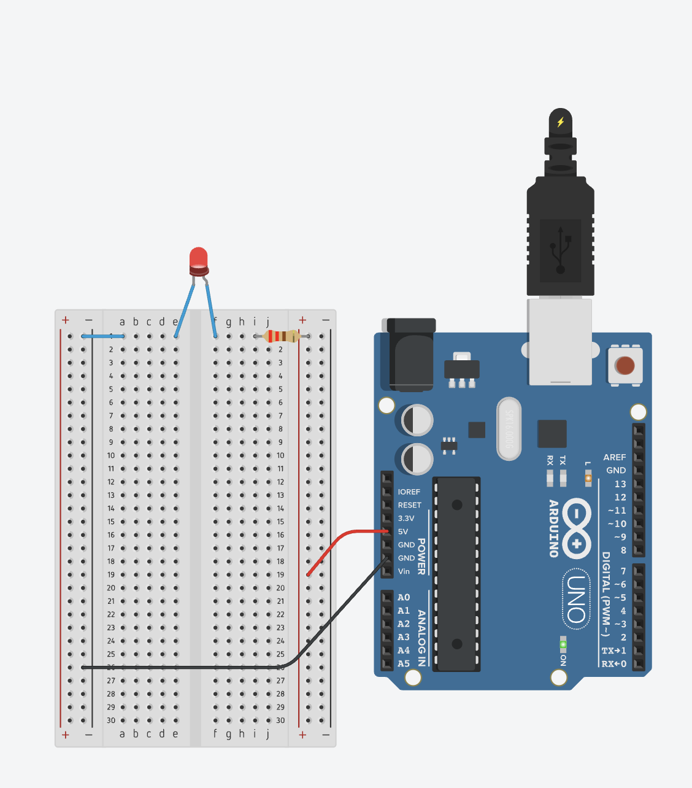
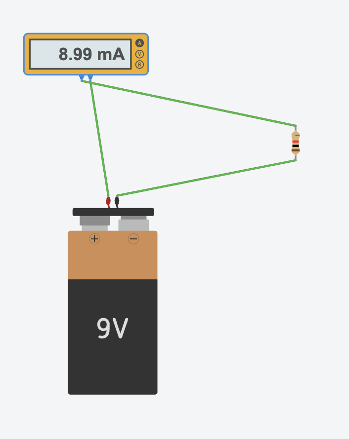
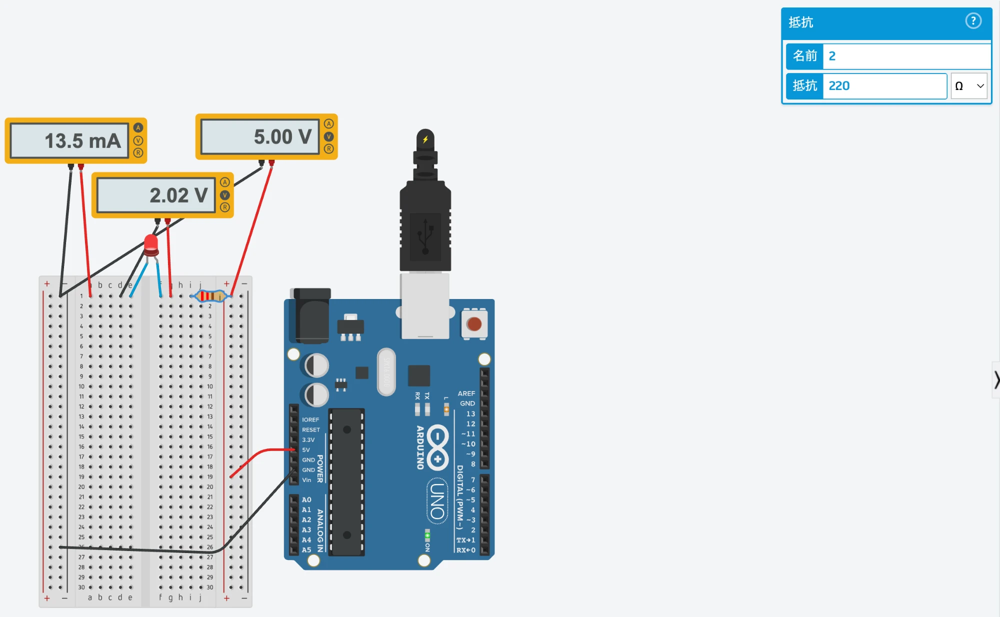

# 第1週 オームの法則・直列並列・電力

- フェーズ：[フェーズ1 電子回路・道具・はんだ付け](../README.md)
- 日：1〜7日目（詳細は [CHECKLIST.md](../CHECKLIST.md#第1週-オームの法則直列並列電力) ）
- ゴール：抵抗が2〜3本の回路の電流・電圧・電力を手で計算し、Tinkercadの仮想テスターで答え合わせできる
- 状態：進行中

日ごとに「やること → 成果物 → 予想 → 結果 → 差の理由」を残します。測定や実験は、やる前に予想を書きます。

## 1日目（月）回路と記号

**やること**（詳細は [チェックリスト](../CHECKLIST.md#第1週-オームの法則直列並列電力)）

- 読む：回路と電気記号と回路を流れる電流と電圧の性質
- Tinkercadにアカウントを作る：Tinkercad Circuits
- 演習：SunFounder「2. 初めての回路」を読み、同じ回路（Arduinoの5V → 220Ω → LED → GND）をTinkercadのブレッドボードで組んで光らせる
- 観察：Falstad オームの法則で、電圧を変えると電流の点の速さが変わることを見る（英語ですが、見るだけで分かります）
- 記録：今日組んだ回路を紙に回路図として描く

**成果物**

- 手描きの回路図

  

- Tinkercad の回路（5V → 220Ω → LED → GND。LED が点灯）

  

**学んだこと**（SunFounder「2. 初めての回路」）

> **ひとことで**：電気は「＋ → 部品 → −」と1周つながったときだけ流れる。LEDには向きがあり、抵抗で電流を抑えて守る。

**① 回路は1周の輪**

電流は電源の＋から出て、部品を通り、−に戻ってくる。輪がつながっていれば流れ、どこか1か所でも切れると止まる。

閉じた回路（LEDが光る）：

```
5V(+) --> [220Ω] --> [LED] --+
  ^                          |
  +-------- GND(-) <---------+
```

開いた回路（LEDが消える）：

```
5V(+) --> [220Ω] --> [LED] --+
  ^                          x      <- 線が1本抜けている
  +-------- GND(-) <---------+
```

| 言葉 | 意味 | この回路では |
| --- | --- | --- |
| ＋（プラス） | 電流が出ていく側 | Arduinoの **5V** ピン |
| −（マイナス）／GND | 電流が戻ってくる側。電圧の基準（0V） | Arduinoの **GND** ピン |
| 閉じた回路 | 輪がつながっている状態 | LEDが光る |
| 開いた回路 | 輪がどこかで切れている状態 | LEDが消える |

**② ブレッドボードの中のつながり**

穴の中に金属の板が入っていて、同じグループの穴どうしは最初からつながっている。はんだ付けなしで回路が組める。

```
 +  -    a b c d e     f g h i j    +  -
 |  |    o-o-o-o-o     o-o-o-o-o    |  |     <- 1行目：a〜e がつながる / f〜j がつながる
 |  |    o-o-o-o-o     o-o-o-o-o    |  |     <- 2行目：1行目とはつながらない
 |  |            ^     ^            |  |
 |  |            e と f の間（溝）はつながらない
 両端のレール：縦の列全体がつながる（5V と GND を配る）
```

| 場所 | つながり方 | 使い道 |
| --- | --- | --- |
| 中央（a〜e、f〜j） | **横**に5つずつ。行が違えば別 | 部品どうしをつなぐ |
| 両端のレール（＋、−） | **縦**に1列全部 | 5V と GND を配る |

**③ LEDには向きがある**

| 足 | 名前 | つなぐ側 | 回路図の記号 |
| --- | --- | --- | --- |
| 長い方 | アノード | ＋側 | 三角の底の側 |
| 短い方 | カソード | −側 | 三角の先の縦線の側 |

電流はアノード → カソードの一方向にしか流れない。**光らないときは、まずLEDを逆向きに挿し直す。**

**④ 抵抗はLEDを守るために入れる**

抵抗は「電流の流れにくさ」を作る部品。抵抗がないとLEDに電流が流れすぎて壊れる。

- 水道にたとえると、抵抗は**ホースを細くする**ようなもの。細いほど流れる水（電流）が少なくなる。
- 抵抗の値は胴体の色の帯で表す。220Ω は **赤・赤・茶**。（赤・赤・黄だと 220kΩ で、LEDはほとんど光らない）

**⑤ そのほかに覚えておくこと**

| 項目 | 内容 |
| --- | --- |
| ショート | 部品を通さずに 5V と GND を直接つなぐこと。大きな電流が流れて熱くなり、壊れたり火が出たりする |
| 電流の向き | 回路図では＋ → −に流れると考える。実際に動く電子は逆向き（− → ＋） |
| 直流（DC） | 向きが一定。Arduino、電池 |
| 交流（AC） | 向きが周期的に入れ替わる。家のコンセント |
| つなぐ順番 | 電源をつなぐときは＋から、外すときは−から |

**予想 → 結果 → 差の理由**

この日は測定なし（回路を組んで LED が光ることを確かめただけ）。

## 2日目（火）オームの法則

**やること**（詳細は [チェックリスト](../CHECKLIST.md#第1週-オームの法則直列並列電力)）

- 読む：抵抗とオームの法則
- 解く：同ページの「オームの法則基本」と「計算1」「計算2」のPDF
- 検証：Tinkercadで9V電池＋1kΩを組み、マルチメーターを電流モードにして測る
- 記録：計算値と測定値の比較表

**成果物**

- Tinkercad の回路（電池の＋ → テスター → 1kΩ → 電池の−。テスターは電流モード）

  

**学んだこと**（まなびの広場「抵抗とオームの法則」と、Tinkercad での測定）

> **ひとことで**：電圧・電流・抵抗の3つは **V = R × I** の1本の式でつながっている。2つ分かれば残りの1つが計算できる。計算の前に、単位を V・A・Ω にそろえる。

**① 抵抗とは「電流の流れにくさ」**

| 言葉 | 記号 | 単位 | 意味 | 水道にたとえると |
| --- | --- | --- | --- | --- |
| 電圧 | V | V（ボルト） | 電流を押し出す力 | 水を押す水圧 |
| 電流 | I | A（アンペア） | 流れる電気の量 | 流れる水の量 |
| 抵抗 | R | Ω（オーム） | 電流の流れにくさ | ホースの細さ |

抵抗の大きさは、物によって大きく違う。

| 種類 | 抵抗 | 例 | 使い道 |
| --- | --- | --- | --- |
| 導体 | 小さい（よく流れる） | 銅などの金属、炭素 | 導線（銅） |
| 不導体（絶縁体） | とても大きい（ほぼ流れない） | プラスチック、ガラス、ゴム | 導線のカバー |
| 抵抗の大きい金属 | 大きめ | ニクロム | 電熱線（熱を出す） |

**② オームの法則：覚える式は1本だけ**

**V = R × I**（電圧 ＝ 抵抗 × 電流）

この式を入れ替えると、求めたいものに合わせて3つの形になる。

| 求めたいもの | 式 | 使う場面 |
| --- | --- | --- |
| 電圧 V | **V = R × I** | 抵抗と電流が分かっている |
| 電流 I | **I = V ÷ R** | 電圧と抵抗が分かっている（今日の測定） |
| 抵抗 R | **R = V ÷ I** | 電圧と電流が分かっている（3日目の測定） |

覚え方：下の三角で、求めたいものを指で隠すと残りが式になる。上下に並んでいれば「÷」、横に並んでいれば「×」。

```
      +-------+
      |   V   |        V を隠す -> R × I
      +---+---+        I を隠す -> V ÷ R
      | R | I |        R を隠す -> V ÷ I
      +---+---+
```

**③ 計算の前に単位をそろえる**

式に入れるときは、必ず **V・A・Ω** に直してから計算する。

| よく出る単位 | 直し方 | 例 |
| --- | --- | --- |
| mA（ミリアンペア） | ÷ 1000 で A にする | 9mA = 0.009A |
| kΩ（キロオーム） | × 1000 で Ω にする | 1kΩ = 1000Ω |
| MΩ（メガオーム） | × 1,000,000 で Ω にする | 1MΩ = 1,000,000Ω |

**④ 今日の回路で計算してみる**

回路：9V電池 → 電流計 → 1kΩ → 電池の−

```
9V(+) --> (A) --> [1kΩ] --+
  ^                       |
  +-------- (-) <---------+
```

| 手順 | やること | 計算 |
| --- | --- | --- |
| 1 | 分かっているものを書き出す | V = 9V、R = 1kΩ |
| 2 | 単位をそろえる | R = 1kΩ = 1000Ω |
| 3 | 求めたいもの（電流）の式を選ぶ | I = V ÷ R |
| 4 | 数字を入れる | I = 9 ÷ 1000 = 0.009A |
| 5 | 読みやすい単位に直す | 0.009A = **9mA** |

**⑤ 計算と測定が少しずれる理由：メーターにも抵抗がある**

計算は 9.00mA、Tinkercad の電流計は 8.99mA だった。

```
9V --> [電流計の中の抵抗 約1Ω] --> [1kΩ] --> (-)
        |------ 合計 約1001Ω ------|
```

- 電流計の中にも小さな抵抗（内部抵抗）があるので、回路全体の抵抗は 1000Ω ではなく約 1001Ω になる。
- 9V ÷ 1001Ω ≒ 0.00899A = **8.99mA** で、測定と一致する。
- 差はわずか 0.1% なので、ふだんの計算ではメーターの抵抗は無視してよい。

**⑥ 電圧と電流は比例する**

抵抗が同じなら、電圧を2倍にすると電流も2倍になる（I = V ÷ R で、R が一定だから）。

| 電圧（1kΩのとき） | 電流 |
| --- | --- |
| 3V | 3mA |
| 6V | 6mA |
| 9V | 9mA |

1日目に Falstad で見た「電圧を上げると電流の点が速く動く」のは、このこと。

**予想 → 結果 → 差の理由**

| 何を測った／試したか | 予想 | 結果 | 差の理由 |
| --- | --- | --- | --- |
| 9V電池 + 1kΩ の電流（Tinkercadの電流計） | 9.00mA（9V ÷ 1000Ω） | 8.99mA | テスターの中に小さな抵抗（内部抵抗、約1Ω）があり、回路全体が約1001Ωになるため |

## 3日目（水）直列回路

**やること**（詳細は [チェックリスト](../CHECKLIST.md#第1週-オームの法則直列並列電力)）

- 読む：直列回路、並列回路の計算の直列部分
- 解く：同ページのPDF 1-1、1-2
- 演習：SunFounder「3. マルチメーターの使い方を学ぶ」の手順を、1日目の回路とTinkercadのマルチメーターで再現する
- 記録：SunFounderの測定例（約5.13V、約13.5mA）と自分のTinkercadの値を並べ、違いの理由を1行

**成果物**

- Tinkercad の回路（1日目の回路にマルチメーターを3台）
  - 電圧（右上、5.00V）：右の＋レールと左の−レール → 回路全体の電圧
  - 電圧（中央、2.02V）：LEDの両足 → LEDにかかる電圧
  - 電流（左、13.5mA）：青い線（a1 → −レール）の代わりに入れて、回路を通る電流
  - 抵抗器（右上の設定欄）：220Ω

  

**測定値**

| 測ったもの | 値 |
| --- | --- |
| 回路全体の電圧 V | 5.00V |
| LEDにかかる電圧 V_LED | 2.02V |
| 回路を流れる電流 I | 13.5mA = 0.0135A |
| 抵抗器 | 220Ω（Tinkercadの設定値） |

**抵抗の計算**（オームの法則 R = V ÷ I）

| 何を求めるか | 式 | 答え |
| --- | --- | --- |
| ① 回路全体の抵抗 | 5.00V ÷ 0.0135A | 約 **370Ω** |
| ② LEDの分 | ① − 抵抗器 = 370Ω − 220Ω | 約 **150Ω** |
| 答え合わせ：LEDの電圧から | 2.02V ÷ 0.0135A | 約 150Ω（②と一致） |
| 答え合わせ：抵抗器の電圧から | (5.00V − 2.02V) ÷ 0.0135A = 2.98V ÷ 0.0135A | 約 221Ω（設定値の220Ωと一致） |

計算のコツ：電流は **mA を A に直してから**割る（13.5mA = 0.0135A）。

**学んだこと**（SunFounder「3. マルチメーターの使い方を学ぶ」）

> **ひとことで**：マルチメーターは「何を測るか」でモードとつなぎ方が変わる。抵抗だけは電源を切って測る。LEDのような部品の抵抗は、電圧と電流を測って R = V ÷ I で計算する。

**① マルチメーターの3つのモード**

測る前に、まずモードを選ぶ。モードを間違えると「Error」が出たり、回路を壊したりする。

| モード | 測るもの | つなぎ方 | 回路の電源 | たとえ（水道） |
| --- | --- | --- | --- | --- |
| 電圧（V） | 2点の間の電圧 | 部品の両端に**横から当てる**。回路は切らない | 入れたまま | 2か所の水圧の差を見る |
| 電流（A） | 回路を流れる電流 | 回路を1か所切り、すき間に**メーターをはさむ** | 入れたまま | 管の途中に流量計をはさむ |
| 抵抗（R） | 部品の抵抗値 | 部品だけを取り出して両端に当てる | **切る** | 水を止めてから管の細さを調べる |

**② 電圧計と電流計のつなぎ方の違い**

電圧計（V）：回路は切らずに、測りたい部品の両端に当てる。

```
5V --> [220Ω] --+--> [LED] --+--> GND
                |            |
                +----(V)-----+      <- LEDの両端の電圧を見る
```

電流計（A）：回路を1か所切って、すき間にメーターをはさむ。

```
5V --> [220Ω] --> [LED] --x  x--> GND     <- x の所で線を切る
                          |  |
                          +(A)+           <- 電流がメーターの中を通る
```

- 電流は回路を1周して流れるので、**メーターの中を通らないと測れない**。
- 直列回路（1本道の回路）では、電流はどこでも同じ。だから、どこを切ってメーターを入れても同じ 13.5mA になる。

**③ 抵抗モードは電源を切って使う**

抵抗モードのメーターは、次の手順で抵抗を出している。

1. メーター**自身の電池**から、決まった小さな電流を部品に流す
2. そのとき部品の両端に出た電圧を測る
3. R = V ÷ I で抵抗を計算する

回路の電源が入っていると、Arduinoからの電流も混ざって計算が狂う。だから「Error」になる。**実物のマルチメーターでも同じ**で、抵抗は電源を切ってから、できれば部品を回路から外して測る。

> たとえ：誰かが上から手で押している体重計に乗っても、正しい体重は出ない。手（電源）をどけてから測る。

**④ LEDの抵抗は計算で出す**

LEDは、約2V かからないと電流をほとんど流さない。抵抗モードのメーターが流す電圧は低いので、LEDに当てても正しい値が出ない。そこで、光っている状態で電圧と電流を測り、オームの法則で計算する。

| 分かっていること | 求めるもの | 式 |
| --- | --- | --- |
| 電圧 V と電流 I | 抵抗 R | **R = V ÷ I** |

LEDの「抵抗」は、流れる電流によって変わる。今回の 150Ω は「13.5mA 流れているときだけの値」で、抵抗器の 220Ω のように決まった値ではない。

**⑤ 直列回路では、電圧を部品で分け合う**

```
5.00V --> [220Ω] --> [LED] --> GND
           2.98V      2.02V
          |-- 合計 5.00V --|
```

電源の 5.00V を、抵抗器が 2.98V、LEDが 2.02V と分け合っている。足すと電源の電圧に戻る。

**⑥ 抵抗器がないと電流が増えすぎる（失敗から分かったこと）**

電源が入ったまま、抵抗モードのメーターを抵抗器の両端に当てたら、メーターが抵抗器の「迂回路」になった。

| | 電流 | LEDの電圧 | LED |
| --- | --- | --- | --- |
| ふつう（抵抗器が効いている） | 13.5mA | 2.02V | 光る |
| 迂回した（抵抗器が効いていない） | **319mA**（約24倍） | 4.00V | **壊れた** |

抵抗器が電流を抑えてLEDを守っていたことが、目で見て分かった。

**SunFounder との比較**

| | 電圧 | 電流 | 回路全体の抵抗 | 抵抗器 | LEDの分 |
| --- | --- | --- | --- | --- | --- |
| SunFounder（実物） | 5.13V | 13.54mA | 5.13 ÷ 0.01354 ≒ 379Ω | 215Ω（実測） | 379 − 215 ≒ 164Ω |
| Tinkercad | 5.00V | 13.5mA | 5.00 ÷ 0.0135 ≒ 370Ω | 220Ω（設定値） | 370 − 220 = 150Ω |

違いの理由：実物のUSB電源は5Vより少し高く、抵抗器にも誤差（実測215Ω）があるが、Tinkercadは5.00Vと220Ωちょうどの理想値で計算するため。

**予想 → 結果 → 差の理由**

| 何を測った／試したか | 予想 | 結果 | 差の理由 |
| --- | --- | --- | --- |
| 回路を流れる電流 | 約13.5mA（(5V − 2.02V) ÷ 220Ω） | 13.5mA | 差なし |
| 回路全体の抵抗 | SunFounderの約379Ω | 約370Ω | 電源電圧（5.13V と 5.00V）と抵抗器の値（215Ω と 220Ω）が違うため |

## 4日目（木）並列回路と合成抵抗

**やること**（詳細は [チェックリスト](../CHECKLIST.md#第1週-オームの法則直列並列電力)）

- 読む：回路全体の抵抗とMONOist 電子工作“超”入門(4) キルヒホッフの法則の合成抵抗の部分
- 演習：SunFounder「4. オームの法則」の実験をTinkercadで行う
- 演習：SunFounder「5. 直列回路と並列回路」の回路をTinkercadで組み、直列と並列でLEDにかかる電圧を比べる
- 記録：「直列で1個壊れると全部消え、並列だと残りが光る」理由を自分の言葉で2行

**成果物**

- 

**予想 → 結果 → 差の理由**

| 何を測った／試したか | 予想 | 結果 | 差の理由 |
| --- | --- | --- | --- |
| | | | |

## 5日目（金）電力

**やること**（詳細は [チェックリスト](../CHECKLIST.md#第1週-オームの法則直列並列電力)）

- 読む：電力と電力量
- 解く：同ページのPDF 2枚
- 計算：2日目の回路（9V、1kΩ）で抵抗が消費する電力を求め、1/4W抵抗で足りるかを判断する
- 観察：Falstad 抵抗の例題で、抵抗値ごとの電流の違いを見る

**成果物**

- 

**予想 → 結果 → 差の理由**

| 何を測った／試したか | 予想 | 結果 | 差の理由 |
| --- | --- | --- | --- |
| | | | |

## 6日目（土）まとめと遅れの取り戻し

**やること**（詳細は [チェックリスト](../CHECKLIST.md#第1週-オームの法則直列並列電力)）

- 解く：いろいろな回路の計算とまとめ、総合問題
- 間違えた問題だけTinkercadで組んで確かめる
- 読む：Arrow「抵抗のカラーコードの読み方」
- 練習：Tinkercadで抵抗を5本置き、値を見ないで色の帯だけから抵抗値を当てる
- `week1/README.md` に比較表と回路図の写真を置く

**成果物**

- 

**予想 → 結果 → 差の理由**

| 何を測った／試したか | 予想 | 結果 | 差の理由 |
| --- | --- | --- | --- |
| | | | |

## 何が壊れてどう直したか

うまくいかなかったことを、症状・原因・直し方の順に書きます。この週で一番大事な節です。

-

## 分からなかったこと・あとで調べること

-
