# 第1週 オームの法則・直列並列・電力

- フェーズ：[フェーズ1 電子回路・道具・はんだ付け](../README.md)
- 日：1〜7日目（詳細は [CHECKLIST.md](../CHECKLIST.md#第1週-オームの法則直列並列電力) ）
- ゴール：抵抗が2〜3本の回路の電流・電圧・電力を手で計算し、Tinkercadの仮想テスターで答え合わせできる
- 状態：完了

日ごとに「やること → 成果物 → 予想 → 結果 → 差の理由」を残します。測定や実験は、やる前に予想を書きます。

## 1日目 回路と記号

> **ひとことで**：電気は「＋ → 部品 → −」と1周つながったときだけ流れる。LEDには向きがあり、抵抗で電流を抑えて守る。

やることの詳細は[チェックリスト](../CHECKLIST.md#第1週-オームの法則直列並列電力)。チェックリストと同じ順に、やったことと分かったことを並べる。

### 1. 読む：[回路と電気記号](https://chugaku.manabihiroba.net/rika/kairo.html)と[回路を流れる電流と電圧の性質](https://chugaku.manabihiroba.net/rika/denryudenatus.html)

読んだページについている練習プリントで確かめた。

> **解き方の型**：直列は「電流はどこも同じ、電圧は足し算」。並列は「電圧はどこも同じ、電流は足し算」。この2つで、この日の問題はすべて解ける。

**A. 回路図と電気図記号**（[PDF](https://chugaku.manabihiroba.net/wp/wp-content/uploads/2018/05/kigotokairo1.pdf)）

| 問題 | 答え | ひとこと |
| --- | --- | --- |
| [1] 電流が流れるひとまわりの道筋を何というか | **回路** | 1日目の「輪」のこと |
| [1] 電流の向きは（ ）極から（ ）極へ流れると決められている | **＋** 極から **−** 極 | 実際の電子は逆向き |
| [2] 下の記号は何を表すか | ① **スイッチ** ② **抵抗器** ③ **電池** ④ **電流計** ⑤ **電圧計** ⑥ **電球** | 下の表を参照 |
| [3]① 電球2個を1本道でつないだ回路（図1）を何というか | **直列回路** | |
| [3]② 電球2個を枝分かれさせてつないだ回路（図2）を何というか | **並列回路** | |
| [3]③ 図1・図2を電気図記号で書く | 下の図 | |

| 記号の見た目 | 名前 |
| --- | --- |
| 線が途中で斜めに開いている | スイッチ |
| 長方形（四角） | 抵抗器 |
| 長い線（＋）と短い線（−）が向かい合う | 電池 |
| 丸の中に A | 電流計 |
| 丸の中に V | 電圧計 |
| 丸の中に × | 電球 |

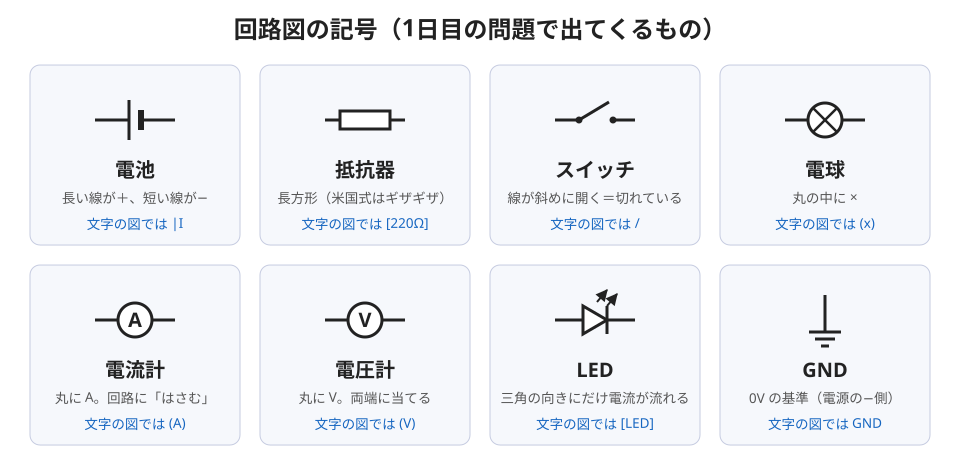

このノートでは、回路を文字だけで描くこともある。そのときの書き方は、図の青い字（例：電池は `|I`、電流計は `(A)`）。

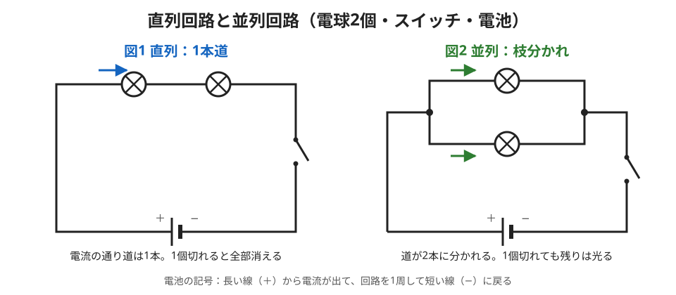

**B. 電流と電圧の性質 1-1**（[PDF](https://chugaku.manabihiroba.net/wp/wp-content/uploads/2018/05/denryudenatu1.pdf)）

[1] 豆電球 A・B を、図1は直列（電流計 0.6A）、図2は並列（全体 0.8A、B の枝 0.3A）でつないだ。

| 問題 | 答え | 考え方 |
| --- | --- | --- |
| ① 図1・図2はそれぞれ何回路か | 図1 **直列回路**、図2 **並列回路** | |
| ② 片方の豆電球が切れると、もう1個も消えるのはどちらか | **図1**（直列） | 通り道が1本だけだから |
| ③ 図1で B を流れる電流 | **0.6A** | 直列は電流がどこでも同じ |
| ④ 図2で B を流れる電流 | **0.3A**（プリントの解答は 0.5A） | 図では 0.3A の測定点が B の枝の上にあるので、B は 0.3A。0.8 − 0.3 = 0.5A は A の枝の電流 |

> 注意：④ はプリントの解答が「0.8 − 0.3 = 0.5A」になっている。図では 0.3A の点が B の枝にあるので、B は 0.3A、A が 0.5A のはず（解答の誤り、または図の書き間違い）。並列では「枝の電流を足すと全体（0.3 + 0.5 = 0.8A）」になることを確かめる問題。

[2] 図1は豆電球2個の直列（3.0V と 2.0V）、図2は並列（電源 8.0V）。

| 問題 | 答え | 考え方 |
| --- | --- | --- |
| ① 図1のア・イ間（2個の両端）の電圧 | 3.0 + 2.0 = **5.0V** | 直列は電圧の足し算 |
| ② 図2のウ・エ間（下の電球の両端）の電圧 | **8.0V** | 並列はどの枝も電源と同じ |

**C. 回路と電流・電圧 1**（[PDF](https://chugaku.manabihiroba.net/wp/wp-content/uploads/2018/05/kairodennryudenatu1.pdf)）

空欄の電流や電圧を、単位に注意して答える。

| 番号 | 回路 | 分かっていること | 答え | 考え方 |
| --- | --- | --- | --- | --- |
| ① | 直列（抵抗2個） | 回路の1か所で 0.2A | 抵抗の間も **0.2A** | 直列は電流がどこでも同じ |
| ② | 並列（2本の枝） | 全体 0.6A、上の枝 0.4A | 下の枝 **0.2A** | 0.6 − 0.4 |
| ③ | 直列 | 抵抗の間で 0.5A | **500mA** | 同じ 0.5A を mA に直す（×1000） |
| ④ | 並列 | 全体 450mA、上の枝 300mA | 下の枝 **0.15A**（= 150mA） | 450 − 300 = 150mA。空欄の単位が A なので 0.15A |
| ⑤ | 直列 | 電源 30V、右の抵抗 20V | 左の抵抗 **10V** | 30 − 20 |
| ⑥ | 並列 | 電源 6V | 下の枝 **6V** | 並列はどの枝も電源と同じ |
| ⑦ | 直列 | 抵抗が 3V と 5V | 電源 **8V** | 3 + 5 |
| ⑧ | 並列 | 上の枝 5.4V | 電源・下の枝とも **5.4V** | 並列はどこも同じ |

### 2. Tinkercad にアカウントを作る：[Tinkercad Circuits](https://www.tinkercad.com/circuits)

作成済み。

### 3. 演習：[SunFounder「2. 初めての回路」](https://docs.sunfounder.com/projects/inventor-lab-kit/ja/latest/lessons/2_first_circuit.html)の回路を Tinkercad で組んで光らせる

**成果物**：5V → 220Ω → LED → GND。LED が点灯した。


**学んだこと**

**① 回路は1周の輪**

電流は電源の＋から出て、部品を通り、−に戻ってくる。輪がつながっていれば流れ、どこか1か所でも切れると止まる。

閉じた回路（LEDが光る）：

```
5V(+) --> [220Ω] --> [LED] --+
  ^                          |
  +-------- GND(-) <---------+
```

開いた回路（LEDが消える）：

```
5V(+) --> [220Ω] --> [LED] --+
  ^                          x      <- 線が1本抜けている
  +-------- GND(-) <---------+
```

| 言葉 | 意味 | この回路では |
| --- | --- | --- |
| ＋（プラス） | 電流が出ていく側 | Arduinoの **5V** ピン |
| −（マイナス）／GND | 電流が戻ってくる側。電圧の基準（0V） | Arduinoの **GND** ピン |
| 閉じた回路 | 輪がつながっている状態 | LEDが光る |
| 開いた回路 | 輪がどこかで切れている状態 | LEDが消える |

**② ブレッドボードの中のつながり**

穴の中に金属の板が入っていて、同じグループの穴どうしは最初からつながっている。はんだ付けなしで回路が組める。

```
 +  -    a b c d e     f g h i j    +  -
 |  |    o-o-o-o-o     o-o-o-o-o    |  |     <- 1行目：a〜e がつながる / f〜j がつながる
 |  |    o-o-o-o-o     o-o-o-o-o    |  |     <- 2行目：1行目とはつながらない
 |  |            ^     ^            |  |
 |  |            e と f の間（溝）はつながらない
 両端のレール：縦の列全体がつながる（5V と GND を配る）
```

| 場所 | つながり方 | 使い道 |
| --- | --- | --- |
| 中央（a〜e、f〜j） | **横**に5つずつ。行が違えば別 | 部品どうしをつなぐ |
| 両端のレール（＋、−） | **縦**に1列全部 | 5V と GND を配る |

**③ LEDには向きがある**

| 足 | 名前 | つなぐ側 | 回路図の記号 |
| --- | --- | --- | --- |
| 長い方 | アノード | ＋側 | 三角の底の側 |
| 短い方 | カソード | −側 | 三角の先の縦線の側 |

電流はアノード → カソードの一方向にしか流れない。**光らないときは、まずLEDを逆向きに挿し直す。**

**④ 抵抗はLEDを守るために入れる**

抵抗は「電流の流れにくさ」を作る部品。抵抗がないとLEDに電流が流れすぎて壊れる。

- 水道にたとえると、抵抗は**ホースを細くする**ようなもの。細いほど流れる水（電流）が少なくなる。
- 抵抗の値は胴体の色の帯で表す。220Ω は **赤・赤・茶**。（赤・赤・黄だと 220kΩ で、LEDはほとんど光らない）

**⑤ そのほかに覚えておくこと**

| 項目 | 内容 |
| --- | --- |
| ショート | 部品を通さずに 5V と GND を直接つなぐこと。大きな電流が流れて熱くなり、壊れたり火が出たりする |
| 電流の向き | 回路図では＋ → −に流れると考える。実際に動く電子は逆向き（− → ＋） |
| 直流（DC） | 向きが一定。Arduino、電池 |
| 交流（AC） | 向きが周期的に入れ替わる。家のコンセント |
| つなぐ順番 | 電源をつなぐときは＋から、外すときは−から |

### 4. 観察：[Falstad オームの法則](https://www.falstad.com/circuit/e-ohms.html)で、電圧と電流の点の速さを見る

電圧を上げると、電流を表す点が速く動いた。電圧が大きいほど電流が多く流れる（2日目の「電圧と電流は比例する」につながる）。

### 5. 記録：今日組んだ回路を紙に回路図として描く


### この日のまとめ：予想 → 結果 → 差の理由

この日は測定なし（回路を組んで LED が光ることを確かめただけ）。

## 2日目 オームの法則

> **ひとことで**：電圧・電流・抵抗の3つは **V = R × I** の1本の式でつながっている。2つ分かれば残りの1つが計算できる。計算の前に、単位を V・A・Ω にそろえる。

やることの詳細は[チェックリスト](../CHECKLIST.md#第1週-オームの法則直列並列電力)。

### 1. 読む：[抵抗とオームの法則](https://chugaku.manabihiroba.net/rika/ohmhousoku.html)

**学んだこと**

**① 抵抗とは「電流の流れにくさ」**

| 言葉 | 記号 | 単位 | 意味 | 水道にたとえると |
| --- | --- | --- | --- | --- |
| 電圧 | V | V（ボルト） | 電流を押し出す力 | 水を押す水圧 |
| 電流 | I | A（アンペア） | 流れる電気の量 | 流れる水の量 |
| 抵抗 | R | Ω（オーム） | 電流の流れにくさ | ホースの細さ |

抵抗の大きさは、物によって大きく違う。

| 種類 | 抵抗 | 例 | 使い道 |
| --- | --- | --- | --- |
| 導体 | 小さい（よく流れる） | 銅などの金属、炭素 | 導線（銅） |
| 不導体（絶縁体） | とても大きい（ほぼ流れない） | プラスチック、ガラス、ゴム | 導線のカバー |
| 抵抗の大きい金属 | 大きめ | ニクロム | 電熱線（熱を出す） |

**② オームの法則：覚える式は1本だけ**

**V = R × I**（電圧 ＝ 抵抗 × 電流）

この式を入れ替えると、求めたいものに合わせて3つの形になる。

| 求めたいもの | 式 | 使う場面 |
| --- | --- | --- |
| 電圧 V | **V = R × I** | 抵抗と電流が分かっている |
| 電流 I | **I = V ÷ R** | 電圧と抵抗が分かっている（今日の測定） |
| 抵抗 R | **R = V ÷ I** | 電圧と電流が分かっている（3日目の測定） |

覚え方：下の三角で、求めたいものを指で隠すと残りが式になる。上下に並んでいれば「÷」、横に並んでいれば「×」。

```
      +-------+
      |   V   |        V を隠す -> R × I
      +---+---+        I を隠す -> V ÷ R
      | R | I |        R を隠す -> V ÷ I
      +---+---+
```

**③ 計算の前に単位をそろえる**

式に入れるときは、必ず **V・A・Ω** に直してから計算する。

| よく出る単位 | 直し方 | 例 |
| --- | --- | --- |
| mA（ミリアンペア） | ÷ 1000 で A にする | 9mA = 0.009A |
| kΩ（キロオーム） | × 1000 で Ω にする | 1kΩ = 1000Ω |
| MΩ（メガオーム） | × 1,000,000 で Ω にする | 1MΩ = 1,000,000Ω |

**④ 電圧と電流は比例する**

抵抗が同じなら、電圧を2倍にすると電流も2倍になる（I = V ÷ R で、R が一定だから）。

| 電圧（1kΩのとき） | 電流 |
| --- | --- |
| 3V | 3mA |
| 6V | 6mA |
| 9V | 9mA |

1日目に Falstad で見た「電圧を上げると電流の点が速く動く」のは、このこと。

### 2. 解く：同ページの「オームの法則基本」と「計算1」「計算2」の PDF

> **解き方の型**：① 分かっているもの（V・I・R）を書き出す → ② **mA は ÷1000 で A、kΩ は ×1000 で Ω** に直す → ③ 求めたいものの式（V = R × I、I = V ÷ R、R = V ÷ I）に入れる → ④ 聞かれた単位に直す。

**A. 抵抗とオームの法則基本 NO.1**（[PDF](https://chugaku.manabihiroba.net/wp/wp-content/uploads/2016/07/ohmkihon1.pdf)）

| 問題 | 答え |
| --- | --- |
| ① 電流が流れる金属などの物質を何というか | **導体** |
| ② ①の金属でできた、電流を流すための線を何というか | **導線** |
| ③ 電流が流れないプラスチック・ガラス・ゴムなどを何というか | **不導体（絶縁体）** |
| ④ 電流の流れにくさを何というか | **抵抗** |
| ⑤ 電圧と電流の強さにはどんな関係があるか | **比例** |
| ⑥ ⑤の関係の法則の名前 | **オームの法則** |
| ⑦ 抵抗 R(Ω) に電圧 E(V) を加えて電流 I(A) が流れるときの関係 | **I = E ÷ R** |
| ⑧ 電熱線に 8V を加えたら 0.4A 流れた。抵抗は何Ωか | R = 8 ÷ 0.4 = **20Ω** |

> このプリントでは電圧を **E** と書いている。V と同じ意味（E = 起電力）。

**B. 抵抗とオームの法則基本 NO.2**（[PDF](https://chugaku.manabihiroba.net/wp/wp-content/uploads/2016/07/ohmkihon.pdf)）

[1] 電熱線に電圧を加えて電流を測ったら、次の表になった。

| 電圧（V） | 1.0 | 2.0 | 4.0 | 6.0 | 8.0 |
| --- | --- | --- | --- | --- | --- |
| 電流（A） | 0.1 | 0.2 | 0.4 | 0.6 | 0.8 |

| 問題 | 答え | 考え方 |
| --- | --- | --- |
| ① 電流と電圧にはどんな関係があるか | **比例関係** | 電圧が2倍なら電流も2倍 |
| ② ①の関係を何の法則というか | **オームの法則** | |
| ③ 電圧を 5V にしたときの電流 | **0.5A** | 表から 1V あたり 0.1A |
| ④ 電熱線の抵抗 | 1.0 ÷ 0.1 = **10Ω** | どの列で割っても 10Ω |

[2] ある電熱線に 3V を加えると 0.2A 流れる。

| 問題 | 答え |
| --- | --- |
| ① 抵抗は何Ωか | 3 ÷ 0.2 = **15Ω** |
| ② 6V を加えたときの電流 | 6 ÷ 15 = **0.4A** |
| ③ 1A 流れているときの電圧 | 1 × 15 = **15V** |

**C. オームの法則 計算1 NO.1**（[PDF](https://chugaku.manabihiroba.net/wp/wp-content/uploads/2016/07/ohm1_1-1.pdf)）

| 問題 | 式 | 答え |
| --- | --- | --- |
| ① 20Ω に 0.2A 流れているときの電圧 | V = 20 × 0.2 | **4V** |
| ② 電熱線に 1.8V で 0.3A 流れた。抵抗は | R = 1.8 ÷ 0.3 | **6Ω** |
| ③ 30Ω に 15V を加えたときの電流 | I = 15 ÷ 30 | **0.5A** |
| ④ 20Ω に 0.4A 流すのに必要な電圧 | V = 20 × 0.4 | **8V** |
| ⑤ 2V の電源に 10Ω をつないだときの電流 | I = 2 ÷ 10 | **0.2A** |
| ⑥ 電熱線を 3V につないだら 0.3A 流れた。抵抗は | R = 3 ÷ 0.3 | **10Ω** |

**D. オームの法則 計算1 NO.2**（[PDF](https://chugaku.manabihiroba.net/wp/wp-content/uploads/2016/07/ohm1_2-1.pdf)）

| 問題 | 式 | 答え |
| --- | --- | --- |
| ① 30Ω に 0.1A 流れているときの電圧 | V = 30 × 0.1 | **3V** |
| ② 電熱線に 6.4V で 0.4A 流れた。抵抗は | R = 6.4 ÷ 0.4 | **16Ω** |
| ③ 5Ω に 3V を加えたときの電流 | I = 3 ÷ 5 | **0.6A** |
| ④ 15Ω に 0.3A 流すのに必要な電圧 | V = 15 × 0.3 | **4.5V** |
| ⑤ 8V の電源に 10Ω をつないだときの電流 | I = 8 ÷ 10 | **0.8A** |
| ⑥ 電熱線を 8V につないだら 0.6A 流れた。抵抗は | R = 8 ÷ 0.6 | **約 13.3Ω** |

> 注意：⑥ はプリントの解答が「8.4 ÷ 0.6 = 14Ω」になっている。問題文は 8V なので、正しくは 8 ÷ 0.6 ≒ **13.3Ω**（解答の誤り）。

**E. オームの法則 計算2 NO.1**（[PDF](https://chugaku.manabihiroba.net/wp/wp-content/uploads/2016/07/ohm2_1-1.pdf)）：単位の直しが入る問題

| 問題 | 単位を直す | 式 | 答え |
| --- | --- | --- | --- |
| ① 30Ω に 200mA 流れているときの電圧 | 200mA = 0.2A | V = 30 × 0.2 | **6V** |
| ② 電熱線に 12V で 600mA 流れた。抵抗は | 600mA = 0.6A | R = 12 ÷ 0.6 | **20Ω** |
| ③ 25Ω に 5V を加えたときの電流（mA で） | | I = 5 ÷ 25 = 0.2A | **200mA** |
| ④ 15Ω に 300mA 流すのに必要な電圧 | 300mA = 0.3A | V = 15 × 0.3 | **4.5V** |
| ⑤ 3.6V の電源に 9Ω をつないだときの電流（mA で） | | I = 3.6 ÷ 9 = 0.4A | **400mA** |
| ⑥ 電熱線を 3V につないだら 200mA 流れた。抵抗は | 200mA = 0.2A | R = 3 ÷ 0.2 | **15Ω** |

**F. オームの法則 計算2 NO.2**（[PDF](https://chugaku.manabihiroba.net/wp/wp-content/uploads/2016/07/ohm2_2-1.pdf)）

| 問題 | 単位を直す | 式 | 答え |
| --- | --- | --- | --- |
| ① 20Ω に 300mA 流れているときの電圧 | 300mA = 0.3A | V = 20 × 0.3 | **6V** |
| ② 電熱線に 10V で 400mA 流れた。抵抗は | 400mA = 0.4A | R = 10 ÷ 0.4 | **25Ω** |
| ③ 25Ω に 6V を加えたときの電流（mA で） | | I = 6 ÷ 25 = 0.24A | **240mA** |
| ④ 12Ω に 650mA 流すのに必要な電圧 | 650mA = 0.65A | V = 12 × 0.65 | **7.8V** |
| ⑤ 4.2V の電源に 20Ω をつないだときの電流（mA で） | | I = 4.2 ÷ 20 = 0.21A | **210mA** |
| ⑥ 電熱線を 5V につないだら 250mA 流れた。抵抗は | 250mA = 0.25A | R = 5 ÷ 0.25 | **20Ω** |

> 注意：プリントの解答の途中式が ④「12 × 0.7」、⑥「5 ÷ 0.3」になっているが、正しくは ④ 12 × 0.65、⑥ 5 ÷ 0.25。答え（7.8V、20Ω）は合っている。

（同じページの「グラフを使った問題」はチェックリストの範囲外なのでやっていない）

### 3. 検証：Tinkercad で 9V 電池 ＋ 1kΩ を組み、電流モードで測る

**成果物**：電池の＋ → テスター（電流モード）→ 1kΩ → 電池の−


**学んだこと**

**① 今日の回路で計算してみる**

回路：9V電池 → 電流計 → 1kΩ → 電池の−

```
9V(+) --> (A) --> [1kΩ] --+
  ^                       |
  +-------- (-) <---------+
```

| 手順 | やること | 計算 |
| --- | --- | --- |
| 1 | 分かっているものを書き出す | V = 9V、R = 1kΩ |
| 2 | 単位をそろえる | R = 1kΩ = 1000Ω |
| 3 | 求めたいもの（電流）の式を選ぶ | I = V ÷ R |
| 4 | 数字を入れる | I = 9 ÷ 1000 = 0.009A |
| 5 | 読みやすい単位に直す | 0.009A = **9mA** |

**② 計算と測定が少しずれる理由：メーターにも抵抗がある**

計算は 9.00mA、Tinkercad の電流計は 8.99mA だった。

```
9V --> [電流計 約1Ω] --> [1kΩ] --> 電池の−
```

電流計の約 1Ω と 1kΩ（1000Ω）が直列なので、合計は約 1001Ω。

- 電流計の中にも小さな抵抗（内部抵抗）があるので、回路全体の抵抗は 1000Ω ではなく約 1001Ω になる。
- 9V ÷ 1001Ω ≒ 0.00899A = **8.99mA** で、測定と一致する。
- 差はわずか 0.1% なので、ふだんの計算ではメーターの抵抗は無視してよい。

### 4. 記録：計算値と測定値の比較表（予想 → 結果 → 差の理由）

| 何を測った／試したか | 予想 | 結果 | 差の理由 |
| --- | --- | --- | --- |
| 9V電池 + 1kΩ の電流（Tinkercadの電流計） | 9.00mA（9V ÷ 1000Ω） | 8.99mA | テスターの中に小さな抵抗（内部抵抗、約1Ω）があり、回路全体が約1001Ωになるため |

## 3日目 直列回路

> **ひとことで**：マルチメーターは「何を測るか」でモードとつなぎ方が変わる。抵抗だけは電源を切って測る。LEDのような部品の抵抗は、電圧と電流を測って R = V ÷ I で計算する。

やることの詳細は[チェックリスト](../CHECKLIST.md#第1週-オームの法則直列並列電力)。

### 1. 読む：[直列回路、並列回路の計算](https://chugaku.manabihiroba.net/rika/tyokuretuheiretukeisann.html)の直列部分

**要点**：直列回路は電流の通り道が1本なので、**電流はどこでも同じ**。電源の電圧は各抵抗で**分け合い、足すと電源の電圧**になる。回路全体の抵抗は**各抵抗の足し算**。

### 2. 解く：同ページの PDF 1-1、1-2

> **解き方の型**：まず「直列か並列か」を見る。直列なら電流が全部同じなので、**電流から各抵抗の電圧を出して足す**。並列なら電圧が全部同じなので、**電圧から各枝の電流を出して足す**。最後に「回路全体の抵抗 = 電源の電圧 ÷ 全体の電流」。

**A. 直列回路、並列回路の計算1 NO.1**（[PDF](https://chugaku.manabihiroba.net/wp/wp-content/uploads/2018/06/tyokuretuheiretu1_1.pdf)）

[1] 直列回路

```
+--[20Ω]--[40Ω]--+
|               (A) 0.3A
+-------|I-------+
```

| 問題 | 式 | 答え |
| --- | --- | --- |
| ① 20Ω に流れる電流 | 直列は電流が同じ | **0.3A** |
| ② 40Ω に加わる電圧 | 0.3 × 40 | **12V** |
| ③ 電源の電圧 | 20Ω の電圧 0.3 × 20 = 6V、6 + 12 | **18V** |
| ④ 回路全体の抵抗 | 18 ÷ 0.3（= 20 + 40） | **60Ω** |

> 注意：プリントの解答では ② が「0.3 × 20 = 6V」（20Ω の電圧）になっている。問題は 40Ω の電圧なので、正しくは **12V**。

[2] 並列回路（電源 3V）

```
   +--[15Ω]--+
+--+         +--+
|  +--[30Ω]--+  * ア
+------|I-------+
         3V
```

| 問題 | 式 | 答え |
| --- | --- | --- |
| ① 15Ω に加わる電圧 | 並列は電源と同じ | **3V** |
| ② 30Ω に流れる電流 | 3 ÷ 30 | **0.1A** |
| ③ アを流れる電流（全体） | 15Ω の電流 3 ÷ 15 = 0.2A、0.1 + 0.2 | **0.3A** |
| ④ 回路全体の抵抗 | 3 ÷ 0.3 | **10Ω** |

> 並列の合成抵抗の式でも確かめられる：(15 × 30) ÷ (15 + 30) = 450 ÷ 45 = 10Ω。並列にすると、どちらの抵抗よりも小さくなる。

**B. 直列回路、並列回路の計算1 NO.2**（[PDF](https://chugaku.manabihiroba.net/wp/wp-content/uploads/2018/06/tyokuretuheiretu1_2.pdf)）

[1] 直列回路（R にかかる電圧 3V、電流計 0.2A）

```
+--[ R ]--[10Ω]--+
    3V          (A) 0.2A
+-------|I-------+
```

| 問題 | 式 | 答え |
| --- | --- | --- |
| ① 10Ω に流れる電流 | 直列は電流が同じ | **0.2A** |
| ② R の大きさ | 3 ÷ 0.2 | **15Ω** |
| ③ 電源の電圧 | 10Ω の電圧 0.2 × 10 = 2V、3 + 2 | **5V** |
| ④ 回路全体の抵抗 | 5 ÷ 0.2（= 15 + 10） | **25Ω** |

[2] 並列回路（電源 6V、全体 0.5A）

```
   +--[15Ω]--+
+--+         +--+
|  +--[ R ]--+ (A) 0.5A
+------|I-------+
         6V
```

| 問題 | 式 | 答え |
| --- | --- | --- |
| ① 15Ω に加わる電圧 | 並列は電源と同じ | **6V** |
| ② 回路全体の抵抗 | 6 ÷ 0.5 | **12Ω** |
| ③ 15Ω に流れる電流 | 6 ÷ 15 | **0.4A** |
| ④ R に流れる電流 | 0.5 − 0.4 | **0.1A** |
| ⑤ R の大きさ | 6 ÷ 0.1 | **60Ω** |

> 確かめ：(15 × 60) ÷ (15 + 60) = 900 ÷ 75 = 12Ω で、② と一致する。

（同じページの「計算2」の PDF はチェックリストの範囲外なのでやっていない）

### 3. 演習：[SunFounder「3. マルチメーターの使い方を学ぶ」](https://docs.sunfounder.com/projects/inventor-lab-kit/ja/latest/lessons/3_multimeter.html)の手順を Tinkercad で再現する

**成果物**

- Tinkercad の回路（1日目の回路にマルチメーターを3台）
  - 電圧（右上、5.00V）：右の＋レールと左の−レール → 回路全体の電圧
  - 電圧（中央、2.02V）：LEDの両足 → LEDにかかる電圧
  - 電流（左、13.5mA）：青い線（a1 → −レール）の代わりに入れて、回路を通る電流
  - 抵抗器（右上の設定欄）：220Ω

  

**測定値**

| 測ったもの | 値 |
| --- | --- |
| 回路全体の電圧 V | 5.00V |
| LEDにかかる電圧 V_LED | 2.02V |
| 回路を流れる電流 I | 13.5mA = 0.0135A |
| 抵抗器 | 220Ω（Tinkercadの設定値） |

**抵抗の計算**（オームの法則 R = V ÷ I）

| 何を求めるか | 式 | 答え |
| --- | --- | --- |
| ① 回路全体の抵抗 | 5.00V ÷ 0.0135A | 約 **370Ω** |
| ② LEDの分 | ① − 抵抗器 = 370Ω − 220Ω | 約 **150Ω** |
| 答え合わせ：LEDの電圧から | 2.02V ÷ 0.0135A | 約 150Ω（②と一致） |
| 答え合わせ：抵抗器の電圧から | (5.00V − 2.02V) ÷ 0.0135A = 2.98V ÷ 0.0135A | 約 221Ω（設定値の220Ωと一致） |

計算のコツ：電流は **mA を A に直してから**割る（13.5mA = 0.0135A）。

**学んだこと**

**① マルチメーターの3つのモード**

測る前に、まずモードを選ぶ。モードを間違えると「Error」が出たり、回路を壊したりする。

| モード | 測るもの | つなぎ方 | 回路の電源 | たとえ（水道） |
| --- | --- | --- | --- | --- |
| 電圧（V） | 2点の間の電圧 | 部品の両端に**横から当てる**。回路は切らない | 入れたまま | 2か所の水圧の差を見る |
| 電流（A） | 回路を流れる電流 | 回路を1か所切り、すき間に**メーターをはさむ** | 入れたまま | 管の途中に流量計をはさむ |
| 抵抗（R） | 部品の抵抗値 | 部品だけを取り出して両端に当てる | **切る** | 水を止めてから管の細さを調べる |

**② 電圧計と電流計のつなぎ方の違い**

電圧計（V）：回路は切らずに、測りたい部品の両端に当てる。

```
5V --> [220Ω] --+--> [LED] --+--> GND
                |            |
                +----(V)-----+      <- LEDの両端の電圧を見る
```

電流計（A）：回路を1か所切って、すき間にメーターをはさむ。

```
5V --> [220Ω] --> [LED] --x  x--> GND     <- x の所で線を切る
                          |  |
                          +(A)+           <- 電流がメーターの中を通る
```

- 電流は回路を1周して流れるので、**メーターの中を通らないと測れない**。
- 直列回路（1本道の回路）では、電流はどこでも同じ。だから、どこを切ってメーターを入れても同じ 13.5mA になる。

**③ 抵抗モードは電源を切って使う**

抵抗モードのメーターは、次の手順で抵抗を出している。

1. メーター**自身の電池**から、決まった小さな電流を部品に流す
2. そのとき部品の両端に出た電圧を測る
3. R = V ÷ I で抵抗を計算する

回路の電源が入っていると、Arduinoからの電流も混ざって計算が狂う。だから「Error」になる。**実物のマルチメーターでも同じ**で、抵抗は電源を切ってから、できれば部品を回路から外して測る。

> たとえ：誰かが上から手で押している体重計に乗っても、正しい体重は出ない。手（電源）をどけてから測る。

**④ LEDの抵抗は計算で出す**

LEDは、約2V かからないと電流をほとんど流さない。抵抗モードのメーターが流す電圧は低いので、LEDに当てても正しい値が出ない。そこで、光っている状態で電圧と電流を測り、オームの法則で計算する。

| 分かっていること | 求めるもの | 式 |
| --- | --- | --- |
| 電圧 V と電流 I | 抵抗 R | **R = V ÷ I** |

LEDの「抵抗」は、流れる電流によって変わる。今回の 150Ω は「13.5mA 流れているときだけの値」で、抵抗器の 220Ω のように決まった値ではない。

**⑤ 直列回路では、電圧を部品で分け合う**

```
5.00V --> [220Ω] --> [LED] --> GND
           2.98V      2.02V
          |-- 合計 5.00V --|
```

電源の 5.00V を、抵抗器が 2.98V、LEDが 2.02V と分け合っている。足すと電源の電圧に戻る。

**⑥ 抵抗器がないと電流が増えすぎる（失敗から分かったこと）**

電源が入ったまま、抵抗モードのメーターを抵抗器の両端に当てたら、メーターが抵抗器の「迂回路」になった。

| | 電流 | LEDの電圧 | LED |
| --- | --- | --- | --- |
| ふつう（抵抗器が効いている） | 13.5mA | 2.02V | 光る |
| 迂回した（抵抗器が効いていない） | **319mA**（約24倍） | 4.00V | **壊れた** |

抵抗器が電流を抑えてLEDを守っていたことが、目で見て分かった。

### 4. 記録：SunFounder の測定例と自分の値を並べ、違いの理由を1行

| | 電圧 | 電流 | 回路全体の抵抗 | 抵抗器 | LEDの分 |
| --- | --- | --- | --- | --- | --- |
| SunFounder（実物） | 5.13V | 13.54mA | 5.13 ÷ 0.01354 ≒ 379Ω | 215Ω（実測） | 379 − 215 ≒ 164Ω |
| Tinkercad | 5.00V | 13.5mA | 5.00 ÷ 0.0135 ≒ 370Ω | 220Ω（設定値） | 370 − 220 = 150Ω |

違いの理由：実物のUSB電源は5Vより少し高く、抵抗器にも誤差（実測215Ω）があるが、Tinkercadは5.00Vと220Ωちょうどの理想値で計算するため。

### この日のまとめ：予想 → 結果 → 差の理由

| 何を測った／試したか | 予想 | 結果 | 差の理由 |
| --- | --- | --- | --- |
| 回路を流れる電流 | 約13.5mA（(5V − 2.02V) ÷ 220Ω） | 13.5mA | 差なし |
| 回路全体の抵抗 | SunFounderの約379Ω | 約370Ω | 電源電圧（5.13V と 5.00V）と抵抗器の値（215Ω と 220Ω）が違うため |

## 4日目 並列回路と合成抵抗

> **ひとことで**：抵抗を大きくすると電流が減ってLEDは暗くなる。直列は「1本道」で電流が同じ・電圧を分け合う。並列は「枝分かれ」で電圧が同じ・電流を分け合う。

やることの詳細は[チェックリスト](../CHECKLIST.md#第1週-オームの法則直列並列電力)。

### 1. 読む：[回路全体の抵抗](https://chugaku.manabihiroba.net/rika/kairoteiko.html)と[MONOist 電子工作“超”入門(4) キルヒホッフの法則](https://monoist.itmedia.co.jp/mn/articles/1501/26/news020.html)の合成抵抗の部分

**学んだこと**

**① 合成抵抗：いくつかの抵抗を1本にまとめた値**

| つなぎ方 | 式 | 1Ω を2本つないだとき | 覚え方 |
| --- | --- | --- | --- |
| 直列 | R = R1 + R2 | 1 + 1 = **2Ω**（大きくなる） | 道が長くなる |
| 並列 | R = (R1 × R2) ÷ (R1 + R2) | (1 × 1) ÷ (1 + 1) = **0.5Ω**（小さくなる） | 道が増えて流れやすくなる |

同じ抵抗を2本並列にすると、ちょうど半分になる。

**② キルヒホッフの法則（読んだだけ。詳しくはあとで）**

直列と並列が混ざり、電池が2つ以上ある回路は、合成抵抗だけでは解けない。そこで次の2つのきまりを使う。

| 法則 | 内容 | 今日の測定で言うと |
| --- | --- | --- |
| 第1法則（電流） | 1つの点に入る電流の合計 ＝ 出る電流の合計 | 並列で、合計 27.1mA が 13.5mA ずつに分かれる |
| 第2法則（電圧） | 回路を1周すると、電圧の上がり下がりの合計は 0 | 直列で、5V = 1.15 + 1.93 + 1.93 |

> 注意：MONOist の例題（Ea＝3V、Eb＝1.5V、Ra〜Rd＝1Ω）の答え「Ia＝2A、Ib＝1A」は誤り。記事の式をそのまま解くと Ia＝1A、Ib＝1A、I＝2A になり、式自体も回路図と合っていない。回路図どおりに正しく解くと、Ra に 3A、Rd に 0A、Rb‖Rc に 3A が流れる。

**確認問題**：「回路全体の抵抗」のページについている練習プリントで確かめた。

> **解き方の型**：回路全体の抵抗は「**電源の電圧 ÷ 全体の電流**」。電源の電圧か全体の電流が書いていないときは、直列・並列のきまりで先にそれを出す。抵抗が2つとも分かっていれば、合成抵抗の式（直列 R1 + R2、並列 (R1 × R2) ÷ (R1 + R2)）でも出せる。

**A. 回路全体の抵抗 NO.1**（[PDF](https://chugaku.manabihiroba.net/wp/wp-content/uploads/2016/07/kairoteiko1_1.pdf)）

| 番号 | 回路 | 分かっていること | 考え方 | 答え |
| --- | --- | --- | --- | --- |
| ① | 直列 | 5Ω と 10Ω | 5 + 10 | **15Ω** |
| ② | 並列 | 電源 12V、枝 0.2A と 0.4A | 全体 0.2 + 0.4 = 0.6A、12 ÷ 0.6 | **20Ω** |
| ③ | 直列 | 電源 12V、全体 600mA（片方の抵抗 9V） | 600mA = 0.6A、12 ÷ 0.6（9V は使わない） | **20Ω** |
| ④ | 並列 | 電源 6V、上の枝 10Ω、下の枝 0.2A | 上の枝 6 ÷ 10 = 0.6A、全体 0.6 + 0.2 = 0.8A、6 ÷ 0.8 | **7.5Ω** |
| ⑤ | 直列 | 電源 35V、15Ω、もう片方 20V | 15Ω の電圧 35 − 20 = 15V、電流 15 ÷ 15 = 1A、35 ÷ 1 | **35Ω** |
| ⑥ | 並列 | 全体 0.3A、片方の抵抗 9V（下の枝 0.1A） | 並列なので電源も 9V、9 ÷ 0.3 | **30Ω** |
| ⑦ | 直列 | 全体 500mA、抵抗が 7V と 3V | 電源 7 + 3 = 10V、10 ÷ 0.5 | **20Ω** |
| ⑧ | 並列 | 上の枝 0.1A、下の枝 15Ω で 0.2A | 電源 0.2 × 15 = 3V、全体 0.1 + 0.2 = 0.3A、3 ÷ 0.3 | **10Ω** |

**B. 回路全体の抵抗 NO.2**（[PDF](https://chugaku.manabihiroba.net/wp/wp-content/uploads/2016/07/kairoteiko1_2.pdf)）

| 番号 | 回路 | 分かっていること | 考え方 | 答え |
| --- | --- | --- | --- | --- |
| ① | 直列 | 4Ω と 8Ω | 4 + 8 | **12Ω** |
| ② | 並列 | 電源 21V、枝 0.8A と 0.6A | 全体 1.4A、21 ÷ 1.4 | **15Ω** |
| ③ | 直列 | 電源 15V、全体 500mA（片方の抵抗 10V） | 15 ÷ 0.5（10V は使わない） | **30Ω** |
| ④ | 並列 | 電源 12V、上の枝 20Ω、下の枝 0.4A | 上の枝 12 ÷ 20 = 0.6A、全体 1A、12 ÷ 1 | **12Ω** |
| ⑤ | 直列 | 電源 24V、8Ω、もう片方 16V | 8Ω の電圧 8V、電流 8 ÷ 8 = 1A、24 ÷ 1 | **24Ω** |
| ⑥ | 並列 | 全体 0.5A、片方の抵抗 3V（下の枝 0.2A） | 電源も 3V、3 ÷ 0.5 | **6Ω** |
| ⑦ | 直列 | 全体 650mA、抵抗が 8V と 5V | 電源 13V、13 ÷ 0.65 | **20Ω** |
| ⑧ | 並列 | 上の枝 1.2A、下の枝 30Ω で 0.8A | 電源 0.8 × 30 = 24V、全体 2A、24 ÷ 2 | **12Ω** |

> 引っかけに注意：③ の「9V」や「10V」は片方の抵抗の電圧で、全体の抵抗には使わない。**全体の抵抗には、必ず電源の電圧と全体の電流を使う。**

### 2. 演習：[SunFounder「4. オームの法則」](https://docs.sunfounder.com/projects/inventor-lab-kit/ja/latest/lessons/4_ohm%27s_law.html)の実験を Tinkercad で行う（抵抗と電源を替える）

**成果物**

電流計は「＋レール → j1」の間にはさんで、回路を流れる電流を測った。

| 100Ω（5V） | 220Ω（5V） |
| --- | --- |
| 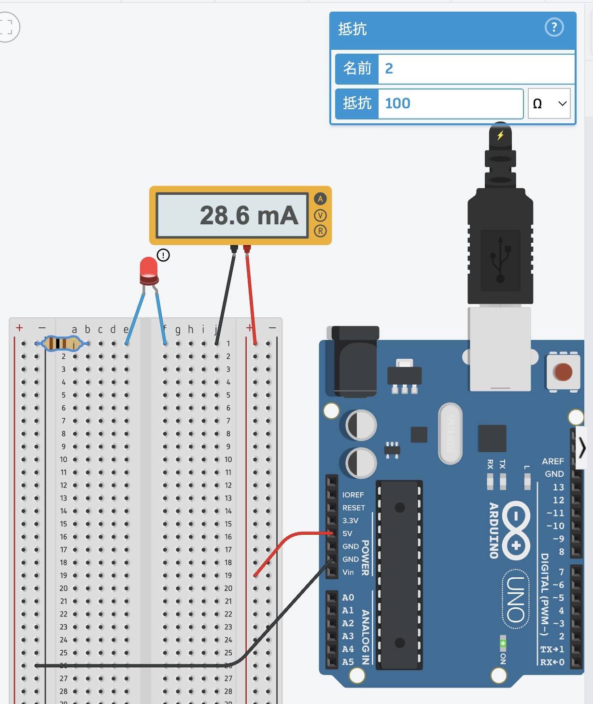 | 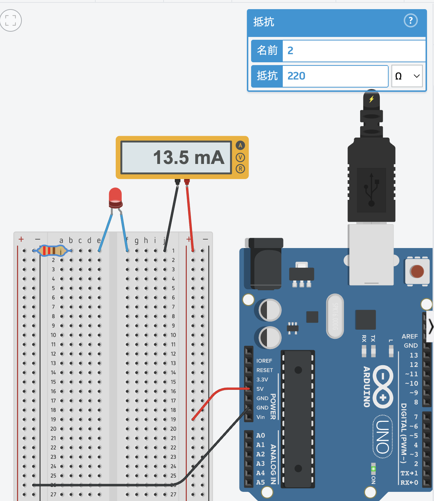 |
| **1kΩ（5V）** | **10kΩ（5V）** |
| 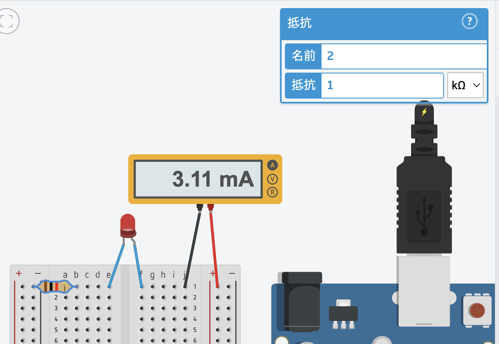 | 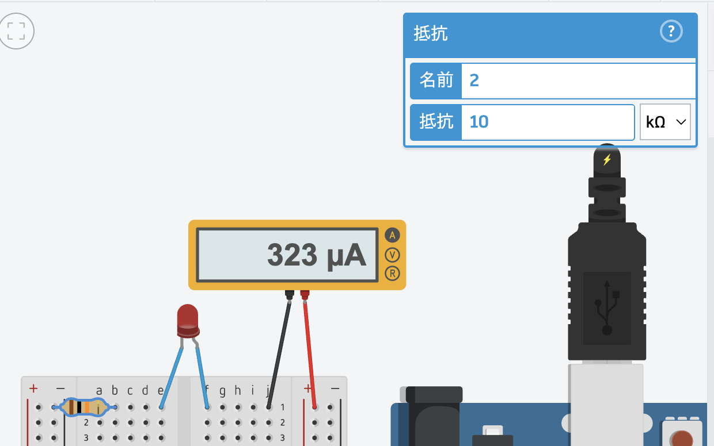 |
| **1MΩ（5V）** | **220Ω（3.3V）** |
| 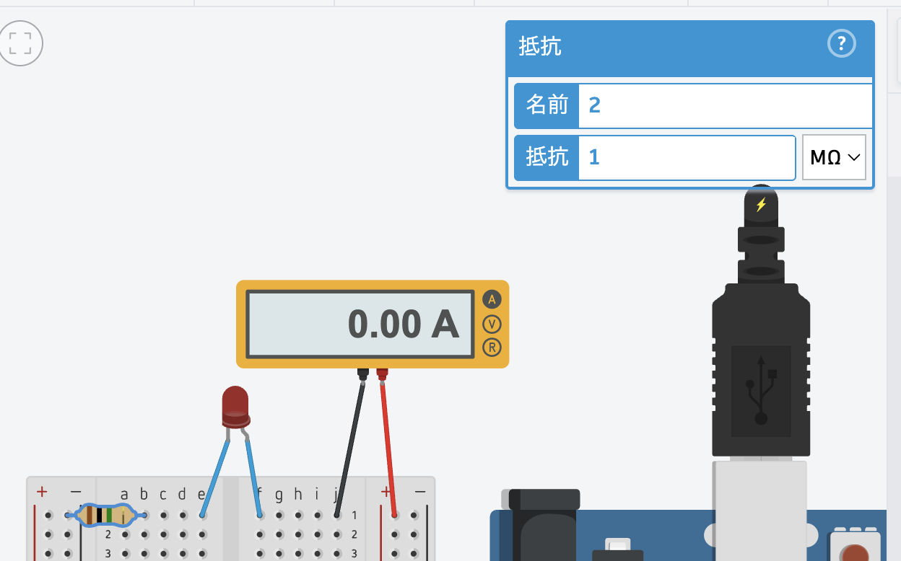 | 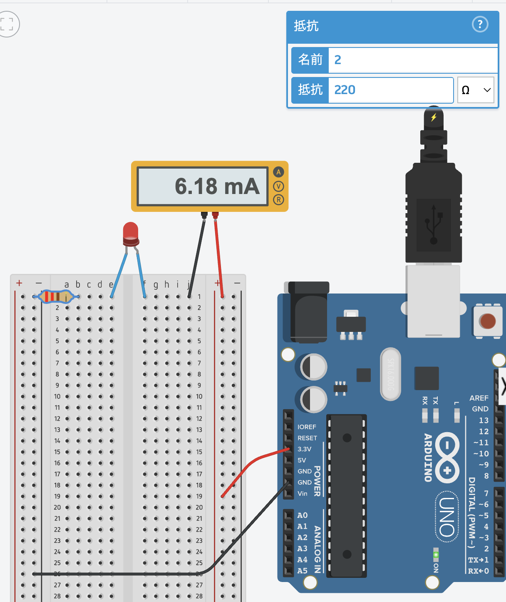 |

**測定値**

| 電源 | 抵抗 | 電流 | LEDの電圧（電源 − 電流 × 抵抗） | LEDの見た目 |
| --- | --- | --- | --- | --- |
| 5V | 100Ω | 28.6mA | 5 − 2.86 = 2.14V | とても明るい（「!」の警告） |
| 5V | 220Ω | 13.5mA | 5 − 2.97 = 2.03V | ふつう |
| 5V | 1kΩ | 3.11mA | 5 − 3.11 = 1.89V | 暗め |
| 5V | 10kΩ | 323µA（0.323mA） | 5 − 3.23 = 1.77V | かなり暗い |
| 5V | 1MΩ | 0.00A（数µA で表示されない） | — | 消えている |
| 3.3V | 220Ω | 6.18mA | 3.3 − 1.36 = 1.94V | 5V より暗い |

**学んだこと**

**① 抵抗を大きくすると、電流が減ってLEDが暗くなる**

```
100Ω   28.6mA   ##########  とても明るい
220Ω   13.5mA   #####       ふつう
1kΩ    3.11mA   #           暗い
10kΩ   0.32mA   .           かなり暗い
1MΩ    約0      (消える)
```

- 抵抗を10倍にすると、電流はだいたい10分の1になる（1kΩ → 10kΩ で 3.11mA → 0.32mA）。
- 電源を 5V → 3.3V に下げても、電流が減って暗くなる（220Ω で 13.5mA → 6.18mA）。

**② LEDが使う電圧は、電流が変わってもほぼ 2V のまま**

上の表のとおり、電流が約90倍変わっても、LEDの電圧は 1.8〜2.1V の間にとどまる。だから電流は次の式でおおよそ予想できる。

| 予想の式 | 例（5V、220Ω） |
| --- | --- |
| **電流 ≒ (電源 − 約2V) ÷ 抵抗** | (5 − 2) ÷ 220 ≒ 13.6mA（測定 13.5mA） |

**③ LEDに流してよい電流には上限がある**

| | 電流 |
| --- | --- |
| ふつうの赤LEDの目安 | 約 20mA まで |
| 100Ω のとき | 28.6mA → 超えている（Tinkercad が「!」で警告） |

実物だと熱くなって寿命が縮む。**5V で赤LEDを使うときは 220Ω** を使うのはこのため。

### 3. 演習：[SunFounder「5. 直列回路と並列回路」](https://docs.sunfounder.com/projects/inventor-lab-kit/ja/latest/lessons/5_parallel_series_circuit.html)の回路を Tinkercad で組み、直列と並列を比べる

**成果物**

**B. 直列回路（LED 2個 ＋ 220Ω）**

| 電圧（抵抗器・LED1・LED2） | LED1 の電流 |
| --- | --- |
| 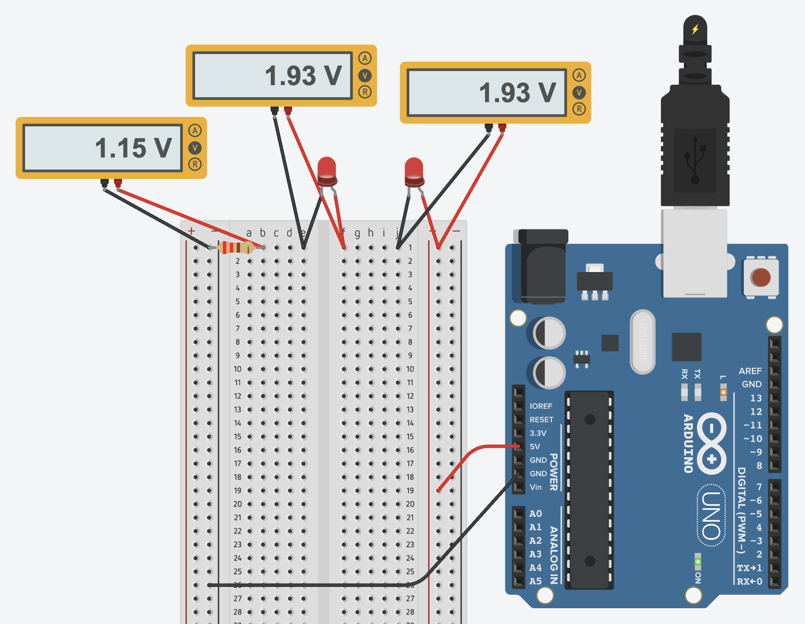 | 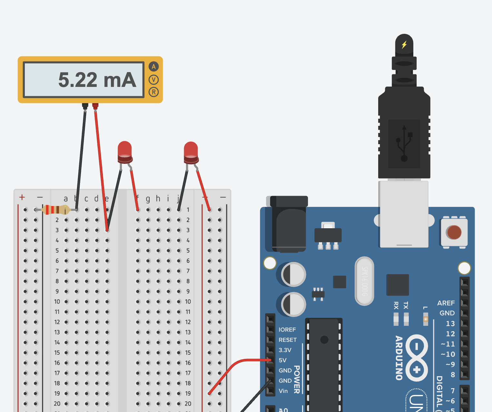 |
| **LED2 の電流** |  |
| 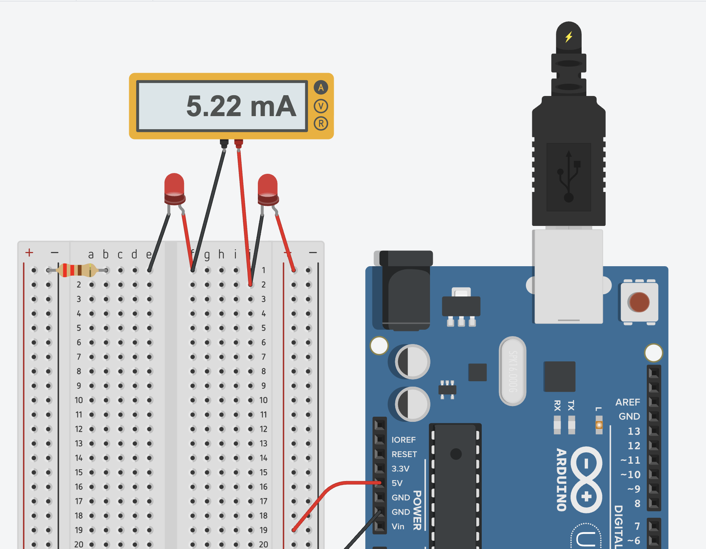 |  |

**C. 並列回路（LED ＋ 220Ω を2列）**

| 各列の電圧 | 2列目の電流 |
| --- | --- |
| 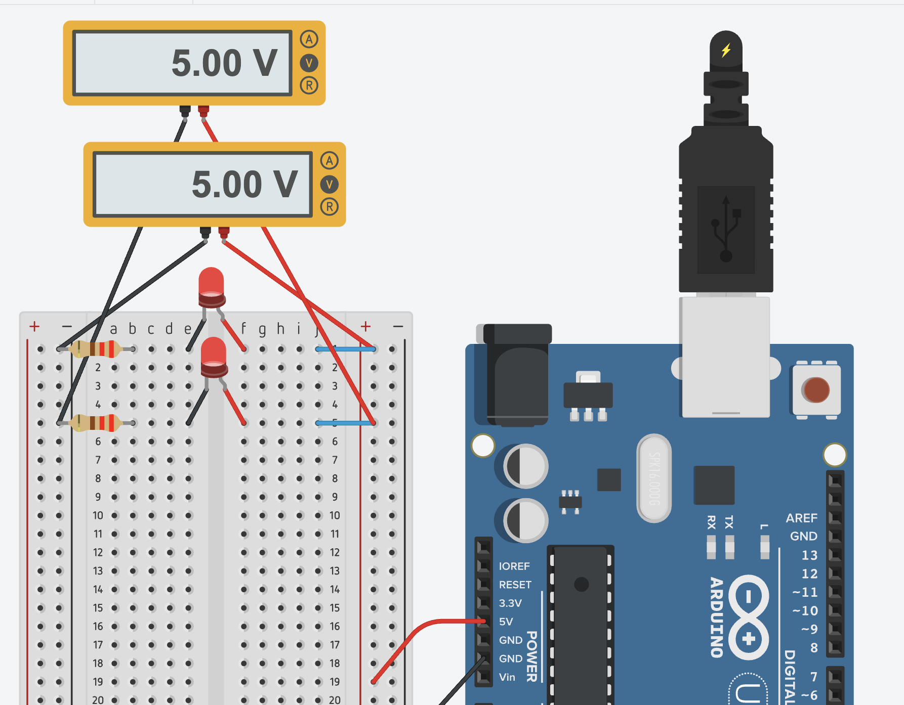 | 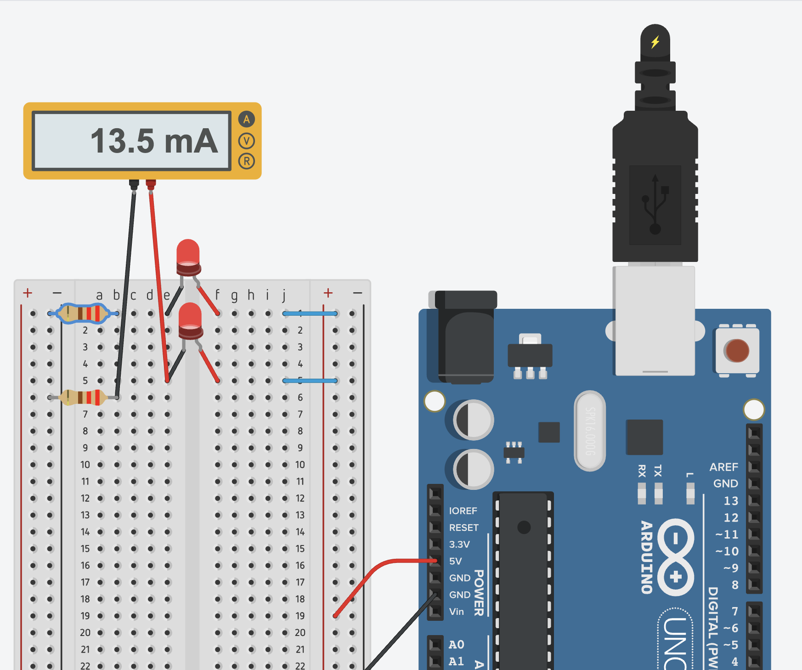 |
| **合計の電流** | **おまけ：LED 3個の並列** |
| 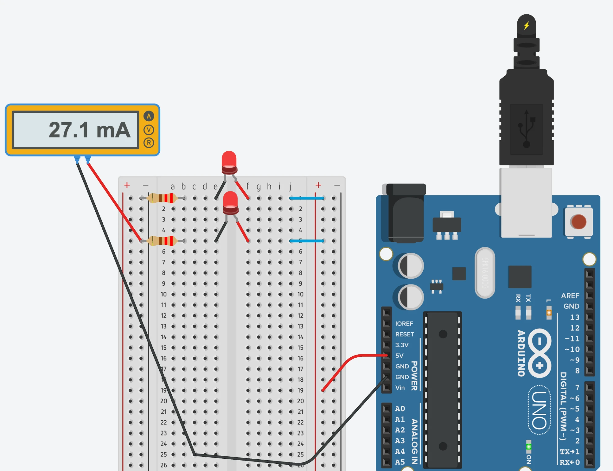 | 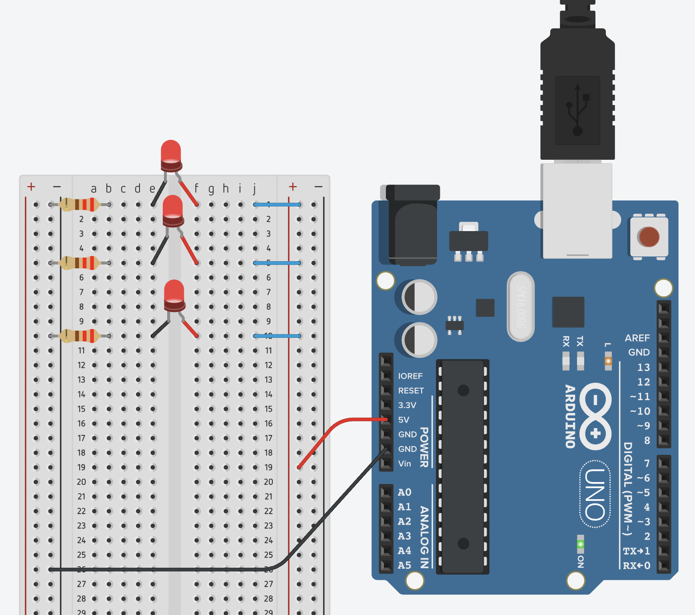 |

**測定値**

B. 直列回路

| 抵抗器の電圧 | LED1 の電圧 | LED2 の電圧 | 電圧の合計 | LED1 の電流 | LED2 の電流 |
| --- | --- | --- | --- | --- | --- |
| 1.15V | 1.93V | 1.93V | **5.01V** | 5.22mA | 5.22mA |

C. 並列回路

| 1列目の電圧 | 2列目の電圧 | 1列目の電流 | 2列目の電流 | 合計の電流 |
| --- | --- | --- | --- | --- |
| 5.00V | 5.00V | 13.5mA | 13.5mA | **27.1mA** |

**学んだこと**

**① 直列と並列のちがい**

直列：1本道

```
5V --> [LED1] --> [LED2] --> [抵抗] --> GND
```

並列：枝分かれ

```
5V --+--> [LED1] --> [抵抗] --+--> GND
     |                        |
     +--> [LED2] --> [抵抗] --+
```

| | 直列 | 並列 |
| --- | --- | --- |
| 電流の通り道 | 1本だけ | 枝ごとに別々 |
| 電流 | **どこでも同じ**（5.22mA と 5.22mA） | **枝ごとに分かれ、合計は足し算**（13.5 + 13.5 = 27.1mA） |
| 電圧 | **部品で分け合う**（1.15 + 1.93 + 1.93 = 5V） | **どの枝も電源と同じ**（5.00V と 5.00V） |
| LEDの明るさ | 暗い（電圧を分け合うので電流が減る） | 1個のときと同じ |
| 電源から出る電流 | 少ない（5.22mA） | 多い（27.1mA。LEDを増やすほど増える） |
| 1個こわれると | **全部消える** | **残りは光る** |
| 身近な例 | 1本道の線路 | 部屋ごとのコンセント |

**② メーターのつなぎ方の失敗から分かったこと**

| 失敗 | 何が起きたか | 正しくは |
| --- | --- | --- |
| 電流計を LED の**両足に並べて**当てた | 電流計（ほぼ 0Ω）が LED の迂回路になり、LED が消えた。電流は「電源 ÷ 抵抗」のLEDなしの値（220Ω で 22.7mA）になった | 線を1本外し、すき間に**はさむ** |
| **電圧計**を回路のすき間にはさんだ | 電圧計（とても大きい抵抗）で回路が切れたのと同じになり、LED が消えた | 電流を測るときはモードを **A** にする |
| **A モード**のメーターを＋と−のレールに当てたままにした | 5V と GND を直接つないだ**ショート**になり、25.0kA と表示された | 使わないメーターは消すか V モードにする |

測る前に、**すべてのメーターのモード（A・V・R）とつなぎ方**を確かめる。

| モード | つなぎ方 | メーターの中の抵抗 |
| --- | --- | --- |
| 電圧（V） | 部品の両端に**横から当てる** | とても大きい（電流をほぼ通さない） |
| 電流（A） | 回路を切って**すき間にはさむ** | ほぼ 0Ω（電流をそのまま通す） |

### 4. 記録：「直列で1個壊れると全部消え、並列だと残りが光る」理由を2行

> 直列は電流の通り道が1本だけなので、1か所でも切れると道が全部ふさがり、すべてのLEDが消える。
> 並列はLEDごとに電源につながる別々の道があるので、1本が切れても他の道はそのまま使え、残りのLEDは光り続ける。

### この日のまとめ：予想 → 結果 → 差の理由

| 何を測った／試したか | 予想 | 結果 | 差の理由 |
| --- | --- | --- | --- |
| 5V、100Ω の電流 | 約 30mA（(5 − 2) ÷ 100） | 28.6mA | LEDの電圧が 2V より少し高い 2.14V だったため |
| 5V、1kΩ の電流 | 約 3mA | 3.11mA | ほぼ一致 |
| 5V、10kΩ の電流 | 約 0.3mA | 0.323mA | ほぼ一致 |
| 3.3V、220Ω の電流 | 約 6mA（(3.3 − 2) ÷ 220） | 6.18mA | ほぼ一致 |
| 直列の電流 | 約 5.2mA（1.15V ÷ 220Ω） | 5.22mA | 一致 |
| 並列の合計の電流 | 27.0mA（13.5 + 13.5） | 27.1mA | 表示の丸め（13.5 は 13.55 などを丸めた値） |
| 直列の電流（SunFounder と比較） | SunFounder の 4.43mA | 5.22mA | 実物は抵抗器やLEDに誤差があり、電流計の中の抵抗も電流を少し減らす。Tinkercad は理想の部品で計算する |
| 並列の合計（SunFounder と比較） | SunFounder の 25.3mA | 27.1mA | 同上 |

## 5日目 電力

> **ひとことで**：電力は「部品が1秒あたりに使うエネルギー」で、**P = V × I**（W）。抵抗では電力がそのまま熱になるので、使う電力が抵抗の**定格電力（1/4W = 0.25W）**を超えないか確かめる。電力に時間をかけると電力量（J、Wh）になる。

やることの詳細は[チェックリスト](../CHECKLIST.md#第1週-オームの法則直列並列電力)。

### 1. 読む：[電力と電力量](https://chugaku.manabihiroba.net/rika/denryokur.html)

**学んだこと**

**① 電力：電気が1秒あたりにする仕事の大きさ**

電気器具は、電気のエネルギーを熱・光・動きに変えている。電熱線なら熱、LED なら光、モーターなら回転。その「1秒あたりの量」が電力。

| 言葉 | 記号 | 単位 | 水道にたとえると |
| --- | --- | --- | --- |
| 電圧 | V | V（ボルト） | 水を押す力 |
| 電流 | I | A（アンペア） | 流れる水の量 |
| **電力** | **P** | **W（ワット）** | 水車を回す仕事の大きさ（押す力 × 流れる量） |

**P = V × I**（電力 ＝ 電圧 × 電流）

オームの法則（V = R × I）と組み合わせると、分かっている値に合わせて3つの形で計算できる。

| 分かっているもの | 式 |
| --- | --- |
| 電圧と電流 | **P = V × I** |
| 電圧と抵抗 | **P = V × V ÷ R** |
| 電流と抵抗 | **P = I × I × R** |

**② 電力量：電力 × 時間**

電力を、使った時間だけ足し合わせたものが電力量。電気代は電力量で決まる。

| 単位 | 式 | 意味 |
| --- | --- | --- |
| J（ジュール） | 電力（W）× 時間（**秒**） | 1W を 1秒使うと 1J |
| Wh（ワット時） | 電力（W）× 時間（**時間**） | 1W を 1時間使うと 1Wh |
| kWh（キロワット時） | 1kWh = 1000Wh | 電気代の請求書で使う単位 |

**1Wh = 3600J**（1時間 = 60 × 60 = 3600秒）。**時間の単位をそろえる**のが一番の注意点（分のままかけない）。

**③ 熱量：ジュールとカロリー**

| 単位 | 決め方 | 換算 |
| --- | --- | --- |
| J（ジュール） | 電熱線の熱 = 電圧 × 電流 × 時間（秒） = 電力 × 時間（秒） | |
| cal（カロリー） | 水 1g の温度を 1℃ 上げる熱量 | **1cal ≒ 4.2J** |

- 電圧・電流が分かる実験 → **J** で求める
- 水の量と温度の変化が分かる実験 → **cal** で求める（cal = 水の g × 上がった ℃）

### 2. 解く：同ページの PDF 2枚

> **解き方の型**：① 求めたいものの式を選ぶ（P = V × I、電力量 = P × 時間、cal = g × ℃）→ ② **時間の単位を直す**（J なら秒、Wh なら時間）→ ③ 計算する。電気器具の「100V − 500W」は「100V で使うと 500W」という意味。

**A. 電力と電力量 NO.1**（[PDF](https://chugaku.manabihiroba.net/wp/wp-content/uploads/2018/07/denryoku1_1.pdf)）

[1] 語句を入れる

| 問題 | 答え |
| --- | --- |
| ① 電気器具が熱や光を出したり物を動かしたりする能力を（ ）といい、単位は（ ）（記号 W） | **電力**、**ワット** |
| ② 電力 =（ ）×（ ） | **電圧** × **電流** |
| ③ 電熱線が発生した熱量の単位（記号 J） | **ジュール** |
| ④ 1W の電力で 1（ ）間はたらかせたときを 1Wh という。1Wh =（ ）J | **時間**、**3600**（1時間 = 60 × 60 = 3600秒） |

[2] 計算

| 問題 | 式 | 答え |
| --- | --- | --- |
| ① 電気器具に 200V をかけたら 12A 流れた。電力は | P = 200 × 12 | **2400W** |
| ② 電気器具に 20A 流れたとき、電力は 1200W だった。電圧は | V = 1200 ÷ 20 | **60V** |
| ③ 100W の電気ポットで 6分間加熱した。熱量は何 J か | 6分 = 360秒、100 × 360 | **36000J** |
| ④ 100V − 500W の電熱器を 100V で 30分使った。電力量は何 Wh か | 30分 = 0.5時間、500 × 0.5 | **250Wh** |

**B. 電力と電力量 NO.2**（[PDF](https://chugaku.manabihiroba.net/wp/wp-content/uploads/2018/07/denryoku1_2.pdf)）

[1] 100V − 100W の電球に 40V を加えた。

| 問題 | 式 | 答え |
| --- | --- | --- |
| ① 電球の抵抗 | 100V で使うと電流は 100W ÷ 100V = 1A、抵抗は 100V ÷ 1A | **100Ω** |
| ② 40V のときの電流 | 40 ÷ 100 | **0.4A** |
| ③ 40V のときの電力 | 40 × 0.4 | **16W** |

> ポイント：「100W」は 100V で使ったときの電力。40V で使うと、抵抗（100Ω）は同じでも電流が減るので、電力は 100W ではなく 16W になる。

[2] 100V − 600W のヒーターを 100V で使う。

| 問題 | 式 | 答え |
| --- | --- | --- |
| ① 50秒使ったときの電力量（J） | 600 × 50 | **30000J** |
| ② 40分使ったときの電力量（Wh） | 40分 = 40/60 = 2/3時間、600 × 2/3 | **400Wh** |

[3] 電熱器で 200g の水を加熱したら、5分間で 15℃ 上がった。

| 問題 | 式 | 答え |
| --- | --- | --- |
| ① 水が受け取った熱量（cal） | 200g × 15℃ | **3000cal** |
| ② ① は何 J か | 3000 × 4.2 | **12600J** |

> 注意：プリントの問題文は「1J = 4.2cal とする」になっているが、正しくは **1cal = 4.2J**（解答の 3000 × 4.2 = 12600J はこちらで計算している）。

### 3. 計算：2日目の回路（9V、1kΩ）で抵抗が消費する電力を求め、1/4W 抵抗で足りるかを判断する

```
9V(+) --> [1kΩ] --+
  ^               |      <- 抵抗に 9V 全部がかかる
  +----- (-) <----+
```

| 手順 | やること | 計算 |
| --- | --- | --- |
| 1 | 分かっているものを書き出す | V = 9V、R = 1kΩ = 1000Ω |
| 2 | 電流を出す（2日目と同じ） | I = 9 ÷ 1000 = 0.009A（9mA） |
| 3 | 電力の式に入れる | P = 9 × 0.009 = **0.081W** |
| 確かめ | 電流を出さずに一発で | P = 9 × 9 ÷ 1000 = 0.081W |

**判断：1/4W 抵抗で足りる**

| | 電力 |
| --- | --- |
| 1/4W 抵抗の上限（定格電力） | 0.25W |
| 余裕を見た目安（上限の半分） | 0.125W |
| 実際に使う電力 | **0.081W** |

0.081W は上限の 0.25W より小さく、余裕の目安 0.125W も下回るので、**1/4W 抵抗で安心して使える**。

**比べると分かること**

| 回路 | 抵抗の電力 | 1/4W 抵抗で |
| --- | --- | --- |
| 9V、1kΩ（2日目） | 9 × 9 ÷ 1000 = **0.081W** | ◯ 足りる |
| 9V、220Ω | 9 × 9 ÷ 220 = **約 0.37W** | ✕ 足りない（熱くなって焦げる） |
| 5V、100Ω ＋ LED（4日目） | 2.86V × 0.0286A = **約 0.082W** | ◯ 足りる（ただし LED には電流が多すぎた） |
| 5V、100Ω だけ（下の Falstad） | 5 × 0.05 = **0.25W** | △ 上限ぴったり。使わないほうがよい |

同じ電源でも、**抵抗が小さいほど電流が増え、電力（熱）が大きくなる**。

### 4. 観察：[Falstad 抵抗の例題](https://www.falstad.com/circuit/e-resistors.html)で、抵抗値ごとの電流の違いを見る

元のページの Java 版は今のブラウザでは動かないので、[JavaScript 版](https://www.falstad.com/circuit/circuitjs.html?startCircuit=resistors.txt)を使った。

```
5V  [100]  [400]  [800]     <- 上の段：スイッチで選ぶ
     |      |      |
    [600]  [200]  (線)      <- 下の段：スイッチで選ぶ（右は抵抗なし）
```

電流は「上の段 → 下の段」と直列に通る。同じ段で2つ以上のスイッチを入れると、その段は並列になる。電流は **5V ÷ 全体の抵抗** で予想してから、左上の表示で答え合わせした。

| スイッチ | 全体の抵抗 | 予想 | 結果 |
| --- | --- | --- | --- |
| 上 100 ＋ 下 200 | 300Ω | 16.7mA | **16.7mA** |
| 上 100 と 800（並列）＋ 下 200 | 88.9 + 200 = 288.9Ω | 17.3mA | **17.3mA** |
| 上 400 ＋ 下 200 | 600Ω | 8.3mA | **8.3mA** |
| 上 100 ＋ 下 600 | 700Ω | 7.1mA | **7.1mA** |
| 上 800 ＋ 下 600 | 1400Ω | 3.6mA | **3.6mA** |
| 上 100 ＋ 下の線（抵抗なし） | 100Ω | 50mA | **50mA** |

**画面**（左上に電流が表示される）

| 上 100 ＋ 下 200 | 上 100 と 800（並列）＋ 下 200 |
| --- | --- |
| 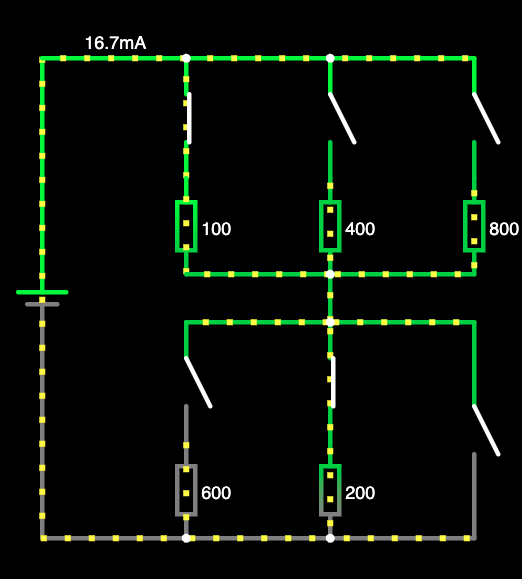 | 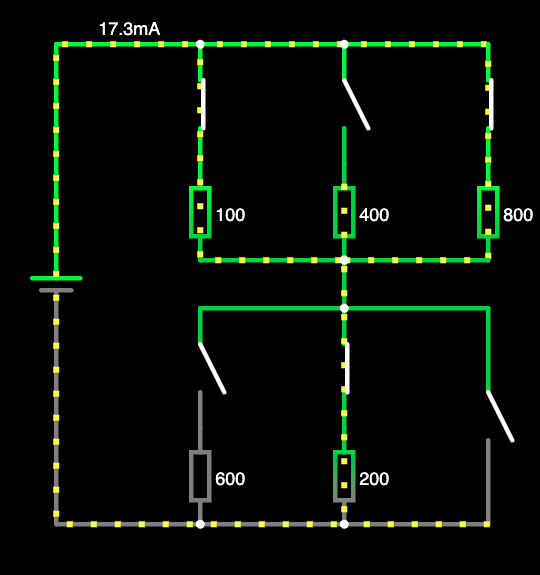 |
| **上 400 ＋ 下 200** | **上 100 ＋ 下 600** |
| 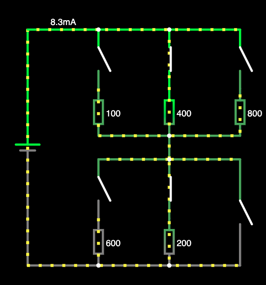 | 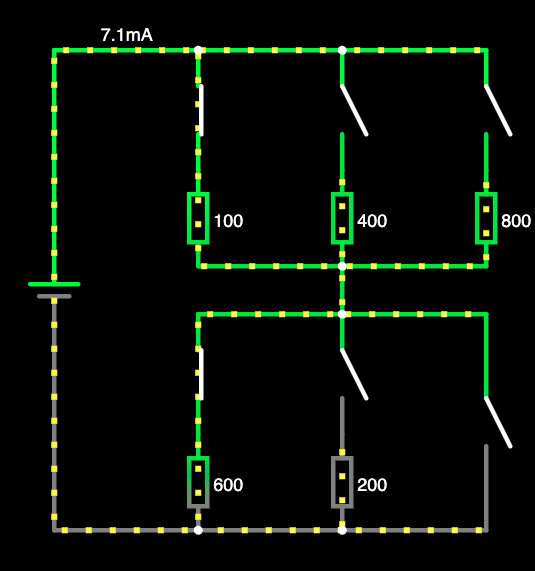 |
| **上 800 ＋ 下 600** | **上 100 ＋ 下の線（抵抗なし）** |
| 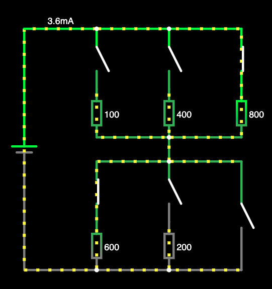 | 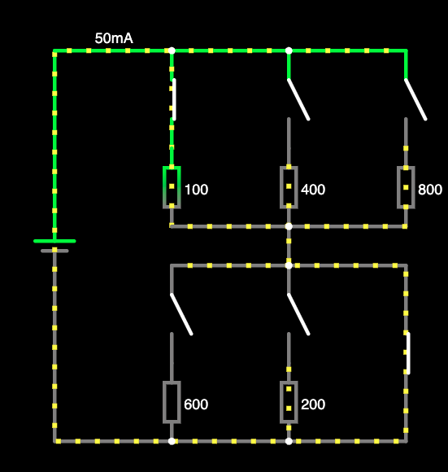 |

**学んだこと**

**① 抵抗が大きいほど電流が小さい**

```
100Ω     50.0mA   ##############################
288.9Ω   17.3mA   ##########
300Ω     16.7mA   ##########
600Ω      8.3mA   #####
700Ω      7.1mA   ####
1400Ω     3.6mA   ##
```

抵抗が2倍（300Ω → 600Ω）になると、電流はちょうど半分（16.7mA → 8.3mA）になる。これがオームの法則 **I = V ÷ R**。

**② 並列にすると抵抗が減り、電流が増える**

上の段を「100Ω だけ」から「100Ω と 800Ω の並列」にすると、全体の抵抗が 300Ω → 288.9Ω に減り、電流は 16.7mA → 17.3mA に増えた。800Ω という大きな抵抗を**足したのに電流が増えた**。道が増えると流れやすくなるから。

**③ 画面の色と点の動きで、電流の流れが見える**

| 見え方 | 意味 |
| --- | --- |
| 灰色で点が止まっている抵抗 | スイッチが開いていて、電流が流れていない |
| 並列の枝で点が速いほう | 抵抗が小さい枝（100Ω）。電流は流れやすい道ほど多く流れる |
| 抵抗なしの線を入れると、その先が全部灰色 | 線の先が GND と同じ 0V になり、5V が全部 100Ω にかかる（迂回） |

### この日のまとめ：予想 → 結果 → 差の理由

| 何を測った／試したか | 予想 | 結果 | 差の理由 |
| --- | --- | --- | --- |
| 9V、1kΩ の抵抗の電力（計算） | 1/4W 以内か？ | 0.081W で足りる | — |
| Falstad 6通りの電流 | 5V ÷ 全体の抵抗 | 6つとも一致 | 差なし（Falstad は理想の部品で計算するため） |
| 100Ω だけの抵抗の電力 | — | 0.25W | 1/4W 抵抗の上限ぴったり。実物なら避ける |

## 6日目 まとめと遅れの取り戻し

> **ひとことで**：直列と並列が混ざった回路は、「並列の部分を1つのかたまりとみなして直列で考える → かたまりの中は並列で考える」の2段階で解ける。抵抗の値は胴体の色の帯で読み、左から「数字・数字・何個0をつけるか・誤差」の順。

やることの詳細は[チェックリスト](../CHECKLIST.md#第1週-オームの法則直列並列電力)。

### 1. 解く：[いろいろな回路の計算](https://chugaku.manabihiroba.net/rika/iroiron.html)と[まとめ、総合問題](https://chugaku.manabihiroba.net/rika/denryukairomatome.html)

**学んだこと**

**① 直列と並列が混ざった回路の解き方**

この日の「複雑な回路」は、すべて次の形をしている。

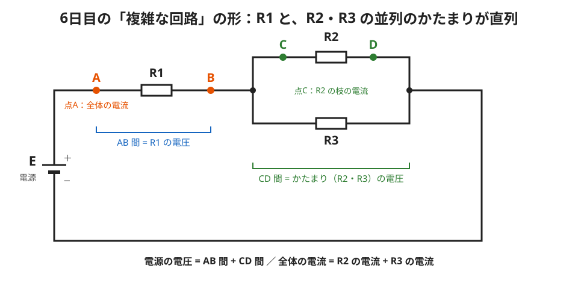

| 段階 | 見方 | 使うきまり |
| --- | --- | --- |
| 1 | R1 と「R2・R3 のかたまり」が**直列** | 電流はどこも同じ（R1 にも、かたまり全体にも同じ電流）。電源の電圧 = R1 の電圧 + かたまりの電圧 |
| 2 | かたまりの中の R2 と R3 は**並列** | 電圧は同じ（CD 間 = かたまりの電圧）。電流は分かれて、足すと全体の電流 |

**解く順番の型**：① 全体の電流 × R1 で AB 間の電圧 → ② 電源 − AB 間 で CD 間の電圧 → ③ CD 間の電圧 ÷ R3 で R3 の電流 → ④ 全体 − R3 の電流 で R2 の電流 → ⑤ CD 間の電圧 ÷ R2 の電流 で R2 の抵抗。

**② 並列の合成抵抗の式**

| 式 | 例：20Ω と 30Ω の並列 |
| --- | --- |
| **1/R = 1/R2 + 1/R3**（逆数の足し算） | 1/20 + 1/30 = 3/60 + 2/60 = 5/60 = 1/12 → **12Ω** |
| **R = (R2 × R3) ÷ (R2 + R3)**（2本のときの近道） | (20 × 30) ÷ (20 + 30) = 600 ÷ 50 = **12Ω** |

並列の合成抵抗は、**どちらの抵抗よりも小さくなる**（12Ω は 20Ω より小さい）。

**演習問題と解答**

> **解き方の型**：まず回路を「直列の部分」と「並列の部分」に分ける。分かっている値から順に、上の ①〜⑤ の流れで埋めていく。電圧・電流・抵抗のうち2つが分かったら、オームの法則で残りの1つが出る。

**A. 複雑な回路の計算 NO.1**（[PDF](https://chugaku.manabihiroba.net/wp/wp-content/uploads/2018/07/fukuzatunakaironokeisan1.pdf)）

[1] R1 = 8Ω、R3 = 10Ω（R3 の電圧 3V）、全体の電流 0.4A、電源 E

| 問題 | 式 | 答え |
| --- | --- | --- |
| ① AB 間（R1）の電圧 | 0.4 × 8 | **3.2V** |
| ② CD 間（R2）の電圧 | 並列なので R3 と同じ | **3V** |
| ③ 点C（R2 の枝）の電流 | R3 は 3 ÷ 10 = 0.3A、0.4 − 0.3 | **0.1A** |
| ④ R2 の抵抗 | 3 ÷ 0.1 | **30Ω** |
| ⑤ 電源 E の電圧 | 3.2 + 3 | **6.2V** |

> 注意：プリントの解答は ③ が「3 ÷ 10 = 0.3A」（R3 の電流）になっている。点C は R2 の枝にあるので、正しくは **0.1A**（④ の解答も 0.1A を使っている）。

[2] R1 = 4Ω、R3 = 20Ω、全体の電流 0.5A、電源 8V

| 問題 | 式 | 答え |
| --- | --- | --- |
| ① AB 間の電圧 | 0.5 × 4 | **2V** |
| ② CD 間の電圧 | 8 − 2 | **6V** |
| ③ 点A の電流 | 全体の電流そのもの | **0.5A** |
| ④ R2 の電流 | R3 は 6 ÷ 20 = 0.3A、0.5 − 0.3 | **0.2A** |
| ⑤ R2 の抵抗 | 6 ÷ 0.2 | **30Ω** |

> 注意：プリントの解答は ③ が「1.2 ÷ 0.1 = 12Ω」になっていて、問題と合わない（別の問題の式が入っている）。点A は全体の電流が流れる場所なので **0.5A**。

**B. 複雑な回路の計算 NO.2**（[PDF](https://chugaku.manabihiroba.net/wp/wp-content/uploads/2018/07/fukuzatunakaironokeisan2.pdf)）

[1] R1 = 6Ω、R3 = 4Ω（R3 の電流 0.3A）、全体の電流 0.4A

| 問題 | 式 | 答え |
| --- | --- | --- |
| ① AB 間の電圧 | 0.4 × 6 | **2.4V** |
| ② CD 間の電圧 | R3 の電圧 0.3 × 4 | **1.2V** |
| ③ 点C（R2）の電流 | 0.4 − 0.3 | **0.1A** |
| ④ R2 の抵抗 | 1.2 ÷ 0.1 | **12Ω** |
| ⑤ 電源 E の電圧 | 2.4 + 1.2 | **3.6V** |

[2] R1 = 8Ω、R3 = 20Ω、全体の電流 0.5A、電源 10V

| 問題 | 式 | 答え |
| --- | --- | --- |
| ① AB 間の電圧 | 0.5 × 8 | **4V** |
| ② CD 間の電圧 | 10 − 4 | **6V** |
| ③ R3 の電流 | 6 ÷ 20 | **0.3A** |
| ④ 点C（R2）の電流 | 0.5 − 0.3 | **0.2A** |
| ⑤ R2 の抵抗 | 6 ÷ 0.2 | **30Ω** |

**C. 複雑な回路の計算 NO.3**（[PDF](https://chugaku.manabihiroba.net/wp/wp-content/uploads/2018/07/fukuzatunakaironokeisan3.pdf)、プリント上の表記は NO.2）

[1] R1 = 20Ω、R3 = 30Ω（R3 の電圧 3V）、全体の電流 0.3A

| 問題 | 式 | 答え |
| --- | --- | --- |
| ① AB 間の電圧 | 0.3 × 20 | **6V** |
| ② 電源 E の電圧 | 6 + 3 | **9V** |
| ③ R3 の電流 | 3 ÷ 30 | **0.1A** |
| ④ 点C（R2）の電流 | 0.3 − 0.1 | **0.2A** |
| ⑤ R2 の抵抗 | 3 ÷ 0.2 | **15Ω** |

[2] R1 = 5Ω（R1 の電圧 2.5V）、R3 = 10Ω、電源 6.5V

| 問題 | 式 | 答え |
| --- | --- | --- |
| ① 点A の電流（全体） | 2.5 ÷ 5 | **0.5A** |
| ② CD 間の電圧 | 6.5 − 2.5 | **4V** |
| ③ R3 の電流 | 4 ÷ 10 | **0.4A** |
| ④ 点C（R2）の電流 | 0.5 − 0.4 | **0.1A** |
| ⑤ R2 の抵抗 | 4 ÷ 0.1 | **40Ω** |

**D. 複雑な回路の計算 発展 NO.1**（[PDF](https://chugaku.manabihiroba.net/wp/wp-content/uploads/2018/07/fukuzatunakaironokeisanhatten1.pdf)）：合成抵抗を使う問題

[1] R1 = 10Ω、R2 = 20Ω、R3 = 30Ω、電源 11V

| 問題 | 式 | 答え |
| --- | --- | --- |
| ① 並列部分（R2 と R3）の合成抵抗 | 1/R = 1/20 + 1/30 = 1/12 | **12Ω** |
| ② 回路全体の抵抗 | 10 + 12 | **22Ω** |
| ③ 電源を流れる電流（点A） | 11 ÷ 22 | **0.5A** |
| ④ CD 間の電圧 | 0.5 × 12 | **6V** |
| ⑤ R2 の電流 | 6 ÷ 20 | **0.3A** |

> 注意：プリントの解答は ④ の単位が「6.0A」になっているが、電圧なので正しくは **6.0V**。

[2] R1 = 10Ω、R2 = 30Ω、R3 は不明、全体の電流 0.3A、電源 9V

| 問題 | 式 | 答え |
| --- | --- | --- |
| ① 回路全体の抵抗 | 9 ÷ 0.3 | **30Ω** |
| ② AB 間の電圧 | 0.3 × 10 | **3V** |
| ③ CD 間の電圧 | 9 − 3 | **6V** |
| ④ R2 の電流 | 6 ÷ 30 | **0.2A** |
| ⑤ R3 の抵抗 | R3 の電流 0.3 − 0.2 = 0.1A、6 ÷ 0.1 | **60Ω** |

> 確かめ：並列部分は (30 × 60) ÷ (30 + 60) = 20Ω、全体は 10 + 20 = 30Ω で ① と一致する。

**E. 静電気・回路と電流・電圧まとめ 基本 NO.1**（[PDF](https://chugaku.manabihiroba.net/wp/wp-content/uploads/2025/10/seidennkikairomatomekihon1.pdf)）

| 問題 | 答え |
| --- | --- |
| [1]① 異なる2種類の物体をこすり合わせたときに発生する電気 | **静電気** |
| [1]② たまっていた静電気が空気中を一気に流れる現象 | **放電** |
| [1]③ 電流は電源の（ ）極から流れ出て（ ）極に流れ込む | **＋**、**−** |
| [1]④ 電流の流れにくさを表す量 | **抵抗** |
| [1]⑤ 電圧と電流の関係を表す法則 | **オームの法則** |
| [2] 記号 ① 長い線と短い線 ② 丸に A ③ 丸に V ④ 長方形 | ① **電池** ② **電流計** ③ **電圧計** ④ **抵抗器** |
| [3] ① 電球2個を1本道でつないだ回路 ② 枝分かれさせた回路 | ① **直列回路** ② **並列回路** |
| [4] 20Ω の電熱線に 4V を加えたときの電流 | 4 ÷ 20 = **0.2A** |
| [5] 100V で 1.5A 流れる電気器具の消費電力 | 100 × 1.5 = **150W** |

**F. まとめ 基本 NO.2**（[PDF](https://chugaku.manabihiroba.net/wp/wp-content/uploads/2025/10/seidenkikairomatomekihon2.pdf)）

| 問題 | 答え |
| --- | --- |
| [1]① 電流が流れるひとまわりの道筋 | **回路** |
| [1]② 回路を電気用図記号で表したもの | **回路図** |
| [1]③ 1秒間あたりに消費される電気エネルギーの量 | **電力** |
| [1]④ 電力の単位（記号） | **W** |
| [1]⑤ 同じ種類の電気どうしは引き合うか、反発し合うか | **反発し合う** |
| [2]① 豆電球 A・B を1本道でつないだ回路（3V、0.3A）のつなぎ方 | **直列回路** |
| [2]② 回路全体に流れる電流 | **0.3A**（直列はどこも同じ） |
| [2]③ 2つの豆電球の抵抗が等しいとき、1つの抵抗 | 全体 3 ÷ 0.3 = 10Ω、10 ÷ 2 = **5Ω** |
| [3]・[4] 電熱線に 0.6A 流したら電圧は 12V だった。抵抗は | 12 ÷ 0.6 = **20Ω** |
| [5] 200V で 2A 流れる電気器具の消費電力 | 200 × 2 = **400W** |

> 注意：プリントでは [3] と [4] が同じ問題文になっていて、[3] の解答だけ「直列回路・並列回路」（別の問題の答え）になっている。問題文どおりなら [3] も **20Ω**。

**G. まとめ 基本 NO.3**（[PDF](https://chugaku.manabihiroba.net/wp/wp-content/uploads/2025/10/seidenkikairomatomekihon3.pdf)）

| 問題 | 式 | 答え |
| --- | --- | --- |
| [1]① 導線の中を流れる、−の電気を帯びた粒子 | | **電子** |
| [1]② 電流が流れない物質 | | **不導体（絶縁体）** |
| [1]③ 1W を1時間使ったときの電力量の単位（記号） | | **Wh** |
| [1]④ 1Wh は何 J か | 1 × 3600秒 | **3600J** |
| [2]① 30Ω ともう1本を枝分かれでつないだ回路（12V） | | **並列回路** |
| [2]② 30Ω に流れる電流 | 12 ÷ 30 | **0.4A** |
| [2]③ 30Ω にかかる電圧 | 並列は電源と同じ | **12V** |
| [3] 25Ω に 0.4A 流したときの電圧 | 0.4 × 25 | **10V** |
| [4] 100V − 500W の電熱器を 100V で使ったときの電流 | 500 ÷ 100 | **5A** |
| [5] 20A 流れて電力が 950W のときの電圧 | 950 ÷ 20 | **47.5V** |

> 注意：プリントの解答は [4] が「12 ÷ 0.6 = 20Ω」（別の問題の式）になっている。問題は 500W の電熱器の電流なので、正しくは 500 ÷ 100 = **5A**。

**H. まとめ 標準 NO.1**（[PDF](https://chugaku.manabihiroba.net/wp/wp-content/uploads/2025/10/seidenkikairomatomehyoujyun1.pdf)）

| 問題 | 式 | 答え |
| --- | --- | --- |
| [1]① 15Ω と 25Ω の直列の全体の抵抗 | 15 + 25 | **40Ω** |
| [1]② 0.4A 流れているときの電源の電圧 | 0.4 × 40 | **16V** |
| [1]③ そのとき 25Ω にかかる電圧 | 0.4 × 25 | **10V** |
| [2]① 15Ω と 10Ω の並列（6V）で、10Ω の電流 | 6 ÷ 10 | **0.6A** |
| [2]② 15Ω の電流 | 6 ÷ 15 | **0.4A** |
| [2]③ 全体の電流 | 0.6 + 0.4 | **1.0A** |
| [3]① 100V・1200W のドライヤーの電流 | 1200 ÷ 100 | **12A** |
| [3]② 5分使ったときの電力量（J） | 5分 = 300秒、1200 × 300 | **360000J** |

**I. まとめ 標準 NO.2**（[PDF](https://chugaku.manabihiroba.net/wp/wp-content/uploads/2025/10/seidenkikairomatomehyoujyun2.pdf)）

| 問題 | 式 | 答え |
| --- | --- | --- |
| [1]① 4Ω の電熱線 A（電圧 2V）と B の直列（電源 3V）。回路の電流 | 2 ÷ 4 | **0.5A** |
| [1]② B にかかる電圧 | 3 − 2 | **1V** |
| [1]③ B の抵抗 | 1 ÷ 0.5 | **2Ω** |
| [2]① 20Ω と 30Ω の並列（12V）で、20Ω の電流 | 12 ÷ 20 | **0.6A** |
| [2]② 30Ω の電流 | 12 ÷ 30 | **0.4A** |
| [2]③ 全体の電流 | 0.6 + 0.4 | **1.0A** |
| [3]① 4V で 0.2A、8V で 0.4A 流れる電熱線の抵抗 | 4 ÷ 0.2 | **20Ω** |
| [3]② 10V を加えたときの電流 | 10 ÷ 20 | **0.5A** |
| [3]③ 6V につないだときの消費電力 | 電流 6 ÷ 20 = 0.3A、6 × 0.3 | **1.8W** |

> 注意：[1] は図の電流計が **0.4A** になっているのに、解答は A の電圧から計算した **0.5A**（2V ÷ 4Ω）を使っていて、図と解答が食い違っている。0.5A なら ② 1V、③ 2Ω。図どおり 0.4A なら A の電圧は 1.6V になり、「2V」と合わない。問題の数字の誤りと考えられる。

### 2. 間違えた問題だけ Tinkercad で組んで確かめる

間違えた問題はなかったので、Tinkercad で組んで確かめる対象はなし。

（ただし、プリントの解答のほうに誤りが 7 か所あった。上の「注意」を参照）

### 3. 読む：[Arrow「抵抗のカラーコードの読み方」](https://www.arrow.com/ja/resources/articles/2023/11/how-to-read-resistor-color-code.html)

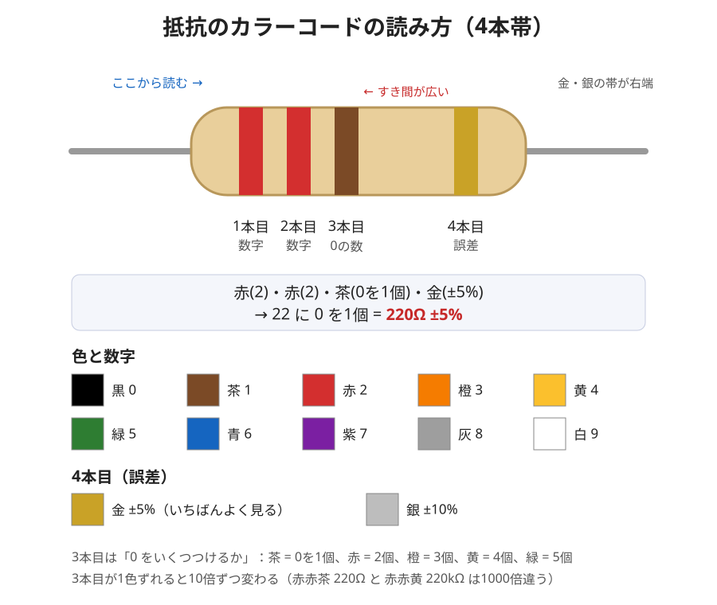

**学んだこと**

**① 色と数字の対応**

| 色 | 数字 | 3本目に来たとき（0をいくつつけるか） |
| --- | --- | --- |
| 黒 | 0 | ×1 |
| 茶 | 1 | ×10 |
| 赤 | 2 | ×100 |
| 橙 | 3 | ×1k（1000） |
| 黄 | 4 | ×10k |
| 緑 | 5 | ×100k |
| 青 | 6 | ×1M（100万） |
| 紫 | 7 | ×10M |
| 灰 | 8 | — |
| 白 | 9 | — |
| 金 | — | ×0.1 |
| 銀 | — | ×0.01 |

**② 4本帯の読み方**

上の図の「4本帯の読み方」のとおり、左から「数字・数字・0の数（倍率）・誤差」。

| 帯 | 意味 | 例：赤・赤・茶・金 |
| --- | --- | --- |
| 1本目 | 1けた目の数字 | 赤 = 2 |
| 2本目 | 2けた目の数字 | 赤 = 2 |
| 3本目 | 0をいくつつけるか（倍率） | 茶 = ×10 → 22 × 10 |
| 4本目 | 誤差 | 金 = ±5% |
| 答え | | **220Ω ±5%** |

- **読み始める側**：金や銀の帯（誤差）は端に少し離れて付いているので、そちらが**右端**。反対側から読む。
- 誤差の色：**金 ±5%**、銀 ±10%、茶 ±1%、赤 ±2%。
- 5本帯は「数字・数字・数字・倍率・誤差」で、数字が3けたになる（精度の高い抵抗）。

**③ この週に使った抵抗の色**

| 抵抗値 | 1本目 | 2本目 | 3本目（倍率） | 読み方 |
| --- | --- | --- | --- | --- |
| 100Ω | 茶 1 | 黒 0 | 茶 ×10 | 10 × 10 = 100 |
| 220Ω | 赤 2 | 赤 2 | 茶 ×10 | 22 × 10 = 220 |
| 1kΩ | 茶 1 | 黒 0 | 赤 ×100 | 10 × 100 = 1000 |
| 10kΩ | 茶 1 | 黒 0 | 橙 ×1k | 10 × 1000 = 10000 |
| 220kΩ | 赤 2 | 赤 2 | 黄 ×10k | 22 × 10000 = 220000 |
| 1MΩ | 茶 1 | 黒 0 | 緑 ×100k | 10 × 100000 = 1000000 |

> 1日目の失敗：220Ω（赤・赤・**茶**）のつもりが 220kΩ（赤・赤・**黄**）になっていて、LED がほとんど光らなかった。**3本目の1色の違いで、抵抗は1000倍**になる。

### 4. 練習：Tinkercad で抵抗を5本置き、色の帯だけから抵抗値を当てる

**やらないことにした。代わりに、よく使う4本の色だけ覚える。**

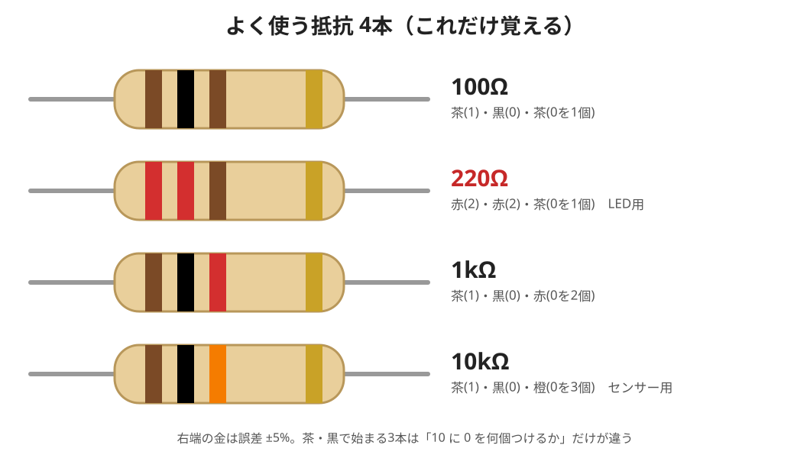

| 抵抗値 | 色 | 覚え方 | 主な使い道 |
| --- | --- | --- | --- |
| 100Ω | 茶・黒・茶 | 10 に 0 を1個 | |
| **220Ω** | **赤・赤・茶** | 22 に 0 を1個 | LED の電流を抑える（5V のとき） |
| 1kΩ | 茶・黒・赤 | 10 に 0 を2個 | |
| **10kΩ** | **茶・黒・橙** | 10 に 0 を3個 | センサーの分圧など |

**理由**

| | 内容 |
| --- | --- |
| 色を読めると得なところ | 実物の抵抗には数字が印刷されていないことが多く、キットの袋から出すと色でしか区別できない。3本目の1色違いで抵抗が10倍・1000倍変わる（1日目の 220Ω と 220kΩ） |
| 全部を暗記しなくてよいところ | 迷ったらマルチメーターで測れば確実。このロードマップで使う抵抗はほぼ 220Ω・1kΩ・10kΩ。Tinkercad では設定欄に値が表示される |
| 決めたこと | よく使う4本だけ色で覚え、それ以外は上の読み方の図を見るか、マルチメーターで測る。実物の抵抗を手にしたら、袋の抵抗を色で読んでから測って答え合わせする |

### 5. `week1/README.md` に比較表と回路図の写真を置く

済み。

- 回路図の写真：[1日目の記録](#5-記録今日組んだ回路を紙に回路図として描く)
- 計算値と測定値の比較表：各日の「予想 → 結果 → 差の理由」（[2日目](#4-記録計算値と測定値の比較表予想--結果--差の理由)、[3日目](#4-記録sunfounder-の測定例と自分の値を並べ違いの理由を1行)、[4日目](#この日のまとめ予想--結果--差の理由-2)、[5日目](#この日のまとめ予想--結果--差の理由-3)）

### この日のまとめ：予想 → 結果 → 差の理由

| 何を測った／試したか | 予想 | 結果 | 差の理由 |
| --- | --- | --- | --- |
| 練習プリント 9 本 | 全問正解できるか | 間違いなし | ― |
| プリントの解答の確かさ | 正しい前提 | 誤り 7 か所 | 解答の転記ミスや別問題の式の混入。自分の計算を回路図で確かめる習慣が大事 |

## 何が壊れてどう直したか

うまくいかなかったことを、症状・原因・直し方の順に書きます。この週で一番大事な節です。

| 日 | 症状 | 原因 | 直し方 |
| --- | --- | --- | --- |
| 1日目 | LED がほとんど光らない | 220Ω（赤・赤・**茶**）のつもりが 220kΩ（赤・赤・**黄**）になっていた。抵抗が 1000 倍 | 3本目の色を茶に直した（6日目のカラーコード） |
| 3日目 | 抵抗モードで「Error」 | 電源が入ったまま抵抗を測った。メーター自身の電流に、回路の電流が混ざる | 抵抗は電源を切ってから測る |
| 3日目 | LED が壊れた（319mA） | 電源を入れたまま、抵抗モードのメーターを抵抗器の両端に当てた。メーターが抵抗器の迂回路になり、LED に電流が流れすぎた | 抵抗器が LED を守っていると分かった。抵抗モードは電源を切って使う |
| 4日目 | 電流計をつないだら LED が消えた | 電流計を LED の両足に**並べて**当てた。ほぼ 0Ω の電流計が迂回路になった | 線を1本外し、すき間に**はさむ** |
| 4日目 | 電圧計をつないだら LED が消えた | 電圧計（とても大きい抵抗）を回路のすき間に**はさんだ**ので、回路が切れたのと同じになった | 電流を測るならモードを A に。電圧計は横から当てる |
| 4日目 | 25.0kA と表示された | A モードのメーターを＋と−のレールに当てたままにして、ショートした | 使わないメーターは消すか V モードにする |

**この週の教訓**：測る前に、メーターの**モード（V・A・Ω）**と**つなぎ方（横から当てる／はさむ）**を確かめる。

## 分からなかったこと・あとで調べること

-
