# 第2週 分圧・回路図・コンデンサ

- フェーズ：[フェーズ1 電子回路・道具・はんだ付け](../README.md)
- 日：8〜14日目（詳細は [CHECKLIST.md](../CHECKLIST.md#第2週-分圧回路図コンデンサ) ）
- ゴール：分圧回路の出力を4つの変数のどれからでも計算でき、自分の回路をKiCadで回路図に起こせる
- 状態：完了

日ごとに「やること → 成果物 → 予想 → 結果 → 差の理由」を残します。測定や実験は、やる前に予想を書きます。

## 8日目 分圧の式

> **ひとことで**：抵抗を2本つなぐと、電源の電圧を**抵抗の比で分け合う**。下の抵抗（R2）の電圧を取り出したものが「分圧回路の出力」。

**この日にやったことと、分かったこと**

| # | やったこと | 分かったこと（一言） |
| --- | --- | --- |
| 1 | 記事を読む | 出力 = 電源 × R2 の割合 |
| 2 | 問題を解く | 負荷があるときは、先に並列をまとめる |
| 3 | Falstad で観察 | 電圧は「比」で、電流は「合計」で決まる |
| 4 | Tinkercad で検証 | 手計算と測定がぴったり一致した |

やることの詳細は[チェックリスト](../CHECKLIST.md#第2週-分圧回路図コンデンサ)。

### 1. 読む：[DigiKey「分圧器の基礎」](https://forum.digikey.com/t/topic/44004)の「分圧器を理解する」まで

**学んだこと**

**① 分圧回路は「電圧を分け合う」回路**

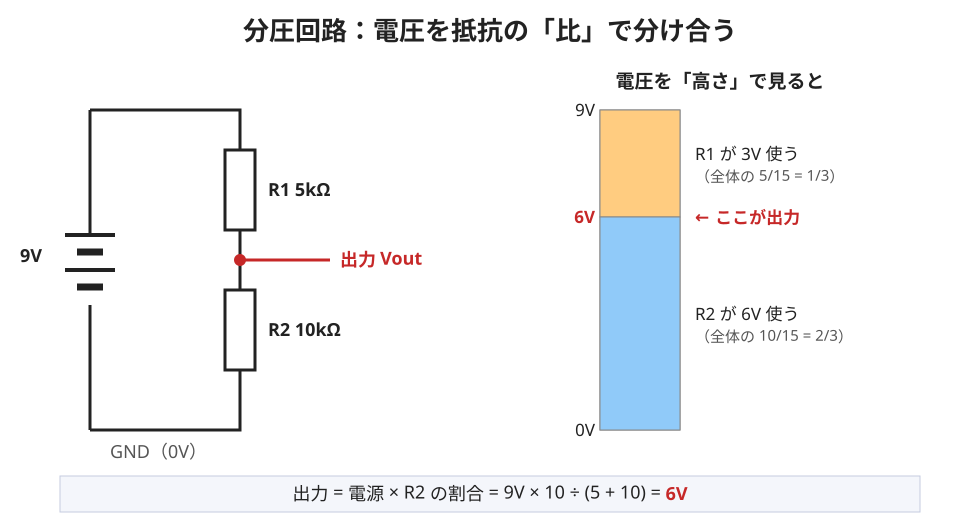

- 2本の抵抗を直列（1本道）につなぐと、電源の 9V を2本で分け合う。
- **大きい抵抗ほど、たくさんの電圧を使う。** 5k と 10k なら、10k のほうが2倍使う（3V と 6V）。
- 2本のつなぎ目から電圧を取り出したものが「出力」。電源より必ず小さくなる。

| 使い道の例 | なぜ分圧するか |
| --- | --- |
| 9V の電池から 6V を作る | 電源より低い電圧がほしい |
| 明るさで抵抗が変わるセンサー（フォトレジスタ）を読む | 抵抗の変化を、マイコンで読める電圧の変化に変える |

**② 式：出力 = 電源 × R2 の割合**

**Vout = Vin × R2 ÷ (R1 + R2)**

| 記号 | 意味 | 図の例 |
| --- | --- | --- |
| Vin | 電源の電圧 | 9V |
| R1 | 上の抵抗 | 5kΩ |
| R2 | 下の抵抗（出力側） | 10kΩ |
| R2 ÷ (R1 + R2) | 全体のうち、R2 が占める割合 | 10 ÷ 15 = 2/3 |
| Vout | 出力（R2 の電圧） | 9 × 2/3 = **6V** |

**③ この式は、オームの法則を2回使うだけで出てくる**

| 手順 | 考え方 | 図の例 |
| --- | --- | --- |
| 1 | 直列なので、全体の抵抗は足し算 | 5k + 10k = 15k |
| 2 | 電流 = 電圧 ÷ 全体の抵抗（どこでも同じ） | 9 ÷ 15k = 0.6mA |
| 3 | 出力 = 電流 × R2 | 0.6mA × 10k = **6V** |

新しい公式を覚えるのではなく、**2日目のオームの法則（I = V ÷ R、V = I × R）の組み合わせ**。

**④ 出力は抵抗の「値」ではなく「比」で決まる**

| R1 | R2 | 比 | 9V のときの出力 |
| --- | --- | --- | --- |
| 5Ω | 10Ω | 1 : 2 | 6V |
| 5kΩ | 10kΩ | 1 : 2 | 6V（同じ） |
| 10kΩ | 10kΩ | 1 : 1 | 4.5V（半分） |

**⑤ 注意：出力に何かをつなぐと、出力は下がる**（詳しくは9日目）

式は「出力に何もつながっていない」ときのもの。センサーやマイコン（＝**負荷**）をつなぐと出力が下がる。理由は下の「2. 解く」の問題3B で説明。

<details>
<summary>発展：4つの変数のどれでも求められる（クリックで開く）</summary>

| 求めたいもの | 式 |
| --- | --- |
| 出力 Vout | Vout = Vin × R2 ÷ (R1 + R2) |
| 電源 Vin | Vin = Vout × (R1 + R2) ÷ R2 |
| 上の抵抗 R1 | R1 = R2 × (Vin − Vout) ÷ Vout |
| 下の抵抗 R2 | R2 = R1 × Vout ÷ (Vin − Vout) |

記事のおすすめは、変形した式を覚えるより、**基本の式に数字を入れてから解く**こと。

</details>

**確認問題**（記事末の問題1・2）

| 問題 | 答え |
| --- | --- |
| 1. 分圧器の式は？ | **Vout = Vin × R2 ÷ (R1 + R2)** |
| 2. 可変抵抗器（つまみで抵抗が変わる部品）を分圧器として使えるか？ | **使える**。可変抵抗器は中で1本の抵抗を、つまみの位置で上（R1）と下（R2）に分けている。つまみを回すと比が変わり、出力が変わる |

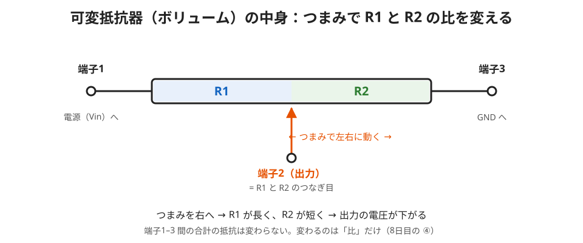

### 2. 解く：同記事末の問題3、4、5（手計算）

> **解き方の型**：
> - 負荷なし → 分圧の式に入れるだけ
> - 負荷あり → **先に R2 と負荷を1本にまとめて**から、分圧の式に入れる

記事には答えが載っていないので、下は自分の計算（4日目の検証で、Tinkercad の測定と一致することを確かめた）。

**問題3A：出力電圧は？**（電源 13.8V、R1 5Ω、R2 10Ω、負荷なし）

```
13.8V --[ R1 5Ω ]--+--> 出力 ?
                   |
                [ R2 10Ω ]
                   |
GND ---------------+
```

| 手順 | 計算 |
| --- | --- |
| R2 の割合 | 10 ÷ (5 + 10) = 2/3 |
| 出力 | 13.8 × 2/3 = **9.2V** |

**問題3B：出力に 15Ω の負荷をつなぐと？**

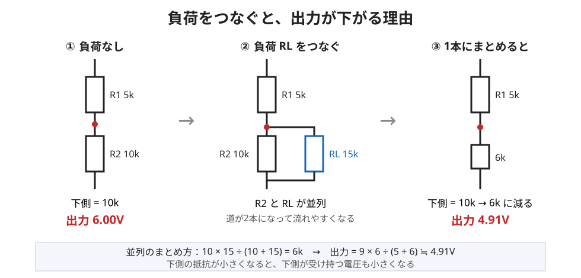

| 手順 | 計算 |
| --- | --- |
| ① R2 と負荷（並列）を1本にまとめる | 10 × 15 ÷ (10 + 15) = **6Ω** |
| ② 下の抵抗を 6Ω として割合を出す | 6 ÷ (5 + 6) = 6/11 |
| ③ 出力 | 13.8 × 6/11 ≒ **7.53V**（負荷なしの 9.2V から下がる） |

**問題4：分圧の式を使わずに、問題3を解き直す**

オームの法則だけで、「全体の電流 → R2 の電圧」の順に解く。答えが問題3と同じになれば正解。

| 手順 | 3A（負荷なし） | 3B（負荷あり） |
| --- | --- | --- |
| ① 下側の抵抗 | 10Ω | 10Ω と 15Ω の並列 = 6Ω |
| ② 全体の抵抗（直列） | 5 + 10 = 15Ω | 5 + 6 = 11Ω |
| ③ 電流 = 電源 ÷ 全体 | 13.8 ÷ 15 = 0.92A | 13.8 ÷ 11 ≒ 1.255A |
| ④ 出力 = 電流 × 下側 | 0.92 × 10 = **9.2V** | 1.255 × 6 ≒ **7.53V** |
| 確かめ：R1 の電圧を足すと電源に戻る | 0.92 × 5 = 4.6V、4.6 + 9.2 = 13.8V ✓ | 1.255 × 5 ≒ 6.27V、6.27 + 7.53 = 13.8V ✓ |

> 分圧の式は、この ①〜④ を1本にまとめた「近道」。

**問題5：R1 は何Ω？**（電源 100V、出力 75V、R2 25Ω、負荷なし）

```
100V --[ R1 ? ]--+--> 出力 75V
                 |
              [ R2 25Ω ]
                 |
GND -------------+
```

| 手順 | 考え方 | 計算 |
| --- | --- | --- |
| ① R2 を流れる電流 | R2 の電圧（= 出力）÷ R2 | 75 ÷ 25 = 3A |
| ② R1 が使う電圧 | 電源 − 出力 | 100 − 75 = 25V |
| ③ R1 | 直列なので電流は同じ 3A | 25 ÷ 3 ≒ **8.33Ω** |
| 確かめ | 分圧の式に入れる | 100 × 25 ÷ (8.33 + 25) ≒ 75V ✓ |

| 問題 | 答え |
| --- | --- |
| 3A・4A | **9.2V** |
| 3B・4B | **約 7.53V** |
| 5 | **約 8.33Ω** |

### 3. 観察：[Falstad 分圧の例題](https://www.falstad.com/circuit/e-voltdivide.html)。10Vから5V、7.5V・5V・2.5Vを作る回路の電圧を確認

元のページの Java 版は今のブラウザでは動かないので、[JavaScript 版](https://www.falstad.com/circuit/circuitjs.html?startCircuit=voltdivide.txt)を使った。

| そのままの回路 | 左の下の抵抗を 30k に変えた |
| --- | --- |
| 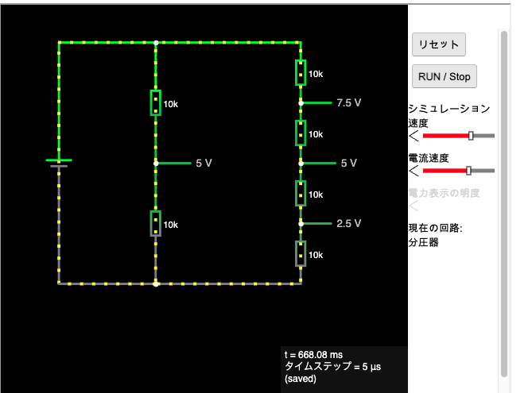 | 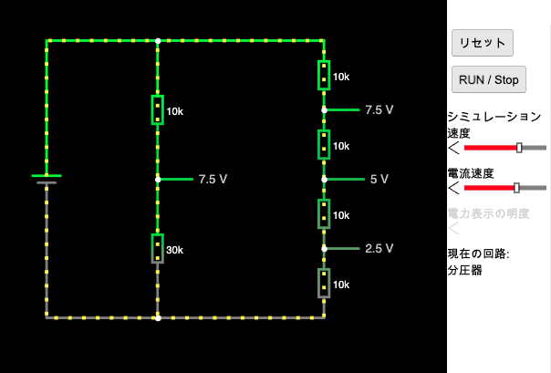 |

**回路の見方**：10V の電源に、抵抗の列が2つ並列につながっている。

```
        左の列            右の列
10V --+------------------+
      |                  |
    [10k]              [10k]
      +-- 5V             +-- 7.5V
    [10k]              [10k]
      |                  +-- 5V
     GND               [10k]
                         +-- 2.5V
                       [10k]
                         |
                        GND
```

**予想 → 結果**（予想の式：10V × その点より下の抵抗 ÷ 列全体の抵抗）

| 列 | 点 | 下の抵抗 ÷ 全体 | 予想 | 結果 |
| --- | --- | --- | --- | --- |
| 左 | 真ん中 | 10k ÷ 20k = 1/2 | 5V | **5V** ✓ |
| 右 | 上 | 30k ÷ 40k = 3/4 | 7.5V | **7.5V** ✓ |
| 右 | 真ん中 | 20k ÷ 40k = 2/4 | 5V | **5V** ✓ |
| 右 | 下 | 10k ÷ 40k = 1/4 | 2.5V | **2.5V** ✓ |
| 左（下を 30k に） | 真ん中 | 30k ÷ 40k = 3/4 | 7.5V | **7.5V** ✓ |

**学んだこと**

**① 同じ抵抗を並べると、電圧が等分される**

```
右の列（10k × 4本）

10V   ─┬─
       │  10k   2.5V 使う
7.5V  ─┤
       │  10k   2.5V 使う
5V    ─┤
       │  10k   2.5V 使う
2.5V  ─┤
       │  10k   2.5V 使う
0V    ─┴─
```

**② 電圧は「比」で、電流は「合計」で決まる**

| 決まるもの | 何で決まるか | Falstad で見えたこと |
| --- | --- | --- |
| 出力の電圧 | 抵抗の**比** | 左の下を 30k にすると、比が 1:3 になり 7.5V |
| 流れる電流（点の速さ） | 抵抗の**合計** | 左の列も 40kΩ になったら、左右の点の速さがそろった（どちらも 0.25mA） |

> 設計のコツ：**出したい電圧は「比」で決め、電池の減り方（電流）は「合計」で決める**。1k と 3k でも 7.5V になるが、合計が 4kΩ なので電流は 10 倍の 2.5mA 流れ、電池がはやく減る。

**③ 並列の列は、互いに影響しない**

左の列を変えても、右の列の 7.5V・5V・2.5V は変わらなかった。どちらの列にも、電源の 10V がそのままかかっているから（4日目の並列のきまり）。

### 4. 検証：Tinkercad で 9V ＋ R1 ＋ R2 を組み、問題で解いた値を設定して測る

**成果物**

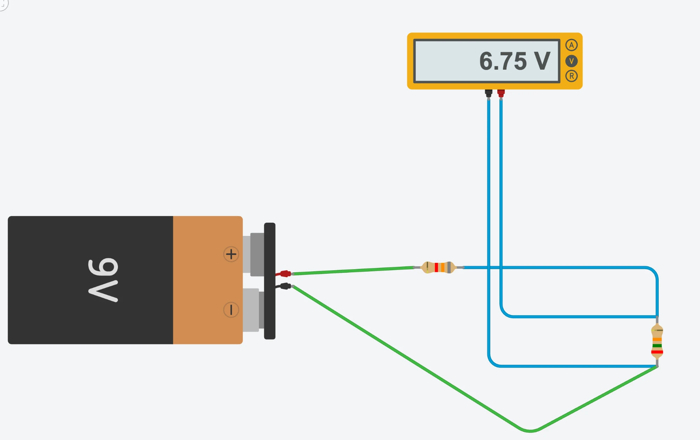

| 部品 | つなぎ方 |
| --- | --- |
| 9V 電池 | ＋ → R1 の上、− → R2 の下 |
| R1（上）・R2（下） | 縦に直列。つなぎ目が出力 |
| 電圧計（V モード） | 赤 → 出力（R1 と R2 のつなぎ目）、黒 → R2 の下（GND） |

**ひと工夫：抵抗を「Ω」から「kΩ」に変えた**

問題の値（5Ω・10Ω）のままだと、9V 電池に大きな電流が流れて電池の電圧が下がり、計算と合わない。出力は「比」で決まるので、**比を変えずに 1000 倍**（5kΩ・10kΩ）にして測った。

| | 5Ω・10Ω のまま | 5kΩ・10kΩ に変更 |
| --- | --- | --- |
| 流れる電流 | 約 0.6A（大きい） | 約 0.6mA（1000 分の 1） |
| 9V 電池の電圧 | 下がる（電池の中にも小さな抵抗があるため） | ほぼ下がらない |
| 比 | 1 : 2 | 1 : 2（同じ） |

**予想 → 結果**

| 確かめたこと | R1 | R2 | 負荷 | 予想 | 結果 |
| --- | --- | --- | --- | --- | --- |
| 問題3A（負荷なし） | 5kΩ | 10kΩ | なし | 9 × 10/15 = 6.0V | **6.00V** ✓ |
| 問題3B（負荷あり） | 5kΩ | 10kΩ | 15kΩ | 9 × 6/11 ≒ 4.91V | **4.91V** ✓ |
| 問題5 の答え | 8.33kΩ | 25kΩ | なし | 9 × 25/33.33 ≒ 6.75V | **6.75V** ✓ |

**参考：問題と同じ値（13.8V・5Ω・10Ω）でも測った**

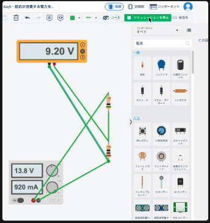

Tinkercad の「電源」部品（電圧を自由に設定できる。上限 30V）を使い、問題3と同じ値で組んだもの。線は交差しているが、交差しているだけではつながらないので、つなぎ方は上と同じ（「回路図」タブで確認済み）。

この回路を、線が交差しないように描き直すとこうなる。

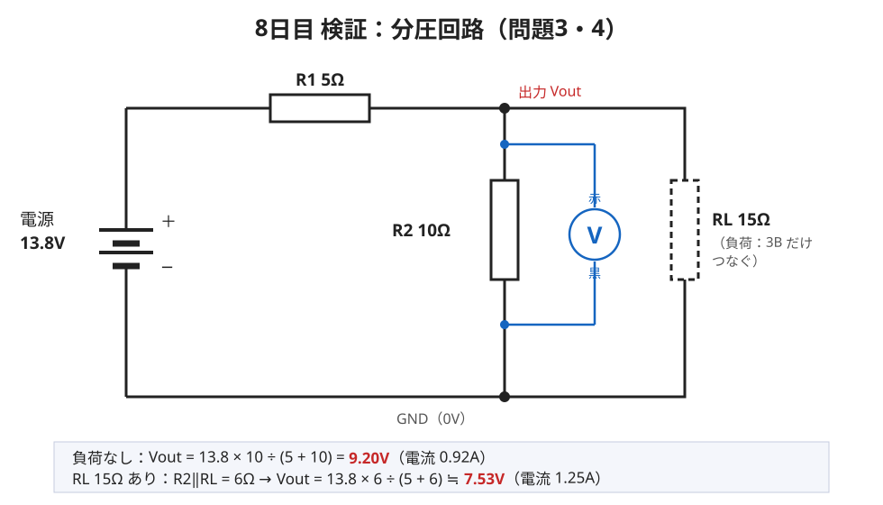

| 条件 | 予想 | 電圧計 | 電源の電流 |
| --- | --- | --- | --- |
| 負荷なし | 9.2V、0.92A | **9.20V** | **920mA** |
| 15Ω の負荷あり | 約 7.53V、約 1.255A | **7.53V** | **1.25A** |

**学んだこと**

**① 手計算と測定がぴったり一致した**

問題3・4・5の答えは、Ω でも kΩ でも Tinkercad の測定と合った。

**② 負荷をつなぐと、どちらも同じ割合で下がる**

| 回路 | 負荷なし | 負荷あり | 下がり方 |
| --- | --- | --- | --- |
| 13.8V・5Ω・10Ω・負荷 15Ω | 9.20V | 7.53V | 約 18% |
| 9V・5kΩ・10kΩ・負荷 15kΩ | 6.00V | 4.91V | 約 18% |

比が同じなら、下がる割合も同じ。

**③ 本物の電池は、大きな電流を流すと電圧が下がる**

電池の中にも小さな抵抗（内部抵抗）があり、大きな電流を流すとそこで電圧を使ってしまう。だから**分圧回路は kΩ の抵抗で、電流を小さくして使う**のがふつう。

<details>
<summary>Tinkercad でつまずいたこと（クリックで開く）</summary>

| つまずいたこと | どうしたか |
| --- | --- |
| 最初に組んだら 6.0V のはずが 7.83V と出た | 配線ミスだった（R1 の両端が同じ線につながってショートし、R2 だけが電池につながっていた）。「回路図」タブで見つけた |
| 線が交差してぐちゃぐちゃに見える | 交差しているだけではつながらない。つながりは「回路図」タブで確かめる |
| 線の端が別の線に重なって、端子につながらない | 部品を少し動かして、端子に重なる線をどけてからつなぐ |
| 9V 電池を置いたら大きくて部品に重なった | 置いてから左上の「全体表示」ボタンで画面を合わせる |

</details>

### この日のまとめ：予想 → 結果 → 差の理由

| 何を測った／試したか | 予想 | 結果 | 差の理由 |
| --- | --- | --- | --- |
| Falstad 分圧（5通り） | 10V × 下の抵抗 ÷ 全体 | 5つとも一致 | 差なし |
| Tinkercad 9V・5kΩ・10kΩ（3A） | 6.0V | 6.00V | 差なし |
| Tinkercad 同上＋負荷 15kΩ（3B） | 4.91V | 4.91V | 差なし |
| Tinkercad 9V・8.33kΩ・25kΩ（問題5） | 6.75V | 6.75V | 差なし |
| Tinkercad 13.8V・5Ω・10Ω（負荷なし／あり） | 9.2V／7.53V | 9.20V／7.53V | 差なし |
| 最初に組んだ回路（9V 電池・5Ω・10Ω） | 6.0V | 7.83V | 配線ミス。R2 だけが電池につながり、さらに大きな電流で電池の電圧が下がった |

## 9日目 負荷で電圧が下がる

> **ひとことで**：分圧回路の出力に何か（負荷）をつなぐと、出力は下がる。分圧の抵抗が**負荷より大きいほど、大きく下がる**。

**この日にやったことと、分かったこと**

| # | やったこと | 分かったこと（一言） |
| --- | --- | --- |
| 1 | 記事を読む（負荷による電圧降下） | 電圧計をつなぐだけでも、出力は少し下がる |
| 2 | Tinkercad で 1kΩ ペアと 100kΩ ペアに負荷をつなぐ | 同じ 1kΩ の負荷で、1kΩ ペアは 33%、100kΩ ペアは 98% 下がった |
| 3 | 記事を読む（3本以上の分圧） | どの抵抗の電圧も「電源 × その抵抗 ÷ 合計」で出せる |
| 4 | 記録：大きすぎる抵抗で困ること | 負荷に電流をとられて、正しい電圧が読めなくなる |

やることの詳細は[チェックリスト](../CHECKLIST.md#第2週-分圧回路図コンデンサ)。

### 1. 読む：同記事の「分圧負荷による電圧降下」

[DigiKey「分圧器の基礎」](https://forum.digikey.com/t/topic/44004)の後半。

**学んだこと**

**① 「負荷」とは、出力につなぐものすべて**

| 負荷の例 | つなぐ理由 |
| --- | --- |
| マイコン（Arduino）の入力ピン | 出力の電圧を読む |
| 別の回路 | 出力の電圧を使う |
| **電圧計・オシロスコープ** | 出力の電圧を**測る**。測る道具も負荷になる |

負荷は出力と GND の間につながるので、**R2 と並列**になる。8日目の問題3B と同じ形。


**② 記事の例：電圧計をつないだだけで下がる**

記事では、10V の電源で「抵抗の値が 10 倍ずつ違う3つの分圧回路（どれも同じ抵抗2本、計算上の出力は 5V）」を、中の抵抗が 1MΩ の電圧計で測っている。

| ペア | 計算（負荷なし） | 電圧計で測った値 |
| --- | --- | --- |
| 1kΩ ＋ 1kΩ | 5V | **5.00V** |
| 100kΩ ＋ 100kΩ | 5V | **4.76V**（下がった） |

電圧計の中の 1MΩ が R2 と並列になる。100kΩ ペアでは、下側が 100k → 約 91k に減るので出力が下がる（10 × 91 ÷ 191 ≒ 4.76V）。1kΩ ペアでは、1MΩ はほとんど影響しない。

**③ 下がって驚かないために**

記事のまとめは、「手で問題をたくさん解いて、負荷の影響を感覚でつかむこと。そうすれば、測った電圧が計算より低くても慌てない」。

<details>
<summary>発展：記事の先の話題（クリックで開く）</summary>

| 話題 | 内容 |
| --- | --- |
| テブナンの定理 | 負荷がある回路を、もっと簡単に計算するための考え方。今後学ぶ |
| フィルタ | 抵抗の代わりにコンデンサやコイルを使うと、周波数で出力が変わる回路（ローパスフィルタなど）になる。13日目で学ぶ |
| オペアンプ | 分圧の出力を「受け取るだけで電流をほとんど取らない」部品で、負荷の影響をなくせる |

記事末には問題6〜18もある（自分で問題を作る、テスターの仕様を調べる、など発展的なもの）。チェックリストの範囲は問題3〜5（8日目に済み）なので、ここでは解いていない。

</details>

### 2. 演習：Tinkercad で 1kΩ ペア、100kΩ ペアの分圧をそれぞれ作り、出力に 1kΩ の負荷をつなぐ前後で電圧を測る

**作った回路**

9V 電池に、2つの分圧回路を並列につないだ（並列なので、どちらにも 9V がかかり、お互いに影響しない）。

| | 1kΩ ペア | 100kΩ ペア |
| --- | --- | --- |
| 上の抵抗 | R1 1kΩ | R3 100kΩ |
| 下の抵抗 | R2 1kΩ | R4 100kΩ |
| 負荷（あとから足す） | R5 1kΩ | R6 1kΩ |
| 電圧計 | 上の電圧計 | 下の電圧計 |

**測る前の予想**

| ペア | 負荷なし | 負荷あり：下側の抵抗 | 負荷ありの出力 | 下がり方 |
| --- | --- | --- | --- | --- |
| 1kΩ | 9 × 1/2 = 4.5V | 1k と 1k の並列 = 0.5k | 9 × 0.5 ÷ 1.5 = **3.0V** | 約 33% |
| 100kΩ | 9 × 1/2 = 4.5V | 100k と 1k の並列 ≒ 0.99k | 9 × 0.99 ÷ 100.99 ≒ **0.088V** | 約 98% |

予想：**100kΩ ペアのほうが、はるかに大きく下がる。**

**成果物**

| | 負荷なし | 負荷あり |
| --- | --- | --- |
| Tinkercad | 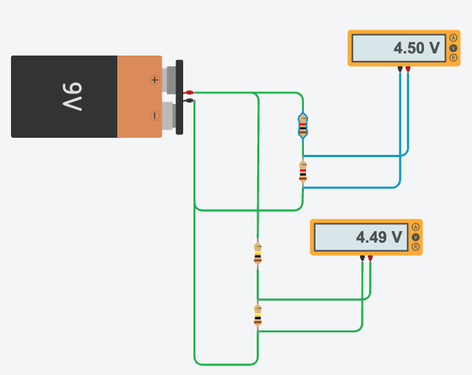 | 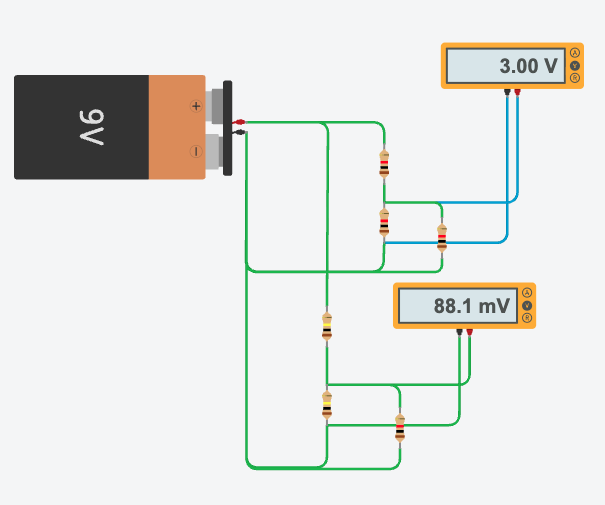 |
| 回路図 | 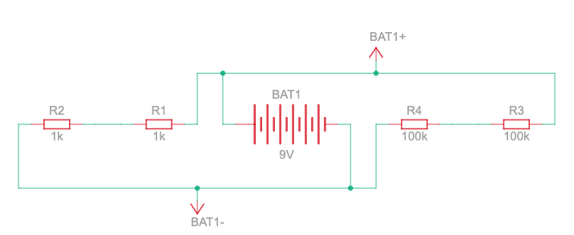 | 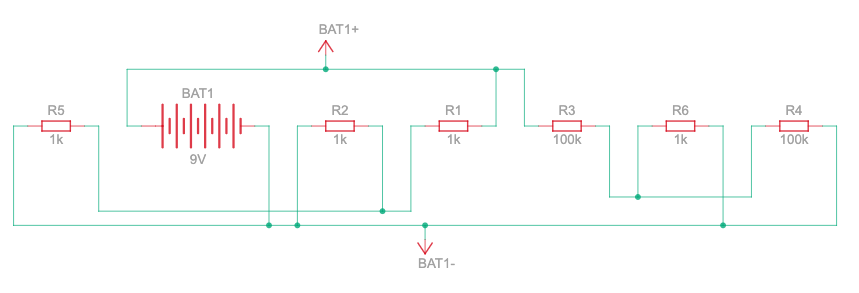 |

**結果**

| ペア | 負荷なし | 負荷あり | 予想と比べて |
| --- | --- | --- | --- |
| 1kΩ | **4.50V** | **3.00V** | ✓ 一致 |
| 100kΩ | **4.49V** | **88.1mV**（0.0881V） | ✓ ほぼ一致 |

**学んだこと**

**① 同じ負荷でも、抵抗が大きいペアほど大きく下がる**

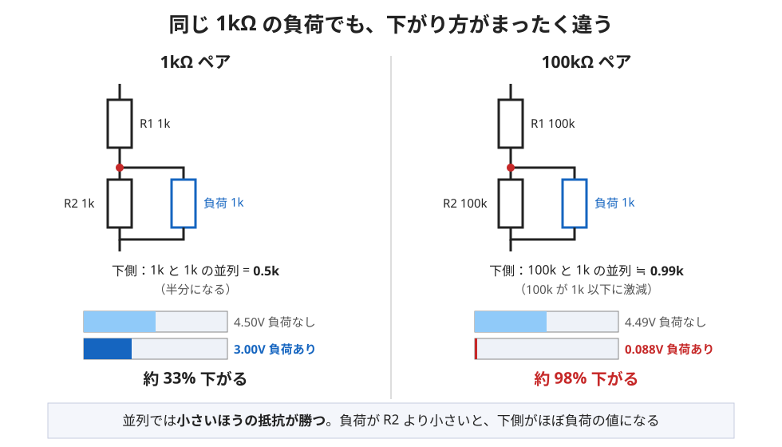

**② 理由：並列では「小さいほうの抵抗」が勝つ**

4日目に学んだとおり、並列の合成抵抗は**どちらの抵抗よりも小さくなる**。

| ペア | R2 | 負荷 | 並列にすると | 下側がどうなったか |
| --- | --- | --- | --- | --- |
| 1kΩ | 1k | 1k | 0.5k | 半分になった |
| 100kΩ | 100k | 1k | 0.99k | **100 分の 1** になった（ほぼ負荷の 1k だけ） |

100kΩ ペアでは、下側がほぼ 1k になり、上の 100k との比が 100 : 1 になってしまう。だから出力は 9V の約 1/100 しか残らない。

**③ 電圧計も負荷になる**

100kΩ ペアは、負荷なしでも 4.50V ではなく **4.49V** だった。Tinkercad の電圧計の中にも大きな抵抗があり、それが R2 と並列になってわずかに下げている（記事の 4.76V と同じ現象。Tinkercad の電圧計のほうが中の抵抗が大きいので、下がり方が小さい）。

**④ 小さい抵抗にも弱点がある：電池をたくさん使う**

| ペア | 負荷なしで流れる電流（9V ÷ 合計） | 電池の持ち |
| --- | --- | --- |
| 1kΩ ペア | 9 ÷ 2k = **4.5mA** | 減りやすい |
| 100kΩ ペア | 9 ÷ 200k = **0.045mA** | 100 倍長持ち |

| 抵抗の選び方 | 良いところ | 困るところ |
| --- | --- | --- |
| 小さい抵抗（1kΩ など） | 負荷をつないでも電圧が下がりにくい | 電流が多く、電池が減る |
| 大きい抵抗（100kΩ など） | 電流が少なく、電池が長持ち | 負荷をつなぐと電圧が大きく下がる |

一般的な目安は、**分圧の抵抗を、負荷の抵抗の 1/10 以下にする**こと（例：負荷が 10kΩ なら、R2 は 1kΩ 以下）。こうすると、下がり方は 10% 以内におさまる。

### 3. 読む：[3つ以上の抵抗による分圧計算](https://forum.digikey.com/t/topic/45012)

**学んだこと**

**① 抵抗が何本でも、使う式は1つ**

**その抵抗の電圧 = 電源 × その抵抗 ÷ 抵抗の合計**

8日目の分圧の式（Vout = Vin × R2 ÷ (R1 + R2)）を、何本でも使えるように広げたもの。直列では電流がどこでも同じなので、**抵抗が大きいほど、その分だけ大きな電圧を使う**。

**② 記事の例：10V を 3本の抵抗で分ける**

```
10V --[ R1 1500Ω ]--[ R2 1000Ω ]--[ R3 500Ω ]--+
 ^                                              |
 +-------------------- GND ---------------------+
```

| 抵抗 | 計算 | 電圧 |
| --- | --- | --- |
| R1 1500Ω | 10 × 1500 ÷ 3000 | **5V** |
| R2 1000Ω | 10 × 1000 ÷ 3000 | **3.33V** |
| R3 500Ω | 10 × 500 ÷ 3000 | **1.67V** |
| 合計 | 5 + 3.33 + 1.67 | **10V**（電源と同じ） |

全部足すと電源の電圧に戻る（4日目のキルヒホッフの第2法則）。

**③ 「出力」と「電圧降下」の言葉の使い分け**

| 呼び方 | いつ使うか | 測り方 |
| --- | --- | --- |
| 出力（Vout） | GND（0V）を基準にした電圧 | 黒を GND、赤を測る点に当てる |
| 電圧降下 | ある抵抗の両端の電圧（GND と関係ない） | 黒と赤を、その抵抗の両端に当てる |

例：上の R2 の電圧 3.33V は「出力」ではなく「R2 の電圧降下」。電圧はいつも「2つの点の差」なので、測るときは**2本のプローブを、どの2点に当てるか**を意識する。

**確認問題**（記事末の問題から、数字が決まっているもの。記事に答えはないので自分の計算）

| 問題 | 条件 | 考え方 | 答え |
| --- | --- | --- | --- |
| 問題3 | 上の例で、電源を 20V、R3 を 2kΩ にする | 合計 1500 + 1000 + 2000 = 4500Ω | R1 **6.67V**、R2 **4.44V**、R3 **8.89V**（足すと 20V） |
| 問題11 | 上の例（10V）で、R1 に 500Ω を並列につなぐ | 先に並列をまとめる：1500 × 500 ÷ 2000 = 375Ω。合計 375 + 1000 + 500 = 1875Ω | R1 部分 **2.0V**、R2 **5.33V**、R3 **2.67V** |

問題11 のように、**並列の部分は先に1本にまとめてから**、直列の式を使う（8日目の負荷の問題と同じ手順）。

### 4. 記録：「センサーの分圧に大きすぎる抵抗を使うと何が困るか」を2行

> 大きすぎる抵抗で分圧すると、出力につないだマイコンや電圧計（負荷）が R2 と並列になって下側の抵抗が大きく減り、出力の電圧が大きく下がって正しい値が読めない（100kΩ ペアでは 4.5V が 0.088V になった）。
> 逆に小さすぎると電流が増えて電池が減るので、分圧の抵抗は負荷より十分小さく（目安 1/10 以下）、かつ電流が多すぎない値を選ぶ。

### この日のまとめ：予想 → 結果 → 差の理由

| 何を測った／試したか | 予想 | 結果 | 差の理由 |
| --- | --- | --- | --- |
| 1kΩ ペア・負荷なし | 4.5V | 4.50V | 差なし |
| 1kΩ ペア・負荷 1kΩ | 3.0V | 3.00V | 差なし |
| 100kΩ ペア・負荷なし | 4.5V | 4.49V | 電圧計の中の抵抗も負荷になり、わずかに下がった |
| 100kΩ ペア・負荷 1kΩ | 約 0.088V | 88.1mV（0.0881V） | 差なし |
| どちらが大きく下がるか | 100kΩ ペア | 100kΩ ペア（98%）。1kΩ ペアは 33% | 予想どおり |

## 10日目 回路図の読み方とKiCad

> **ひとことで**：KiCad では「回路図を描く → ERC（配線チェック）で確かめる → 部品表を出す → 基板を作る」の順に進める。最初の回路図（電池 → 抵抗 → LED）を描き、ERC で違反 0 件を確かめた。

**この日にやったことと、分かったこと**

| # | やったこと | 分かったこと（一言） |
| --- | --- | --- |
| 1 | KiCad 入門ガイドを読む | 回路図は「部品の記号」と「それをつなぐ線」でできている |
| 2 | KiCad 10.0 をインストールし、最初の回路図を描く | 電源の記号と PWR_FLAG で、ERC のエラーが消える |
| 3 | 抵抗の記号の違いを確かめる | KiCad でも四角とギザギザの両方を選べる |

やることの詳細は[チェックリスト](../CHECKLIST.md#第2週-分圧回路図コンデンサ)。

### 1. 読む：[KiCad 10.0 入門ガイド](https://docs.kicad.org/10.0/ja/getting_started_in_kicad/getting_started_in_kicad.html)の「基本概念とワークフロー」と「チュートリアル パート1・2（回路図）」

> 補足：入門ガイドは KiCad 6.0 以降、日本語訳がほとんどない（URL に `ja` があっても中身は英語）。今の最新版 **KiCad 10.0** をインストールし、ガイドも 10.0 版を Chrome の翻訳（右クリック →「日本語に翻訳」）で読んだ。右上の「8.0 ▼」などはガイドの版で、インストールした KiCad と同じ版にそろえると画面が一致する。

**学んだこと**

**① KiCad の作業の流れ**

**回路図を描く → ERC で確かめる → 部品表（BOM）を出す → 基板を作る（後の週）**

| 段階 | KiCad の画面 | やること |
| --- | --- | --- |
| 回路図（Schematic） | 回路図エディター | どの部品を使い、どうつなぐかを記号で描く |
| ERC（Electrical Rules Check） | 回路図エディターの「ERC」ボタン | つなぎ忘れ、電源の入れ忘れなどを見つける |
| BOM（Bill of Materials） | ツール → 部品表を生成 | 使う部品の一覧を CSV などで書き出す |
| 基板（PCB） | PCB エディター | 部品の置き場所と、銅の配線を決める（今回はまだ） |

**② 回路図は「記号」と「線」でできている**

| 用語 | 意味 | 今回の例 |
| --- | --- | --- |
| シンボル（記号） | 部品を表す絵 | 電池、抵抗、LED |
| ライブラリ | 記号の入った箱。基本の部品は **Device** ライブラリ | Device:LED、Device:R_US、Device:Battery_Cell |
| 配線（ワイヤ） | 記号のピンどうしをつなぐ線。緑色 | 電池 → 抵抗 → LED → 電池 |
| ネット | つながっている線のまとまり。名前を付けられる | VCC、GND、led |
| リファレンス（番号） | 部品ごとの名前。自動で付く（アノテーション） | BT2、R1、D1 |
| 値 | 部品の値 | 3V、1k、red |

**③ 電源の記号と PWR_FLAG**

| 記号 | 意味 |
| --- | --- |
| VCC（上向きの矢印） | 電源の＋側。同じ名前の記号どうしは、線がなくてもつながっていることになる |
| GND（下向きの三角） | 電源の−側、0V の基準 |
| PWR_FLAG（ひし形） | 「このネットには電源がつながっている」と KiCad に教える目印 |

人間には「電池がつながっているから VCC と GND には電気が来ている」と分かるが、KiCad には分からない。そのままだと ERC が「電源の来ていないネットがある」とエラーを出す。**PWR_FLAG を VCC と GND に付けると、エラーが消える。**

**④ ERC は「つなぎ方のチェック」で、「動くかどうか」は分からない**

ERC が見つけられるのは、つなぎ忘れのピンや、電源の入れ忘れなどの**よくあるミス**だけ。回路がちゃんと動くか（抵抗の値が合っているかなど）は、自分で計算して確かめる。

### 2. KiCad をインストールし、ガイドに沿って最初の回路図を描く

**成果物**

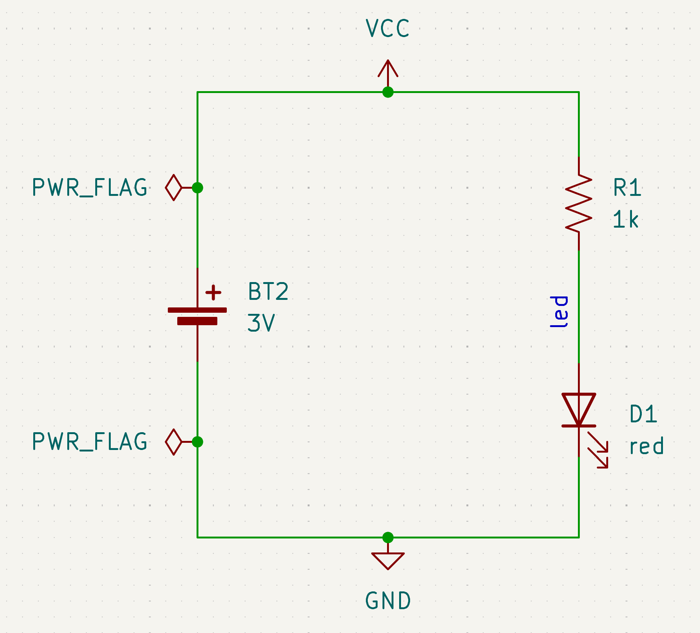

- プロジェクト一式：[kicad/day10-first-schematic/](kicad/day10-first-schematic/)（KiCad 10.0 で開ける）
- 部品表（BOM）：[1st-bom.csv](kicad/day10-first-schematic/1st-bom.csv)

**ERC の結果**（メニュー「検査」→「電気的ルールチェッカー」→「Run ERC」）

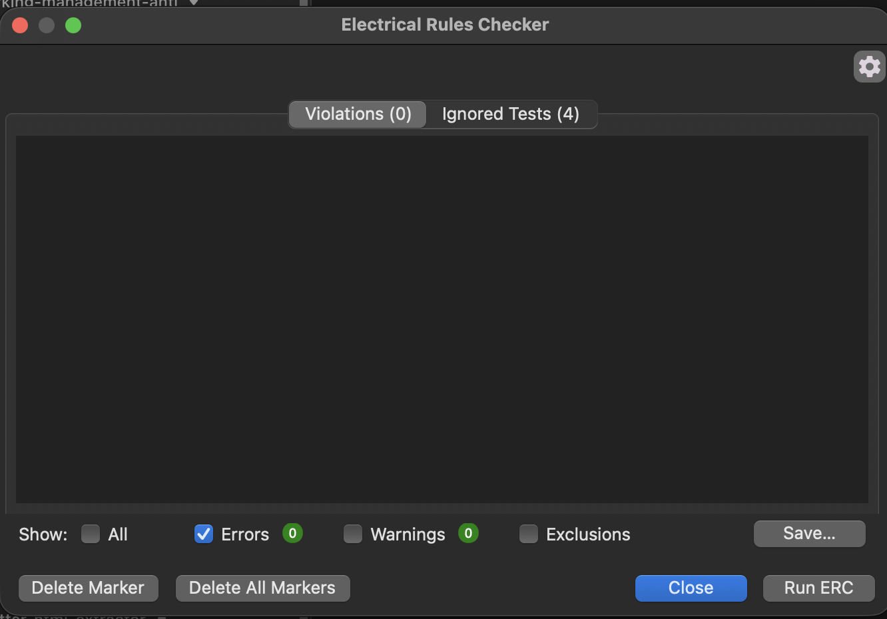

| 表示 | 意味 |
| --- | --- |
| Violations（違反）0 | 見つかった問題が 0 件。**合格** |
| Errors 0・Warnings 0 | エラーも警告もない |
| Ignored Tests（無視しているチェック）4 | KiCad が最初から「チェックしない」と設定している項目の数。異常ではない |

**PWR_FLAG を消して ERC をやり直すと…**（③の PWR_FLAG の役目を確かめた）

| ERC の画面 | 回路図の上の印 |
| --- | --- |
| 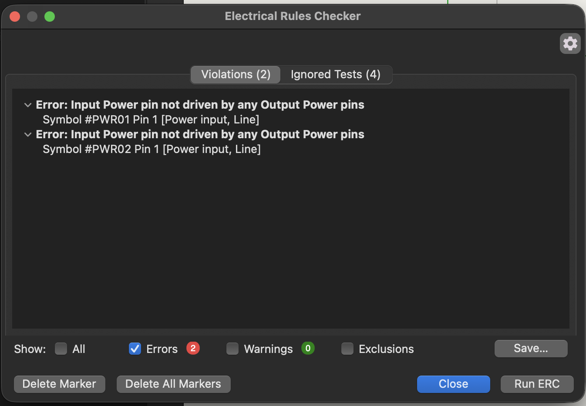 | 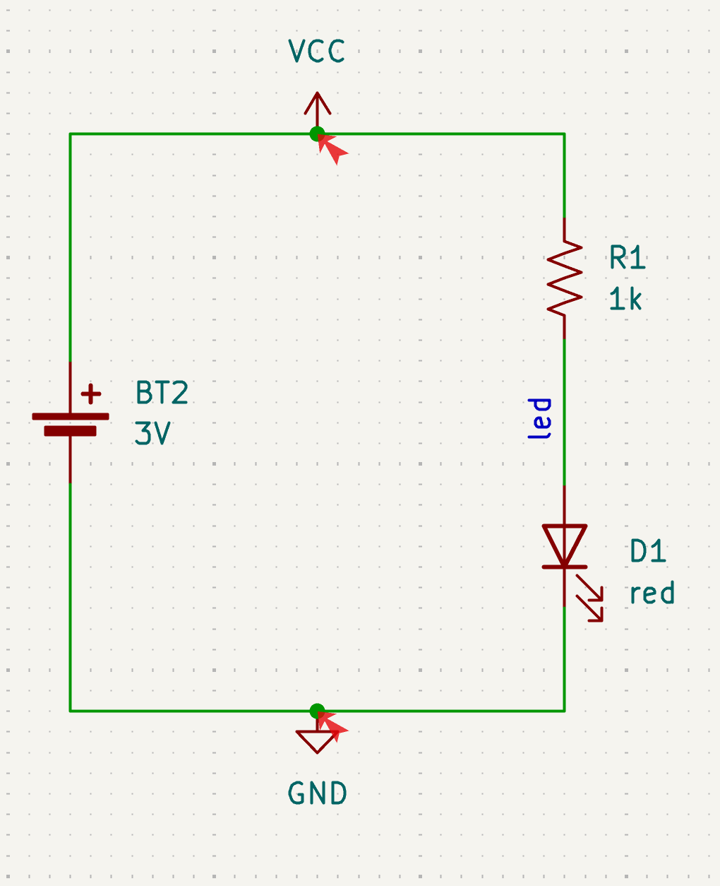 |

| 出たエラー | 意味 | 場所 |
| --- | --- | --- |
| Error: Input Power pin not driven by any Output Power pins（#PWR01） | 電源入力のピンに、電源を出すピンがつながっていない | VCC の記号（赤い矢印の印） |
| 同上（#PWR02） | 同上 | GND の記号（赤い矢印の印） |

| | PWR_FLAG なし | PWR_FLAG あり |
| --- | --- | --- |
| ERC の結果 | **エラー 2 件** | **違反 0 件** |
| 理由 | 電池のピンは「受け身」のピン扱いで、KiCad は電源を出しているとは判断しない | PWR_FLAG が「ここに電源がある」と KiCad に教える |

> リポジトリに置いたプロジェクトは PWR_FLAG ありのもの。確かめたあとは PWR_FLAG を元に戻しておく。

**描いた回路**

回路の形は上の画像のとおり。電池の＋（VCC）→ R1 → D1 → GND → 電池の− と1周する。使った部品は次のとおり。

| 部品 | 記号名（ライブラリ:名前） | 値 |
| --- | --- | --- |
| BT2 | Device:Battery_Cell | 3V（コイン電池） |
| R1 | Device:R_US（ギザギザ） | 1kΩ |
| D1 | Device:LED | red（赤） |
| 電源記号 | power:VCC、power:GND | ― |
| PWR_FLAG ×2 | power:PWR_FLAG | VCC と GND に1つずつ |

**部品表（BOM）の中身**

| 番号 | 数 | 値 |
| --- | --- | --- |
| BT2 | 1 | 3V |
| D1 | 1 | red |
| R1 | 1 | 1k |

**おまけ：この回路でLEDに流れる電流**（4日目の式で計算）

| 計算 | 値 |
| --- | --- |
| 電流 ≒ (電源 − LEDの電圧) ÷ 抵抗 = (3 − 2) ÷ 1000 | **約 1mA** |

1mA は 4日目の 220Ω（13.5mA）よりずっと少ないので、**光るが暗め**になるはず。

### 3. 注意：抵抗の記号は「四角」と「ギザギザ」の2種類。同じ部品だと覚える

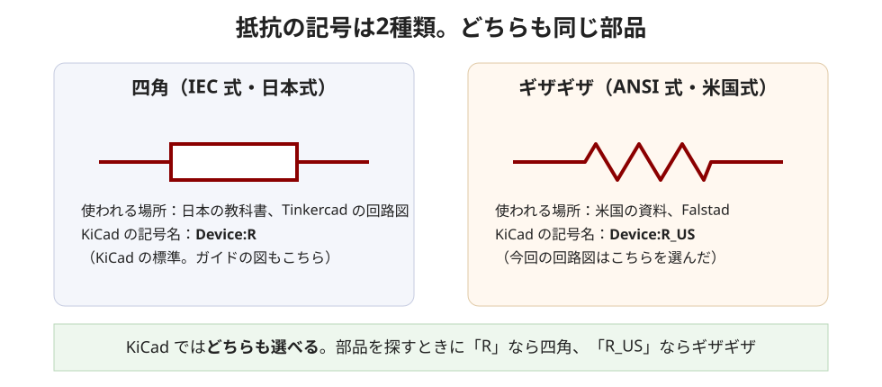

| | 四角 | ギザギザ |
| --- | --- | --- |
| 呼び方 | IEC 式（日本式） | ANSI 式（米国式） |
| 使われる場所 | 日本の教科書、ヨーロッパ、**Tinkercad の回路図表示** | 米国の資料、Falstad |
| KiCad の記号名 | **Device:R**（標準） | **Device:R_US** |

チェックリストには「KiCad は四角」と書いていたが、正しくは **KiCad はどちらも選べる**。部品を探すときに「R」と入れると四角、「R_US」を選ぶとギザギザになる。今回は、Falstad と見た目をそろえるため、ギザギザ（R_US）を使った。

> 訂正（11日目に確認）：Tinkercad は、ブレッドボード表示では抵抗を部品の絵で描き、**回路図表示では四角**で描く。最初「Tinkercad はギザギザ」と書いていたのは誤り。

<details>
<summary>同じ部品の別の書き方（クリックで開く）</summary>

| 部品 | 書き方の違い |
| --- | --- |
| 抵抗 | 四角（IEC）／ギザギザ（ANSI） |
| 電池 | 長い線が＋、短い線が−（どちらの式でも同じ）。KiCad の Battery_Cell は1セル、Battery は複数セルの記号 |
| GND | 下向きの三角や、横線を3本重ねた形など |

</details>

### この日のまとめ：予想 → 結果 → 差の理由

| 何を測った／試したか | 予想 | 結果 | 差の理由 |
| --- | --- | --- | --- |
| ERC（PWR_FLAG なし） | エラーが2つ出る | **エラー 2 件**（VCC と GND の「Input Power pin not driven」） | 差なし。電池のピンは「電源を出す側」と見なされないため、KiCad には VCC・GND に電源が来ていないように見える |
| ERC（PWR_FLAG あり） | エラーなし | **違反 0 件**（エラー 0、警告 0） | 差なし。PWR_FLAG で電源の存在を KiCad に伝えている |
| 部品表の書き出し | 3つの部品が並ぶ | BT2・D1・R1 の3行 | 差なし |

## 11日目 回路図を自分で描く

> **ひとことで**：第1週の直列・並列回路と、8日目の分圧回路を KiCad で描き、3つとも ERC で違反 0 件。Tinkercad の回路図表示と見比べると、**電流計が描かれないので、その場所で線が切れて見える**ことが分かった。

**この日にやったことと、分かったこと**

| # | やったこと | 分かったこと（一言） |
| --- | --- | --- |
| 1 | KiCad で直列・並列・分圧の3つを描く | ラベルは「点に名前を付けるだけ」。分圧をするのは抵抗 |
| 2 | Tinkercad の回路図表示と見比べる | 電源の名前の付け方が違う。電流計は描かれない |
| 3 | プロジェクトと PDF を置く | PDF は A4 の枠に小さく載るが、拡大できるので問題ない |

やることの詳細は[チェックリスト](../CHECKLIST.md#第2週-分圧回路図コンデンサ)。

### 1. 描く：第1週の直列・並列回路と、8日目の分圧回路を KiCad で描く

**成果物**

| 直列（4日目） | 並列（4日目） |
| --- | --- |
| 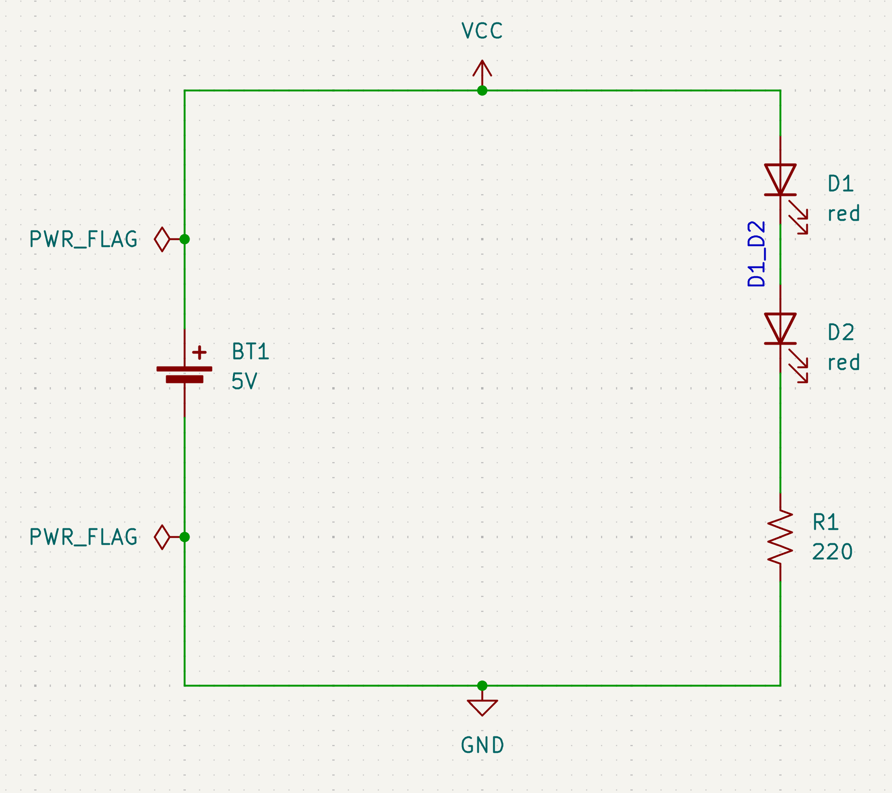 | 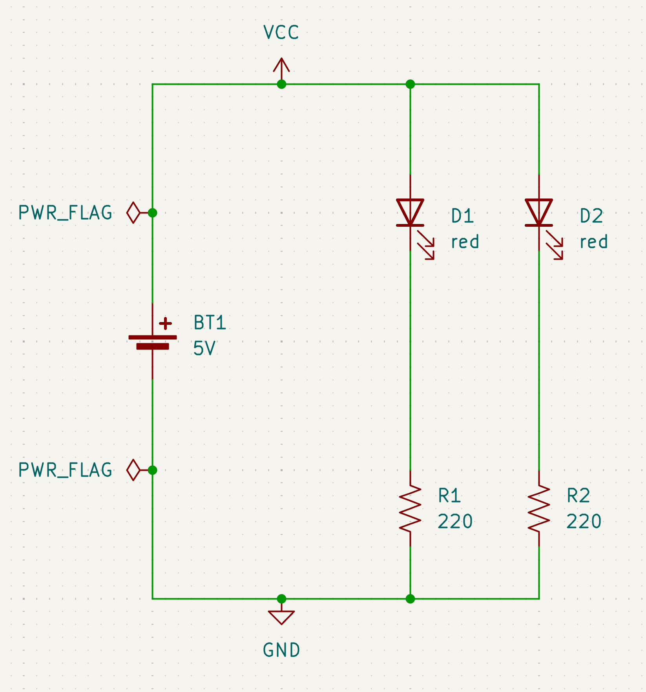 |
| ERC：違反 0 件 | ERC：違反 0 件 |
| **分圧（8日目）** |  |
| 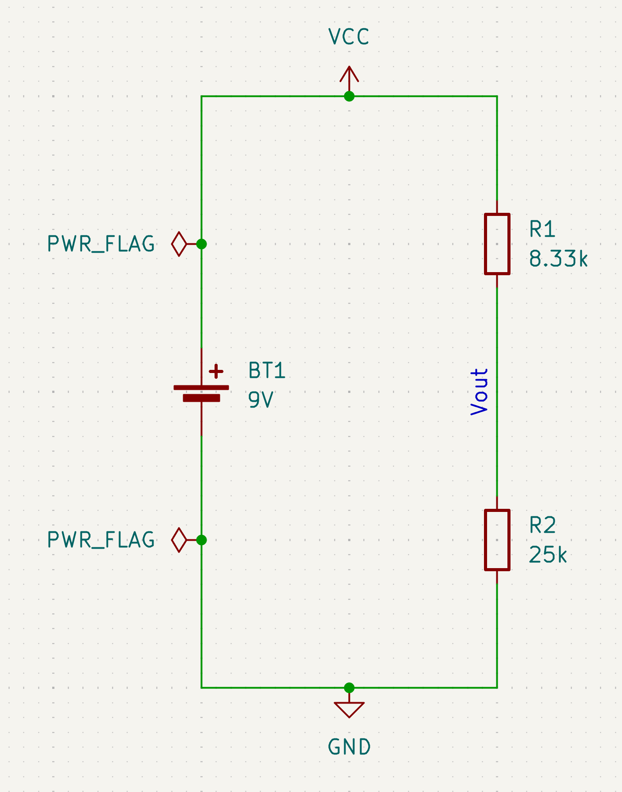 |  |
| ERC：違反 0 件 |  |

| 回路 | 部品 | つなぎ方 | プロジェクト |
| --- | --- | --- | --- |
| 直列 | 5V、赤LED ×2（D1・D2）、220Ω（R1） | VCC → D1 → D2 → R1 → GND の1本道 | [day11_01_series-circuit](kicad/day11_01_series-circuit/) |
| 並列 | 5V、赤LED ×2、220Ω ×2 | VCC から2本に枝分かれ（D1-R1、D2-R2）、GND で合流 | [day11_02_parallel-circuit](kicad/day11_02_parallel-circuit/) |
| 分圧 | 9V、8.33kΩ（R1）、25kΩ（R2） | VCC → R1 → **Vout** → R2 → GND | [day11_03_voltage-divider-circuit](kicad/day11_03_voltage-divider-circuit/) |

各フォルダに、回路図（.kicad_sch）、回路図の PDF、部品表（.csv）、ERC の結果（ERC.rpt）を置いた。

<details>
<summary>ERC の画面と、最初に描いた LED 1個の直列（クリックで開く）</summary>

| 直列 | 並列 |
| --- | --- |
| 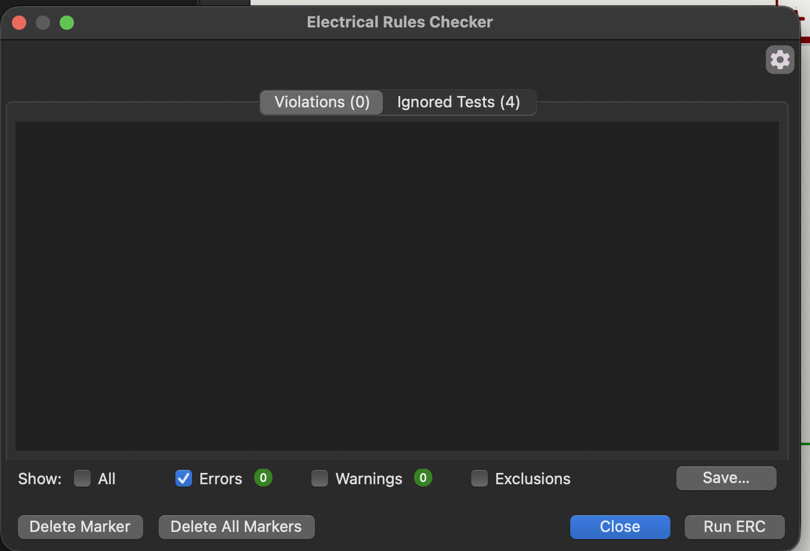 | 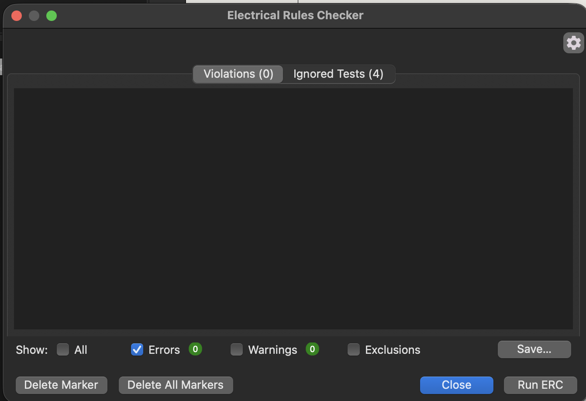 |
| **分圧** |  |
| 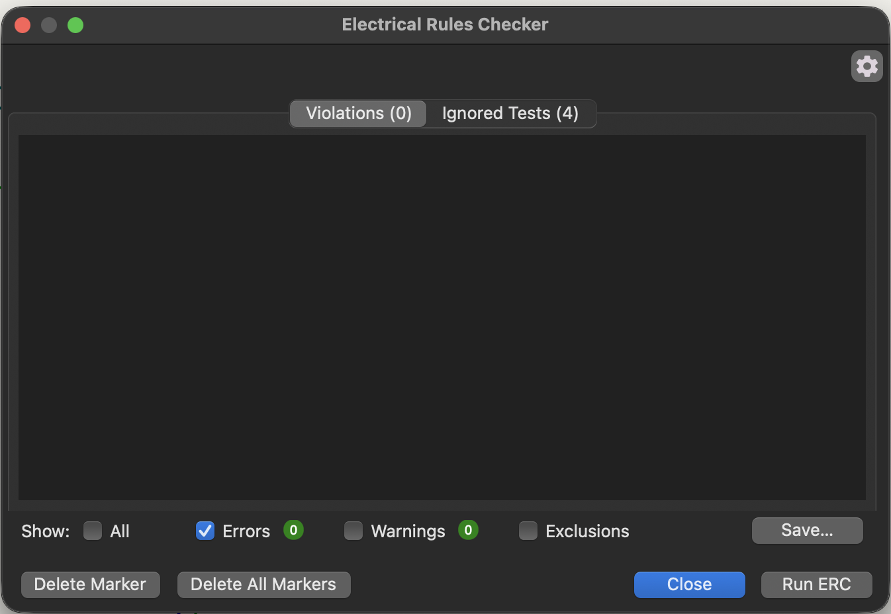 |  |

最初は直列として LED 1個（1・3日目の回路）を描いた。4日目に並列と比べたのは LED 2個の直列なので、D2 を足して描き直した。

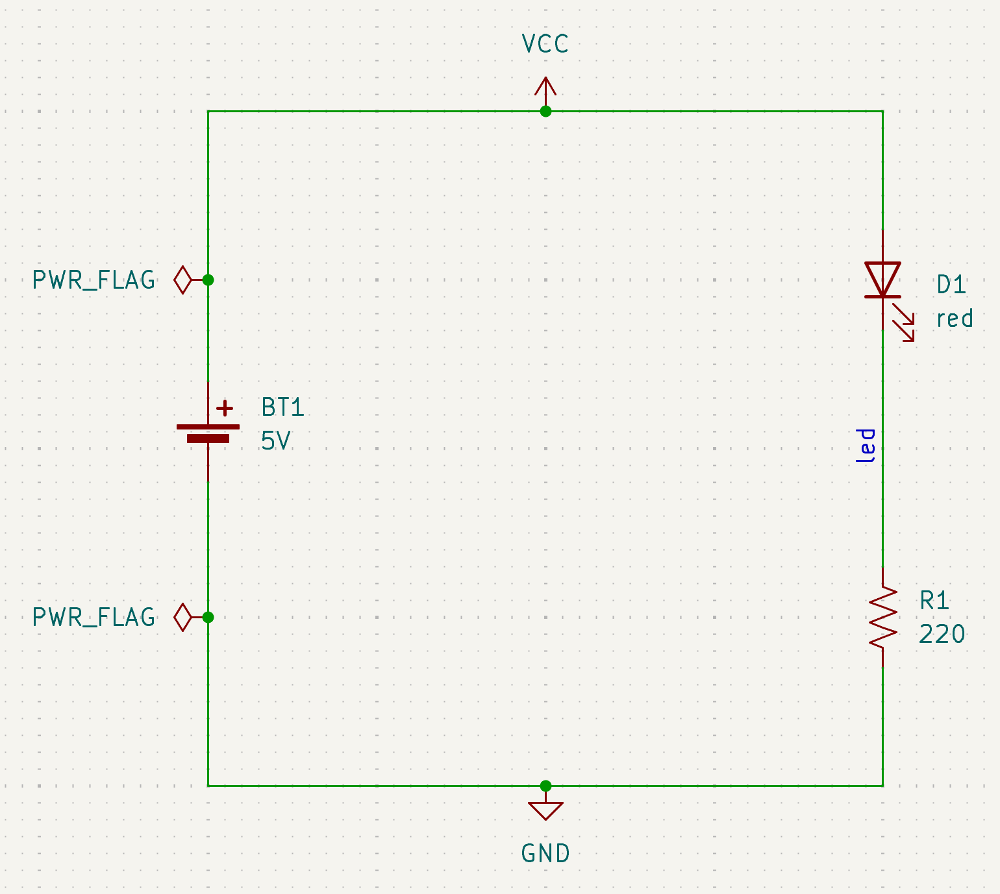

</details>

**学んだこと**

**① ネット名のラベルは「点に名前を付けるだけ」**

| | ラベルあり | ラベルなし |
| --- | --- | --- |
| 回路の動き | 同じ | 同じ |
| ERC | 通る | 通る |
| 名前 | 自分で付けた名前（Vout、D1_D2） | KiCad が自動で付ける（Net-(D1-K) など） |

分圧回路で **分圧をしているのは R1 と R2** の2本。Vout ラベルは、そのつなぎ目に「ここが出力」と名前を付けただけ。8日目に Tinkercad で電圧計の赤を当てた点（6.75V）がここ。

| ラベルを付けると役に立つ場面 | 例 |
| --- | --- |
| 測る点・使う点を示す | 分圧の Vout |
| 離れた場所を線なしでつなぐ | 同じ名前のラベルどうしはつながる（VCC・GND と同じしくみ） |

ラベルの付け方：キーボードの **L** → 名前を入れる → ラベルの小さな点を**線の上**に合わせてクリック。点が線から外れていると、ラベルの端に**小さな四角**（どこにもつながっていない印）が出る。

**② 部品の「値」は人が読むためのメモ**

| 「値」に書いたもの | 使われる場面 | ERC・回路の動き |
| --- | --- | --- |
| red（LED の色） | 回路図を読む、部品表、部品を用意する | 変わらない |
| 9V（電池） | 同上 | 変わらない |

LED は色によって使う電圧が違う（赤は約 2V、青・白は約 3V）。実物を作るときは、抵抗の計算のために色を書いておく。

**③ ERC のエラーと直し方（分圧回路で出たもの）**

| 出たエラー | 原因 | 直し方 |
| --- | --- | --- |
| Input Power pin not driven（#PWR01） | PWR_FLAG が VCC 側にしかなく、GND 側になかった | GND の線にも PWR_FLAG を付けた |

**④ 抵抗の記号は、四角とギザギザを両方使ってみた**

| 回路 | 記号 |
| --- | --- |
| 直列・並列 | ギザギザ（Device:R_US） |
| 分圧 | 四角（Device:R） |

どちらも同じ部品（10日目）。

### 2. Tinkercad の Circuits で回路図表示に切り替え、自分の KiCad の図と見比べる

Tinkercad の右上の「回路図」ボタンで、ブレッドボードの回路を回路図として自動で描いてくれる。

| | ブレッドボード表示 | 回路図表示 |
| --- | --- | --- |
| 分圧（8日目） |  | 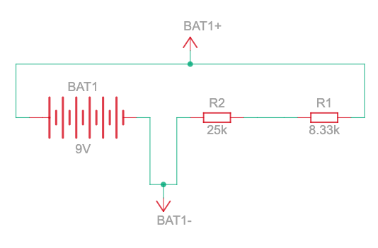 |
| 3.3V・LED 1個（4日目） | 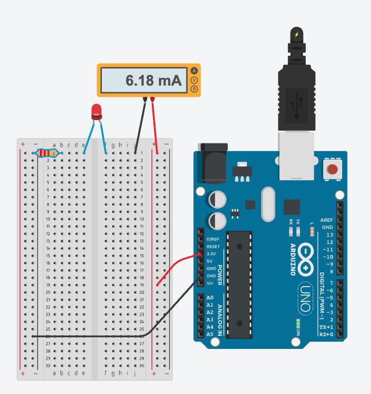 | 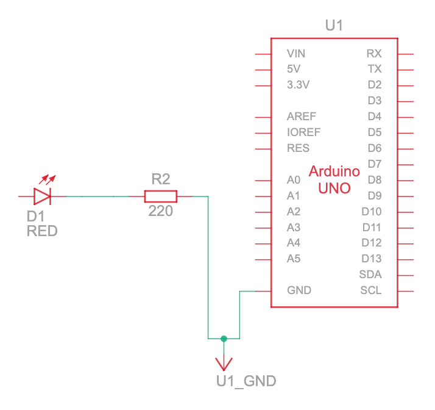 |
| 並列（4日目） | 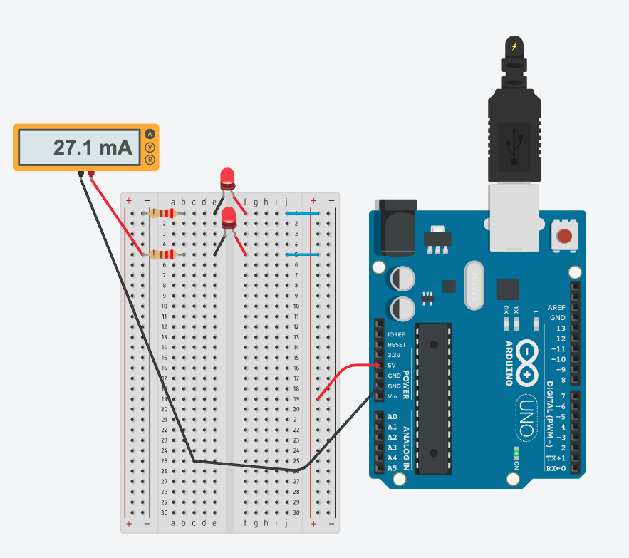 | 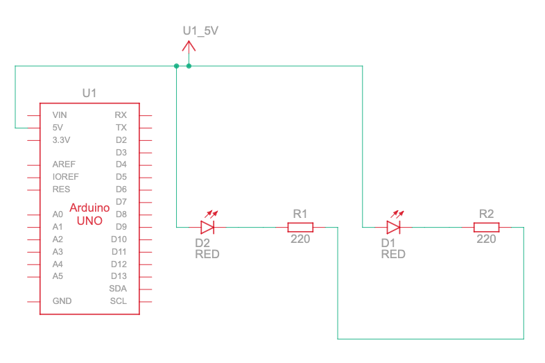 |

**学んだこと**

**① 電流計は回路図に描かれない → その場所で線が切れて見える**

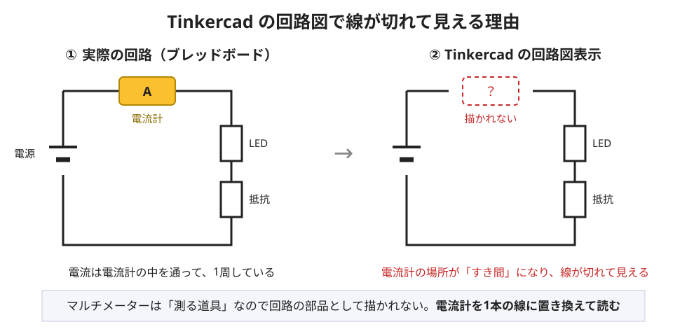

| 回路 | 電流計をはさんでいた場所 | 回路図での見え方 |
| --- | --- | --- |
| 3.3V・LED 1個 | ＋レール と LED のあいだ | LED の左端が何にもつながっていない。Arduino の 3.3V ピンにも線がない |
| 並列 | −レール と GND のあいだ（合計の電流） | 2本の枝は合流しているが、その先が行き止まり。Arduino の GND ピンにも線がない |
| 分圧 | なし（電圧計は横から当てるだけ） | 切れずに描かれる |

**電源はブレッドボードでは実際につながっている。** 電流計を1本の線に置き換えて読めば、どれも1周の輪になり、KiCad で描いた図と同じになる。

> 電圧計は部品の横から当てるだけなので、描かれなくても線は切れない。電流計は回路の途中にはさむので、描かれないとすき間になる（3日目の「電圧計と電流計のつなぎ方の違い」）。

**② 電源の名前の付け方が違う**

| | Tinkercad の回路図表示 | 自分の KiCad の図 |
| --- | --- | --- |
| ＋側の名前 | U1_5V（Arduino の 5V ピン）、BAT1+（電池の＋） | VCC |
| −側の名前 | U1_GND、BAT1− | GND |
| 名前の決まり方 | 「部品名＋ピン名」で自動で付く | 自分で電源の記号を置いて付ける |
| 記号の形 | 上向きの矢印（＋側）、下向きの三角（GND） | 同じ |

形も意味も同じで、**名前の付け方だけが違う**。

**③ VCC・GND・PWR_FLAG とは**

| 記号 | 何か | Tinkercad | KiCad |
| --- | --- | --- | --- |
| VCC | ＋側の電源の線の名前 | ある（U1_5V、BAT1+） | 自分で置く |
| GND | −側・0V の基準の線の名前 | ある（U1_GND、BAT1−） | 自分で置く |
| PWR_FLAG | ERC のための目印。電気的には何もしない | **ない** | ERC を通すために置く |

同じ名前の電源記号どうしは、線を引かなくてもつながっていることになる。電源の線は回路のあちこちに必要なので、名前でつなぐと図がすっきりする。

| | Tinkercad | KiCad |
| --- | --- | --- |
| 何をするソフトか | **シミュレーター**（実際に電気を流して計算する） | **設計図を描くソフト**（電気は流さない） |
| 電源があるかどうか | 電池や Arduino が電気を出すことを、計算で知っている | 図を見るだけなので、電池が電気を出すと判断できない |
| 間違いの見つけ方 | 動かしてみる（LED が光らないなど） | ERC |
| PWR_FLAG | 不要 | 必要（10日目に、消すとエラーが2件出た） |

**④ そのほかの違い**

| | Tinkercad の回路図表示 | 自分の KiCad の図 |
| --- | --- | --- |
| 描き方 | 自動。部品の並びや向きは見やすさを考えていない（電池が横向き、R2・R1 の順など） | 自分で並べた。電流の流れ（上から下）が分かりやすい |
| 抵抗の記号 | **四角** | ギザギザ・四角（選べる） |
| 大きな回路 | ページを分けて描くことがある | 1枚に描いた |

### 3. `week2/kicad/` に KiCad のプロジェクトと回路図の PDF を置く

| フォルダ | 中身 |
| --- | --- |
| [kicad/day11_01_series-circuit/](kicad/day11_01_series-circuit/) | 直列：プロジェクト、回路図、PDF、部品表、ERC.rpt |
| [kicad/day11_02_parallel-circuit/](kicad/day11_02_parallel-circuit/) | 並列：同上 |
| [kicad/day11_03_voltage-divider-circuit/](kicad/day11_03_voltage-divider-circuit/) | 分圧：同上 |

- KiCad のローカル設定（.kicad_prl）、ロックファイル、履歴（.history）は入れていない。
- 並列の部品表（.csv）は LED の値を「red」に変える前に書き出したので「LED」のまま。回路図は「red」。

**PDF が小さく見える理由**

KiCad は A4 の紙の枠に回路図を描くので、小さな回路は左上に小さく載る。PDF は拡大しても線がぼやけない形式なので、画面で拡大すれば読める。

| 気になるときの直し方（任意） | 操作 |
| --- | --- |
| 回路を枠の真ん中に移す | 全部を囲んで選び、ドラッグ |
| 紙を小さくする | 「ファイル」→「ページ設定」→ 用紙サイズを A5 に |
| 右下の表題欄を埋める | 「ファイル」→「ページ設定」→ タイトルと日付 |

### この日のまとめ：予想 → 結果 → 差の理由

| 何を測った／試したか | 予想 | 結果 | 差の理由 |
| --- | --- | --- | --- |
| 直列（LED 2個）の ERC | 違反 0 件 | 違反 0 件 | 差なし |
| 並列の ERC | 違反 0 件 | 違反 0 件 | 差なし |
| 分圧の ERC（最初） | 違反 0 件 | エラー 1 件 | GND 側に PWR_FLAG を付け忘れた |
| 分圧の ERC（直したあと） | 違反 0 件 | 違反 0 件 | 差なし |
| Tinkercad の回路図表示 | KiCad と同じ形 | 3.3V と並列で線が切れていた | 電流計が回路図に描かれないため。電流計を線に置き換えれば同じ形 |

## 12日目 コンデンサの基礎

> **ひとことで**：コンデンサは**電気をためる部品**。充電すると、電圧は「じわじわ」上がり、電流は「最初が最大で、だんだん 0 に」なる。かかる時間は **τ（タウ）= R × C** で決まり、R か C を2倍にすると時間も2倍になる。

**この日にやったことと、分かったこと**

| # | やったこと | 分かったこと（一言） |
| --- | --- | --- |
| 1 | MONOist の記事を読む | コンデンサは2枚の板で電気をためる。直流は止め、交流は通す |
| 2 | Falstad で充電・放電を見る | 電圧はゆっくり、電流はスイッチの瞬間に跳ねる |
| 3 | 抵抗を2倍にして比べる | 時間は2倍、最初の電流は半分 |

やることの詳細は[チェックリスト](../CHECKLIST.md#第2週-分圧回路図コンデンサ)。

### 1. 読む：[MONOist 電子工作“超”入門(3) コンデンサを知ろう](https://monoist.itmedia.co.jp/mn/articles/1412/16/news026.html)

**学んだこと**

**① コンデンサは「電気をためる」部品**

| | 抵抗 | コンデンサ |
| --- | --- | --- |
| 英語・記号 | Resistor・R | Capacitor（キャパシタ）・**C** |
| 単位 | Ω（オーム） | **F（ファラッド）** |
| 働き | 電流を流れにくくする | **電気をためる** |
| 中のしくみ | 電気を通しにくい材料 | 向かい合った**2枚の板（電極）**のあいだに、電気を通さないもの（誘電体）をはさむ |

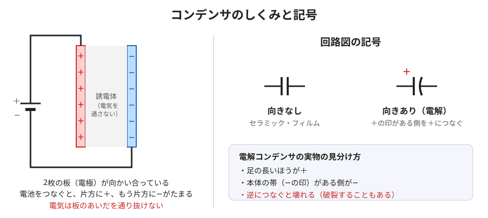

**② ためられる量：Q = C × V**

| 記号 | 意味 | 単位 |
| --- | --- | --- |
| Q | たまる電気の量（電荷） | C（クーロン） |
| C | 容量（どれだけためられるか） | F（ファラッド） |
| V | かけた電圧 | V |

容量が大きいほど、同じ電圧でたくさんためられる。

**③ 単位は µF・pF を使う（1F は大きすぎる）**

| 単位 | 読み方 | 大きさ | よく見る例 |
| --- | --- | --- | --- |
| µF | マイクロファラッド | 0.000001F（10⁻⁶） | 電解コンデンサ 100µF |
| nF | ナノファラッド | 0.000000001F（10⁻⁹） | 海外の部品表でよく見る |
| pF | ピコファラッド | 0.000000000001F（10⁻¹²） | セラミックコンデンサ 10pF |

1µF = 1000nF = 1,000,000pF。

**④ 直流は止める、交流は通す**

| 電気の種類 | コンデンサはどうなるか |
| --- | --- |
| 直流（電池） | 満タンになるまで電気がたまり、そのあとは**電流が止まる** |
| 交流（向きが入れ替わる） | ためて・はき出すをくり返すので、**電流が通る**（抵抗のように働く） |

**⑤ よく使う種類**

| 種類 | 見た目・特徴 | 容量の目安 | 向き（極性） |
| --- | --- | --- | --- |
| セラミック | 茶色の丸形。いちばんよく使う | 1pF〜0.1µF | なし |
| 積層セラミック | 青など。セラミックを重ねて大容量に | 〜数µF | なし |
| **電解** | 筒形。大容量。「16V 100µF」のように**使える電圧が決まっている** | 1µF〜10000µF | **あり**（足の長いほうが＋、本体の帯の側が−） |
| タンタル | 黄土色のタマゴ形。電源を安定させるのに使う。値段が高い | | あり |
| フィルム | プラスチックのフィルムを使う。音響（オーディオ）向け | | なし |

足の出かた：下から2本出ているのが**ラジアル**、両端から出ているのが**アキシャル**（抵抗はアキシャル）。

**⑥ 数字の読み方（3けたの表示）**

抵抗のカラーコード（6日目）と同じ考え方。**単位は pF**。

| 表示 | 読み方 | 容量 |
| --- | --- | --- |
| 10 | そのまま 10pF | 10pF |
| 103 | 10 に 0 を3個 = 10,000pF | **0.01µF** |
| **104** | 10 に 0 を4個 = 100,000pF | **0.1µF**（13日目のパスコンでよく使う） |
| 105 | 10 に 0 を5個 = 1,000,000pF | **1µF** |

### 2. 観察：[Falstad コンデンサの例題](https://www.falstad.com/circuit/e-cap.html)。スイッチで放電・充電を繰り返し、電圧（緑）と電流（黄）の波形の形を見る

| 充電・放電を1回ずつ | 素早く何度も切り替えた |
| --- | --- |
| 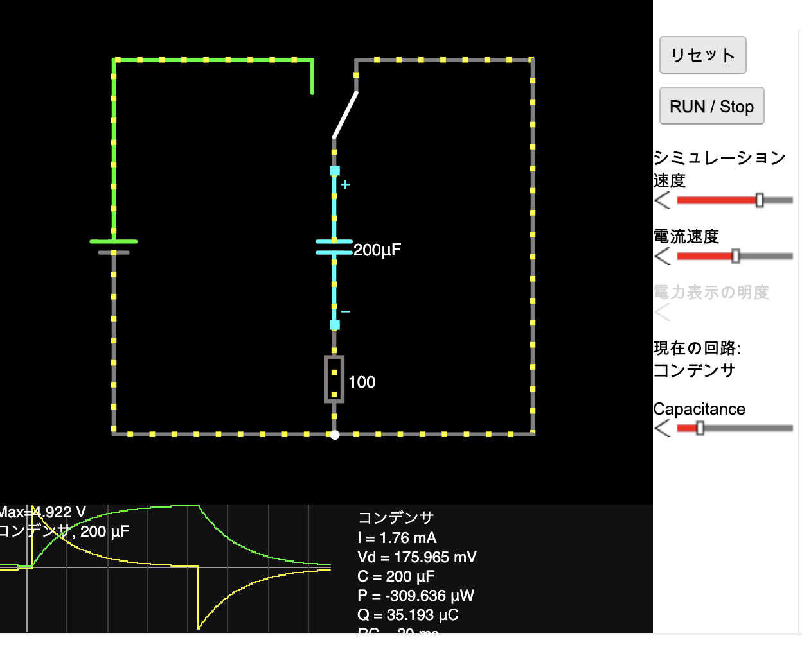 | 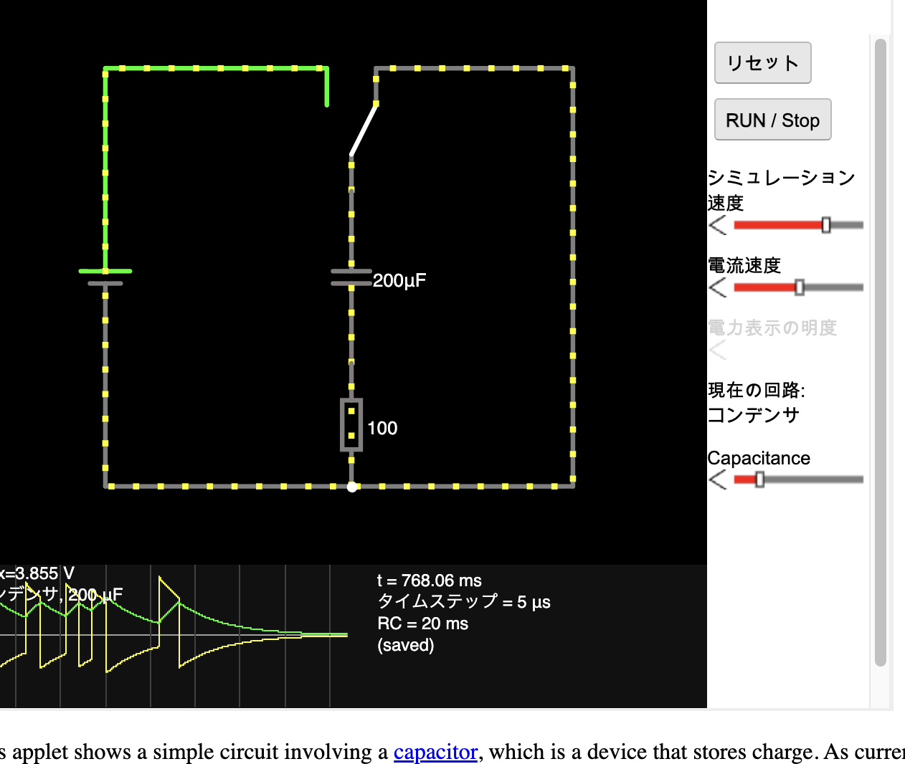 |

**回路の見方**

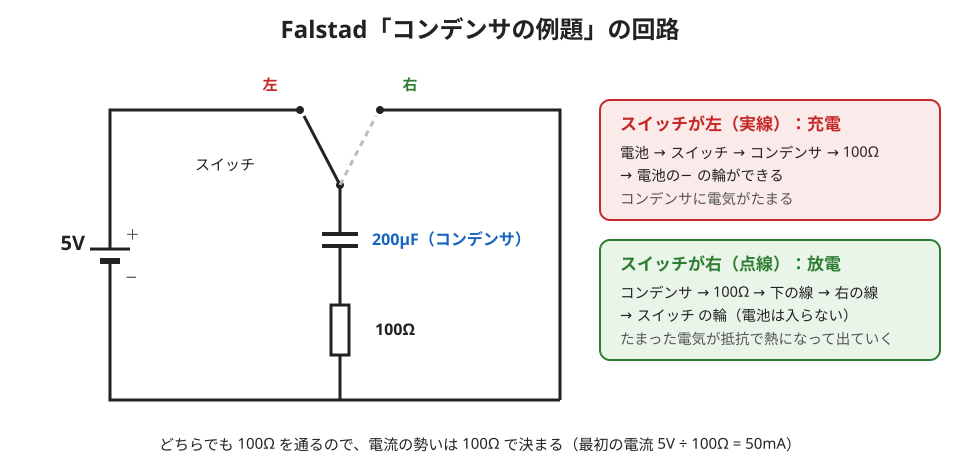

| 波形 | 何を表すか |
| --- | --- |
| **緑** | コンデンサの電圧（どれだけたまっているか） |
| **黄** | 回路を流れる電流（0 の線より上は充電の向き、下は放電の向き） |

**学んだこと**

**① 電圧はじわじわ、電流は最初が最大**

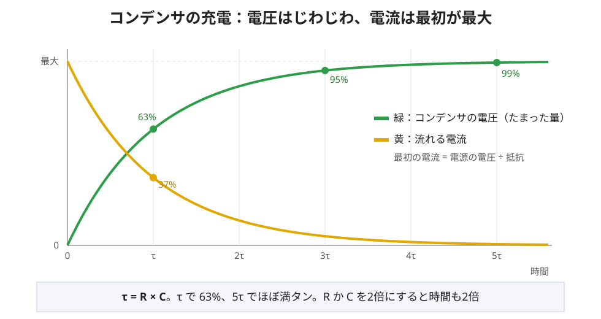

| | 充電（電池側に切り替え） | 放電（線側に切り替え） |
| --- | --- | --- |
| 緑（電圧） | 0V から、最初は速く、だんだんゆっくり上がって 5V に近づく | 5V から、最初は速く、だんだんゆっくり下がって 0V に近づく |
| 黄（電流） | 切り替えた瞬間に**いきなり最大**（5V ÷ 100Ω = 50mA）→ だんだん 0 に | いきなり**反対向き**に最大 → だんだん 0 に |

> たとえ：空のバケツ（コンデンサ）にホース（抵抗）で水を入れる。最初は勢いよく入る（電流が大きい）が、たまるほど押し返す力が増えて、入る量が減る。水位（電圧）は、最初は速く、だんだんゆっくり上がる。

満タンになると電流は 0 になる。これが「直流は止める」（記事の ④）の正体。

**② どれくらいで満タンになるか：時定数 τ = R × C**

| 計算 | 値 |
| --- | --- |
| τ = R × C = 100Ω × 200µF = 100 × 0.0002 | **0.02秒 = 20ms**（画面の「RC = 20 ms」） |

| 時間 | 充電でたまる割合 | 放電で残る割合 |
| --- | --- | --- |
| τ | 約 63% | 約 37% |
| 3τ | 約 95% | 約 5% |
| 5τ | 約 99%（ほぼ満タン） | 約 1%（ほぼ空っぽ） |

**③ 途中で切り替えると、満タンにならない**

素早く何度も切り替えると、緑がギザギザになり 5V まで届かない。満タンになる前（5τ = 100ms より前）に放電に切り替えたから。切り替えるたびに、黄は上下に跳ねる。

### 3. 実験：同じ例題で抵抗を2倍にし、充電にかかる時間がどう変わるか見る。時定数 τ = R × C で予想してから確かめる

**予想**

| | 200µF・100Ω（元） | 200µF・200Ω（抵抗2倍） |
| --- | --- | --- |
| τ = R × C | 20ms | **40ms**（2倍） |
| ほぼ満タン（5τ）まで | 100ms | **200ms**（2倍） |
| 最初の電流（5V ÷ R） | 50mA | **25mA**（半分） |

**成果物**

| 200µF・100Ω（τ = 20ms） | 200µF・200Ω（τ = 40ms） |
| --- | --- |
| 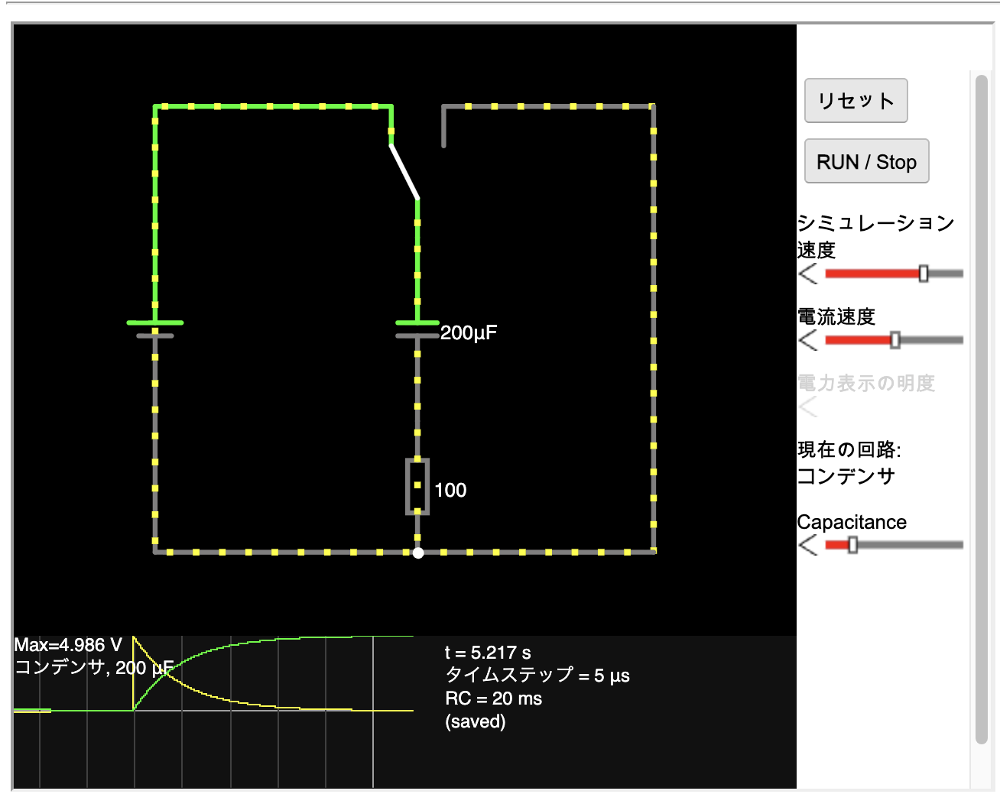 | 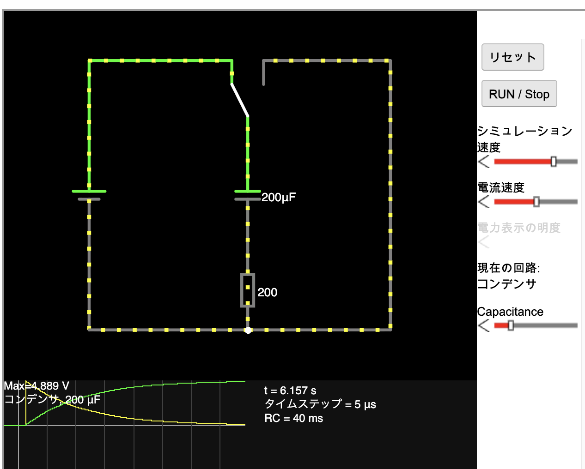 |
| **抵抗の最初の電流（200Ω）** |  |
| 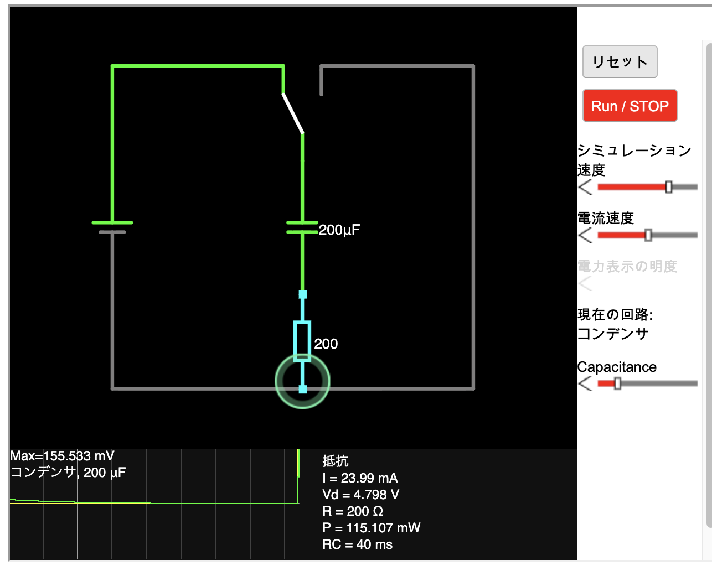 |  |

**結果**

| | 予想 | 結果 |
| --- | --- | --- |
| τ | 40ms | **RC = 40ms** ✓ |
| 充電の速さ | 2倍ゆっくり | 緑の上がり方がゆっくりになり、同じ時間ではまだ 5V に届いていない ✓ |
| 最初の電流 | 25mA | **23.99mA** ✓（切り替えてすぐ止めて測った。少しだけ充電が進んでいたぶん、25mA より小さい） |

**最初の電流が 25mA より少し小さい理由**

| 表示 | 値 | 意味 |
| --- | --- | --- |
| 抵抗の電圧（Vd） | 4.798V | 電池の 5V のうち、抵抗が使っている分 |
| コンデンサにたまった電圧 | 5 − 4.798 ≒ 0.20V | 止める前に少し充電が進んでいた |
| 電流 | 4.798 ÷ 200 ≒ **23.99mA** | ちょうど切り替えた瞬間なら 5 ÷ 200 = 25mA |

> グラフの黄の高さでは比べられない。Falstad のグラフは、一番大きい値に合わせて縦の目盛りを自動で変えるため、最大が 50mA でも 25mA でも同じ高さに描かれる。値は、抵抗にマウスを乗せて読む。

**学んだこと**

**① 抵抗を2倍にすると、時間は2倍、最初の電流は半分**

**② 容量を変えても時間は変わるが、最初の電流は変わらない**

予想を確かめる途中で、容量も変えて比べた。

| 110µF（τ = 11ms） | 790µF（τ = 79ms） |
| --- | --- |
| 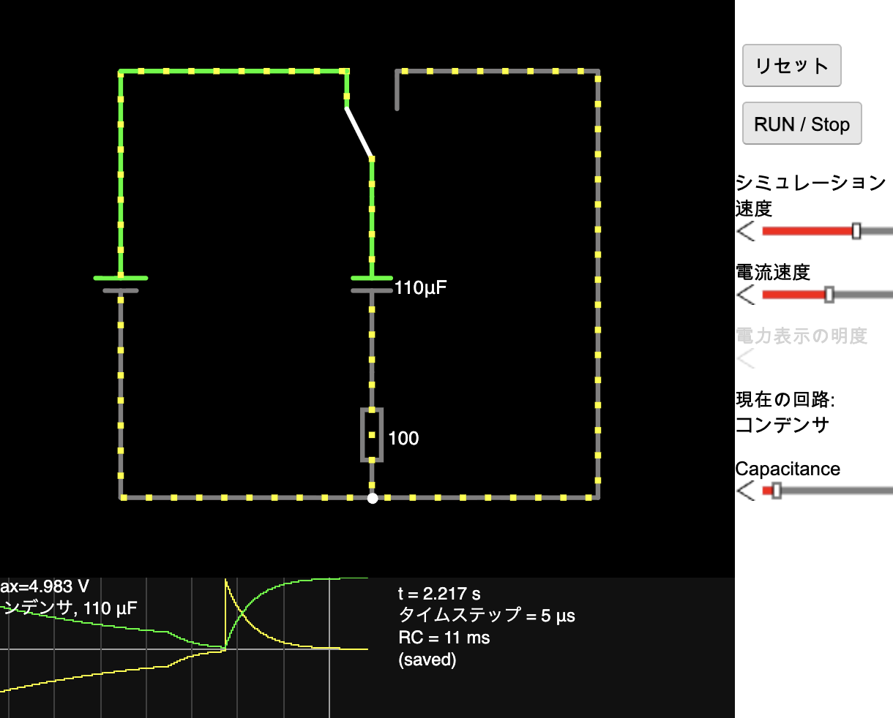 | 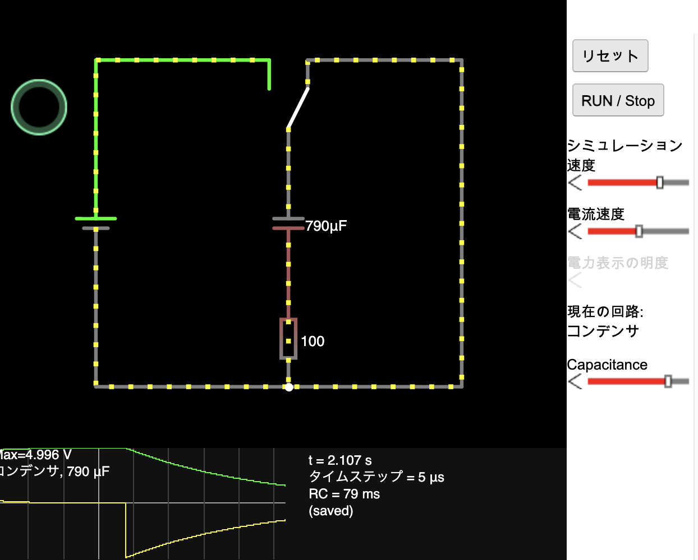 |

| 100µF（τ = 10ms） | 200µF（τ = 20ms） |
| --- | --- |
| 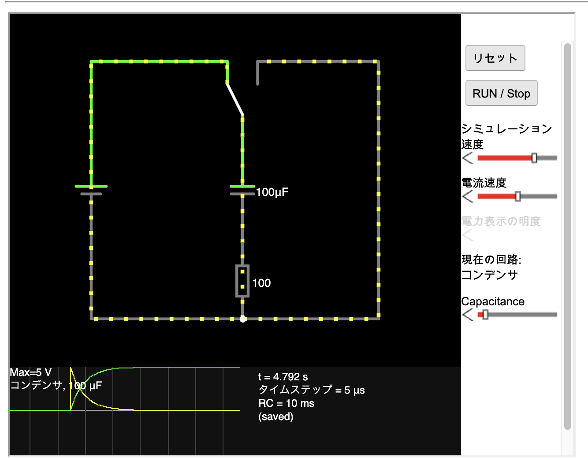 |  |

| 変えたもの | τ | 充電の時間 | 最初の電流 | たとえ |
| --- | --- | --- | --- | --- |
| 容量を2倍（100 → 200µF） | 10 → 20ms | 2倍 | **同じ**（50mA） | バケツを2倍の大きさにした（ホースは同じ太さ） |
| 容量を約7倍（110 → 790µF） | 11 → 79ms | 約7倍 | 同じ | 同上 |
| **抵抗を2倍（100 → 200Ω）** | 20 → 40ms | 2倍 | **半分**（50 → 25mA） | ホースを細くした（入る勢いが半分になる） |

どちらも **τ = R × C** なので、R と C のどちらを2倍にしても時間は2倍。違うのは**最初の電流**で、これは 電源の電圧 ÷ R で決まり、C には関係しない。

### この日のまとめ：予想 → 結果 → 差の理由

| 何を測った／試したか | 予想 | 結果 | 差の理由 |
| --- | --- | --- | --- |
| 200µF・100Ω の τ | 20ms | 20ms | 差なし |
| 200µF・200Ω の τ（抵抗2倍） | 40ms | 40ms | 差なし |
| 200Ω の最初の電流 | 25mA | 23.99mA | 止めるまでに 0.2V 充電が進んでいた |
| 容量 100 → 200µF の τ | 10 → 20ms | 10 → 20ms | 差なし |
| 容量 110 → 790µF の τ | 11 → 79ms | 11 → 79ms | 差なし |

## 13日目 コンデンサの計算とフィルタ

> **ひとことで**：抵抗とコンデンサを組み合わせると、**ゆっくりな信号は通し、速いノイズは消す**フィルタになる。この「コンデンサは速い変化を通して GND へ逃がす」性質を使って、IC のすぐ横に置くのが**パスコン**。

**この日にやったことと、分かったこと**

| # | やったこと | 分かったこと（一言） |
| --- | --- | --- |
| 1 | MONOist の記事を読む | コンデンサの合成は抵抗と逆。RC 回路でフィルタができる |
| 2 | Falstad でローパスフィルタを見る | 速い波ほど消える（12Hz は 99%、26.75kHz は 0.3%）。C を2倍にすると境目は半分 |
| 3 | パスコンの記事を読む | IC が一瞬で使う電気を、すぐ横から渡して電圧を安定させる |
| 4 | パスコンの理由を2行で | 下の「4.」 |

やることの詳細は[チェックリスト](../CHECKLIST.md#第2週-分圧回路図コンデンサ)。

### 1. 読む：[MONOist 電子工作“超”入門(5) コンデンサを知る](https://monoist.itmedia.co.jp/mn/articles/1502/27/news035.html)

**学んだこと**

**① 数字の読み方（12日目の復習）**

単位は pF。3けた目が「0 をいくつつけるか」。

| 表示 | 計算 | 容量 |
| --- | --- | --- |
| 102 | 10 に 0 を2個 = 1,000pF | 0.001µF |
| 103 | 10 に 0 を3個 = 10,000pF | 0.01µF |
| **104** | 10 に 0 を4個 = 100,000pF | **0.1µF**（パスコンの定番） |
| 224 | 22 に 0 を4個 = 220,000pF | 0.22µF |

> 注意：記事には「pF は 10 のマイナス9乗」「224 は 2.2µF」とあるが、正しくは **pF は 10⁻¹²**（10⁻⁹ は nF）、**224 は 0.22µF**。

**② 容量を大きくする3つの方法**

コンデンサは2枚の板で電気をためる（12日目）。容量は板の作りで決まる。

| 方法 | 理由 |
| --- | --- |
| 板の**面積を大きく**する | ためられる場所が広くなる |
| 板の**すき間を狭く**する | ＋と−が引き合う力が強くなる |
| すき間に**電気をためやすい材料**（誘電率の大きい材料）を入れる | 同じ板でも多くためられる |

実際の部品では、**耐圧**（何 V までかけてよいか）も大事。

**③ 合成容量は、抵抗と逆**

| つなぎ方 | 抵抗（4日目） | コンデンサ |
| --- | --- | --- |
| 並列 | 1/R = 1/R1 + 1/R2（**小さく**なる） | **C = C1 + C2**（**大きく**なる） |
| 直列 | R = R1 + R2（**大きく**なる） | **1/C = 1/C1 + 1/C2**（**小さく**なる） |

| 例：10µF を2個 | 並列 | 直列 |
| --- | --- | --- |
| 合成容量 | 10 + 10 = **20µF** | 10 × 10 ÷ (10 + 10) = **5µF** |
| イメージ | 板が横に並んで、面積が2倍になる | すき間が2倍に広がったのと同じ |

**④ RC 回路でフィルタができる**

| 名前 | 通すもの | 消すもの | 使い道 |
| --- | --- | --- | --- |
| **ローパスフィルタ** | ゆっくりな（低い周波数の）信号 | 速い（高い周波数の）ノイズ | センサーのノイズ消し、音の高音カット |
| ハイパスフィルタ | 速い信号 | ゆっくりな変化・直流 | 音の低音カット、直流を止める |

**カットオフ周波数**（通す・消すの境目）より先で、出力が下がっていく。出力の大きさは **dB（デシベル）**で表す（入力と出力の比）。

### 2. 観察：[Falstad ローパスフィルタ（RC）](https://www.falstad.com/circuit/e-filt-lopass.html)。ノイズを消すフィルタの原型で、Month 2の移動平均と同じ考え方です

**回路と画面の見方**

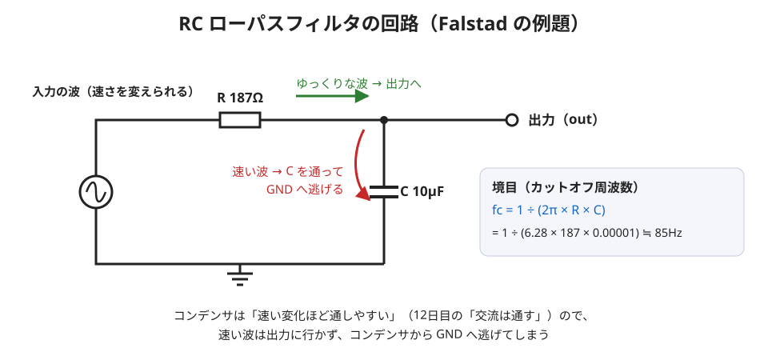

| 場所 | 中身 |
| --- | --- |
| 左の 〜 | 入力の波を出す電源。下のグラフをクリックすると、その速さ（周波数）の波になる |
| 下のグラフ | 横：波の速さ（左ほどゆっくり）。縦：出力の大きさ。**左は平ら、右は下がる** |
| Cutoff | 下がり始める境目（カットオフ周波数） |
| 右の「Cutoff Frequency」つまみ | R・C の値を変えて、境目を動かす |

**① C を変えると、境目が動く**

| C = 4.9µF | C = 10µF |
| --- | --- |
| 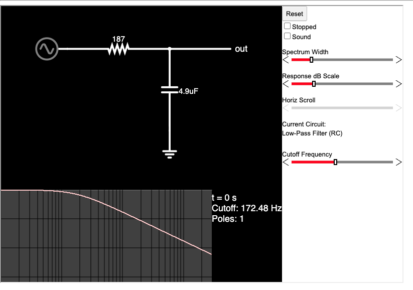 | 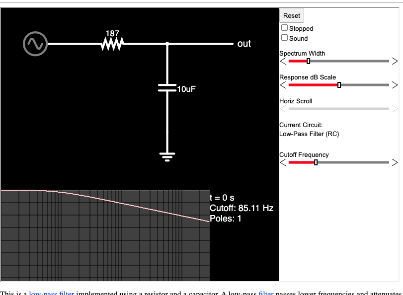 |

| | 4.9µF | 10µF（約2倍） |
| --- | --- | --- |
| 予想（fc = 1 ÷ (2π × R × C)） | 1 ÷ (6.28 × 187 × 0.0000049) ≒ 174Hz | ≒ 85Hz（半分） |
| 画面の Cutoff | **172.48Hz** | **85.11Hz** ✓ |

C（または R）を大きくすると、τ = R × C（12日目）が大きくなり、コンデンサがゆっくりしか動けなくなる。だから、もっと遅い波から消え始める。

> 2枚目のグラフがなだらかに見えるのは、右の「Response dB Scale」のつまみで縦の目盛りが変わったため。フィルタの性質とは関係ない。

**② 入力の波の速さを変えると、出力の大きさが変わる**（C = 10µF、境目 85Hz）

| 12Hz | 109Hz |
| --- | --- |
| 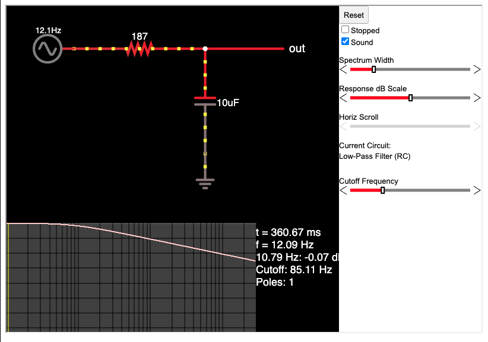 | 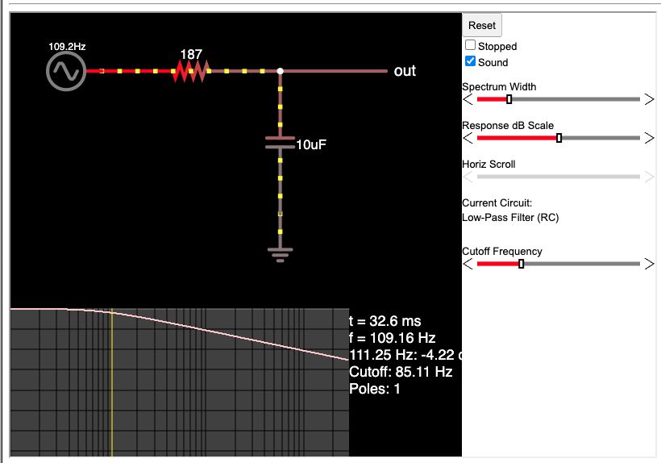 |
| **1.84kHz** | **26.75kHz** |
| 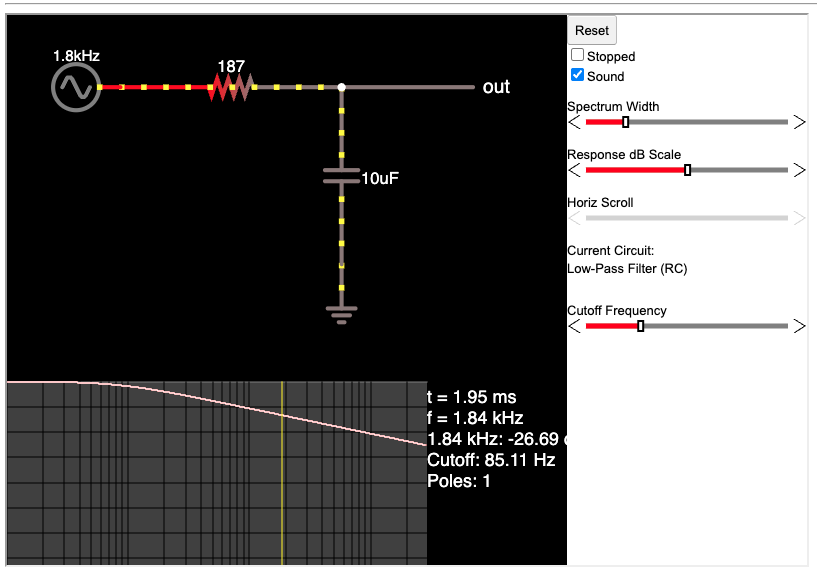 | 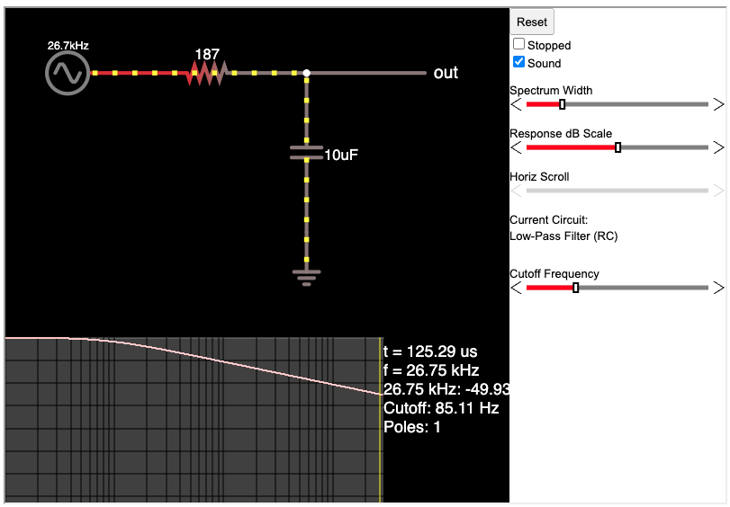 |

| 入力の速さ | 境目との比 | 画面の値 | 出力（入力を 100%） | 計算の予想 | out の線 |
| --- | --- | --- | --- | --- | --- |
| 12Hz | 約 0.1倍 | −0.07dB | **約 99%** | 99% | 赤（電圧が大きい） |
| 109Hz | 約 1.3倍 | −4.22dB | **約 62%** | 62% | |
| 1.84kHz | 約 22倍 | −26.69dB | **約 4.6%** | 4.6% | 灰色（ほぼ 0V） |
| 26.75kHz | 約 314倍 | −49.93dB | **約 0.3%** | 0.3% | 灰色 |

予想の式：出力 ÷ 入力 = 1 ÷ √(1 + (速さ ÷ 境目)²)。4つとも一致した。

**③ なぜ速い波ほど消えるのか**

| 入力 | コンデンサ | 出力 |
| --- | --- | --- |
| ゆっくりな波 | 充電・放電が間に合う（12日目の τ より十分ゆっくり） | 入力と同じ大きさ |
| 速い波 | 充電しきる前に向きが変わる。**コンデンサを通って GND へ逃げる** | ほぼ 0 |

画面でも、速い波では out の線が灰色（0V）で、コンデンサの線にだけ電流（黄色の点）が流れていた。12日目の「交流は通す」を使って、速い波だけを GND へ逃がしている。

**④ dB の読み方**

| dB | 割合 | 意味 |
| --- | --- | --- |
| 0dB | 100% | そのまま |
| −3dB | 約 71% | ここが境目（カットオフ） |
| −20dB | 10% | 1/10 |
| −40dB | 1% | 1/100 |

境目より上では、**速さが 10倍になるごとに、出力が 1/10（−20dB）**。

**⑤ なんのため：ノイズを消す（移動平均と同じ考え方）**

| | 速さ | 例 |
| --- | --- | --- |
| ほしい信号 | ゆっくり | 温度、明るさ、ロボットの傾き |
| ノイズ | 速い | 電気のゆらぎ、モーターからのノイズ |

| | RC ローパスフィルタ（今回） | 移動平均（フェーズ2） |
| --- | --- | --- |
| どこで | 回路（部品） | プログラム（計算） |
| やり方 | コンデンサが少しずつしか動けない | 直近の何回分かを平均する |
| 速いガタガタ | 消える | 打ち消し合って消える |
| ゆっくりな変化 | 残る | 残る |
| 強くするには | R か C を大きくする | 平均する回数を増やす |
| 強くしすぎると | ほしい信号の変化にも遅れる | 同じ |

### 3. 読む：[MONOist 俺流！組み込み用語解説(11) コンデンサー活用術](https://monoist.itmedia.co.jp/mn/spv/2502/06/news039.html)と[RSコンポーネンツ「バイパスコンデンサとは？」](https://jp.rs-online.com/web/content/discovery/ideas-and-advice/bypass-capacitor-guide)。IC の電源ピンのすぐそばに置く小さなコンデンサ「パスコン（デカップリングコンデンサ）」の役割

**学んだこと**

**① パスコンとは**

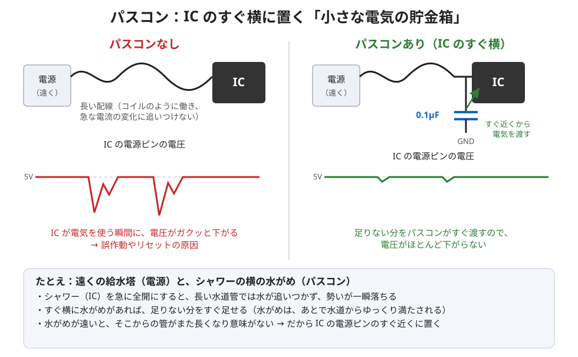

| 項目 | 内容 |
| --- | --- |
| 何か | IC（マイコンなど）の**電源ピンと GND ピンのあいだ**に、**すぐ近く**につなぐ小さなコンデンサ |
| 呼び方 | パスコン（バイパスコンデンサ）、デカップリングコンデンサ。ほぼ同じ意味で使われる |
| よく使う値 | **0.1µF**（表示「104」）のセラミックコンデンサ |

```
         +5V
          |
      +---+---+
      |       |
   [0.1µF]  [ IC ]     <- IC の電源ピンと GND ピンのすぐ横に置く
      |       |
      +---+---+
          |
         GND
```

**② 役割は2つ**

| 役割 | 何が起きているか | 使っている性質 |
| --- | --- | --- |
| **電圧を安定させる** | IC は動くたびに、一瞬だけ大きな電流を使う。電源からの配線が長いと、すぐには電流が届かず電圧が一瞬下がる。パスコンがためた電気をすぐ渡して、下がるのを防ぐ | 電気をためる（12日目） |
| **速いノイズを消す** | IC が動くと速いノイズが出る。パスコンはそのノイズを GND へ逃がし、ほかの部品へ伝わらないようにする | 速い変化を通す（ローパスフィルタと同じ） |

**③ なぜ「すぐ近く」なのか**

| 配線が長いと | 結果 |
| --- | --- |
| 長い配線は**コイルのように働き**、電流の急な変化についていけない | パスコンを離して置くと、パスコンと IC のあいだでまた同じ問題が起きる |
| ノイズの通る輪（ループ）が大きくなる | ノイズがほかの配線へ伝わりやすくなる |

**④ なぜ 0.1µF なのか**

| コンデンサ | 得意なこと | 置く場所 |
| --- | --- | --- |
| **小さい容量（0.1µF、0.01µF）のセラミック** | **速い変化・高い周波数のノイズ**に強い | IC の電源ピンのすぐ横 |
| 大きい容量（数µF〜数百µF の電解など） | ゆっくりな電圧の変化や、大きな電流をおぎなう | 電源の入口側 |

実際の値や置き方は、IC のデータシートに推奨回路として書かれていることが多いので、それに従う。

<details>
<summary>記事にあったその他の使い方（クリックで開く）</summary>

| 使い方 | 内容 |
| --- | --- |
| ハイパスフィルタ | ゆっくりな成分（直流）を止めて、速い信号だけ通す。カップリングコンデンサ |
| バンドパス・バンドストップフィルタ | 特定の周波数だけ通す・止める。ラジオの選局など |
| リセット遅延回路 | 電源を入れてから、コンデンサが充電されるまでの時間だけマイコンを止めておく（12日目の τ を使う） |
| マルチバイブレータ | 充電・放電をくり返して、四角い波（クロック）を作る |

</details>

### 4. 記録：「なぜ 0.1µF のパスコンを、IC の電源ピンの近くに置くのか」を2行

> IC は動く瞬間に一瞬だけ大きな電流を使うが、遠い電源からの長い配線ではすぐに届かず電圧が下がる。そこで IC のすぐ横に 0.1µF をためておき、その場で電気を渡し、速いノイズは GND へ逃がして電圧を安定させる。
> 0.1µF は速い変化に強い小さなセラミックコンデンサの定番の値で、離して置くと配線がまた長くなって効かないので、電源ピンと GND ピンのすぐ近くに置く。

最初に書いたメモ（記事の言葉）：「デカップリングコンデンサーは、IC が動作する際に発生する瞬間的な電流変化に対して、その電荷を出し入れすることで、電源電圧の変動を抑制します。」

### 5. 遅れの取り戻し

遅れはなし。

### この日のまとめ：予想 → 結果 → 差の理由

| 何を測った／試したか | 予想 | 結果 | 差の理由 |
| --- | --- | --- | --- |
| C を 4.9 → 10µF にしたときの境目 | 174Hz → 85Hz | 172.48Hz → 85.11Hz | 差なし（画面の R・C は丸めて表示） |
| 12Hz の出力 | 99% | −0.07dB（99%） | 差なし |
| 109Hz の出力 | 62% | −4.22dB（62%） | 差なし |
| 1.84kHz の出力 | 4.6% | −26.69dB（4.6%） | 差なし |
| 26.75kHz の出力 | 0.3% | −49.93dB（0.3%） | 差なし |

## 何が壊れてどう直したか

うまくいかなかったことを、症状・原因・直し方の順に書きます。この週で一番大事な節です。

| 日 | 症状 | 原因 | 直し方 |
| --- | --- | --- | --- |
| 8日目 | 6.0V のはずが 7.83V と出た | 配線ミス。R1 の両端が同じ線につながってショートし、R2 だけが電池につながっていた | Tinkercad の「回路図」タブでつながりを見て見つけた |
| 8日目 | 5Ω・10Ω だと計算と合わない | 大きな電流（約 0.6A）で、9V 電池の中の抵抗（内部抵抗）が電圧を使ってしまう | 比を変えずに 5kΩ・10kΩ にして電流を小さくした |
| 8日目 | 線が交差してつながりが分からない | 交差しているだけではつながらない | 「回路図」タブで確かめる |
| 10日目 | ERC でエラー 2 件 | PWR_FLAG がなく、KiCad には VCC・GND に電源が来ていないように見える | VCC と GND に PWR_FLAG を付けた |
| 11日目 | 分圧回路の ERC でエラー 1 件 | GND 側の PWR_FLAG を付け忘れた | GND の線にも PWR_FLAG を付けた |
| 11日目 | ラベルの端に小さな四角が出た | ラベルの点が線から外れていて、どこにもつながっていない | 点を線の上に合わせてクリックし直す |
| 11日目 | Tinkercad の回路図で線が切れて見える | 電流計は回路図に描かれないので、はさんでいた場所がすき間になる | 壊れていない。電流計を1本の線に置き換えて読む |

**この週の教訓**：つながりは「見た目」ではなく、**回路図（Tinkercad の回路図タブ、KiCad の ERC）**で確かめる。

## 分からなかったこと・あとで調べること

-
