# 第3週 ダイオード・トランジスタ・プルアップ・電池の内部抵抗

- フェーズ：[フェーズ1 電子回路・道具・はんだ付け](../README.md)
- 日：15〜21日目（詳細は [CHECKLIST.md](../CHECKLIST.md#第3週-ダイオードトランジスタプルアップ電池の内部抵抗) ）
- ゴール：マイコンの弱い信号で大きな電流を切り替える回路を設計でき、「モーターが止まるとマイコンがリセットする」理由を数字で説明できる
- 状態：進行中

日ごとに「やること → 成果物 → 予想 → 結果 → 差の理由」を残します。測定や実験は、やる前に予想を書きます。

## 15日目 LEDの抵抗を計算する

> **ひとことで**：LED（ダイオード）は、ある電圧を超えると電流が急に増えるので、**抵抗で電流を決める**。抵抗値は **R = (電源 − LED の電圧) ÷ 流したい電流**。5V・赤LED・10mA なら 300Ω で、Tinkercad でも 10.0mA になった。

**この日にやったことと、分かったこと**

| # | やったこと | 分かったこと（一言） |
| --- | --- | --- |
| 1 | Falstad でダイオードを見る | 逆向きは流れない。約 0.6V を超えると急に流れる |
| 2 | DigiKey の記事を読む | 抵抗は「Ω」と「W（定格電力）」の2つを決めて選ぶ |
| 3 | 抵抗値と電力を手で計算 | 300Ω、0.03W（1/4W で十分） |
| 4 | Tinkercad で確かめる | 300Ω で 10.0mA、330Ω で 9.16mA。ブレッドボードの挿し方でつまずいた |

やることの詳細は[チェックリスト](../CHECKLIST.md#第3週-ダイオードトランジスタプルアップ電池の内部抵抗)。

### 1. 観察：[Falstad ダイオードの例題](https://www.falstad.com/circuit/e-diodevar.html)。一方向にしか電流が流れないことを確認

**回路**：電源（右の「電圧」つまみで変える）→ ダイオード → GND

```
電源（つまみで電圧を変える）
  |
  ▼  ダイオード（三角の向きにだけ電流が流れる）
  |
 GND
```

**成果物**（電圧の低い順）

| −1V（逆向き） | 0.363V | 0.54V |
| --- | --- | --- |
| 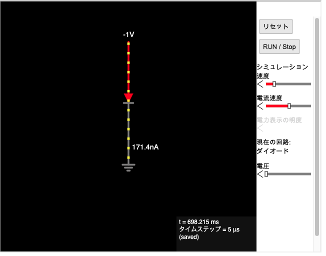 | 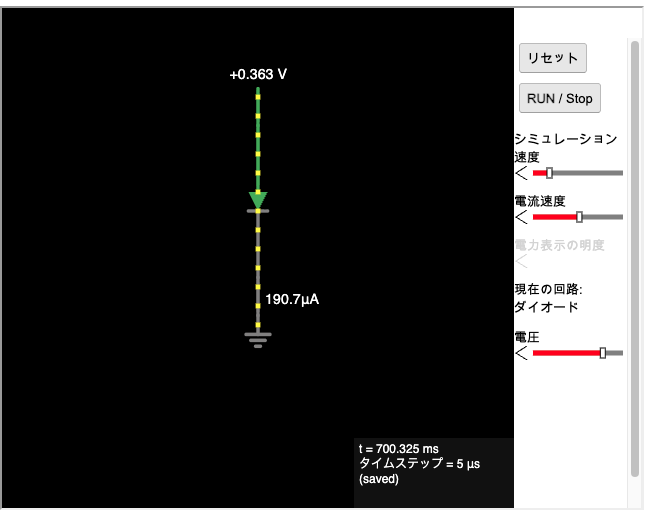 | 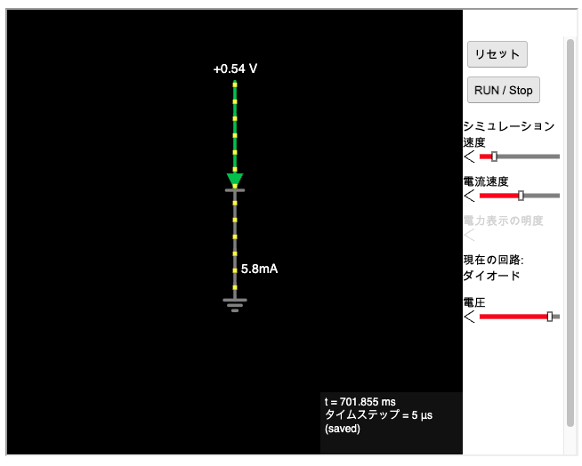 |
| **0.611V** | **0.717V** | **0.77V** |
| 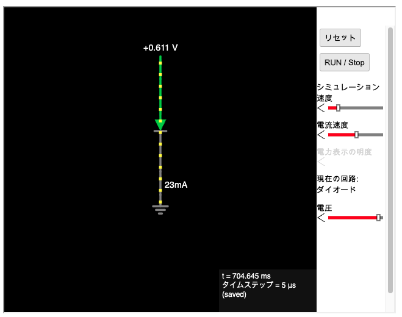 | 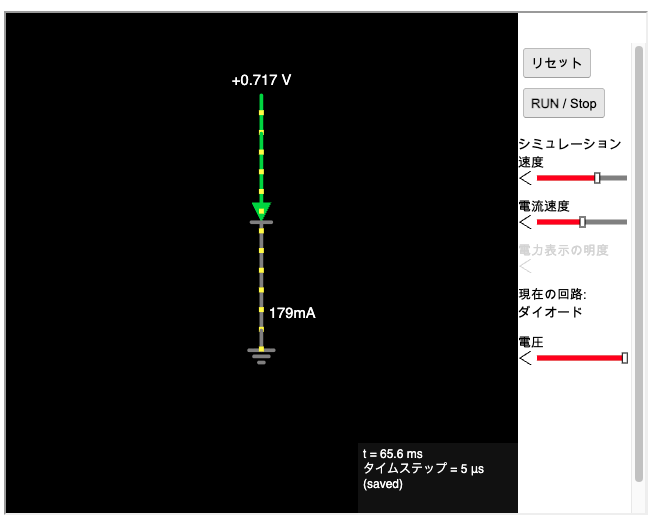 | 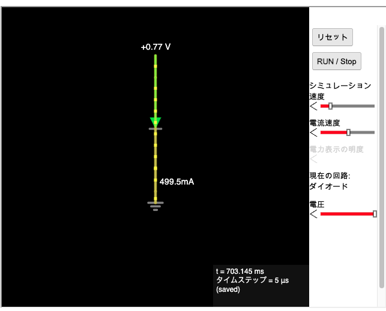 |

| 電圧 | 電流 | mA にそろえると |
| --- | --- | --- |
| **−1V**（逆向き） | 171.4nA | **0.0002mA**（ほぼ 0） |
| 0.363V | 190.7µA | 0.19mA |
| 0.54V | 5.8mA | 5.8mA |
| 0.611V | 23mA | 23mA |
| 0.717V | 179mA | 179mA |
| 0.77V | 499.5mA | 500mA |

**学んだこと**

**① 逆向きには流れない**

−1V では 0.0002mA。ごくわずかな「漏れ」だけで、ほぼ 0。

**② 約 0.6V を超えると、電流が急に増える**

```
0.363V    0.19mA  |
0.54V     5.8mA   |
0.611V    23mA    ||
0.717V    179mA   ||||||||||||
0.77V     500mA   ||||||||||||||||||||||||||||||||||
```

| | 抵抗（オームの法則） | ダイオード |
| --- | --- | --- |
| 電圧を約2倍（0.363 → 0.77V）にすると | 電流も約 **2倍** | 電流は約 **2600倍**（0.19 → 500mA） |
| 逆向き | 同じように流れる | 流れない |

> たとえ：ダイオードは**ばね付きの一方通行の弁**。逆向きに押すと閉じたまま。正しい向きでも、弱く押すうち（約 0.6V まで）はばねに負けて開かない。強く押すと開いて、どっと流れる。

**③ だから、流れているときの電圧はほぼ一定に見える**

0.54〜0.77V のわずか 0.23V のあいだに、電流が 5.8mA から 500mA まで変わる。ふつうに使う電流の範囲では、電圧は「だいたい 0.6〜0.7V」で決まっていると考えてよい。

| 部品 | 流れているときの電圧（Vf） |
| --- | --- |
| ふつうのダイオード | 約 0.6〜0.7V |
| 赤 LED | 約 2V（4日目に測った 1.9〜2.1V） |
| 青・白 LED | 約 3V |

> このシミュレーターのダイオードは 0.54V で流れ始めていた。部品によって少しずつ違うので、幅で覚えておく。

### 2. 読む：[DigiKey「LED 用の適切な抵抗の選択」](https://forum.digikey.com/t/led/5558)。抵抗値と、抵抗に必要なワット数の求め方

**学んだこと**

**① LED の抵抗を決めるのに必要な3つの値**

| 記号 | 意味 | 記事の例 |
| --- | --- | --- |
| Vs | 電源の電圧 | 9V |
| Vf（順方向電圧） | LED が光るときに使う電圧 | 3.2V（青・白などの LED） |
| If（順方向電流） | LED に流したい電流 | 20mA = 0.020A |

**② 抵抗値の式**

**R = (Vs − Vf) ÷ If**

| 手順 | 考え方 | 記事の例 |
| --- | --- | --- |
| 1 | 抵抗にかかる電圧 = 電源 − LED の電圧 | 9 − 3.2 = 5.8V |
| 2 | 抵抗 = 抵抗の電圧 ÷ 電流 | 5.8 ÷ 0.020 = **290Ω** |

**③ 抵抗は「Ω」と「W」の2つで選ぶ**

| 数字 | 意味 | たとえ（ホース） |
| --- | --- | --- |
| Ω（抵抗値） | 電流をどれだけ流れにくくするか | ホースの**細さ** |
| W（定格電力） | どれだけの熱まで耐えられるか。超えると焦げる | ホースの**丈夫さ** |

同じ 330Ω でも、1/8W・1/4W・1/2W・1W などの大きさ違いが売られている。体が大きいほど熱を逃がしやすいので、大きい W に耐えられる。**ブレッドボードの電子工作で使うふつうの抵抗は 1/4W**。

| 定格電力 | 見た目 | 使いどころ |
| --- | --- | --- |
| 1/8W・1/6W | 小さい | 小さな電流の回路 |
| **1/4W** | ふつうの大きさ | キット・入門セットのほとんど |
| 1/2W・1W 以上 | 大きい | 大きな電流が流れる回路 |

**④ 記事の「290Ω、1/8W」の意味**

記事は、計算した電力を書かずに、選ぶ部品の定格（1/8W）だけを書いている。

| 手順 | 計算 | 値 |
| --- | --- | --- |
| 抵抗の電力（**計算した W**） | 5.8V × 0.020A | **0.116W** |
| 選ぶ定格電力（**売られている段から選ぶ W**） | 0.116W を上回る一番小さい段 | **1/8W（0.125W）** |

ただし、0.116W に対して 0.125W は**余裕が 7% しかない**。ふつうは計算した電力の **2倍以上**の定格を選ぶので、この例なら **1/4W** のほうが安心。また、290Ω は売られていない値なので、実際は近い **300Ω（E24 系列）か 330Ω（E12 系列）** を選ぶ。

### 3. 計算：5V 電源、赤 LED（Vf 約 2V）、10mA のときの抵抗値と消費電力を手で求める

```
5V --[ R = ? ]--[ 赤LED 2V ]-- GND
       3V を使う    2V を使う
```

| 求めるもの | 式 | 答え |
| --- | --- | --- |
| 抵抗値 | (5 − 2) ÷ 0.01 | **300Ω** |
| 抵抗にかかる電圧 | 300 × 0.01（= 5 − 2） | **3V** |
| 抵抗の消費電力 | 3 × 0.01 | **0.03W（30mW）** |

**① 1/4W 抵抗で足りるか**（5日目と同じ判断）

| | 電力 |
| --- | --- |
| 1/4W 抵抗の上限 | 0.25W |
| 余裕の目安（上限の半分） | 0.125W |
| 今回 | **0.03W** → 上限の約 1/8。**1/4W で十分**（1/8W でも約4倍の余裕） |

**② 売っている値を選ぶ**

| 選ぶ抵抗 | 電流 = 3V ÷ R | 判断 |
| --- | --- | --- |
| 270Ω（E12） | 約 11.1mA | 少し多め |
| 300Ω（E24） | 10mA | ちょうど。手に入れば使う |
| **330Ω（E12）** | 約 **9.1mA** | 少し少なめ。**迷ったら大きいほう（安全側）** |

**③ 回路全体の電力の内訳**

| 部品 | 電圧 | 電力（電圧 × 0.01A） |
| --- | --- | --- |
| 抵抗 | 3V | 0.03W |
| LED | 2V | 0.02W |
| 合計（電源が出す） | 5V | 0.05W |

| | DigiKey の例 | 自分の計算 |
| --- | --- | --- |
| 電源・LED・電流 | 9V・3.2V・20mA | 5V・2V・10mA |
| 抵抗値 → 買う値 | 290Ω → 300Ω か 330Ω | 300Ω → 300Ω か 330Ω |
| 計算した電力 | 0.116W | 0.03W |
| 選ぶ定格電力 | 1/8W はぎりぎり → **1/4W** | 1/8W でも 1/4W でも十分 |

### 4. 検証：Tinkercad で組み、電流計で 10mA 前後になるか確かめる

Tinkercad には 5V の電池がないので、**Arduino の 5V ピン**を電源にした（電池は 9V・1.5V・3V だけで、組み合わせてもちょうど 5V にならない）。

**成果物**

| 300Ω（計算した値） | 330Ω（売っている値） |
| --- | --- |
| 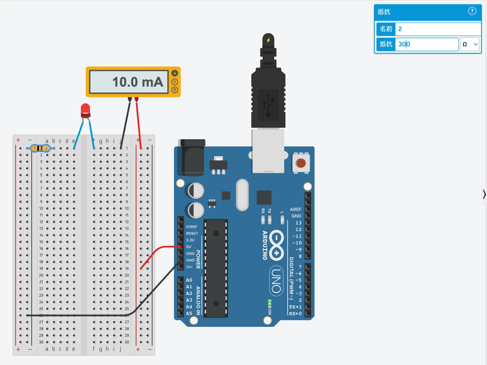 | 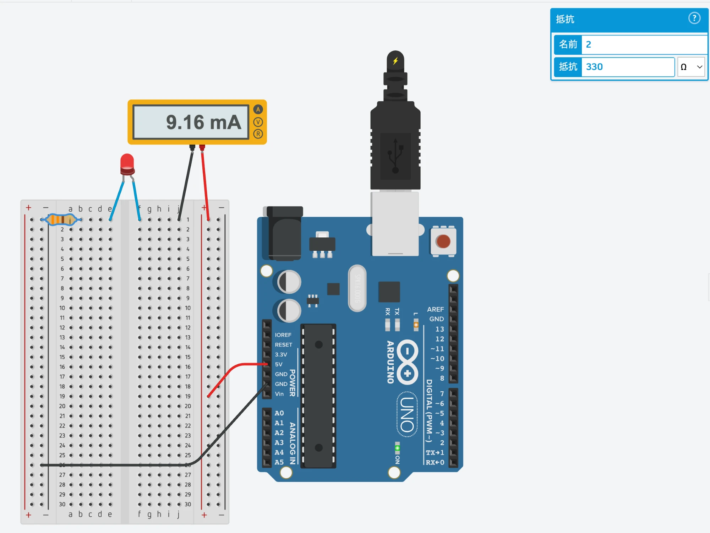 |

```
Arduino 5V --> ＋レール --[電流計]--> j1 --> LED（f1 → e1）--> 抵抗（1行目の左 → −レール）--> Arduino GND
```

| 抵抗 | 予想 | 結果 | LED の電圧（逆算） |
| --- | --- | --- | --- |
| **300Ω** | (5 − 2) ÷ 300 = **10mA** | **10.0mA** ✓ | 5 − 0.0100 × 300 = 2.0V |
| 330Ω | (5 − 2) ÷ 330 ≒ 9.1mA | **9.16mA** ✓ | 5 − 0.00916 × 330 ≒ 1.98V |

**学んだこと：ブレッドボードの正しい組み方と、よくある間違い**

組み方を間違えて、正しく測れないことが3回あった。原因はどれも「**同じ行の5穴はつながっている**」ことだった。

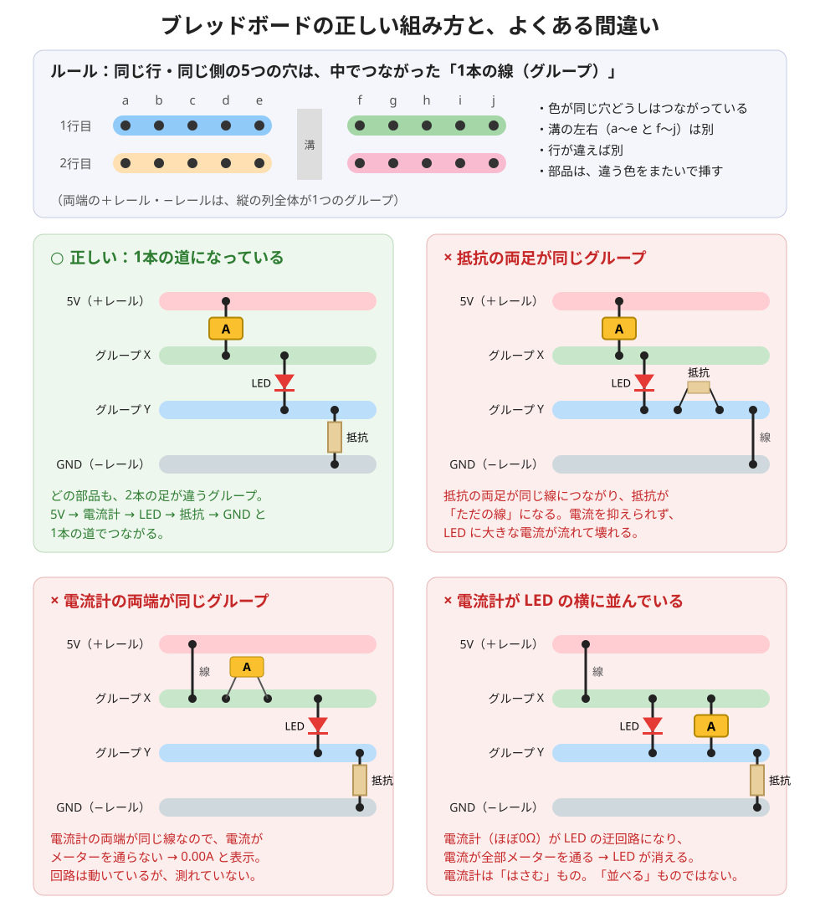

**① ルール**

| ルール | 内容 |
| --- | --- |
| 同じ行・同じ側の5穴 | 中でつながった **1本の線（グループ）**。a〜e と f〜j は溝で分かれていて別 |
| ＋レール・−レール | 縦の列全体が1つのグループ |
| 部品（抵抗・LED） | **2本の足を、違うグループに**挿す。同じグループだと、その部品は「ただの線」になって働かない |
| 電流計 | 回路を1か所切り、**そこ以外ではつながっていない2つのグループ**のあいだにはさむ（3日目） |

**② 正しい組み方（5V → 電流計 → LED → 抵抗 → GND の1本道）**

| 部品 | 挿し方 | ポイント |
| --- | --- | --- |
| 電流計 | ＋レール と j1 | 2本が別のグループ。＋レールと1行目の右は、メーター以外ではつながっていない |
| LED | f1 と e1 | 溝をまたいで、左右の別グループをつなぐ |
| 抵抗 | 1行目の左 と −レール | 別のグループをつなぐ |

**③ よくある間違い（実際にやったもの）**

| 間違い | 何が起きたか | 結果 |
| --- | --- | --- |
| **電流計が LED の横に並んでいた**（LED と同じ2つのグループにメーターを挿した） | ほぼ 0Ω の電流計が LED の迂回路になり、電流が全部メーターを通った | 15.2mA（= 5V ÷ 330Ω。LED の分の電圧がない）。**LED は消えた** |
| **電流計の両端が同じグループ**（2本とも1行目の右） | 両端が同じ線なので、電流がメーターを通らない | **0.00A**。回路は動いて LED は光っているのに、測れていない |
| **抵抗の両足が同じグループ**（2本とも1行目の右）＋電流計の両端も同じグループ | 抵抗が「ただの線」になり、LED が抵抗なしで 5V に直接つながった | 0.00A。実物なら **LED に大電流が流れて壊れる**危険な状態 |

<details>
<summary>間違えたときの画面（クリックで開く）</summary>

| 電流計が LED の横（15.2mA） | 電流計の両端が同じグループ（0.00A） | 抵抗の両足も同じグループ（0.00A） |
| --- | --- | --- |
| 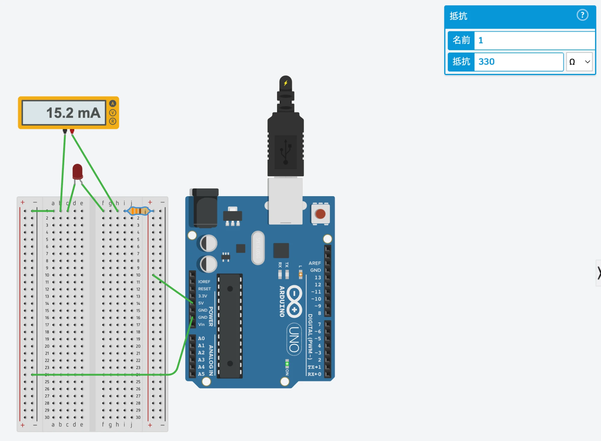 | 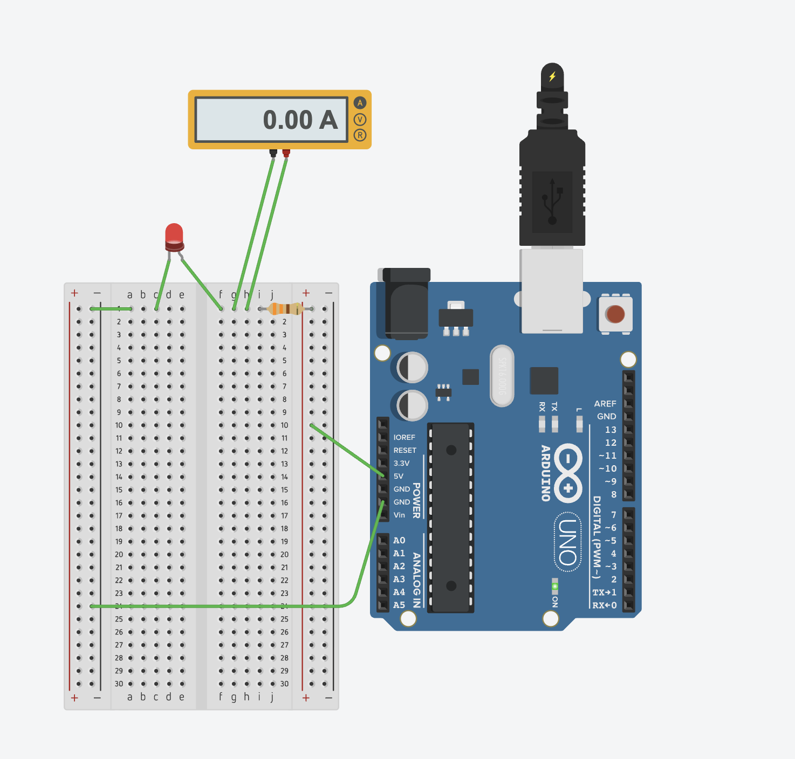 | 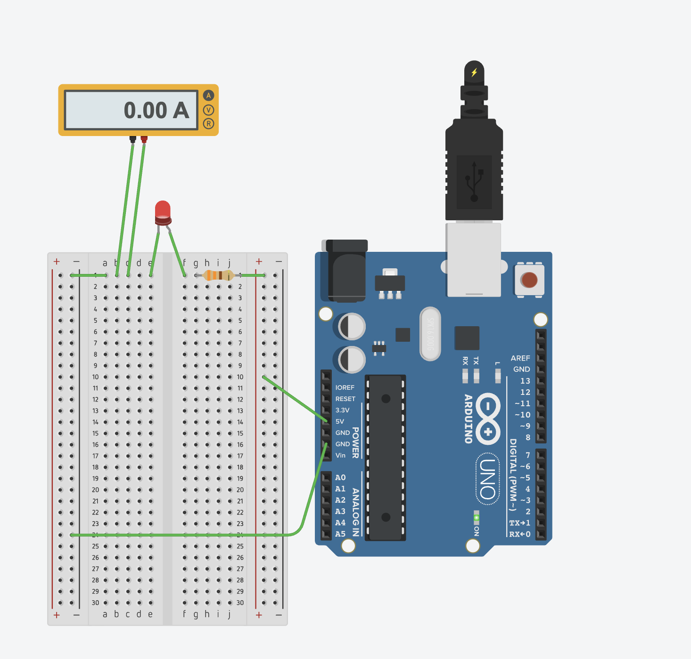 |

</details>

**④ 確かめ方のコツ**

組んだら、部品1つずつに「**この部品の2本の足は、別々のグループに挿さっているか？**」と聞く。同じグループなら、その部品は働かない（抵抗・LED）か、測れない（電流計）。

### この日のまとめ：予想 → 結果 → 差の理由

| 何を測った／試したか | 予想 | 結果 | 差の理由 |
| --- | --- | --- | --- |
| ダイオードに −1V | 流れない | 0.0002mA | 差なし（ごくわずかな漏れ） |
| ダイオードを 0.6V 付近から上げる | 急に増える | 0.54V で 5.8mA → 0.77V で 500mA | 差なし |
| 5V・300Ω・赤 LED の電流 | 10mA | 10.0mA | 差なし |
| 5V・330Ω・赤 LED の電流 | 9.1mA | 9.16mA | 差なし |
| 電流計を LED の横に並べた | 10mA 前後 | 15.2mA、LED が消えた | 電流計が LED の迂回路になった |
| 電流計の両端を同じ行に挿した | 10mA 前後 | 0.00A | 両端が同じ線で、メーターに電流が通らない |

## 16日目 トランジスタの仕組み

**やること**（詳細は [チェックリスト](../CHECKLIST.md#第3週-ダイオードトランジスタプルアップ電池の内部抵抗)）

- 読む：MONOist 俺流！組み込み用語解説(2) トランジスタ（2ページ、30分）
- 観察：Falstad NPNトランジスタとFalstad トランジスタのスイッチ
- 記録：ベース・コレクタ・エミッタの役割を自分の言葉で3行

**成果物**

- 

**予想 → 結果 → 差の理由**

| 何を測った／試したか | 予想 | 結果 | 差の理由 |
| --- | --- | --- | --- |
| | | | |

## 17日目 トランジスタスイッチを設計する（筆者の課題）

**やること**（詳細は [チェックリスト](../CHECKLIST.md#第3週-ダイオードトランジスタプルアップ電池の内部抵抗)）

- 設計：Arduinoのピン（5V）でNPNトランジスタを動かし、9V電源からLED 3個を同時に光らせる回路を考える
- 検証：Tinkercadで組み、ベース電流とコレクタ電流を測る
- KiCadで回路図に起こす

**成果物**

- 

**予想 → 結果 → 差の理由**

| 何を測った／試したか | 予想 | 結果 | 差の理由 |
| --- | --- | --- | --- |
| | | | |

## 18日目 プルアップとプルダウン

**やること**（詳細は [チェックリスト](../CHECKLIST.md#第3週-ダイオードトランジスタプルアップ電池の内部抵抗)）

- 読む：MONOist 俺流！組み込み用語解説(3) プルアップ抵抗（2ページ、30分）
- 演習：Tinkercadで5V、押しボタン、10kΩのプルダウン抵抗をつなぎ、ボタンを押したとき・離したときの入力点の電圧を測る
- 実験：プルダウン抵抗を外すと、離したときの電圧が決まらないことを確認し、理由を記録

**成果物**

- 

**予想 → 結果 → 差の理由**

| 何を測った／試したか | 予想 | 結果 | 差の理由 |
| --- | --- | --- | --- |
| | | | |

## 19日目 電池の内部抵抗とブラウンアウト

**やること**（詳細は [チェックリスト](../CHECKLIST.md#第3週-ダイオードトランジスタプルアップ電池の内部抵抗)）

- 読む：乾電池の性質（内部抵抗と端子電圧）
- 実験：Falstadで、6Vの電圧源に0.5Ωの抵抗（内部抵抗の代わり）を直列に入れ、負荷を100Ω→10Ω→2Ωと重くして端子電圧を記録
- 計算：マイコンが4.5Vを下回るとリセットすると仮定し、電流が何A流れたら下回るかを手で求める
- 記録：「モーターが止まると大電流が流れ、電圧が下がってマイコンがリセットする」を自分の数字で説明する（筆者のMonth 1マイルストーン）
- 読む：高山無線「ドローン用バッテリーのすべて」と計測技術研究所「バッテリーのCレートって、そもそもナニ？」
- 計算：2200mAh・30Cのリポで取り出せる最大電流、最大20Aのモーターに1000mAhの電池なら何C以上が必要か、の2問

**成果物**

- 

**予想 → 結果 → 差の理由**

| 何を測った／試したか | 予想 | 結果 | 差の理由 |
| --- | --- | --- | --- |
| | | | |

## 20日目 まとめ

**やること**（詳細は [チェックリスト](../CHECKLIST.md#第3週-ダイオードトランジスタプルアップ電池の内部抵抗)）

- 第1〜3週で間違えた計算問題をもう一度解く
- `week3/README.md` に、トランジスタスイッチの回路図、測定値、ブラウンアウトの説明を置く

**成果物**

- 

**予想 → 結果 → 差の理由**

| 何を測った／試したか | 予想 | 結果 | 差の理由 |
| --- | --- | --- | --- |
| | | | |

## 何が壊れてどう直したか

うまくいかなかったことを、症状・原因・直し方の順に書きます。この週で一番大事な節です。

-

## 分からなかったこと・あとで調べること

-
