# 第3週 ダイオード・トランジスタ・プルアップ・電池の内部抵抗

- フェーズ：[フェーズ1 電子回路・道具・はんだ付け](../README.md)
- 日：15〜21日目（詳細は [CHECKLIST.md](../CHECKLIST.md#第3週-ダイオードトランジスタプルアップ電池の内部抵抗) ）
- ゴール：マイコンの弱い信号で大きな電流を切り替える回路を設計でき、「モーターが止まるとマイコンがリセットする」理由を数字で説明できる
- 状態：完了

日ごとに「やること → 成果物 → 予想 → 結果 → 差の理由」を残します。測定や実験は、やる前に予想を書きます。

## 15日目 LEDの抵抗を計算する

> **ひとことで**：LED（ダイオード）は、ある電圧を超えると電流が急に増えるので、**抵抗で電流を決める**。抵抗値は **R = (電源 − LED の電圧) ÷ 流したい電流**。5V・赤LED・10mA なら 300Ω で、Tinkercad でも 10.0mA になった。

**この日にやったことと、分かったこと**

| # | やったこと | 分かったこと（一言） |
| --- | --- | --- |
| 1 | Falstad でダイオードを見る | 逆向きは流れない。約 0.6V を超えると急に流れる |
| 2 | DigiKey の記事を読む | 抵抗は「Ω」と「W（定格電力）」の2つを決めて選ぶ |
| 3 | 抵抗値と電力を手で計算 | 300Ω、0.03W（1/4W で十分） |
| 4 | Tinkercad で確かめる | 300Ω で 10.0mA、330Ω で 9.16mA。ブレッドボードの挿し方でつまずいた |

やることの詳細は[チェックリスト](../CHECKLIST.md#第3週-ダイオードトランジスタプルアップ電池の内部抵抗)。

**何に役立つか**

ダイオードは一方向にしか流さない。LED を正しい電流で光らせ、回路を逆向きの電気から守る。

| 使う場面 | どう使うか |
| --- | --- |
| 表示用 LED の抵抗を選ぶ | R = (電源 − LED の電圧) ÷ 電流 と、定格電力で選ぶ |
| 電池を逆に挿したときに回路を守る | 電源の入口にダイオードを入れる |
| モーターやリレーを切った瞬間の高い電圧を逃がす | モーターやリレーのコイルにダイオードを並べてつなぐ（後の週） |

### 1. 観察：[Falstad ダイオードの例題](https://www.falstad.com/circuit/e-diodevar.html)。一方向にしか電流が流れないことを確認

**回路**：電源（右の「電圧」つまみで変える）→ ダイオード → GND

```
電源（つまみで電圧を変える）
  |
  ▼  ダイオード（三角の向きにだけ電流が流れる）
  |
 GND
```

**成果物**（電圧の低い順）

| −1V（逆向き） | 0.363V |
| --- | --- |
|  |  |
| **0.54V** | **0.611V** |
|  |  |
| **0.717V** | **0.77V** |
|  |  |

| 電圧 | 電流 | mA にそろえると |
| --- | --- | --- |
| **−1V**（逆向き） | 171.4nA | **0.0002mA**（ほぼ 0） |
| 0.363V | 190.7µA | 0.19mA |
| 0.54V | 5.8mA | 5.8mA |
| 0.611V | 23mA | 23mA |
| 0.717V | 179mA | 179mA |
| 0.77V | 499.5mA | 500mA |

**学んだこと**

**① 逆向きには流れない**

−1V では 0.0002mA。ごくわずかな「漏れ」だけで、ほぼ 0。

**② 約 0.6V を超えると、電流が急に増える**

```
0.363V    0.19mA  |
0.54V     5.8mA   |
0.611V    23mA    ||
0.717V    179mA   ||||||||||||
0.77V     500mA   ||||||||||||||||||||||||||||||||||
```

| | 抵抗（オームの法則） | ダイオード |
| --- | --- | --- |
| 電圧を約2倍（0.363 → 0.77V）にすると | 電流も約 **2倍** | 電流は約 **2600倍**（0.19 → 500mA） |
| 逆向き | 同じように流れる | 流れない |

> たとえ：ダイオードは**ばね付きの一方通行の弁**。逆向きに押すと閉じたまま。正しい向きでも、弱く押すうち（約 0.6V まで）はばねに負けて開かない。強く押すと開いて、どっと流れる。

**③ だから、流れているときの電圧はほぼ一定に見える**

0.54〜0.77V のわずか 0.23V のあいだに、電流が 5.8mA から 500mA まで変わる。ふつうに使う電流の範囲では、電圧は「だいたい 0.6〜0.7V」で決まっていると考えてよい。

| 部品 | 流れているときの電圧（Vf） |
| --- | --- |
| ふつうのダイオード | 約 0.6〜0.7V |
| 赤 LED | 約 2V（4日目に測った 1.9〜2.1V） |
| 青・白 LED | 約 3V |

> このシミュレーターのダイオードは 0.54V で流れ始めていた。部品によって少しずつ違うので、幅で覚えておく。

### 2. 読む：[DigiKey「LED 用の適切な抵抗の選択」](https://forum.digikey.com/t/led/5558)。抵抗値と、抵抗に必要なワット数の求め方

**学んだこと**

**① LED の抵抗を決めるのに必要な3つの値**

| 記号 | 意味 | 記事の例 |
| --- | --- | --- |
| Vs | 電源の電圧 | 9V |
| Vf（順方向電圧） | LED が光るときに使う電圧 | 3.2V（青・白などの LED） |
| If（順方向電流） | LED に流したい電流 | 20mA = 0.020A |

**② 抵抗値の式**

**R = (Vs − Vf) ÷ If**

| 手順 | 考え方 | 記事の例 |
| --- | --- | --- |
| 1 | 抵抗にかかる電圧 = 電源 − LED の電圧 | 9 − 3.2 = 5.8V |
| 2 | 抵抗 = 抵抗の電圧 ÷ 電流 | 5.8 ÷ 0.020 = **290Ω** |

**③ 抵抗は「Ω」と「W」の2つで選ぶ**

| 数字 | 意味 | たとえ（ホース） |
| --- | --- | --- |
| Ω（抵抗値） | 電流をどれだけ流れにくくするか | ホースの**細さ** |
| W（定格電力） | どれだけの熱まで耐えられるか。超えると焦げる | ホースの**丈夫さ** |

同じ 330Ω でも、1/8W・1/4W・1/2W・1W などの大きさ違いが売られている。体が大きいほど熱を逃がしやすいので、大きい W に耐えられる。**ブレッドボードの電子工作で使うふつうの抵抗は 1/4W**。

| 定格電力 | 見た目 | 使いどころ |
| --- | --- | --- |
| 1/8W・1/6W | 小さい | 小さな電流の回路 |
| **1/4W** | ふつうの大きさ | キット・入門セットのほとんど |
| 1/2W・1W 以上 | 大きい | 大きな電流が流れる回路 |

**④ 記事の「290Ω、1/8W」の意味**

記事は、計算した電力を書かずに、選ぶ部品の定格（1/8W）だけを書いている。

| 手順 | 計算 | 値 |
| --- | --- | --- |
| 抵抗の電力（**計算した W**） | 5.8V × 0.020A | **0.116W** |
| 選ぶ定格電力（**売られている段から選ぶ W**） | 0.116W を上回る一番小さい段 | **1/8W（0.125W）** |

ただし、0.116W に対して 0.125W は**余裕が 7% しかない**。ふつうは計算した電力の **2倍以上**の定格を選ぶので、この例なら **1/4W** のほうが安心。また、290Ω は売られていない値なので、実際は近い **300Ω（E24 系列）か 330Ω（E12 系列）** を選ぶ。

### 3. 計算：5V 電源、赤 LED（Vf 約 2V）、10mA のときの抵抗値と消費電力を手で求める


| 求めるもの | 式 | 答え |
| --- | --- | --- |
| 抵抗値 | (5 − 2) ÷ 0.01 | **300Ω** |
| 抵抗にかかる電圧 | 300 × 0.01（= 5 − 2） | **3V** |
| 抵抗の消費電力 | 3 × 0.01 | **0.03W（30mW）** |

**① 1/4W 抵抗で足りるか**（5日目と同じ判断）

| | 電力 |
| --- | --- |
| 1/4W 抵抗の上限 | 0.25W |
| 余裕の目安（上限の半分） | 0.125W |
| 今回 | **0.03W** → 上限の約 1/8。**1/4W で十分**（1/8W でも約4倍の余裕） |

**② 売っている値を選ぶ**

| 選ぶ抵抗 | 電流 = 3V ÷ R | 判断 |
| --- | --- | --- |
| 270Ω（E12） | 約 11.1mA | 少し多め |
| 300Ω（E24） | 10mA | ちょうど。手に入れば使う |
| **330Ω（E12）** | 約 **9.1mA** | 少し少なめ。**迷ったら大きいほう（安全側）** |

**③ 回路全体の電力の内訳**

| 部品 | 電圧 | 電力（電圧 × 0.01A） |
| --- | --- | --- |
| 抵抗 | 3V | 0.03W |
| LED | 2V | 0.02W |
| 合計（電源が出す） | 5V | 0.05W |

| | DigiKey の例 | 自分の計算 |
| --- | --- | --- |
| 電源・LED・電流 | 9V・3.2V・20mA | 5V・2V・10mA |
| 抵抗値 → 買う値 | 290Ω → 300Ω か 330Ω | 300Ω → 300Ω か 330Ω |
| 計算した電力 | 0.116W | 0.03W |
| 選ぶ定格電力 | 1/8W はぎりぎり → **1/4W** | 1/8W でも 1/4W でも十分 |

### 4. 検証：Tinkercad で組み、電流計で 10mA 前後になるか確かめる

Tinkercad には 5V の電池がないので、**Arduino の 5V ピン**を電源にした（電池は 9V・1.5V・3V だけで、組み合わせてもちょうど 5V にならない）。

**成果物**

| 300Ω（計算した値） | 330Ω（売っている値） |
| --- | --- |
|  |  |

```
Arduino 5V --> ＋レール --[電流計]--> j1 --> LED（f1 → e1）--> 抵抗（1行目の左 → −レール）--> Arduino GND
```

| 抵抗 | 予想 | 結果 | LED の電圧（逆算） |
| --- | --- | --- | --- |
| **300Ω** | (5 − 2) ÷ 300 = **10mA** | **10.0mA** ✓ | 5 − 0.0100 × 300 = 2.0V |
| 330Ω | (5 − 2) ÷ 330 ≒ 9.1mA | **9.16mA** ✓ | 5 − 0.00916 × 330 ≒ 1.98V |

**学んだこと：ブレッドボードの正しい組み方と、よくある間違い**

組み方を間違えて、正しく測れないことが3回あった。原因はどれも「**同じ行の5穴はつながっている**」ことだった。


**① ルール**

| ルール | 内容 |
| --- | --- |
| 同じ行・同じ側の5穴 | 中でつながった **1本の線（グループ）**。a〜e と f〜j は溝で分かれていて別 |
| ＋レール・−レール | 縦の列全体が1つのグループ |
| 部品（抵抗・LED） | **2本の足を、違うグループに**挿す。同じグループだと、その部品は「ただの線」になって働かない |
| 電流計 | 回路を1か所切り、**そこ以外ではつながっていない2つのグループ**のあいだにはさむ（3日目） |

**② 正しい組み方（5V → 電流計 → LED → 抵抗 → GND の1本道）**

| 部品 | 挿し方 | ポイント |
| --- | --- | --- |
| 電流計 | ＋レール と j1 | 2本が別のグループ。＋レールと1行目の右は、メーター以外ではつながっていない |
| LED | f1 と e1 | 溝をまたいで、左右の別グループをつなぐ |
| 抵抗 | 1行目の左 と −レール | 別のグループをつなぐ |

**③ よくある間違い（実際にやったもの）**

| 間違い | 何が起きたか | 結果 |
| --- | --- | --- |
| **電流計が LED の横に並んでいた**（LED と同じ2つのグループにメーターを挿した） | ほぼ 0Ω の電流計が LED の迂回路になり、電流が全部メーターを通った | 15.2mA（= 5V ÷ 330Ω。LED の分の電圧がない）。**LED は消えた** |
| **電流計の両端が同じグループ**（2本とも1行目の右） | 両端が同じ線なので、電流がメーターを通らない | **0.00A**。回路は動いて LED は光っているのに、測れていない |
| **抵抗の両足が同じグループ**（2本とも1行目の右）＋電流計の両端も同じグループ | 抵抗が「ただの線」になり、LED が抵抗なしで 5V に直接つながった | 0.00A。実物なら **LED に大電流が流れて壊れる**危険な状態 |

<details>
<summary>間違えたときの画面（クリックで開く）</summary>

| 電流計が LED の横（15.2mA） | 電流計の両端が同じグループ（0.00A） |
| --- | --- |
|  |  |
| **抵抗の両足も同じグループ（0.00A）** |  |
|  |  |

</details>

**④ 確かめ方のコツ**

組んだら、部品1つずつに「**この部品の2本の足は、別々のグループに挿さっているか？**」と聞く。同じグループなら、その部品は働かない（抵抗・LED）か、測れない（電流計）。

### この日のまとめ：予想 → 結果 → 差の理由

| 何を測った／試したか | 予想 | 結果 | 差の理由 |
| --- | --- | --- | --- |
| ダイオードに −1V | 流れない | 0.0002mA | 差なし（ごくわずかな漏れ） |
| ダイオードを 0.6V 付近から上げる | 急に増える | 0.54V で 5.8mA → 0.77V で 500mA | 差なし |
| 5V・300Ω・赤 LED の電流 | 10mA | 10.0mA | 差なし |
| 5V・330Ω・赤 LED の電流 | 9.1mA | 9.16mA | 差なし |
| 電流計を LED の横に並べた | 10mA 前後 | 15.2mA、LED が消えた | 電流計が LED の迂回路になった |
| 電流計の両端を同じ行に挿した | 10mA 前後 | 0.00A | 両端が同じ線で、メーターに電流が通らない |

## 16日目 トランジスタの仕組み

> **ひとことで**：トランジスタは、**ベースに流す小さな電流で、コレクタ → エミッタの大きな電流を調節する「蛇口」**。Falstad では、コレクタ電流がベース電流の約 **100 倍**（hFE = 100）になった。ただし大きい方の電流には上限があり、**上限を外の抵抗が決めている状態を「飽和」**と呼ぶ。スイッチとして使うときは、わざと飽和させる。

**この日にやったことと、分かったこと**

| # | やったこと | 分かったこと（一言） |
| --- | --- | --- |
| 1 | MONOist の記事を読む | トランジスタは真空管の代わりの部品。マイコンの小さな電流で、大きな電流のものを動かせる |
| 2 | Falstad で NPN トランジスタとスイッチ回路を見る | コレクタ電流 ≒ ベース電流 × 100。スイッチ回路では 300Ω が電流を約 16mA に制限して飽和した |
| 3 | B・C・E の役割を3行にまとめる | B＝ハンドル、C＝大きい電流の入口、E＝合流して出る出口 |

やることの詳細は[チェックリスト](../CHECKLIST.md#第3週-ダイオードトランジスタプルアップ電池の内部抵抗)。

**何に役立つか**

トランジスタは、マイコンの小さな電流で大きな電流を ON / OFF する「電子のスイッチ」。

| 使う場面 | どう使うか |
| --- | --- |
| マイコンのピンでは足りない部品を動かす | モーター、リレー、ブザー、たくさんの LED |
| 確実に ON / OFF する | ベース電流を多めに流して飽和させ、発熱を小さくする |
| モータードライバの中身を理解する | 市販のモータードライバも、中ではトランジスタが同じことをしている |

### 1. 読む：[MONOist 俺流！組み込み用語解説(2) トランジスタ](https://monoist.itmedia.co.jp/mn/articles/2406/26/news018.html)

**記事のポイント**

| テーマ | 内容 |
| --- | --- |
| 形（パッケージ） | 小さい表面実装用 → 足3本のスルーホール用 → 放熱用の穴つき → さらに大きい大電力用。**大きい電流を扱うものほど大きく、ヒートシンク（放熱板）が要る** |
| 足の間隔 | スルーホール用は 2.54mm（0.1インチ）。ブレッドボードの穴の間隔と同じ |
| 真空管と比べて | ①**長寿命**（フィラメントが切れない）②**小型**（IC には数千万個入る）③**省電力**（数 V で動き、温める必要がない） |
| 回路図の記号（NPN 型） | C＝コレクタ、B＝ベース、E＝エミッタ。電流は IB、IC、IE |
| スイッチとしての使い方 | **IB を流すと C → E に IC が流れる**。向きは C → E だけ。IC は IB より大きくできる |
| 組み込みでの意味 | **マイコンの出力ピンの電流では動かせない部品も、トランジスタをはさめば動かせる**（17日目の課題につながる） |

**回路図の記号を図で見る**：記事の「C・B・E」と「IB・IC・IE」は、記号のどこを指すか


記事が扱っているのは「バイポーラ型」のトランジスタ。もう1つの種類（ユニポーラ型＝FET など）は次回以降とのこと。

### 2. 観察：[Falstad NPNトランジスタ](https://www.falstad.com/circuit/e-npn.html)と[Falstad トランジスタのスイッチ](https://www.falstad.com/circuit/e-transswitch.html)

足の名前と役割は、1 の図を参照。

#### 2-1. NPN トランジスタ：小さいベース電流で、大きいコレクタ電流が流れる

**回路**：ベース電圧（右の「基準電圧」つまみ）→ ベース、コレクタ電圧（「コレクタ電圧」つまみ、最大 2V）→ コレクタ、エミッタ → GND。抵抗はない。


**成果物**

| ベース 0.595V | ベース 0.657V |
| --- | --- |
|  |  |
| **ベース 0.693V** | **ベース 0.657V・コレクタ 0.12V** |
|  |  |

| ベース電圧 | コレクタ電圧 | ベース電流 Ib | コレクタ電流 Ic | エミッタ電流 Ie | Ic ÷ Ib |
| --- | --- | --- | --- | --- | --- |
| 0.595V | 2V | 9.8µA | 978.4µA | 988.2µA | **約 100** |
| 0.657V | 2V | 109.6µA | 11mA | 11.1mA | **約 100** |
| 0.693V | 2V | 424.3µA | 42.4mA | 42.9mA | **約 100** |
| 0.657V | **0.12V** | **215.6µA** | 10.8mA | 11mA | **約 50** |

**学んだこと**

| 気づいたこと | くわしく |
| --- | --- |
| **Ic はいつも Ib の約 100 倍** | Ib が 9.8µA → 109.6µA → 424.3µA と増えると、Ic も 0.98mA → 11mA → 42.4mA とついてくる。この倍率を **hFE（直流電流増幅率）** と呼ぶ |
| **エミッタは合流地点** | 例：9.8µA + 978.4µA = 988.2µA。ベースとコレクタから入った電流が、エミッタから出ていく |
| **ベース電圧は 0.06V で電流が 10 倍** | 0.595V → 0.657V で Ib が約 10 倍。15日目のダイオードと同じ「約 0.6V を超えると急に流れる」性質。だから**トランジスタは電圧ではなくベース電流で考える** |
| **コレクタ電圧を下げると「100 倍」が崩れる** | 同じベース 0.657V でも、コレクタを 0.12V に下げると Ib は約 2 倍に増えたのに、Ic は 11mA → 10.8mA でほぼ同じ。増えたベース電流はコレクタ側へ漏れているだけ。これが**飽和** |

#### 2-2. トランジスタのスイッチ：抵抗が電流を制限して「飽和」する

**回路**（Falstad の回路ファイルで確認）


スイッチをクリックして ON / OFF し、ベース側の抵抗を 10kΩ → 1kΩ に変えて（抵抗をダブルクリック）もう一度試した。

**成果物**

| 10kΩ・OFF | 10kΩ・ON |
| --- | --- |
|  |  |
| **1kΩ・OFF** | **1kΩ・ON** |
|  |  |

300Ω の下に写っている緑の輪は、Mac のポインタを目立たせる表示で、回路の部品ではない。

| ベース側の抵抗 | スイッチ | 300Ω の電流（= Ic） | 300Ω の電圧 | 残り（≈ C–E 間の電圧） |
| --- | --- | --- | --- | --- |
| 10kΩ | OFF | 497pA（≈ 0） | ≈ 0V | ≈ 5V |
| 10kΩ | **ON** | **16.309mA** | 4.893V | **約 0.11V** |
| 1kΩ | OFF | 497pA（≈ 0） | ≈ 0V | ≈ 5V |
| 1kΩ | **ON** | **16.511mA** | 4.953V | **約 0.05V** |

「残り」は 5V − 300Ω の電圧で出した。

**なぜ 100 倍にならないのか（飽和）**

| ベース側 | Ib（計算） | 100 倍すると | 実際の Ic | 300Ω が通せる上限 |
| --- | --- | --- | --- | --- |
| 10kΩ | (5 − 0.7) ÷ 10k ≒ 0.43mA | 43mA | 16.3mA | 5 ÷ 300 ≒ 16.7mA |
| 1kΩ | (5 − 0.7) ÷ 1k ≒ 4.3mA | 430mA | 16.5mA | 5 ÷ 300 ≒ 16.7mA |

- ベース電流を **10 倍**にしても、コレクタ電流は 16.3 → 16.5mA で **約 1% しか増えない**
- トランジスタは「43mA（430mA）流していいよ」と全開にしている。でも **300Ω が約 16.7mA までしか通さない**
- 全開なので C–E 間はほぼ電線（0.05〜0.11V）になる

**学んだこと：トランジスタの3つの状態**

| 状態 | C–E 間の電圧 | 電流を決めるもの | 蛇口のたとえ | 使いみち |
| --- | --- | --- | --- | --- |
| 遮断（OFF） | 電源の電圧ほぼ全部 | （流れない） | 閉じている | スイッチの OFF |
| 増幅（2-1 の 2V のとき） | ある程度ある（例：2V） | **ベース電流 × hFE** | ハンドルの開け具合で水量が変わる | 信号を大きくする |
| **飽和**（2-2 の ON） | **0.1〜0.2V 以下** | **外の抵抗**（電源 ÷ 抵抗） | 全開。水量は水道管の細さで決まる | **スイッチの ON**（Arduino で LED やモーターを動かす） |

**スイッチで使うときは、しっかり飽和させる**

| | 計算 | 結果 |
| --- | --- | --- |
| 300Ω の抵抗の電力 | Falstad 表示 79.8mW | 1/4W（250mW）の抵抗で余裕あり（15日目の考え方） |
| トランジスタの発熱 | 0.11V × 16.3mA | **約 1.8mW**。ほとんど熱くならない |
| もし中途半端に開けたら（例：C–E 間 2.5V、8mA） | 2.5V × 8mA | 20mW。飽和のときの 10 倍以上が熱になる |

飽和させると、hFE が部品ごとにばらついても電流は抵抗の値で決まるので安定し、発熱も小さい。だから**ベース電流は「必要なコレクタ電流 ÷ hFE」より多めに流す**（17日目の設計で使う）。

### 3. 記録：ベース・コレクタ・エミッタの役割を自分の言葉で3行


- **ベース（B）**：蛇口のハンドル。小さい電流を流すと、C → E の大きい電流が流れ出す。約 0.6V を超えないと流れない（ダイオードと同じ）
- **コレクタ（C）**：大きい電流の入口。ふつうはベース電流の約 100 倍（hFE）が入るが、外の抵抗で上限が決まると、それ以上は増えない（飽和）
- **エミッタ（E）**：出口。ベースとコレクタの電流が合流して GND へ出ていく（IE = IB + IC）


### この日のまとめ：予想 → 結果 → 差の理由

| 何を測った／試したか | 予想 | 結果 | 差の理由 |
| --- | --- | --- | --- |
| ベース電流とコレクタ電流の比（コレクタ 2V） | hFE = 100 倍 | 3回とも約 100 倍 | 差なし |
| ベース 0.657V のままコレクタを 0.12V に下げる | Ic は 11mA のまま | 10.8mA、Ib が 2 倍に増えて比は約 50 | 飽和。増えたベース電流はコレクタ側へ漏れる |
| スイッチ回路の ON（ベース 10kΩ） | 100 倍の 43mA | 16.3mA | 300Ω が上限 16.7mA に制限（飽和） |
| ベース側を 1kΩ にして Ib を 10 倍 | Ic も増える？ | 16.5mA（約 1% だけ） | 飽和しているので、Ic は 300Ω で決まる |
| スイッチ OFF | 0 | 497pA | 差なし（ごくわずかな漏れ） |

## 17日目 トランジスタスイッチを設計する（筆者の課題）

> **ひとことで**：Arduino の 5V で NPN トランジスタを動かし、**9V 電池から LED 3個**を光らせた。Rc 300Ω・Rb 4.7kΩ と計算し、Tinkercad で**ベース電流 0.914mA、コレクタ電流 10.0mA**。Arduino が出す電流は LED の電流の約 **1/11** で済んだ。一番大事なのは、**9V の − と Arduino の GND をつなぐ（共通の GND）**こと。

**この日にやったことと、分かったこと**

| # | やったこと | 分かったこと（一言） |
| --- | --- | --- |
| 1 | 回路を設計する（Rc・Rb を計算） | Rc = 300Ω、Rb = 4.7kΩ。ベース電流は「Ic ÷ hFE」の約 10 倍流して飽和させる |
| 2 | Tinkercad で組んで測る | IB 0.914mA、IC 10.0mA。ピンの電流は LED の約 1/11 |
| 3 | KiCad で回路図に起こす | ERC 違反 0。エミッタと PWR_FLAG の1件は理由を確かめて除外 |

やることの詳細は[チェックリスト](../CHECKLIST.md#第3週-ダイオードトランジスタプルアップ電池の内部抵抗)。

**何に役立つか**

「マイコンのピン → 抵抗 → トランジスタ → 大きな電源の部品」は、ロボットでいちばんよく使う形。

| 使う場面 | どう使うか |
| --- | --- |
| Arduino で 9V や 12V の部品を ON / OFF する | LED テープ、小さなモーター、ポンプ、電磁石（ソレノイド） |
| 電源を2つ使う回路を正しくつなぐ | マイコン用とモーター用の電源の GND を共通にする |
| 部品を壊さない設計 | Rb・Rc を計算して、ピン・トランジスタ・LED の電流を安全な範囲にする |

### 1. 設計：Arduino のピン（5V）で NPN トランジスタを動かし、9V 電源から LED 3個を同時に光らせる


**電源は2つ使う**

| 電源 | 役割 | 流れる電流 |
| --- | --- | --- |
| Arduino の 5V | トランジスタの**ベース**を動かす「指令」（蛇口のハンドルを回す手） | 小さい（約 1mA） |
| 9V 電池 | **LED 3個**を光らせる「力仕事」（水道） | 大きい（約 10mA） |

LED 3個を直列にすると LED だけで 3 × 2V = 6V 使うので、5V では足りない。だから LED は 9V 電池から光らせる。マイコンのピンは大きな電流を出せないので、大きい電流はトランジスタを通して 9V 電池から流す。

**① コレクタ電流と Rc を決める**

| 手順 | 計算 | 答え |
| --- | --- | --- |
| コレクタ電流 Ic | 15日目と同じ目安 | **10mA** |
| Rc にかかる電圧 | 9V − 6V（LED 3個）− 0.2V（飽和した C–E 間） | 2.8V |
| Rc | 2.8 ÷ 0.01 = 280Ω → 売っている値 | **300Ω**（または 270Ω） |

**② ベース電流と Rb を決める**

| 手順 | 計算 | 答え |
| --- | --- | --- |
| 最低限のベース電流 | Ic ÷ hFE = 10mA ÷ 100 | 0.1mA |
| 実際に流す量 | しっかり飽和させるため約 10 倍（16日目の 1kΩ の実験と同じ考え方） | **1mA** |
| Rb | (5V − 0.7V) ÷ 1mA = 4.3kΩ → 売っている値 | **4.7kΩ**（約 0.91mA） |
| ピンから出る電流 | 約 0.9mA | Arduino のピンの目安 20mA よりずっと小さい ✓ |

hFE は Tinkercad のトランジスタの正確な値が分からないので 100 と仮定した。多めに流しているので、多少違っても飽和する。

**③ 共通の GND**

9V 電池の − と Arduino の GND を必ずつなぐ。つながっていないと、ベースの電流が Arduino へ戻る道がなく、トランジスタは動かない（1日目の「回路は1周の輪」）。

### 2. 検証：Tinkercad で組み、ベース電流とコレクタ電流を測る

**成果物**

| 電流計で測った（IC 10.0mA、IB 914µA） | 回路図表示（つながりの確認） |
| --- | --- |
|  |  |

| 電流計 | はさんだ場所 |
| --- | --- |
| 左上（コレクタ電流） | 9V の + と 300Ω のあいだ |
| 真ん中（ベース電流） | 4.7kΩ とトランジスタの B のあいだ |

ベースは Arduino の **5V ピン**につないだ（いつも 5V なので、つけっぱなし）。13番ピンにつないでコードで HIGH / LOW を切り替える方法は、今回はやっていない。

**予想 → 結果**

| 測ったもの | 予想 | 結果 |
| --- | --- | --- |
| ベース電流（Arduino から出る電流） | (5 − 0.7) ÷ 4700 ≒ 0.91mA | **914µA（0.914mA）** ✓ |
| コレクタ電流（LED 3個の電流） | (9 − 6 − 0.2) ÷ 300 ≒ 9.3mA | **10.0mA**（0.7mA 多い） |

**学んだこと**

**① Arduino のピンからは、LED の電流の約 1/11 しか出ていない**

10.0 ÷ 0.914 ≒ 11 倍。Arduino が出すのは約 0.9mA だけで、LED 3個ぶんの 10mA は 9V 電池から流れている。

**② 11 倍しかないのは、飽和しているから**

hFE が 100 なら、ベース電流 0.914mA で最大 91mA まで流せる。実際は 300Ω が約 10mA に抑えているので、10mA で頭打ち。これが16日目の「しっかり飽和したスイッチ」の状態で、設計どおり。

**③ コレクタ電流が予想より 0.7mA 多かった理由**

300Ω に 10.0mA 流れているので、300Ω の電圧は 0.01 × 300 = 3.0V。残り 6.0V を LED 3個とトランジスタで分け合っている。

| | 予想で置いた値 | 実際（逆算） |
| --- | --- | --- |
| トランジスタの C–E 間（飽和） | 0.2V | 約 0.05〜0.1V（16日目の Falstad でも 0.05〜0.11V） |
| LED 1個 | 2.0V | 約 1.97V |

トランジスタの電圧を多めに見積もったぶん、300Ω にかかる電圧を少なく見積もっていた。理由を説明できるずれなので、回路の間違いではない。

**④ 予想とぴったりでなくても「合格」と言える理由**

実物の LED の電圧は1個ずつ 1.8〜2.2V くらいばらつき、抵抗にも ±5% の誤差がある（6日目）。設計では、ぴったり当てることより、**ばらついても困らないか**を確かめる。

| 確かめること | 結果 |
| --- | --- |
| LED の電流は上限（約 20mA）を超えていないか | 10mA。半分なので安全 ✓ |
| トランジスタはしっかり飽和しているか | IC ÷ IB ≒ 11 倍。hFE（100）よりずっと小さい ✓ |
| Arduino のピンの電流は小さいか | 0.9mA。目安の 20mA よりずっと小さい ✓ |

**⑤ つながりは回路図表示で確かめる**

Tinkercad の回路図表示は、**電流計が描かれない以外は、つながりをそのまま正しく表示する**。電流計がないのに回路図で線が切れていれば、本当につながっていない。見た目では線が足に届いていても、端がピンの真上に乗っていないとつながらない。

<details>
<summary>うまくいかなかったときの画面（クリックで開く）</summary>

| ① 抵抗がない | ② 4.7kΩ がエミッタ側（シミュレーションのエラー） |
| --- | --- |
|  |  |
| **③ LED の向きが逆（光らない）** | **④ 電流計の元の線が残っている（0.00A）** |
|  |  |
| **⑤ R2 の両端が 5V（ブレッドボード）** | **⑤ R2 の両端が 5V（回路図表示）** |
|  |  |
| **⑥ C と LED の端がつながっていない（光らない）** | **⑥ 回路図表示では LED の両端が浮いている** |
|  |  |

| # | 症状 | 原因 | 直し方 |
| --- | --- | --- | --- |
| ① | （動かす前に気づいた） | Rc も Rb もない。LED とトランジスタ、Arduino が壊れるつなぎ方 | 9V 側に 300Ω、ベース側に 4.7kΩ を入れる |
| ② | 「この回路はシミュレートできません」 | 4.7kΩ をエミッタ側に入れ、ベースを 5V に直接つないでいた | 4.7kΩ を B 側へ移し、E は GND に直接つなぐ。線の端もつなぎ直した |
| ③ | LED が 3個とも光らない | LED の向きが逆（曲がった足＝アノードがトランジスタ側） | 曲がった足を 9V + 側に向ける。直列なので1個でも逆なら全部消える |
| ④ | LED は光っているのに電流計が 0.00A | 元の線を消さずに電流計を足したので、電流が元の線を通った | 元の線を消して、電流計だけが通り道になるようにする（15日目と同じ間違い） |
| ⑤ | 回路図表示で R2 の両端が 5V、ベースも 5V に直接 | 電流計を外したときの線が重なって残っていた | まわりの線を全部消して引き直す |
| ⑥ | LED が光らない | 線の端が足の真上からずれて、LED のかたまりの両端が浮いていた | 2本の線を引き直し、回路図表示で線が出たのを確かめた |

</details>

### 3. KiCad で回路図に起こす

**成果物**

| 回路図 | ERC（違反 0、除外 1） |
| --- | --- |
|  |  |

- プロジェクト一式：[kicad/day17_npn-transistor-switch/](kicad/day17_npn-transistor-switch/)（回路図、PDF、部品表、ERC.rpt）

| 部品 | 記号 | 値 |
| --- | --- | --- |
| BT1 | 電池 | 9V |
| BT2 | 電池（Arduino の 5V の代わり） | 5V (Arduino) |
| R1・R2 | Device:R（四角） | 300、4.7k |
| D1〜D3 | Device:LED | LED |
| Q1 | NPN トランジスタ | NPN |
| PWR_FLAG ×2 | power:PWR_FLAG | 9V の + 側と GND |

**最初に描いた回路図で直したところ**


| 直したところ | 理由 |
| --- | --- |
| LED 3個の向き（三角が左向き → 右向き） | 電流は上の線を左から右へ流れる。逆だと光らない。**ERC はこの間違いを見つけない**（10日目の「ERC は動くかどうかは分からない」） |
| BT2 の − を GND につないだ | 端の小さな丸は「どこにもつながっていないピン」の印。Tinkercad の「共通の GND」と同じ線 |

**ERC のエラーを1件だけ除外した理由**

| ERC のエラー | KiCad のピン競合マップ |
| --- | --- |
|  |  |

| 項目 | 内容 |
| --- | --- |
| 出たエラー | Pins of type Open emitter and Power output are connected（Q1 の E と、GND 側の PWR_FLAG） |
| なぜ出るか | KiCad はピンに種類を決めていて、「Open Emitter」と「Power Output」の組み合わせは表で**エラー（赤）**と決められている。IC の出力ピンを電源の線に直接つなぐような危ない場面を見つけるための決まり |
| なぜ除外してよいか | トランジスタのエミッタを GND につなぐのは、スイッチ回路の基本の形。Tinkercad でも同じつなぎ方で 10.0mA で正しく動いた |
| どう除外したか | エラーの行を右クリック →「Exclude this violation」。**この1件だけ**を除外し、ピン競合マップの表は変えていない（表を変えると、プロジェクト全体で同じ組み合わせを見逃す） |
| 除外しても ERC は働くか | 働く。つなぎ忘れのピンや電源の来ていない線は、これまでどおり見つける |

> ERC.rpt は「Errors」だけを書き出す設定なので、除外した1件は載っていない（Exclusions 1 は ERC の画面で確認）。

### この日のまとめ：予想 → 結果 → 差の理由

| 何を測った／試したか | 予想 | 結果 | 差の理由 |
| --- | --- | --- | --- |
| ベース電流 | 0.91mA | 0.914mA | 差なし |
| コレクタ電流 | 9.3mA | 10.0mA | C–E 間を 0.2V と多めに見積もった（実際は約 0.05〜0.1V）。LED も 2.0V ではなく約 1.97V |
| コレクタ電流 ÷ ベース電流 | hFE（100）より小さい | 約 11 倍 | 300Ω で電流が決まる飽和の状態。設計どおり |
| KiCad の ERC | 違反 0 | エラー 1（Open emitter と Power output） | KiCad のピン種類の決まりによるもの。理由を確かめてこの1件だけ除外し、違反 0 |

## 18日目 プルアップとプルダウン

> **ひとことで**：マイコンの入力ピンは、何もつながっていないと電圧が決まらない（**フローティング**）。抵抗を1本入れて、ボタンを離したときの電圧を決めておく。GND 側に入れると**プルダウン**（離すと 0V）、5V 側に入れると**プルアップ**（離すと 5V）。Tinkercad では、プルダウンありで離すと **0.00V**、抵抗なしだと **49.5mV** という中途半端な値になった。

**この日にやったことと、分かったこと**

| # | やったこと | 分かったこと（一言） |
| --- | --- | --- |
| 1 | MONOist の記事を読む | ボタンだけだと、離したときの入力ピンはどこにもつながらず値がバタつく。プルアップ抵抗で必ず HIGH か LOW に決める |
| 2 | Tinkercad でプルダウンの電圧を測る | 離す 0.00V、押す 5.00V |
| 3 | プルダウン抵抗を外して測る | 離す 49.5mV（0 でも 5 でもない）、押す 5.00V |

やることの詳細は[チェックリスト](../CHECKLIST.md#第3週-ダイオードトランジスタプルアップ電池の内部抵抗)。

**まず：マイコンの「入力ピン」とは**


| 言葉 | 意味 |
| --- | --- |
| マイコン | 小さなコンピューター。Arduino の真ん中の黒い長い部品（ATmega328P）がそれ |
| ピン | Arduino の上下に並んでいる、線を挿す穴（0〜13番、A0〜A5 など）。マイコンの足につながっている |
| **出力ピン** | プログラムで 5V か 0V を**出す**ピン。LED やトランジスタを動かす（17日目は 5V ピンで代わりにした） |
| **入力ピン** | 外から来た電圧を**見る**だけのピン。ボタンが押されたか、センサーが反応したかを知るのに使う。ほとんど電流を吸わない（中の抵抗がとても大きい＝**ハイインピーダンス**） |

入力ピンは、見た電圧を **HIGH（1）か LOW（0）の2つのどちらか**に決めて、プログラムに渡す（`digitalRead(2)` で読む）。5V の Arduino では、だいたい 3V 以上なら HIGH、1.5V 以下なら LOW。そのあいだはどちらになるか決まらない。

だから、ボタンを離したときの入力ピンの電圧が**はっきり 0V（または 5V）になっていないと困る**。それを決めるのが今日のプルダウン・プルアップ抵抗。

**何に役立つか**

「マイコンがスイッチやセンサーの状態を読む」場面は、すべてこの形を使う。ロボットでは、たとえば次のような場面。

| 使う場面 | 何をつなぐか | 抵抗がないと起きること |
| --- | --- | --- |
| ロボットのスタート・ストップボタン | 押しボタン | 誰も押していないのに勝手に動き出す、止まる |
| 壁にぶつかったら止まる（バンパー） | バンパーの裏のスイッチ | 何もぶつかっていないのに「ぶつかった」と止まる、ぶつかっても気づかない |
| アームの動ける範囲の端で止める（リミットスイッチ） | 端に置いたスイッチ | 端に来ていないのに止まる、または止まらずに壊れる |
| 人や物を見つけるセンサー（人感・反射型など） | センサーの「HIGH / LOW を出すピン」 | センサーが外れたり出力が切れたりしたとき、値がでたらめになる |
| マイコンどうし、センサーとの通信（I2C など、後の週） | 2本の通信線 | 通信線にもプルアップ抵抗が必要。ないと通信できない |

Arduino では、ボタンは `INPUT_PULLUP`（中のプルアップ抵抗）でつなぐのが定番。今日の「離したときの電圧をはっきり決める」は、これから作るロボットのボタンやセンサーを**誤作動させないための基本**になる。


### 1. 読む：[MONOist 俺流！組み込み用語解説(3) プルアップ抵抗](https://monoist.itmedia.co.jp/mn/articles/2407/18/news027.html)

**記事のポイント**

| テーマ | 内容 |
| --- | --- |
| 困ること | ボタン（タクトスイッチ）をマイコンの入力ピンにつないだだけだと、押していないときの値が**バタつく** |
| なぜバタつくか | 入力ピンは中の抵抗がとても大きい（**ハイインピーダンス**）。何もつながっていないと、まわりの電気の影響を受けて 0 か 1 か決まらない。デジタル回路では絶対に作ってはいけない状態 |
| プルアップ抵抗のつなぎ方 | 抵抗を **VCC（＋）と入力ピン**のあいだに、ボタンを**入力ピンと GND** のあいだにつなぐ |
| 離しているとき | 抵抗を通して VCC につながるだけなので、入力ピンは VCC の電圧 → **1（HIGH）** |
| 押しているとき | ボタンで GND につながり **0V → 0（LOW）**。抵抗には電流が流れる（例：5V、2kΩ なら 5 ÷ 2000 = 2.5mA） |
| Arduino では | `pinMode(ピン番号, INPUT_PULLUP);` と書くと、**マイコンの中のプルアップ抵抗**がつながる。外に抵抗を付けなくてよい（`INPUT` だと中の抵抗はつながらない） |

**プルアップとプルダウンの比べ方**（上の図）

| | プルダウン（今日の演習） | プルアップ（記事） |
| --- | --- | --- |
| 抵抗の場所 | 入力ピンと **GND** のあいだ | 入力ピンと **5V** のあいだ |
| ボタンの場所 | 5V と入力ピンのあいだ | 入力ピンと GND のあいだ |
| 離したとき | 0V（LOW） | 5V（HIGH） |
| 押したとき | 5V（HIGH） | 0V（LOW） |
| Arduino での使いやすさ | 抵抗を外に付ける必要がある | `INPUT_PULLUP` で中の抵抗が使えるので、**よく使われる**。そのかわり「押すと LOW」と逆になる |

### 2. 演習：Tinkercad で 5V、押しボタン、10kΩ のプルダウン抵抗をつなぎ、ボタンを押したとき・離したときの入力点の電圧を測る

**回路**：5V → ボタン → 入力点（Arduino の 2番ピンにもつないだ）→ 10kΩ → GND。メーター（V モード）は **赤を入力点、黒を GND** に当てる。

**成果物**

| 離したとき（0.00V） | 押したとき（5.00V） |
| --- | --- |
|  |  |

**予想 → 結果**

| ボタン | 予想 | 結果 | 理由 |
| --- | --- | --- | --- |
| 離したとき | 0V | **0.00V** ✓ | ボタンが切れていて、入力点は 10kΩ を通して GND につながるだけ。10kΩ に電流が流れないので両端に差が出ず、入力点 = GND = 0V |
| 押したとき | 5V | **5.00V** ✓ | ボタンで 5V に直接つながる。10kΩ には 5 ÷ 10000 = 0.5mA 流れ、5V はすべて 10kΩ が受け持つ |

**学んだこと：電圧計の黒をどこに当てるか**

最初は、メーターの2本をボタンの両端に当てていたので、**離すと 5V、押すと 0V** と逆の値が出た。

| メーターの当て方 | 測っているもの | 離す | 押す |
| --- | --- | --- | --- |
| ボタンの両端（最初） | ボタンが受け持つ電圧（5V − 入力点） | 5V | 0V |
| **赤を入力点、黒を GND**（正しい） | 入力点の電圧（GND から見て） | 0V | 5V |

ボタンと 10kΩ は直列なので、2つの電圧を足すといつも 5V（3日目）。「入力点の電圧」を測るときは、**黒を GND（0V の基準）**に当てる（9日目の「出力」と「電圧降下」の違い）。

<details>
<summary>うまくいかなかったときの画面（クリックで開く）</summary>

| ① メーターが電流（A）モード | ② ボタンの両端を測っていた（離す：5.00V） |
| --- | --- |
|  |  |
| **② ボタンの両端を測っていた（押す：0.00V）** | **③ 抵抗を外したあとも GND の線がボタンに残っていた** |
|  |  |

| # | 症状 | 原因 | 直し方 |
| --- | --- | --- | --- |
| ① | 0.00A のまま、何も分からない | 電圧を測りたいのに、メーターが電流（A）モードだった | メーターを V モードにする |
| ② | 離すと 5V、押すと 0V（逆） | メーターの2本をボタンの両端に当てていた | 赤を入力点、黒を GND に当て直す |
| ③ | 抵抗を外しても 0.00V | 10kΩ の下につながっていた GND の黒い線が、ボタンの入力点側の足に残っていた。抵抗 0Ω のプルダウンと同じで、押すと 5V と GND がショートする | GND の黒い線を消す（メーターの黒は Arduino の GND に直接つなぐ） |

</details>

### 3. 実験：プルダウン抵抗を外すと、離したときの電圧が決まらないことを確認し、理由を記録

**回路**：10kΩ を外し、入力点は 2番ピンとメーターの赤だけにつながる。メーターの黒は Arduino の GND。

**成果物**

| 離したとき（49.5mV） | 押したとき（5.00V） |
| --- | --- |
|  |  |

**予想 → 結果**

| ボタン | プルダウンあり | プルダウンなし |
| --- | --- | --- |
| 離したとき | 0.00V（はっきり 0） | **49.5mV**（0 でも 5 でもない） |
| 押したとき | 5.00V | 5.00V（同じ） |

押したときはどちらもボタンで 5V に直接つながるので同じ。違いが出るのは**離したとき**だけ。

**理由：電圧を決めているのが、ふだん無視している「漏れ」になる**

離したとき、入力点は回路の部品にはっきりつながっていない。電圧を決めているのは、とても大きい抵抗の「漏れ」の道だけ。

| 漏れの道 | 中身 |
| --- | --- |
| 5V → 入力点 | 離したボタンの中（とても大きい抵抗だが、無限大ではない） |
| 入力点 → GND | メーターの中の抵抗（9日目の「電圧計も負荷になる」）や、Arduino の入力ピンの中 |

この2つが**とても大きい抵抗どうしの分圧**（8日目）になり、その比で 49.5mV になった。たとえばボタンの漏れが約 1GΩ、メーターが約 10MΩ なら、5 × 10M ÷ (1G + 10M) ≒ 49.5mV になる（Tinkercad の中の本当の値は確かめていない。この形で説明できるという見積もり）。

| | 入力点の電圧を決めているもの | 結果 |
| --- | --- | --- |
| プルダウンあり | 10kΩ（漏れよりずっと小さいので、漏れは効かない） | いつも 0V。はっきり LOW |
| プルダウンなし | 漏れの抵抗どうしの比 | たまたま 49.5mV。実物では手を近づけたり、まわりのノイズを拾ったりして 0〜5V をふらふらし、Arduino は HIGH と LOW をでたらめに読む（記事の「バタつく」） |

**記録：プルダウン抵抗がないと、なぜ離したときの電圧が決まらないのか**

> ボタンを離すと、入力点は 5V にも GND にもつながらず、電圧はボタンやメーター・入力ピンの中のとても大きな「漏れ」の比だけで決まる（Tinkercad では 49.5mV）。漏れは少しの条件で変わるので電圧が定まらず、実物では HIGH と LOW をでたらめに読む。10kΩ のプルダウンを入れると、漏れよりずっと小さい抵抗で GND につながるので、離したときは必ず 0V になる。

### この日のまとめ：予想 → 結果 → 差の理由

| 何を測った／試したか | 予想 | 結果 | 差の理由 |
| --- | --- | --- | --- |
| プルダウンあり・離す | 0V | 0.00V | 差なし |
| プルダウンあり・押す | 5V | 5.00V | 差なし |
| プルダウンなし・離す | 決まらない（Tinkercad ではメーターが弱いプルダウンになり 0V に近いかも） | 49.5mV | ボタンの漏れとメーターの中の抵抗の分圧で、中途半端な値になった |
| プルダウンなし・押す | 5V | 5.00V | 差なし |
| メーターをボタンの両端に当てた | 0V / 5V | 5V / 0V（逆） | 入力点ではなく、ボタンが受け持つ電圧を測っていた |

## 19日目 電池の内部抵抗とブラウンアウト

> **ひとことで**：電池の中には小さな抵抗（**内部抵抗**）があり、電流を流すほど電池の中で電圧が消えて、外に出る電圧（**端子電圧**）が下がる。6V・0.5Ω の電池なら、**3A 流すと 4.5V まで下がる**。モーターが止まる（ロックする）と大電流が流れ、同じ電池のマイコンがリセットする（**ブラウンアウト**）。電池は **C レート**（どれだけの電流を出せるか）で選ぶ。

**この日にやったことと、分かったこと**

| # | やったこと | 分かったこと（一言） |
| --- | --- | --- |
| 1 | 乾電池の資料を読む | 端子電圧 V = 起電力 E − 電流 I × 内部抵抗 r |
| 2 | Falstad で負荷を重くする | 100Ω → 10Ω → 2Ω で、端子電圧が 5.97V → 5.71V → 4.8V に下がった |
| 3 | リセットする電流を計算 | 3A 流れると 4.5V を下回る（負荷 1.5Ω 以下） |
| 4 | ブラウンアウトを自分の数字で説明 | モーターのロック → 大電流 → 電池の中で電圧が消える → マイコンがリセット |
| 5 | リポ電池と C レートの記事を読む | セル数で電圧、C レートで取り出せる電流が決まる。充電中は目を離さない |
| 6 | C レートの計算 | 2200mAh・30C で 66A、20A に 1000mAh なら 20C 以上 |

やることの詳細は[チェックリスト](../CHECKLIST.md#第3週-ダイオードトランジスタプルアップ電池の内部抵抗)。

**まず：言葉の意味**

| 言葉 | 意味 | たとえ（水道） |
| --- | --- | --- |
| **起電力** E | 電流を流していないときの電池の電圧（今回は 6V） | 給水塔の水圧 |
| **内部抵抗** r | 電池の中にある小さな抵抗。どんな電池にも少しある。古くなると大きくなる | 水道管の細いところ |
| **端子電圧** V | 電池の外の端子に出ている電圧。部品に届くのはこれ | 蛇口から出る水の勢い |
| **負荷** | 電池につなぐ部品。抵抗が小さいほど「重い」＝電流をたくさん食う | 同時に開ける蛇口 |
| **ブラウンアウト** | 電圧が一瞬下がって、マイコンがリセットしてしまうこと | 水圧が落ちて機械が止まる |

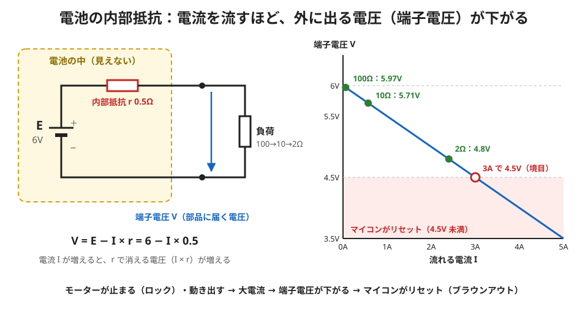

**何に役立つか**

モーターを使うロボットで「急にマイコンが再起動する」「動き出すと止まる」原因の多くがこれ。電池の選び方と電源の分け方を決める基本になる。

| 使う場面 | どう使うか |
| --- | --- |
| モーターが動き出す・何かに引っかかると、マイコンが再起動する | 大電流で電池の端子電圧が下がっていないかを疑う。今日の式で何 A までなら大丈夫か計算できる |
| ロボット・ドローンの電池を選ぶ | モーターの最大電流 ÷ 容量で必要な C レートを出し、それ以上の電池を選ぶ |
| 何分動くかを見積もる | 容量（Ah）÷ 電流 で動かせる時間を出す |
| 電源の設計 | マイコン用とモーター用の電源を分ける、コンデンサで電圧の落ち込みを助ける（12日目）、内部抵抗の小さい電池を使う |
| 電池の寿命を見分ける | 古い電池は内部抵抗が大きくなり、少しの電流で電圧が下がる |

### 1. 読む：[乾電池の性質（内部抵抗と端子電圧）](https://center.esnet.ed.jp/uploads/07shiryo/05rika/04_kandentinoseisitu.pdf)。電流を多く流すほど端子電圧が下がる仕組み

**資料のポイント**

| テーマ | 内容 |
| --- | --- |
| 端子電圧は一定ではない | 回路に流れる電流によって変わる |
| 電池の中の考え方 | 電池の中に、**起電力 E と内部抵抗 r が直列**に入っていると考える（上の図の左） |
| 式 | 電流 I を流すと、内部抵抗で I × r の電圧が消えるので、**V = E − I × r** |
| 起電力とは | 電流が流れていないとき（I = 0）の端子電圧 |
| 古い電池 | 起電力が小さくなり、内部抵抗が大きくなる |
| 電池の種類 | アルカリ乾電池はマンガン乾電池より内部抵抗が小さい。太い電熱線（大電流）の実験ではアルカリを使う |
| 実験の前に | 電熱線につないだときの端子電圧を測り、大きく下がっていたら新しい電池に替える |

### 2. 実験：[Falstad](https://www.falstad.com/circuit/) で、6V の電圧源に 0.5Ω の抵抗（内部抵抗の代わり）を直列に入れ、負荷を 100Ω → 10Ω → 2Ω と重くして端子電圧を記録

**回路**：直流電圧源（6V）→ 0.5Ω（内部抵抗のかわり）→ 負荷 → 電源の −。**負荷の両端の電圧（Vd）が端子電圧**。

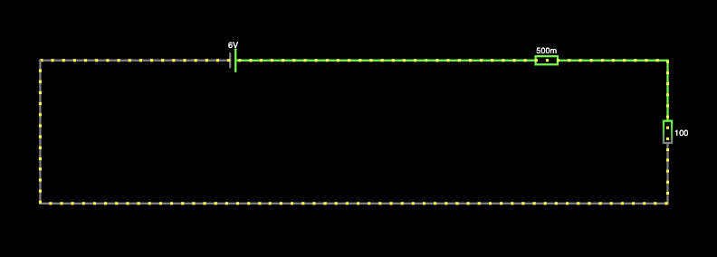

**Falstad での組み方**

| 手順 | やること |
| --- | --- |
| 1 | 「ファイル」→ 空の回路（Blank Circuit）で画面を空にする |
| 2 | 部品を選ぶ：`v`＝直流電圧源（2端子）、`r`＝抵抗、`w`＝ワイヤ（メニューの「追加」からも選べる） |
| 3 | **選んだあと、黒い画面の上でドラッグする**と、その2点のあいだに部品が置かれる（選ぶだけでは何も出ない） |
| 4 | 部品をダブルクリックして値を変える（電源 6V、抵抗 0.5Ω と 100Ω） |
| 5 | 部品にマウスを乗せると、右下に I（電流）と Vd（両端の電圧）が出る |

<details>
<summary>つまずいたときの画面（クリックで開く）</summary>

| メニューで選んだだけ（交流電圧源が選ばれている） | 左端がつながっていない（白い点、下の線が緑） |
| --- | --- |
| 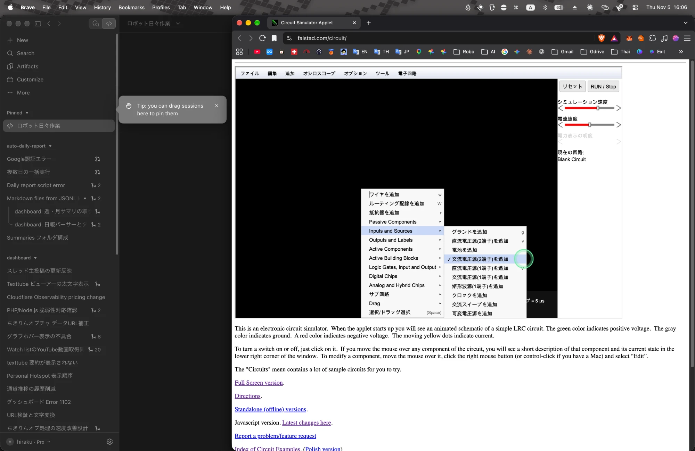 | 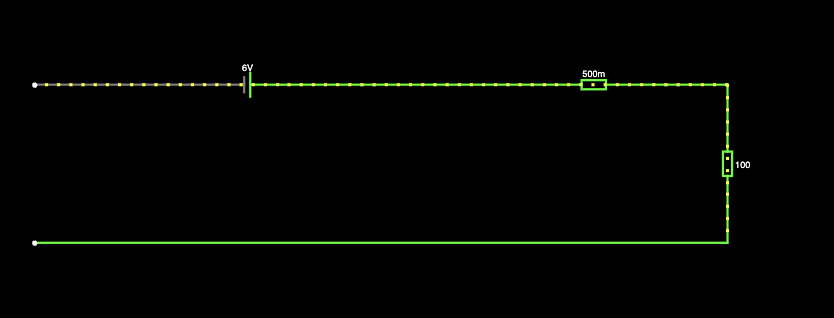 |

線の色は電圧を表す（緑＝高い、灰色＝0V）。輪がつながると、電源の − につながる下の線は灰色になる。

</details>

**成果物**

| 100Ω：負荷（Vd 5.97V） | 100Ω：内部抵抗（Vd 29.851mV） |
| --- | --- |
| 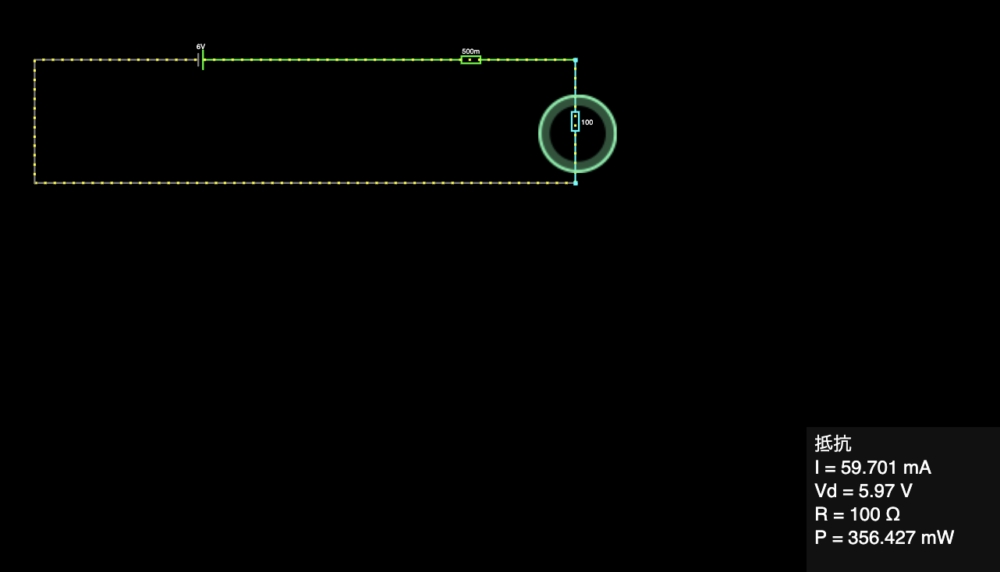 | 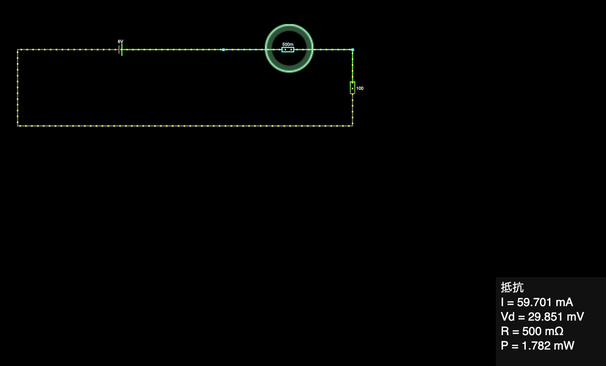 |
| **10Ω：負荷（Vd 5.714V）** | **10Ω：内部抵抗（Vd 285.714mV）** |
| 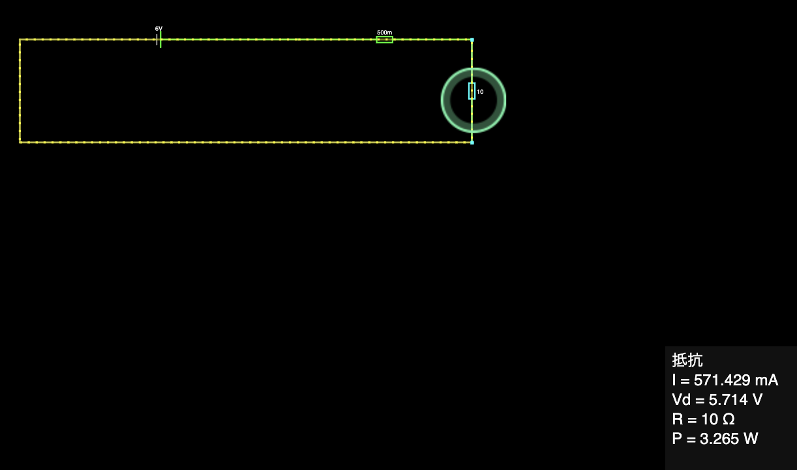 | 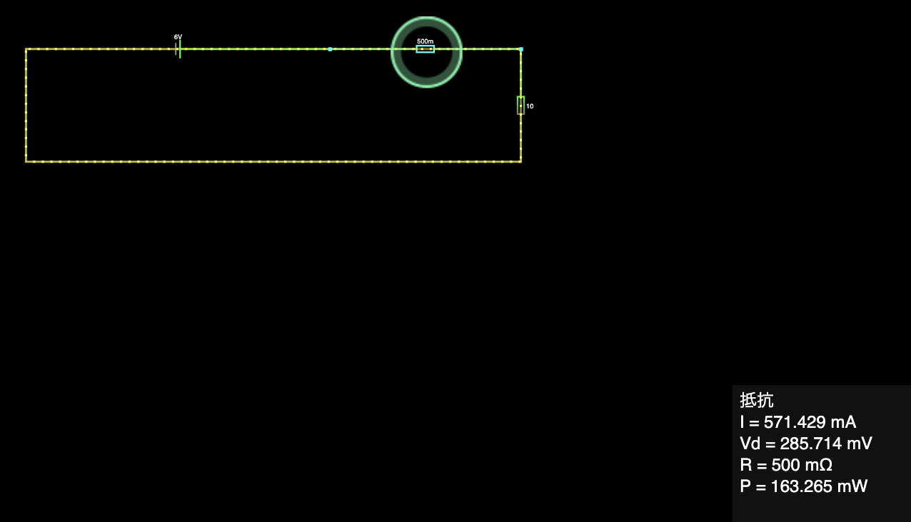 |
| **2Ω：負荷（Vd 4.8V）** | **2Ω：内部抵抗（Vd 1.2V）** |
| 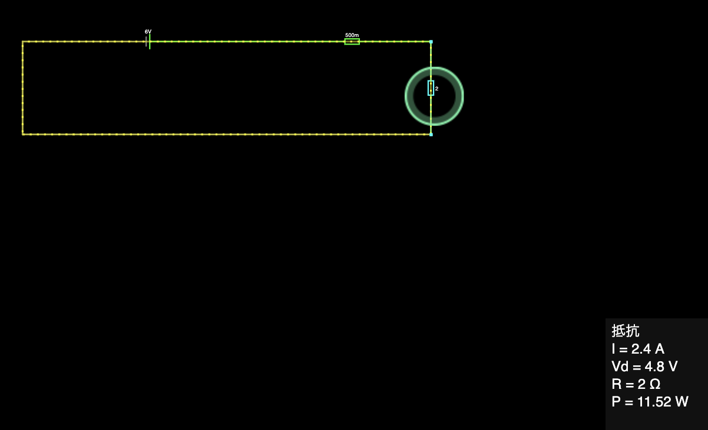 | 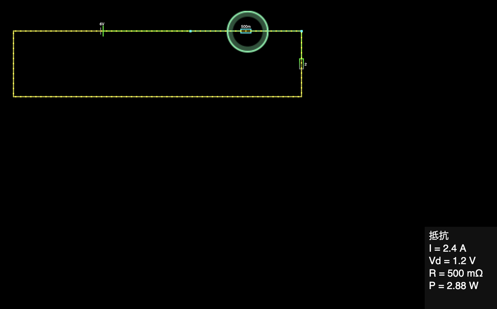 |

緑の輪はマウスの位置を目立たせる表示で、回路の部品ではない。

**予想 → 結果**（予想の式：I = 6 ÷ (0.5 + 負荷)、端子電圧 = 6 − I × 0.5）

| 負荷 | 電流 I（予想 → 結果） | 内部抵抗で消える電圧 | 端子電圧（予想 → 結果） | 合計 |
| --- | --- | --- | --- | --- |
| 100Ω | 59.7mA → **59.701mA** ✓ | 0.030V | 5.97V → **5.97V** ✓ | 6.00V |
| 10Ω | 571mA → **571.429mA** ✓ | 0.286V | 5.71V → **5.714V** ✓ | 6.00V |
| 2Ω | 2.4A → **2.4A** ✓ | 1.2V | 4.8V → **4.8V** ✓ | 6.00V |

**学んだこと**

**① 電流が増えるほど、端子電圧が下がる**

内部抵抗で消える電圧は「電流 × 0.5Ω」。電流が 0.06A → 0.57A → 2.4A と増えると、0.03V → 0.29V → 1.2V と増え、そのぶん部品に届く電圧が減る。電池の「6V」は、電流をほとんど流していないときの値。

**② 内部抵抗と負荷は直列**

2つの電圧を足すといつも 6V（3日目の「直列は電圧を分け合う」）。流れる電流も同じ（どちらも 2.4A など）。8日目の分圧と同じ形で、内部抵抗が「上の抵抗」、負荷が「下の抵抗」。

**③ 内部抵抗も熱を出す**

2Ω のとき、0.5Ω の電力は P = 2.88W。電池の中でこれだけの熱が出ている。大きな電流を流すと電池が熱くなるのはこのため（5日目の電力）。

### 3. 計算：マイコンが 4.5V を下回るとリセットすると仮定し、電流が何 A 流れたら下回るかを手で求める

| 手順 | 計算 |
| --- | --- |
| 端子電圧の式 | 6 − I × 0.5 = 4.5 |
| 内部抵抗で消してよい電圧 | 6 − 4.5 = 1.5V |
| 電流 | 1.5 ÷ 0.5 = **3A** |
| そのときの負荷の抵抗 | 4.5V ÷ 3A = **1.5Ω** |

| 負荷 | 電流 | 端子電圧 | マイコン |
| --- | --- | --- | --- |
| 100Ω | 0.06A | 5.97V | 動く |
| 10Ω | 0.57A | 5.71V | 動く |
| 2Ω | 2.4A | 4.8V | 動く（余裕は 0.3V だけ） |
| **1.5Ω** | **3A** | **4.5V** | **ここが境目** |
| 1Ω | 4A | 4.0V | リセットする |

この電池では、**3A より多く流れる（負荷が 1.5Ω より小さい）とマイコンがリセットする**。

### 4. 記録：「モーターが止まると大電流が流れ、電圧が下がってマイコンがリセットする」を自分の数字で説明する（筆者の Month 1 マイルストーン）

**「モーターが止まる」とは**：スイッチを切ることではなく、**回ろうとしているのに、何かに引っかかって回れない状態**（ロック）のこと。モーターは回っているあいだ、自分で電流を抑える力（逆起電力。ブレーキのようなもの）を出している。回れなくなるとその力がなくなり、中の銅の巻き線の小さな抵抗だけになるので、大電流が流れる。**動き出しの瞬間**も、まだ回っていないので同じ。

```
 モーターが止まる（ロック）
        |
        v
 大きな電流が流れる（3A 以上）
        |
        v
 電池の中の 0.5 オームで、電流 x 0.5 の電圧が消える（3A なら 1.5V）
        |
        v
 電池の外に出る電圧が 6V -> 4.5V より下に
        |
        v
 同じ電池につながったマイコンが、電圧不足でリセット（ブラウンアウト）
```

> モーターが何かに引っかかって止まると、回転による「電流のブレーキ」がなくなり、抵抗の小さい重い負荷になって大きな電流が流れる。
> 電池の中には 0.5Ω の内部抵抗があり、電流 × 0.5Ω の電圧が電池の中で消えるので、3A 流れると 1.5V 消えて、外に出る電圧は 6V から 4.5V に下がる。
> 同じ電池につながったマイコンは、4.5V を下回ると動き続けられずにリセットする（ブラウンアウト）。だから、内部抵抗の小さい電池を選ぶ、マイコンとモーターの電源を分ける、コンデンサで電圧の落ち込みを助ける、などの対策をする。

### 5. 読む：[高山無線「ドローン用バッテリーのすべて」](https://www.takayama-musen.com/drone/battery-guide/)と[計測技術研究所「バッテリーの C レートって、そもそもナニ？」](https://www.keisoku.co.jp/u-po/20260219-04/)

**① リポ（LiPo）電池の電圧：セル数で決まる**

リポ電池は、小さな電池（**セル**）を何個か直列にしたもの。1セルの基準の電圧は約 **3.7V**。

| 表記 | セル数 | 基準の電圧 |
| --- | --- | --- |
| 1S | 1個 | 3.7V |
| **2S** | 2個 | **7.4V** |
| 3S | 3個 | 11.1V |
| 4S | 4個 | 14.8V |

ラベルには2つの電圧が書いてある。

| 表示 | 意味 |
| --- | --- |
| Max Charge Voltage（最大充電電圧） | 充電器が止まる上限。満充電直後がいちばん高い |
| Nominal Voltage（定格電圧） | 使っているあいだの大半で保たれる、真ん中の基準の電圧。Wh の計算に使う |

> 記事には1セルの満充電・下限の数字は書かれていない。一般的には、1セルあたり満充電 **4.2V**、使い終わりの目安 **3.3〜3.5V** くらい（下げすぎると傷む）。

**② 容量と電力量**

| 言葉 | 意味 | 例（記事の DJI Mini 5 Pro） |
| --- | --- | --- |
| mAh | ためられる電気の量。÷ 1000 で Ah | 2453mAh = 2.453Ah |
| Wh | 定格電圧 × 容量（Ah）。エネルギーの量（5日目の電力量） | 7.38V × 2.453Ah ≒ **18.1Wh** |

容量を増やすと重くなるので、ドローンの飛行時間は思ったほど伸びないことがある。

**③ C レート：取り出せる電流の目安**

| 言葉 | 意味 |
| --- | --- |
| C | Capacity（容量）の頭文字 |
| **1C** | 電池を**ちょうど1時間で空にする電流**。容量の数字をそのまま A にしたもの（1000mAh なら 1A） |
| 30C など | 1C の何倍の電流まで、続けて取り出せるか |
| 「30C/60C」の表記 | 続けて出せるのが 30C、短い時間（数秒）なら 60C まで |
| 充電の C | ふつうは 1C くらい。速いものでも 5C くらい |
| 必要な C の式 | **必要な C = 必要な電流（A）÷ 容量（Ah）** |

| 1000mAh の電池 | 電流 | 空になるまで（理想） |
| --- | --- | --- |
| 1C | 1A | 60分 |
| 2C | 2A | 30分 |
| 10C | 10A | 6分 |

C レートが大きい電池は、内部抵抗が小さく、大電流でも端子電圧が下がりにくい（今日の実験とつながる）。そのかわり、値段が高く重くなりやすい。使っていると内部抵抗が上がり、使える電流の上限が下がって、熱くなりやすくなる。

**④ 安全：充電中に目を離さない理由**

| 注意 | 理由・やること |
| --- | --- |
| **充電中に目を離さない**（寝ているあいだ・外出中に充電しない） | リポは過充電・衝撃・高温に弱く、発火することがある。充電中は外からエネルギーが入り続けるので、何かあったときの被害が大きくなる |
| 使い切らない | 残り 0% 近くまで使うと傷む |
| 熱い場所に置かない | 夏の車内や直射日光を避ける。使った直後・充電直後は冷ましてから |
| 保管 | 満充電や空のまま長く置かない。50〜60% くらいで涼しい所に |
| ふくらんだ・変なにおい・熱い | すぐ使うのをやめ、燃えにくい袋（耐火バッグ）などに入れて離す |
| 捨てるとき | 一般ごみに出さない。端子をテープでふさいでショートを防ぎ、回収に出す |

<details>
<summary>記事で気になったところ（クリックで開く）</summary>

| 記事 | 気になったところ |
| --- | --- |
| 高山無線 | C レートを「瞬間的に取り出せる電流」と説明しているが、正しくは「容量に対する電流の倍率」。短い時間だけ出せる値（バースト）は別に書かれる（計測技術研究所の記事のほうが正確） |
| 高山無線 | リポ（LiPo）とリチウムイオン（Li-ion）を別の種類として表にしているが、リポもリチウムイオン電池の仲間 |
| 計測技術研究所 | 「10C なら 6分」は理想の値。大きな電流で使うと取り出せる容量が減るので、実際の時間はもっと短くなりやすい |

</details>

### 6. 計算：2200mAh・30C のリポで取り出せる最大電流、最大 20A のモーターに 1000mAh の電池なら何 C 以上が必要か、の2問

**問1：2200mAh・30C で取り出せる最大電流**

| 手順 | 計算 |
| --- | --- |
| 1C | 2200mAh → 2.2A |
| 30C | 2.2 × 30 = **66A** |

**問2：最大 20A のモーターに 1000mAh の電池なら、何 C 以上が必要か**

| 手順 | 計算 |
| --- | --- |
| 1C | 1000mAh → 1A |
| 必要な C | 20A ÷ 1A = **20C 以上** |
| 実際の選び方 | ぎりぎりだと熱くなり電圧も下がるので、余裕を見て 25〜30C を選ぶ |

最初は「1Ah ÷ 20A = 3分」と計算した。これは「20A を流し続けたら何分もつか」の答えで、計算としては正しい。問題が聞いていたのは「何 C か」なので、答えは 20C。両方とも電池選びに使う。

| 計算 | 答え | 何が分かるか |
| --- | --- | --- |
| 20A ÷ 1A（1C） | **20C 以上** | どの電池なら 20A を出せるか（選び方） |
| 1Ah ÷ 20A | 3分 | 20A を流し続けたら何分で空になるか（もつ時間） |

### この日のまとめ：予想 → 結果 → 差の理由

| 何を測った／試したか | 予想 | 結果 | 差の理由 |
| --- | --- | --- | --- |
| 100Ω の端子電圧 | 5.97V | 5.97V | 差なし |
| 10Ω の端子電圧 | 5.71V | 5.714V | 差なし |
| 2Ω の端子電圧 | 4.8V | 4.8V | 差なし |
| 2Ω の内部抵抗の電圧 | 1.2V | 1.2V | 差なし |
| リセットする電流（計算） | — | 3A（負荷 1.5Ω） | — |
| C レートの問2 | — | 最初は 3分（もつ時間）と答えた | 聞かれていたのは必要な C（20C）。時間の計算と区別する |

## 20日目 まとめ

> **ひとことで**：第1〜3週の大事な計算を **7問** 解き直した。1回目は **4問正解**。残りは「問題の後半を答え忘れた」（2問）、「1/4W で足りるかを逆に判断した」、「ベース抵抗の求め方が分からなかった」。2回目で全問正解。抵抗を売っている値に丸めるときは、**電流が多すぎると困るなら大きい側、少なすぎると困るなら小さい側**を選ぶ。最後に、第3週の成果（トランジスタスイッチ・測定値・ブラウンアウト）を1か所にまとめた。

**この日にやったことと、分かったこと**

| # | やったこと | 分かったこと（一言） |
| --- | --- | --- |
| 1 | 第1〜3週の計算を7問解き直す | 1回目 4/7、2回目 7/7。問題文の「〜か。また〜か」を最後まで読む |
| 2 | 第3週のまとめを置く | トランジスタスイッチの回路図・測定値・ブラウンアウトの説明を、下の「2.」に集めた |

やることの詳細は[チェックリスト](../CHECKLIST.md#第3週-ダイオードトランジスタプルアップ電池の内部抵抗)。

**何に役立つか**

7問はどれも、**部品をつなぐ前に「壊れないか」「ちゃんと動くか」を確かめる計算**。ロボットを作るときに毎回やる。27日目の Month 1 マイルストーン確認（回路図から組める、抵抗値を計算で判断できる、ブラウンアウトを数字で説明できる）の練習でもある。

| 問題 | ロボットで使う場面 |
| --- | --- |
| 問1 C レートと時間 | ドローンやロボットの電池を選ぶ。何分動くかを見積もる |
| 問2・問3 オームの法則と電力 | 抵抗に流れる電流を出し、熱で焦げないか（定格が足りるか）を確かめる |
| 問4 分圧と負荷 | センサーの電圧をマイコンで読むとき、つないだ相手で電圧が変わらないかを確かめる |
| 問5 LED の抵抗 | 状態表示の LED を、壊さずに光らせる |
| 問6 ベース抵抗 | Arduino でモーター・リレー・LED テープなど大きな電流の部品を ON/OFF する（第2月のモーター駆動） |
| 問7 内部抵抗 | モーターを回すとマイコンが再起動しないかを、電池の数字から確かめる |

### 1. 復習問題：第1〜3週の大事な計算を1問ずつ解き直す

記録を見返すと、自分で計算を間違えたのは19日目の C レートの1問（「何 C か」を聞かれて「何分もつか」を答えた）だけだった。そこで、その問題に似た問題と、第1〜3週の大事な計算を1問ずつ並べた **7問** を解いた。

**結果の一覧**

| # | 範囲 | 問題 | 1回目 | 2回目 | 答え |
| --- | --- | --- | --- | --- | --- |
| 0 | 19日目（間違えた問題） | 最大 20A のモーターに 1000mAh の電池。何 C 以上か | ✅ 20C | — | 20C |
| 1 | 19日目 C レート | 最大 30A のモーターに 1500mAh。何 C 以上か。30A で何分で空か | 🔺 20C だけ | ✅ | 20C、3分 |
| 2 | [2日目 オームの法則](../week1/README.md#2日目-オームの法則) | 12V に 2.4kΩ。電流は何 mA か | ✅ | — | 5mA |
| 3 | [5日目 電力](../week1/README.md#5日目-電力) | 問2 の抵抗の電力は何 W か。1/4W で足りるか | 🔺 0.06W・足りない | ✅ | 0.06W、足りる |
| 4 | [8日目](../week2/README.md#8日目-分圧の式)・[9日目](../week2/README.md#9日目-負荷で電圧が下がる) 分圧と負荷 | 9V、R1 2kΩ、R2 1kΩ の出力は？ 1kΩ の負荷をつなぐと？ | 🔺 3V だけ | ✅ | 3V、1.8V |
| 5 | [15日目 LED の抵抗](#15日目-ledの抵抗を計算する) | 9V で赤 LED（2V）を 15mA。抵抗は？ 売っている値なら？ | ✅ | — | 466.67Ω → 470Ω |
| 6 | [17日目 トランジスタスイッチ](#17日目-トランジスタスイッチを設計する筆者の課題) | 5V、hFE 100、コレクタ電流 50mA、10倍の余裕。ベース抵抗は？ | ❌ 分からない | ✅ | 860Ω → 820Ω |
| 7 | [19日目 内部抵抗](#19日目-電池の内部抵抗とブラウンアウト) | 7.4V・0.2Ω のリポ。6V を下回るのは何 A から？ | ✅ | — | 7A |

以下、1問ずつ「まず言葉 → 図 → 手順 → ポイント」の順に解説する。

---

#### 問1：電池の C レートと、もつ時間

> 最大 30A のモーターに 1500mAh の電池を使う。何 C 以上の電池が必要か。また、30A を流し続けると何分で空になるか。

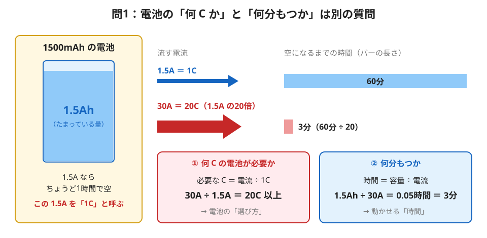

**まず言葉**

| 言葉 | 意味 | たとえ（水のタンク） |
| --- | --- | --- |
| **容量**（mAh） | 電池にたまっている電気の量。1500mAh ＝ 1.5A を1時間流せる量 | タンクに入っている水の量 |
| **1C** | 電池を**ちょうど1時間で空にする電流**。容量の数字をそのまま A にしたもの（1500mAh なら 1.5A） | 1時間で空になる蛇口の開け方 |
| **C レート** | 1C の何倍の電流まで出せるか。20C なら 1C の20倍 | 蛇口をどこまで大きく開けられるか |

**手順**

| # | 聞かれていること | 式 | 計算 | 答え |
| --- | --- | --- | --- | --- |
| ① | 何 C の電池が必要か | 必要な C ＝ 流したい電流 ÷ 1C | 30A ÷ 1.5A | **20C 以上** |
| ② | 何分で空になるか | 時間 ＝ 容量 ÷ 電流 | 1.5Ah ÷ 30A ＝ 0.05時間 → 0.05 × 60 | **3分** |

②は「1C なら60分。その20倍の電流なら、時間は 1/20 で 60 ÷ 20 ＝ 3分」と考えてもよい。

**ポイント**

- 1つの問題に「何 C か」と「何分か」の**2つの質問**が入っていた。答える前に、問題文に「また」「〜と〜」がないかを見る。
- ① は**電池の選び方**（20C より小さい電池は 30A を出しきれず、熱くなって電圧も下がる）、② は**動かせる時間**の見積もり。どちらも電池選びに使う。
- 単位をそろえる。1500mAh → 1.5Ah（÷1000）、0.05時間 → 3分（×60）。

---

#### 問2・問3：オームの法則と電力

> 問2：12V に 2.4kΩ をつないだ。電流は何 mA か。
> 問3：その抵抗の消費電力は何 W か。1/4W の抵抗で足りるか。

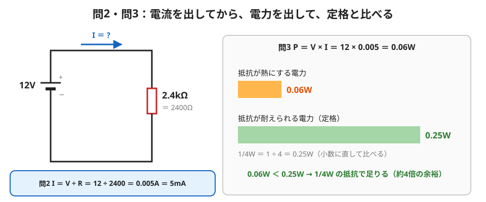

**まず言葉**

| 言葉 | 意味 |
| --- | --- |
| **消費電力**（W） | 抵抗が電気を**熱**に変える量。P ＝ V × I |
| **定格電力**（1/4W など） | その抵抗が熱で壊れずに耐えられる電力の上限。ブレッドボードでよく使う抵抗は 1/4W |

**手順**

| # | 式 | 計算 | 答え |
| --- | --- | --- | --- |
| 問2 | I ＝ V ÷ R | 12 ÷ 2400（kΩ は Ω に直す） | 0.005A ＝ **5mA** |
| 問3 ① | P ＝ V × I | 12 × 0.005 | **0.06W** |
| 問3 ② | 定格を小数に直す | 1/4W ＝ 1 ÷ 4 | 0.25W |
| 問3 ③ | 比べる | 0.06W ＜ 0.25W | **足りる**（約4倍の余裕） |

**ポイント**

- 1回目は 0.06W まで正しく出せたのに、「足りない」と判断した。**分数（1/4）と小数（0.06）を見比べると、大きさが分かりにくい**。両方を小数にそろえてから比べる。
- 「足りる」とは「抵抗の消費電力 ＜ 定格」のこと。実際には、熱くなりすぎないように**定格の半分以下**に収めるのが目安（[5日目](../week1/README.md#5日目-電力)）。0.06W は 0.25W の約1/4なので十分安全。
- mA ↔ A の換算：0.005A × 1000 ＝ 5mA。

---

#### 問4：分圧回路に負荷をつなぐ

> 9V、R1 ＝ 2kΩ、R2 ＝ 1kΩ の分圧の出力は何 V か。出力に 1kΩ の負荷をつなぐと何 V になるか。

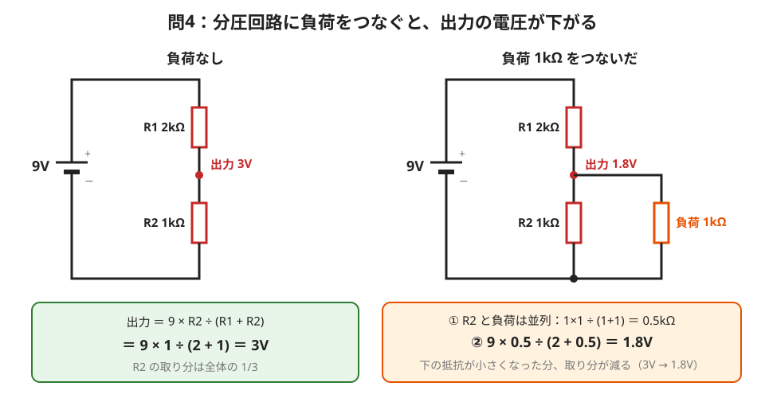

**まず言葉**

| 言葉 | 意味 |
| --- | --- |
| **分圧** | 抵抗を直列につなぎ、電源の電圧を抵抗の大きさの割合で分けること。出力は R2 の両端 |
| **負荷** | 出力につなぐ相手（マイコンのピン、センサー、電圧計など）。電流を少し食う |
| **並列の合成抵抗** | 2本を並列にすると1本にまとめられる。R1 × R2 ÷ (R1 + R2)。**どちらの抵抗よりも小さくなる**（[4日目](../week1/README.md#4日目-並列回路と合成抵抗)） |

**手順**

| # | やること | 計算 | 答え |
| --- | --- | --- | --- |
| ① | 負荷なしの出力 | 9 × 1 ÷ (2 + 1) | **3V** |
| ② | 負荷は出力と GND の間 → R2 と**並列**。先に1本にまとめる | 1 × 1 ÷ (1 + 1) | 0.5kΩ |
| ③ | まとめた 0.5kΩ を「新しい R2」として、分圧の式にもう一度入れる | 9 × 0.5 ÷ (2 + 0.5) | **1.8V** |

**ポイント**

- 負荷をつなぐと、下側の抵抗が 1kΩ → 0.5kΩ に減る。電圧の取り分は抵抗の大きさで決まるので、下側の取り分が減って 3V → 1.8V に下がる。
- 手順は「**並列を先にまとめる → 直列の式**」。[9日目](../week2/README.md#9日目-負荷で電圧が下がる)の Tinkercad の実験と同じ。
- 負荷の抵抗が R2 よりずっと大きい（たとえば 100 倍）なら、ほとんど下がらない。センサーの電圧をマイコンで読むときに、この差が問題になる。

---

#### 問5：LED の抵抗

> 9V で赤 LED（2V）を 15mA 光らせる。抵抗は何 Ω か。売っている値（E12：…270・330・390・470…）から選ぶなら何 Ω か。

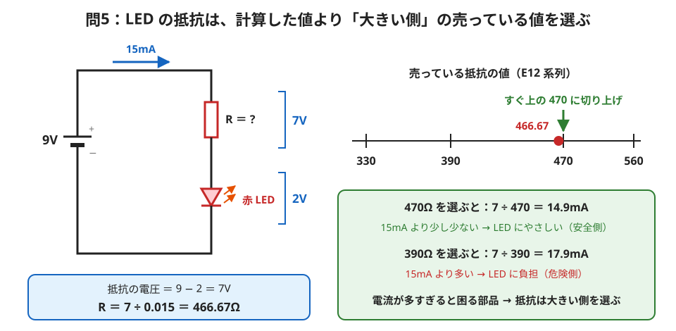

**まず言葉**

| 言葉 | 意味 |
| --- | --- |
| **LED の電圧**（Vf） | LED が光っているあいだ、LED の両端にかかる電圧。赤は約 2V で、電流が変わってもほぼ一定 |
| **E12 系列** | 売っている抵抗の値の並び。1.0・1.2・1.5・1.8・2.2・2.7・3.3・3.9・4.7・5.6・6.8・8.2 の12個に、×10、×100…をかけた値しか売っていない |

**手順**

| # | やること | 計算 | 答え |
| --- | --- | --- | --- |
| ① | 抵抗にかかる電圧 | 9 − 2（LED のぶんを引く） | 7V |
| ② | 抵抗の値 | 7 ÷ 0.015（15mA ＝ 0.015A） | 466.67Ω |
| ③ | 売っている値を選ぶ | 466.67 のすぐ上 | **470Ω** |
| ④ | 選んだ値で確かめる | 7 ÷ 470 | 14.9mA（15mA 以下 ✓） |

**ポイント**

- LED は電流が多すぎると壊れる。だから**抵抗は大きい側（切り上げ）**を選ぶ。390Ω にすると 17.9mA になり、狙いより多く流れる。
- 「電源の電圧 − LED の電圧」を忘れて 9 ÷ 0.015 ＝ 600Ω としないこと。抵抗にかかるのは残りの 7V だけ。

---

#### 問6：トランジスタのベース抵抗（1回目は分からなかった問題）

> Arduino の 5V で NPN（hFE 100）を動かし、コレクタ電流 50mA の部品を ON にしたい。ベース電流を約10倍の余裕で流すとき、ベース抵抗は何 Ω か。

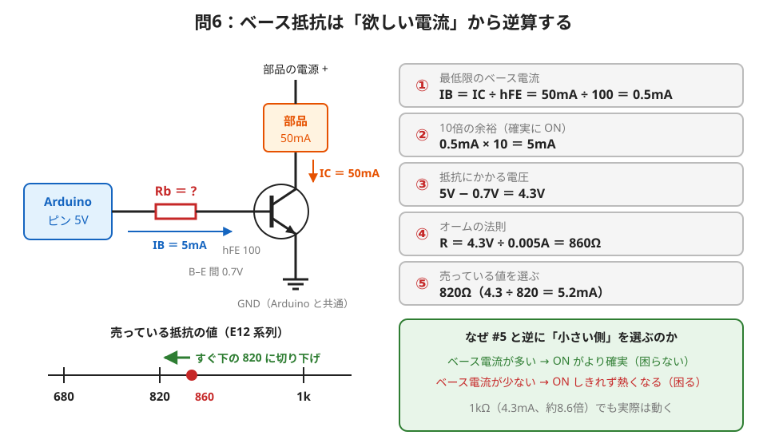

**まず言葉**

| 言葉 | 意味 | たとえ |
| --- | --- | --- |
| **ベース電流**（IB） | Arduino のピンからトランジスタのベースに流す小さい電流。これが「ON にせよ」という合図 | 蛇口のハンドルを回す手の力 |
| **コレクタ電流**（IC） | トランジスタが ON になって、部品に流れる大きい電流 | 蛇口から出る水 |
| **hFE**（電流増幅率） | IC が IB の最大何倍まで流れるか。100 なら、IB 1mA で IC 最大 100mA | ハンドルを少し回すと、水がどれだけ出るか |
| **B–E 間の 0.7V** | ベースからエミッタへ電流を流すとき、トランジスタの中で使われる電圧。ほぼ一定（[16日目](#16日目-トランジスタの仕組み)） | — |
| **飽和**（しっかり ON） | ベース電流を十分流して、トランジスタが「全開のスイッチ」になった状態。熱くならない | ハンドルを最後まで回しきる |

**考え方の流れ**：ほしいのは**ベース抵抗**。抵抗はオームの法則 R ＝ V ÷ I で出せるので、「**抵抗にかかる電圧**」と「**抵抗に流す電流**」の2つが分かればよい。電流は hFE から、電圧は 5V − 0.7V から出す。

**手順**（[17日目](#17日目-トランジスタスイッチを設計する筆者の課題)の設計と同じ順番。数字だけ違う）

| # | やること | なぜ | 計算 | 答え |
| --- | --- | --- | --- | --- |
| ① | 最低限のベース電流 | IC ＝ hFE × IB なので、逆に IB ＝ IC ÷ hFE | 50mA ÷ 100 | 0.5mA |
| ② | 10倍の余裕をもたせる | hFE は部品ごとにばらつく。多めに流して確実に飽和させる | 0.5mA × 10 | **5mA** |
| ③ | 抵抗にかかる電圧 | ピンの 5V のうち 0.7V は B–E 間で使われる。残りが抵抗にかかる | 5 − 0.7 | 4.3V |
| ④ | オームの法則 | R ＝ V ÷ I（mA は A に直す） | 4.3 ÷ 0.005 | 860Ω |
| ⑤ | 売っている値を選ぶ | 860Ω は売っていない。すぐ下は 820Ω、すぐ上は 1kΩ | 4.3 ÷ 820 | **820Ω**（5.2mA） |
| ⑥ | ピンの電流を確かめる | Arduino のピンは 1本 20mA くらいまでが目安 | 5.2mA ＜ 20mA | 安全 ✓ |

**問5 と問6 で、丸める向きが逆になる理由**

| | 問5 LED の抵抗 | 問6 ベース抵抗 |
| --- | --- | --- |
| 電流が多めになると | LED が壊れる（困る） | ON がより確実になる（困らない） |
| 電流が少なめになると | 少し暗いだけ（困らない） | ON しきれず、トランジスタが熱くなる（困る） |
| だから選ぶのは | **大きい抵抗**（切り上げ）470Ω | **小さい抵抗**（切り下げ）820Ω |

丸め方は「**その電流が多すぎると困るのか、少なすぎると困るのか**」で決める。ただし問6 は余裕を10倍とっているので、1kΩ（4.3mA、約8.6倍）でも実際には動く。

---

#### 問7：電池の内部抵抗でマイコンがリセットする電流

> 起電力 7.4V、内部抵抗 0.2Ω のリポ。マイコンが 6V を下回るとリセットするなら、何 A 流れるとリセットするか。

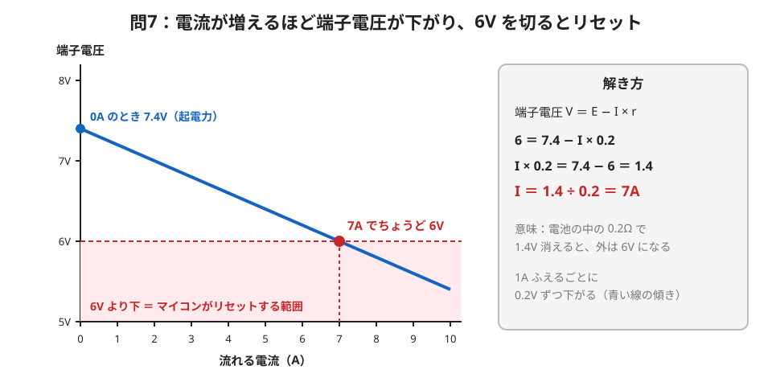

**まず言葉**（くわしくは [19日目](#19日目-電池の内部抵抗とブラウンアウト)）

| 言葉 | 意味 |
| --- | --- |
| **起電力** E | 電流を流していないときの電池の電圧（7.4V） |
| **内部抵抗** r | 電池の中にある小さな抵抗（0.2Ω） |
| **端子電圧** V | 電池の外に出てくる電圧。V ＝ E − I × r |

**手順**

| # | やること | 計算 | 答え |
| --- | --- | --- | --- |
| ① | 式に数字を入れる | 6 ＝ 7.4 − I × 0.2 | — |
| ② | 電池の中で消えてよい電圧 | 7.4 − 6 | 1.4V |
| ③ | その電圧が消える電流 | 1.4 ÷ 0.2 | **7A** |

**ポイント**

- グラフにすると、電流が 1A 増えるごとに端子電圧が 0.2V（＝ 内部抵抗）ずつ下がる直線になる。7A で 6V の線を切る。
- 19日目の乾電池（6V・0.5Ω）は 3A で 1.5V 下がった。このリポは内部抵抗が小さいので、**7A 流してもやっと 1.4V しか下がらない**。ドローンやロボットでリポを使うのは、このため。

<details>
<summary>この日に間違えたこと（クリックで開く）</summary>

| 問題 | 1回目の答え | どう間違えたか | 次から気をつけること |
| --- | --- | --- | --- |
| 問1 | 20C だけ | 「また、何分で空になるか」の後半を答えていなかった | 問題文の「また」「〜と〜」を見て、質問の数を数える |
| 問3 | 0.06W、足りない | 0.06W は正しい。1/4W（＝ 0.25W）と比べて、逆に判断した | 分数は小数に直してから比べる |
| 問4 | 3V だけ | 「負荷をつなぐと」の後半を答えていなかった | 問1 と同じ |
| 問6 | 分からない | 何から計算すればよいか分からなかった | ほしいのは抵抗 → R ＝ V ÷ I → 電流（hFE から）と電圧（5 − 0.7）を先に出す |

</details>

### 2. 第3週のまとめ：トランジスタスイッチ・測定値・ブラウンアウト

第3週のゴールは「マイコンの弱い信号で大きな電流を切り替える回路を設計でき、『モーターが止まるとマイコンがリセットする』理由を数字で説明できる」こと。その成果を1か所に集める。

#### 2-1. トランジスタスイッチの回路図（17日目）

| 設計の図 | KiCad の回路図（ERC 違反 0） |
| --- | --- |
|  |  |

| 部品 | 値 | 決め方 |
| --- | --- | --- |
| Rc（LED 側の抵抗） | 300Ω | (9 − 6 − 0.2) ÷ 10mA ＝ 280Ω → 売っている値 |
| Rb（ベース抵抗） | 4.7kΩ | IB ＝ 10mA ÷ 100 × 10 ＝ 1mA、(5 − 0.7) ÷ 1mA ＝ 4.3kΩ → 売っている値 |
| GND | 9V 電池の − と Arduino の GND をつなぐ | つながないと、ベースの電流が戻る道がない |

- KiCad のプロジェクト一式：[kicad/day17_npn-transistor-switch/](kicad/day17_npn-transistor-switch/)

#### 2-2. 測定値（17日目、Tinkercad）

| 測ったもの | 予想 | 測定 | 判定 |
| --- | --- | --- | --- |
| ベース電流 IB（Arduino から出る電流） | 0.91mA | **0.914mA** | ✓ ピンの目安 20mA よりずっと小さい |
| コレクタ電流 IC（LED 3個の電流） | 9.3mA | **10.0mA** | ✓ LED の上限 20mA の半分。C–E 間を 0.2V と多めに見積もったぶん多い |
| IC ÷ IB | — | 約 11 倍 | ✓ hFE（100）よりずっと小さい ＝ しっかり飽和 |

Arduino が出す電流は、LED に流れる電流の約 1/11 で済んだ。

#### 2-3. ブラウンアウトの説明（19日目）


| 電池 | 起電力 | 内部抵抗 | 端子電圧がリセットの電圧を切る電流 |
| --- | --- | --- | --- |
| 19日目（乾電池の想定） | 6V | 0.5Ω | 4.5V を切るのは **3A** から |
| 20日目 問7（2S リポ） | 7.4V | 0.2Ω | 6V を切るのは **7A** から |

> モーターが何かに引っかかって止まると、回転による「電流のブレーキ」（逆起電力）がなくなり、大きな電流が流れる。
> 電池の中には 0.5Ω の内部抵抗があり、電流 × 0.5Ω の電圧が電池の中で消えるので、3A 流れると 1.5V 消えて、外に出る電圧は 6V から 4.5V に下がる。
> 同じ電池につながったマイコンは、4.5V を下回ると動き続けられずにリセットする（ブラウンアウト）。対策は、内部抵抗の小さい電池を選ぶ、マイコンとモーターの電源を分ける、コンデンサで電圧の落ち込みを助ける。

#### 2-4. 第3週でできるようになったこと

| できるようになったこと | 日 |
| --- | --- |
| LED に流す電流から抵抗値を計算し、Tinkercad で確かめる | 15日目 |
| トランジスタは小さいベース電流で大きいコレクタ電流を流すスイッチだと説明できる | 16日目 |
| Arduino のピンで、別の電源の LED を ON にする回路を設計し、測って確かめる | 17日目 |
| 入力ピンにはプルダウン（プルアップ）抵抗が必要な理由を説明できる | 18日目 |
| 電流が増えると電池の電圧が下がり、マイコンがリセットする理由を数字で説明できる | 19日目 |
| 電池の C レートから、取り出せる電流と必要な電池を計算できる | 19・20日目 |

### この日のまとめ：予想 → 結果 → 差の理由

| 何を測った／試したか | 予想 | 結果 | 差の理由 |
| --- | --- | --- | --- |
| 復習問題 7問（1回目） | 全問正解 | 4問正解、半分正解 3問（後半の答え忘れ 2、判断の逆 1）、不正解 1問 | 問題文の後半を読み落とした。分数と小数をそのまま比べた。ベース抵抗は「何から出すか」の手順が身についていなかった |
| 復習問題 7問（2回目） | 全問正解 | 全問正解 | — |

## 何が壊れてどう直したか

うまくいかなかったことを、症状・原因・直し方の順に書きます。この週で一番大事な節です。

| 日 | 症状 | 原因 | 直し方 |
| --- | --- | --- | --- |
| 15日目 | 電流計が 15.2mA を示し、LED が消えた | 電流計を LED と同じ2つのグループに挿し、LED の横に並べていた（迂回路） | 電流計を、メーター以外ではつながっていない2つのグループのあいだにはさむ |
| 15日目 | LED は光っているのに 0.00A | 電流計の両端を同じ行（同じグループ）に挿していた | 電流計の2本の足を別々のグループに挿す |
| 15日目 | 0.00A で、LED が抵抗なしで 5V につながった | 抵抗の両足も同じ行に挿していて、抵抗が「ただの線」になった | 部品ごとに「2本の足が別々のグループか」を確かめる |
| 17日目 | LED が光らない | LED の向きが逆だった。直列なので1個でも逆なら全部消える | 曲がった足（アノード）を 9V + 側に向けた |
| 17日目 | LED が光っているのに電流計が 0.00A | 元の線を消さずに電流計を足した | 元の線を消して、電流計だけが通り道になるようにした |
| 17日目 | 電流計を外したら LED が消えた | 線の端が足からずれた。重なって残った線で R2 の両端が 5V になっていた | 線を引き直し、Tinkercad の回路図表示でつながりを確かめた |
| 17日目 | KiCad の ERC でエラー 1 件 | エミッタ（Open emitter）と PWR_FLAG（Power output）の組み合わせが、KiCad の決まりでエラー | 理由を確かめ、この1件だけ除外した |
| 18日目 | ボタンを離すと 5V、押すと 0V（逆） | 電圧計をボタンの両端に当てていた | 赤を入力点、黒を GND に当てる |
| 18日目 | プルダウン抵抗を外しても 0.00V | GND の線がボタンの入力点側の足に残っていた（押すとショート） | GND の線を消した |
| 19日目 | Falstad でメニューから部品を選んでも、何も出てこない | Falstad はメニューで「次に描く部品」を選ぶだけ。しかも交流電圧源が選ばれていた | 直流電圧源（`v`）を選び、黒い画面の上でドラッグして置く |
| 19日目 | 回路を組んだのに下の線が緑のまま | 左端の線がつながっておらず、輪になっていなかった（白い点＝つながっていない端） | 左の白い点どうしを線でつないだ。下の線が灰色（0V）に変わり、電流が流れた |
| 20日目 | 復習問題で「1/4W の抵抗で足りるか」を「足りない」と判断した | 0.06W と 1/4W（分数）をそのまま見比べた | 1/4W ＝ 0.25W と小数に直してから比べる。0.06 ＜ 0.25 なので足りる |

**この週の教訓**：ブレッドボードは「**同じ行の5穴は1本の線**」。部品の足は必ず違うグループに挿す（15日目の図）。つながりは見た目ではなく、**回路図表示で確かめる**（17日目）。

## 分からなかったこと・あとで調べること

-
