# 第3週 ダイオード・トランジスタ・プルアップ・電池の内部抵抗

- フェーズ：[フェーズ1 電子回路・道具・はんだ付け](../README.md)
- 日：15〜21日目（詳細は [CHECKLIST.md](../CHECKLIST.md#第3週-ダイオードトランジスタプルアップ電池の内部抵抗) ）
- ゴール：マイコンの弱い信号で大きな電流を切り替える回路を設計でき、「モーターが止まるとマイコンがリセットする」理由を数字で説明できる
- 状態：進行中

日ごとに「やること → 成果物 → 予想 → 結果 → 差の理由」を残します。測定や実験は、やる前に予想を書きます。

## 15日目 LEDの抵抗を計算する

> **ひとことで**：LED（ダイオード）は、ある電圧を超えると電流が急に増えるので、**抵抗で電流を決める**。抵抗値は **R = (電源 − LED の電圧) ÷ 流したい電流**。5V・赤LED・10mA なら 300Ω で、Tinkercad でも 10.0mA になった。

**この日にやったことと、分かったこと**

| # | やったこと | 分かったこと（一言） |
| --- | --- | --- |
| 1 | Falstad でダイオードを見る | 逆向きは流れない。約 0.6V を超えると急に流れる |
| 2 | DigiKey の記事を読む | 抵抗は「Ω」と「W（定格電力）」の2つを決めて選ぶ |
| 3 | 抵抗値と電力を手で計算 | 300Ω、0.03W（1/4W で十分） |
| 4 | Tinkercad で確かめる | 300Ω で 10.0mA、330Ω で 9.16mA。ブレッドボードの挿し方でつまずいた |

やることの詳細は[チェックリスト](../CHECKLIST.md#第3週-ダイオードトランジスタプルアップ電池の内部抵抗)。

**何に役立つか**

ダイオードは一方向にしか流さない。LED を正しい電流で光らせ、回路を逆向きの電気から守る。

| 使う場面 | どう使うか |
| --- | --- |
| 表示用 LED の抵抗を選ぶ | R = (電源 − LED の電圧) ÷ 電流 と、定格電力で選ぶ |
| 電池を逆に挿したときに回路を守る | 電源の入口にダイオードを入れる |
| モーターやリレーを切った瞬間の高い電圧を逃がす | モーターやリレーのコイルにダイオードを並べてつなぐ（後の週） |

### 1. 観察：[Falstad ダイオードの例題](https://www.falstad.com/circuit/e-diodevar.html)。一方向にしか電流が流れないことを確認

**回路**：電源（右の「電圧」つまみで変える）→ ダイオード → GND

```
電源（つまみで電圧を変える）
  |
  ▼  ダイオード（三角の向きにだけ電流が流れる）
  |
 GND
```

**成果物**（電圧の低い順）

| −1V（逆向き） | 0.363V |
| --- | --- |
| 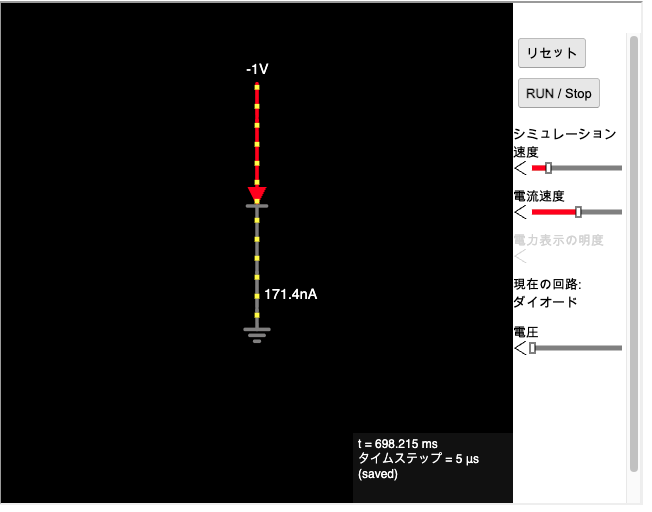 | 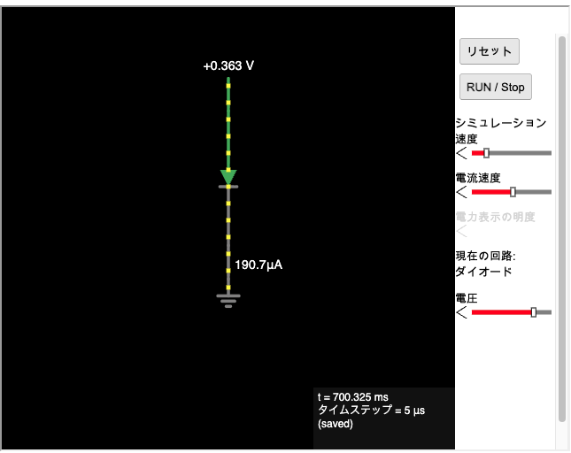 |
| **0.54V** | **0.611V** |
| 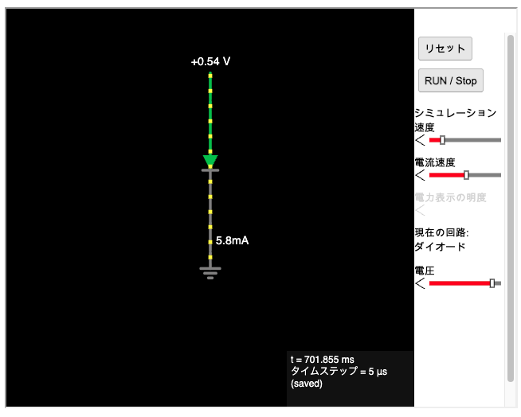 | 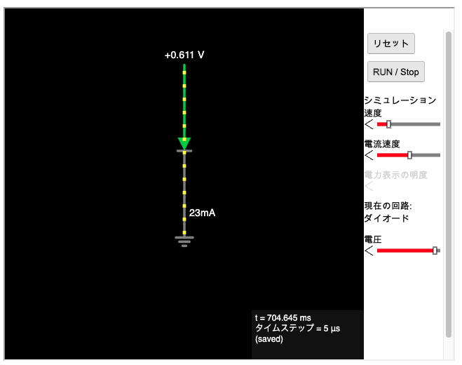 |
| **0.717V** | **0.77V** |
| 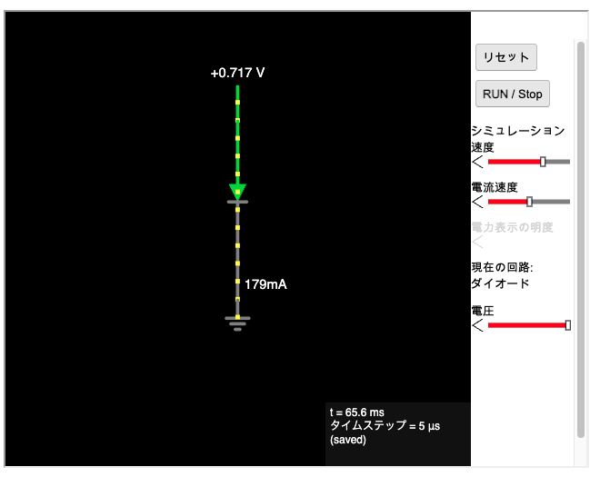 | 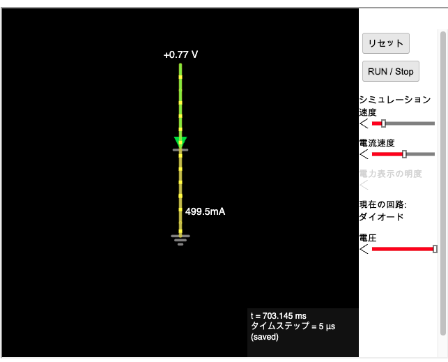 |

| 電圧 | 電流 | mA にそろえると |
| --- | --- | --- |
| **−1V**（逆向き） | 171.4nA | **0.0002mA**（ほぼ 0） |
| 0.363V | 190.7µA | 0.19mA |
| 0.54V | 5.8mA | 5.8mA |
| 0.611V | 23mA | 23mA |
| 0.717V | 179mA | 179mA |
| 0.77V | 499.5mA | 500mA |

**学んだこと**

**① 逆向きには流れない**

−1V では 0.0002mA。ごくわずかな「漏れ」だけで、ほぼ 0。

**② 約 0.6V を超えると、電流が急に増える**

```
0.363V    0.19mA  |
0.54V     5.8mA   |
0.611V    23mA    ||
0.717V    179mA   ||||||||||||
0.77V     500mA   ||||||||||||||||||||||||||||||||||
```

| | 抵抗（オームの法則） | ダイオード |
| --- | --- | --- |
| 電圧を約2倍（0.363 → 0.77V）にすると | 電流も約 **2倍** | 電流は約 **2600倍**（0.19 → 500mA） |
| 逆向き | 同じように流れる | 流れない |

> たとえ：ダイオードは**ばね付きの一方通行の弁**。逆向きに押すと閉じたまま。正しい向きでも、弱く押すうち（約 0.6V まで）はばねに負けて開かない。強く押すと開いて、どっと流れる。

**③ だから、流れているときの電圧はほぼ一定に見える**

0.54〜0.77V のわずか 0.23V のあいだに、電流が 5.8mA から 500mA まで変わる。ふつうに使う電流の範囲では、電圧は「だいたい 0.6〜0.7V」で決まっていると考えてよい。

| 部品 | 流れているときの電圧（Vf） |
| --- | --- |
| ふつうのダイオード | 約 0.6〜0.7V |
| 赤 LED | 約 2V（4日目に測った 1.9〜2.1V） |
| 青・白 LED | 約 3V |

> このシミュレーターのダイオードは 0.54V で流れ始めていた。部品によって少しずつ違うので、幅で覚えておく。

### 2. 読む：[DigiKey「LED 用の適切な抵抗の選択」](https://forum.digikey.com/t/led/5558)。抵抗値と、抵抗に必要なワット数の求め方

**学んだこと**

**① LED の抵抗を決めるのに必要な3つの値**

| 記号 | 意味 | 記事の例 |
| --- | --- | --- |
| Vs | 電源の電圧 | 9V |
| Vf（順方向電圧） | LED が光るときに使う電圧 | 3.2V（青・白などの LED） |
| If（順方向電流） | LED に流したい電流 | 20mA = 0.020A |

**② 抵抗値の式**

**R = (Vs − Vf) ÷ If**

| 手順 | 考え方 | 記事の例 |
| --- | --- | --- |
| 1 | 抵抗にかかる電圧 = 電源 − LED の電圧 | 9 − 3.2 = 5.8V |
| 2 | 抵抗 = 抵抗の電圧 ÷ 電流 | 5.8 ÷ 0.020 = **290Ω** |

**③ 抵抗は「Ω」と「W」の2つで選ぶ**

| 数字 | 意味 | たとえ（ホース） |
| --- | --- | --- |
| Ω（抵抗値） | 電流をどれだけ流れにくくするか | ホースの**細さ** |
| W（定格電力） | どれだけの熱まで耐えられるか。超えると焦げる | ホースの**丈夫さ** |

同じ 330Ω でも、1/8W・1/4W・1/2W・1W などの大きさ違いが売られている。体が大きいほど熱を逃がしやすいので、大きい W に耐えられる。**ブレッドボードの電子工作で使うふつうの抵抗は 1/4W**。

| 定格電力 | 見た目 | 使いどころ |
| --- | --- | --- |
| 1/8W・1/6W | 小さい | 小さな電流の回路 |
| **1/4W** | ふつうの大きさ | キット・入門セットのほとんど |
| 1/2W・1W 以上 | 大きい | 大きな電流が流れる回路 |

**④ 記事の「290Ω、1/8W」の意味**

記事は、計算した電力を書かずに、選ぶ部品の定格（1/8W）だけを書いている。

| 手順 | 計算 | 値 |
| --- | --- | --- |
| 抵抗の電力（**計算した W**） | 5.8V × 0.020A | **0.116W** |
| 選ぶ定格電力（**売られている段から選ぶ W**） | 0.116W を上回る一番小さい段 | **1/8W（0.125W）** |

ただし、0.116W に対して 0.125W は**余裕が 7% しかない**。ふつうは計算した電力の **2倍以上**の定格を選ぶので、この例なら **1/4W** のほうが安心。また、290Ω は売られていない値なので、実際は近い **300Ω（E24 系列）か 330Ω（E12 系列）** を選ぶ。

### 3. 計算：5V 電源、赤 LED（Vf 約 2V）、10mA のときの抵抗値と消費電力を手で求める

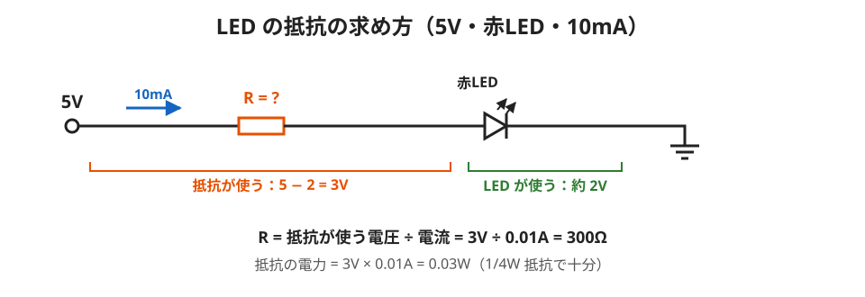

| 求めるもの | 式 | 答え |
| --- | --- | --- |
| 抵抗値 | (5 − 2) ÷ 0.01 | **300Ω** |
| 抵抗にかかる電圧 | 300 × 0.01（= 5 − 2） | **3V** |
| 抵抗の消費電力 | 3 × 0.01 | **0.03W（30mW）** |

**① 1/4W 抵抗で足りるか**（5日目と同じ判断）

| | 電力 |
| --- | --- |
| 1/4W 抵抗の上限 | 0.25W |
| 余裕の目安（上限の半分） | 0.125W |
| 今回 | **0.03W** → 上限の約 1/8。**1/4W で十分**（1/8W でも約4倍の余裕） |

**② 売っている値を選ぶ**

| 選ぶ抵抗 | 電流 = 3V ÷ R | 判断 |
| --- | --- | --- |
| 270Ω（E12） | 約 11.1mA | 少し多め |
| 300Ω（E24） | 10mA | ちょうど。手に入れば使う |
| **330Ω（E12）** | 約 **9.1mA** | 少し少なめ。**迷ったら大きいほう（安全側）** |

**③ 回路全体の電力の内訳**

| 部品 | 電圧 | 電力（電圧 × 0.01A） |
| --- | --- | --- |
| 抵抗 | 3V | 0.03W |
| LED | 2V | 0.02W |
| 合計（電源が出す） | 5V | 0.05W |

| | DigiKey の例 | 自分の計算 |
| --- | --- | --- |
| 電源・LED・電流 | 9V・3.2V・20mA | 5V・2V・10mA |
| 抵抗値 → 買う値 | 290Ω → 300Ω か 330Ω | 300Ω → 300Ω か 330Ω |
| 計算した電力 | 0.116W | 0.03W |
| 選ぶ定格電力 | 1/8W はぎりぎり → **1/4W** | 1/8W でも 1/4W でも十分 |

### 4. 検証：Tinkercad で組み、電流計で 10mA 前後になるか確かめる

Tinkercad には 5V の電池がないので、**Arduino の 5V ピン**を電源にした（電池は 9V・1.5V・3V だけで、組み合わせてもちょうど 5V にならない）。

**成果物**

| 300Ω（計算した値） | 330Ω（売っている値） |
| --- | --- |
| 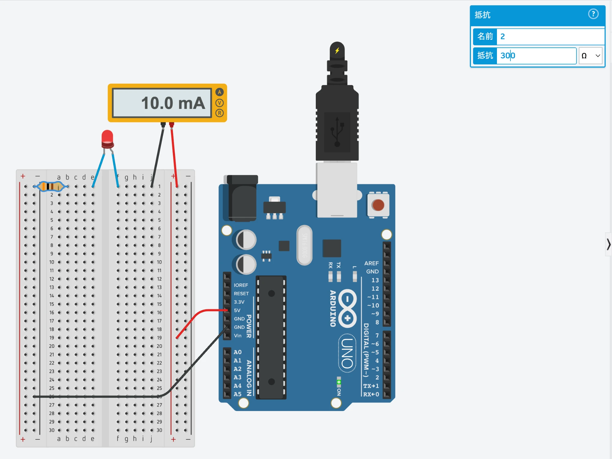 | 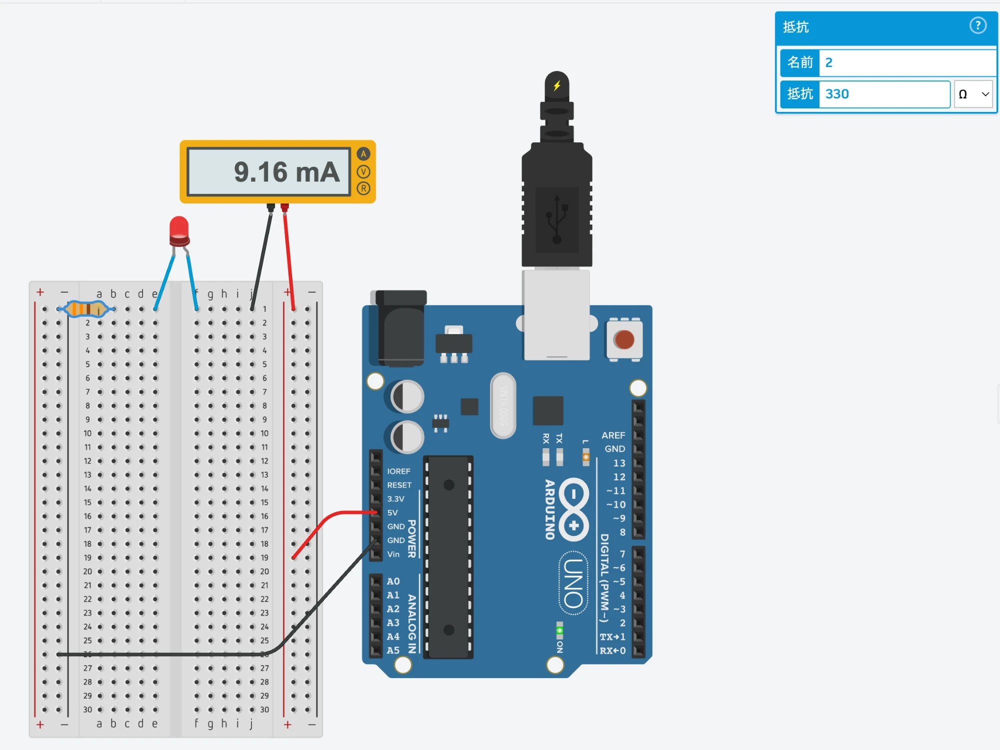 |

```
Arduino 5V --> ＋レール --[電流計]--> j1 --> LED（f1 → e1）--> 抵抗（1行目の左 → −レール）--> Arduino GND
```

| 抵抗 | 予想 | 結果 | LED の電圧（逆算） |
| --- | --- | --- | --- |
| **300Ω** | (5 − 2) ÷ 300 = **10mA** | **10.0mA** ✓ | 5 − 0.0100 × 300 = 2.0V |
| 330Ω | (5 − 2) ÷ 330 ≒ 9.1mA | **9.16mA** ✓ | 5 − 0.00916 × 330 ≒ 1.98V |

**学んだこと：ブレッドボードの正しい組み方と、よくある間違い**

組み方を間違えて、正しく測れないことが3回あった。原因はどれも「**同じ行の5穴はつながっている**」ことだった。

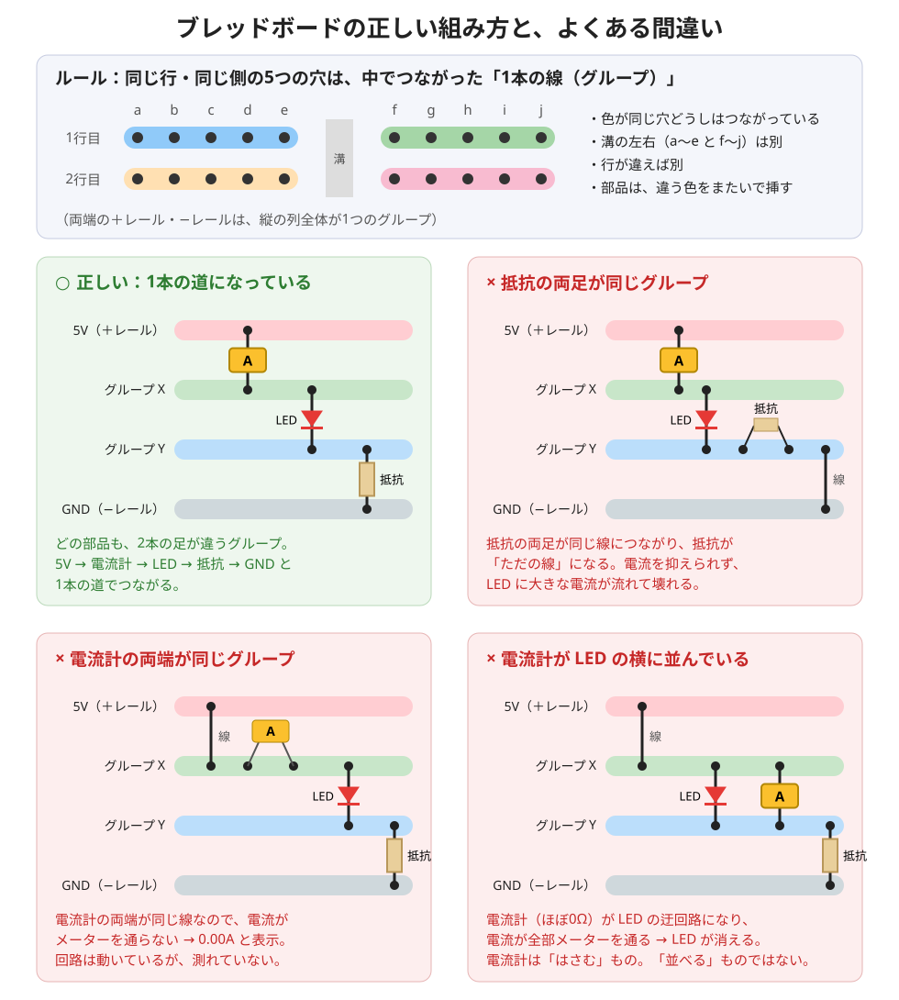

**① ルール**

| ルール | 内容 |
| --- | --- |
| 同じ行・同じ側の5穴 | 中でつながった **1本の線（グループ）**。a〜e と f〜j は溝で分かれていて別 |
| ＋レール・−レール | 縦の列全体が1つのグループ |
| 部品（抵抗・LED） | **2本の足を、違うグループに**挿す。同じグループだと、その部品は「ただの線」になって働かない |
| 電流計 | 回路を1か所切り、**そこ以外ではつながっていない2つのグループ**のあいだにはさむ（3日目） |

**② 正しい組み方（5V → 電流計 → LED → 抵抗 → GND の1本道）**

| 部品 | 挿し方 | ポイント |
| --- | --- | --- |
| 電流計 | ＋レール と j1 | 2本が別のグループ。＋レールと1行目の右は、メーター以外ではつながっていない |
| LED | f1 と e1 | 溝をまたいで、左右の別グループをつなぐ |
| 抵抗 | 1行目の左 と −レール | 別のグループをつなぐ |

**③ よくある間違い（実際にやったもの）**

| 間違い | 何が起きたか | 結果 |
| --- | --- | --- |
| **電流計が LED の横に並んでいた**（LED と同じ2つのグループにメーターを挿した） | ほぼ 0Ω の電流計が LED の迂回路になり、電流が全部メーターを通った | 15.2mA（= 5V ÷ 330Ω。LED の分の電圧がない）。**LED は消えた** |
| **電流計の両端が同じグループ**（2本とも1行目の右） | 両端が同じ線なので、電流がメーターを通らない | **0.00A**。回路は動いて LED は光っているのに、測れていない |
| **抵抗の両足が同じグループ**（2本とも1行目の右）＋電流計の両端も同じグループ | 抵抗が「ただの線」になり、LED が抵抗なしで 5V に直接つながった | 0.00A。実物なら **LED に大電流が流れて壊れる**危険な状態 |

<details>
<summary>間違えたときの画面（クリックで開く）</summary>

| 電流計が LED の横（15.2mA） | 電流計の両端が同じグループ（0.00A） |
| --- | --- |
| 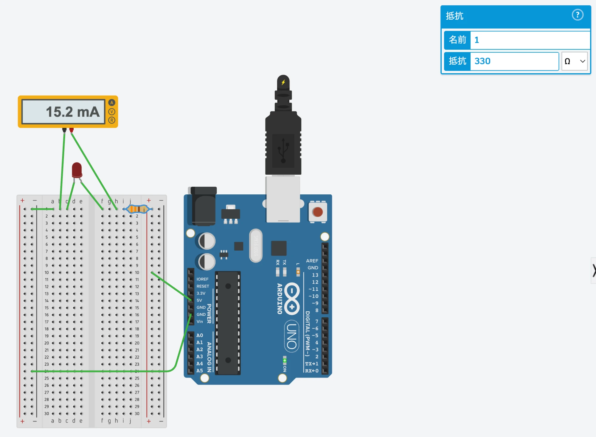 | 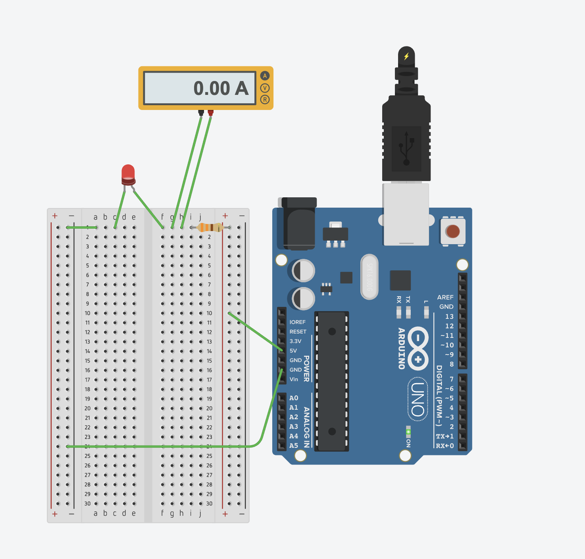 |
| **抵抗の両足も同じグループ（0.00A）** |  |
| 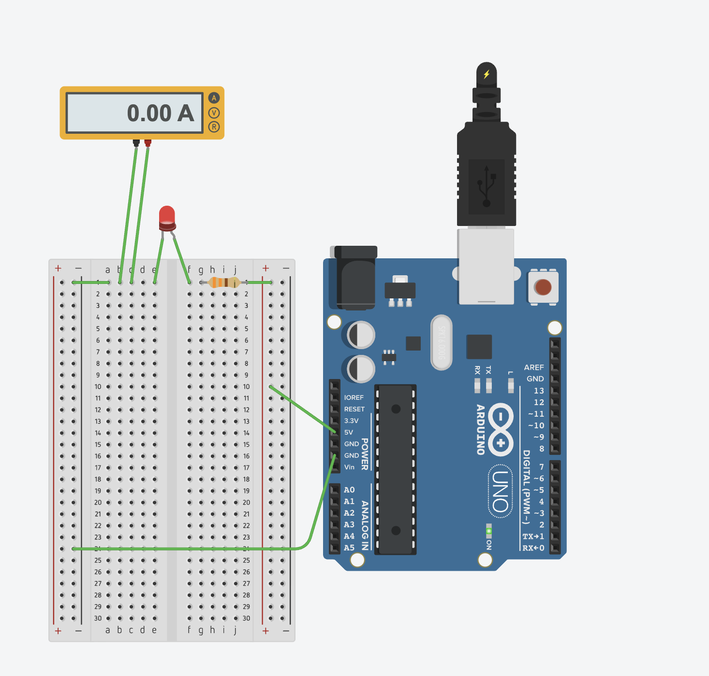 |  |

</details>

**④ 確かめ方のコツ**

組んだら、部品1つずつに「**この部品の2本の足は、別々のグループに挿さっているか？**」と聞く。同じグループなら、その部品は働かない（抵抗・LED）か、測れない（電流計）。

### この日のまとめ：予想 → 結果 → 差の理由

| 何を測った／試したか | 予想 | 結果 | 差の理由 |
| --- | --- | --- | --- |
| ダイオードに −1V | 流れない | 0.0002mA | 差なし（ごくわずかな漏れ） |
| ダイオードを 0.6V 付近から上げる | 急に増える | 0.54V で 5.8mA → 0.77V で 500mA | 差なし |
| 5V・300Ω・赤 LED の電流 | 10mA | 10.0mA | 差なし |
| 5V・330Ω・赤 LED の電流 | 9.1mA | 9.16mA | 差なし |
| 電流計を LED の横に並べた | 10mA 前後 | 15.2mA、LED が消えた | 電流計が LED の迂回路になった |
| 電流計の両端を同じ行に挿した | 10mA 前後 | 0.00A | 両端が同じ線で、メーターに電流が通らない |

## 16日目 トランジスタの仕組み

> **ひとことで**：トランジスタは、**ベースに流す小さな電流で、コレクタ → エミッタの大きな電流を調節する「蛇口」**。Falstad では、コレクタ電流がベース電流の約 **100 倍**（hFE = 100）になった。ただし大きい方の電流には上限があり、**上限を外の抵抗が決めている状態を「飽和」**と呼ぶ。スイッチとして使うときは、わざと飽和させる。

**この日にやったことと、分かったこと**

| # | やったこと | 分かったこと（一言） |
| --- | --- | --- |
| 1 | MONOist の記事を読む | トランジスタは真空管の代わりの部品。マイコンの小さな電流で、大きな電流のものを動かせる |
| 2 | Falstad で NPN トランジスタとスイッチ回路を見る | コレクタ電流 ≒ ベース電流 × 100。スイッチ回路では 300Ω が電流を約 16mA に制限して飽和した |
| 3 | B・C・E の役割を3行にまとめる | B＝ハンドル、C＝大きい電流の入口、E＝合流して出る出口 |

やることの詳細は[チェックリスト](../CHECKLIST.md#第3週-ダイオードトランジスタプルアップ電池の内部抵抗)。

**何に役立つか**

トランジスタは、マイコンの小さな電流で大きな電流を ON / OFF する「電子のスイッチ」。

| 使う場面 | どう使うか |
| --- | --- |
| マイコンのピンでは足りない部品を動かす | モーター、リレー、ブザー、たくさんの LED |
| 確実に ON / OFF する | ベース電流を多めに流して飽和させ、発熱を小さくする |
| モータードライバの中身を理解する | 市販のモータードライバも、中ではトランジスタが同じことをしている |

### 1. 読む：[MONOist 俺流！組み込み用語解説(2) トランジスタ](https://monoist.itmedia.co.jp/mn/articles/2406/26/news018.html)

**記事のポイント**

| テーマ | 内容 |
| --- | --- |
| 形（パッケージ） | 小さい表面実装用 → 足3本のスルーホール用 → 放熱用の穴つき → さらに大きい大電力用。**大きい電流を扱うものほど大きく、ヒートシンク（放熱板）が要る** |
| 足の間隔 | スルーホール用は 2.54mm（0.1インチ）。ブレッドボードの穴の間隔と同じ |
| 真空管と比べて | ①**長寿命**（フィラメントが切れない）②**小型**（IC には数千万個入る）③**省電力**（数 V で動き、温める必要がない） |
| 回路図の記号（NPN 型） | C＝コレクタ、B＝ベース、E＝エミッタ。電流は IB、IC、IE |
| スイッチとしての使い方 | **IB を流すと C → E に IC が流れる**。向きは C → E だけ。IC は IB より大きくできる |
| 組み込みでの意味 | **マイコンの出力ピンの電流では動かせない部品も、トランジスタをはさめば動かせる**（17日目の課題につながる） |

**回路図の記号を図で見る**：記事の「C・B・E」と「IB・IC・IE」は、記号のどこを指すか

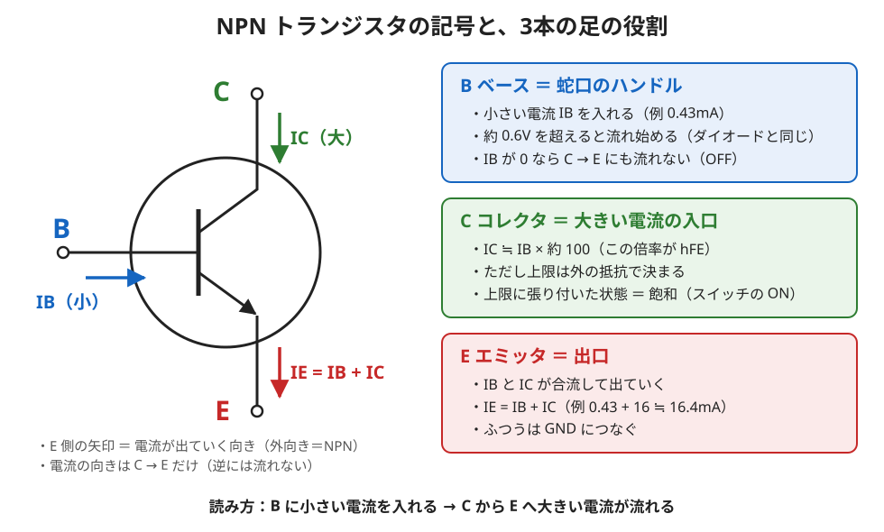

記事が扱っているのは「バイポーラ型」のトランジスタ。もう1つの種類（ユニポーラ型＝FET など）は次回以降とのこと。

### 2. 観察：[Falstad NPNトランジスタ](https://www.falstad.com/circuit/e-npn.html)と[Falstad トランジスタのスイッチ](https://www.falstad.com/circuit/e-transswitch.html)

足の名前と役割は、1 の図を参照。

#### 2-1. NPN トランジスタ：小さいベース電流で、大きいコレクタ電流が流れる

**回路**：ベース電圧（右の「基準電圧」つまみ）→ ベース、コレクタ電圧（「コレクタ電圧」つまみ、最大 2V）→ コレクタ、エミッタ → GND。抵抗はない。

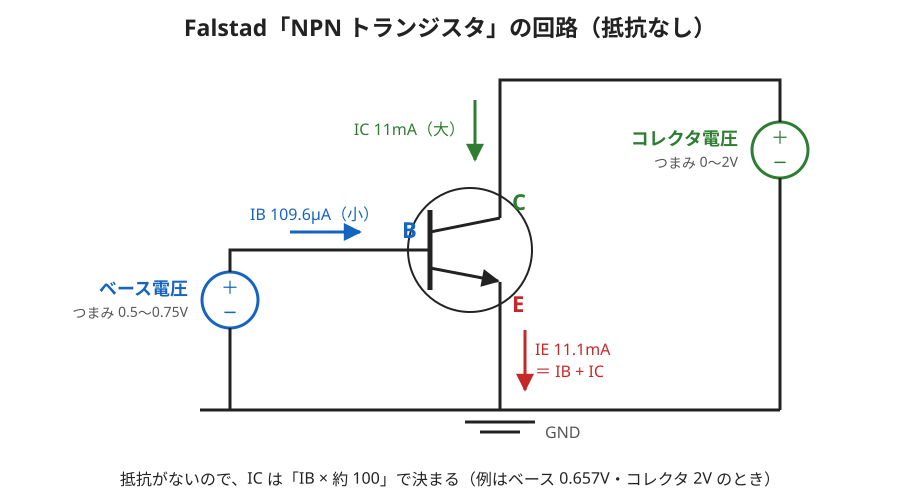

**成果物**

| ベース 0.595V | ベース 0.657V |
| --- | --- |
| 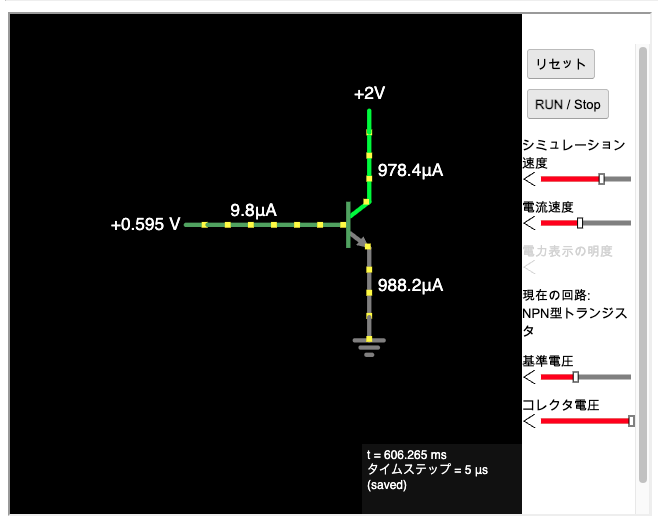 | 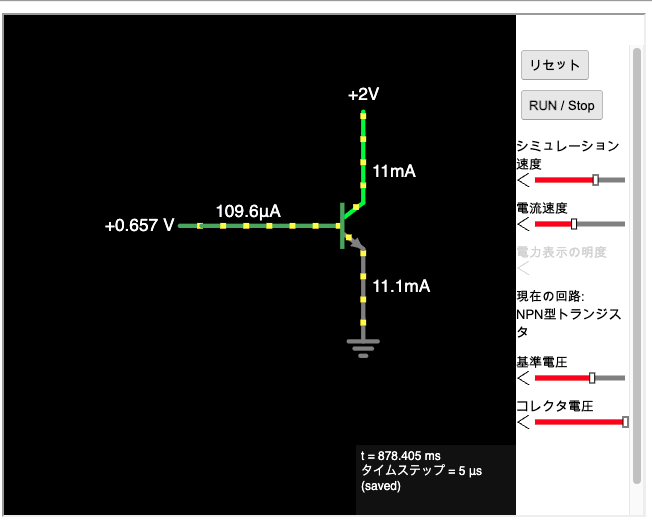 |
| **ベース 0.693V** | **ベース 0.657V・コレクタ 0.12V** |
| 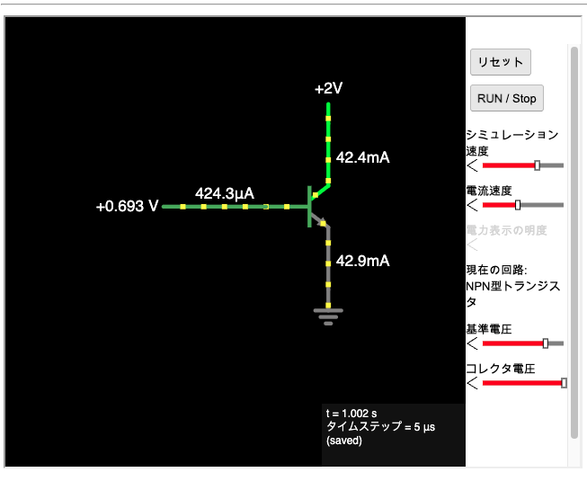 | 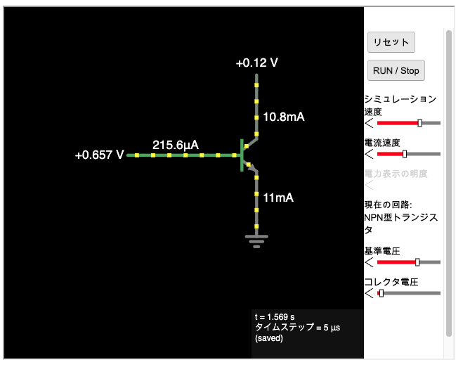 |

| ベース電圧 | コレクタ電圧 | ベース電流 Ib | コレクタ電流 Ic | エミッタ電流 Ie | Ic ÷ Ib |
| --- | --- | --- | --- | --- | --- |
| 0.595V | 2V | 9.8µA | 978.4µA | 988.2µA | **約 100** |
| 0.657V | 2V | 109.6µA | 11mA | 11.1mA | **約 100** |
| 0.693V | 2V | 424.3µA | 42.4mA | 42.9mA | **約 100** |
| 0.657V | **0.12V** | **215.6µA** | 10.8mA | 11mA | **約 50** |

**学んだこと**

| 気づいたこと | くわしく |
| --- | --- |
| **Ic はいつも Ib の約 100 倍** | Ib が 9.8µA → 109.6µA → 424.3µA と増えると、Ic も 0.98mA → 11mA → 42.4mA とついてくる。この倍率を **hFE（直流電流増幅率）** と呼ぶ |
| **エミッタは合流地点** | 例：9.8µA + 978.4µA = 988.2µA。ベースとコレクタから入った電流が、エミッタから出ていく |
| **ベース電圧は 0.06V で電流が 10 倍** | 0.595V → 0.657V で Ib が約 10 倍。15日目のダイオードと同じ「約 0.6V を超えると急に流れる」性質。だから**トランジスタは電圧ではなくベース電流で考える** |
| **コレクタ電圧を下げると「100 倍」が崩れる** | 同じベース 0.657V でも、コレクタを 0.12V に下げると Ib は約 2 倍に増えたのに、Ic は 11mA → 10.8mA でほぼ同じ。増えたベース電流はコレクタ側へ漏れているだけ。これが**飽和** |

#### 2-2. トランジスタのスイッチ：抵抗が電流を制限して「飽和」する

**回路**（Falstad の回路ファイルで確認）

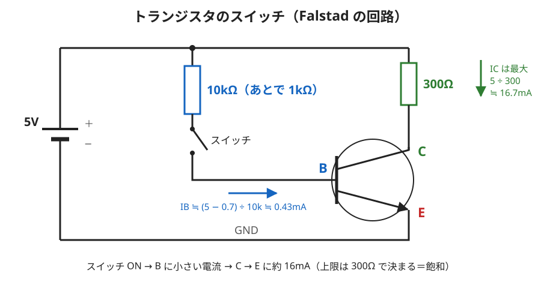

スイッチをクリックして ON / OFF し、ベース側の抵抗を 10kΩ → 1kΩ に変えて（抵抗をダブルクリック）もう一度試した。

**成果物**

| 10kΩ・OFF | 10kΩ・ON |
| --- | --- |
| 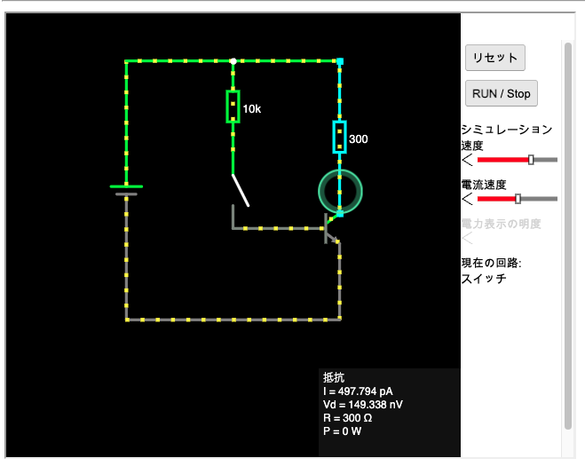 | 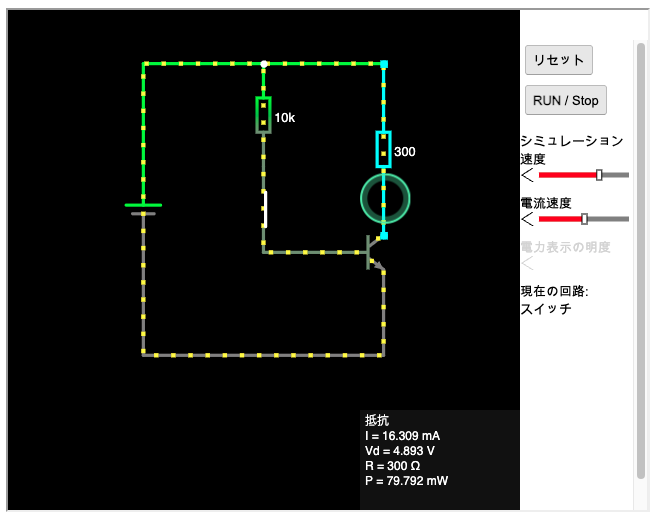 |
| **1kΩ・OFF** | **1kΩ・ON** |
| 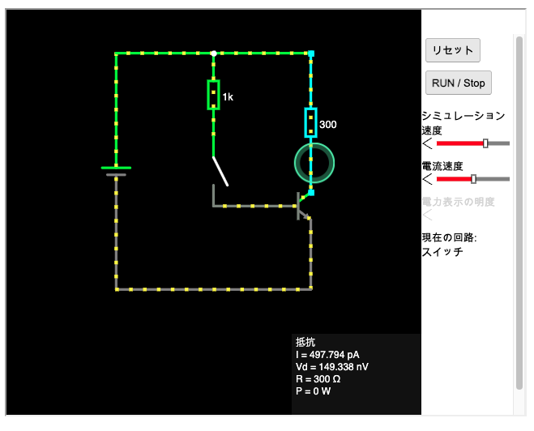 | 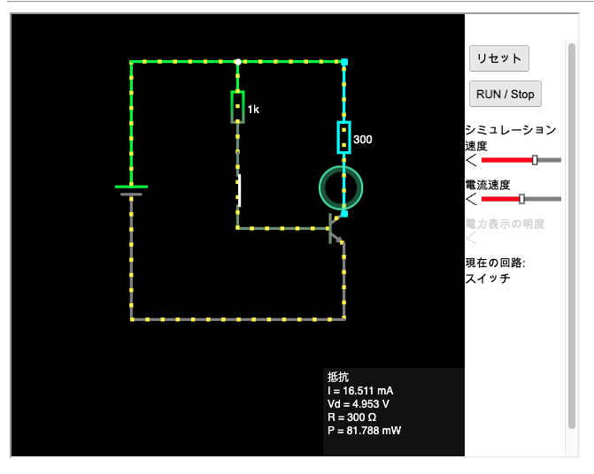 |

300Ω の下に写っている緑の輪は、Mac のポインタを目立たせる表示で、回路の部品ではない。

| ベース側の抵抗 | スイッチ | 300Ω の電流（= Ic） | 300Ω の電圧 | 残り（≈ C–E 間の電圧） |
| --- | --- | --- | --- | --- |
| 10kΩ | OFF | 497pA（≈ 0） | ≈ 0V | ≈ 5V |
| 10kΩ | **ON** | **16.309mA** | 4.893V | **約 0.11V** |
| 1kΩ | OFF | 497pA（≈ 0） | ≈ 0V | ≈ 5V |
| 1kΩ | **ON** | **16.511mA** | 4.953V | **約 0.05V** |

「残り」は 5V − 300Ω の電圧で出した。

**なぜ 100 倍にならないのか（飽和）**

| ベース側 | Ib（計算） | 100 倍すると | 実際の Ic | 300Ω が通せる上限 |
| --- | --- | --- | --- | --- |
| 10kΩ | (5 − 0.7) ÷ 10k ≒ 0.43mA | 43mA | 16.3mA | 5 ÷ 300 ≒ 16.7mA |
| 1kΩ | (5 − 0.7) ÷ 1k ≒ 4.3mA | 430mA | 16.5mA | 5 ÷ 300 ≒ 16.7mA |

- ベース電流を **10 倍**にしても、コレクタ電流は 16.3 → 16.5mA で **約 1% しか増えない**
- トランジスタは「43mA（430mA）流していいよ」と全開にしている。でも **300Ω が約 16.7mA までしか通さない**
- 全開なので C–E 間はほぼ電線（0.05〜0.11V）になる

**学んだこと：トランジスタの3つの状態**

| 状態 | C–E 間の電圧 | 電流を決めるもの | 蛇口のたとえ | 使いみち |
| --- | --- | --- | --- | --- |
| 遮断（OFF） | 電源の電圧ほぼ全部 | （流れない） | 閉じている | スイッチの OFF |
| 増幅（2-1 の 2V のとき） | ある程度ある（例：2V） | **ベース電流 × hFE** | ハンドルの開け具合で水量が変わる | 信号を大きくする |
| **飽和**（2-2 の ON） | **0.1〜0.2V 以下** | **外の抵抗**（電源 ÷ 抵抗） | 全開。水量は水道管の細さで決まる | **スイッチの ON**（Arduino で LED やモーターを動かす） |

**スイッチで使うときは、しっかり飽和させる**

| | 計算 | 結果 |
| --- | --- | --- |
| 300Ω の抵抗の電力 | Falstad 表示 79.8mW | 1/4W（250mW）の抵抗で余裕あり（15日目の考え方） |
| トランジスタの発熱 | 0.11V × 16.3mA | **約 1.8mW**。ほとんど熱くならない |
| もし中途半端に開けたら（例：C–E 間 2.5V、8mA） | 2.5V × 8mA | 20mW。飽和のときの 10 倍以上が熱になる |

飽和させると、hFE が部品ごとにばらついても電流は抵抗の値で決まるので安定し、発熱も小さい。だから**ベース電流は「必要なコレクタ電流 ÷ hFE」より多めに流す**（17日目の設計で使う）。

### 3. 記録：ベース・コレクタ・エミッタの役割を自分の言葉で3行

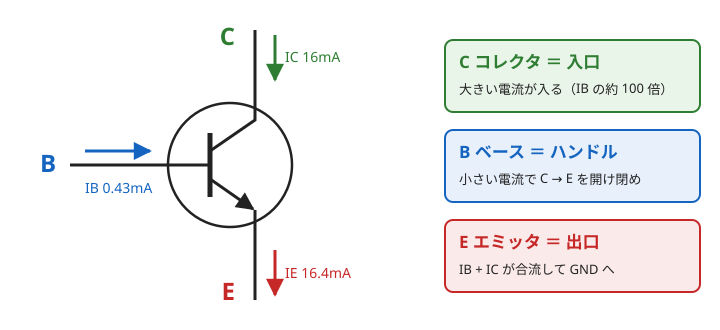

- **ベース（B）**：蛇口のハンドル。小さい電流を流すと、C → E の大きい電流が流れ出す。約 0.6V を超えないと流れない（ダイオードと同じ）
- **コレクタ（C）**：大きい電流の入口。ふつうはベース電流の約 100 倍（hFE）が入るが、外の抵抗で上限が決まると、それ以上は増えない（飽和）
- **エミッタ（E）**：出口。ベースとコレクタの電流が合流して GND へ出ていく（IE = IB + IC）


### この日のまとめ：予想 → 結果 → 差の理由

| 何を測った／試したか | 予想 | 結果 | 差の理由 |
| --- | --- | --- | --- |
| ベース電流とコレクタ電流の比（コレクタ 2V） | hFE = 100 倍 | 3回とも約 100 倍 | 差なし |
| ベース 0.657V のままコレクタを 0.12V に下げる | Ic は 11mA のまま | 10.8mA、Ib が 2 倍に増えて比は約 50 | 飽和。増えたベース電流はコレクタ側へ漏れる |
| スイッチ回路の ON（ベース 10kΩ） | 100 倍の 43mA | 16.3mA | 300Ω が上限 16.7mA に制限（飽和） |
| ベース側を 1kΩ にして Ib を 10 倍 | Ic も増える？ | 16.5mA（約 1% だけ） | 飽和しているので、Ic は 300Ω で決まる |
| スイッチ OFF | 0 | 497pA | 差なし（ごくわずかな漏れ） |

## 17日目 トランジスタスイッチを設計する（筆者の課題）

> **ひとことで**：Arduino の 5V で NPN トランジスタを動かし、**9V 電池から LED 3個**を光らせた。Rc 300Ω・Rb 4.7kΩ と計算し、Tinkercad で**ベース電流 0.914mA、コレクタ電流 10.0mA**。Arduino が出す電流は LED の電流の約 **1/11** で済んだ。一番大事なのは、**9V の − と Arduino の GND をつなぐ（共通の GND）**こと。

**この日にやったことと、分かったこと**

| # | やったこと | 分かったこと（一言） |
| --- | --- | --- |
| 1 | 回路を設計する（Rc・Rb を計算） | Rc = 300Ω、Rb = 4.7kΩ。ベース電流は「Ic ÷ hFE」の約 10 倍流して飽和させる |
| 2 | Tinkercad で組んで測る | IB 0.914mA、IC 10.0mA。ピンの電流は LED の約 1/11 |
| 3 | KiCad で回路図に起こす | ERC 違反 0。エミッタと PWR_FLAG の1件は理由を確かめて除外 |

やることの詳細は[チェックリスト](../CHECKLIST.md#第3週-ダイオードトランジスタプルアップ電池の内部抵抗)。

**何に役立つか**

「マイコンのピン → 抵抗 → トランジスタ → 大きな電源の部品」は、ロボットでいちばんよく使う形。

| 使う場面 | どう使うか |
| --- | --- |
| Arduino で 9V や 12V の部品を ON / OFF する | LED テープ、小さなモーター、ポンプ、電磁石（ソレノイド） |
| 電源を2つ使う回路を正しくつなぐ | マイコン用とモーター用の電源の GND を共通にする |
| 部品を壊さない設計 | Rb・Rc を計算して、ピン・トランジスタ・LED の電流を安全な範囲にする |

### 1. 設計：Arduino のピン（5V）で NPN トランジスタを動かし、9V 電源から LED 3個を同時に光らせる

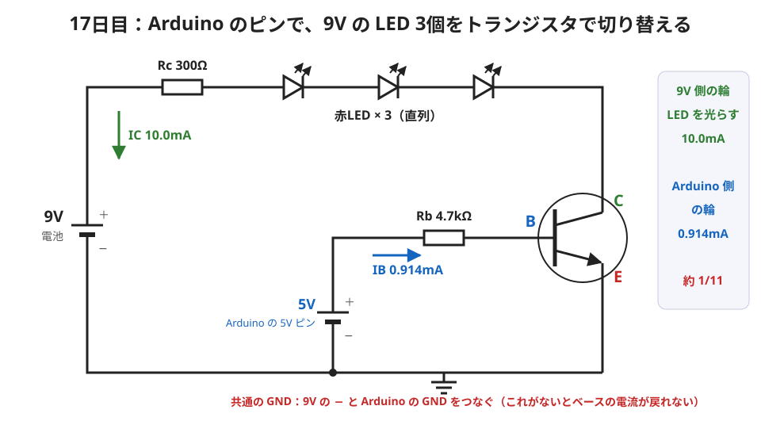

**電源は2つ使う**

| 電源 | 役割 | 流れる電流 |
| --- | --- | --- |
| Arduino の 5V | トランジスタの**ベース**を動かす「指令」（蛇口のハンドルを回す手） | 小さい（約 1mA） |
| 9V 電池 | **LED 3個**を光らせる「力仕事」（水道） | 大きい（約 10mA） |

LED 3個を直列にすると LED だけで 3 × 2V = 6V 使うので、5V では足りない。だから LED は 9V 電池から光らせる。マイコンのピンは大きな電流を出せないので、大きい電流はトランジスタを通して 9V 電池から流す。

**① コレクタ電流と Rc を決める**

| 手順 | 計算 | 答え |
| --- | --- | --- |
| コレクタ電流 Ic | 15日目と同じ目安 | **10mA** |
| Rc にかかる電圧 | 9V − 6V（LED 3個）− 0.2V（飽和した C–E 間） | 2.8V |
| Rc | 2.8 ÷ 0.01 = 280Ω → 売っている値 | **300Ω**（または 270Ω） |

**② ベース電流と Rb を決める**

| 手順 | 計算 | 答え |
| --- | --- | --- |
| 最低限のベース電流 | Ic ÷ hFE = 10mA ÷ 100 | 0.1mA |
| 実際に流す量 | しっかり飽和させるため約 10 倍（16日目の 1kΩ の実験と同じ考え方） | **1mA** |
| Rb | (5V − 0.7V) ÷ 1mA = 4.3kΩ → 売っている値 | **4.7kΩ**（約 0.91mA） |
| ピンから出る電流 | 約 0.9mA | Arduino のピンの目安 20mA よりずっと小さい ✓ |

hFE は Tinkercad のトランジスタの正確な値が分からないので 100 と仮定した。多めに流しているので、多少違っても飽和する。

**③ 共通の GND**

9V 電池の − と Arduino の GND を必ずつなぐ。つながっていないと、ベースの電流が Arduino へ戻る道がなく、トランジスタは動かない（1日目の「回路は1周の輪」）。

### 2. 検証：Tinkercad で組み、ベース電流とコレクタ電流を測る

**成果物**

| 電流計で測った（IC 10.0mA、IB 914µA） | 回路図表示（つながりの確認） |
| --- | --- |
| 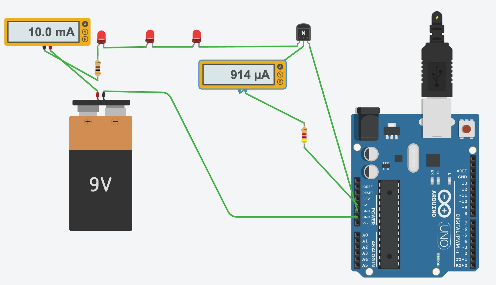 | 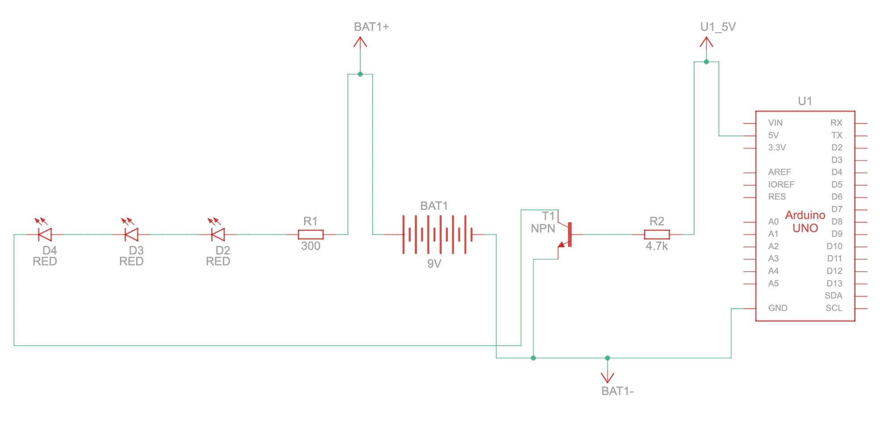 |

| 電流計 | はさんだ場所 |
| --- | --- |
| 左上（コレクタ電流） | 9V の + と 300Ω のあいだ |
| 真ん中（ベース電流） | 4.7kΩ とトランジスタの B のあいだ |

ベースは Arduino の **5V ピン**につないだ（いつも 5V なので、つけっぱなし）。13番ピンにつないでコードで HIGH / LOW を切り替える方法は、今回はやっていない。

**予想 → 結果**

| 測ったもの | 予想 | 結果 |
| --- | --- | --- |
| ベース電流（Arduino から出る電流） | (5 − 0.7) ÷ 4700 ≒ 0.91mA | **914µA（0.914mA）** ✓ |
| コレクタ電流（LED 3個の電流） | (9 − 6 − 0.2) ÷ 300 ≒ 9.3mA | **10.0mA**（0.7mA 多い） |

**学んだこと**

**① Arduino のピンからは、LED の電流の約 1/11 しか出ていない**

10.0 ÷ 0.914 ≒ 11 倍。Arduino が出すのは約 0.9mA だけで、LED 3個ぶんの 10mA は 9V 電池から流れている。

**② 11 倍しかないのは、飽和しているから**

hFE が 100 なら、ベース電流 0.914mA で最大 91mA まで流せる。実際は 300Ω が約 10mA に抑えているので、10mA で頭打ち。これが16日目の「しっかり飽和したスイッチ」の状態で、設計どおり。

**③ コレクタ電流が予想より 0.7mA 多かった理由**

300Ω に 10.0mA 流れているので、300Ω の電圧は 0.01 × 300 = 3.0V。残り 6.0V を LED 3個とトランジスタで分け合っている。

| | 予想で置いた値 | 実際（逆算） |
| --- | --- | --- |
| トランジスタの C–E 間（飽和） | 0.2V | 約 0.05〜0.1V（16日目の Falstad でも 0.05〜0.11V） |
| LED 1個 | 2.0V | 約 1.97V |

トランジスタの電圧を多めに見積もったぶん、300Ω にかかる電圧を少なく見積もっていた。理由を説明できるずれなので、回路の間違いではない。

**④ 予想とぴったりでなくても「合格」と言える理由**

実物の LED の電圧は1個ずつ 1.8〜2.2V くらいばらつき、抵抗にも ±5% の誤差がある（6日目）。設計では、ぴったり当てることより、**ばらついても困らないか**を確かめる。

| 確かめること | 結果 |
| --- | --- |
| LED の電流は上限（約 20mA）を超えていないか | 10mA。半分なので安全 ✓ |
| トランジスタはしっかり飽和しているか | IC ÷ IB ≒ 11 倍。hFE（100）よりずっと小さい ✓ |
| Arduino のピンの電流は小さいか | 0.9mA。目安の 20mA よりずっと小さい ✓ |

**⑤ つながりは回路図表示で確かめる**

Tinkercad の回路図表示は、**電流計が描かれない以外は、つながりをそのまま正しく表示する**。電流計がないのに回路図で線が切れていれば、本当につながっていない。見た目では線が足に届いていても、端がピンの真上に乗っていないとつながらない。

<details>
<summary>うまくいかなかったときの画面（クリックで開く）</summary>

| ① 抵抗がない | ② 4.7kΩ がエミッタ側（シミュレーションのエラー） |
| --- | --- |
| 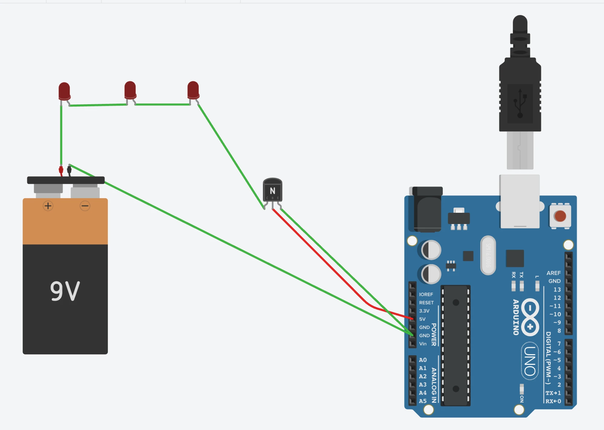 | 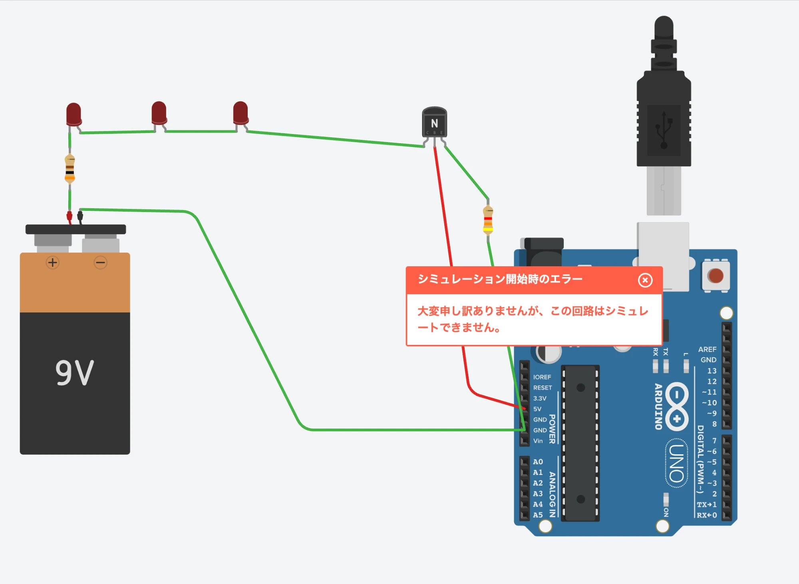 |
| **③ LED の向きが逆（光らない）** | **④ 電流計の元の線が残っている（0.00A）** |
| 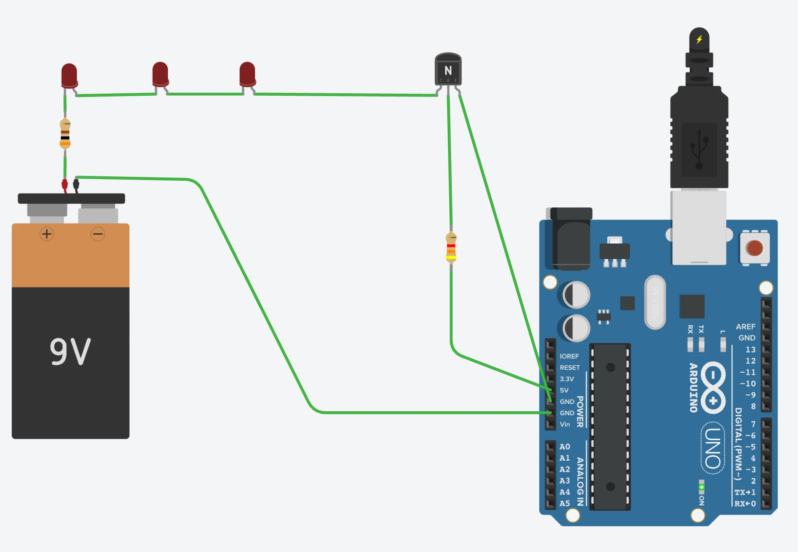 | 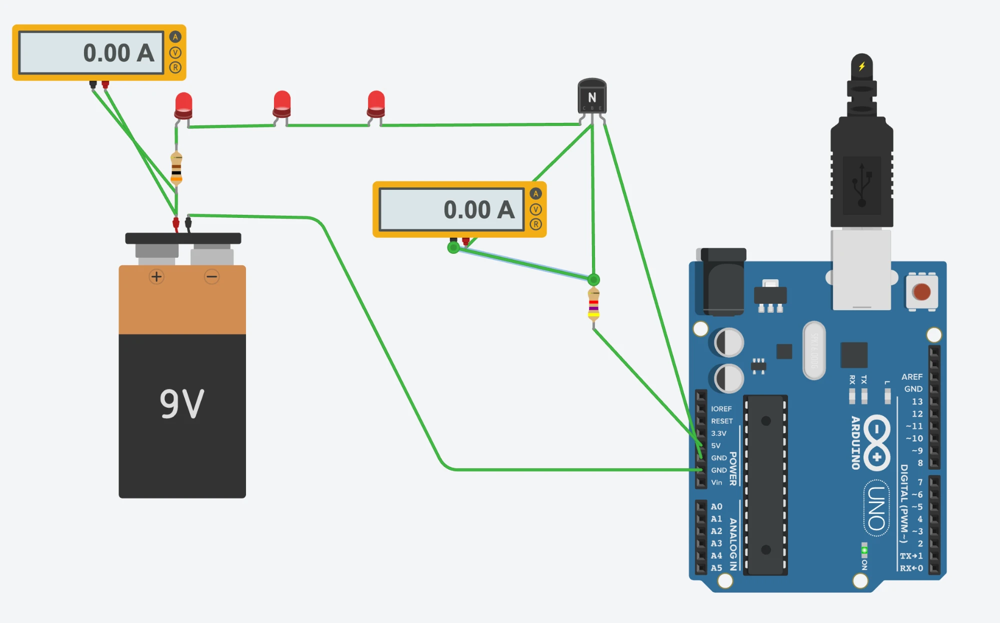 |
| **⑤ R2 の両端が 5V（ブレッドボード）** | **⑤ R2 の両端が 5V（回路図表示）** |
| 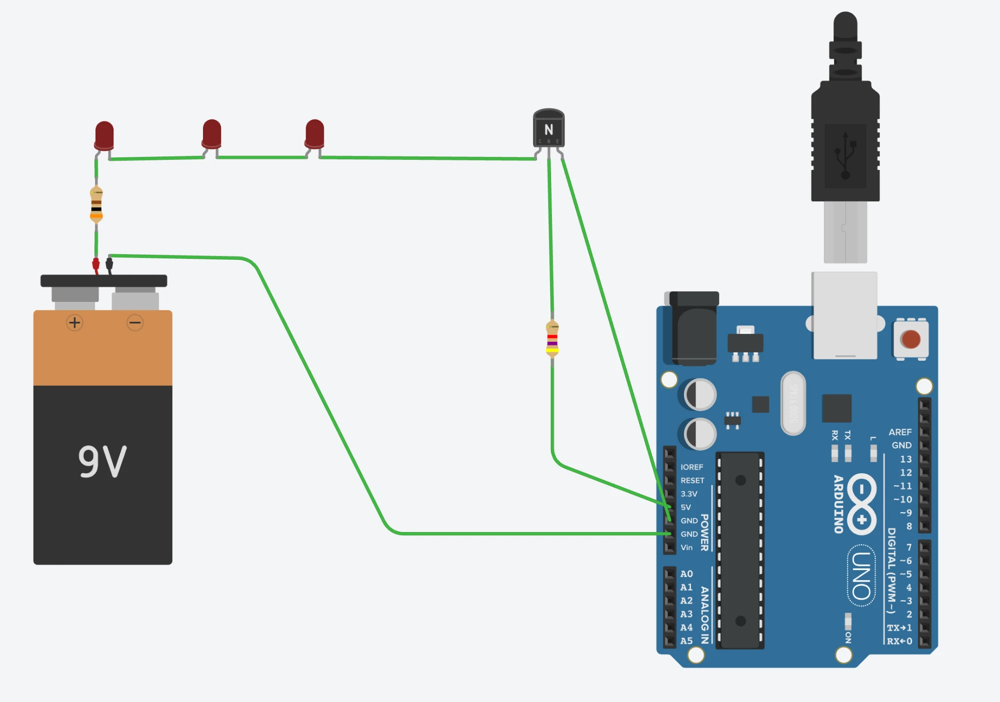 | 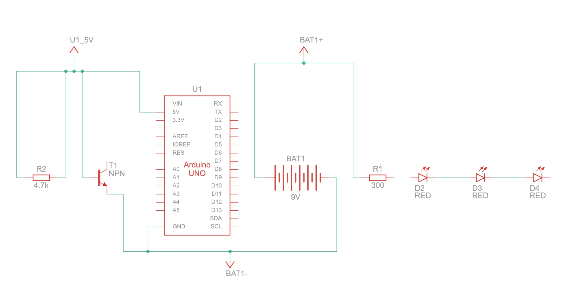 |
| **⑥ C と LED の端がつながっていない（光らない）** | **⑥ 回路図表示では LED の両端が浮いている** |
| 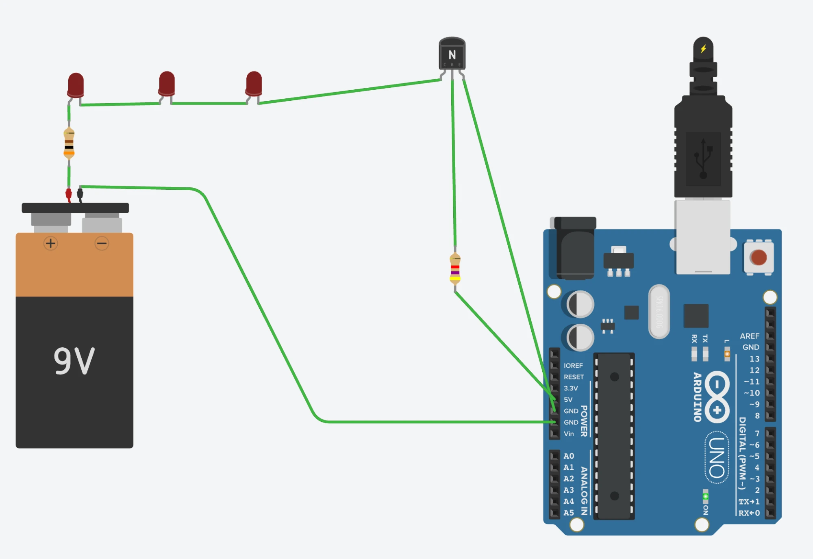 | 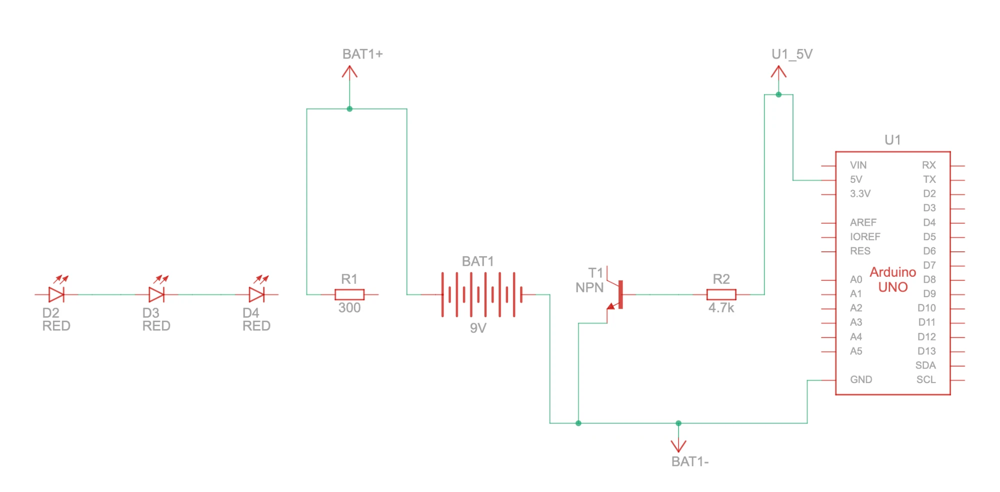 |

| # | 症状 | 原因 | 直し方 |
| --- | --- | --- | --- |
| ① | （動かす前に気づいた） | Rc も Rb もない。LED とトランジスタ、Arduino が壊れるつなぎ方 | 9V 側に 300Ω、ベース側に 4.7kΩ を入れる |
| ② | 「この回路はシミュレートできません」 | 4.7kΩ をエミッタ側に入れ、ベースを 5V に直接つないでいた | 4.7kΩ を B 側へ移し、E は GND に直接つなぐ。線の端もつなぎ直した |
| ③ | LED が 3個とも光らない | LED の向きが逆（曲がった足＝アノードがトランジスタ側） | 曲がった足を 9V + 側に向ける。直列なので1個でも逆なら全部消える |
| ④ | LED は光っているのに電流計が 0.00A | 元の線を消さずに電流計を足したので、電流が元の線を通った | 元の線を消して、電流計だけが通り道になるようにする（15日目と同じ間違い） |
| ⑤ | 回路図表示で R2 の両端が 5V、ベースも 5V に直接 | 電流計を外したときの線が重なって残っていた | まわりの線を全部消して引き直す |
| ⑥ | LED が光らない | 線の端が足の真上からずれて、LED のかたまりの両端が浮いていた | 2本の線を引き直し、回路図表示で線が出たのを確かめた |

</details>

### 3. KiCad で回路図に起こす

**成果物**

| 回路図 | ERC（違反 0、除外 1） |
| --- | --- |
| 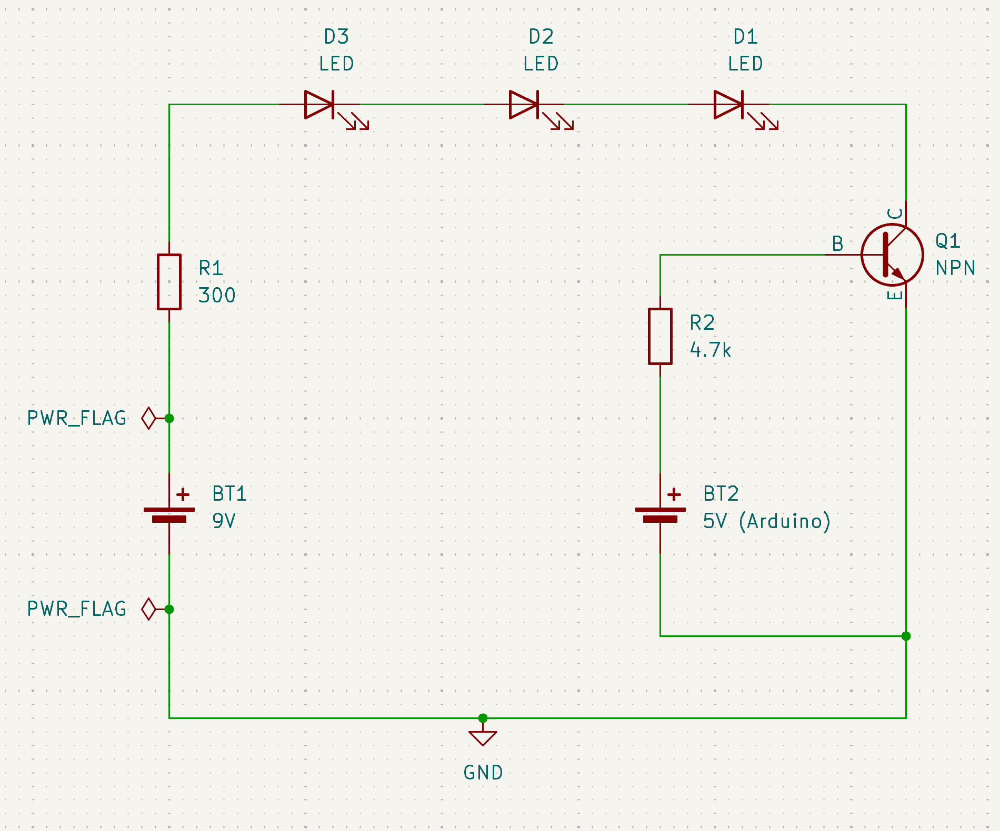 | 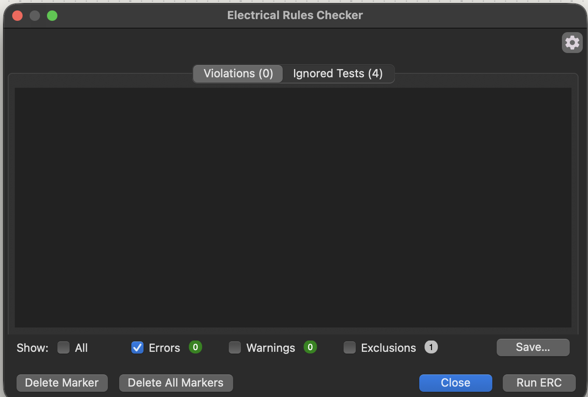 |

- プロジェクト一式：[kicad/day17_npn-transistor-switch/](kicad/day17_npn-transistor-switch/)（回路図、PDF、部品表、ERC.rpt）

| 部品 | 記号 | 値 |
| --- | --- | --- |
| BT1 | 電池 | 9V |
| BT2 | 電池（Arduino の 5V の代わり） | 5V (Arduino) |
| R1・R2 | Device:R（四角） | 300、4.7k |
| D1〜D3 | Device:LED | LED |
| Q1 | NPN トランジスタ | NPN |
| PWR_FLAG ×2 | power:PWR_FLAG | 9V の + 側と GND |

**最初に描いた回路図で直したところ**

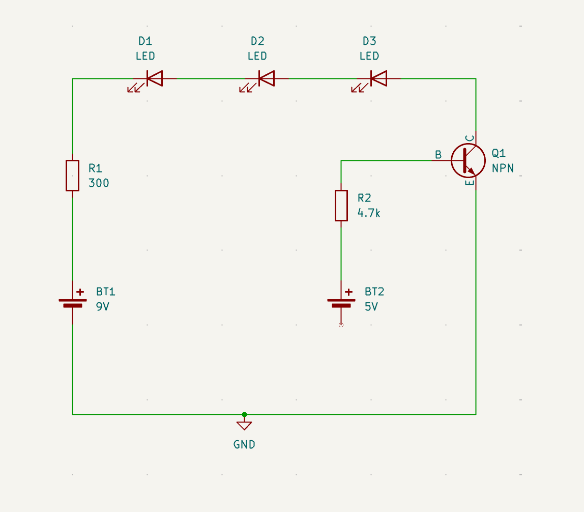

| 直したところ | 理由 |
| --- | --- |
| LED 3個の向き（三角が左向き → 右向き） | 電流は上の線を左から右へ流れる。逆だと光らない。**ERC はこの間違いを見つけない**（10日目の「ERC は動くかどうかは分からない」） |
| BT2 の − を GND につないだ | 端の小さな丸は「どこにもつながっていないピン」の印。Tinkercad の「共通の GND」と同じ線 |

**ERC のエラーを1件だけ除外した理由**

| ERC のエラー | KiCad のピン競合マップ |
| --- | --- |
| 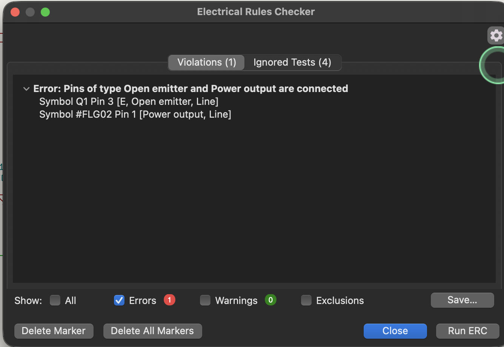 | 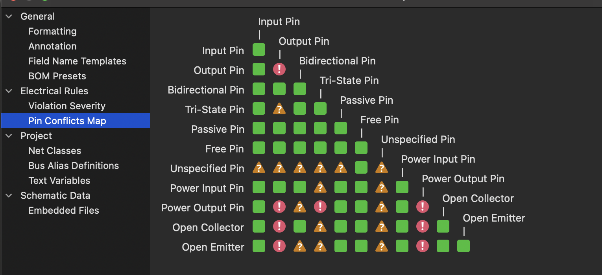 |

| 項目 | 内容 |
| --- | --- |
| 出たエラー | Pins of type Open emitter and Power output are connected（Q1 の E と、GND 側の PWR_FLAG） |
| なぜ出るか | KiCad はピンに種類を決めていて、「Open Emitter」と「Power Output」の組み合わせは表で**エラー（赤）**と決められている。IC の出力ピンを電源の線に直接つなぐような危ない場面を見つけるための決まり |
| なぜ除外してよいか | トランジスタのエミッタを GND につなぐのは、スイッチ回路の基本の形。Tinkercad でも同じつなぎ方で 10.0mA で正しく動いた |
| どう除外したか | エラーの行を右クリック →「Exclude this violation」。**この1件だけ**を除外し、ピン競合マップの表は変えていない（表を変えると、プロジェクト全体で同じ組み合わせを見逃す） |
| 除外しても ERC は働くか | 働く。つなぎ忘れのピンや電源の来ていない線は、これまでどおり見つける |

> ERC.rpt は「Errors」だけを書き出す設定なので、除外した1件は載っていない（Exclusions 1 は ERC の画面で確認）。

### この日のまとめ：予想 → 結果 → 差の理由

| 何を測った／試したか | 予想 | 結果 | 差の理由 |
| --- | --- | --- | --- |
| ベース電流 | 0.91mA | 0.914mA | 差なし |
| コレクタ電流 | 9.3mA | 10.0mA | C–E 間を 0.2V と多めに見積もった（実際は約 0.05〜0.1V）。LED も 2.0V ではなく約 1.97V |
| コレクタ電流 ÷ ベース電流 | hFE（100）より小さい | 約 11 倍 | 300Ω で電流が決まる飽和の状態。設計どおり |
| KiCad の ERC | 違反 0 | エラー 1（Open emitter と Power output） | KiCad のピン種類の決まりによるもの。理由を確かめてこの1件だけ除外し、違反 0 |

## 18日目 プルアップとプルダウン

> **ひとことで**：マイコンの入力ピンは、何もつながっていないと電圧が決まらない（**フローティング**）。抵抗を1本入れて、ボタンを離したときの電圧を決めておく。GND 側に入れると**プルダウン**（離すと 0V）、5V 側に入れると**プルアップ**（離すと 5V）。Tinkercad では、プルダウンありで離すと **0.00V**、抵抗なしだと **49.5mV** という中途半端な値になった。

**この日にやったことと、分かったこと**

| # | やったこと | 分かったこと（一言） |
| --- | --- | --- |
| 1 | MONOist の記事を読む | ボタンだけだと、離したときの入力ピンはどこにもつながらず値がバタつく。プルアップ抵抗で必ず HIGH か LOW に決める |
| 2 | Tinkercad でプルダウンの電圧を測る | 離す 0.00V、押す 5.00V |
| 3 | プルダウン抵抗を外して測る | 離す 49.5mV（0 でも 5 でもない）、押す 5.00V |

やることの詳細は[チェックリスト](../CHECKLIST.md#第3週-ダイオードトランジスタプルアップ電池の内部抵抗)。

**まず：マイコンの「入力ピン」とは**

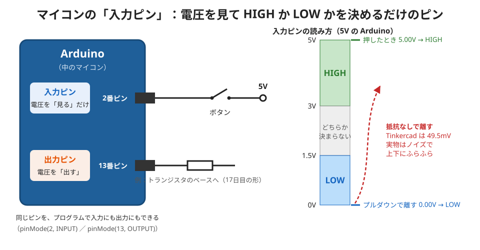

| 言葉 | 意味 |
| --- | --- |
| マイコン | 小さなコンピューター。Arduino の真ん中の黒い長い部品（ATmega328P）がそれ |
| ピン | Arduino の上下に並んでいる、線を挿す穴（0〜13番、A0〜A5 など）。マイコンの足につながっている |
| **出力ピン** | プログラムで 5V か 0V を**出す**ピン。LED やトランジスタを動かす（17日目は 5V ピンで代わりにした） |
| **入力ピン** | 外から来た電圧を**見る**だけのピン。ボタンが押されたか、センサーが反応したかを知るのに使う。ほとんど電流を吸わない（中の抵抗がとても大きい＝**ハイインピーダンス**） |

入力ピンは、見た電圧を **HIGH（1）か LOW（0）の2つのどちらか**に決めて、プログラムに渡す（`digitalRead(2)` で読む）。5V の Arduino では、だいたい 3V 以上なら HIGH、1.5V 以下なら LOW。そのあいだはどちらになるか決まらない。

だから、ボタンを離したときの入力ピンの電圧が**はっきり 0V（または 5V）になっていないと困る**。それを決めるのが今日のプルダウン・プルアップ抵抗。

**何に役立つか**

「マイコンがスイッチやセンサーの状態を読む」場面は、すべてこの形を使う。ロボットでは、たとえば次のような場面。

| 使う場面 | 何をつなぐか | 抵抗がないと起きること |
| --- | --- | --- |
| ロボットのスタート・ストップボタン | 押しボタン | 誰も押していないのに勝手に動き出す、止まる |
| 壁にぶつかったら止まる（バンパー） | バンパーの裏のスイッチ | 何もぶつかっていないのに「ぶつかった」と止まる、ぶつかっても気づかない |
| アームの動ける範囲の端で止める（リミットスイッチ） | 端に置いたスイッチ | 端に来ていないのに止まる、または止まらずに壊れる |
| 人や物を見つけるセンサー（人感・反射型など） | センサーの「HIGH / LOW を出すピン」 | センサーが外れたり出力が切れたりしたとき、値がでたらめになる |
| マイコンどうし、センサーとの通信（I2C など、後の週） | 2本の通信線 | 通信線にもプルアップ抵抗が必要。ないと通信できない |

Arduino では、ボタンは `INPUT_PULLUP`（中のプルアップ抵抗）でつなぐのが定番。今日の「離したときの電圧をはっきり決める」は、これから作るロボットのボタンやセンサーを**誤作動させないための基本**になる。

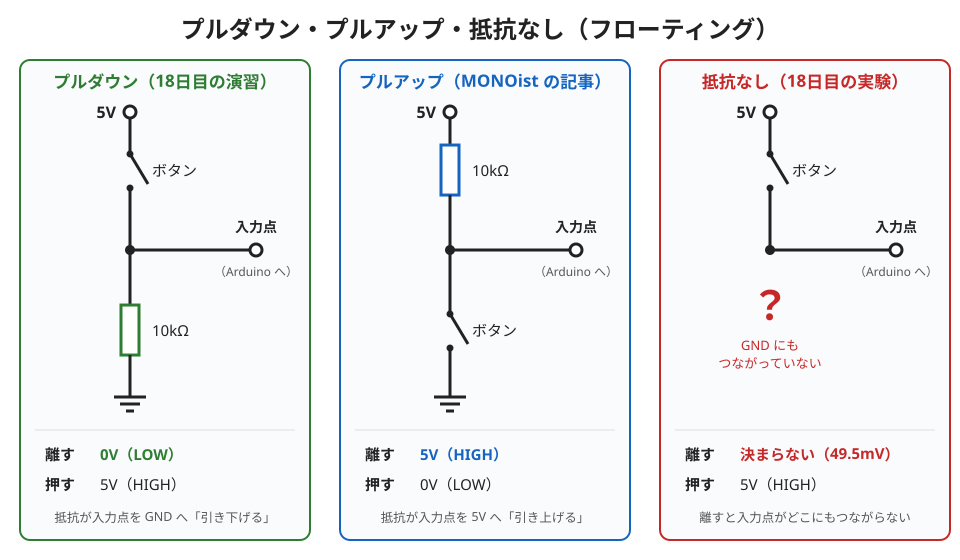

### 1. 読む：[MONOist 俺流！組み込み用語解説(3) プルアップ抵抗](https://monoist.itmedia.co.jp/mn/articles/2407/18/news027.html)

**記事のポイント**

| テーマ | 内容 |
| --- | --- |
| 困ること | ボタン（タクトスイッチ）をマイコンの入力ピンにつないだだけだと、押していないときの値が**バタつく** |
| なぜバタつくか | 入力ピンは中の抵抗がとても大きい（**ハイインピーダンス**）。何もつながっていないと、まわりの電気の影響を受けて 0 か 1 か決まらない。デジタル回路では絶対に作ってはいけない状態 |
| プルアップ抵抗のつなぎ方 | 抵抗を **VCC（＋）と入力ピン**のあいだに、ボタンを**入力ピンと GND** のあいだにつなぐ |
| 離しているとき | 抵抗を通して VCC につながるだけなので、入力ピンは VCC の電圧 → **1（HIGH）** |
| 押しているとき | ボタンで GND につながり **0V → 0（LOW）**。抵抗には電流が流れる（例：5V、2kΩ なら 5 ÷ 2000 = 2.5mA） |
| Arduino では | `pinMode(ピン番号, INPUT_PULLUP);` と書くと、**マイコンの中のプルアップ抵抗**がつながる。外に抵抗を付けなくてよい（`INPUT` だと中の抵抗はつながらない） |

**プルアップとプルダウンの比べ方**（上の図）

| | プルダウン（今日の演習） | プルアップ（記事） |
| --- | --- | --- |
| 抵抗の場所 | 入力ピンと **GND** のあいだ | 入力ピンと **5V** のあいだ |
| ボタンの場所 | 5V と入力ピンのあいだ | 入力ピンと GND のあいだ |
| 離したとき | 0V（LOW） | 5V（HIGH） |
| 押したとき | 5V（HIGH） | 0V（LOW） |
| Arduino での使いやすさ | 抵抗を外に付ける必要がある | `INPUT_PULLUP` で中の抵抗が使えるので、**よく使われる**。そのかわり「押すと LOW」と逆になる |

### 2. 演習：Tinkercad で 5V、押しボタン、10kΩ のプルダウン抵抗をつなぎ、ボタンを押したとき・離したときの入力点の電圧を測る

**回路**：5V → ボタン → 入力点（Arduino の 2番ピンにもつないだ）→ 10kΩ → GND。メーター（V モード）は **赤を入力点、黒を GND** に当てる。

**成果物**

| 離したとき（0.00V） | 押したとき（5.00V） |
| --- | --- |
| 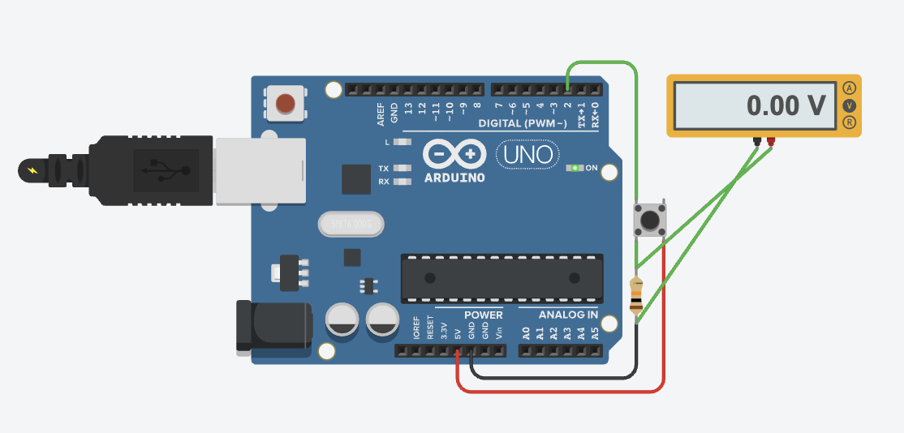 | 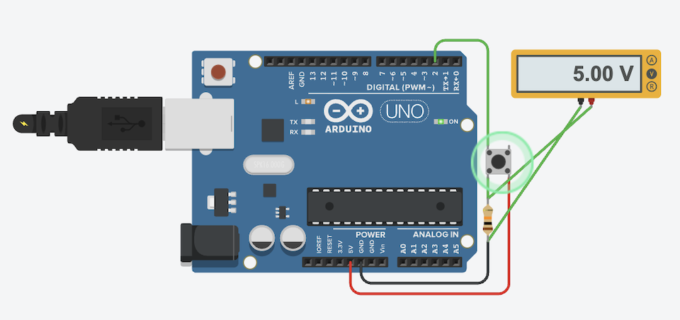 |

**予想 → 結果**

| ボタン | 予想 | 結果 | 理由 |
| --- | --- | --- | --- |
| 離したとき | 0V | **0.00V** ✓ | ボタンが切れていて、入力点は 10kΩ を通して GND につながるだけ。10kΩ に電流が流れないので両端に差が出ず、入力点 = GND = 0V |
| 押したとき | 5V | **5.00V** ✓ | ボタンで 5V に直接つながる。10kΩ には 5 ÷ 10000 = 0.5mA 流れ、5V はすべて 10kΩ が受け持つ |

**学んだこと：電圧計の黒をどこに当てるか**

最初は、メーターの2本をボタンの両端に当てていたので、**離すと 5V、押すと 0V** と逆の値が出た。

| メーターの当て方 | 測っているもの | 離す | 押す |
| --- | --- | --- | --- |
| ボタンの両端（最初） | ボタンが受け持つ電圧（5V − 入力点） | 5V | 0V |
| **赤を入力点、黒を GND**（正しい） | 入力点の電圧（GND から見て） | 0V | 5V |

ボタンと 10kΩ は直列なので、2つの電圧を足すといつも 5V（3日目）。「入力点の電圧」を測るときは、**黒を GND（0V の基準）**に当てる（9日目の「出力」と「電圧降下」の違い）。

<details>
<summary>うまくいかなかったときの画面（クリックで開く）</summary>

| ① メーターが電流（A）モード | ② ボタンの両端を測っていた（離す：5.00V） |
| --- | --- |
| 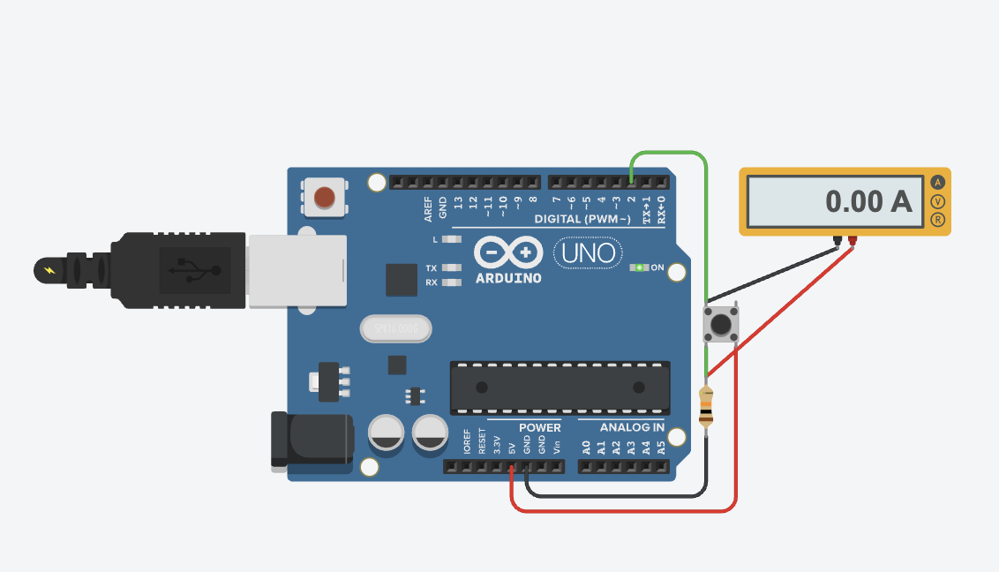 | 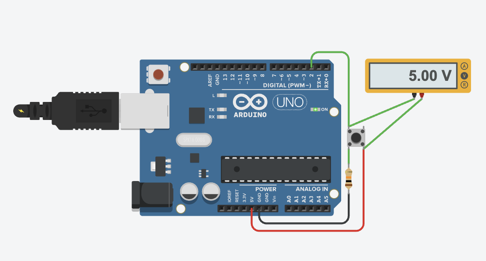 |
| **② ボタンの両端を測っていた（押す：0.00V）** | **③ 抵抗を外したあとも GND の線がボタンに残っていた** |
| 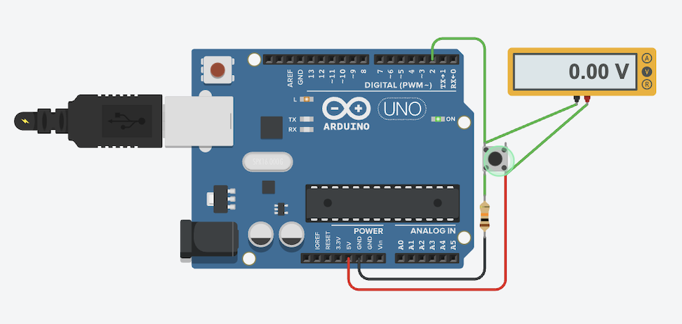 | 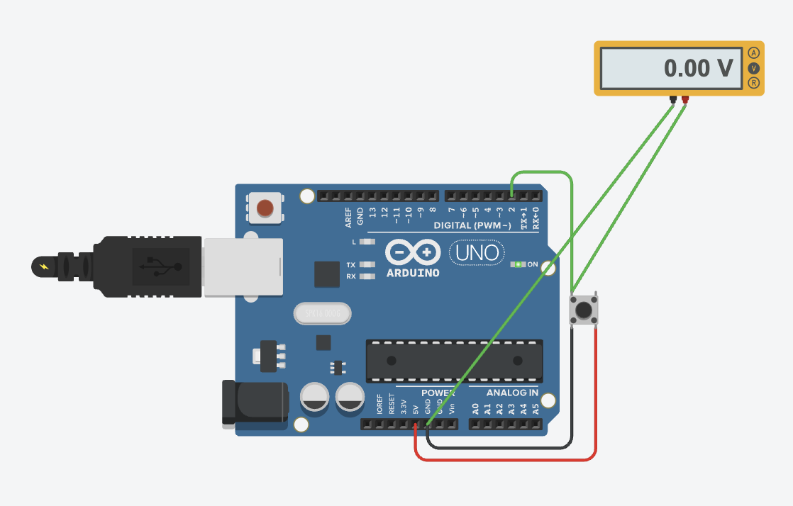 |

| # | 症状 | 原因 | 直し方 |
| --- | --- | --- | --- |
| ① | 0.00A のまま、何も分からない | 電圧を測りたいのに、メーターが電流（A）モードだった | メーターを V モードにする |
| ② | 離すと 5V、押すと 0V（逆） | メーターの2本をボタンの両端に当てていた | 赤を入力点、黒を GND に当て直す |
| ③ | 抵抗を外しても 0.00V | 10kΩ の下につながっていた GND の黒い線が、ボタンの入力点側の足に残っていた。抵抗 0Ω のプルダウンと同じで、押すと 5V と GND がショートする | GND の黒い線を消す（メーターの黒は Arduino の GND に直接つなぐ） |

</details>

### 3. 実験：プルダウン抵抗を外すと、離したときの電圧が決まらないことを確認し、理由を記録

**回路**：10kΩ を外し、入力点は 2番ピンとメーターの赤だけにつながる。メーターの黒は Arduino の GND。

**成果物**

| 離したとき（49.5mV） | 押したとき（5.00V） |
| --- | --- |
| 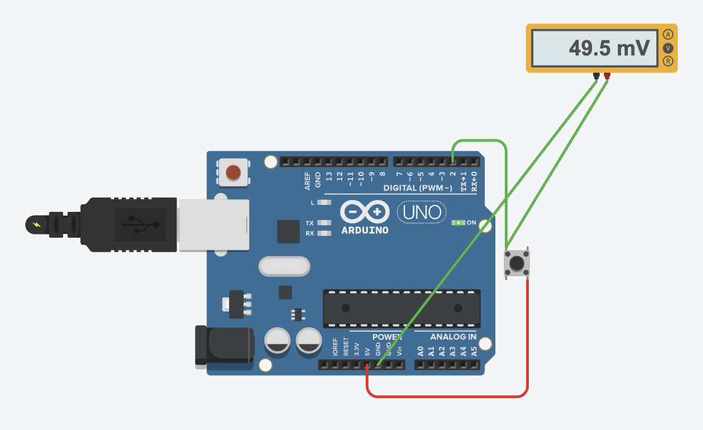 |  |

**予想 → 結果**

| ボタン | プルダウンあり | プルダウンなし |
| --- | --- | --- |
| 離したとき | 0.00V（はっきり 0） | **49.5mV**（0 でも 5 でもない） |
| 押したとき | 5.00V | 5.00V（同じ） |

押したときはどちらもボタンで 5V に直接つながるので同じ。違いが出るのは**離したとき**だけ。

**理由：電圧を決めているのが、ふだん無視している「漏れ」になる**

離したとき、入力点は回路の部品にはっきりつながっていない。電圧を決めているのは、とても大きい抵抗の「漏れ」の道だけ。

| 漏れの道 | 中身 |
| --- | --- |
| 5V → 入力点 | 離したボタンの中（とても大きい抵抗だが、無限大ではない） |
| 入力点 → GND | メーターの中の抵抗（9日目の「電圧計も負荷になる」）や、Arduino の入力ピンの中 |

この2つが**とても大きい抵抗どうしの分圧**（8日目）になり、その比で 49.5mV になった。たとえばボタンの漏れが約 1GΩ、メーターが約 10MΩ なら、5 × 10M ÷ (1G + 10M) ≒ 49.5mV になる（Tinkercad の中の本当の値は確かめていない。この形で説明できるという見積もり）。

| | 入力点の電圧を決めているもの | 結果 |
| --- | --- | --- |
| プルダウンあり | 10kΩ（漏れよりずっと小さいので、漏れは効かない） | いつも 0V。はっきり LOW |
| プルダウンなし | 漏れの抵抗どうしの比 | たまたま 49.5mV。実物では手を近づけたり、まわりのノイズを拾ったりして 0〜5V をふらふらし、Arduino は HIGH と LOW をでたらめに読む（記事の「バタつく」） |

**記録：プルダウン抵抗がないと、なぜ離したときの電圧が決まらないのか**

> ボタンを離すと、入力点は 5V にも GND にもつながらず、電圧はボタンやメーター・入力ピンの中のとても大きな「漏れ」の比だけで決まる（Tinkercad では 49.5mV）。漏れは少しの条件で変わるので電圧が定まらず、実物では HIGH と LOW をでたらめに読む。10kΩ のプルダウンを入れると、漏れよりずっと小さい抵抗で GND につながるので、離したときは必ず 0V になる。

### この日のまとめ：予想 → 結果 → 差の理由

| 何を測った／試したか | 予想 | 結果 | 差の理由 |
| --- | --- | --- | --- |
| プルダウンあり・離す | 0V | 0.00V | 差なし |
| プルダウンあり・押す | 5V | 5.00V | 差なし |
| プルダウンなし・離す | 決まらない（Tinkercad ではメーターが弱いプルダウンになり 0V に近いかも） | 49.5mV | ボタンの漏れとメーターの中の抵抗の分圧で、中途半端な値になった |
| プルダウンなし・押す | 5V | 5.00V | 差なし |
| メーターをボタンの両端に当てた | 0V / 5V | 5V / 0V（逆） | 入力点ではなく、ボタンが受け持つ電圧を測っていた |

## 19日目 電池の内部抵抗とブラウンアウト

**やること**（詳細は [チェックリスト](../CHECKLIST.md#第3週-ダイオードトランジスタプルアップ電池の内部抵抗)）

- 読む：乾電池の性質（内部抵抗と端子電圧）
- 実験：Falstadで、6Vの電圧源に0.5Ωの抵抗（内部抵抗の代わり）を直列に入れ、負荷を100Ω→10Ω→2Ωと重くして端子電圧を記録
- 計算：マイコンが4.5Vを下回るとリセットすると仮定し、電流が何A流れたら下回るかを手で求める
- 記録：「モーターが止まると大電流が流れ、電圧が下がってマイコンがリセットする」を自分の数字で説明する（筆者のMonth 1マイルストーン）
- 読む：高山無線「ドローン用バッテリーのすべて」と計測技術研究所「バッテリーのCレートって、そもそもナニ？」
- 計算：2200mAh・30Cのリポで取り出せる最大電流、最大20Aのモーターに1000mAhの電池なら何C以上が必要か、の2問

**成果物**

- 

**予想 → 結果 → 差の理由**

| 何を測った／試したか | 予想 | 結果 | 差の理由 |
| --- | --- | --- | --- |
| | | | |

## 20日目 まとめ

**やること**（詳細は [チェックリスト](../CHECKLIST.md#第3週-ダイオードトランジスタプルアップ電池の内部抵抗)）

- 第1〜3週で間違えた計算問題をもう一度解く
- `week3/README.md` に、トランジスタスイッチの回路図、測定値、ブラウンアウトの説明を置く

**成果物**

- 

**予想 → 結果 → 差の理由**

| 何を測った／試したか | 予想 | 結果 | 差の理由 |
| --- | --- | --- | --- |
| | | | |

## 何が壊れてどう直したか

うまくいかなかったことを、症状・原因・直し方の順に書きます。この週で一番大事な節です。

| 日 | 症状 | 原因 | 直し方 |
| --- | --- | --- | --- |
| 15日目 | 電流計が 15.2mA を示し、LED が消えた | 電流計を LED と同じ2つのグループに挿し、LED の横に並べていた（迂回路） | 電流計を、メーター以外ではつながっていない2つのグループのあいだにはさむ |
| 15日目 | LED は光っているのに 0.00A | 電流計の両端を同じ行（同じグループ）に挿していた | 電流計の2本の足を別々のグループに挿す |
| 15日目 | 0.00A で、LED が抵抗なしで 5V につながった | 抵抗の両足も同じ行に挿していて、抵抗が「ただの線」になった | 部品ごとに「2本の足が別々のグループか」を確かめる |
| 17日目 | LED が光らない | LED の向きが逆だった。直列なので1個でも逆なら全部消える | 曲がった足（アノード）を 9V + 側に向けた |
| 17日目 | LED が光っているのに電流計が 0.00A | 元の線を消さずに電流計を足した | 元の線を消して、電流計だけが通り道になるようにした |
| 17日目 | 電流計を外したら LED が消えた | 線の端が足からずれた。重なって残った線で R2 の両端が 5V になっていた | 線を引き直し、Tinkercad の回路図表示でつながりを確かめた |
| 17日目 | KiCad の ERC でエラー 1 件 | エミッタ（Open emitter）と PWR_FLAG（Power output）の組み合わせが、KiCad の決まりでエラー | 理由を確かめ、この1件だけ除外した |
| 18日目 | ボタンを離すと 5V、押すと 0V（逆） | 電圧計をボタンの両端に当てていた | 赤を入力点、黒を GND に当てる |
| 18日目 | プルダウン抵抗を外しても 0.00V | GND の線がボタンの入力点側の足に残っていた（押すとショート） | GND の線を消した |

**この週の教訓**：ブレッドボードは「**同じ行の5穴は1本の線**」。部品の足は必ず違うグループに挿す（15日目の図）。つながりは見た目ではなく、**回路図表示で確かめる**（17日目）。

## 分からなかったこと・あとで調べること

-
