# 第4週 故障診断・統合課題・はんだ付けの座学

- フェーズ：[フェーズ1 電子回路・道具・はんだ付け](../README.md)
- 日：22〜28日目（詳細は [CHECKLIST.md](../CHECKLIST.md#第4週-故障診断統合課題はんだ付けの座学) ）
- ゴール：壊れた回路の原因を仮想テスターで特定でき、Month 1の内容を1つの回路にまとめて公開する
- 状態：進行中（23日目まで）

日ごとに「やること → 成果物 → 予想 → 結果 → 差の理由」を残します。測定や実験は、やる前に予想を書きます。

## 22日目 故障診断の練習

> **ひとことで**：17日目のトランジスタスイッチを3通りに壊し、**テスターで測った電圧だけから原因を当てた**。コツは2つ。電流が流れないときは、**電圧が一気に落ちている場所（段差）が、電流を止めている場所**。電流は流れているのに様子がおかしいときは、**R ＝ V ÷ I で部品の値を逆算する**。①ベース抵抗 100kΩ はベース電流が 1/21 になったことから、②LED 逆向きは LED3 の両端に 6.26V かかったことから、③配線外しは配線の両端で電圧が違ったことから見つけた。

**この日にやったことと、分かったこと**

| # | やったこと | 分かったこと（一言） |
| --- | --- | --- |
| 1 | 17日目の回路を Tinkercad で複製し、3通りに壊す | ①は LED が光ったまま。②③は LED が消えて電流 0 |
| 2 | 正常な回路で、各点の電圧を測る | 比べるための「正しい値」。これがないと異常かどうか言えない |
| 3 | ①ベース抵抗 100kΩ を診断 | 電圧はほぼ正常。ベース電流 43.1µA から R ＝ 4.31V ÷ 43.1µA ＝ **100kΩ** |
| 4 | ②LED 逆向きを診断 | LED3 の両足で 6.26V → 0.003V。**LED3 の中**で電流が止まっている |
| 5 | ③配線外しを診断 | LED2 の右足 6.26V、LED3 の左足 0.00V。**配線の両端**で電圧が違う → 切れている |

やることの詳細は[チェックリスト](../CHECKLIST.md#第4週-故障診断統合課題はんだ付けの座学)。

**何に役立つか**

ロボットは、組んだあとに「動かない」「なんか弱い」がしょっちゅう起きる。原因を勘で探すと、部品を全部つけ直すことになる。テスターで測って、**どこで電圧がおかしくなっているか**を見れば、1か所に絞り込める。

| 使う場面 | どう使うか |
| --- | --- |
| モーターやLEDが動かない | 電源側から順に電圧を測り、電圧が消える場所（断線・はんだ不良・コネクタ抜け）を探す |
| 動くけど弱い・熱い | 電流と電圧を測って R ＝ V ÷ I で部品の値を確かめる（抵抗の付け間違いなど） |
| 部品を逆向きにつけたかも | ダイオード・LED・電解コンデンサの両端に、電源の電圧がまるごとかかっていないか見る |
| 実機を買ったとき | 今日の手順は、本物のテスターでもまったく同じ。はんだ付けした基板の検査にそのまま使う |

**この日に出てくることば**

| ことば | 意味 | たとえ |
| --- | --- | --- |
| 正常値 | 壊れていない回路で測った値。診断はこれとの比較で行う | 健康診断の「基準値」 |
| 断線（オープン） | 線や部品の中で道が切れて、電流が流れない状態 | 道路が工事で通行止め |
| 逆接続 | LED などの向きが逆。一方通行の部品なので電流が止まる | 一方通行を逆から入ろうとする |
| 電圧降下 | 部品を通ると、その部品の分だけ電圧が下がること | 階段を1段降りる |
| 各点の電圧 | 黒をGNDに固定し、赤で測った電圧。その点の「高さ」 | 地面（GND）から測った各階の高さ |
| 部品の両端の電圧 | 2つの点の電圧の差。その部品が使っている電圧 | 1段の階段の高さ |

### 0. 先に：この回路の見方と、使う法則

①②③の「なぜ」は、どれも次の3つで説明できる。

**① この回路は「2本の道」でできている**

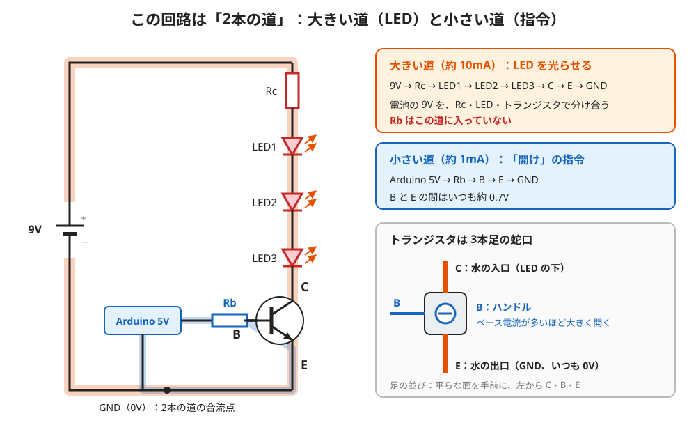

| 道 | 通る順番 | 流れる電流 | 役割 |
| --- | --- | --- | --- |
| **大きい道** | 9V → Rc → LED1 → LED2 → LED3 → **C → E** → GND | 約 10mA | LED を光らせる「力仕事」 |
| **小さい道** | Arduino 5V → Rb → **B → E** → GND | 約 1mA | トランジスタに「開け」と伝える「指令」 |

**Rb は小さい道にあって、LED の道（大きい道）には入っていない。** 故障①の「抵抗が大きくなったのに電圧が上がる？」の謎を解くカギになる。

**② トランジスタの C・B・E は「3本足の蛇口」**

```
          C (collector)  <-- 水の入口 (LED の水が上から来る)
          |
  B ---> [ faucet ]      <-- B (base) = ハンドル
          |
          E (emitter)    <-- 水の出口 (GND へ)
```

| 足 | 名前 | この回路で何につながっているか | 蛇口でいうと |
| --- | --- | --- | --- |
| **C** | コレクタ | LED3 の下（P5） | 水の入口 |
| **B** | ベース | Rb を通って Arduino 5V（P6） | **ハンドル** |
| **E** | エミッタ | GND（いつも 0V） | 水の出口 |

| 蛇口のルール | 意味 |
| --- | --- |
| B → E に小さい電流（ベース電流）を流すと、C → E に大きい電流が流れる | ハンドルを回すと水が出る |
| ベース電流が多い → C–E 間が**通りやすい**（大きく開く） | ハンドルを大きく回す |
| ベース電流が少ない → C–E 間が**通りにくい**（少ししか開かない） | ハンドルを少しだけ回す |
| B と E のあいだの電圧は、いつも**約 0.7V** でほぼ一定 | ハンドルの重さは決まっている |

足の並びは、平らな面を手前にして左から **C・B・E**（[16日目](../week3/README.md#16日目-トランジスタの仕組み)）。

**③ 使う法則は2つだけ**

**法則A：オームの法則**（[2日目](../week1/README.md#2日目-オームの法則)）

```
 V = I x R      (電圧 = 電流 x 抵抗)
 I = V / R      (電流 = 電圧 / 抵抗)
 R = V / I      (抵抗 = 電圧 / 電流)
```

水でいうと、電圧＝水を押す力、電流＝水の量、抵抗＝管の細さ。

- 同じ力で押しても、管が細い（抵抗が大きい）と、水は少ししか流れない。
- 流れていない（電流 0）なら、抵抗で電圧は下がらない（V ＝ 0 × R ＝ 0）。

**法則B：直列のとき、電圧は「通りにくい部品ほど多く」分け合う**（[8日目の分圧](../week2/README.md#8日目-分圧の式)と同じ）

```
 9V --[small R]--[big R]-- 0V
         |          たくさん取る
         少し取る
```

電圧は「高さ」。GND（0V）が地面、9V の + が9階。電流は上から下へ流れ、部品を通るたびに階段を降りる。

| 言い方 | 意味 |
| --- | --- |
| 各点の電圧（黒を GND） | その点の**地面からの高さ** |
| 部品の両端の電圧 | その部品が取っている**階段1段の高さ** |
| 全部の段の合計 | 電池の電圧（9V） |
| 通りにくい部品 | **大きな段**を取る |

### 1. 準備：17日目の回路を複製して、3通りに壊す

17日目の回路（[設計と測定値](../week3/README.md#17日目-トランジスタスイッチを設計する筆者の課題)）を Tinkercad で4つ用意し、1つは正常のまま、残り3つを壊した。2つの電流計（左上が LED の電流、真ん中がベース電流）は、17日目と同じ場所にはさんだまま。

| 正常（Rb 4.7kΩ）：LED 10.0mA、ベース 914µA | ① Rb を 100kΩ に：LED 9.71mA、ベース 43.1µA |
| --- | --- |
| 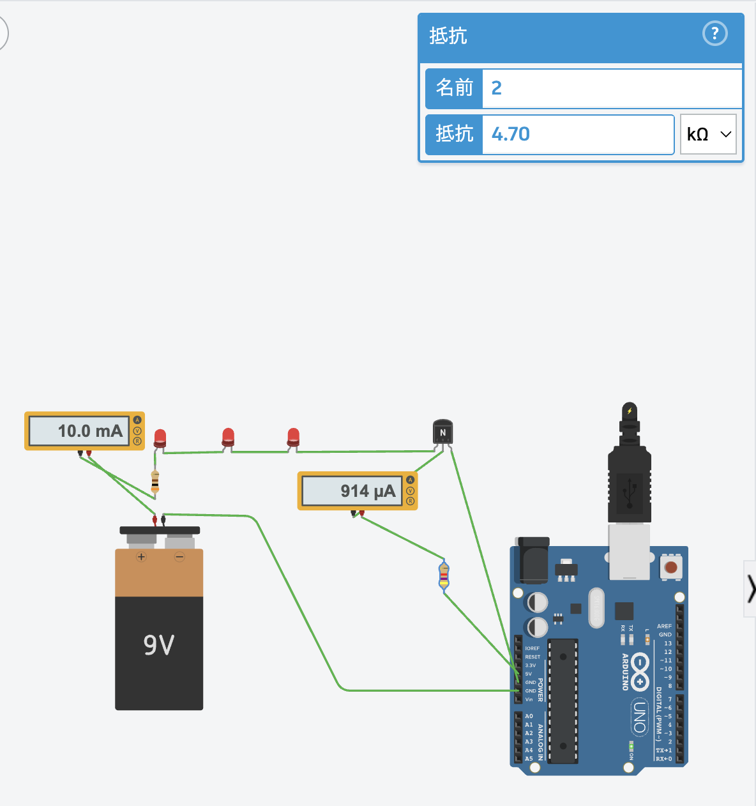 |  |
| **② LED3 を逆向きに：LED 0.00A、ベース 919µA** | **③ LED2 と LED3 の間の配線を外す：LED 0.00A、ベース 919µA** |
| 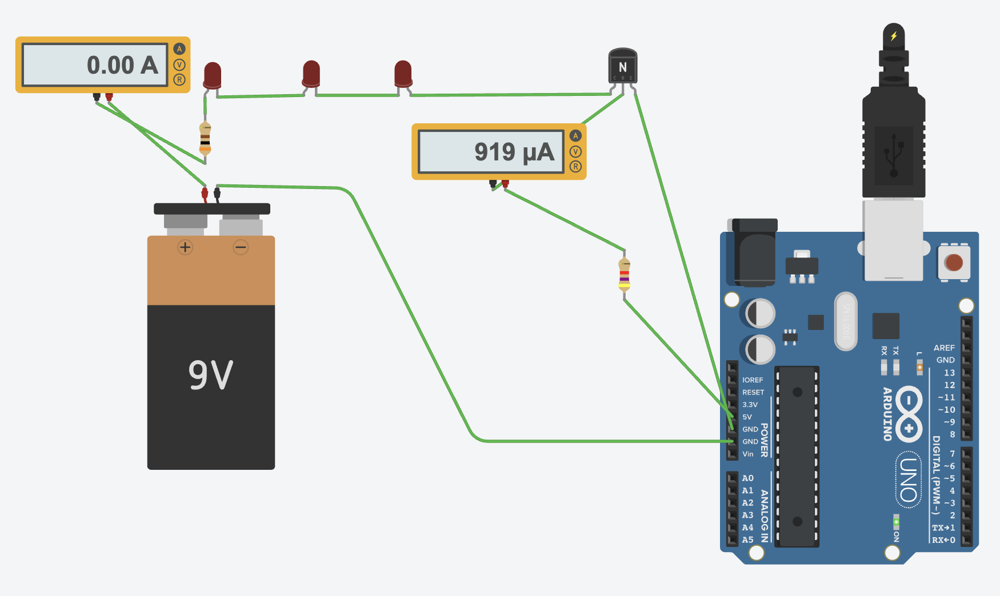 | 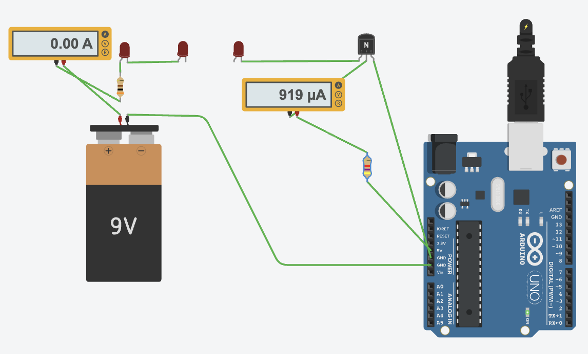 |

**見た目で分かること・分からないこと**

| 故障 | LED | 見た目で原因が分かるか |
| --- | --- | --- |
| ① Rb 100kΩ | **光る**（ほとんど変わらない） | 分からない。抵抗の色の帯を読まないと気づけない |
| ② LED 逆向き | 3個とも消える | 消えたことは分かる。でも「どこが悪いか」は分からない |
| ③ 配線外し | 3個とも消える | ②と見分けがつかない |

だから**テスターで測る**。今日は「答えを知っていても、測定値だけから原因を言えるか」を確かめた。

### 2. 測り方：黒を GND に固定して、赤で各点を順に測る

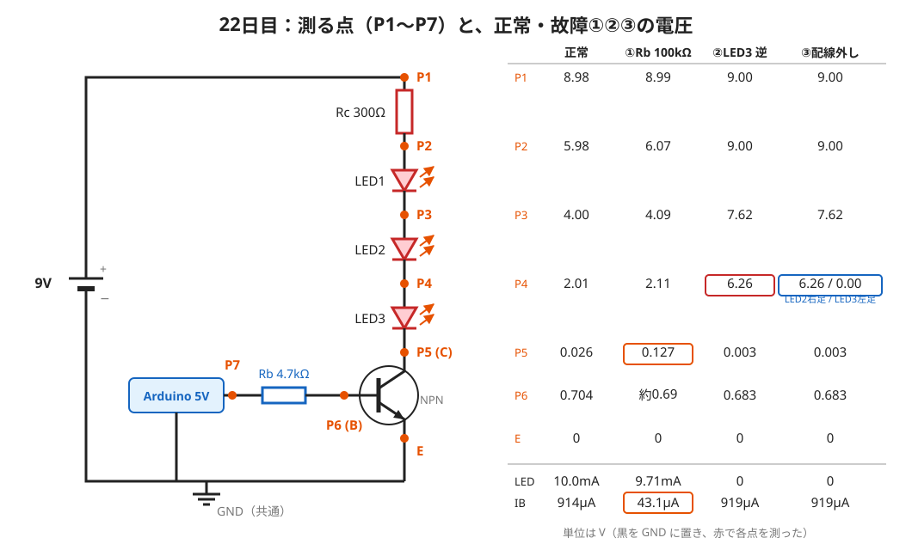

**測り方**

| 手順 | やること | 理由 |
| --- | --- | --- |
| 1 | 電圧計（テスターの V）をもう1台出す | 電流計は回路にはさんだまま使う。電流計を V に切り替えると回路が切れる（下の「うまくいかなかったとき」） |
| 2 | **黒を GND**（9V の −）につなぐ | 全部の点を「地面からの高さ」で比べるため |
| 3 | **赤で P1 → P2 → … → P5 → B → E** と順に測る | 電源から GND に向かって、電圧がどう下がっていくかを見る |
| 4 | 正常の値と並べて比べる | 違うところが原因の近く |

**正常な回路の電圧（ものさしになる値）**

| 点 | 電圧 | その前の部品で下がった電圧 |
| --- | --- | --- |
| P1（9V の +） | 8.98V | 電池の内部抵抗で 0.02V（19日目） |
| P2（Rc の下） | 5.98V | Rc：**3.00V**（10mA × 300Ω ＝ 3V ✓） |
| P3（LED1 の下） | 4.00V | LED1：1.98V |
| P4（LED2 の下） | 2.01V | LED2：1.99V |
| P5（C） | 0.026V | LED3：1.98V |
| E | 0V | トランジスタ C–E：0.026V（しっかり ON） |
| P6（B） | 0.704V | トランジスタの B–E：0.7V |
| P7（Arduino 5V） | 5.00V | |
| Rb の両端（赤を 5V、黒を B） | 4.30V | 4.30V ÷ 4700Ω ＝ 0.914mA。電流計の 914µA と一致 ✓ |

| B は 0.704V（黒は GND、赤はトランジスタの真ん中の足） | Rb の両端は 4.30V（赤は 5V、黒は B） |
| --- | --- |
| 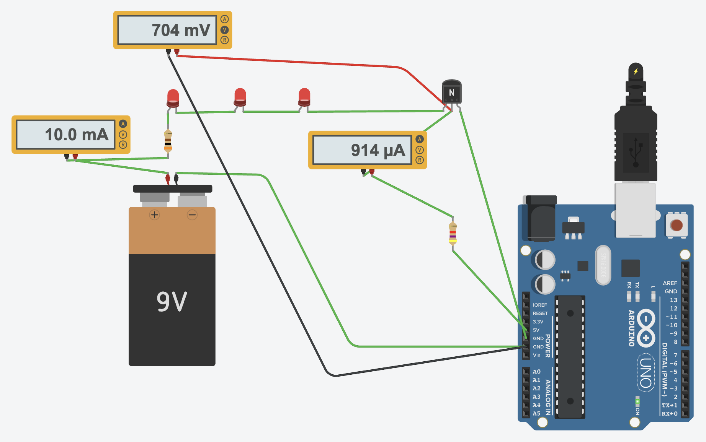 | 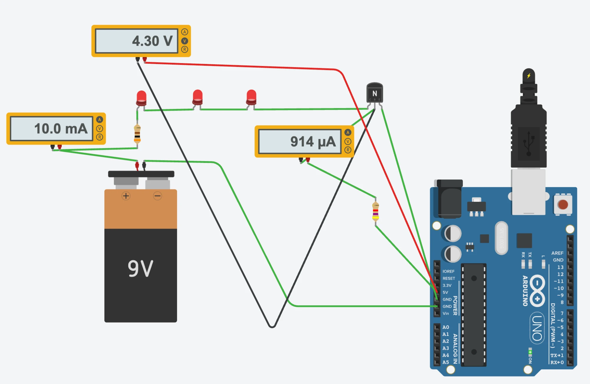 |

**ポイント**

**① 各点の電圧の差が、部品の両端の電圧**

Rb の両端の電圧は、P7 − P6 ＝ 5.00 − 0.704 ＝ 4.296V。テスターを Rb の両端に直接当てても 4.30V になった。どちらの測り方でも同じ答えになる。

```
P7 5.00V ---[Rb]--- P6 0.704V
          4.30V
     (5.00 - 0.704 = 4.296)
```

**② トランジスタの足の順番（TO-92、平らな面を手前に）**

左から **C・B・E**。この回路では E は GND に直接つながっているので **0V**。真ん中の B が約 0.7V。

**③ 17日目の「予想 9.3mA、結果 10.0mA」の理由が、測ってはっきりした**

17日目は C–E 間を 0.2V、LED を 2.0V と仮定した。実際に測ると **C–E 間は 0.026V、LED は 1.98V**。そのぶん Rc にかかる電圧が 3.00V に増えて、10.0mA になっていた。

### 3. 故障①：ベース抵抗が 100kΩ（LED は光っている）

| Rb の両端は 4.31V（正常 4.30V とほぼ同じ） | C は 127mV（正常 26mV の約5倍） |
| --- | --- |
| 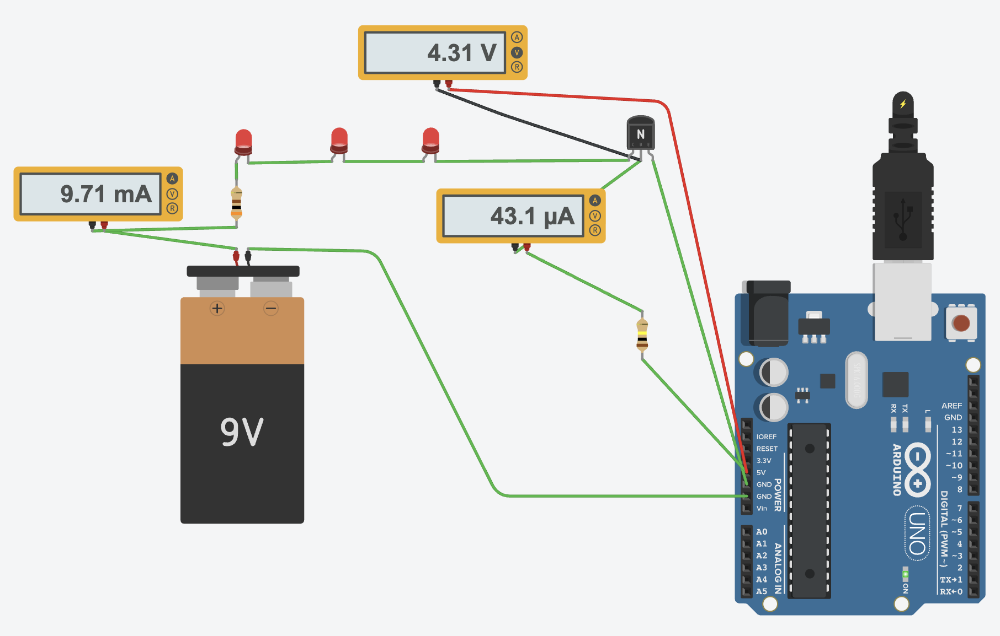 | 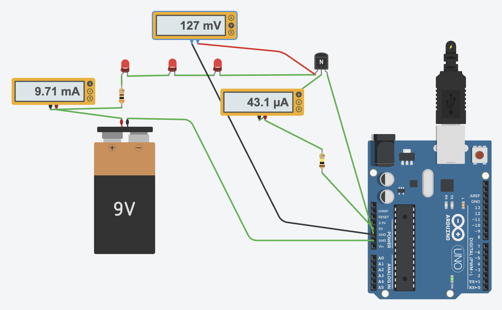 |

**正常と比べる**

| 点 | 正常 | ① | 差 |
| --- | --- | --- | --- |
| P1 | 8.98V | 8.99V | ほぼ同じ |
| P2 | 5.98V | 6.07V | +0.09V |
| P3 | 4.00V | 4.09V | +0.09V |
| P4 | 2.01V | 2.11V | +0.10V |
| P5（C） | 0.026V | **0.127V** | **約5倍** |
| E | 0V | 0V | 同じ |
| Rb の両端 | 4.30V | 4.31V | ほぼ同じ |
| ベース電流 | 914µA | **43.1µA** | **約 1/21** |
| LED の電流 | 10.0mA | 9.71mA | 少し減った |

**測定値から原因を言う**

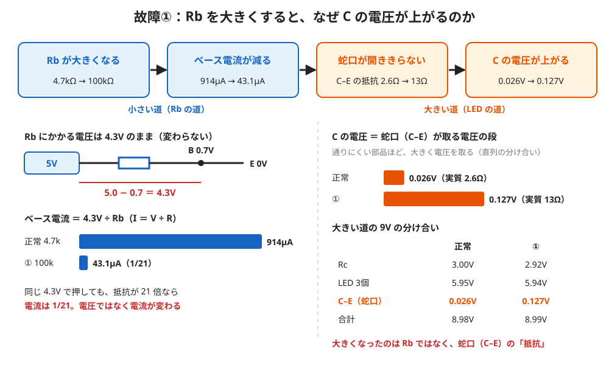

**① 電圧は 0.1V しか変わらない。違いがはっきり出たのは2つだけ**

- ベース電流が **1/21** に減った（914µA → 43.1µA）
- C の電圧が **約5倍** に上がった（0.026V → 0.127V）

**② なぜベース電流が 1/21 になるのか（小さい道だけを見る）**

```
 Arduino 5V --[Rb]-- B --(0.7V)-- E = GND
             ^^^^^^
             5.0 - 0.7 = 4.3V    <-- Rb にかかる電圧
```

B–E 間はいつも約 0.7V なので、Rb にかかる電圧は、Rb が何Ωでも **5.0 − 0.7 ＝ 約 4.3V** で変わらない。あとは法則A（I ＝ V ÷ R）。

| | Rb にかかる電圧（測定） | Rb | ベース電流 ＝ V ÷ R |
| --- | --- | --- | --- |
| 正常 | 4.30V | 4,700Ω | 4.30 ÷ 4,700 ＝ **0.000914A ＝ 914µA** |
| ① | 4.31V | 100,000Ω | 4.31 ÷ 100,000 ＝ **0.0000431A ＝ 43.1µA** |

100,000 ÷ 4,700 ≒ 21。**同じ力（4.3V）で押しても、管が 21 倍細くなったので、水が 1/21 しか流れない。** Rb が大きくなって変わったのは、Rb の**電圧ではなく電流**。

**③ なぜ「Rb が原因」と言い切れるのか**

測った電圧と電流から、Rb の値を逆算する（法則A：R ＝ V ÷ I）。

| | 計算 | 答え |
| --- | --- | --- |
| 正常 | 4.30V ÷ 0.000914A | 約 4,700Ω ＝ **4.7kΩ** |
| ① | 4.31V ÷ 0.0000431A | 約 100,000Ω ＝ **100kΩ** |

ほかの原因ではないことも、測定値で確かめられる。

| もし原因が〜なら | そのとき見えるはずの値 | 実際 | 判定 |
| --- | --- | --- | --- |
| Arduino の 5V が弱っている | Rb にかかる電圧が 4.3V より小さい | 4.31V（正常） | ✗ ちがう |
| トランジスタの B が壊れている | B の電圧がおかしい（0V や 5V） | 約 0.69V（正常） | ✗ ちがう |
| **Rb の値が大きすぎる** | **電圧は正常、電流だけ小さい** | **4.31V で 43.1µA** | **✓ これ** |

**結論：Rb が 4.7kΩ ではなく 100kΩ になっている。**

**④ なぜ C の電圧が上がったのか（「抵抗が大きくなったのに電圧が上がる」の謎）**

**大きくなった抵抗（Rb）と、電圧が上がった場所（C）は、別の道にある。**

| | どの道？ | 何が起きた？ |
| --- | --- | --- |
| Rb（100kΩ になった） | 小さい道 | 電圧は 4.3V のまま。**電流が減った** |
| C の電圧（0.127V に上がった） | 大きい道 | Rb とは別の場所。**トランジスタの C–E 間の電圧** |

E は 0V なので、**C の電圧 ＝ トランジスタの C–E 間の電圧**（蛇口が取っている階段の段）。

```
 Rb が大きい (4.7k -> 100k)
   |
   v
 ベース電流が減る (914uA -> 43.1uA)               <-- ハンドルを少ししか回さない
   |
   v
 C-E 間が全開にならない = 通りにくくなる
   |
   v
 大きい道の中で、蛇口が取る電圧の段が大きくなる   <-- 法則B
   |
   v
 C の電圧が上がる (0.026V -> 0.127V)
```

大きい道の 9V の分け合い（測定値から計算）：

| 部品 | 正常 | ① | 変化 |
| --- | --- | --- | --- |
| Rc（P1 − P2） | 8.98 − 5.98 ＝ 3.00V | 8.99 − 6.07 ＝ 2.92V | 少し減った |
| LED 3個（P2 − P5） | 5.98 − 0.026 ＝ 5.95V | 6.07 − 0.127 ＝ 5.94V | ほぼ同じ |
| トランジスタ C–E（P5 − E） | **0.026V** | **0.127V** | **増えた** |
| 合計 | 8.98V | 8.99V | 電池の電圧 ✓ |

トランジスタを「抵抗」とみなして、法則A（R ＝ V ÷ I）で計算すると：

| | C–E 間の電圧 | 電流 | トランジスタの「実質の抵抗」 |
| --- | --- | --- | --- |
| 正常 | 0.026V | 10.0mA | 0.026 ÷ 0.0100 ＝ **約 2.6Ω** |
| ① | 0.127V | 9.71mA | 0.127 ÷ 0.00971 ＝ **約 13Ω** |

**蛇口の「抵抗」が約5倍になったので、C の電圧も約5倍になった。** 「抵抗が大きくなると、その部品の電圧が大きくなる」は正しい。ただし大きくなったのは Rb ではなく、ハンドルを絞られた**トランジスタの C–E 間**。そのぶん Rc の電圧が 3.00V → 2.92V に減り、LED の電流も 2.92V ÷ 300Ω ＝ 9.73mA（電流計 9.71mA）に減った。

**⑤ ベース電流は 1/21 なのに、C の電圧は5倍で済んだのはなぜか**

Tinkercad のトランジスタは、少ないハンドル（43µA）でもほぼ全開近くまで開くほど強力（hFE が大きい）だから。

| | 計算 | LED の電流 |
| --- | --- | --- |
| Tinkercad（今回） | 9.71mA ÷ 43.1µA | hFE は少なくとも約 **225**。だから 43µA でもほぼ 10mA 流せた |
| hFE が 100 の部品なら | 43.1µA × 100 | 約 **4.3mA**。LED は目に見えて暗くなる |

実物ではトランジスタの hFE は1個ずつばらつく。**「シミュレーションでは光ったけど、実物では暗い・熱い」**という、見つけにくい故障になる。17日目に「ベース電流を約 10 倍多めに流す」と決めたのは、この余裕を作るため。

### 4. 故障②：LED3 が逆向き（LED が全部消える）

| LED3 の左足は 6.26V | LED3 の右足は 3.33mV（ほぼ 0V） |
| --- | --- |
| 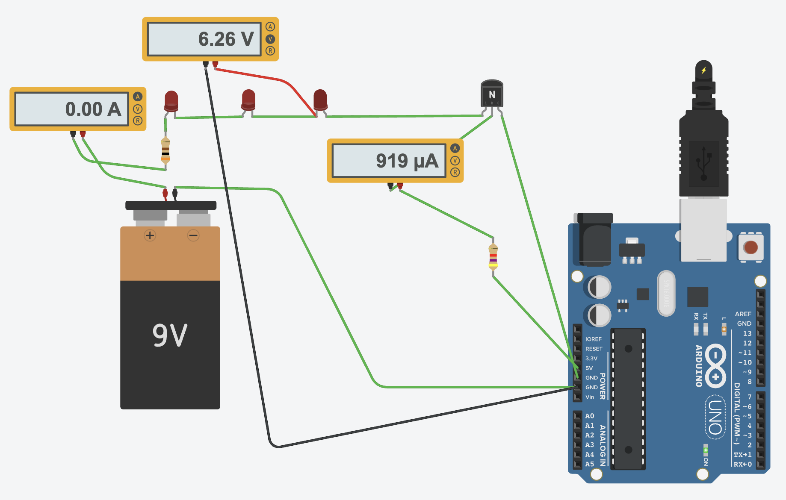 | 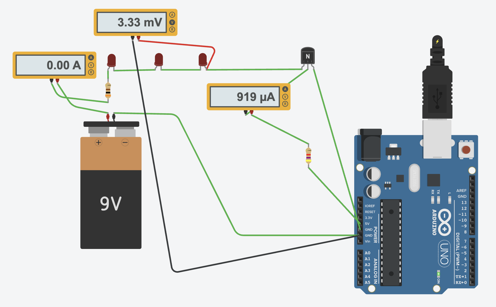 |

**正常と比べる**

| 点 | 正常 | ② | 前の点からの下がり方 |
| --- | --- | --- | --- |
| P1 | 8.98V | 9.00V | |
| P2 | 5.98V | **9.00V** | Rc：**0V**（正常は 3.00V） |
| P3 | 4.00V | 7.62V | LED1：1.38V |
| P4（LED3 の左足） | 2.01V | 6.26V | LED2：1.36V |
| LED3 の右足 | （P5 と同じ） | 0.003V | **LED3：6.26V** ← ここ |
| P5（C） | 0.026V | 0.003V | 配線：0V |
| B | 0.704V | 0.683V | |
| E | 0V | 0V | |
| ベース電流 | 914µA | 919µA | |
| LED の電流 | 10.0mA | **0.00A** | |

```
9.00V --[Rc]-- 9.00V --LED1-- 7.62V --LED2-- 6.26V --LED3-- 0.003V --wire-- 0.003V (C)
         0V             1.38V          1.36V        ^^^^^^^           0V
                                                    6.26V  <- ここで一気に落ちる
```

**測定値から原因を言う**

**① LED は「一方通行の扉」。1枚閉まると道全体が止まる**

| 向き | 扉 | 電流 |
| --- | --- | --- |
| 正しい向き | 開く（約 2V 使う） | 流れる |
| 逆向き | **閉まる** | **流れない** |

大きい道は1本道（直列）なので、扉が1枚でも閉まると、道全体で電流が 0 になる。だから3個とも消える。

**② ベース側は正常 → トランジスタより上（LED 側）が悪い**

B は 0.683V、ベース電流は 919µA で正常とほぼ同じ。ハンドルはちゃんと回っている。C が 0.003V なので、トランジスタ自身も ON になっている。

**③ 電流 0 のとき、電圧は「閉じた扉」まで下がらない**

水道管の途中に閉じたバルブがあると、水が流れないので、管の途中で圧力は下がらない。**バルブの手前まで高い圧力がそのまま届き、バルブのところで一気に 0 になる。**

```
 water side            closed valve             outlet side
 [high pressure] ============X============ [pressure 0]
```

電気も同じ。

| 区間 | 下がった電圧 | 理由 |
| --- | --- | --- |
| Rc | **0V** | 電流 0 なので V ＝ 0 × 300 ＝ 0（法則A）。P2 が 9V のまま |
| LED1、LED2 | 約 1.37V ずつ | 正しい向き。測れないほど小さな漏れ電流で少し電圧を使う。2V に届かないので光らない |
| **LED3** | **6.26V** | **閉じた扉**。残りの電圧が全部ここにかかる |
| LED3 の右足 → C（配線） | 0V | 配線はつながっている |

P1 が 9.00V で正常（8.98V）より高いのも、電流 0 で電池の内部抵抗の電圧降下がないから（[19日目](../week3/README.md#19日目-電池の内部抵抗とブラウンアウト)）。

**④ 一番大きな段差の場所が、電流を止めている場所**

LED3 の左足（6.26V）と右足（0.003V）で 6.26V も下がる。正常な LED は約 2V しか使わないので、明らかにおかしい。

**結論：LED3 が電流を止めている（逆向き）。**

**ルール：電流 0 なのに、1つの部品に大きな電圧がかかっていたら、その部品が電流を止めている。**

### 5. 故障③：LED2 と LED3 の間の配線が外れている（LED が全部消える）

| LED3 の左足は 0.00V | LED2 の右足は 6.26V |
| --- | --- |
| 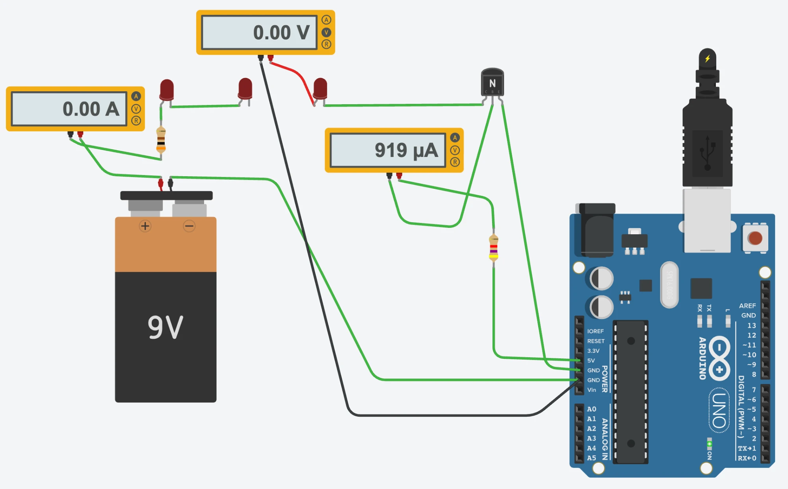 | 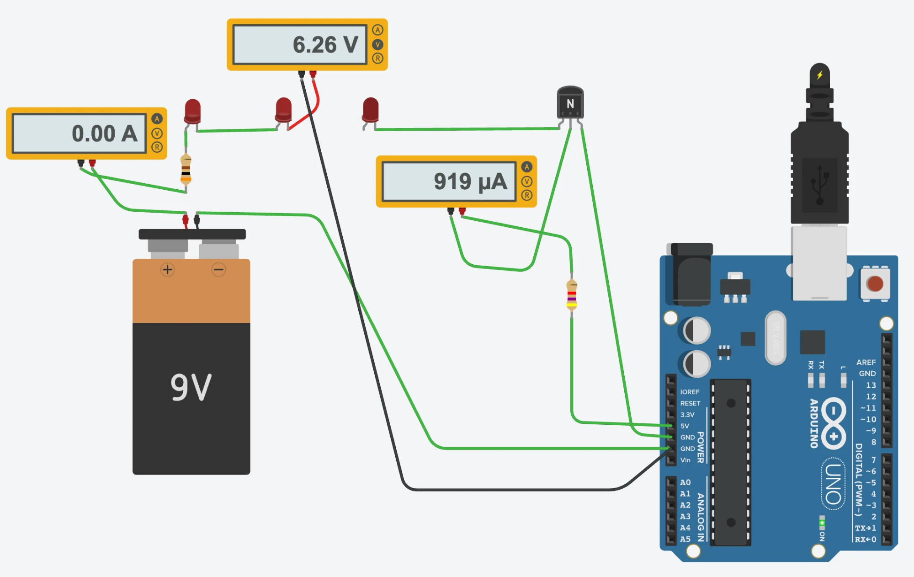 |

**正常・②と比べる**

| 点 | 正常 | ② LED3 逆向き | ③ 配線外し |
| --- | --- | --- | --- |
| P1 | 8.98V | 9.00V | 9.00V |
| P2 | 5.98V | 9.00V | 9.00V |
| P3 | 4.00V | 7.62V | 7.62V |
| LED2 の右足 | 2.01V | 6.26V | **6.26V** |
| LED3 の左足 | 2.01V | 6.26V | **0.00V** |
| P5（C） | 0.026V | 0.003V | 0.003V |
| B | 0.704V | 0.683V | 0.683V |
| E | 0V | 0V | 0V |
| LED の電流 | 10.0mA | 0.00A | 0.00A |
| ベース電流 | 914µA | 919µA | 919µA |

```
9.00V --LED1-- 7.62V --LED2-- 6.26V - - - wire - - - 0.00V --LED3-- 0.003V (C)
        1.38V          1.36V        ^^^^^^^^^^^^^^^^
                                    6.26V <- 配線で落ちる = つながっていない
```

**測定値から原因を言う**

**① ②と③は、P1〜P3 がまったく同じ**

LED が消えて電流 0 という症状も同じ。最初の測定だけでは区別できない。

**② 配線は「段差 0 の平らな廊下」**

配線は抵抗がほぼ 0。法則A で V ＝ I × 0 ＝ 0 なので、**つながっている配線の両端は、いつも同じ電圧**（電流が流れていても、いなくても）。②の LED3 の右足と C が、どちらも 0.003V だったのがその例。

**③ 切れると、両側が別々の高さになる**

```
 9.00V --LED1-- 7.62V --LED2-- 6.26V     (gap)     0.00V --LED3-- 0.003V -- C
                               ^^^^^               ^^^^^
                               |                   GND 側の高さ
                               9V 側の高さ
```

| 切れた配線の… | どこにつながっている？ | 電圧 |
| --- | --- | --- |
| 上の端（LED2 の右足） | LED1・LED2 を通って **9V 側**にだけつながっている | 9V 側に引っ張られて **6.26V** |
| 下の端（LED3 の左足） | LED3・トランジスタを通って **GND 側**にだけつながっている | GND 側に引っ張られて **0.00V** |

**切れた線の両端は、それぞれ「まだつながっている側」の高さになる。** だから配線の両端に 6.26V の差が出る。

**④ 段差の両側をはさんで測る**

段差（7.62V → 0V）は「LED2」と「LED2 → LED3 の配線」のどちらかにある。そこで LED2 の右足を測ったら 6.26V。

| 区間 | 両端の電圧 | 判定 |
| --- | --- | --- |
| LED2 の左足 → 右足 | 7.62V → 6.26V | 1.36V。②の LED2 と同じで、正常な振る舞い |
| LED2 の右足 → LED3 の左足（配線） | 6.26V → 0.00V | **6.26V 下がる** |

**結論：LED2 と LED3 の間の配線が切れている。**

**⑤ ②と③の見分け方**

| | 段差（6.26V → 約 0V）の場所 | 判定 |
| --- | --- | --- |
| ② | **LED3 の左足と右足のあいだ**（部品の中） | LED3 が電流を止めている |
| ③ | **LED2 の右足と LED3 の左足のあいだ**（配線） | 配線が切れている |

### 6. 3つの故障をまとめる

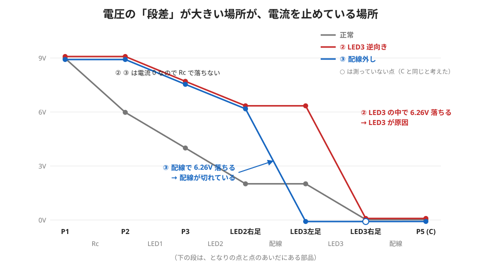

**故障診断の記録**

| 故障 | 症状 | 測った値 | 原因 |
| --- | --- | --- | --- |
| ①ベース抵抗100kΩ | LED は光る（9.71mA、ほぼ正常）。見た目では気づけない | 各点の電圧は正常と 0.1V 以内。**ベース電流 43.1µA**（正常 914µA）、Rb の両端 4.31V、C 0.127V（正常 0.026V） | 4.31V ÷ 43.1µA ＝ **100kΩ**。Rb の値が違う（正しくは 4.7kΩ） |
| ②LED逆向き | LED が3個とも消える。LED の電流 0.00A | P2 9.00V（Rc で下がらない）、B 0.683V・ベース電流 919µA（正常）。**LED3 の左足 6.26V、右足 0.003V** | LED3 の両端に 6.26V かかり、LED3 の中で電流が止まっている → **LED3 が逆向き** |
| ③配線1本外れ | LED が3個とも消える。LED の電流 0.00A | P1〜P3 は②と同じ。**LED2 の右足 6.26V、LED3 の左足 0.00V** | 配線の両端で電圧が違う → **LED2 と LED3 の間の配線が切れている** |

**診断の順番（今日のやり方を手順にしたもの）**

```
1. 電流は流れている？
   |
   +-- 流れている (LED が光る) --> 値はおかしい？
   |       各部品の両端の電圧と電流を測り、R = V / I で値を確かめる   (故障1)
   |
   +-- 流れていない (0A) --> 黒を GND、赤で電源側から順に測る
           |
           +-- 一気に下がる「段差」を見つける
           +-- 段差の両側をはさんで測る
                 部品の両足で下がる   --> その部品が原因        (故障2)
                 配線の両端で下がる   --> その配線が切れている   (故障3)
```

| 見るもの | 正常 | 断線・逆接続（電流 0） | 値違い（電流は流れる） |
| --- | --- | --- | --- |
| 抵抗の両端 | V ＝ I × R | **0V**（電流 0 だから） | V は同じでも I が違う → R ＝ V ÷ I で値が分かる |
| LED の両端 | 約 2V | 逆向きの LED に**電源の電圧がまるごと**かかる | 約 2V |
| 配線の両端 | 0V | 切れた配線の両端に**大きな電圧** | 0V |

<details>
<summary>うまくいかなかったとき（クリックで開く）</summary>

| ① 電流計を V に切り替えた（4.93V、LED が消えた） |
| --- |
| 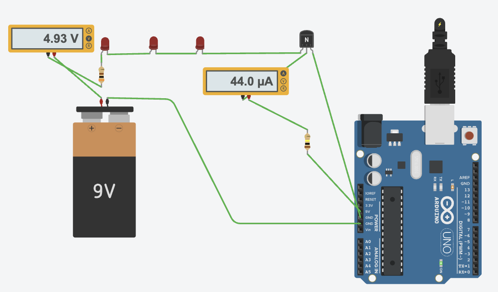 |

| # | 症状 | 原因 | 直し方 |
| --- | --- | --- | --- |
| ① | LED に電流計をはさんだまま V に切り替えたら 4.93V と出て、LED が消えた | 電圧計は中の抵抗がとても大きい。回路にはさんだまま V にすると、そこで回路が切れたのと同じになる | 電流計は A のまま残し、電圧計をもう1台出して**並列**（黒を GND、赤を測る点）に当てる |
| ② | B の 704mV を「E の電圧」だと思った | トランジスタの足の順番を覚えていなかった | 平らな面を手前にして左から **C・B・E**。E は GND につながっているので 0V。0.7V は B |
| ③ | 正常な回路で測った値を、①の回路で測ったと思っていた | 4つの回路が同じ見た目で、どれを測ったか取り違えた | ベース電流で見分ける（正常 914µA、① 43.1µA、②③ 919µA）。測る前に電流計の値を見る |

</details>

### この日のまとめ：予想 → 結果 → 差の理由

| 何を測った／試したか | 予想 | 結果 | 差の理由 |
| --- | --- | --- | --- |
| ① Rb 100kΩ の LED の電流 | hFE 100 なら 43µA × 100 ＝ 約 4.3mA で暗くなる | 9.71mA。ほとんど変わらず光った | Tinkercad のトランジスタの hFE が少なくとも約 225 と大きい。実物なら暗くなりうる |
| ① の原因の特定 | ベース電流が減るはず | 43.1µA（1/21）。4.31V ÷ 43.1µA ＝ 100kΩ | 差なし。電圧だけでは気づけず、**電流**が決め手 |
| ② LED 逆向きの電圧 | 9V から 0V へ1か所で一気に下がる | LED3 の両端で 6.26V 下がった。LED1・LED2 にも約 1.37V | 測れないほど小さな電流で、正しい向きの LED も少し電圧を使う。段差の場所は予想どおり |
| ③ 配線外しの電圧 | 切れた場所の手前は高く、先は 0V | LED2 の右足 6.26V、LED3 の左足 0.00V | 差なし。②と同じ段差を、**配線**の両端で確かめて区別できた |
| ②③ の Rc の電圧 | 電流 0 なので 0V | P1 9.00V ＝ P2 9.00V で 0V | 差なし（V ＝ I × R ＝ 0） |

## 23日目 統合課題の設計：暗くなると点灯する回路

> **ひとことで**：光センサー（暗いと抵抗が大きくなる部品）と 10kΩ で**分圧**を作り、その境目（out）の電圧で NPN トランジスタを動かして、**暗くなると LED が点く回路**を設計した。ポイントは3つ。①**光センサーを下（GND 側）に置く**と、暗いとき out が高くなる。②LED 側は 5V・LED 1個・**Rc 300Ω**。③ベース電流は上の 10kΩ も通るので **0.43mA より多くは流せない**。だから Rb は **1kΩ**（最低限の約 4 倍）にした。KiCad で回路図を描き、ERC 違反 0。

**この日にやったことと、分かったこと**

| # | やったこと | 分かったこと（一言） |
| --- | --- | --- |
| 1 | SunFounder「4.2 光を感じる」の配線図を読む | 光センサーと 10kΩ の直列（分圧）。境目の電圧を A0 で読んでいる |
| 2 | 並べ方を考える | SunFounder の並びは「明るいと out が高い」。逆にして光センサーを下に置くと「暗いと高い」 |
| 3 | Rc を計算する | (5 − 2 − 0.05) ÷ 10mA ＝ 295Ω → **300Ω**（電流が多すぎると困るので大きい側） |
| 4 | Rb を計算する | 最初は 3.6kΩ と出たが、10kΩ も通る落とし穴に気づき、**1kΩ** に変えた |
| 5 | KiCad で回路図を描く | ERC のエラー 1 件は17日目と同じ（エミッタと PWR_FLAG）。除外して違反 0 |

やることの詳細は[チェックリスト](../CHECKLIST.md#第4週-故障診断統合課題はんだ付けの座学)。

**何に役立つか**

「センサー → 分圧で電圧に変える → トランジスタで大きな電流を ON / OFF」は、ロボットのセンサー回路の基本の形。

| 使う場面 | どう使うか |
| --- | --- |
| 暗くなると点くライト（街灯・常夜灯） | 今日の回路そのもの |
| ライントレースロボット | 床の白黒（光の反射）を光センサーで電圧に変え、マイコンで読む |
| マイコンでセンサーを読む | 抵抗が変わるセンサー（光・温度・曲げ）は、固定抵抗と分圧にして A0 などのピンで電圧として読む |
| 設計の見落としを防ぐ | 分圧から電流を取り出すと電圧が下がる（9日目）。センサーの出力で直接大きな負荷を動かさない |

**この日に出てくることば**

| ことば | 意味 | たとえ |
| --- | --- | --- |
| 光センサー（フォトレジスタ、CdS） | 明るいと抵抗が小さく、暗いと大きくなる抵抗 | 明るいと広がり、暗いと細くなる水道管 |
| 分圧 | 直列の2つの抵抗で、電源の電圧を分け合うこと | 5m の高さを、2段の階段で降りる |
| out（境目） | 分圧の2つの抵抗のあいだの点。ここの電圧を使う | 階段の踊り場の高さ |
| A0（アナログ入力ピン） | Arduino が電圧を測って 0〜1023 の数字にするピン | 電圧計 |
| 負荷 | 分圧の out から電流を取り出す相手（今日はトランジスタのベース） | 踊り場から水をくみ出す人 |
| E 系列（E12、E24） | 売っている抵抗の値の並び | 靴のサイズ（決まった刻みしか売っていない） |

### 0. 先に：この日に使う前提知識

**① 直列だと電圧は分け合う（3日目・8日目）**

| 直列のルール | 意味 |
| --- | --- |
| 電流はどこでも同じ | 1本道なので、上の抵抗を通った電流が、そのまま下の抵抗も通る |
| 電圧は足し算 | 2つの抵抗の電圧を足すと、電源の電圧（5V）になる |

各抵抗の電圧は V ＝ I × R。**電流 I が同じなので、電圧は抵抗の大きさに比例する。** だから「通りにくい（抵抗が大きい）部品ほど、大きな段を取る」（[22日目の法則B](#0-先にこの回路の見方と使う法則)）。

```
 5V
  |
 [R1]      <-- 上の段
  |
  +--- out <-- 踊り場の高さ = 下の段 (R2) の高さ
  |
 [R2]      <-- 下の段
  |
 GND (0V)
```

```
 out = 5V x R2 / (R1 + R2)       <-- 8日目の分圧の式 (R2 は下の抵抗)
```

並列（枝分かれ）では、どの部品にも 5V がまるごとかかるので分け合わない。**分圧は必ず直列で作る。**

**② ブレッドボードは「同じ列の5つ穴」が1つのグループ（15日目）**

穴が違っても、同じ列（番号）に刺さっていれば電気的には同じ点。

**③ B–E 間は約 0.7V（ON のとき）**

NPN の B と E のあいだには、ダイオードと同じつくり（PN 接合）が入っている。ダイオードは約 0.6V を超えると電流が急に増えるので、**電流が 10µA でも 10mA でも、電圧は 0.6〜0.75V くらい**にしかならない。

| 条件 | B–E の電圧 |
| --- | --- |
| ON（ベース電流が流れている） | 約 0.7V（16日目の Falstad：ベース電流 9.8µA で 0.595V、10 倍の 109.6µA で 0.657V） |
| OFF（B に 0.6V も届かない） | 回路が決めた電圧のまま（例：0.45V）。電流はほぼ 0 |

**ON のとき、B より上の「残りの電圧」は Rb が受け持つ。** Rb がないと、残りの電圧の行き場がなく、大電流が流れて壊れる（17日目）。

**④ 設計に出てくる数字は4種類**

| 種類 | 意味 | たとえ |
| --- | --- | --- |
| **A. 部品の性質** | 部品ごとに決まっている。自分では変えられない | 水は 100℃ で沸く |
| **B. 自分で決めた** | 設計する人が「こうしたい」と選ぶ | お湯を 1L 沸かしたい |
| **C. 仮定** | 本当の値が分からないので「だいたいこれ」と置く | やかんは 1000W くらいだろう |
| **D. 計算** | A・B・C から計算で出す | なら 5分くらい |

### 1. 読む：[SunFounder「4.2 光を感じる」](https://docs.sunfounder.com/projects/3in1-kit-v2/ja/latest/basic_project/ar_photoresistor.html)。光センサーを分圧で使う回路を確認

| SunFounder の配線図 | 回路図にすると |
| --- | --- |
| 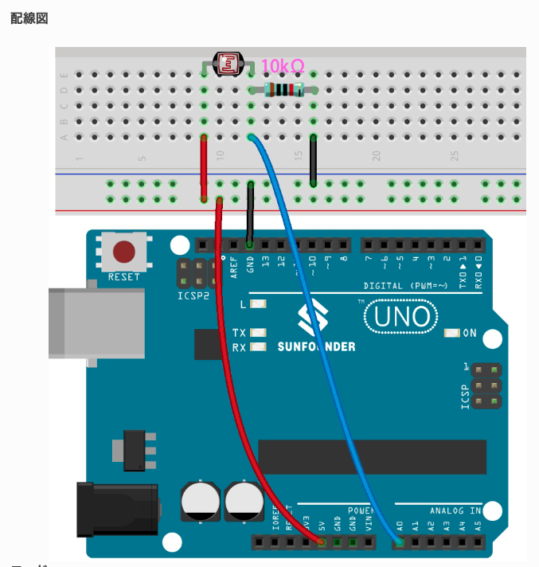 | 下の表と図 |

**配線図を線ごとにたどる**

| 順番 | 図の中の場所 | 回路図でいうと |
| --- | --- | --- |
| 1 | Arduino の **5V** → 赤い線 → ブレッドボードの + の列 → **9列目** | 5V |
| 2 | 9列目 → **光センサー** → 12列目 | 上の抵抗（R1） |
| 3 | **12列目** → 青い線 → Arduino の **A0** | 境目（out） |
| 4 | 12列目 → **10kΩ** → 15列目 | 下の抵抗（R2） |
| 5 | 15列目 → 黒い線 → − の列 → Arduino の **GND** | GND |

```
          col 9      col 12     col 15
 row E      o--[photo]--o          o      <-- 光センサー: 9 と 12
 row D      o           o--[10k]---o      <-- 10kΩ: 12 と 15
 row A      o           o          o
            |           |          |
          5V         A0 (blue)   GND
```

**① 青い線は「10kΩ の後」ではなく「光センサーと 10kΩ のあいだ」**

12列目の E（光センサーの右足）・D（10kΩ の左足）・A（青い線）は、同じ列なので全部つながっている。見た目の位置ではなく、**どの列に刺さっているか**で見る。

**② この回路で Arduino は3つの役をしている**

| Arduino のピン | 役割 | これまでの道具でいうと |
| --- | --- | --- |
| 5V | 回路に電気を送る | 電池の + |
| GND | 帰り道（0V） | 電池の − |
| A0 | 12列目の電圧を測って 0〜1023 の数字にする（0V → 0、5V → 1023） | 電圧計。入力ピンなので電流をほとんど吸わない（18日目） |

**③ 明るさが電圧に変わる**

光センサーが上なので、out ＝ 下の 10kΩ が取る段の高さ。

| 明るさ | 光センサー（例） | out ＝ 5 × 10 ÷ (光センサー ＋ 10) | A0 の数字 |
| --- | --- | --- | --- |
| 明るい | 1kΩ（小さい段） | **約 4.55V** | 約 930 |
| 暗い | 100kΩ（大きい段） | **約 0.45V** | 約 93 |

光センサーの 1kΩ・100kΩ は、説明のために置いた例（C. 仮定）。本当の値は24日目に Tinkercad で確かめる。

**④ なぜ分圧にするのか**

A0 が測れるのは**電圧**だけ。光センサーは**抵抗**が変わる部品なので、そのままでは読めない。固定抵抗と直列にすると、**抵抗の変化が境目の電圧の変化に変わる**。

<details>
<summary>Arduino IDE でコードを開いたが、動かせなかった（クリックで開く）</summary>

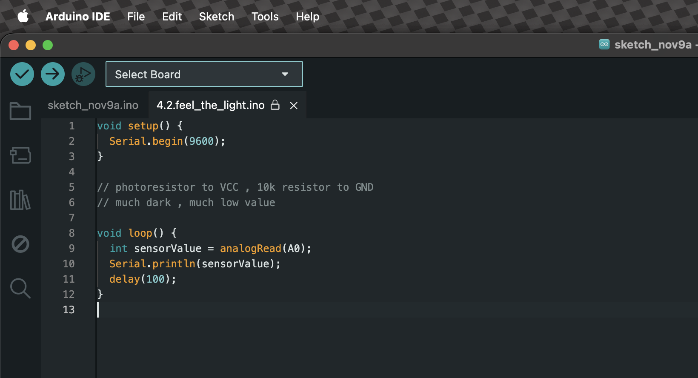

SunFounder のコードを Arduino IDE に入れたが、「Select Board」が空のまま進めなかった。

| 道具 | コードを書く | ボードなしで動かす |
| --- | --- | --- |
| Arduino IDE | ✓ | ✗ 本物のボードを USB でつなぐ必要がある |
| Arduino Cloud（ブラウザ版） | ✓ | ✗ 同じく本物のボードが必要 |
| **Tinkercad Circuits** | ✓ | **✓ 回路とコードを一緒にシミュレーションできる** |

今日の「読む」は回路の確認だけなので、コードを動かす必要はなかった。動かすなら Tinkercad で、Arduino・光センサー・10kΩ を置き、「コード」→「文字」に切り替えて貼り、シリアルモニタで数字を見る。

| 行 | コード | 意味 |
| --- | --- | --- |
| 2 | `Serial.begin(9600);` | パソコンに文字を送る準備 |
| 9 | `int sensorValue = analogRead(A0);` | A0 の電圧を 0〜1023 の数字で読む |
| 10 | `Serial.println(sensorValue);` | その数字を画面に表示 |
| 11 | `delay(100);` | 0.1秒待つ（1秒に約10回表示） |

</details>

### 2. 設計：光センサーと固定抵抗の分圧 → NPN トランジスタ → LED

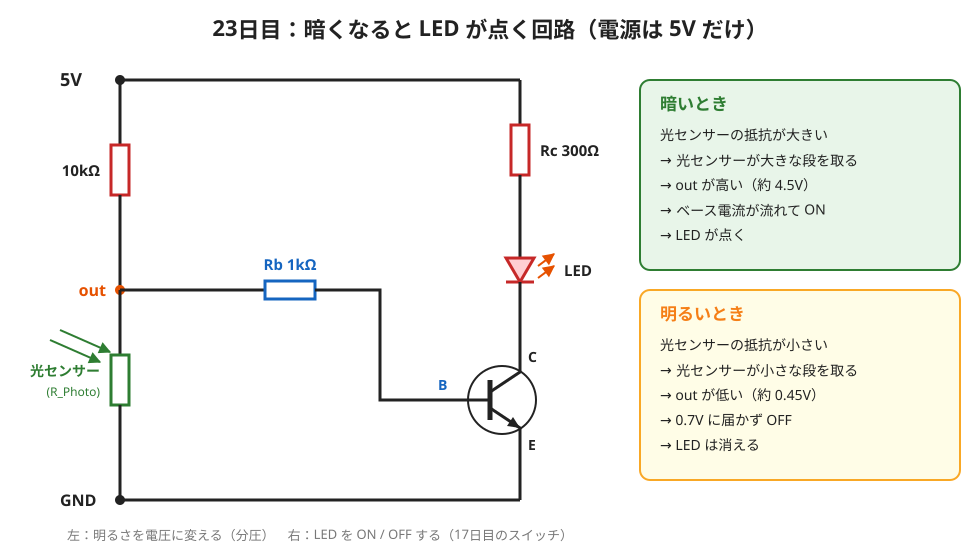

**① 並べ方：光センサーを下（GND 側）に置く**

トランジスタは、ベースの電圧が約 0.7V より**高いと ON**（LED が点く）。SunFounder の並びのままつなぐと、明るいとき out が高いので「明るいと点く」になってしまう。

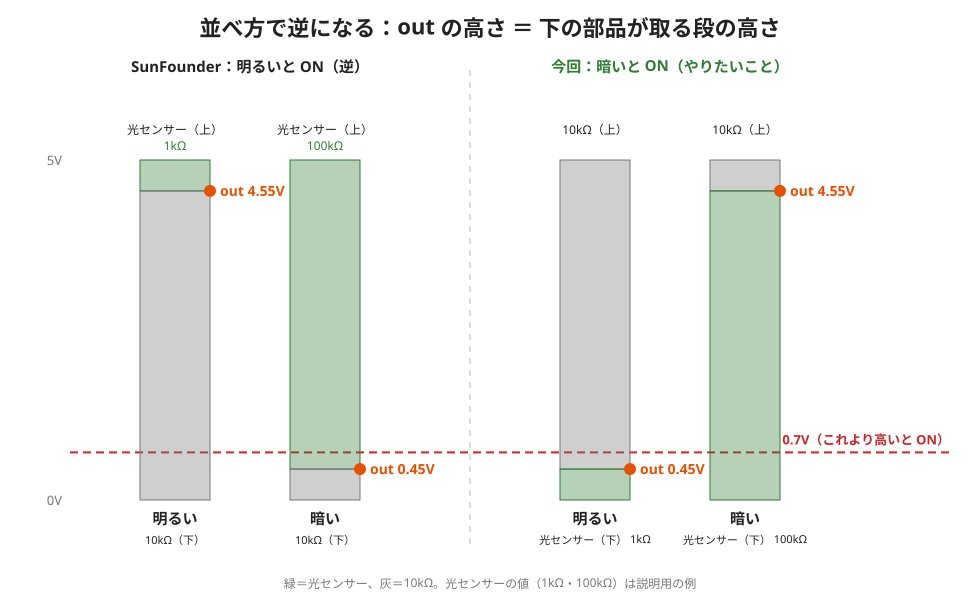

| 並べ方 | 明るいときの out | 暗いときの out | 結果 |
| --- | --- | --- | --- |
| SunFounder（光センサーが上） | 4.55V（ON） | 0.45V（OFF） | 明るいと点く ✗ |
| **今回（10kΩ が上、光センサーが下）** | **0.45V（OFF）** | **4.55V（ON）** | **暗いと点く ✓** |

out は**下の部品が取る段の高さ**。暗いと抵抗が大きくなるのは光センサーなので、光センサーを下にすれば、暗いとき out が高くなる。

| | 光センサー（例） | out ＝ 5 × 光センサー ÷ (10 ＋ 光センサー) | トランジスタ |
| --- | --- | --- | --- |
| 明るい | 1kΩ | 5 × 1 ÷ 11 ＝ **約 0.45V** | 0.7V に届かない → **OFF** |
| 暗い | 100kΩ | 5 × 100 ÷ 110 ＝ **約 4.55V** | 0.7V を超える → **ON** |

光センサーの抵抗は暗いと**とても大きく**なるが、無限ではない。だから光センサーが上だと、暗いときの out は「0 に近い」（ちょうど 0 ではない）。

**② LED 側：LED は1個、電源は 5V だけ**

17日目は LED 3個（3 × 2V ＝ 6V）に 5V では足りないので 9V を使った。今回学びたいのは「分圧 → トランジスタ → LED」のつながりなので、LED は1個で十分。

| 観点 | LED 3個（17日目） | LED 1個（今回） |
| --- | --- | --- |
| 電源 | 9V 電池 ＋ Arduino 5V。GND を共通にする | **5V だけ** |
| 計算 | 多い | 少ない。分圧と Rb に集中できる |
| 24日目の測定 | 測る点が多い | out の電圧と LED の電流だけ |

**③ Rc を決める（LED の電流を決める抵抗）**

| 手順 | 計算 | 答え |
| --- | --- | --- |
| 5V を分け合う相手 | Rc・LED・トランジスタ（C–E）の直列 | |
| Rc にかかる電圧 | 5V − 2V（LED）− 0.05V（C–E） | 2.95V |
| Rc | 2.95V ÷ 0.01A | 295Ω |
| 売っている値に丸める | LED の電流は**多すぎると困る**ので**大きい側**（20日目） | **300Ω**（E24） |
| LED の電流 | 2.95V ÷ 300Ω | **約 9.8mA** |

**Rc が決めるのは LED の電流で、ベース電流ではない。** ベース電流を決めるのは Rb（22日目の「2本の道」：Rc は大きい道、Rb は小さい道）。

**④ Rb を決める（最初の計算）**

| 手順 | 計算 | 答え |
| --- | --- | --- |
| 最低限のベース電流 | 9.8mA ÷ hFE 100 | 約 0.1mA |
| 確実に ON にするため約 10 倍（17日目と同じ） | 0.1mA × 10 | 約 1mA |
| Rb にかかる電圧 | out 4.55V − B 0.7V | 3.85V |
| Rb | 3.85V ÷ 0.001A | 3.85kΩ |
| 売っている値に丸める | ベース電流は**少なすぎると困る**ので**小さい側** | 3.6kΩ（約 1.07mA） |

Rb の計算には、**小さい道の数字**（out の電圧、ベース電流）を使う。Rc の 2.95V や LED の 10mA（大きい道の数字）ではない。

**⑤ 落とし穴：ベース電流は、上の 10kΩ も通る**

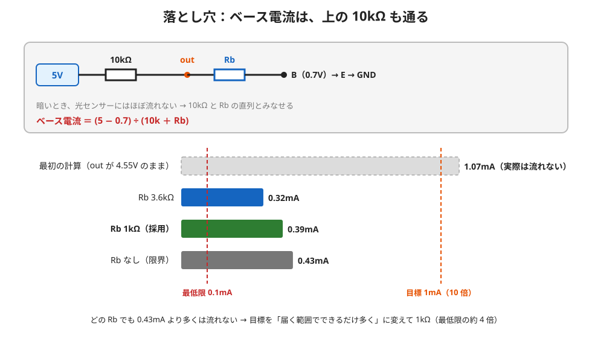

out ＝ 4.55V は、**out から電流を取り出していないとき**の値（8日目の分圧の式）。ベース電流 1mA は、5V から**上の 10kΩ を通って** out に来る。

| 問い | 計算 | 答え |
| --- | --- | --- |
| 10kΩ に 1mA 流すには何V必要？ | 0.001A × 10,000Ω | **10V** |
| 電源は？ | | 5V しかない → **1mA は流せない** |
| 暗いとき分圧に流れている電流 | 5V ÷ (10k ＋ 100k) | 約 0.045mA（取り出したい 1mA の約 1/20） |

9日目のルール：**負荷の電流が、分圧に流れている電流よりずっと小さいときだけ、分圧の式どおりの電圧になる。** 今回は逆なので、out は 4.55V にならない。

暗いときは光センサーの抵抗がとても大きく、そちらにはほぼ流れない。すると電流の道は **5V → 10kΩ → Rb → B（0.7V）** の直列とみなせる。

```
 5V --[10k]-- out --[Rb]-- B (0.7V)
     \______________________/
       5 - 0.7 = 4.3V を 10k と Rb で分け合う
```

```
 base current = (5V - 0.7V) / (10k + Rb)
```

| Rb | 最初の計算（out ＝ 4.55V のまま） | 実際（10kΩ も通る） | LED に必要な 9.8mA に足りる？（× hFE 100） |
| --- | --- | --- | --- |
| 3.6kΩ | 1.07mA | 4.3 ÷ 13.6k ＝ **0.32mA** | 32mA まで流せる ✓ |
| **1kΩ** | 3.85mA | 4.3 ÷ 11k ＝ **0.39mA** | **39mA まで流せる ✓** |
| なし（0Ω） | | 4.3 ÷ 10k ＝ 0.43mA（**限界**） | |

**⑥ 「10 倍」は目標だった。届かないので目標を変えた**

「10 倍」は B. 自分で決めた値（目標）。どの Rb を選んでも 0.43mA より多くは流れないので、1mA には届かない。そこで「**届く範囲でできるだけ多く**」に変えて Rb ＝ 1kΩ。Rb を 0 にしないのは、ベースを守る役が残るから。

4 倍で大丈夫な理由：

| トランジスタの hFE | 必要なベース電流（9.8mA ÷ hFE） | 0.39mA で足りる？ |
| --- | --- | --- |
| 100（仮定） | 0.098mA | ✓ |
| 50（弱い部品） | 0.2mA | ✓ |
| 25 | 0.39mA | ぎりぎり |
| Tinkercad（22日目の測定で約 225 以上） | 0.044mA | ✓ 余裕 |

どうしても 10 倍にしたいなら上の 10kΩ を小さくする方法があるが、どのくらい暗くなったら点くかも変わる。今回はそこまでしない。

**⑦ 決まった設計と、数字の出どころ**

| 部品 | 値 | 理由 |
| --- | --- | --- |
| 上の抵抗 | 10kΩ | SunFounder と同じ |
| 光センサー | 下（GND 側） | 暗いと out が高くなる |
| Rb | 1kΩ | 10kΩ がすでに電流を抑えている。ベース電流を少しでも多くする |
| Rc | 300Ω | LED 約 9.8mA |
| 電源 | 5V（Tinkercad では Arduino の 5V と GND） | コードは使わない |

| 数字 | 種類 | どこから来たか |
| --- | --- | --- |
| 5V | B. 決めた | 電源に Arduino の 5V ピンを使う |
| LED 2V | A. 性質 | 赤い LED は約 2V（15日目。22日目の測定で 1.98V） |
| C–E 0.05V | A. 性質 | ON のトランジスタはほとんど電圧を使わない（22日目の測定で 0.026V） |
| LED の電流 10mA | B. 決めた | LED の上限（約 20mA）の半分（15日目からの目安） |
| B–E 0.7V | A. 性質 | B–E 間はダイオードと同じ |
| hFE 100 | C. 仮定 | 1個ずつばらつき、Tinkercad の値も分からない（17日目と同じ） |
| 10 倍 | B. 決めた（目標） | hFE がばらついても確実に ON にする余裕。今回は届かず 4 倍に |
| 10kΩ | B. 決めた | SunFounder と同じ |
| 光センサー 1kΩ・100kΩ | C. 仮定 | 説明用の例。24日目に確かめる |
| out 0.45V・4.55V | D. 計算 | 分圧の式（トランジスタをつながないとき） |
| Rc 295Ω → 300Ω | D. 計算 | (5 − 2 − 0.05) ÷ 10mA、大きい側に丸め |
| ベース電流 0.39mA | D. 計算 | (5 − 0.7) ÷ (10k ＋ 1k) |

```
 [B] 5V ----------+
 [A] LED 2V ------+--> [D] Rc = (5 - 2 - 0.05) / 10mA = 295 -> 300 ohm
 [A] C-E 0.05V ---+          |
 [B] 10mA --------+          v
                       [D] LED current = 2.95V / 300 = 9.8mA
                             |
 [C] hFE 100 ----------------+--> [D] base current needed = 0.1mA
                                         |
 [B] 10k, [A] B-E 0.7V ------------> [D] max base current = 4.3V / 10k = 0.43mA
                                         |
                                     [B] Rb = 1k -> 0.39mA (about 4x)
```

<details>
<summary>設計の途中のまちがい（クリックで開く）</summary>

| # | まちがい | 正しくは | 理由 |
| --- | --- | --- | --- |
| ① | Rc を (5 − 2) ÷ 10mA ＝ 300Ω と計算 | (5 − 2 − 0.05) ÷ 10mA ＝ 295Ω → 300Ω | 5V は Rc・LED・トランジスタの3つで分け合う。トランジスタの分も引く |
| ② | Rc を「小さめに倒す（ベース電流を多くして ON を確実に）」 | **大きめ**に倒す | Rc が決めるのは LED の電流。小さくすると LED の電流が増えすぎる。ベース電流は Rb が決める |
| ③ | Rb ＝ (2.95V − 0.7V) ÷ 10mA ＝ 225Ω | (4.55V − 0.7V) ÷ 1mA ＝ 3.85kΩ | Rb は小さい道の部品。Rc の電圧や LED の電流（大きい道の数字）ではなく、out の電圧とベース電流を使う |
| ④ | 1mA × 10kΩ ＝ 0.01 × 10,000 ＝ 100V | 0.001 × 10,000 ＝ **10V** | 1mA ＝ 0.001A（m は 1/1000）。0.01A は 10mA |

</details>

### 3. KiCad で回路図を描き、明るいとき・暗いときの分圧出力を手計算する

**成果物**

| KiCad の回路図 | ERC 違反 0（除外 1） |
| --- | --- |
| 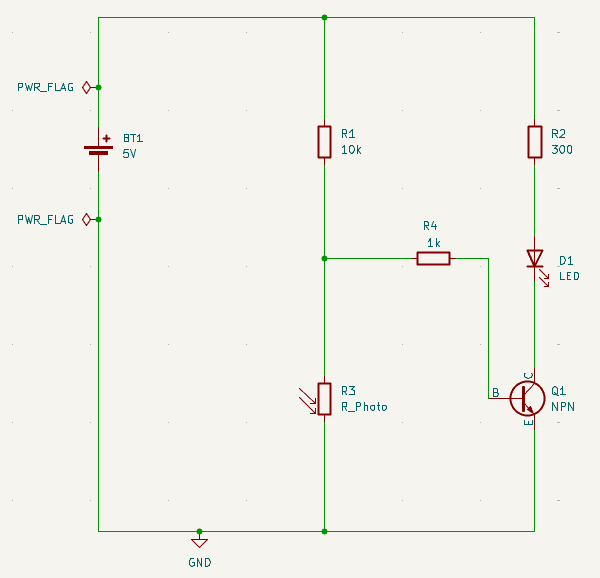 | 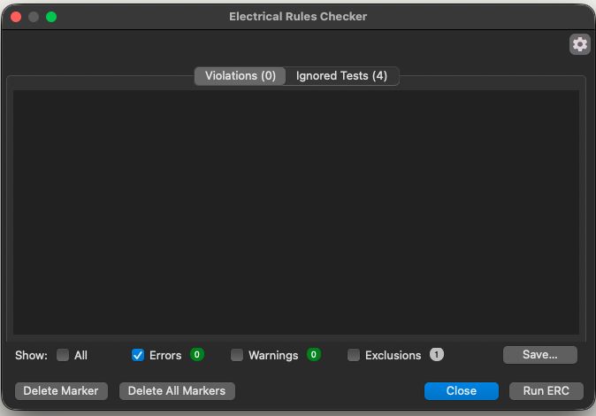 |

- プロジェクト一式：[kicad/day23_dark-light-switch/](kicad/day23_dark-light-switch/)（回路図、PDF、部品表、ERC.rpt）

| 回路図の記号 | 部品 | 値 |
| --- | --- | --- |
| BT1 | 電源（Tinkercad では Arduino の 5V） | 5V |
| R1 | 上の抵抗 | 10kΩ |
| R3 | 光センサー（`R_Photo`） | |
| R4 | Rb | 1kΩ |
| R2 | Rc | 300Ω |
| D1 | LED | |
| Q1 | NPN トランジスタ（`Simulation_SPICE:NPN`、17日目と同じ） | |

**分圧出力の手計算**（トランジスタをつながないとき。光センサーの値は例）

| | 光センサー | out ＝ 5V × 光センサー ÷ (10k ＋ 光センサー) | トランジスタ |
| --- | --- | --- | --- |
| 明るい | 1kΩ | 5 × 1 ÷ 11 ＝ **0.45V** | OFF（0.7V 未満） |
| 暗い | 100kΩ | 5 × 100 ÷ 110 ＝ **4.55V** | ON。ただしトランジスタをつなぐと、ベース電流で out は約 0.7V ＋ 0.39mA × 1kΩ ＝ **約 1.1V** まで下がる |

**① ERC のエラーは17日目と同じ**

| ERC のエラー（除外する前） |
| --- |
| 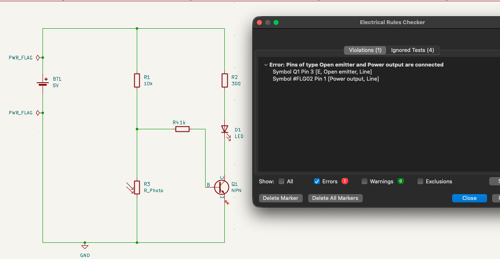 |

「Pins of type Open emitter and Power output are connected」。KiCad は部品の足ごとに種類をつけていて、NPN の E（Open emitter）と GND の PWR_FLAG（Power output）の組み合わせを表で「エラー」と決めている。エミッタを GND につなぐのは NPN スイッチのいちばん普通の使い方なので、回路の間違いではない。17日目と同じく、右クリック →「この違反を除外」で違反 0 にした（ERC.rpt は Errors だけを書き出すので、除外した1件は載らない）。

**② 部品番号と値の文字が重なっていた**

Rb のところが「R41k」と読めた。部品番号「R4」と値「1k」の文字が重なっていたので、値の文字を選んで `M` キーで動かした。

<details>
<summary>プロジェクト名を day22 で作っていた（クリックで開く）</summary>

| 症状 | 原因 | 直し方 |
| --- | --- | --- |
| プロジェクト名が `day22_…` になっていた | 作るときに日付の番号を間違えた | KiCad で保存して全部閉じてから、フォルダとファイル名を day23 に変えた |
| 名前を変える前、回路図ファイルが 230 バイトしかなかった | 描いた回路図をまだ保存していなかった（ERC.rpt と部品表だけ出力済み） | Cmd + S で保存してから閉じた。開いたまま名前を変えると、描いたものが失われたり、元の名前で保存し直されたりする |
| ファイルの中にも元の名前が残っていた | 回路図ファイルは、部品番号（R1 など）をプロジェクト名とセットで保存している | ファイルの中のプロジェクト名も合わせて書き換えた。そのままだと部品番号が「R?」に戻ることがある |

リポジトリには `day23_dark-light` という名前でコピーした。

</details>

### この日のまとめ：予想 → 結果 → 差の理由

| 何を測った／試したか | 予想 | 結果 | 差の理由 |
| --- | --- | --- | --- |
| SunFounder の並び（光センサーが上）のままトランジスタにつなぐ | 暗いと点く | 明るいと点く（out が高いのは明るいとき） | out は下の部品が取る段の高さ。光センサーを下にして逆にした |
| Rb の計算 | 3.6kΩ でベース電流 約 1mA | 実際は 0.32mA しか流れない | ベース電流は上の 10kΩ も通る。分圧から大きな電流は取り出せない（9日目）。Rb を 1kΩ にして 0.39mA |
| ベース電流の余裕 | 最低限の 10 倍 | 約 4 倍（0.43mA が限界） | 10 倍は自分で決めた目標。hFE 25 まで ON できるので十分 |
| KiCad の ERC | 違反 0 | エラー 1（Open emitter と Power output） | 17日目と同じ KiCad の決まり。理由を確かめて除外し、違反 0 |

## 24日目 統合課題の製作と測定

**やること**（詳細は [チェックリスト](../CHECKLIST.md#第4週-故障診断統合課題はんだ付けの座学)）

- Tinkercadで組み、光センサーの光量スライダーを動かして点灯・消灯を確認
- 測定：光量を5段階に変え、分圧出力の電圧とLEDの電流を表にする
- うまくいかなかった点と直し方を記録

**成果物**

- 

**予想 → 結果 → 差の理由**

| 何を測った／試したか | 予想 | 結果 | 差の理由 |
| --- | --- | --- | --- |
| | | | |

## 25日目 はんだ付けの座学

**やること**（詳細は [チェックリスト](../CHECKLIST.md#第4週-故障診断統合課題はんだ付けの座学)）

- 読む：RSコンポーネンツ「はんだ付けとは？方法や注意点」
- 読む：RSコンポーネンツ「マニュアルはんだ付けのツボ」
- 読む：MONOist マイクロマウスで始める組み込み開発入門(2) 3ページ目
- メモ：実機を買ったときに使う「はんだ付けの手順」と「不良の見分け方」を自分用に1枚にまとめる

**成果物**

- 

**予想 → 結果 → 差の理由**

| 何を測った／試したか | 予想 | 結果 | 差の理由 |
| --- | --- | --- | --- |
| | | | |

## 26日目 GitHubで公開

**やること**（詳細は [チェックリスト](../CHECKLIST.md#第4週-故障診断統合課題はんだ付けの座学)）

- `week4/README.md` に統合課題をまとめる

**成果物**

- 

**予想 → 結果 → 差の理由**

| 何を測った／試したか | 予想 | 結果 | 差の理由 |
| --- | --- | --- | --- |
| | | | |

## 27日目 Month 1 マイルストーン確認

**やること**（詳細は [チェックリスト](../CHECKLIST.md#第4週-故障診断統合課題はんだ付けの座学)）

- 回路図を見てTinkercadで組める
- 抵抗値が正しいかを、つなぐ前に計算で判断できる
- 仮想テスターで断線・逆接続・値違いを特定できる
- 「モーターが止まるとマイコンがリセットする理由」を数字で説明できる
- はんだ付けの手順と不良の見分け方を説明できる（実技は実機購入後）
- できなかった項目の日をやり直す

**成果物**

- 

**予想 → 結果 → 差の理由**

| 何を測った／試したか | 予想 | 結果 | 差の理由 |
| --- | --- | --- | --- |
| | | | |

## 何が壊れてどう直したか

うまくいかなかったことを、症状・原因・直し方の順に書きます。この週で一番大事な節です。

| 日 | 症状 | 原因 | 直し方 |
| --- | --- | --- | --- |
| 22日目 | 電流計を V に切り替えたら 4.93V と出て、LED が消えた | 回路にはさんだまま電圧計にすると、中の大きな抵抗で回路が切れたのと同じになる | 電流計は A のまま残し、電圧計をもう1台出して並列に当てた |
| 22日目 | B の 0.704V を E の電圧だと思った | TO-92 の足の順番（C・B・E）を覚えていなかった | 平らな面を手前に左から C・B・E。E は GND なので 0V |
| 22日目 | 正常な回路の値を、故障①の値だと思った | 見た目が同じ4つの回路を取り違えた | ベース電流（914µA／43.1µA／919µA）で、どの回路かを先に確かめる |
| 23日目 | Arduino IDE にコードを入れたが動かせなかった | IDE も Arduino Cloud も本物のボードへの書き込み用。シミュレーションはできない | 実機がないあいだは Tinkercad でコードごと動かす。今日の「読む」は回路の確認だけでよかった |
| 23日目 | Rb を 3.6kΩ と計算したが、ベース電流は 1mA ではなく 0.32mA しか流れない | out ＝ 4.55V は電流を取り出さないときの値。ベース電流は上の 10kΩ も通る（9日目の負荷） | ベース電流 ＝ (5 − 0.7) ÷ (10k ＋ Rb) で考え直し、Rb を 1kΩ（0.39mA）にした |
| 23日目 | KiCad の ERC でエラー 1 件 | 17日目と同じ。NPN の E（Open emitter）と PWR_FLAG（Power output）の組み合わせ | 理由を確かめ、この1件だけ除外した |
| 23日目 | KiCad のプロジェクト名が day22 で、回路図も未保存だった | 作るときに番号を間違え、保存前に ERC だけ出力していた | 保存して KiCad を閉じてから、フォルダ・ファイル名・中のプロジェクト名を day23 に変えた |

## 分からなかったこと・あとで調べること

-
