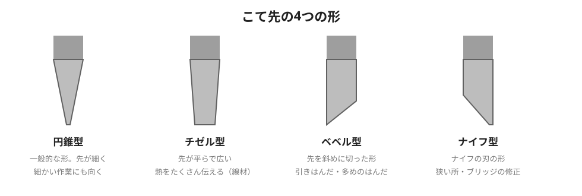
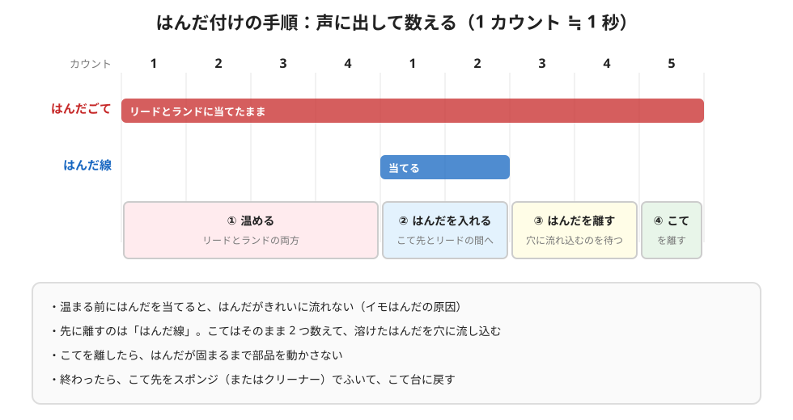
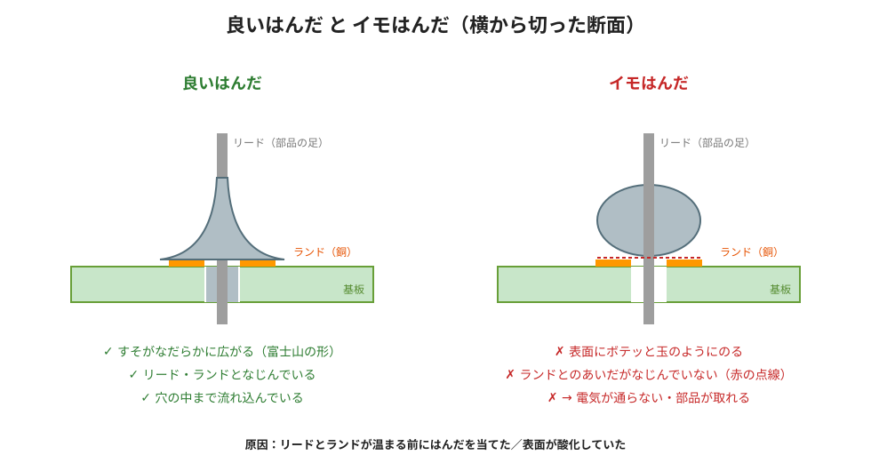

# はんだ付けカンペ（実機を買ったら作業台の横に置く1枚）

25日目に読んだ3本の記事から、自分用にまとめたもの。記事に書かれていないことは「記事外」と書いて分けている。

- 出典：RSコンポーネンツ「[はんだ付けとは？方法や注意点](https://jp.rs-online.com/web/content/discovery/ideas-and-advice/how-to-solder-guide)」（安全・こて先・はんだ除去）
- 出典：RSコンポーネンツ「[マニュアルはんだ付けのツボ](https://jp.rs-online.com/web/content/discovery/ideas-and-advice/solders-guide)」（温度・良いはんだ・イモはんだ）
- 出典：MONOist「[マイクロマウスで始める組み込み開発入門(2) 3ページ目](https://monoist.itmedia.co.jp/mn/spv/1206/07/news003_3.html)」（数えながら進める手順）

## 1. 始める前に（安全）

| チェック | なぜ |
| --- | --- |
| □ 保護眼鏡をかける | はんだやフラックスが飛ぶことがある |
| □ 換気の良い場所で作業する。煙（ヒューム）を直接吸わない | フラックスを熱すると煙が出る |
| □ こて台を用意する。使わないときは必ずこて台へ | こて先はとても熱い。机に直接置かない |
| □ 電気が流れている回路には、はんだ付けしない | 感電・ショート |
| □ 離れるとき・終わったときは電源を切る | やけど・火事を防ぐ |
| □ 鉛入りのはんだを使ったら手を洗う | 鉛は体に悪い |
| □ やけどしたら、すぐ流水で冷やす | |
| □ 消火器の場所を確かめておく | |

## 2. 温度の考え方

| はんだ | 溶ける温度（融点） | はんだ付けする所の最適温度（融点 ＋ 40〜60℃） |
| --- | --- | --- |
| 鉛入り（共晶はんだ：すず 63%・鉛 37%） | 183℃ | 約 223〜243℃ |
| 鉛フリー（Sn-Ag-Cu 系） | 217℃ | 約 257〜277℃ |

- こて先の温度は、この最適温度より**さらに高く**する（部品に熱が移るあいだに下がるため）。
- 高すぎると、フラックス（はんだの中の、汚れを落とす薬）が飛んでしまい、はんだがのらなくなる。
- 鉛フリーは、鉛入りより溶ける温度が 20〜40℃ 高い。
- 「こての設定は何℃」という数字は、記事には書かれていない。

## 3. こて先

| こて先 | 向いている作業 |
| --- | --- |
| **円錐型** | 一般的な形。先が細いので細かい作業にも向く。**最初の1本はこれ** |
| チゼル型 | 先が平らで広く、熱をたくさん伝えられる（線材など） |
| ベベル型 | 引きはんだ、はんだを多めに使う作業 |
| ナイフ型 | 狭い所、ブリッジ（くっついたはんだ）の修正 |

- 作業中も、こて先をこまめにクリーニングする（ぬらしたスポンジ、金属製のクリーナーなど）。
- ふいたあとは、こて先に新しいはんだを薄くのせておく。さびにくく長持ちする。

## 4. 手順：声に出して数える（MONOist の図1）

| # | すること | 数える |
| --- | --- | --- |
| ① | こて先を、**リードとランドの両方**に当てて温める | いーち、にぃー、さーん、しぃー |
| ② | はんだ線を、こて先とリードのあいだに入れる | いーち、にぃー |
| ③ | **はんだ線を先に離す**（こてはそのまま） | さーん、しぃー |
| ④ | はんだごてを離す | ごー |
| ⑤ | こて先をスポンジでふいて、こて台へ戻す | |

- ① で温まる前にはんだを当てると、はんだがきれいに流れない。
- ③ で 2 つ数えるあいだに、溶けたはんだが穴の中に流れ込む。
- ④ のあとは、はんだが固まるまで部品を動かさない。
- はんだは**温度が高い方へ流れる**。リードとランドの両方を熱くするのがコツ。

## 5. 良いはんだ と イモはんだ

| | 見た目 | 原因 |
| --- | --- | --- |
| **良いはんだ** | すそがなだらかに広がる（富士山の形）。リード・ランドとなじんでいる | リードとランドの両方が十分に熱い |
| **イモはんだ** | ランドとリードの表面に、はんだがボテッと玉のようにのる | 温まる前にはんだを当てた／表面が酸化（さび）していた |

イモはんだは、**電気が通らない・部品が取れる**原因になる。

記事外：ほかによく聞く不良（クリックで開く）

3本の記事には書かれていないが、名前だけ知っておくと調べやすいもの。実機を買ったら、はんだ付けの講座などで確かめる。

| 不良 | ざっくりした意味 |
| --- | --- |
| ブリッジ | となりのランドどうしが、はんだでつながってしまう（ショート） |
| ツノ | こてを離すときに、はんだが引っぱられてとがる |
| はんだ不足 | はんだが少なく、穴やランドを埋めきれていない |

## 6. 失敗したとき（はんだを取り除く）

| 道具 | どんなものか |
| --- | --- |
| はんだ吸取線 | フラックスをしみこませた銅の編み線。はんだに当てて、上からこてで温めると吸い取る |
| はんだ吸取器 | はんだを溶かして、ポンプで吸い取る道具 |
| はんだ吸取用ノズル | 吸取器などの先につける部品 |

記事には道具の名前と説明だけで、使い方の手順は書かれていない。実機を買ったら、道具の説明書で確かめる。

## 7. いちばん大事なこと3つ

1. **両方温める**：リードとランドの両方にこてを当てて、4 つ数える。
2. **はんだが先、こてが後**：はんだを離してから 2 つ数えて、こてを離す。
3. **富士山の形**を確かめる。玉のようならイモはんだなので、やり直す。
