# 第5週 Arduinoの基本

- フェーズ：[フェーズ2 マイコン・モーター・センサー](../README.md)
- 日：29〜35日目（詳細は [CHECKLIST.md](../CHECKLIST.md#第5週-arduinoの基本) ）
- ゴール：delay() を使わずに複数の処理を同時に進めるプログラムを書ける
- 状態：進行中（34日目まで。35日目は休み）
- 回路の共有リンク：[tinkercad.md](tinkercad.md)　コード：[code/](code/)

日ごとに「やること → 成果物 → 予想 → 結果 → 差の理由」を残します。測定や実験は、やる前に予想を書きます。

## 29日目 LEDとシリアルモニタ

> **ひとことで**：Tinkercad の Arduino UNO で、**ピン9 → 220Ω → LED → GND** の回路を組み、コードで LED を **0.5秒ごとに点滅**させた。最初は点かなかった。配線は正しく、原因は**コードを何もいじっていなかった**こと（線をつないだだけで、コードの画面を開いていなかった。基板の「L」だけが光っていた）。次に `Serial.println()` で、シリアルモニタに `100` と `Hello world` を **0.1秒ごと**に出した。`setup()` は**最初に1回だけ**、`loop()` は**電源を切るまでずっと繰り返す**。

**この日にやったことと、分かったこと**

| # | やったこと | 分かったこと（一言） |
| --- | --- | --- |
| 1 | SunFounder「1.1 ハロー、LED！」を読む | 記事は実機のキット向け。回路図とコードだけを使い、買う・IDE で書き込む手順は飛ばす |
| 2 | Tinkercad で ピン9 → 220Ω → LED → GND を組む | 配線は1回で合っていた。でも LED は点かなかった |
| 3 | コードを「文字」に切り替えて、ピン9のコードを打つ | 0.5秒ごとに点滅した。**回路が正しくても、コードのピン番号が合っていないと動かない** |
| 4 | SunFounder「3.0 シリアルモニタ」を読んで、コードを打つ | 配線なしで、`100` と `Hello world` が交互に流れた |
| 5 | 通信速度（9600）の設定を探す | Tinkercad のシリアルモニタには設定欄がない。コードの `Serial.begin(9600)` に自動で合う |
| 6 | `setup()` と `loop()` の役割を自分の言葉で書く | `setup()` は1回だけの準備、`loop()` は続けたい動き |

やることの詳細は[チェックリスト](../CHECKLIST.md#第5週-arduinoの基本)。

**何に役立つか**

| 使う場面 | どう使うか |
| --- | --- |
| モーター・ブザー・リレーを ON/OFF する | LED と同じ `digitalWrite(ピン, HIGH / LOW)` で動かす。モーターは電流が大きいので、ピンから直接ではなくトランジスタをはさむ（[17日目](../../phase1-electronics/week3/README.md#17日目-トランジスタスイッチを設計する筆者の課題)、36日目〜） |
| センサーの値を見る | 距離センサーや光センサーの値を `Serial.println()` で画面に出す。数字が見えないと、調整ができない（43日目〜） |
| 動かない原因を切り分ける | 「ここまで来た」を `Serial.println("ON")` のように出すと、**コードの問題か、配線の問題か**が分かる。今日のピン13のまちがいも、これがあればすぐ分かった |
| ロボットの制御ループ | 「測る → 判断する → 動かす」の繰り返しは、`loop()` の中に書く。ライントレースロボットも、1秒に何百回も `loop()` を回している |
| 実機を買ったとき | 今日のコードは、本物の Arduino UNO にそのまま書き込める（[code/day29_blink](code/day29_blink/day29_blink.ino)） |

**この日に出てくることば（プログラムと LED）**

| ことば | 意味 | たとえ |
| --- | --- | --- |
| マイコン | 小さなコンピュータが1個の部品に入ったもの。Arduino UNO の黒い長い部品 | ロボットの頭 |
| スケッチ | Arduino のプログラムのこと。ファイル名の最後は `.ino` | 作業の手順書 |
| 関数 | 名前のついた命令のまとまり。`名前( 渡す値 );` の形で使う | 「〇〇して」と頼むひとこと |
| `setup()` | 電源を入れたとき（リセットしたとき）に**1回だけ**動く部分 | 朝の身じたく |
| `loop()` | `setup()` のあと、**ずっと繰り返す**部分 | その日の仕事のくり返し |
| ピン | Arduino のふちに並んだ、線をさす穴。番号がついている（0〜13、A0〜A5） | 建物の、番号のついた出入口 |
| 出力（`OUTPUT`） | ピンから電圧を**出す**使い方。反対は入力（`INPUT`、30日目） | 蛇口（水を出す側） |
| `pinMode(ピン, OUTPUT)` | そのピンを出力として使う、と決める命令 | 「この出入口は出口専用」と札をかける |
| `digitalWrite(ピン, HIGH)` | そのピンを 5V にする命令。`LOW` なら 0V | 台を上げる／下げるスイッチ |
| `HIGH`・`LOW` | 5V と 0V のこと。デジタルは、この2つしかない | 電気のスイッチの ON・OFF |
| `delay(500)` | 500ミリ秒（＝0.5秒）、**何もせずに待つ**命令 | 「0.5秒そのまま」と止まる |
| ミリ秒（ms） | 1秒の1000分の1。1000ミリ秒 ＝ 1秒（m ＝ ÷1000） | — |
| 変数 | 値を入れておく、名前のついた箱。`int number = 100;` は「number という箱に 100 を入れる」 | ラベルつきの引き出し |
| `int` | 箱に入れるものが整数（小数のない数）である、という印 | 「この引き出しは整数専用」 |
| `const` | 「あとで中身を変えない」という印。まちがって書きかえるのを防ぐ | 引き出しにカギをかける |
| コメント（`//`） | `//` から行の終わりまでは、人が読むためのメモ。Arduino は無視する | 手順書の余白の書きこみ |
| `;`（セミコロン） | 命令1つの終わりの印。忘れるとエラーになる | 文の終わりの「。」 |
| 電流制限抵抗 | LED に流れすぎないように、直列に入れる抵抗（[15日目](../../phase1-electronics/week3/README.md#15日目-ledの抵抗を計算する)） | 蛇口を少ししぼる |
| 内蔵 LED「L」 | Arduino の基板に最初から付いている小さな LED。**ピン13**につながっている。コードでは `LED_BUILTIN` とも書く | 最初から付いているお試しランプ |

**この日に出てくることば（シリアル通信）**

| ことば | 意味 | たとえ |
| --- | --- | --- |
| シリアル通信 | 文字を1つずつ順番に、1本の線で送る通信 | 1列に並んで1人ずつ通る改札 |
| シリアルモニタ | Arduino から送られてきた文字を、パソコンで見る画面 | 実況中継を聞くラジオ |
| `Serial.begin(9600)` | 通信を始める命令。速さを 9600 に決める。`setup()` に書く | 「この速さで話します」と最初に決める |
| ボーレート（通信速度） | 1秒に何ビット送るか。9600 なら1秒に 9600 ビット | 話す速さ |
| ビット | 0 か 1 の1個ぶん。文字1つは、ビットをいくつか並べて送る | モールス信号の点と線1個ぶん |
| `Serial.println(値)` | 値を文字にして送り、最後に**改行**する。`ln` は line（行）の意味 | 1行書いて、次の行へ進む |
| `Serial.print(値)` | 値を送るが、改行**しない** | 同じ行に続けて書く |
| TX・RX | TX は送る側（ピン1）、RX は受ける側（ピン0）。パソコンとの通信に使われている | 送話口と受話口 |
| デバッグ | 動かない原因を探して直すこと | 故障診断（[22日目](../../phase1-electronics/week4/README.md#22日目-故障診断の練習)）のプログラム版 |

### 0. 先に：この日に使う前提知識

**① 今日から変わること：回路に「コード」が加わる**

フェーズ1は、線をつなげば回路は動いた。今日からは、**「線をつなぐ（回路）」と「命令を書く（コード）」の2つ**がそろって、はじめて動く。

| | フェーズ1（〜27日目） | フェーズ2（今日から） |
| --- | --- | --- |
| 電源 | 電池、Arduino の 5V ピン（いつも 5V） | Arduino の**番号つきのピン**（コードで 5V と 0V を切り替える） |
| ON/OFF するもの | ボタン、光センサー、トランジスタ | **コード**（`digitalWrite`） |
| 動かないときに疑う場所 | 配線、部品の向き、抵抗の値 | 配線 ＋ **コード（ピン番号、書きまちがい）** |

**② LED には向きがあり、抵抗が必要（[15日目](../../phase1-electronics/week3/README.md#15日目-ledの抵抗を計算する)）**

| 決まり | 意味 |
| --- | --- |
| LED は一方向にしか流さない | アノード（＋、Tinkercad では**曲がった足**）から、カソード（−、まっすぐな足）へ流れる |
| LED は約 2V を使う | 赤い LED は、光っているとき約 2V（22日目の測定では 1.98V）。A. 部品の性質 |
| 残りの電圧は抵抗が受け持つ | 電流 ＝ (電源 − LED の電圧) ÷ 抵抗 |
| LED の上限は約 20mA | これを超えると壊れる。A. 部品の性質 |

**③ ブレッドボードの決まり（[15日目](../../phase1-electronics/week3/README.md#15日目-ledの抵抗を計算する)・[24日目](../../phase1-electronics/week4/README.md#24日目-統合課題の製作と測定)）**

今日の画面では、ブレッドボードが横長に置かれている。**同じ番号の a〜e（たて5つ）は中でつながり、f〜j（たて5つ）も中でつながる**。真ん中のみぞで上下は分かれている。

```
        16   17
   j     o    o      <-- 16 の f-j は中でつながっている。17 の f-j も同じ
   i     |    |
   h     |    |
   g     |    |
   f     o    o
      ===========    <-- 真ん中のみぞ。上と下はつながっていない
   e     o    o
   d     |    |
   c     |    |
   b     |    |
   a     o    o      <-- 16 の a-e は中でつながっている。17 の a-e も同じ
```

**④ Arduino のピンが出せる電流は約 20mA まで（[17日目](../../phase1-electronics/week3/README.md#17日目-トランジスタスイッチを設計する筆者の課題)）**

LED 1個（十数 mA）ならピンから直接つなげる。モーターのように大きな電流が要るものは、トランジスタをはさむ。

### 1. 読む・組む：[1.1 ハロー、LED！](https://docs.sunfounder.com/projects/3in1-kit-v2/ja/latest/basic_project/ar_blinking_led.html)（40分）

**① 記事のどこを使い、どこを飛ばすか**

記事は、実機のキット（SunFounder 3in1 Kit）を買った人向けに書かれている。実機がないので、**回路とコードだけを Tinkercad に写す**。

| 記事の節 | 書いてあること | どう使ったか |
| --- | --- | --- |
| 必要な部品 | 制御ボード（Arduino UNO 互換）、ブレッドボード、ジャンパーワイヤー、抵抗、LED の5つ | Tinkercad の部品一覧から同じものを置く。買う案内は飛ばす |
| 回路図 | ピン9が 5V を出すと、220Ω の抵抗を通って LED が点く。0V を出すと消える | **そのまま写す** |
| 配線図 | ブレッドボードの絵（文章の説明はない） | 絵を見て写す |
| コード | Arduino IDE でファイルを開いて、ボードに書き込む手順 | 手順は飛ばす。Tinkercad では「コード」に打って「シミュレーションを開始」 |
| どのように動作するのか？ | `ledPin` という変数、`pinMode`、`digitalWrite`、`delay` の説明 | 読んで、下の ④ にまとめた |

> 記事に書いていないこと（記事外）：LED の足の向き（どちらが＋か）、220Ω を選んだ理由、`setup()` と `loop()` がいつ動くか。この3つは、この記録で補った。

**② 回路：ピン9 → 220Ω → LED → GND**

| 点滅しているところ | 配線を拡大したところ |
| --- | --- |
|  |  |

```
        16   17
   j     K    A      <-- LED。A = アノード(+、曲がった足)、K = カソード(-)
   i     |    |
   h     |    |
   g     |    |
   f    GND   R      <-- 16f から GND へ緑の線。17f に抵抗の上の足
      ===========    <-- 抵抗が真ん中のみぞをまたぐ
   e          |
   d          R      <-- 17d に抵抗の下の足
   c          |
   b          |
   a          9      <-- 17a からピン9へ緑の線
```

電気の通り道を、1か所ずつたどる。

| 順番 | 場所 | つながる理由 |
| --- | --- | --- |
| 1 | Arduino のピン `~9` → 緑の線 → 17a | 線 |
| 2 | 17a → 17d（抵抗の下の足） | 17 の a〜e は中でつながっている |
| 3 | 抵抗 220Ω（17d → 17f） | 抵抗がみぞをまたいで、下と上をつなぐ |
| 4 | 17f → 17j（LED の曲がった足＝アノード） | 17 の f〜j は中でつながっている |
| 5 | LED（17j → 16j） | アノードからカソードへ流れる |
| 6 | 16j → 16f → 緑の線 → Arduino の `GND` | 16 の f〜j は中でつながっている |

> ピン番号の前の `~`（`~9` など）は、PWM（明るさを変える機能、31日目）が使えるピンの印。今日は使わない。

**③ 数字はどこから来たか**


| 数字 | 種類 | どこから来たか |
| --- | --- | --- |
| HIGH ＝ 5V、LOW ＝ 0V | A. 部品の性質 | Arduino UNO の決まり。記事にも書いてある |
| ピン9 | B. 決めた値 | 記事がピン9を使っているので合わせた。コードと線の両方で同じ番号にする |
| 220Ω | B. 決めた値 | 記事の値。なぜ 220Ω でよいかは下の計算で確かめる |
| LED の電圧 約 2V | A. 部品の性質 | 赤い LED。22日目の測定では 1.98V |
| LED の上限 約 20mA、ピンの上限 約 20mA | A. 部品の性質 | 15日目・17日目 |
| 500ミリ秒 | B. 決めた値 | コードの `delay(500)` |
| LED の電流 約 13.6mA | D. 計算 | 下の表。**今日は電流計で測っていない** |

| 手順 | 考え方 | 計算 | 答え |
| --- | --- | --- | --- |
| 1 | HIGH のとき、ピン9は 5V。GND は 0V | — | 高さの差は 5V |
| 2 | LED が約 2V を使う。残りが抵抗にかかる | 5V − 2V | 3V |
| 3 | オームの法則（[2日目](../../phase1-electronics/week1/README.md#2日目-オームの法則)）。電流 ＝ 電圧 ÷ 抵抗 | 3V ÷ 220Ω | 約 0.0136A |
| 4 | A を mA になおす（×1000） | 0.0136 × 1000 | **約 13.6mA** |
| 5 | 上限とくらべる | 13.6mA ＜ 20mA | LED もピンも大丈夫 |

220Ω は、LED とピンの上限（約 20mA）より小さい電流にするための値。**抵抗をはずして直結すると、電流を止めるものがなくなり、上限を超える**（LED もピンも壊れる）。

**④ コード：1行ずつ読む**

保存したコード：[code/day29_blink/day29_blink.ino](code/day29_blink/day29_blink.ino)　／　回路：[Tinkercad で開く](https://www.tinkercad.com/things/5flwTfr1yzf-day29-led1hello-led/editel?sharecode=eR5hTdCiV8DzIhYwy75Y2APvANFsT_QDWI57_efGms4)

```cpp
const int ledPin = 9;

void setup()
{
  pinMode(ledPin, OUTPUT);
}

void loop()
{
  digitalWrite(ledPin, HIGH);
  delay(500);
  digitalWrite(ledPin, LOW);
  delay(500);
}
```

| 行 | 意味 | いつ動くか |
| --- | --- | --- |
| `const int ledPin = 9;` | `ledPin` という名前の箱に 9 を入れる。この先 `ledPin` と書けば 9 の意味になる | 最初に1回 |
| `void setup() { … }` | `{` から `}` までが `setup()` の中身 | 電源を入れたとき1回だけ |
| `pinMode(ledPin, OUTPUT);` | ピン9を「出力」にする | 1回だけ |
| `void loop() { … }` | `{` から `}` までが `loop()` の中身 | `setup()` のあと、ずっと繰り返す |
| `digitalWrite(ledPin, HIGH);` | ピン9を 5V にする → LED が点く | 繰り返し |
| `delay(500);` | 0.5秒、そのまま待つ（点いたまま） | 繰り返し |
| `digitalWrite(ledPin, LOW);` | ピン9を 0V にする → LED が消える | 繰り返し |
| `delay(500);` | 0.5秒、そのまま待つ（消えたまま） | 繰り返し |

- `9` を直接3か所に書いても動く。`ledPin` という名前にしておくと、**ピンを変えたいときに1行目だけ直せばよい**。
- `void` は「この関数は、結果の値を返さない」という印。今は「`setup` と `loop` の前に付ける決まり文句」と思っておけばよい。
- 記事の説明文は `delay(1000)`（1秒）で書かれている。打ったコードは `delay(500)`（0.5秒）。数字がちがうだけで、仕組みは同じ。

**⑤ ピン9の電圧の変わり方**

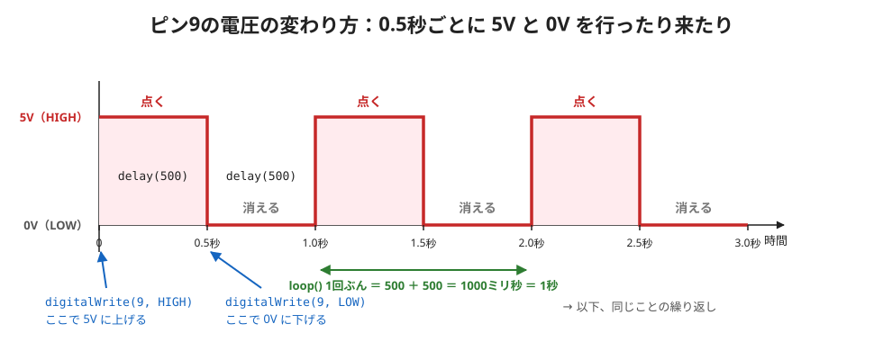

`delay()` がなかったら、点いた直後に消え、消えた直後に点く。速すぎて、人の目には変化が見えない。記事も「変化が人に見えるように、間をあける」と説明している。

**⑥ Tinkercad での手順（実機とのちがい）**

| 手順 | Tinkercad | 実機（Arduino IDE） |
| --- | --- | --- |
| 部品を用意する | 右の部品一覧からドラッグ。抵抗はクリックして 220Ω にする | キットの部品を使う |
| コードを書く場所 | 上の「コード」→ 左上を「ブロック」から「**文字**」に切り替える | Arduino IDE |
| コードを Arduino に入れる | 何もしなくてよい | USB でつなぎ、ボードとポートを選んで「書き込み」 |
| 動かす | 「シミュレーションを開始」 | 書き込みが終わると自動で動く |
| LED の足の見分け方 | **曲がった足**がアノード（＋）。マウスを乗せると名前が出る | **長い足**がアノード（＋） |

<details>
<summary>まちがい：回路は合っているのに LED が点かない（クリックで開く）</summary>

| 点かなかったとき（基板の「L」がオレンジに光っている） | 直したあと（LED が赤く光り、「L」は消えている） |
| --- | --- |
| 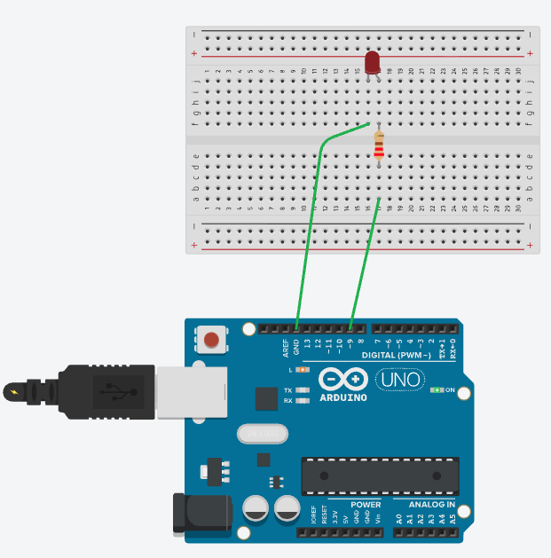 |  |

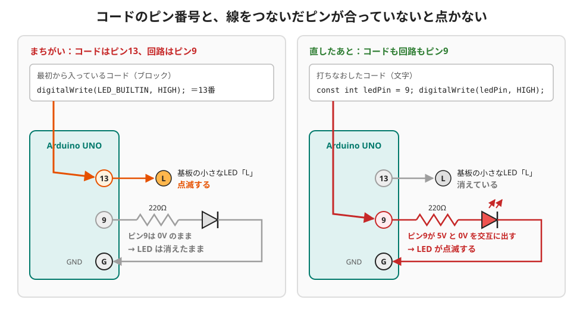

| # | 症状 | 原因 | 直し方 |
| --- | --- | --- | --- |
| 1 | 配線は正しいのに LED が点かない。基板の小さな「L」だけが光る | **コードを何もいじっていなかった**。線をつないだだけで、コードの画面を開いていなかった。Tinkercad は、Arduino を置くと「内蔵 LED（ピン13）を点滅させる」コードが最初から入っているので、**ピン13の「L」だけが点滅し、ピン9には何も出なかった** | 「コード」→「文字」に切り替え、最初のコードを消して、`ledPin = 9` のコードを打った |

最初から入っていたコードの中身は、見ていない。「ピン13を点滅させるコード」というのは、点かなかったときの画面で「L」が光っていたことからの判断。

**フェーズ1とのちがい**：フェーズ1の回路は、線をつなげば動いた。Arduino のピン9は、**コードで「5V を出せ」と命令しないかぎり何も出さない**。線をつないだら、次に必ずコードを書く。

**見分け方**：シミュレーション中に **「L」が光る ＝ ピン13 が HIGH になっている**。ピン13を使っていないのに「L」が点滅していたら、コードがちがう。

**確かめた順番**（22日目の故障診断と同じ考え方。1か所ずつ疑う）

| 順番 | 確かめたこと | 結果 |
| --- | --- | --- |
| 1 | Arduino 側の線が `GND` と `~9` にささっているか | ✓ |
| 2 | 抵抗が真ん中のみぞをまたいでいるか（同じ a〜e の中に両足を入れていないか） | ✓ |
| 3 | LED の向き（曲がった足が抵抗の側か） | ✓ |
| 4 | LED の足が、赤い＋の線（電源レール）ではなく j の穴にささっているか | ✓ |
| 5 | コードが「文字」で、ピン番号が 9 か | **✗ → ここだった** |

</details>

### 2. 読む・組む：[3.0 シリアルモニタ](https://docs.sunfounder.com/projects/3in1-kit-v2/ja/latest/basic_project/ar_serial_monitor.html)。値を画面に出す方法は、この先ずっとデバッグの主な道具になります（40分）

**① 何をするものか**


Arduino には画面がない。プログラムの中で「いま変数がいくつか」「いまどこを実行しているか」を知るには、**パソコンへ文字を送ってもらう**しかない。これがシリアル通信で、受け取った文字を見る画面がシリアルモニタ。

**② 記事のどこを使い、どこを飛ばすか**

| 記事に書いてあること | どう使ったか |
| --- | --- |
| 回路 | **なし**。Arduino だけでよい（配線しない） |
| ピン0と1はパソコンとの通信に使うので、何かをつなぐと書き込みに失敗することがある | 覚えておく。ボードの `RX←0`・`TX→1` と書いてあるピン |
| Arduino IDE を開く、ボードとポートを選ぶ、虫めがねのボタンでシリアルモニタを開く | 飛ばす。Tinkercad ではコード画面のいちばん下の「**シリアルモニタ**」を押す |
| シリアルモニタの画面の説明（自動スクロール、時刻の表示、行末の文字、通信速度、消去、送信欄） | 通信速度だけ覚える。**コードの `Serial.begin()` と同じ値にする**。ほかは実機を買ってから |
| コードと、`Serial.begin()`・`Serial.println()` の説明 | そのまま打って、下の ③ にまとめた |

**③ コード：1行ずつ読む**

保存したコード：[code/day29_serial/day29_serial.ino](code/day29_serial/day29_serial.ino)

```cpp
void setup()
{
  Serial.begin(9600);
}

void loop()
{
  int number = 100;
  Serial.println(number);
  Serial.println("Hello world");
  delay(100);
}
```

| 行 | 意味 | 画面に出るもの |
| --- | --- | --- |
| `Serial.begin(9600);` | 通信を始める。速さは 9600 ビット毎秒。1回だけでよいので `setup()` に書く | — |
| `int number = 100;` | `number` という箱に 100 を入れる | — |
| `Serial.println(number);` | 箱の**中身**を送って改行する | `100` |
| `Serial.println("Hello world");` | `" "` で囲んだ文字を**そのまま**送って改行する | `Hello world` |
| `delay(100);` | 0.1秒待つ。なければ、目で追えない速さで流れる | — |

| 書き方 | 送られるもの | 例 |
| --- | --- | --- |
| `Serial.println(number)`（`" "` なし） | 箱の中身 | `100` |
| `Serial.println("number")`（`" "` あり） | 書いた文字そのもの | `number` |

`" "` を付けるかどうかで意味が変わる。**変数の値を見たいときは `" "` を付けない。**

**④ 結果**

| シリアルモニタ | このときの Arduino（配線なし） |
| --- | --- |
|  |  |

| 数字 | 種類 | どこから来たか |
| --- | --- | --- |
| 9600 | B. 決めた値 | コードの `Serial.begin(9600)`。記事の値。よく使われる速さ |
| 100（表示される数） | B. 決めた値 | コードの `int number = 100;` |
| 100ミリ秒 | B. 決めた値 | コードの `delay(100)` |
| 1秒に約10回、約20行 | D. 計算 | 1000ミリ秒 ÷ 100ミリ秒 ＝ 10回。1回で2行出るので、10 × 2 ＝ 20行 |

`100` と `Hello world` が交互に流れた。記事の結果と同じ。

**⑤ Tinkercad と実機のちがい**

| | Tinkercad | 実機（Arduino IDE） |
| --- | --- | --- |
| シリアルモニタを開く | コード画面のいちばん下の「シリアルモニタ」 | 右上の虫めがねのボタン |
| 通信速度の設定 | **設定欄がない**。コードに自動で合う | 画面の右下で、コードと同じ 9600 を自分で選ぶ |
| 速さが合っていないと | 起こらない | 文字化けする（読めない記号が出る） |
| グラフ | 右下の波形のボタン。数字だけを出すと折れ線になる | 「シリアルプロッタ」という別の画面 |

<details>
<summary>補足：9600 で足りるのか（記事外。クリックで開く）</summary>

| 手順 | 考え方 | 計算 | 答え |
| --- | --- | --- | --- |
| 1 | 1文字を送るのに、ふつう 10 ビット使う（文字の 8 ビット ＋ 始まりと終わりの印） | — | 10ビット |
| 2 | 1秒に送れる文字の数 | 9600 ÷ 10 | 960文字 |
| 3 | `loop()` 1回で送る文字。`100` ＋改行2文字 ＝ 5文字、`Hello world` ＋改行2文字 ＝ 13文字 | 5 ＋ 13 | 18文字 |
| 4 | 1秒に10回なので | 18 × 10 | 180文字 |
| 5 | くらべる | 180 ＜ 960 | 足りる |

改行は、`\r`（行の先頭へ戻る）と `\n`（次の行へ進む）の2文字。`println` が自動で付ける（記事にも書いてある）。

</details>

<details>
<summary>気になったこと：TX のランプは光らなかった／9600 を設定していない（クリックで開く）</summary>

| # | 気になったこと | 分かったこと |
| --- | --- | --- |
| 1 | 記事には「通信速度を選ぶ」とあるが、9600 をどこにも設定していない | Tinkercad のシリアルモニタには設定欄がない。コードの `Serial.begin(9600)` だけでよい。実機では自分で合わせる |
| 2 | 基板の「TX」のランプが光っていない | 文字が画面に出ているので、通信はできている。Tinkercad が TX のランプの点滅まで再現しているかは、**確かめられていない**（スクリーンショットは一瞬なので、点滅していても写らないこともある） |

2 は、Claude が先に「TX のランプが光るはず」と説明したが、確かめていないことを断定した説明だった。

</details>

### 3. 記録：`setup()` と `loop()` の役割を自分の言葉で2行

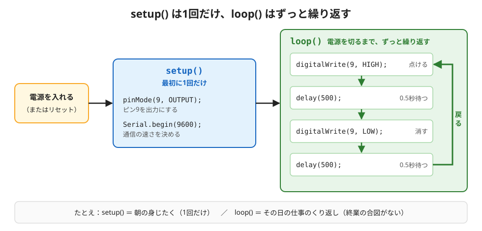

**① 自分の言葉で書いた2行**

> - pinMode と Serial.begin は setup で設定し、それぞれ1回実行
> - loop() では繰り返し処理を実施

**② 「何のために」を足した形**

| | 自分の言葉 | 足したこと |
| --- | --- | --- |
| `setup()` | pinMode と Serial.begin は setup で設定し、それぞれ1回実行 | 電源を入れたとき（リセットしたとき）に**1回だけ**動く。ピンの向きや通信の速さなど、**最初に1回決めればよい準備**を書く |
| `loop()` | 繰り返し処理を実施 | `setup()` のあと、**電源を切るまでずっと**繰り返す。LED の点滅や画面への表示など、**続けたい動き**を書く |

**③ どちらに書くかの見分け方**

| 命令 | 書く場所 | 理由 |
| --- | --- | --- |
| `pinMode(9, OUTPUT)` | `setup()` | ピンの向きは、1回決めれば変わらない |
| `Serial.begin(9600)` | `setup()` | 通信の速さは、1回決めれば変わらない |
| `digitalWrite(9, HIGH)`、`delay(500)` | `loop()` | 点ける・待つ・消す・待つを、何度も続けたい |
| `Serial.println(number)` | `loop()` | 値を何度も知らせてほしい |

`pinMode` を `loop()` に書いても動く。ただ、毎回同じ設定をやりなおすだけなので、むだになる。

**④ 今日の2つのコードをくらべる**

| | LED の点滅 | シリアルモニタ |
| --- | --- | --- |
| `setup()`（準備） | `pinMode(ledPin, OUTPUT);` | `Serial.begin(9600);` |
| `loop()`（続ける動き） | 点ける → 0.5秒 → 消す → 0.5秒 | 100 を出す → Hello world を出す → 0.1秒 |
| `loop()` 1回の時間 | 約 1秒 | 約 0.1秒 |
| 結果を見る場所 | LED | シリアルモニタ |

形は同じ。**準備を `setup()` に、続けたい動きを `loop()` に書く。**

### この日のまとめ：予想 → 結果 → 差の理由

今日は、測る前・動かす前に予想を書かなかった。下の「予想」は、そのとき思っていたこと。次の日からは、動かす前に予想を書く。

| 何を測った／試したか | 予想 | 結果 | 差の理由 |
| --- | --- | --- | --- |
| 回路を組んで、シミュレーションを開始 | 配線が合っていれば LED が点く | 点かない。基板の「L」だけが光った | コードを何もいじっていなかった。最初から入っているコードはピン9を動かさない。回路はピン9につないでいた |
| コードを `ledPin = 9` に打ちなおす | 点滅する | 0.5秒ごとに点滅した | 差なし |
| シリアルモニタのコードを動かす | `100` と `Hello world` が出る | 交互に流れた | 差なし |
| 通信速度 9600 の設定 | シリアルモニタの側でも 9600 を選ぶ必要がある | 設定欄がなく、何もしなくても表示された | Tinkercad はコードの値に自動で合わせる。実機では自分で選ぶ |
| TX のランプ | 通信中は光る（Claude の説明） | 光っているのは確認できなかった | Tinkercad が再現しているか分からない。未確認 |
| LED に流れる電流 | 約 13.6mA（計算） | **測っていない** | — |

**まだ試していないこと**（時間のある日に）

| 試すこと | 先に書く予想 |
| --- | --- |
| `delay(500)` を `100` や `2000` に変える | 点滅の速さはどうなるか |
| LED の回路に電流計をはさむ | 13.6mA に近い値が出るか |
| 点滅のコードに `Serial.println("ON")` と `Serial.println("OFF")` を足す | LED が点いた瞬間に「ON」と出るか |

**実機を買ったらやり直すこと**

- Arduino IDE でボードとポートを選び、今日の2つのコードを書き込む
- シリアルモニタの通信速度を 9600 に合わせる。わざと別の値にして、文字化けを見る
- LED の長い足がアノード（＋）であることを、実物で確かめる
- 通信中に TX のランプが光るかを見る

## 30日目 ボタンを読む

> **ひとことで**：Arduino のピン2を**入力**にして、ボタンの状態を読んだ。**押していないと `0`、押すと `1`** が画面に出た（3.1、18日目のプルダウンと同じ回路）。次に 5.3 で、**「押している間」ではなく「押した瞬間」だけ**を検出した。ボタンを**押し続けても `The detection state is:` の行は増えず**、**押すたびに `1` → `0` → `1` → `0`** と切り替わった。Tinkercad に L9110 と TT モーターがないので、**モーターの代わりに LED** を使った。

**この日にやったことと、分かったこと**

| # | やったこと | 分かったこと（一言） |
| --- | --- | --- |
| 1 | MONOist「GPIO」を読む | GPIO は入力にも出力にも使えるピン。**入力は、電圧がしきい値（約 2.87V）より高いと 1、低いと 0** |
| 2 | 3.1：5V → ボタン → ピン2、ピン2 → 10kΩ → GND を組み、`digitalRead` で読む | 押していないと `0`、押すと `1`。18日目のプルダウンそのまま |
| 3 | 5.3：Tinkercad にない L9110・TT モーターを、LED に置きかえる | 課題の中身は「押した瞬間の検出」。モーターは結果を見せる出力にすぎない |
| 4 | 5.3：最初の配線で、ピン9を LED ではなく 5V の列につないでいた | コードを入れる前に、**回路図表示で D9 が 5V につながっている**のが見つかった |
| 5 | 5.3：コードを入れて動かす | **押し続けても何も変わらない**。押した瞬間に1行だけ出て、LED が切り替わる |

やることの詳細は[チェックリスト](../CHECKLIST.md#第5週-arduinoの基本)。

**何に役立つか**

| 使う場面 | どう使うか |
| --- | --- |
| ロボットのスタート・ストップボタン | ボタンを**1回押すたびに**「動く」と「止まる」を切り替える。5.3 の形そのもの |
| バンパー、リミットスイッチ（ぶつかったら止める） | スイッチの値を `digitalRead` で読み、`1` なら止める。3.1 の形 |
| モードの切り替え（手動／自動、速い／遅い） | 押すたびに状態を切り替えて、その状態を**覚えておく**（`detectionState`） |
| センサーの値が「変わった瞬間」を知る | 障害物が現れた瞬間、ラインを横切った瞬間だけ反応する。前回の値と比べる考え方は、あとのセンサーでも同じ（43日目〜） |
| 押した回数を数える | 「押している間」を数えると何百回にもなる。**「押した瞬間」だけ**を数える |
| 動かない原因の切り分け | `Serial.println(値)` でボタンの値を見れば、「ボタンの配線の問題か、コードの問題か」が分かる |

**この日に出てくることば（ボタンと入力）**

| ことば | 意味 | たとえ |
| --- | --- | --- |
| GPIO | マイコンの、プログラムで**入力にも出力にも**使えるピン（General-Purpose Input/Output、汎用入出力） | 出入口の札を「入口」「出口」に付けかえられる扉 |
| 入力（`INPUT`） | ピンの電圧を**聞く**使い方。外の電圧が 0 か 1 かを、コードが読む | 蛇口ではなく、水圧計 |
| `pinMode(ピン, INPUT)` | そのピンを入力にする命令。29日目の `OUTPUT` の反対 | 「この出入口は入口専用」の札 |
| `digitalRead(ピン)` | 入力ピンの値を読んで、`HIGH`（1）か `LOW`（0）を返す命令 | 水圧計の目盛りを読む |
| しきい値 | 0 と 1 を分ける境目の電圧。Arduino UNO のマイコンは 5V のとき約 2.87V（MONOist 記事） | 「ここより上なら高い」と決めた線 |
| ノイズ | 回路にまぎれこむ、予定していない小さな電圧のゆれ。配線やまわりの電気機器から入る | ラジオの「ザーッ」という雑音 |
| プルダウン抵抗 | 入力ピンを、ふだん GND（0V）に引っぱっておく抵抗（[18日目](../../phase1-electronics/week3/README.md#18日目-プルアップとプルダウン)） | ふだんは地面にいるように、ひもで引っぱっておく |
| プルアップ抵抗 | プルダウンの反対。ふだん 5V に引っぱっておく抵抗。押すと 0 になる | ふだんは高い所にいるように、ひもで引っぱっておく |
| `INPUT_PULLUP` | Arduino の中にあるプルアップ抵抗を使う設定。外付けの抵抗が要らない（MONOist 記事） | ひもが最初から内蔵されている |
| フローティング | 入力ピンの電圧が決まっていない状態。値がでたらめにゆれる（[18日目](../../phase1-electronics/week3/README.md#18日目-プルアップとプルダウン)） | どこにもつかまっていない風船 |

**この日に出てくることば（押した瞬間の検出）**

| ことば | 意味 | たとえ |
| --- | --- | --- |
| 状態（ステート） | 「いま ON か OFF か」「いまどのモードか」のこと。5.3 では `detectionState`（0 または 1） | 電気スタンドの、いまの ON/OFF |
| ステート変更の検出 | 値そのものではなく、**前回から変わった瞬間**を見つけること | 「明るい」ではなく「明るくなった」に気づく |
| 前回の値（`lastButtonState`） | 1周前に読んだ値を、変数に取っておいたもの | 前回の体重をメモしておく |
| `!=` | 「ちがう」。`A != B` は、A と B が**ちがうとき**に正しい | 「同じ？」の反対 |
| `==` | 「同じ」。`A == B` は、A と B が**同じとき**に正しい（`=` ひとつは「入れる」なので別物） | 「同じ？」と聞く |
| `if (条件) { … }` | 条件が正しいときだけ、`{ }` の中を実行する | 「もし〜なら」 |
| `%`（あまり） | 割り算の**あまり**。`(0 + 1) % 2 ＝ 1`、`(1 + 1) % 2 ＝ 0`。足しても 0 か 1 しか出ない | 時計の針。12 まで行くと 0 に戻る |
| チャタリング | ボタンの接点がふるえて、1回押しただけで ON/OFF が何回もくり返されたように見えること | 扉を勢いよく閉めると、跳ねかえって何度か「カチカチ」と鳴る |
| `delay(50)` | 50ミリ秒（0.05秒）待つ。記事ではチャタリング対策として使っている | ふるえが落ちつくまで待つ |

### 0. 先に：この日に使う前提知識

**① プルダウンとフローティング（[18日目](../../phase1-electronics/week3/README.md#18日目-プルアップとプルダウン)）**

マイコンの入力ピンは、**何もつながっていないと、電圧が決まらない**（フローティング）。そこで抵抗を1本入れて、ボタンを離したときの電圧を決めておく。

| | ボタンを離す | ボタンを押す | 抵抗をつける場所 |
| --- | --- | --- | --- |
| **プルダウン**（今日の回路） | 0V（LOW） | 5V（HIGH） | ピンと **GND** のあいだ |
| プルアップ | 5V（HIGH） | 0V（LOW） | ピンと **5V** のあいだ |

18日目の Tinkercad では、プルダウンありで離すと **0.00V**、抵抗なしだと **49.5mV** という中途半端な値になった。

**② `setup()`・`loop()`・`pinMode`・`Serial`（[29日目](#29日目-ledとシリアルモニタ)）**

| 命令 | 書く場所 | 29日目 | 今日 |
| --- | --- | --- | --- |
| `pinMode(ピン, OUTPUT)` | `setup()` | LED のピン9 | LED のピン9（5.3） |
| `pinMode(ピン, INPUT)` | `setup()` | — | **ボタンのピン2（新しい）** |
| `digitalWrite(ピン, HIGH / LOW)` | `loop()` | LED を点ける・消す | LED を点ける・消す（5.3） |
| `digitalRead(ピン)` | `loop()` | — | **ボタンを読む（新しい）** |
| `Serial.begin(9600)` / `Serial.println()` | `setup()` / `loop()` | 画面に出す | 読んだ値を画面に出す |

**③ ブレッドボードで、ボタンを置く場所（[27日目](../../phase1-electronics/week4/README.md#27日目-month-1-マイルストーン確認)）**

ボタンは、**真ん中のみぞをまたいで**置く。左半分に置くと、いつもつながっている足の組を使ってしまい、押しても押さなくても同じになる（27日目のまちがい）。同じ列の a〜e は中でつながっている（[24日目](../../phase1-electronics/week4/README.md#24日目-統合課題の製作と測定)）。

**④ 入力ピンは、電圧を「しきい値」で 0 と 1 に分ける**

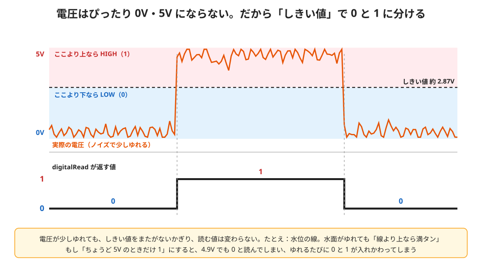

なぜ、電圧そのものではなく、0 と 1 の2つに分けるのか。**現実の電圧は、ぴったり 0V や 5V にならないから**。配線の抵抗、まわりのノイズ、電池の減りなどで、電圧は少しずつずれる。

| 実際の電圧 | しきい値（約 2.87V）と比べると | 読む値 |
| --- | --- | --- |
| 0V、0.3V（ノイズが乗った）、1.5V | 低い | `0`（LOW） |
| 3.2V、4.7V（少し下がった）、5V | 高い | `1`（HIGH） |

| 考え方 | 内容 |
| --- | --- |
| もし「ちょうど 5V のときだけ 1」にしたら | 4.9V で 0 と読んでしまい、少しゆれるたびに 0 と 1 が入れかわる |
| 真ん中に境目を引くと | 多少ゆれても、境目をまたがないかぎり、読む値は変わらない。**ノイズに強い** |
| たとえ | 水位の線。水面がゆれても、「線より上なら満タン」の判定は変わらない |
| 「何V か」を細かく知りたいときは | 別の道具を使う（`analogRead`、31日目） |
| 境目のすぐそばの電圧だと | ゆれるたびに 0 と 1 が入れかわる。その対策が、45日目の「ヒステリシス」（[チェックリスト](../CHECKLIST.md#第7週-センサーとフィルタ)） |

しきい値の約 2.87V は、MONOist 記事にある Atmega328（Arduino UNO のマイコン）が 5V で動くときの値（A. 部品の性質）。正確な値はデータシートで確かめる。

**⑤ INPUT と OUTPUT は「ピンの向き」、0 と 1 は「値」**

「入力が 0、出力が 1」ではない。**向き（INPUT／OUTPUT）と、値（0／1）は別の軸**で、どちらの向きでも、値は 0 か 1 になる。

| | 値が `0`（LOW） | 値が `1`（HIGH） | ピンのたとえ |
| --- | --- | --- | --- |
| **OUTPUT**（出力） | コードがピンを 0V にする | コードがピンを 5V にする | **口**（話す）。電圧を決めるのは**コード** |
| **INPUT**（入力） | 外の電圧が低いので、`0` と読む | 外の電圧が高いので、`1` と読む | **耳**（聞く）。電圧を決めるのは**外の回路** |

出力も関係している。**出力側は、5V と 0V に近い電圧を「きれいに」出す。入力側は、多少くずれていても読めるように、真ん中に境目を置く**。この差が、ノイズに対する余裕になる。

```
 0V ----- LOW area ----- 2.87V ----- HIGH area ----- 5V   <-- 左が 0 と読む側、右が 1 と読む側
 ^ output LOW (about 0V)             output HIGH (about 5V) ^   <-- 出力は、両はしのきれいな電圧を出す
```

ピンAの OUTPUT を、ピンBの INPUT につなぐと、Aが `1` を出せば、Bは `1` と読む。マイコンどうしの通信は、この仕組み。

**⑥ プルダウン・プルアップの目的：ボタンを離している間の電圧を決める**

ボタンは、**押したときにしか何かにつながらない**。離すと、入力ピンはどこにもつながらず、電圧が決まらない（フローティング、①）。どこにもつかまっていない風船のように、風（ノイズ）で `0` と `1` がでたらめに変わる。そこで、抵抗で**ひもを付けておく**。

| | ひもの付け方 | 離したとき | 押したとき |
| --- | --- | --- | --- |
| プルダウン | ピンと **GND** のあいだに抵抗 | `0` | `1`（ボタンが 5V と直結） |
| プルアップ | ピンと **5V** のあいだに抵抗 | `1` | `0`（ボタンが GND と直結） |

**なぜ線ではなく、抵抗なのか。** 線で GND につなぐと、押した瞬間に 5V と GND がボタンでつながり、**ショート**する。抵抗が入っていれば、電流は小さくおさえられる。

| 手順 | 考え方 | 計算 | 答え |
| --- | --- | --- | --- |
| 1 | 押したとき、10kΩ の両端に 5V がかかる（オームの法則、2日目） | 5V ÷ 10kΩ ＝ 5 ÷ 10,000 | 0.0005A |
| 2 | A を mA にする（×1000） | 0.0005 × 1000 | **0.5mA**（測っていない） |

```
 pin 2 --- (10k ohm: weak string) --- GND    <-- 弱いひも。いつもつながっている
 pin 2 --- (button wire: strong)  --- 5V     <-- 強い線。押したときだけ。強いほうが勝つ
```

押したときは、**弱いひも（10kΩ）と、強い線（ボタン）の勝負**になり、ほぼ 0Ω のボタンの線が勝つ。だからピン2は 5V になる。離したときは、ボタンの線がないので、弱いひもだけが残り、ピン2は GND に落ちつく。

| | よい点 |
| --- | --- |
| プルダウン | 「押す＝1」で分かりやすい（SunFounder の回路） |
| プルアップ | Arduino の中に最初から入っている（`INPUT_PULLUP`）ので、**外付けの抵抗が要らない**（MONOist 記事） |

電気的には、どちらも同じ仕事で、**ちがいは 0 と 1 の向き**だけ。配線図で並べたものが、次の 1. の ③。

**何に役立つか**：ロボットのスイッチ、バンパー、リミットスイッチは、全部この形になる。抵抗を忘れると、押していないのに動き出す、という誤動作になる。

**⑦ 抵抗なしで 49.5mV が出る理由：電流ではなく、電圧が決まっていない**

18日目の「抵抗なしだと 49.5mV」は、**電流ではなく電圧**。ボタンを離しているので、電流がほとんど流れない、というのは**そのとおり**。ただし、**「電流が流れない」と「電圧が 0V」は別の話**。どこにもつながっていない点は、0V になるのではなく、電圧が**決まっていない**。風船から手を放すと高さが決まらないのと同じ。

18日目では、次のように見積もった（本当の値は確かめていない）。

```
 5V --- (button leak: about 1G ohm?) ---+--- (meter inside: about 10M ohm) --- GND
                                        |
                                    49.5mV here      <-- ここが 49.5mV
```

| 手順 | 考え方 | 計算 | 答え |
| --- | --- | --- | --- |
| 1 | 大きな抵抗どうしの分圧（8日目）。ボタンの漏れ 約 1GΩ（C. 仮定）と、電圧計の中 約 10MΩ（C. 仮定） | 5V × 10MΩ ÷ (1GΩ ＋ 10MΩ) | 約 0.0495V |
| 2 | V を mV にする（×1000） | 0.0495 × 1000 | **約 49.5mV** |

ボタンを離しても、中にはとても大きな抵抗ぶんの漏れがあり、電圧計の中にもとても大きな抵抗がある。その**比**で、たまたま 49.5mV になっただけ。条件が少し変わると値が変わり、実物では手を近づけただけで 0〜5V をふらふらする。**10kΩ のプルダウンを付けると、漏れよりずっと小さい抵抗で GND につながるので、離すと 0V に固定される。**

### 1. 読む：[MONOist 俺流！組み込み用語解説(5) GPIO](https://monoist.itmedia.co.jp/mn/spv/2408/29/news034.html)（20分）

記事は2ページ構成で、文章はそのまま写さず、言いかえてまとめた。

**① 記事の構成**

| ページ | 節 | 書いてあること |
| --- | --- | --- |
| 1/2 | はじめに | 筆者の前書き（今回は内容と関係がない） |
| 1/2 | GPIOとは | GPIO は「汎用入出力」。外部機器を制御したり、外から信号を取りこんだりするのに使う。ピンごとに、入力か出力かを**ビット単位で**決められる。LED を点滅させる「Lチカ」でも必ず使われる |
| 1/2 | GPIOを出力端子として用いる | コードで 0（LOW）を書くとピンは 0V に近くなり、1（HIGH）を書くと電源（VCC）に近い電圧が出る。図1は、ピン → 抵抗 → LED のアノード、カソード → GND の回路。`pinMode(outPin, OUTPUT)` と `digitalWrite(outPin, HIGH)` のコード例 |
| 2/2 | GPIOを入力端子として用いる | 入力ピンは、**しきい値より高い電圧なら 1、低ければ 0** と読まれる。しきい値は電源電圧の半分より少し高く、Atmega328（Arduino UNO のマイコン）は 5V のとき約 2.87V。図2は、ボタンの一端を入力ピン、もう一端を GND につなぐ回路 |
| 2/2 | プルアップ抵抗と内部プルアップ | ボタンを離したとき、プルアップ抵抗で入力ピンが VCC に引っぱられて 1 になる。`INPUT_PULLUP` を使うと、マイコンの中のプルアップ抵抗が使えて、外付けの抵抗が要らない |

**② GPIO を図で見る**

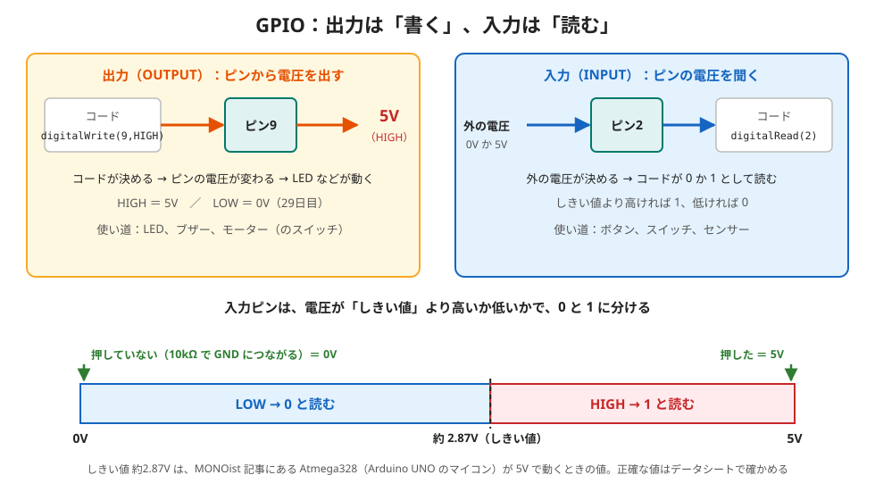

| | 出力（29日目） | 入力（今日） |
| --- | --- | --- |
| コードの命令 | `pinMode(ピン, OUTPUT)` と `digitalWrite` | `pinMode(ピン, INPUT)` と `digitalRead` |
| 電圧を決めるのは | **コード**（ピンが電圧を出す） | **外の回路**（ボタンなど。コードは読むだけ） |
| つなぐもの | LED、ブザー | ボタン、スイッチ、センサー |

**③ 記事の回路（プルアップ）と、3.1 の回路（プルダウン）は逆向き**

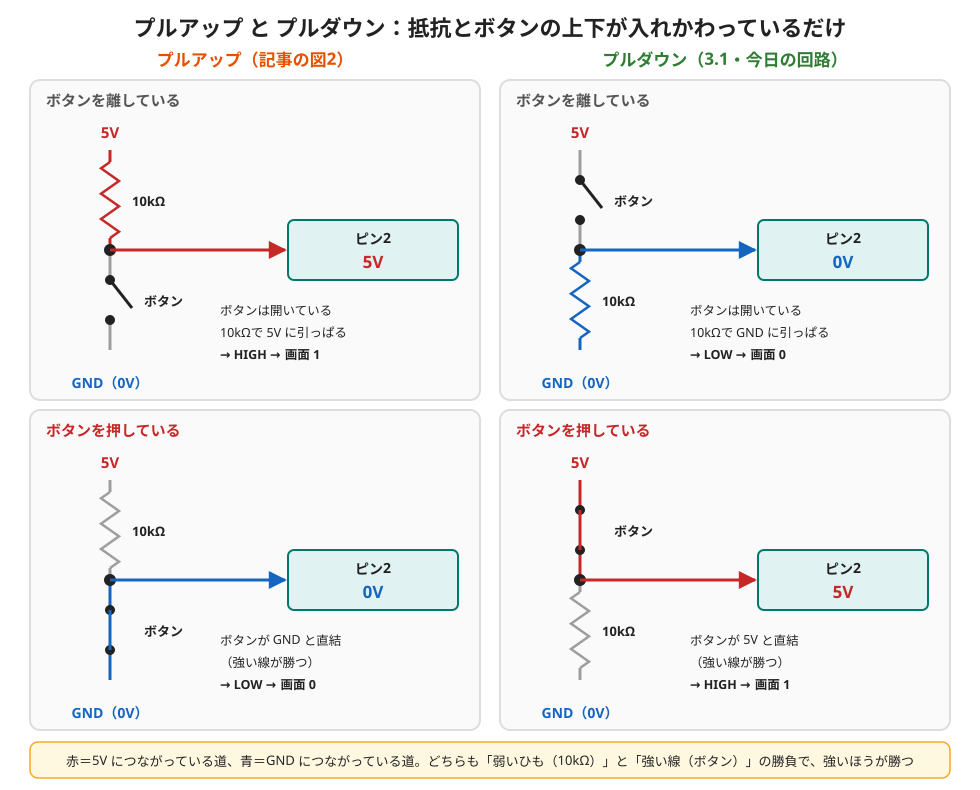

赤は「5V につながっている道」、青は「GND につながっている道」。**押したときは、強い線（ボタン）が勝つ**ので、ピン2は、ボタンのつなぎ先の電圧になる。離したときは、弱いひも（10kΩ）の先の電圧になる。

| | 記事の図2（プルアップ） | 3.1・今日の回路（プルダウン） |
| --- | --- | --- |
| ボタンのつなぎ先 | 入力ピン と **GND** | 入力ピン と **5V** |
| 抵抗 | ピンと **5V** のあいだ | ピンと **GND** のあいだ |
| 離したとき | 1（5V に引っぱられる） | **0**（GND に引っぱられる） |
| 押したとき | **0**（GND とつながる） | **1**（5V とつながる） |
| 18日目との対応 | プルアップ | プルダウン |

どちらも「離したときの電圧を、抵抗で決めておく」点は同じで、**0 と 1 の向きが逆になる**だけ。

ブレッドボードでの配線のちがいは、次のとおり。

| 部品 | プルダウン（3.1、組んだ回路） | プルアップ（組んでいない） |
| --- | --- | --- |
| ボタンの一方 | **5V**（＋の列）へ | **GND**（−の列）へ |
| ボタンのもう一方 | ピン2へ、10kΩ の一端へ | ピン2へ、10kΩ の一端へ |
| 10kΩ のもう一端 | **GND**（−の列）へ | **5V**（＋の列）へ |
| 離したとき／押したとき | `0` ／ `1` | `1` ／ `0` |

> 上のプルアップの配線は、回路の組み合わせから書いたもので、Tinkercad で組んで確かめてはいない。

**④ `INPUT_PULLUP`：プルアップ抵抗を Arduino の中のものにする**

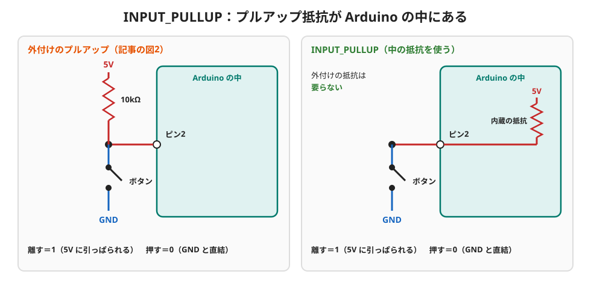

Arduino の中には、最初からプルアップ抵抗が入っている。コードで `pinMode(2, INPUT_PULLUP);` と書くと、その抵抗がピン2につながる。

```cpp
pinMode(2, INPUT_PULLUP);   // INPUT の代わりに、これを書くだけ
```

| | 外付けのプルダウン（今日） | 外付けのプルアップ | `INPUT_PULLUP` |
| --- | --- | --- | --- |
| 部品 | 10kΩ が1本 | 10kΩ が1本 | **抵抗なし**（ボタンだけ） |
| ボタンのつなぎ先 | ピン2 と 5V | ピン2 と GND | ピン2 と GND |
| 離したとき | `0` | `1` | **`1`** |
| 押したとき | `1` | `0` | **`0`** |
| 押しているかの判定 | `digitalRead(2) == HIGH` | `digitalRead(2) == LOW` | `digitalRead(2) == LOW` |

利点は、**部品と配線が減る**こと。気をつけることは、**押したときが `0`** になること（`if` の条件の向きが、今日の 3.1・5.3 と逆になる）。ピンが何本もあるときは、それぞれに外付けの抵抗を付けずに済むので、特に楽になる（MONOist 記事）。

> 記事外：内蔵の抵抗は、一般に数十kΩ程度とされている（この記録では確かめていない）。Tinkercad で `INPUT_PULLUP` が使えるかも、まだ試していない。今日は使わない。

### 2. 読む・組む：[3.1 ボタンの値を読む](https://docs.sunfounder.com/projects/3in1-kit-v2/ja/latest/basic_project/ar_button.html)。第3週のプルダウン抵抗がそのまま出てきます（40分）

**① 記事のどこを使い、どこを飛ばすか**

| 記事の節 | 書いてあること | どう使ったか |
| --- | --- | --- |
| 必要な部品 | 制御ボード、ブレッドボード、ジャンパーワイヤー、抵抗、ボタン（10kΩ は本文のプルダウンの説明から分かる） | Tinkercad の部品を置く。買う案内は飛ばす |
| 回路図 | ボタンの片方の端子は 5V、もう片方はピン2。押すとピン2が HIGH。押していないと**ピン2はどこにもつながらず浮く**ので、**10kΩ のプルダウン抵抗で GND につないで、安定して LOW にする** | **そのまま写す**（18日目の回路） |
| 配線図 | ブレッドボードの絵だけ（文字の説明はない） | 絵を見て写す |
| コード | 記事の中の埋め込み画面にあり、本文には載っていない | 手元のコード（Arduino 公式の例題 DigitalReadSerial）を打った。下の ③ |
| 結果 | ボタンを押すと、シリアルモニタに `1` と出る | 離したときの `0` は記事に書いていない。実際に動かして確かめた |
| Arduino IDE の手順（虫めがね、ポート選び） | — | 飛ばす（Tinkercad ではコード画面の下の「シリアルモニタ」） |

> 記事外：記事の「押していないと浮く」は、18日目の**フローティング**そのもの。記事に、チャタリングの説明はない。

**② 回路：5V → ボタン → ピン2、ピン2 → 10kΩ → GND**

| 配線図（ブレッドボード） | 回路図表示 |
| --- | --- |
| 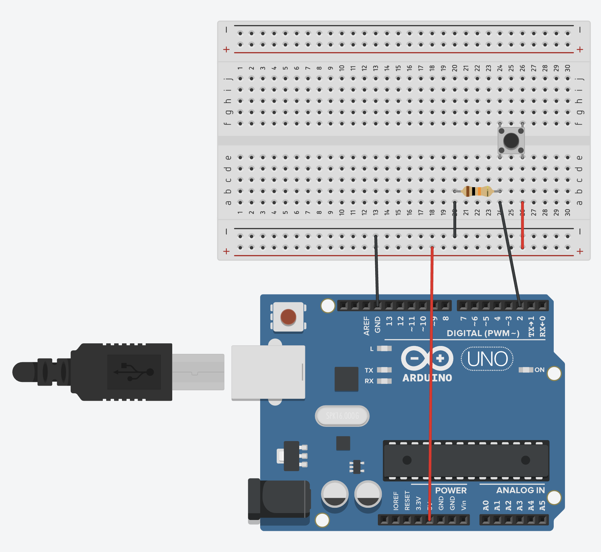 | 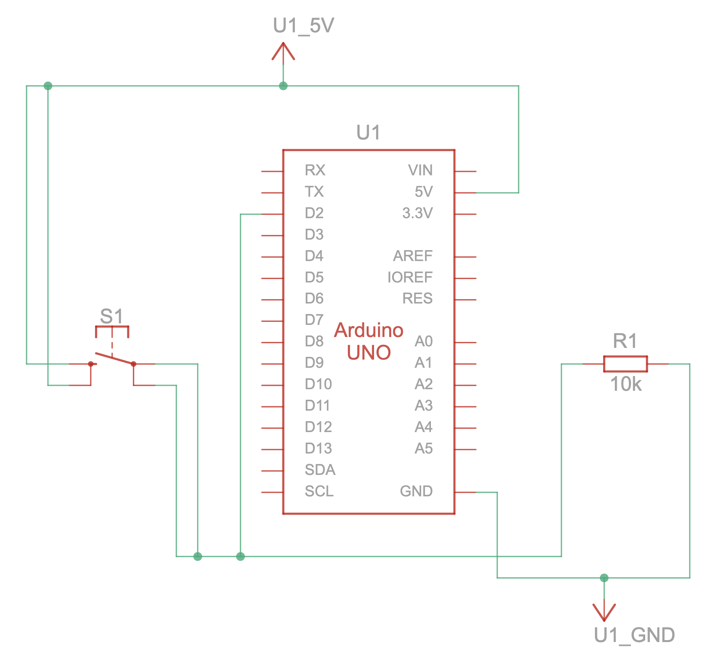 |

```
        20   24   26
   e     .    B    B      <-- ボタンの下の足(24e と 26e)。押したときだけ 24 と 26 がつながる
   d     .    |    |
   c     .    |    |
   b     R----R    |      <-- 10kΩ。20b と 24b にまたがる
   a     G    P    5      <-- 20a→GND、24a→ピン2、26a→5V
```

ボタンは真ん中のみぞをまたいでいる（上の図は下半分のみ）。電気の通り道を、1か所ずつたどる。

| 順番 | 場所 | つながる理由 |
| --- | --- | --- |
| 1 | Arduino の `5V` → 赤い線 → 下の **＋** の列 | 線 |
| 2 | ＋ の列 → 赤い線 → 26a | 線 |
| 3 | 26 列 → ボタン → 24 列 | **押したときだけ**つながる |
| 4 | 24a → 黒い線 → Arduino の**ピン2** | 線。24 列の a〜e は中でつながっている |
| 5 | 24b → 10kΩ → 20b | 24 列とピン2は同じグループ。抵抗が 24 列と 20 列をつなぐ |
| 6 | 20a → 黒い線 → 下の **−** の列 → 黒い線 → Arduino の `GND` | 線 |

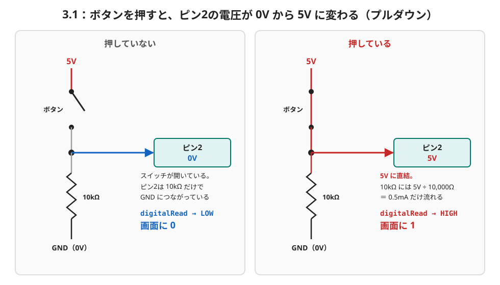

**③ 数字はどこから来たか**

| 数字 | 種類 | どこから来たか |
| --- | --- | --- |
| 5V、0V | A. 部品の性質 | Arduino UNO の電源と GND |
| 約 2.87V（しきい値） | A. 部品の性質 | MONOist 記事。Atmega328 を 5V で使うとき。正確な値はデータシートで確かめる |
| 10kΩ | B. 自分で決めた値 | 記事の値。18日目と同じ |
| 9600 | B. 自分で決めた値 | `Serial.begin(9600)`（29日目と同じ） |
| 1ミリ秒 | B. 自分で決めた値 | `delay(1)` |
| 0.5mA | D. 計算 | 下の表。**押したときに 5V → 10kΩ → GND に流れる電流**（測っていない） |

| 手順 | 考え方 | 計算 | 答え |
| --- | --- | --- | --- |
| 1 | 押すと、ボタンのつなぎ先から 10kΩ に 5V がかかる | 5V ÷ 10kΩ ＝ 5 ÷ 10,000 | 0.0005A |
| 2 | A を mA にする（×1000） | 0.0005 × 1000 | **0.5mA** |
| 3 | LED の上限（約 20mA）とくらべる | 0.5mA ≪ 20mA | ほとんど流れない（だから 10kΩ のような大きな値を使う） |

**④ コード：1行ずつ読む**

保存したコード：[code/day30_button/day30_button.ino](code/day30_button/day30_button.ino)　／　回路：[Tinkercad で開く](https://www.tinkercad.com/things/dz8KeFOmEUI-day30-131-/editel?sharecode=DgwOkS_hnWZBoAcr2fk0u4QKZ9e6jSi56eZT1PgqSRI)

```cpp
int pushButton = 2;

void setup() {
  Serial.begin(9600);
  pinMode(pushButton, INPUT);
}

void loop() {
  int buttonState = digitalRead(pushButton);
  Serial.println(buttonState);
  delay(1);
}
```

| 行 | 意味 | いつ動くか |
| --- | --- | --- |
| `int pushButton = 2;` | ボタンをつないだピンの番号 2 に、`pushButton` という名前をつける | 最初に1回 |
| `Serial.begin(9600);` | シリアル通信を始める（29日目） | `setup()` で1回 |
| `pinMode(pushButton, INPUT);` | ピン2を**入力**にする | `setup()` で1回 |
| `int buttonState = digitalRead(pushButton);` | ピン2を読む。しきい値より高ければ `1`（HIGH）、低ければ `0`（LOW）を、`buttonState` の箱に入れる | `loop()` で毎回 |
| `Serial.println(buttonState);` | 箱の中身を画面に出して、改行する | 毎回 |
| `delay(1);` | 1ミリ秒待つ。コメントによると「読みの安定のため」 | 毎回 |

`pinMode(…, INPUT)` と `digitalRead` が、29日目の `OUTPUT` と `digitalWrite` の**反対**の組。

**⑤ 結果**

| シリアルモニタ | 読み方 |
| --- | --- |
| 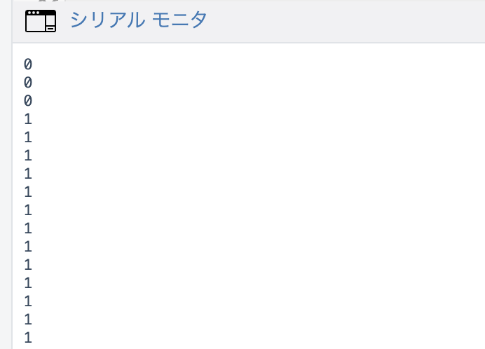 | 最初の `0` が、**押していないとき**。途中から `1` がずっと続くのが、**押しているとき** |

| ボタン | ピン2 | `digitalRead` | 画面 | 18日目の測定との対応 |
| --- | --- | --- | --- | --- |
| 押していない | 10kΩ 経由で GND（0V） | `LOW` | `0` | 離すと 0.00V |
| 押している | 5V | `HIGH` | `1` | 押すと 5.00V |

画面に `1` が**何行も**続くのは、`loop()` が止まらずに回り続け、**毎回**読んだ値を出しているから。次の 5.3 は、この「毎回出る」を「押した瞬間の1回だけ」にする。

<details>
<summary>補足：ボタンを1秒押し続けると、`1` は何行出る？（記事外・計算。クリックで開く）</summary>

測っていない。計算だけ。

| 手順 | 考え方 | 計算 | 答え |
| --- | --- | --- | --- |
| 1 | `delay(1)` だけなら、1秒に回れる回数の上限 | 1000ミリ秒 ÷ 1ミリ秒 | 1000回 |
| 2 | 9600 ビット毎秒。1文字は約 10 ビット（29日目の補足） | 9600 ÷ 10 | 960文字 |
| 3 | 1行 ＝ `1` ＋ 改行2文字 | 1 ＋ 2 | 3文字 |
| 4 | 送れる行数の上限 | 960 ÷ 3 | **320行** |
| 5 | 小さいほうが、実際の上限 | 320 ＜ 1000 | 約 320行（1秒あたり） |

`delay(1)` ではなく、**通信の速さ**のほうが上限を決める。Tinkercad の結果は、この計算と同じとは限らない。

</details>

### 3. 読む・組む：[5.3 ステート変更の検出](https://docs.sunfounder.com/projects/3in1-kit-v2/ja/latest/basic_project/ar_state_change.html)。「押している間」ではなく「押した瞬間」を数える（40分）

**① 何をする課題か**

記事の課題は、**ボタンを押すたびにモーターが回る／止まる**を切り替えること。ポイントは、ボタンの「押されている状態」ではなく、**前回から変わった瞬間**を見ること。

| 方法 | 動き | 問題 |
| --- | --- | --- |
| ボタンの値で直接決める | 押している間だけ回る | 離すと止まる。「押すたびに切り替え」にならない |
| **前回の値と比べて、押した瞬間だけ切り替える（今日）** | 押すたびに ON/OFF が入れかわり、離しても状態が残る | — |

**② Tinkercad にない部品を、どう置きかえたか**

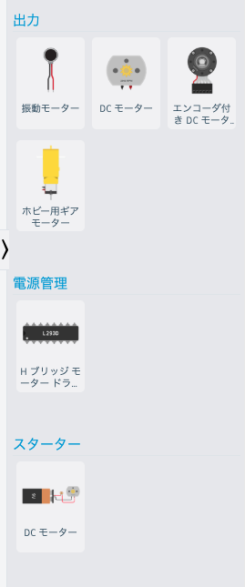

| 記事の部品 | Tinkercad | 今日どうしたか |
| --- | --- | --- |
| ボタン、10kΩ | ある | 3.1 の回路をそのまま使う |
| **L9110 モータードライバー** | **ない**（一覧には「H ブリッジ モーター ドライバ」＝ L293D だけある） | 使わない |
| **TT モーター** | **ない**（似た「ホビー用ギア モーター」はある） | 使わない |
| — | LED、220Ω（29日目の部品） | **モーターの代わりに LED** を使う |

置きかえた理由は、課題の中身が「押した瞬間を検出して、状態を切り替える」ことで、**モーターは結果を見せる出力にすぎない**から。LED なら、点く・消えるで同じことが見える。モーターは [38日目](../CHECKLIST.md#第6週-モーター)の「Hブリッジ（L293D）」で扱う。

> 記事外：Tinkercad の一覧にある「H ブリッジ モーター ドライバ」の DC モーターでも組めるが、配線が増えて、今日の目的からそれる。

**③ 記事のどこを使い、どこを飛ばすか**

| 記事の節 | 書いてあること | どう使ったか |
| --- | --- | --- |
| 必要な部品 | 制御ボード、ブレッドボード、ジャンパーワイヤー、抵抗、ボタン、TT モーター、L9110 | ボタンと抵抗だけ使う。残りは LED に置きかえ |
| 回路図、配線図 | 画像だけ（文字の説明はない） | 画像は、LED に置きかえたので写さなかった |
| コード | ボタンのピンとモーターの2ピンを使う。`detectionState`（0 と 1 を交互に）、`buttonState`（今回）、`lastButtonState`（前回）の3つの変数 | モーターのピンを `ledPin` 1つに変えて打った。下の ⑥ |
| どのように動作するのか | 「変数を決める → `setup()` でピンとシリアルを準備 → `loop()` でボタンの変化を見て、状態を切り替え、状態に合わせてモーターを動かす」の3段階。押すとモーターが回り、もう一度押すと止まる | 下の ⑤ ⑥ にまとめた |

> 記事外：記事の `delay(50)` は、変化を見つけたときだけ入る。50ミリ秒をすぎても残るふるえには効かない可能性があるが、**確かめていない**。Tinkercad でチャタリングが再現されるかも、確かめていない。

**④ 回路：3.1 の回路に、29日目の LED を足す**

| 配線図（ブレッドボード） | 回路図表示 |
| --- | --- |
| 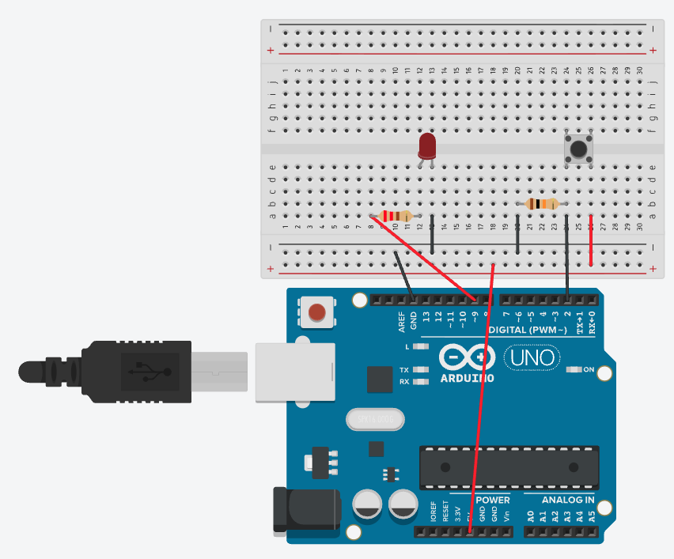 | 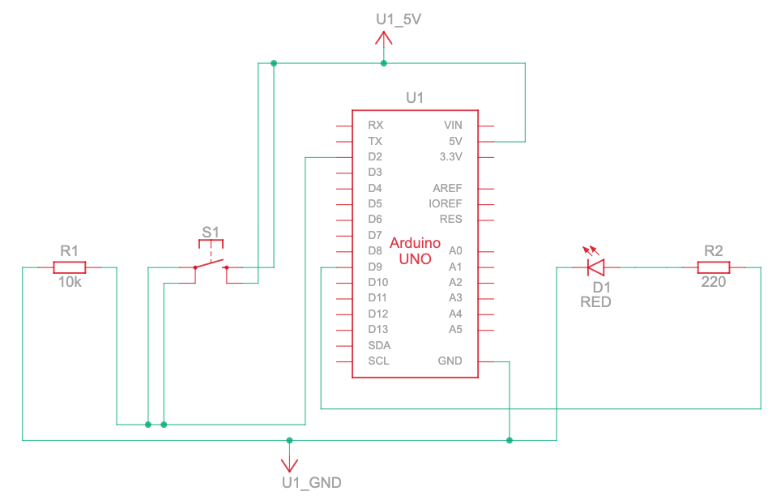 |

```
 pin 2 --- button / 10k (pull-down)                        <-- 3.1 の回路のまま
 pin 9 --- 220 ohm --- LED(+, bent leg) --- LED(-) --- - rail --- GND   <-- 29日目と同じ形
```

| 場所 | 刺すもの |
| --- | --- |
| 8a | ピン `~9` からの線 |
| 8 と 12 | 220Ω の抵抗 |
| 12 と 13 | LED（曲がった足＝アノードが 12 列、まっすぐな足＝カソードが 13 列） |
| a13 → ［−］の列 | LED のカソードを GND へ |
| a20 → ［−］の列 | 10kΩ の下端を GND へ（3.1 のまま） |
| ［−］の列 → GND | **1本だけ**。GND につなぐ部品は、全部「− の列」へ |
| 5V → ［＋］の列、26a → ［＋］の列、24a → ピン2 | 3.1 のまま |

回路図表示で、**D9 → R2（220）→ D1（LED）→ GND** と、**S1 の片側が 5V、反対側が D2 と R1（10k）、R1 の先が GND** を確かめた。

**⑤ 考え方：「押している間」ではなく「押した瞬間」**

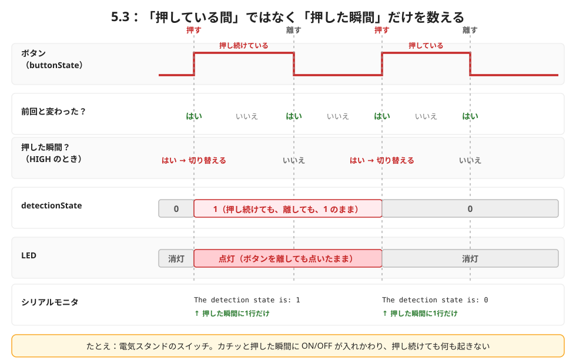

`loop()` が1周するたびに、「今回の値」と「前回の値」を比べる。

| 状況 | `buttonState`（今回） | `lastButtonState`（前回） | 変わった？ | 押された？ | すること |
| --- | --- | --- | --- | --- | --- |
| 何もしていない | 0 | 0 | いいえ | — | 何もしない |
| **押した瞬間** | **1** | 0 | **はい** | **はい** | **切り替えて、画面に出す（1回だけ）** |
| 押し続けている | 1 | 1 | **いいえ** | — | **何もしない（ここが「押し続けても変わらない」理由）** |
| 離した瞬間 | 0 | 1 | はい | いいえ | 切り替えない（`delay(50)` だけ入る） |

LED が点いたままなのは、LED の状態を、ボタンではなく**覚えておく箱**（`detectionState`）に持たせているから。ロボットの「いまのモード」を覚えるのと同じ考え方。

**⑥ コード：1行ずつ読む**

保存したコード：[code/day30_state_change/day30_state_change.ino](code/day30_state_change/day30_state_change.ino)

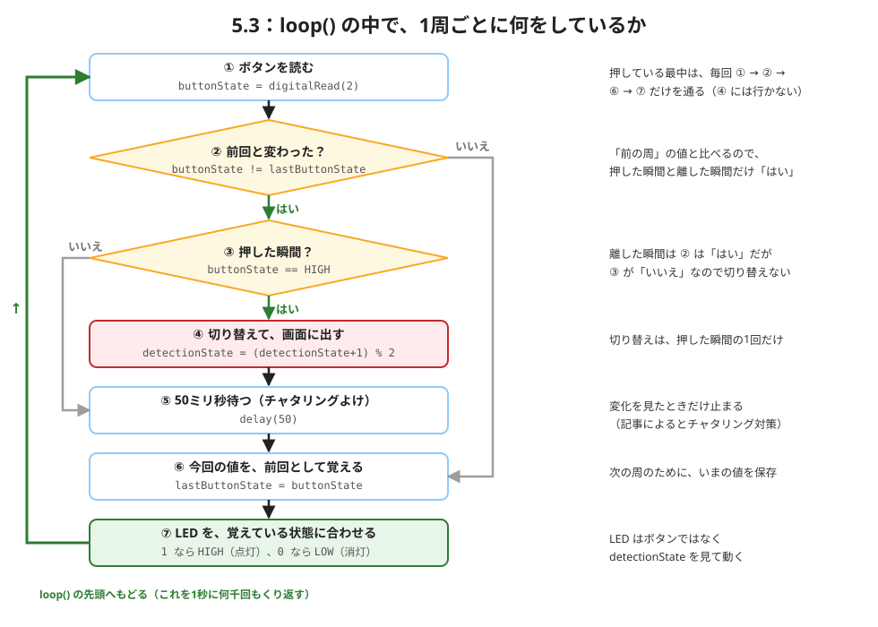

```cpp
const int buttonPin = 2;
const int ledPin = 9;

int detectionState = 0;
int buttonState = 0;
int lastButtonState = 0;

void setup() {
  pinMode(buttonPin, INPUT);
  pinMode(ledPin, OUTPUT);
  Serial.begin(9600);
}

void loop() {
  buttonState = digitalRead(buttonPin);

  if (buttonState != lastButtonState) {
    if (buttonState == HIGH) {
      detectionState = (detectionState + 1) % 2;
      Serial.print("The detection state is: ");
      Serial.println(detectionState);
    }
    delay(50);
  }
  lastButtonState = buttonState;

  if (detectionState == 1) {
    digitalWrite(ledPin, HIGH);
  } else {
    digitalWrite(ledPin, LOW);
  }
}
```

| 行 | 意味 | いつ動くか |
| --- | --- | --- |
| `const int buttonPin = 2;` `const int ledPin = 9;` | ボタンのピンと LED のピンに名前をつける。あとから変えない（`const`） | 最初に1回 |
| `int detectionState = 0;` | **覚えておく箱**。0 が OFF、1 が ON。押すたびに切り替わる | 最初に1回 |
| `int buttonState = 0;` `int lastButtonState = 0;` | 今回の値と、前回の値を入れる箱 | 最初に1回 |
| `pinMode(buttonPin, INPUT);` | ボタンのピンは**入力** | `setup()` で1回 |
| `pinMode(ledPin, OUTPUT);` | LED のピンは**出力** | `setup()` で1回 |
| `buttonState = digitalRead(buttonPin);` | ① 今のボタンを読む | 毎回 |
| `if (buttonState != lastButtonState) {` | ② **前回と変わったとき**だけ、中に入る | 毎回 |
| `if (buttonState == HIGH) {` | ③ 変わった結果が**押した状態**（HIGH）のときだけ。離した瞬間は入らない | 変わったとき |
| `detectionState = (detectionState + 1) % 2;` | ④ 0 なら 1、1 なら 0 にする | 押した瞬間だけ |
| `Serial.print(…)` `Serial.println(detectionState);` | 切り替えたあとの値を画面に出す。`print` は改行しない、`println` は改行する | 押した瞬間だけ |
| `delay(50);` | ⑤ 50ミリ秒待つ（チャタリングよけ）。押したときも離したときも入る | 変わったとき |
| `lastButtonState = buttonState;` | ⑥ 今回の値を、次の周のための「前回」として覚える | **毎回**（`if` の外） |
| `if (detectionState == 1) { … HIGH … } else { … LOW … }` | ⑦ 覚えている状態に合わせて、LED を点ける・消す（記事ではモーター） | 毎回 |

`%`（あまり）で、足しても 0 か 1 しか出ない。

| 今の `detectionState` | 計算 | 答え |
| --- | --- | --- |
| 0 | (0 ＋ 1) ÷ 2 ＝ 0 あまり **1** | 1 |
| 1 | (1 ＋ 1) ÷ 2 ＝ 1 あまり **0** | 0 |

> `lastButtonState = buttonState;` を書き忘れると、前回の値がずっと 0 のままになり、押している間は**毎回「変わった」と判断され**て、`loop()` が回るたびに切り替わると考えられる（動かして確かめていない）。「前回の値を覚える」行が、この課題の要になる。

**⑦ 結果**

| 消灯（`detectionState` が 0） | 点灯（`detectionState` が 1） |
| --- | --- |
| 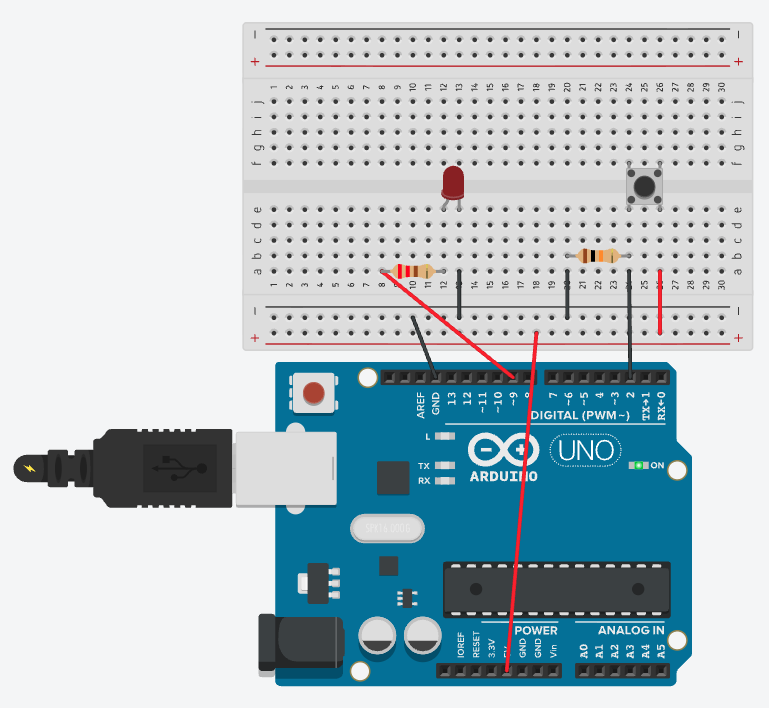 | 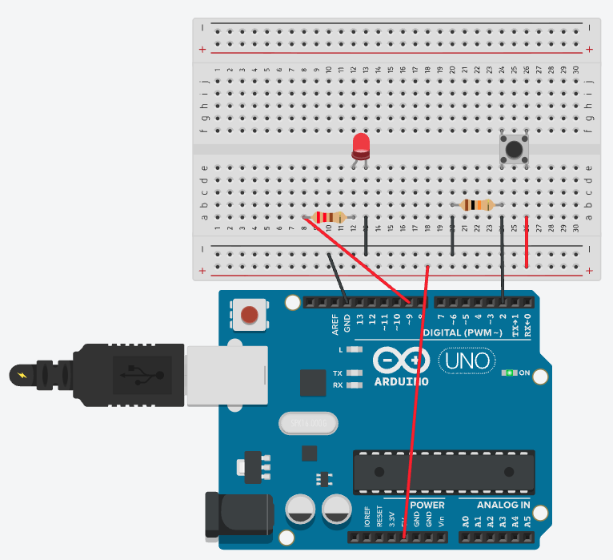 |

押すたびに、シリアルモニタに次のように出た（貼ってもらった出力）。

```
The detection state is: 1
The detection state is: 0
The detection state is: 1
The detection state is: 0
The detection state is: 1
The detection state is: 0
The detection state is: 1
The detection state is: 0
The detection state is: 1
The detection state is: 0
```

| 試したこと | 結果 |
| --- | --- |
| ボタンを押し続ける | **何も変わらない**（行は増えない、LED もそのまま） |
| 1回押す | 1行出て、LED が切り替わる |
| 押すたびに | `1` → `0` → `1` → `0` と、LED が点く・消えるをくり返す |

**⑧ 3.1 と 5.3 のちがい**

| | 3.1 | 5.3 |
| --- | --- | --- |
| 何を見るか | ボタンが**いま**押されているか | ボタンが**前回から変わった**か |
| 画面の出方 | 押している間、`1` が**何行も**続く | 押した瞬間に**1行だけ** |
| 前回の値 | 覚えない | `lastButtonState` に覚える |
| 状態を覚えるか | 覚えない | `detectionState` に覚える |
| 向いている使い方 | 「押している間だけ動く」（バンパーなど） | 「押すたびに切り替える」（スタート／ストップなど） |

回路の共有リンク：3.1 は[ここ](https://www.tinkercad.com/things/dz8KeFOmEUI-day30-131-/editel?sharecode=DgwOkS_hnWZBoAcr2fk0u4QKZ9e6jSi56eZT1PgqSRI)。5.3（LED 版）は、まだ取っていない（[tinkercad.md](tinkercad.md) の欄は空）。

<details>
<summary>まちがい：5.3 の最初の配線で、ピン9が 5V の列につながっていた（クリックで開く）</summary>

コードを入れる前に、スクリーンショットの**回路図表示**で見つかった。

| 回路図表示（まちがい） | 配線図（まちがい） |
| --- | --- |
| 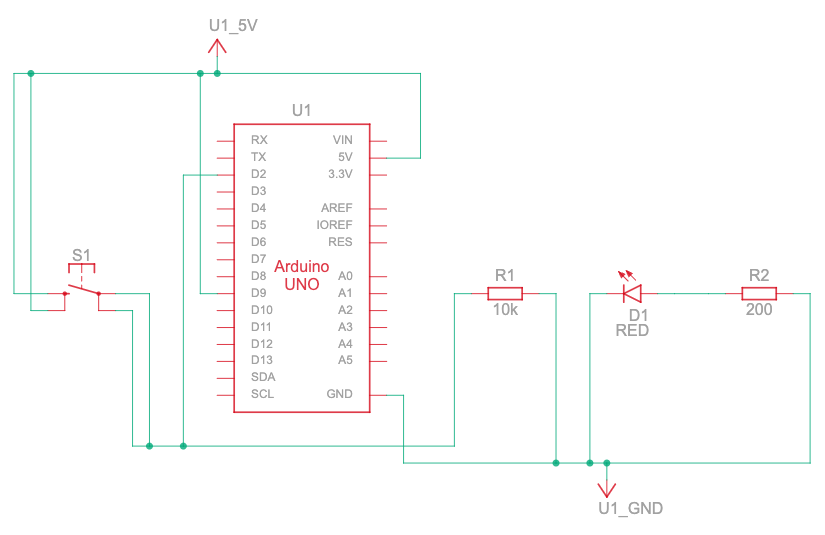 | 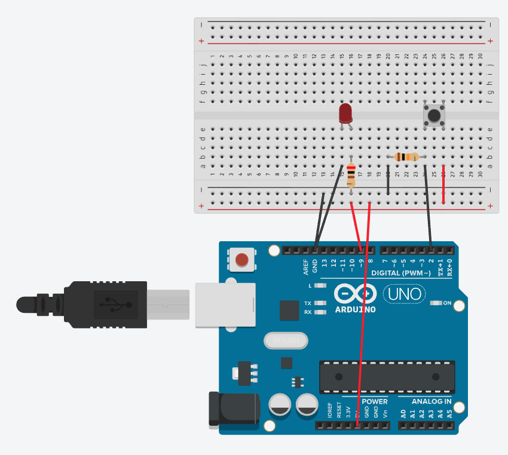 |

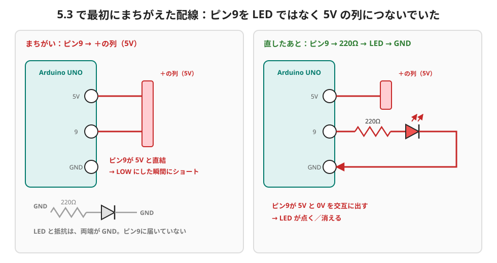

| # | 症状 | 原因 | 直し方 |
| --- | --- | --- | --- |
| 1 | 回路図表示で、**D9 が 5V の線につながっていて**、LED と抵抗は両端が GND になっていた（ピン9に届いていない） | ピン `~9` からの赤い線を、**抵抗ではなく下の ＋ の列に刺していた**。5V の赤い線も同じ ＋ の列にあるので、ピン9が 5V と直結になった | 赤い線を **8a**（抵抗の左端と同じ列）に刺しなおした。回路図表示で D9 → R2 → D1 → GND になった |
| 2 | GND への線が、3.1 の回路の線とあわせて**何本も**残っていた（a15 → GND を含む） | 3.1 の回路を使いまわして、LED の GND を足したので、**「− の列 → GND」が重複**した | 余った線を消して、**「− の列 → GND」は1本だけ**にした。GND につなぐ部品は全部「− の列」へ |

**ピン9を 5V につなぐと何が困るか**

| 問題 | 内容 |
| --- | --- |
| LED が光らない | LED と抵抗にピン9の電気が届かない |
| **ショートする** | コードがピン9を LOW（0V）にした瞬間、5V と 0V が直結になる。実機なら、Arduino のピンが壊れる原因になる |

**修正の途中経過**（1つ直したあと、まだ GND の線が余っていた）

| 配線図 | 回路図表示 |
| --- | --- |
| 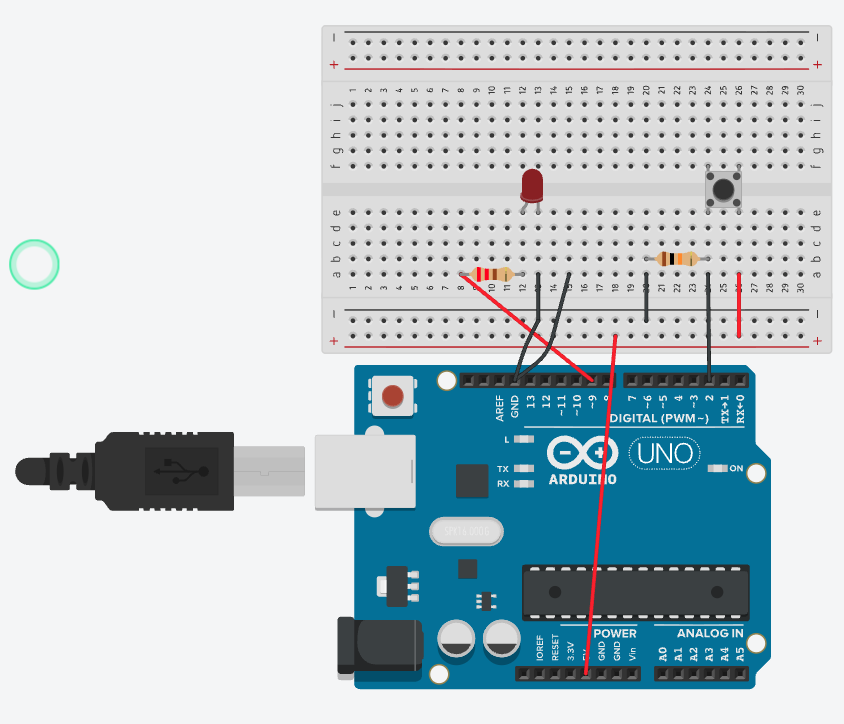 | 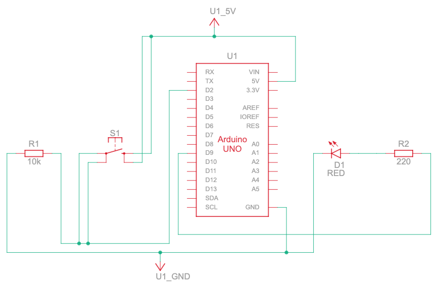 |

**Claude の説明のまちがい**

| # | まちがい | 本当は |
| --- | --- | --- |
| 1 | 「黒い線が GND へ向かっている」と説明した | LED の足の列から、**「− の列」を経由して** GND へつながっていた。画像が小さく、線の行き先を読みちがえた |

</details>

### この日のまとめ：予想 → 結果 → 差の理由

今日は、動かす前の予想を書かなかった。下の「予想」は、そのとき思っていたこと。次の日からは、動かす前に予想を書く。

| 何を測った／試したか | 予想 | 結果 | 差の理由 |
| --- | --- | --- | --- |
| 3.1：ボタンを離す・押す | 書かなかった（18日目のプルダウンの考え方では 0 と 1） | 離すと `0`、押すと `1` | 差なし。押していないと 10kΩ で GND に引っぱられ、押すと 5V につながる |
| 3.1：1秒押し続けたときの `1` の行数 | 書かなかった | **測っていない**（計算では上限約 320行） | 通信の速さ（9600）が上限を決める。Tinkercad の結果は未確認 |
| 5.3：最初の配線 | 配線が合っていれば動く | 回路図表示で、D9 が 5V につながっていた | ピン9の赤い線を ＋ の列に刺していた。**コードを入れる前に見つかった** |
| 5.3：1秒押し続けたときの `The detection state is:` の行数 | 書かなかった | **増えなかった（0行）** | `lastButtonState` と同じなので、② の `if` に入らない |
| 5.3：押す → 離す → 押す、の LED | 書かなかった | 点く → 点いたまま → 消える | 状態を `detectionState` に覚えている。離した瞬間は ③ が「いいえ」で切り替えない |
| 5.3：モーターの代わりに LED | LED でも同じ動きになる | 同じ動きになった | 課題の中身は「押した瞬間の検出」で、出力は何でもよい |

**まだ試していないこと**（時間のある日に）

| 試すこと | 先に書く予想 |
| --- | --- |
| 3.1 のコードで、1秒押し続けて `1` が何行出るか数える | 約 320行より多い？少ない？ |
| 5.3 のコードの `delay(50)` を消して、押した回数と表示が合うか | Tinkercad でも、1回押して2回以上切り替わるか |
| 3.1 のコードを `INPUT_PULLUP` にして、ボタンの片側を GND につなぎ、10kΩ を外して値を見る | 離すと `1`、押すと `0` になるか（今日と逆） |
| 5.3 のコードを「押している間だけ点く」に改造する（`if` を使わず、`buttonState` で直接 LED を動かす） | 離すと消えるか |

**実機を買ったらやり直すこと**

- 5.3 を、L9110 モータードライバーと TT モーターで組む
- `delay(50)` を消して、チャタリングで1回押して何度も切り替わるかを見る
- `INPUT_PULLUP` を使って、外付けの抵抗なしでボタンを読む（押すと `0` になる）
- 抵抗をはずして、フローティングで `0` と `1` がでたらめに出るかを見る

## 31日目 PWMとアナログ入力

> **ひとことで**：Tinkercad に「PWM」という部品はない。**PWM は部品ではなく、`~` のついたピンの使い方**で、`analogWrite(9, 0〜255)` で LED の明るさを変える（`128` で約半分、平均 約 2.5V）。可変抵抗器（250kΩ）の真ん中の足を A0 につなぐと、`analogRead` の値は **GND 側で 0、真ん中で 511、5V 側で 1023**。`map` で 0〜180 に変換してサーボを動かすと、画面に **`0 -> 0`、`511 -> 89`、`1023 -> 180`** と出た。

**この日にやったことと、分かったこと**

| # | やったこと | 分かったこと（一言） |
| --- | --- | --- |
| 1 | Tinkercad で「PWM」を検索する | **PWM という部品はない**。PWM は、`~` のついたピンの使い方 |
| 2 | 2.1：`analogWrite` で LED を 0 → 255 にする | ゆっくり明るくなって、**255 のあとは急に暗くなる**（`for` が終わって 0 にもどるから） |
| 3 | `analogWrite(9, 128)` に固定する | 半分くらいの明るさ。5V の時間が約 50%（平均 約 2.5V） |
| 4 | 4.1：可変抵抗器の真ん中の足を A0 につなぎ、`analogRead` を画面に出す | つまみで **0 〜 1023** がなめらかに変わる（0、511、1023 を確認） |
| 5 | 回路図表示で可変抵抗器の回路を確認する | 5V と GND のあいだの**分圧回路**（8日目）。つまみで上下の抵抗の割合が変わる |
| 6 | 5.6：`map` で 0〜1023 を 0〜180 にして、サーボを動かす | 画面で `0 -> 0`、`511 -> 89`、`1023 -> 180`。**小数点以下は切り捨て**（511 が 90 でなく 89） |
| 7 | サーボの電源の列が、Arduino につながっていないことに気づく | ブレッドボードの ＋ と − の列は、**線でつながないかぎり電気は来ない** |
| 8 | 停止中と実行中で、サーボの向きがちがって見える | 停止中は**初期の絵**（縦）。実行中はコードの角度に動くので、ずれて見えるのは正しい動き |

やることの詳細は[チェックリスト](../CHECKLIST.md#第5週-arduinoの基本)。

**何に役立つか**

| 使う場面 | どう使うか |
| --- | --- |
| LED の明るさ調整（ダイヤルで調光） | つまみ → `analogRead` → `map` → `analogWrite`。今日の形そのもの |
| モーターの速さ調整（[37日目](../week6/README.md#37日目-逆起電力とpwmの速度制御)） | LED と同じ形。`analogWrite` の値が、モーターの速さになる |
| サーボの角度（[39日目](../week6/README.md#39日目-サーボモーター)、ロボットアームの関節） | 値を 0〜180 に変換して、角度にする |
| センサーの値を、使える範囲に直す（43日目の超音波センサーなど） | `map` で、「入力の範囲」から「出力の範囲」へうつす |
| しきい値や感度の調整 | つまみを回して、画面の数字を見ながら決める |
| 動かない原因の切り分け | `Serial.println` で、読んだ値と変換後の値を並べて見る |

**この日に出てくることば（PWM とアナログ入力）**

| ことば | 意味 | たとえ |
| --- | --- | --- |
| PWM | 電気を高速で 5V と 0V に切りかえて、**平均の強さ**を変える方法 | 蛇口を、すばやく開け閉めして、平均の水量を変える |
| `analogWrite(ピン, 値)` | PWM で、ピンの平均の強さを**0〜255**で決める命令。0 は 0V、255 は 5V のまま | 蛇口の開け具合を 256 段階で指定する |
| `~` のついたピン | PWM が使えるピン。Arduino UNO では 3、5、6、9、10、11 | 「平均の強さを変えられる」という印 |
| デューティ比 | 1周のうち、5V になっている時間の割合。`analogWrite` の値 ÷ 255 | 点いている時間の割合 |
| アナログ入力ピン（`A0`〜`A5`） | 電圧を 0〜1023 の数字で読めるピン。デジタルの 0〜13 とは別 | 水圧計（目盛りつき） |
| `analogRead(ピン)` | アナログ入力ピンの電圧（0V〜5V）を、**0〜1023** の数字にして読む命令 | 水圧計の目盛りを読む |
| 0〜1023 | `analogRead` の答えの範囲。1024 段階（2 の 10 乗）。5V を 1023 で割ると、1段あたり約 4.9mV | 5V の高さを、1024 段の階段に分ける |
| `for` ループ | `for (最初; 続ける条件; 1回ごとにすること) { … }`。決まった回数だけ、くり返す | 「1から52まで数えながら、同じことをする」 |
| `+=` | 右の数を足して、左の変数に入れる。`value += 5` は「value に 5 を足す」 | 階段を5段ずつ上がる |
| 可変抵抗器（ポテンショメータ） | つまみで抵抗の値が変わる部品。足は3本で、真ん中の足は、つまみの位置に合わせた電圧が出る | つまみで、上下の抵抗の割合を変えられる分圧回路 |

**この日に出てくることば（`map` とサーボ）**

| ことば | 意味 | たとえ |
| --- | --- | --- |
| `map(値, 元の下限, 元の上限, 先の下限, 先の上限)` | ある範囲の数字を、割合を保ったまま別の範囲にうつす。**小数点以下は切り捨て** | 温度計の「℃」の目盛りを、「°F」の目盛りに読みかえる |
| サーボモーター | 指定した角度（0〜180度）まで回って、止まるモーター。今日は「つまみ → 角度」の練習に使う（詳しくは39日目） | 指示された角度に、ぴたっと止まる腕 |
| ホーン（サーボの腕） | サーボの軸についている、十字や棒の形の部品。角度に合わせて向きが変わる | 時計の針 |
| ライブラリ（`#include <Servo.h>`） | よく使う機能を、まとめておいた「道具箱」。`#include` で使えるようにする | 工具セットを借りてくる |
| `attach(ピン)` / `write(角度)` | サーボがつながったピンを教える／サーボを、その角度にする | 「ここにつながっています」と教える／「この角度に」と頼む |
| 電源の列（レール） | ブレッドボードの上下の、＋ と − の長い列。**線でつなぐまでは、ただの穴** | 水道管。蛇口（Arduino）につなぐまで水は来ない |

### 0. 先に：この日に使う前提知識

**① デジタルとアナログのちがい（[29日目](#29日目-ledとシリアルモニタ)・[30日目](#30日目-ボタンを読む)）**

| | デジタル（今まで） | アナログ（今日） |
| --- | --- | --- |
| 入力 | `digitalRead`：しきい値（約 2.87V）で、`0` か `1` の2択（30日目） | **`analogRead`：0〜1023 の細かい数字** |
| 出力 | `digitalWrite`：`HIGH`（5V）か `LOW`（0V）の2択（29日目） | **`analogWrite`：0〜255 の256段階（PWM）** |
| 使うピン | 0〜13 | 入力は `A0`〜`A5`。出力は `~` のついたピン |

**② 分圧（[8日目](../../phase1-electronics/week2/README.md#8日目-分圧の式)）**

2本の抵抗を直列につなぐと、境目の電圧は、**抵抗の比**で決まる。

| 式 | 意味 |
| --- | --- |
| 境目の電圧 ＝ 5V × 下の抵抗 ÷（上の抵抗 ＋ 下の抵抗） | 下の抵抗が大きいほど、境目の電圧は高くなる |

今日の可変抵抗器は、この「上の抵抗」と「下の抵抗」を、**つまみで割合を変えられる1つの部品**にしたもの。

**③ ブレッドボードの列と、電源の列（[24日目](../../phase1-electronics/week4/README.md#24日目-統合課題の製作と測定)）**

| 決まり | 意味 |
| --- | --- |
| 同じ番号の列の a〜e（f〜j）は、中でつながっている | 部品の足は、別々の列に刺す |
| 上下の ＋ と − の列は、横一列がつながっている | ただし、**Arduino の 5V と GND に線でつなぐまでは、電気は来ない**（今日のまちがい） |

### 1. 読む・組む：[2.1 フェージング](https://docs.sunfounder.com/projects/3in1-kit-v2/ja/latest/basic_project/ar_fading.html)。PWMでLEDの明るさを変える（30分）

**① Tinkercad に「PWM」という部品はない**

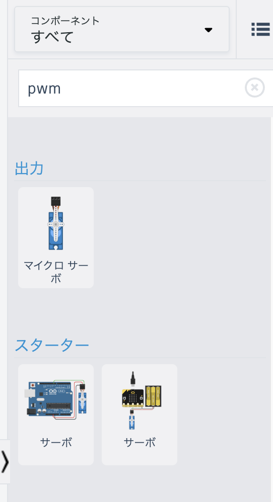

「PWM」で検索しても、**マイクロ サーボとサーボの見本だけ**が出た。**PWM は部品ではなく、ピンの使い方**だから。

| | 部品 | PWM |
| --- | --- | --- |
| 例 | LED、抵抗、ボタン | ピンを高速で 5V と 0V に切りかえて、平均の強さを変える方法 |
| 探す場所 | 部品の一覧 | Arduino のピンの印（`~`）と、コードの命令（`analogWrite`） |

Arduino UNO では、ピン番号の前に `~` がついたピン（3、5、6、9、10、11）で PWM が使える。29日目のピン `~9` がそれ。

**② 記事のどこを使い、どこを飛ばすか**

| 記事の節 | 書いてあること | どう使ったか |
| --- | --- | --- |
| 必要な部品 | 制御ボード、ブレッドボード、ジャンパーワイヤー、抵抗、LED | 29日目と同じ。Tinkercad の部品を置く |
| 本文の説明 | 1.1 に似ているが、1.1 は**デジタル**信号で点灯・消灯、こちらは**アナログ**信号で明るさを変える、という対比。動かすと「LED が息を吹き返すように見える」 | 読んだ |
| 回路図・配線図 | 画像だけ（ピン番号、抵抗の値の文字の説明はない） | 画像を見て、29日目と同じ回路だと確かめた（下の画像） |
| コード | 記事の中の埋め込み画面にあり、本文には載っていない | 手元のコード（記事のコード）を打った。下の ⑤ |
| Arduino IDE の手順 | — | 飛ばす |

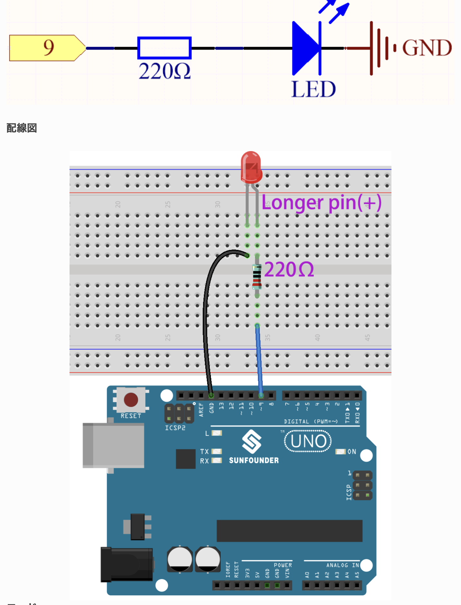

> 記事外：PWM のしくみ、`analogWrite` が 0〜255 であること、`~` のついたピンがPWM対応であることは、記事の本文に書いていない。この記録で補った。

**③ PWM のしくみ**

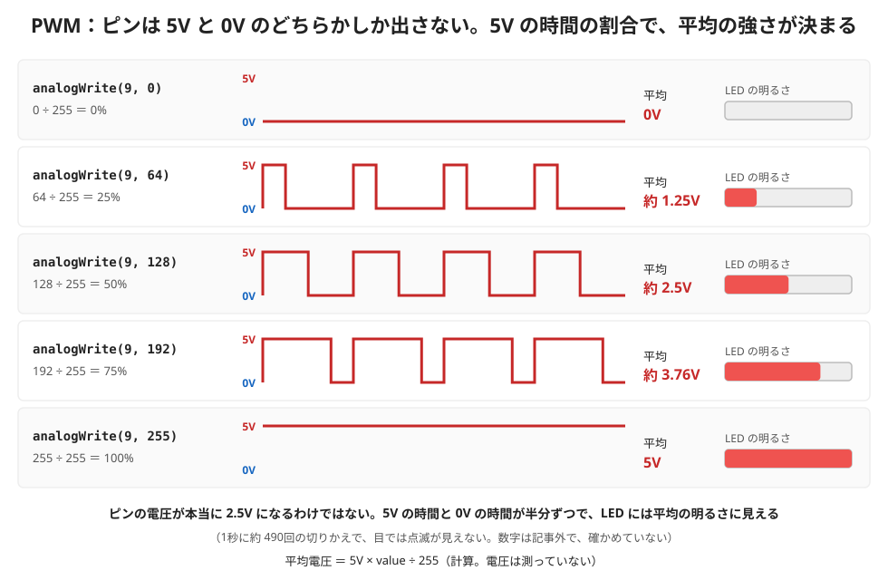

ピンは、5V と 0V の**どちらか**しか出さない。5V の時間の割合（デューティ比）を変えると、LED には**平均の明るさ**に見える。

| 手順 | 考え方 | 計算 | 答え |
| --- | --- | --- | --- |
| 1 | `analogWrite(9, 128)` の、5V の時間の割合 | 128 ÷ 255 | 約 0.502（約 50%） |
| 2 | 平均電圧 ＝ 5V × 割合 | 5V × 0.502 | **約 2.5V** |

| `analogWrite` の値 | 5V の時間の割合 | 平均電圧 | LED の見た目 |
| --- | --- | --- | --- |
| 0 | 0% | 0V | 消えている |
| 64 | 約 25% | 約 1.25V | 暗い |
| 128 | 約 50% | 約 2.5V | 半分くらい |
| 192 | 約 75% | 約 3.76V | 明るい |
| 255 | 100% | 5V | 最大 |

（計算。電圧は測っていない）

> ピンは、2.5V を出しているわけではない。5V と 0V を交互に出していて、2.5V は**平均**。記事外：UNO の `~9` は、1秒に約 490回切りかえるとされる（一般的な仕様で、この記録では確かめていない）。1回は約 2ミリ秒なので、目では点滅が見えない。

**④ 回路：29日目と同じ（ピン `~9` → 220Ω → LED → GND）**

| 配線図（フェージング中・1） | 配線図（フェージング中・2） |
| --- | --- |
| 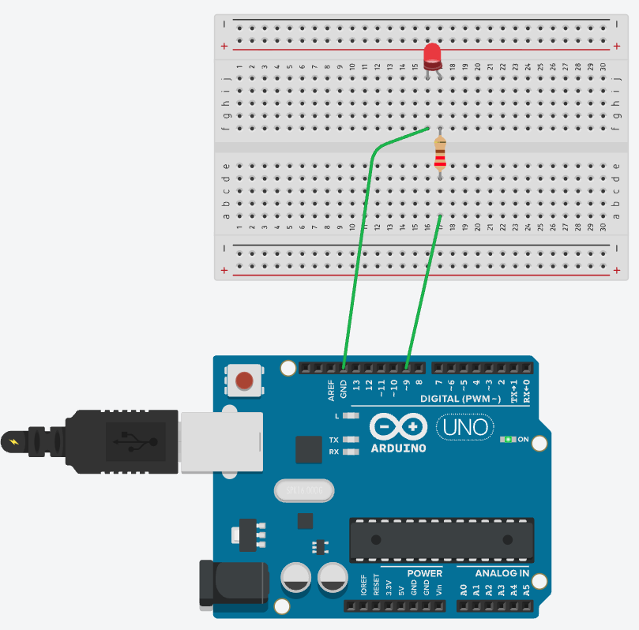 | 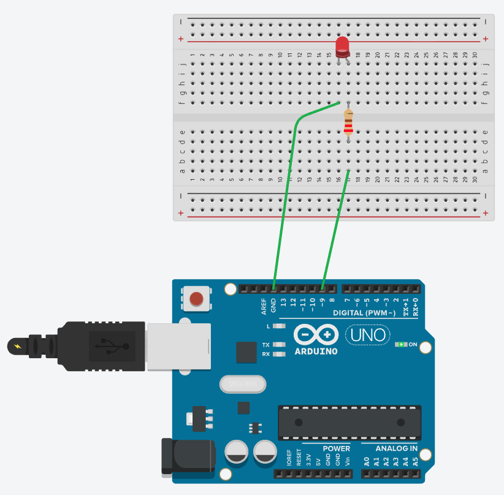 |

回路は、[29日目](#29日目-ledとシリアルモニタ)の LED と同じ。ピン9 → 17a → 抵抗（17d → 17f）→ LED（16 と 17）→ 16f → `GND`。

**⑤ コード：1行ずつ読む**

保存したコード：[code/day31_fading/day31_fading.ino](code/day31_fading/day31_fading.ino)

```cpp
int ledPin = 9;

void setup() {
}

void loop() {
  for (int value = 0; value <= 255; value += 5) {
    analogWrite(ledPin, value);
    delay(30);
  }
}
```

| 行 | 意味 | いつ動くか |
| --- | --- | --- |
| `int ledPin = 9;` | LED のピン番号に名前をつける | 最初に1回 |
| `void setup() { }` | **中身が空**。`pinMode` を書いていない（Tinkercad では、このまま動いた） | 1回だけ |
| `for (int value = 0; value <= 255; value += 5) {` | `value` を 0 から始めて、255 以下のあいだ、5 ずつ増やしながら、`{ }` の中をくり返す | `loop()` の中で |
| `analogWrite(ledPin, value);` | ピン9の明るさを `value`（0〜255）にする | `for` の1回ごと |
| `delay(30);` | 30ミリ秒待つ | `for` の1回ごと |
| `}`（`for` の終わり）のあと | `loop()` の終わり。**先頭にもどり、`value` が 0 になる** | 毎回 |

**⑥ 1周の時間を計算する**

| 手順 | 考え方 | 計算 | 答え |
| --- | --- | --- | --- |
| 1 | `value` の数：0、5、10、…、255 | 255 ÷ 5 ＋ 1 | 52個 |
| 2 | 1個ごとに 30ミリ秒待つ | 52 × 30ミリ秒 | 1560ミリ秒 |
| 3 | 秒にする（÷1000） | 1560 ÷ 1000 | **約 1.56秒** |

（計算。測っていない。`analogWrite` の実行時間は無視している）

**⑦ 結果**

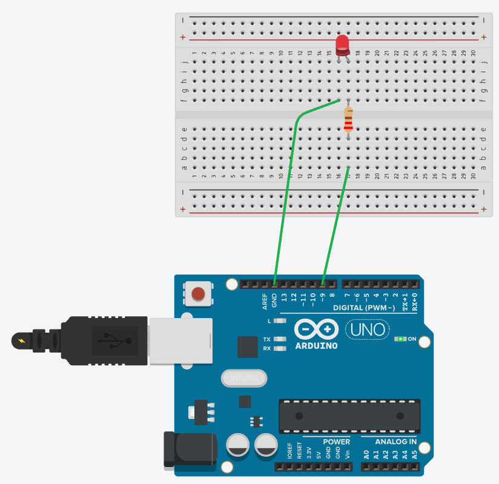

| 試したこと | あなたの回答 | 分かったこと |
| --- | --- | --- |
| 記事のコードで、255 のあと | **急に暗くなる** | `for` が終わって `loop()` の先頭にもどり、`value` が 0 になる。「ゆっくり明るくなって、パッと消える」動き |
| 明るくなる1回の時間 | 1秒くらい（目測） | 計算は約 1.56秒。目測なので、ほぼ合っている。測るなら、ストップウォッチか `millis()`（32日目） |
| `analogWrite(9, 128)` に固定 | 半分くらい | 5V の時間が約 50%、平均 約 2.5V。保存したコード：[code/day31_analogwrite_128/day31_analogwrite_128.ino](code/day31_analogwrite_128/day31_analogwrite_128.ino) |

### 2. 読む・組む：[4.1 ノブを回す](https://docs.sunfounder.com/projects/3in1-kit-v2/ja/latest/basic_project/ar_turn_the_knob.html)と[5.6 マッピング](https://docs.sunfounder.com/projects/3in1-kit-v2/ja/latest/basic_project/ar_map.html)。可変抵抗（分圧）の値0〜1023を、PWMの0〜255に変換する（50分）

**① 「ポテンショメータ」は、Tinkercad では「可変抵抗器」**

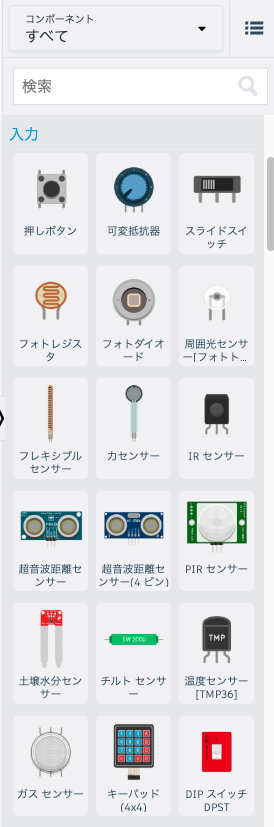

| 記事の部品 | Tinkercad | メモ |
| --- | --- | --- |
| ポテンショメータ | **可変抵抗器**（入力の中。青い丸いつまみの部品） | 「ポテンショメータ」で検索しても出なかった。日本語の名前は「可変抵抗器」 |
| 抵抗の値：10kΩ のトリマー（5.6 の部品表） | 初期値は **250kΩ**（部品をクリックすると変えられる） | 分圧は抵抗の**比**で決まるので、250kΩ でも読む数字は同じ |

**② 4.1 の記事のどこを使い、どこを飛ばすか**

| 記事の節 | 書いてあること | どう使ったか |
| --- | --- | --- |
| 必要な部品 | 制御ボード、ブレッドボード、ジャンパーワイヤー、ポテンショメータ | 可変抵抗器を置く |
| 回路図 | A0 でポテンショメータの値を読む。軸を回すと、3本の端子のあいだの抵抗の割合が変わり、**中央の端子の電圧が変わる**。5V につないだ側との抵抗が 0 に近いと、中央は 5V に近く、10kΩ に近いと 0V に近い | そのまま写す |
| 配線図 | 画像だけ（文字の説明はない） | 画像を見て写す（下の画像） |
| コード | 記事の中の埋め込み画面にあり、本文には載っていない | 手元のコードを打った。下の ④ |
| 結果 | シリアルモニタで、軸を回すと 0 から 1023 の値が出る | 動かして確かめた |

| 記事の回路図 | 記事の配線図 |
| --- | --- |
| 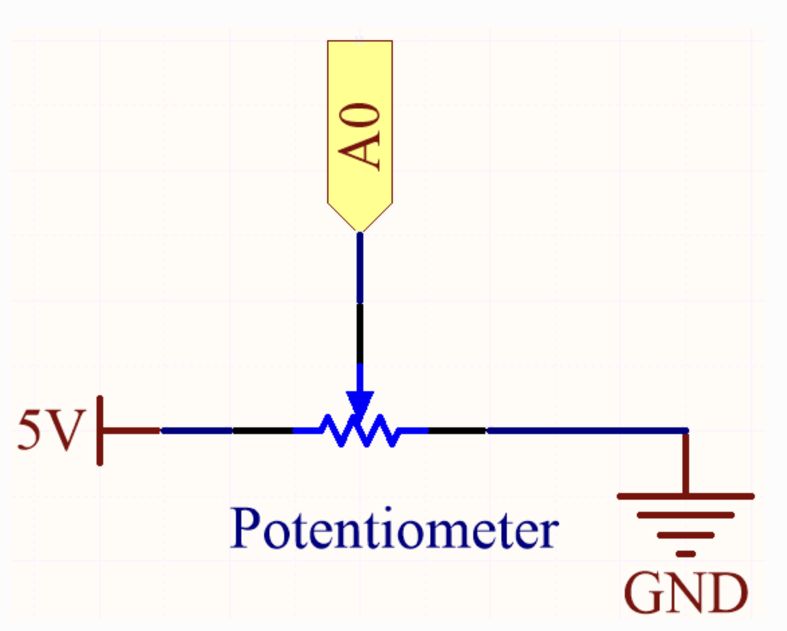 | 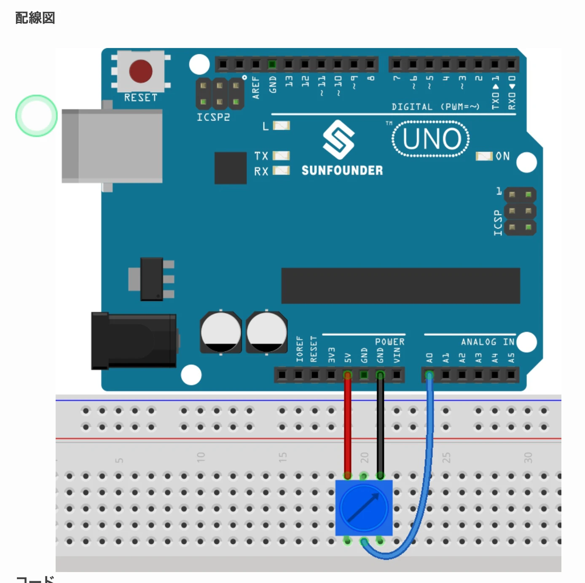 |

> 記事外：`analogRead` という関数名、0〜1023 になる理由（1024 段階）、「分圧」という言葉と式は、記事の本文に書いていない。この記録で補った。

**③ 回路：可変抵抗器の片端 → 5V、もう一方 → GND、真ん中 → A0**

| 配線図 | 回路図表示 |
| --- | --- |
| 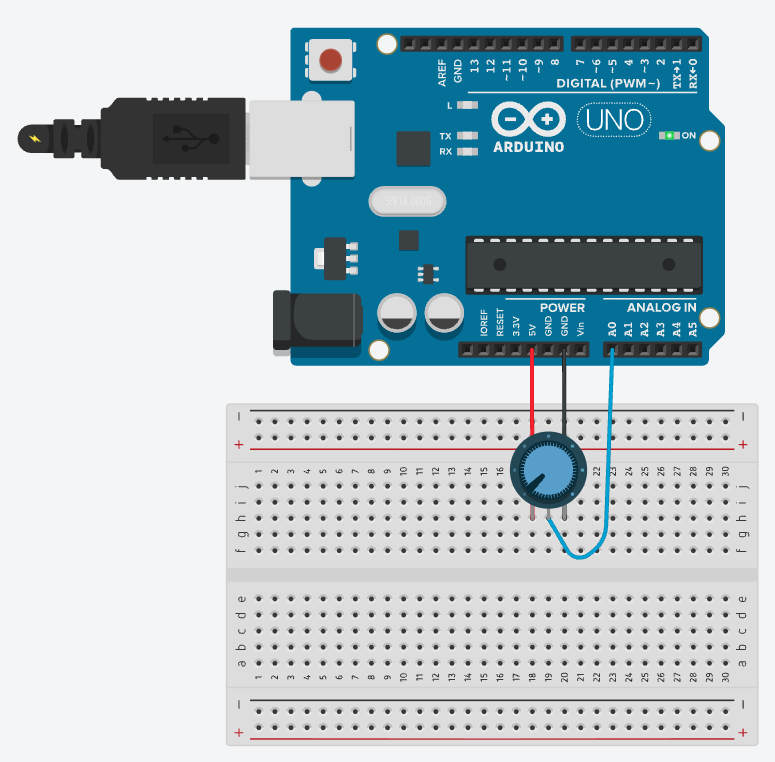 | 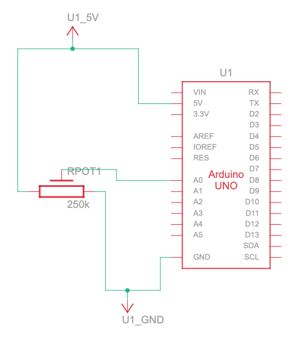 |

| 順番 | 場所 | つながる理由 |
| --- | --- | --- |
| 1 | Arduino の `5V` → 赤い線 → 可変抵抗器の**左の足** | 線 |
| 2 | Arduino の `GND` → 黒い線 → 可変抵抗器の**右の足** | 線 |
| 3 | 可変抵抗器の**真ん中の足** → 青い線 → Arduino の `A0` | 線。つまみで電圧が変わる点 |

3本の足は、別々の列に刺す（同じ列に2本刺すと、24日目と同じショート）。回路図表示では、RPOT1（250k）の左の端が 5V、右の端が GND、真ん中の矢印が A0 につながっている。

| 部品の値を見る画面 |
| --- |
| 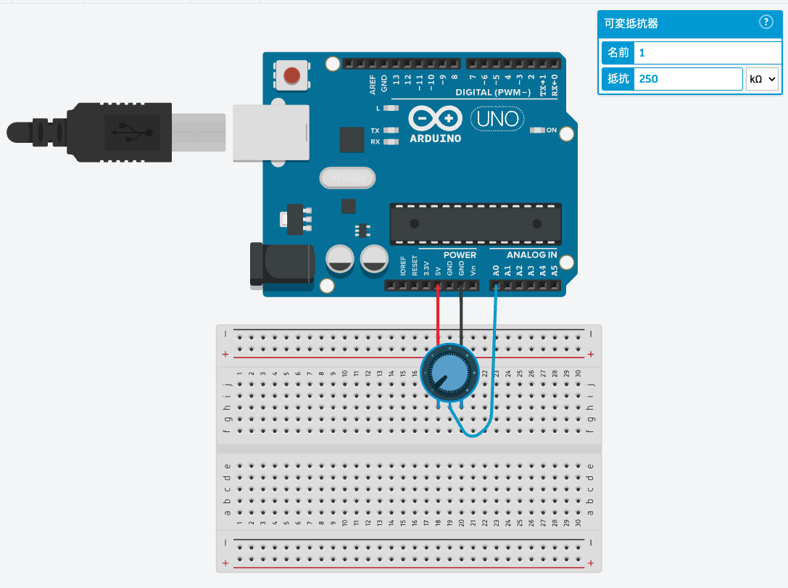 |

**④ コード：1行ずつ読む**

保存したコード：[code/day31_knob_serial/day31_knob_serial.ino](code/day31_knob_serial/day31_knob_serial.ino)

```cpp
int analogPin = A0;
int val = 0;

void setup() {
  Serial.begin(9600);
}

void loop() {
  val = analogRead(analogPin);
  Serial.println(val);
}
```

| 行 | 意味 | いつ動くか |
| --- | --- | --- |
| `int analogPin = A0;` | 可変抵抗器をつないだピン `A0` に名前をつける | 最初に1回 |
| `int val = 0;` | 読んだ値を入れる箱 | 最初に1回 |
| `Serial.begin(9600);` | 画面に出す準備（29日目） | `setup()` で1回 |
| `val = analogRead(analogPin);` | A0 の電圧（0V〜5V）を、**0〜1023 の数字**にして読む | `loop()` で毎回 |
| `Serial.println(val);` | 読んだ数字を画面に出す | 毎回 |

`analogRead` は、30日目の `digitalRead`（0 か 1 の2択）と**ちがい**、**0〜1023 の細かい数字**で返す。

**⑤ 結果：つまみを3か所に回した**

| 画面：`0`（GND 側の端） | 画面：`511`（真ん中） |
| --- | --- |
| 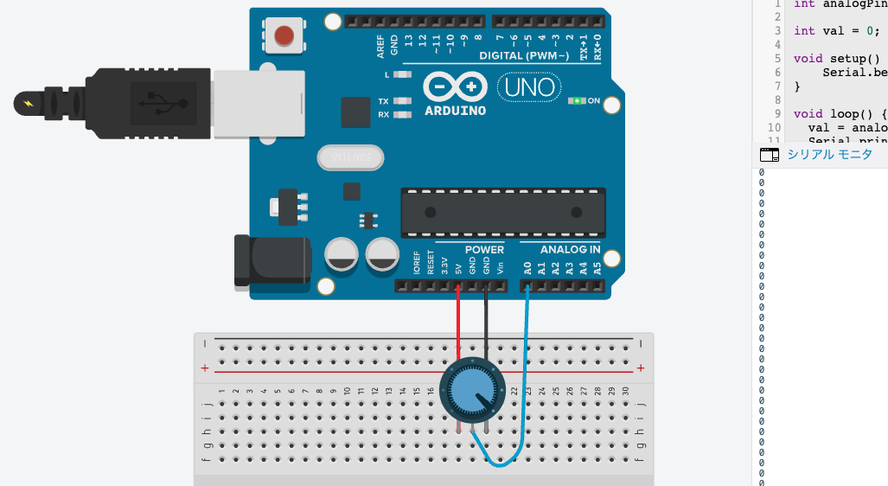 | 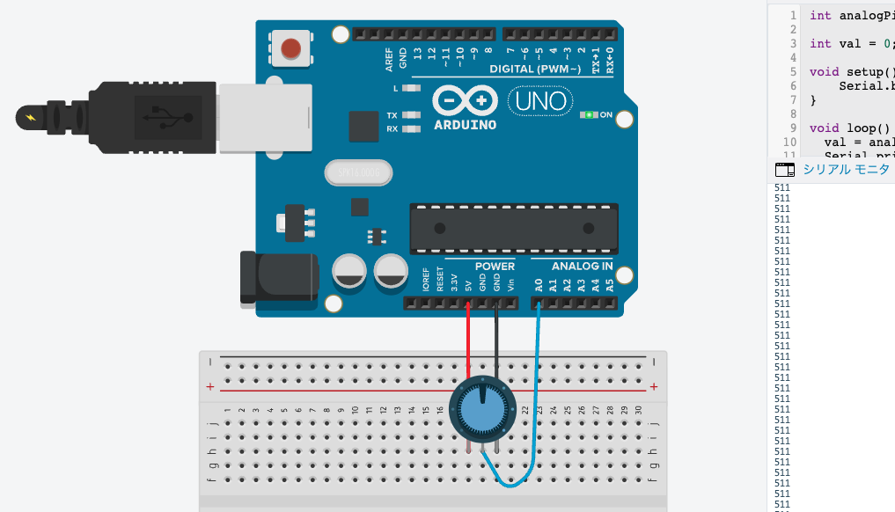 |

| 画面：`1023`（5V 側の端） | 前に出た画面：`1023`（最初の状態） |
| --- | --- |
| 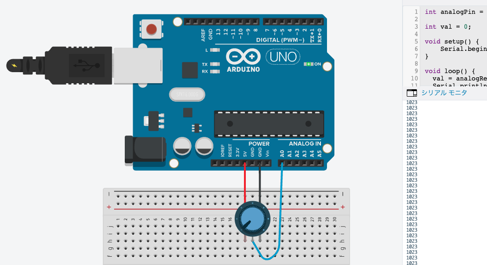 | 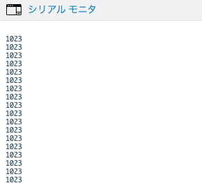 |

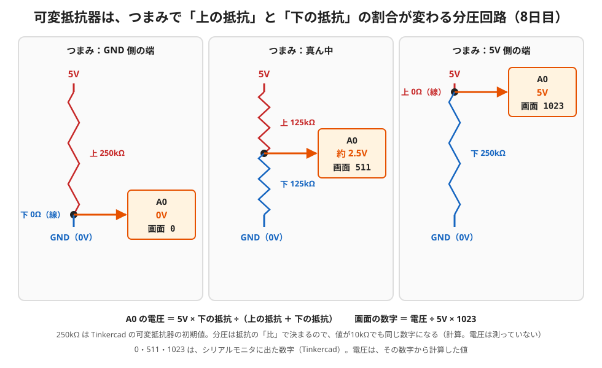

| つまみ | 画面 | A0 の電圧（計算） | 意味 |
| --- | --- | --- | --- |
| GND 側の端 | **0** | 0V | 真ん中の足が GND 側の端にある（上 250kΩ、下 0Ω） |
| 真ん中 | **511** | 約 2.50V | 上と下の抵抗がほぼ同じ（125kΩ ずつ） |
| 5V 側の端 | **1023** | 5V | 真ん中の足が 5V 側の端にある（上 0Ω、下 250kΩ） |

| 手順 | 考え方 | 計算 | 答え |
| --- | --- | --- | --- |
| 1 | 電圧 ＝ 画面の数字 ÷ 1023 × 5V | 511 ÷ 1023 × 5 | 約 2.4976V（約 2.50V） |
| 2 | 1段あたりの電圧 ＝ 5V ÷ 1023 | 5 ÷ 1023 | 約 0.00489V（約 4.9mV） |

予想（Claude の計算）は「真ん中は約 512」で、結果は **511** だった。差は 1。つまみがぴったり真ん中でなかったか、丸めの差かもしれないが、**確かめていない**。

途中の値も見た（つまみを GND 側の端の近くで止めたとき）。

| 画面の数字 | A0 の電圧（計算） | つまみの位置（GND 端から） | 下の抵抗（250kΩ のうち） |
| --- | --- | --- | --- |
| 164 | 約 0.80V | 約 16% | 約 40kΩ |
| 102 | 約 0.50V | 約 10% | 約 25kΩ |
| 82 | 約 0.40V | 約 8% | 約 20kΩ |

（計算。つまみを回した角度に比例して、抵抗が変わると仮定した）

> 画面の数字は、つまみを止めると**ぴたっと止まった**（Tinkercad にはノイズがない）。記事外：実機では、止めても 1〜2 ゆれる（44日目の「移動平均」で扱う）。

**⑥ 5.6 マッピング：記事の内容**

| 記事の節 | 書いてあること | どう使ったか |
| --- | --- | --- |
| 必要な部品 | 制御ボード、ブレッドボード、ジャンパーワイヤー、**サーボ（SG90）**、ポテンショメータ（10kΩ のトリマー） | サーボは Tinkercad の「マイクロ サーボ」を使う |
| 回路図・配線図 | 画像だけ | 画像を見て写した（⑧） |
| `map` の説明 | `map(値, 元の下限, 元の上限, 先の下限, 先の上限)`。元の下限は先の下限に、元の上限は先の上限になる | ⑦ で計算した |
| なぜ必要か | アナログ入力は 0〜1023、アナログ出力は 0〜255、サーボの角度は 0〜180。**範囲がちがう**ので、変換する | 同じ |
| 注意 | 下限と上限は**逆にしてもよい**（向きが反転する）。負の数も使える。**整数なので、小数点以下は切り捨て** | 切り捨ては、`511 -> 89` で確かめた |
| コード | 本文に載っているのは3行の断片（`analogRead` → `map(x, 0, 1023, 0, 255)` → `analogWrite`）。完全なコードは、`Servo` ライブラリで**サーボを動かす**もの | 手元の完全なコード（サーボ版）を打った |

> チェックリストの31日目には「0〜1023 を、PWM の 0〜255 に変換する」とある。**記事の完全なコードは、0〜180 のサーボ版**だった。Claude が先に LED 版（0〜255）のコードを出してしまったのは、まちがい（下の「Claude の説明のまちがい」）。

**⑦ `map` の計算**

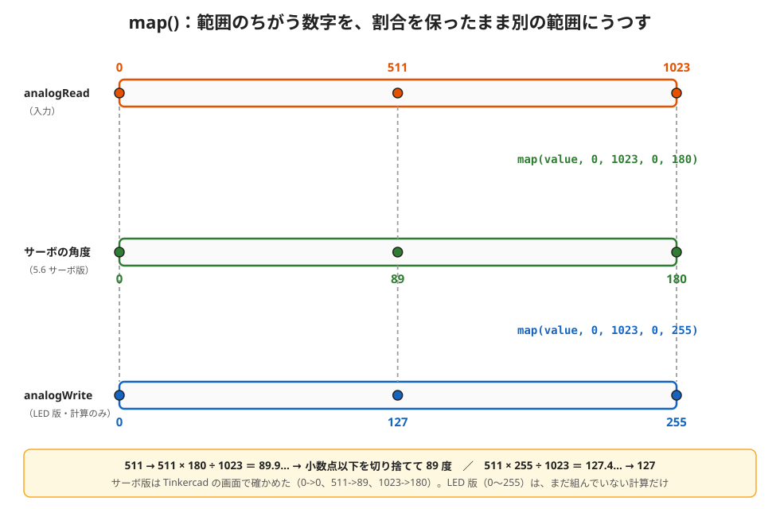

| `value` | サーボ版（0〜180度） | LED 版（0〜255）（計算のみ） |
| --- | --- | --- |
| 0 | 0 | 0 |
| 82 | 82 × 180 ÷ 1023 ＝ 14.4… → **14** | 82 × 255 ÷ 1023 ＝ 20.4… → **20** |
| 102 | 102 × 180 ÷ 1023 ＝ 17.9… → **17** | 102 × 255 ÷ 1023 ＝ 25.4… → **25** |
| 164 | 164 × 180 ÷ 1023 ＝ 28.8… → **28** | 164 × 255 ÷ 1023 ＝ 40.8… → **40** |
| 511 | 511 × 180 ÷ 1023 ＝ 89.9… → **89** | 511 × 255 ÷ 1023 ＝ 127.4… → **127** |
| 1023 | 1023 × 180 ÷ 1023 ＝ **180** | 1023 × 255 ÷ 1023 ＝ **255** |

（計算。`map` は整数で計算して、小数点以下を切り捨てる）

**⑧ サーボ版：回路とコード**

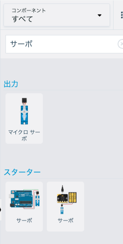

出力の中の「**マイクロ サーボ**」を使う。「スターター」の2つのサーボは、Arduino や micro:bit つきの**見本の回路**で、部品ではない。

| 部品 | つなぎ先 |
| --- | --- |
| 可変抵抗器 | 前のまま（5V、GND、真ん中 → A0） |
| サーボの**信号**（オレンジ） | Arduino の `~9` |
| サーボの**電源**（赤） | ブレッドボードの ＋ の列 |
| サーボの **GND**（茶または黒） | ブレッドボードの − の列 |
| Arduino の `5V` | → ＋ の列（赤い線） |
| Arduino の `GND`（2つ目） | → − の列（黒い線） |

| 記事の配線図 | 直したあとの配線図（Tinkercad） |
| --- | --- |
| 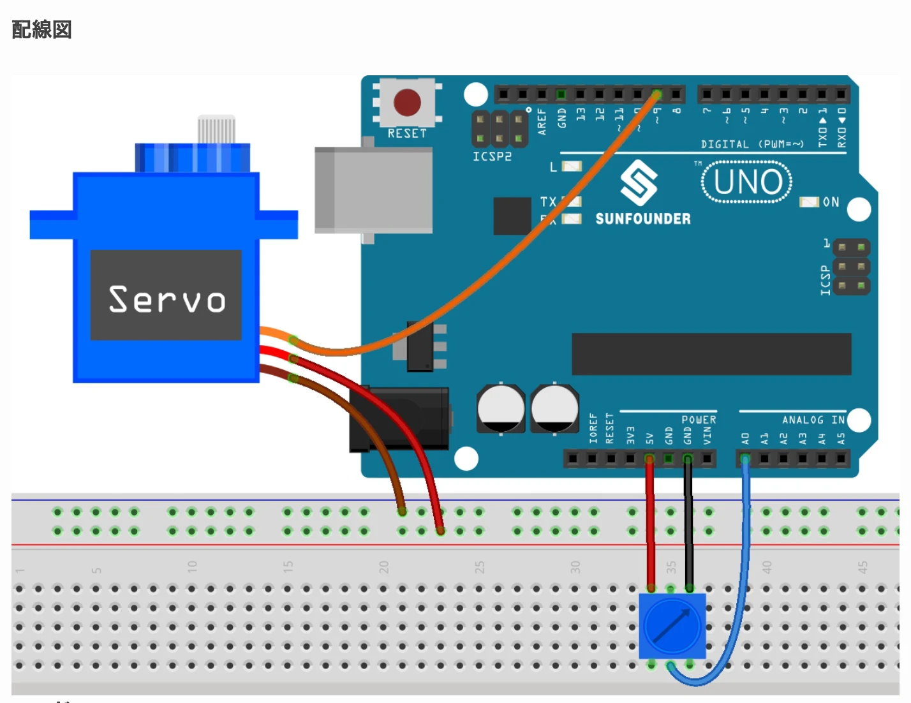 | 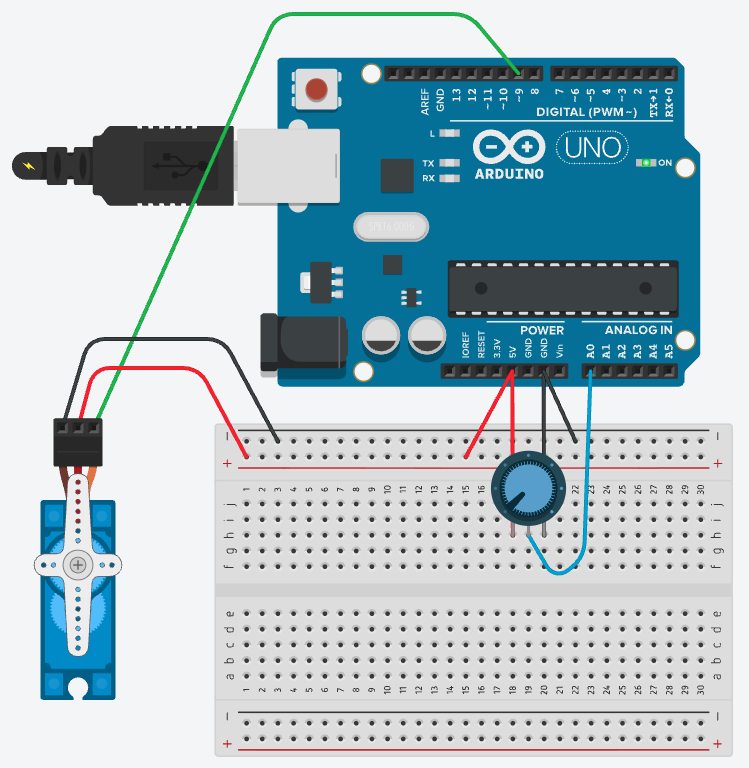 |

保存したコード：[code/day31_servo_map/day31_servo_map.ino](code/day31_servo_map/day31_servo_map.ino)

```cpp
#include <Servo.h>

Servo myservo;

const int servoPin = 9;
const int knob = A0;

void setup() {
  Serial.begin(9600);
  myservo.attach(servoPin);
}

void loop() {
  int value = analogRead(knob);
  int angle = map(value, 0, 1023, 0, 180);
  myservo.write(angle);
  Serial.print(value);
  Serial.print(" -> ");
  Serial.println(angle);
  delay(15);
}
```

| 行 | 意味 | いつ動くか |
| --- | --- | --- |
| `#include <Servo.h>` | サーボ用の道具（ライブラリ）を使えるようにする | 最初 |
| `Servo myservo;` | `myservo` という名前で、サーボを1つ用意する | 最初に1回 |
| `myservo.attach(servoPin);` | サーボがピン9につながっていると教える | `setup()` で1回 |
| `analogRead(knob)` | 可変抵抗器の値（0〜1023） | `loop()` で毎回 |
| `map(value, 0, 1023, 0, 180)` | 0〜1023 を 0〜180 に変換（小数点以下は切り捨て） | 毎回 |
| `myservo.write(angle);` | サーボを `angle` 度にする | 毎回 |
| `Serial.print(value);` ほか3行 | 「読んだ値 -> 角度」を1行で出す（記事にはない、確かめるための3行） | 毎回 |
| `delay(15);` | 15ミリ秒待つ。コメントによると「サーボが動くのを待つ」 | 毎回 |

> 記事外：`Servo` ライブラリを使うと、UNO ではピン9と10の `analogWrite`（PWM）が使えなくなるとされる（一般的な仕様。この記録では確かめていない）。LED とサーボを同時に使うときは、LED を別の `~` ピン（5 や 6 など）につなぐ。

**⑨ 結果：画面の数字と、サーボの向き**

| つまみ：GND 側の端 | つまみ：真ん中 |
| --- | --- |
| 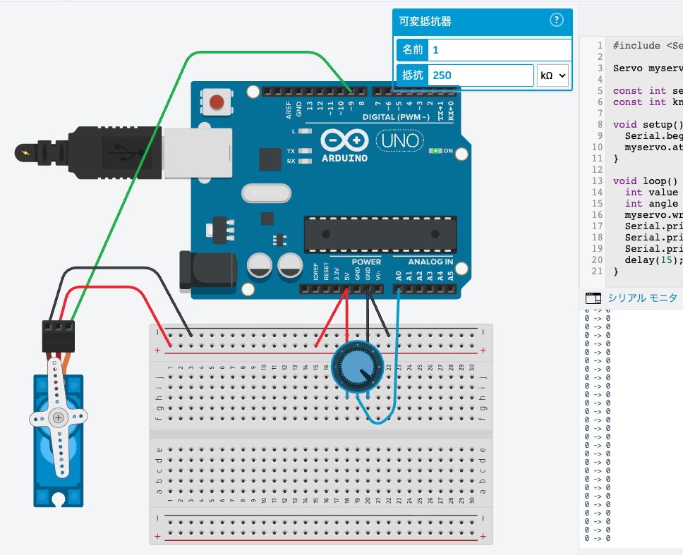 | 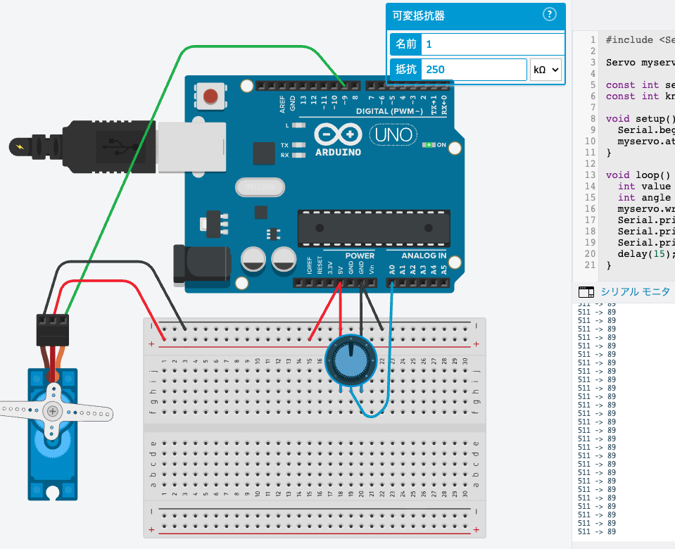 |

| つまみ：5V 側の端 | |
| --- | --- |
| 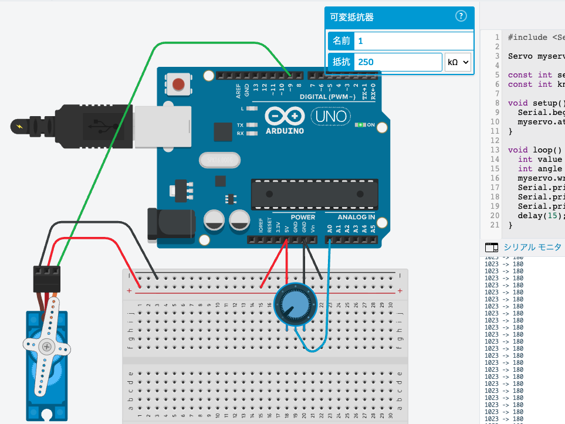 | |

| つまみ | 画面 | 計算（予想） | サーボの腕 |
| --- | --- | --- | --- |
| GND 側の端 | `0 -> 0` | `0 -> 0` | 縦に見える |
| 真ん中 | `511 -> 89` | `511 -> 89` | **横**に見える（90度に近い） |
| 5V 側の端 | `1023 -> 180` | `1023 -> 180` | 縦に見える |

画面の数字は、計算と**ぴたりと一致**した。

**⑩ 停止中と実行中で、向きがちがって見える**

| 停止中（「ON」のランプが消えている） | 実行中（つまみが端でない） |
| --- | --- |
| 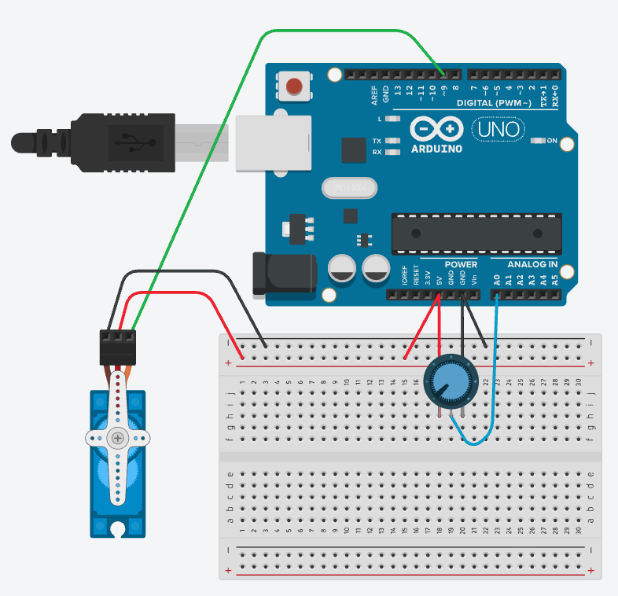 | 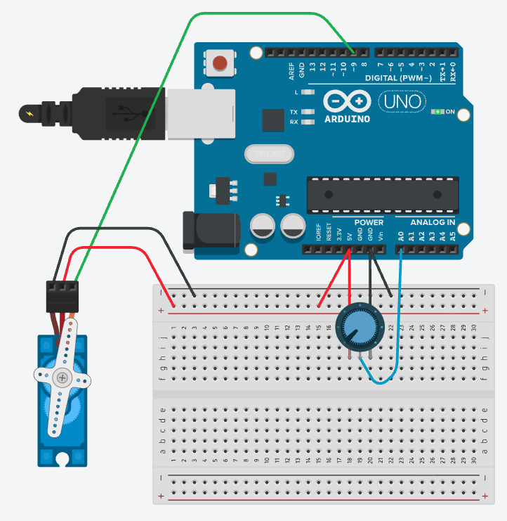 |


| 疑問 | 答え |
| --- | --- |
| 停止中は完全な縦なのに、実行すると少しずれる | 停止中の「縦」は、部品を置いたときの**初期の絵**で、何度かを表すものではない（見た目からの推定で、仕様書では確かめていない）。実行中は `myservo.write(angle)` の角度に動くので、**つまみが端でないとき、縦からずれて見えるのは正しい** |
| 0度のとき | 画面 `0 -> 0` のとき、腕は停止中と同じ縦に見えた |
| 腕の向きは、反対向きになっている？ | 0度と180度は、どちらも縦に見える。長い腕が上か下かで区別できるが、**スクリーンショットでは読みきれなかった** |

| つまみの位置 a | つまみの位置 b |
| --- | --- |
|  |  |

| つまみの位置 c | |
| --- | --- |
|  | |

（画面の数字を出す前の、3つの位置。つまみを動かすと、腕の向きが変わる）

<details>
<summary>まちがい：サーボの電源の列が、Arduino につながっていなかった（クリックで開く）</summary>

実行する前に、スクリーンショットから見つけた（動かしてはいない）。

| サーボの線を、電源の列につなぎ、Arduino とつながっていない | 直したあと |
| --- | --- |
|  |  |

| # | 症状 | 原因 | 直し方 |
| --- | --- | --- | --- |
| 1 | サーボの赤い線と黒い線が、ブレッドボードの ＋ と − の列に刺さっているが、**その列が Arduino の 5V と GND につながっていない**（動かしていないが、このままでは電気が来ない） | 可変抵抗器の赤い線と黒い線は、Arduino の 5V と GND に**直接**つながっていて、サーボの電源だけが、どこにもつながらない列にあった。ブレッドボードの ＋ と − の列は、**線でつなぐまでは、ただの穴** | Arduino の `5V` → ＋ の列、Arduino の `GND`（2つ目）→ − の列、の線を2本足した |

**記事の配線図との比べ**：記事の配線図でも、サーボの赤と茶の線は、ブレッドボードの上の列に刺さっている。Arduino の 5V と GND から出る赤と黒の線は、まっすぐ可変抵抗器につながっていて、**列に入っている線は、私には見えなかった**。記事の図の省略か、私の見落としかは、**確かめきれなかった**。見た目が同じでも、電気がつながっているかは別、という例になった。

**Claude の説明のまちがい**

| # | まちがい | 本当は |
| --- | --- | --- |
| 1 | 「Tinkercad で『ポテンショメータ』と検索して」と案内した | 日本語の部品名は**可変抵抗器**で、「入力」の中にある。名前を確かめずに案内して、探すのが遅れた |
| 2 | 5.6 のコードは LED 用だと思い込んで、LED 版のコードを先に出した | 記事の完全なコードは、**サーボ版**（0〜180）だった。チェックリストの「0〜255」は LED 版を指す |

</details>

### 3. 記録：「可変抵抗は第2週の分圧回路そのもの」であることを回路図で確認

| 回路図表示（Tinkercad） | 分圧の図 |
| --- | --- |
|  |  |

| 第2週の分圧回路（[8日目](../../phase1-electronics/week2/README.md#8日目-分圧の式)） | 今日の可変抵抗器 |
| --- | --- |
| 5V → 上の抵抗 → 境目 → 下の抵抗 → GND | 5V → 可変抵抗器の上側 → **真ん中の足** → 可変抵抗器の下側 → GND |
| 境目の電圧 ＝ 5V × 下 ÷（上 ＋ 下） | 真ん中の足の電圧 ＝ 5V × 下 ÷（上 ＋ 下） |
| 抵抗の値は決まっている（2本の固定抵抗） | **上と下の合計は 250kΩ で一定**。つまみで、上と下の割合が変わる |

| 手順 | 考え方 | 計算 | 答え |
| --- | --- | --- | --- |
| 1 | 真ん中で、上 125kΩ、下 125kΩ（つまみが真ん中） | 5V × 125k ÷ (125k ＋ 125k) | **2.5V** |
| 2 | 画面の数字にする（÷5V × 1023） | 2.5 ÷ 5 × 1023 | 約 511.5（画面は **511**） |

回路図表示の RPOT1（250k）は、左の端が 5V、右の端が GND、真ん中の矢印が A0 につながっている。つまり、**可変抵抗器は、2本の抵抗を、つまみで割合を変えられる1つの部品にした分圧回路**。真ん中の足の電圧を、`analogRead` が 0〜1023 の数字にして読んでいる。

### この日のまとめ：予想 → 結果 → 差の理由

今日は、動かす前の予想を、書かなかった（または、動かす前の予想と、動かしたあとの回答が区別できなかった）項目がある。下の「予想」は、そのとき思っていたこと。**次の日からは、動かす前に予想を書く。**

| 何を測った／試したか | 予想 | 結果 | 差の理由 |
| --- | --- | --- | --- |
| Tinkercad で「PWM」を検索 | 部品がある | ない（サーボしか出ない） | PWM は部品ではなく、`~` のついたピンの使い方 |
| 2.1：255 のあとの LED | 回答：急に暗くなる | 急に暗くなる | `for` が終わって 0 にもどる |
| 2.1：明るくなる1回の時間 | 約 1.56秒（Claude の計算）／回答：1秒くらい | 目測で約 1秒（測っていない） | 目測のずれ。測るなら `millis()`（32日目） |
| `analogWrite(9, 128)` の明るさ | 回答：半分くらい | 半分くらい | 5V の時間が約 50%（平均 約 2.5V） |
| 4.1：つまみの両端と真ん中の数字 | 書かなかった（Claude の計算：0、約 512、1023） | **0、511、1023** | 真ん中が 1 だけちがう。ぴったり真ん中でなかったか、丸めの差（確かめていない） |
| 5.6：`map` の答え | 書かなかった（計算：0、89、180） | **`0 -> 0`、`511 -> 89`、`1023 -> 180`** | 差なし。`511 -> 89` は、小数点以下の切り捨て |
| サーボの腕の向き（0、真ん中、180） | 書かなかった | 縦、横、縦に見える | 腕が上下対称なので、0度と180度は同じ縦に見える。反対向きかは未確認 |
| サーボの停止中と実行中 | 同じ向き | **ちがって見える** | 停止中は初期の絵。実行中はコードの角度に動く |
| サーボを動かせるか（最初の配線） | 動く | 実行前に、電源の列が Arduino につながっていないと気づいた | ＋ と − の列は、線でつなぐまで電気が来ない |
| LED 版（0〜255） | — | **まだ組んでいない**（計算のみ） | — |

**まだ試していないこと**（時間のある日に）

| 試すこと | 先に書く予想 |
| --- | --- |
| LED 版：つまみで LED の明るさを変える（`map(value, 0, 1023, 0, 255)`、LED は `~5` など） | つまみが真ん中（`511`）のとき、`brightness` はいくつ？（計算では 127） |
| `map(value, 0, 1023, 180, 0)` に逆向きで書く | サーボの回る向きが、逆になるか |
| 腕の長い側が、0度と180度で上と下になるか | 反対向きになっているか |
| 2.1 の1周の時間を、ストップウォッチで測る | 約 1.56秒に近いか |
| `delay(30)` や `value += 5` を変える | 明るくなる速さが、どう変わるか |

**実機を買ったらやり直すこと**

- SG90 のサーボと可変抵抗器で、5.6 を組む（Tinkercad の 250kΩ と、記事の 10kΩ のトリマーで、画面の数字が同じかも見る）
- つまみを止めて、画面の数字が 1〜2 ゆれるかを見る
- 記事外：サーボが動くと、電源の電圧が下がることがある（[19日目](../../phase1-electronics/week3/README.md#19日目-電池の内部抵抗とブラウンアウト)のブラウンアウトと同じ考え方）。Arduino が勝手にリセットされないかを見る（確かめていない）

## 32日目 millis() で待たない処理

> **ひとことで**：`delay()` を使わず、`millis()`（Arduino を動かしてからの時間）の**差**で「次の音の時刻か」を調べると、**メロディを鳴らしながら、ボタンで LED も動かせる**（5.4）。記事のコードには**まちがいが2つ**あり、`pinMode(buttonPin, OUTPUT)` のまま押すと、Tinkercad で爆発のマークが出た。改造では、LED を点滅させながらボタンを**すばやく10回**押すと、`delay()` 版は **1回**、`millis()` 版は **10回**見えた。

**この日にやったことと、分かったこと**

| # | やったこと | 分かったこと（一言） |
| --- | --- | --- |
| 1 | 5.4 を読んで、回路（ブザー＝ピン9、LED＝ピン8、ボタン＝ピン2）を組む | 記事に配線の文はなく、図だけ。LED とボタンは、これまでと同じ部品 |
| 2 | 記事のコードを打つ | `pitches.h` は Tinkercad で使えない。使う音だけ `#define` で決めた |
| 3 | エラーを直す | つづり、`;`、`setup()` と `loop()` の混同、配列の個数。エラー文は**一番上**から直す |
| 4 | ボタンを押すと爆発のマークが出る | ボタンの足の列のずれと、**記事のコードでピン2が `OUTPUT`**（これが原因）。`INPUT` に直して解決 |
| 5 | 動かす | メロディが止まらずくり返し鳴り、ボタンで LED が点き、押してもメロディは止まらない |
| 6 | `loop()` の最後に `delay(1000)` を足して比べる | メロディが遅くなり、LED は押して約1秒かかり、一瞬押すと見のがす |
| 7 | 改造：LED の点滅とボタンを、`delay()` 版と `millis()` 版で比べる | 10回押して、**`delay()` 版は 1回、`millis()` 版は 10回** |
| 8 | 記録の1行を書く | `delay()` のあいだは何も見ないので、押下を見のがす |

やることの詳細は[チェックリスト](../CHECKLIST.md#第5週-arduinoの基本)。

**何に役立つか**

| 使う場面 | どう使うか |
| --- | --- |
| ロボットが走りながら、センサーを読む | 「モーターを動かす」「センサーを読む」「音で知らせる」を、**止まらずに同時に**進める（今日の形） |
| ライントレースの制御周期 | 「一定の間隔（たとえば 10ミリ秒ごと）で、センサーを読んで、モーターを直す」を `millis()` で作る（第8週の PID 制御） |
| ボタンやスイッチを見のがさない | 非常停止ボタンなどを、`delay()` のあいだに見のがすと、危ない |
| 反応時間を測る（34日目の反応時間ゲーム） | 「光ってから押すまで」を、`millis()` の差で測る |
| 音で状態を知らせる | メロディやビープ音を鳴らしながら、動作を続ける（ロボットの警告音） |
| 動かない原因の切り分け | エラー文の行と文字の位置を読んで、1つずつ直す。爆発のマークは、線やコードを**1本ずつ外して**調べる |

**この日に出てくることば（`millis()` と時間）**

| ことば | 意味 | たとえ |
| --- | --- | --- |
| `millis()` | Arduino を動かしてから、**何ミリ秒たったか**を返す命令。止まらず、時計を見るだけ | 壁の時計を、ちらっと見る |
| `currentMillis` | いまの時刻（`millis()` で読んだ値）。今回の周回で読んだもの | いま何時か |
| `previousMillis` | 最後に何かをした時刻。前回の `currentMillis` を覚えておく箱 | 最後にお茶を入れた時刻のメモ |
| `interval` | 次にすることまでの待ち時間（ミリ秒） | 「30分ごとに」の30分 |
| `currentMillis - previousMillis` | 前回から**どれだけたったか**（経過時間） | 今の時刻 − メモの時刻 |
| `unsigned long` | 0 以上の、とても大きな整数が入る箱。`millis()` の値を入れる（`int` では足りない） | 大きな数まで数えられる、長いメーター |
| `delay()` | 指定の時間、**止まって何もしない**命令 | 電子レンジの前で、立ちつくして待つ |
| ノンブロッキング | 待っているあいだも、**ほかの処理を止めない**書き方 | 待つあいだに、別の用事をする |

**この日に出てくることば（ブザー・配列・エラー）**

| ことば | 意味 | たとえ |
| --- | --- | --- |
| ブザー（パッシブブザー） | 電気を高速で入り切りして、音を出す部品。音の高さは、入り切りの速さで決まる（記事の部品名から。本文では種類を明記していない） | 振動で音を出すスピーカー |
| `tone(ピン, 周波数, 長さ)` | そのピンから、決まった高さの音を、決まった長さ（ミリ秒）だけ出す命令 | 指定の高さで、ピッと鳴らす |
| 周波数（Hz） | 1秒に何回ふるえるか。大きいほど高い音。ド（C4）は 262Hz | 1秒間の波の数 |
| 休符 | 音を出さない長さ。このコードでは、音の高さを `0` にしている | 楽譜の「休み」 |
| 配列（`int melody[] = { … }`） | 同じ種類の値を、順番に並べて1つの名前で持つ箱 | 番号つきのロッカー |
| 番号（インデックス） | 配列の何番目か。**0 から**数える。`melody[0]` が最初 | ロッカーの番号。1番ではなく0番から |
| 配列の外 | 配列の個数より大きい番号を読むこと。**何が入っているか決まっていない** | 9席しかない劇場の、10番目の席 |
| `sizeof(melody) / 2` | 配列の個数を数える式（`int` は2バイトなので、全体の大きさを2で割る） | ロッカーの全体の幅 ÷ 1つの幅 |
| `#define 名前 値` | 「この名前を、この値に置きかえる」と決める。数字に名前をつける | 辞書に「ド ＝ 262」と書く |
| `#include "〜.h"` | 別のファイル（ヘッダファイル）を読みこむ。Tinkercad のコード画面では、別ファイルを足せない | 別の本を、机に広げる |
| エラー文の `15:1` | **15行目の1文字目**で、エラーが見つかった | 本の15ページの1行目 |

### 0. 先に：この日に使う前提知識

**① `delay()` で待つ点滅（[29日目](#29日目-ledとシリアルモニタ)）**

29日目の点滅は、`delay(500)` で、0.5秒**止まって**待っていた。止まっているあいだ、Arduino は**ほかのことが何もできない**。

**② ボタンを読む（[30日目](#30日目-ボタンを読む)）**

| 使うもの | 意味 |
| --- | --- |
| `pinMode(ボタンのピン, INPUT)` | ボタンのピンは**入力**（`OUTPUT` にしてはいけない。今日の爆発の原因） |
| 5V → ボタン → ピン2、ピン2 → 10kΩ → GND | プルダウン。押すと `1`、離すと `0` |
| `lastButtonState` | 前回の値を覚えて、「押した瞬間」だけ見つける |
| `%`（あまり） | 割り算のあまり。`(7 + 1) % 8 ＝ 0` のように、番号を最初にもどす |

**③ 経過時間の考え方**

| 例 | 計算 | 答え |
| --- | --- | --- |
| 前回が 1000ミリ秒で、いまが 1250ミリ秒 | 1250 − 1000 | 250ミリ秒たった |
| `interval` が 500 のとき、250 たった | 250 ≧ 500 ? | **いいえ**（まだ） |
| 同じく、600 たった | 600 ≧ 500 ? | **はい**（音を出す時刻） |

### 1. 読む・組む：[5.4 インターバル](https://docs.sunfounder.com/projects/3in1-kit-v2/ja/latest/basic_project/ar_interval.html)（40分）

**① 記事のどこを使い、どこを飛ばすか**

| 記事の節 | 書いてあること | どう使ったか |
| --- | --- | --- |
| 必要な部品 | 制御ボード、ブレッドボード、ジャンパーワイヤー、抵抗、LED、ボタン、ブザー（購入リンクの名前から、パッシブブザー） | Tinkercad の部品を置く |
| 回路図・配線図 | 画像だけ（文字の説明はない） | 画像を見て組む |
| コード | 記事の中の埋め込み画面にあり、本文には断片だけ。`previousMillis`、`thisNote`、`interval`、`currentMillis` の変数と、`tone` と LED の行 | ユーザーが貼った記事の完全なコードを使った（まちがいがあった。下の ⑥） |
| どのように動作するのか | `delay()` のあいだ、Arduino は止まって、そのあいだに押されたボタンを見のがす（電子レンジのピザの例え）。`millis()` と `previousMillis` の差が `interval` 以上になったら、音を出して、時刻を更新する | ④ にまとめた |

> 記事外：本文は「ボタンを押すたびに LED が点灯」と書くが、コードは**押している間だけ点く**動き（`digitalWrite(ledPin, digitalRead(buttonPin))`）。`noteDurations` の 4 や 8 は、音符の長さの「分母」と読める（4 ＝ 4分音符）。

**② 回路**

| 配線図（ブレッドボード） | 回路図表示 |
| --- | --- |
|  |  |

| 部品 | つなぎ先 |
| --- | --- |
| ブザーの `−` | 11列 → 黒い線 → − の列 → GND |
| ブザーの `+` | 16列 → 青い線 → **ピン9** |
| LED の曲がった足（アノード） | 20列 → 220Ω（20列と24列）→ 24列 → 水色の線 → **ピン8** |
| LED のまっすぐな足（カソード） | 19列 → 黒い線 → − の列 |
| ボタン | **25列と27列**（真ん中のみぞをまたぐ） |
| 27列 | → 赤い線 → ＋ の列 → 5V |
| 25列 | → 緑の線 → **ピン2**。10kΩ（21列と25列）→ 21列 → 黒い線 → − の列（プルダウン） |
| Arduino の `5V` → ＋ の列、`GND` → − の列 | 線 |

回路図表示では、D8 → 220Ω → LED → GND、D9 → ブザー → GND、ボタンの片側が 5V、反対側が D2 と 10kΩ（その先が GND）、になっている。5V と GND のショートはない。

> 途中の回路図には、**どこにもつながっていないブザーの記号**が1つ余分に出ていた（ブザーが2個あった）。爆発の原因ではなかったが、**あとで削除した**。上の回路図は、削除したあとのもの。

保存した回路：[Tinkercad で開く](https://www.tinkercad.com/things/1peYGEWcMtj-day32-millis-154-/editel?sharecode=ua-2gYmwqF4GbD_2EKZu5QAjVpaMOBUvmBRhPKebNI8)

**③ 数字はどこから来たか**

| 数字 | 種類 | どこから来たか |
| --- | --- | --- |
| 196、220、247、262（Hz） | A. 部品の性質（音の決まり） | G3、A3、B3、C4 の音の周波数。Arduino の標準の `pitches.h` と同じ値 |
| 1000（`interval` の最初と、`1000 / 音の長さ` の 1000） | B. 自分で決めた値 | 記事の値。1000ミリ秒 ＝ 1秒を、音の長さで割る |
| 100（`tone` の長さ） | B. 自分で決めた値 | 記事の値。音を鳴らす長さ（ミリ秒） |
| `noteDurations` の 4、8、2 | B. 自分で決めた値 | 音の長さの分母 |
| 10kΩ、220Ω | B. 自分で決めた値 | 30日目・29日目と同じ |

| 手順 | 考え方 | 計算 | 答え |
| --- | --- | --- | --- |
| 1 | 音の長さが 4 のときの待ち時間 | 1000 ÷ 4 | 250ミリ秒 |
| 2 | 8 のとき | 1000 ÷ 8 | 125ミリ秒 |
| 3 | 2 のとき | 1000 ÷ 2 | 500ミリ秒 |
| 4 | 9個の待ち時間を足す（4、8、8、4、4、4、4、2、4） | 250＋125＋125＋250＋250＋250＋250＋500＋250 | **2250ミリ秒（約 2.25秒）で1周** |

（計算。測っていない）

**④ `millis()` のしくみ**


| 手順 | 考え方 |
| --- | --- |
| 1 | `loop()` は、止まらずに何度も回る |
| 2 | 毎回、`currentMillis`（いまの時刻）を読む |
| 3 | `currentMillis − previousMillis` が `interval` 以上になったときだけ、音を出して、`previousMillis` を更新する |
| 4 | そうでなければ、何もせず、次の行（ボタンと LED）へ進む |

**⑤ コード：1行ずつ読む**

保存したコード：[code/day32_interval/day32_interval.ino](code/day32_interval/day32_interval.ino)

```cpp
#define NOTE_G3 196
#define NOTE_A3 220
#define NOTE_B3 247
#define NOTE_C4 262

int melody[] = {
  NOTE_C4, NOTE_G3, NOTE_G3, NOTE_A3, NOTE_G3, 0, NOTE_B3, NOTE_C4, 0
};

int noteDurations[] = {
  4, 8, 8, 4, 4, 4, 4, 2, 4
};

const int buzzerPin = 9;
unsigned long previousMillis = 0;
int thisNote = 0;
long interval = 1000;

const int ledPin = 8;
const int buttonPin = 2;

void setup() {
  pinMode(ledPin, OUTPUT);
  pinMode(buttonPin, INPUT);
  Serial.begin(9600);
}

void loop() {
  unsigned long currentMillis = millis();
  if (currentMillis - previousMillis >= interval) {
    previousMillis = currentMillis;
    tone(buzzerPin, melody[thisNote], 100);
    interval = 1000 / noteDurations[thisNote];
    thisNote = (thisNote + 1) % (sizeof(melody) / 2);
  }

  digitalWrite(ledPin, digitalRead(buttonPin));
}
```

| 行 | 意味 | いつ動くか |
| --- | --- | --- |
| `#define NOTE_C4 262` など | 音の名前を、周波数（Hz）に置きかえる | 最初 |
| `int melody[] = { … }` | 鳴らす音を、順番に並べた配列（`0` は休符）。9個 | 最初 |
| `int noteDurations[] = { … }` | 各音の長さの分母。**`melody` と同じ9個** | 最初 |
| `unsigned long previousMillis = 0;` | 最後に音を出した時刻を入れる箱 | 最初 |
| `int thisNote = 0;` | いま何番目の音か | 最初 |
| `long interval = 1000;` | 次の音までの待ち時間。最初は 1000ミリ秒 | 最初 |
| `pinMode(ledPin, OUTPUT);` | LED は**出力** | `setup()` で1回 |
| `pinMode(buttonPin, INPUT);` | ボタンは**入力** | `setup()` で1回 |
| `unsigned long currentMillis = millis();` | いまの時刻を読む | `loop()` で毎回 |
| `if (currentMillis - previousMillis >= interval) {` | 前回から `interval` 以上たった？ | 毎回 |
| `previousMillis = currentMillis;` | 今回の時刻を、「前回」として覚える | 音を出すとき |
| `tone(buzzerPin, melody[thisNote], 100);` | `thisNote` 番目の音を、100ミリ秒だけ鳴らす | 音を出すとき |
| `interval = 1000 / noteDurations[thisNote];` | 次の音までの待ち時間を決める | 音を出すとき |
| `thisNote = (thisNote + 1) % (sizeof(melody) / 2);` | 次の音の番号にする。最後まで来たら 0 にもどる（`% 9`） | 音を出すとき |
| `digitalWrite(ledPin, digitalRead(buttonPin));` | ボタンの値（押すと `1`）を、そのまま LED に出す。押している間だけ点く | **毎回**（音の待ち時間のあいだも） |

**⑥ 結果**

| 爆発しなくなったあと（ボタンを押している） |
| --- |
|  |

| 確かめたこと | 結果 |
| --- | --- |
| メロディが、止まらずにくり返し鳴る | ✓ |
| ボタンを押している間、LED が点く（メロディが鳴っている最中でも） | ✓ |
| ボタンを押しても、メロディが止まらない | ✓ |

`delay()` がないので、音の待ち時間のあいだも、`loop()` はボタンを見に行っている。

**⑦ `delay(1000)` を足して比べる**

`loop()` の最後（`digitalWrite(ledPin, digitalRead(buttonPin));` の下）に、`delay(1000);` を足して、同じことを見た（比べたら、消した）。

| 見たこと | 結果 | 理由 |
| --- | --- | --- |
| メロディ | **遅い** | 1周が 1秒かかるので、「音を出す時刻か」を見るのが、1秒に1回だけになる |
| ボタンを長く押す | LED が点くまで **約 1秒** | ボタンを見るのも 1秒に1回。押した直後に見るとは限らない |
| ボタンを一瞬押す | **点かない** | 押して離したのが、「見る」2回のあいだ。見ていないあいだの押下は、見のがす |

<details>
<summary>エラーとまちがい：ここまでに出たもの（クリックで開く）</summary>

**1. `pitche.h: No such file or directory`**

```
1:10: fatal error: pitche.h: No such file or directory
```

| # | 症状 | 原因 | 直し方 |
| --- | --- | --- | --- |
| 1 | 1行目の `# include "pitche.h"` で、ファイルが見つからない | ① つづりのまちがい（`pitches.h`）。② さらに、Tinkercad のコード画面は、**別の `.h` ファイルを足せない**と思われる（確かめていない） | `#include` をやめて、使う音だけ `#define` で決めた |

**2. コンパイルのエラーを、一番上から直す**

| # | エラー（抜粋） | 原因 | 直し方 |
| --- | --- | --- | --- |
| 1 | `15:1: expected ',' or ';' before 'const'` | 配列の `}` のあとに `;` がない | `};` にした |
| 2 | `'correntMillis' was not declared` | 変数名のつづりがまざっている（`cerrentMillis`、`correntMillis`） | 全部 `currentMillis` にそろえた |
| 3 | `'inteval' was not declared` | `r` が抜けている | `interval` にした |
| 4 | `'noteDurations' was not declared` | `noteDuraations` と打っていた | `noteDurations` にした |
| 5 | `'buzzerPin' was not declared` | 上のエラーの影響で、下の定義が読まれていなかった | 上のエラーを直したら、消えた |
| 6 | （`loop()` がないエラーが、次に出る） | 音とボタンの処理が、全部 `setup()` の中にあった | `setup()` と `loop()` に分けた（処理は `loop()`） |
| 7 | — | `pinMode` がなかった | `setup()` に2行足した |

> エラーは、**一番上の1つ**から直す。上のエラーのせいで、下のエラーが出ることがある（今回の `buzzerPin`）。

**3. `invalid header file`**

| # | 症状 | 原因 | 直し方 |
| --- | --- | --- | --- |
| 1 | 画面に `invalid header file` と出る | 1行目のコメントに「**pitches.h**」と書いていて、Tinkercad がヘッダファイルの指定と受け取ったと**考えられる**（推定。確かめていない） | コメントから「pitches.h」を消したら、直った |

根拠は、日本語のコメント自体は動いていたこと（31日目など）と、コメントを直したあとに動いたこと。

**4. ボタンを押すと、爆発のマークが出る**

| 最初の配線（動いたが、爆発のマーク） | ボタンの列を直したあとも、爆発のマーク |
| --- | --- |
|  |  |

| 10kΩ の抵抗の値を確かめた（10 kΩ で正しい） |
| --- |
|  |

| # | 症状 | 原因 | 直し方 |
| --- | --- | --- | --- |
| 1 | ボタンを押したときだけ爆発する | **ボタンの足が1列ずれていた**。左の足が 24列（ピン8の線と 220Ω の右端がある列）で、10kΩ とピン2がある 25列ではなかった | ボタンを 25列と27列にした。赤い線を27列に刺しなおした |
| 2 | ボタンの列を直したあとも、押すと爆発する | **記事のコードで、ピン2が `OUTPUT`**（`pinMode(buttonPin, OUTPUT)`）。出力で `LOW`（0V）のピンに、ボタンで 5V がつながり、**ショート**した | `pinMode(buttonPin, INPUT);` に直した。爆発しなくなった |


切り分けるために、次の順番で試した（押したとき、爆発が出るか）。

| 試したこと | LED | メロディ | 爆発 |
| --- | --- | --- | --- |
| そのまま | 点く | 鳴る | 出る |
| ピン8（LED）の線を外す | 点かない | 鳴る | 出る |
| ピン9（ブザー）の線を外す | 点く | 鳴らない | 出る |
| ピン2の線を外す | 点かない | — | **出ない** |
| 27列の赤い線（5V）を外す | 点かない | — | **出ない** |

→ **ピン2が 5V になったときだけ**爆発する。LED とブザーは関係ない → ピン2の設定（コード）を見て、`OUTPUT` が見つかった。

> 実機でも、同じまちがいは、ピンを壊す原因になりえる（記事外・確かめていない）。**記事のコードにも、まちがいがある**ので、疑う。

**5. 記事のコードの、ほかのまちがい**


| # | 場所 | 内容 | 直し方 |
| --- | --- | --- | --- |
| 1 | `pinMode(buttonPin, OUTPUT);` | `INPUT` が正しい（上の 4） | `INPUT` にした |
| 2 | `melody` は9個、`noteDurations` は8個 | 番号 8 のとき、`noteDurations[8]` が配列の外。何が読めるかは決まっていない（0 なら、0 で割る） | `noteDurations` に9個目の `4` を足した |
| 3 | `#include "pitches.h"` | Tinkercad では使えない | `#define` で音を決めた |

**6. Claude の説明のまちがい**

| # | まちがい | 本当は |
| --- | --- | --- |
| 1 | 記事の `melody` の最後の `0` を**消して8個にそろえる**と案内した | 記事は、9個と8個で個数がちがっていた。消すのではなく、`noteDurations` に9個目を**足す**ほうがよかった（記事のコードを見ずに案内した） |
| 2 | 爆発の原因を、まず「ボタンの足の列」と読んだ | 列のずれも本当だったが、**最後まで残った原因は `OUTPUT`**。半分だけ当たりだった |
| 3 | 「LED が点かない2つのテスト」の結果に、爆発の有無を聞きなおして、読みちがえた | あなたは、「爆発も出ない」という意味で書いていた。この結果が、原因を絞る決め手になった |
| 4 | 「29日目の回路」と「32日目の回路」の、どちらを使うかを、行ったり来たりした | 配線を増やさず、**32日目の回路（LED＝ピン8）で、コードのピン番号だけ変える**ほうが、手間が少なかった |

</details>

### 2. 改造：29日目のLED点滅を `delay()` なしで書き直し、点滅しながらボタンも反応するようにする（50分）

**① 何をするか**

| 29日目の点滅 | 今日の改造 |
| --- | --- |
| `delay(500)` で、点く → 0.5秒 → 消える → 0.5秒（そのあいだ、止まる） | `millis()` で、0.5秒たったら入れかえる（止まらない） |
| ボタンなし | **押した瞬間に、画面に `pressed` と出す** |

**② どの回路を使ったか**

| 回路 | LED のピン | ボタン | 判断 |
| --- | --- | --- | --- |
| 29日目の回路（LED だけ） | 9 | なし | ボタンと 10kΩ を足す配線が増える |
| **32日目の回路**（LED、ボタン、ブザー） | **8** | ピン2 | **配線を変えずに使える。こちらを使った** |

| 29日目の複製（LED だけ） | 29日目の回路図 |
| --- | --- |
|  |  |

29日目の点滅は、**ピン9**。32日目の回路では、ピン9はブザーなので、LED は**ピン8**。コードの `ledPin` を 9 から 8 に変えるだけで、ほかは同じ。**コードのピン番号と、線をつないだピン番号は、同じにする**（29日目と同じ決まり）。

**③ コード：`delay()` 版（比べ用）と、`millis()` 版**

| 保存したコード |
| --- |
| [code/day32_blink_delay/day32_blink_delay.ino](code/day32_blink_delay/day32_blink_delay.ino)（`delay()` 版） |
| [code/day32_blink_millis/day32_blink_millis.ino](code/day32_blink_millis/day32_blink_millis.ino)（`millis()` 版） |

保存した回路（`delay()` 版と `millis()` 版の比べ）：[Tinkercad で開く](https://www.tinkercad.com/things/0tsMt6LITDO/editel?sharecode=PPVdWSyoDIgApMa91kSLw--jHAb-I_uW72Icmtb3J58)

```cpp
// delay() 版の loop()
void loop() {
  digitalWrite(ledPin, HIGH);
  delay(500);
  digitalWrite(ledPin, LOW);
  delay(500);

  int buttonState = digitalRead(buttonPin);
  if (buttonState == HIGH && lastButtonState == LOW) {
    Serial.println("pressed");
  }
  lastButtonState = buttonState;
}
```

```cpp
// millis() 版の loop()
void loop() {
  unsigned long currentMillis = millis();
  if (currentMillis - previousMillis >= interval) {
    previousMillis = currentMillis;
    if (ledState == LOW) {
      ledState = HIGH;
    } else {
      ledState = LOW;
    }
    digitalWrite(ledPin, ledState);
  }

  int buttonState = digitalRead(buttonPin);
  if (buttonState == HIGH && lastButtonState == LOW) {
    Serial.println("pressed");
  }
  lastButtonState = buttonState;
}
```

| `millis()` 版の行 | 意味 |
| --- | --- |
| `int ledState = LOW;` | LED が今、点いているか消えているか（0 か 1）を覚える箱 |
| `const long interval = 500;` | 0.5秒ごとに、入れかえる |
| `if (currentMillis - previousMillis >= interval) {` | 0.5秒たった？ |
| `if (ledState == LOW) { ledState = HIGH; } else { ledState = LOW; }` | 点いていたら消す、消えていたら点ける |
| `digitalWrite(ledPin, ledState);` | LED に出す |
| ボタンの4行 | 30日目と同じ。**毎周回**、押した瞬間だけ `pressed` と出す |

**④ 結果：ボタンをすばやく10回押した**

| `delay()` 版 | `millis()` 版 |
| --- | --- |
|  |  |


| コード | 10回押して、`pressed` が出た回数 |
| --- | --- |
| `delay()` 版 | **1回** |
| `millis()` 版 | **10回** |

| 手順 | 考え方 | 計算 | 答え |
| --- | --- | --- | --- |
| 1 | `delay()` 版で、ボタンを見る間隔 | 500ミリ秒 ＋ 500ミリ秒 | **約 1秒に1回** |
| 2 | 10回すばやく押すのにかかった時間 | — | 約 3秒（C. 仮定。測っていない） |
| 3 | その間に、ボタンを見る回数 | 3秒 ÷ 1秒 | **約 3回**（多くても、3回ぶん） |

見る回数が約3回しかないので、10回のうち見えるのは、多くて数回。今回は、たまたま**1回**だった。

### 3. 記録：`delay()` を使うとボタンが反応しなくなる理由を1行

> **`delay()` のあいだ、Arduino は何も見ない・何もしないので、そのあいだに押されたボタンを見のがす。`millis()` なら、待つあいだも `loop()` が回り続けるので、見のがさない。**

| | `delay()` | `millis()` |
| --- | --- | --- |
| 待つあいだ | **止まって**、何もしない | **止まらず**、ほかのことをする |
| ボタンを見る回数 | 待つ時間ごとに1回（今回は 1秒に1回） | `loop()` が回るたび（とても多い） |
| 一瞬の押下 | 見のがす | 見のがさない |
| 向いている使い方 | 一度きりの、短い待ち（起動時の準備など） | 動き続けながら、ほかのことも見たい（ロボットの制御） |

### この日のまとめ：予想 → 結果 → 差の理由

今日は、動かす前の予想を、**書かなかった**。下の「予想」は、そのとき思っていたこと。**次の日からは、動かす前に予想を書く。**

| 何を測った／試したか | 予想 | 結果 | 差の理由 |
| --- | --- | --- | --- |
| 5.4 のコードを動かす | 書かなかった（記事のとおりなら動く） | `pitche.h` のエラーなど、いくつもエラーが出た | つづり、`;`、`loop()` がない、Tinkercad で別ファイルが使えない |
| ボタンを押す（5.4） | 書かなかった（LED が点く） | 爆発のマークが出た | ボタンの足の列のずれと、**記事のコードの `pinMode(buttonPin, OUTPUT)`** |
| `INPUT` に直したあと | 爆発しない | 爆発しない。メロディが止まらず鳴り、LED が点く | 差なし |
| `loop()` に `delay(1000)` を足す | 書かなかった | メロディが遅い。LED は約 1秒後。一瞬押すと点かない | 1周が 1秒かかり、ボタンを見るのが 1秒に1回 |
| 10回すばやく押す：`delay()` 版 | 書かなかった | **1回** | 見る間隔が約 1秒で、見るのは約3回ぶん |
| 10回すばやく押す：`millis()` 版 | 書かなかった | **10回** | 止まらず、毎周回ボタンを見る |

**まだ試していないこと**（時間のある日に）

| 試すこと | 先に書く予想 |
| --- | --- |
| `delay()` 版で、押す速さを変える（ゆっくり長押し） | `pressed` は、何回出る？ |
| `interval` を 500 から 100 に変える（`millis()` 版） | LED の点滅は、どう変わるか |
| 5.4 の `noteDurations` を別の数字にする | メロディのリズムが、どう変わるか |
| 5.4 に、2つ目の LED を足して、別の間隔で点滅させる | `millis()` が2つ必要か。1つで足りるか |
| 5.4 の動作を、ボタンを「押すたびに」切りかえる形に直す（30日目の `detectionState`） | 押すたびに、メロディのオン・オフが入れかわるか |

**実機を買ったらやり直すこと**

- パッシブブザーを実機につないで、メロディの音の高さが、Tinkercad と同じように聞こえるか
- `noteDurations` を9個にした版で、実機でもメロディがくり返し鳴るか（記事のコードの `OUTPUT` と、配列の外を読むまちがいは、実機では試さない）
- 10回すばやく押して、`delay()` 版と `millis()` 版の `pressed` の回数が、Tinkercad と同じになるか

## 33日目 割り込み

> **ひとことで**：**割り込み**は、ピンの変化があった瞬間に、**今の処理を一時停止して、決めておいた関数（ISR）を実行する**しくみ（5.13）。UNO で割り込みが使えるのは**ピン2と3だけ**で、ISR は**短く**書く。`loop()` に `delay(1000)` が入っているとき、ボタンを一瞬押すと、**割り込み版は反応**し、**通常の読み取り版は反応しなかった**（長押しなら、少しおくれて反応した）。

**この日にやったことと、分かったこと**

| # | やったこと | 分かったこと（一言） |
| --- | --- | --- |
| 1 | 5.13 を読んで、回路（ボタン＝ピン2、ブザー＝ピン8）を組む | 記事に配線の文はなく、図だけ。ブザーは、記事の説明ではアクティブブザー |
| 2 | 割り込み版のコードを動かす | `loop()` は 1秒ごとに数えているのに、ボタンを押すと、すぐブザーが反応する |
| 3 | ボタンを `loop()` の中で読む「通常版」に書きかえる | ちがいは、ボタンの処理が `loop()` の中にあるかどうかだけ |
| 4 | `delay(1000)` が入った状態で、一瞬押す | **割り込み版は反応、通常版は反応しない** |
| 5 | 通常版で、長押しする | 反応する（少しおくれて）。32日目の `delay()` 版と同じ見のがし |
| 6 | 押さえる2点（ピン2と3、ISR は短く） | UNO では、ピン2と3だけ。ISR は短く速く |

やることの詳細は[チェックリスト](../CHECKLIST.md#第5週-arduinoの基本)。

**何に役立つか**

| 使う場面 | どう使ったか |
| --- | --- |
| 非常停止ボタン、バンパー（ぶつかったら止める） | ほかの処理で忙しくても、**変化の瞬間に、すぐ動く**。見のがすと危ない |
| エンコーダでモーターの回転を数える（40日目：エンコーダで「ちょうど1回転」） | 速く変わるパルスを、取りこぼさずに数える |
| 反応時間ゲーム（34日目） | ボタンを押した**瞬間の時刻**（`millis()`）を、割り込みで記録する |
| 一定の時間ごとに処理する（制御周期） | 記事外：タイマー割り込みでも、同じ考え方 |
| `delay()` が入った古いコードに、ボタンを足す | `loop()` を大きく書きかえずに、ボタンの反応だけを割り込みにできる |

**この日に出てくることば**

| ことば | 意味 | たとえ |
| --- | --- | --- |
| 割り込み | ピンの変化があった瞬間に、今の処理を中断して、別の処理を実行する仕組み | 作業中に、玄関のチャイムが鳴って、手を止めて出る |
| ISR（割り込み関数、割り込みサービスルーチン） | 割り込みのときに呼ばれる関数。引数も戻り値もなく、**短く速く**書く | チャイムが鳴ったときに、玄関で言う一言 |
| `attachInterrupt(割り込み番号, 関数, モード)` | 「このピンが、このモードで変わったら、この関数を呼ぶ」と登録する命令 | 「チャイムが鳴ったら、この人が出る」と決めておく |
| `digitalPinToInterrupt(ピン)` | ピン番号を、割り込み番号に変える命令。`attachInterrupt` の1つ目に書く | 住所を、玄関の番号に直す |
| モード | どんな変化で割り込みを呼ぶか。`CHANGE`（変わるたび）、`RISING`（低→高）、`FALLING`（高→低）、`LOW`（低いあいだ） | チャイムが「押したとき」「離したとき」「押している間」のどれで鳴るか |
| 割り込みピン | 割り込みが使えるピン。UNO は、ピン2と3だけ | 玄関が2つしかない家 |
| `volatile` | 「`loop()` と、割り込み関数の両方から変わる」という印を、変数につける | 「この黒板は、誰かが書きかえるから、毎回見て」という札 |
| `byte` | 0〜255 の整数が入る、小さな箱 | 小さめの引き出し |
| `!`（否定） | 0 を 1 に、1 を 0 に入れかえる。`state = !state;` で、点く ↔ 消えるを入れかえる | スイッチを反対側に倒す |
| ポーリング | `loop()` の中で、自分で何度も見に行く方法。割り込みの反対（用語集） | ときどき玄関を見に行く |
| アクティブブザー | 電圧をかけるだけで、決まった音が鳴るブザー。32日目のパッシブ（音の高さを自分で決める）とはちがう（記事の説明より） | 電源を入れると、自分で鳴る目覚まし |

### 0. 先に：この日に使う前提知識

**① ボタンの読み方（[30日目](#30日目-ボタンを読む)）**

| 使うもの | 意味 |
| --- | --- |
| 5V → ボタン → ピン2、ピン2 → 10kΩ → GND | プルダウン。押すと `1`、離すと `0` |
| `pinMode(ピン, INPUT)` | ボタンのピンは**入力**（`OUTPUT` にしてはいけない。32日目の爆発の原因） |
| `digitalRead(ピン)` | ボタンの値を読む |

**② `delay()` のあいだは、何も見ない（[32日目](#32日目-millis-で待たない処理)）**

| 見たこと（32日目） | 結果 |
| --- | --- |
| `delay()` 版で、ボタンをすばやく10回押す | `pressed` が **1回**しか出ない |
| `millis()` 版で、同じように押す | **10回**出る |

今日は、**もう1つの解決方法**。`millis()` で「待たずに、何度も見に行く」のではなく、**変化があったときに、ボタンのほうから知らせてもらう**。

| | 32日目の解決（`millis()`） | 今日の解決（割り込み） |
| --- | --- | --- |
| 方法 | `loop()` を止めずに、何度も見に行く | 変化の瞬間に、自動で関数が呼ばれる |
| `delay()` が入っていても | 見のがす | **気づく** |

**③ 前提：`loop()` の中に `delay(1000)` を入れる理由**

今日の実験は、**わざと `delay(1000)` を入れて**、ボタンを見のがしやすい状態にする。そのなかでも、割り込みが反応するかを見る。

### 1. 読む・組む：[5.13 割り込み](https://docs.sunfounder.com/projects/3in1-kit-v2/ja/latest/basic_project/ar_interrupt.html)。UNOで割り込みが使えるのはピン2と3だけ、割り込み関数は短く書く、の2点を押さえる（60分）

**① 記事のどこを使い、どこを飛ばすか**

| 記事の節 | 書いてあること | どう使ったか |
| --- | --- | --- |
| 必要な部品 | 制御ボード、ブレッドボード、ジャンパーワイヤー、抵抗、ボタン、ブザー（本文の説明では、アクティブブザー） | Tinkercad の部品を置く |
| 回路図・配線図 | 画像だけ（文字の説明はない） | 画像を見て組む |
| コード | 本文にはなく、書式（`attachInterrupt(…)`）と4つのモードの説明だけ | ユーザーが貼ったコードを使った（下の ④） |
| どのように動作するのか | `delay()` を使うと、センサーのパルスを取りこぼすことがある。割り込みなら防げる。R3 ボードで使えるのは、ピン2と3だけ。ISR は、引数も戻り値もなく、できるだけ短く速く。`loop()` は `delay(1000)` で秒を数え、ブザーの処理は ISR に入れる | ③ ⑤ にまとめた |

> 記事外：`volatile` の理由、ISR の中で `delay()` や `Serial.print()` を使わないほうがよいこと、チャタリングで二重に検出されることは、記事の本文には書いていない。

**② 回路**

| 配線図（ブレッドボード） | 回路図表示 |
| --- | --- |
|  |  |

| 部品 | つなぎ先 |
| --- | --- |
| ボタン | **24列と26列**（真ん中のみぞをまたぐ） |
| 26列 | → 赤い線 → ＋ の列 → 5V |
| 24列 | → 緑の線 → **ピン2**。10kΩ（20列と24列）→ 20列 → 黒い線 → − の列（プルダウン） |
| ブザーの `−` | 13列 → 黒い線 → − の列 → GND |
| ブザーの `+` | 18列 → 青い線 → **ピン8** |
| Arduino の `5V` → ＋ の列、`GND` → − の列 | 線 |

回路図表示では、S1 の片側が 5V、反対側が D2 と R1（10k）、R1 の先が GND、D8 → ブザー → GND。余分な部品や、5V と GND のショートはない。

保存した回路：[Tinkercad で開く（割り込み版）](https://www.tinkercad.com/things/4E8UJqicHeE-day33-1513-/editel?sharecode=nMDrtghNfnOsIceBOrhD5qpk3NOoXkOH8raqd363UAk)

**③ 割り込みのしくみ**


| 手順 | 起きること |
| --- | --- |
| 1 | `setup()` で、`attachInterrupt` に「ピン2が変わったら、`noisy` を呼ぶ」と登録する |
| 2 | `loop()` は、ふつうに動く（`delay(1000)` で止まっていてもよい） |
| 3 | ボタンが変わると、今の処理が**一時停止**する |
| 4 | `noisy()`（ISR）が実行される |
| 5 | 終わると、**止まっていた所**から、`loop()` が続く |

`attachInterrupt` の3つ目（モード）は、「どんな変化で呼ぶか」。


| モード | 呼ばれるとき | 今回の使い方 |
| --- | --- | --- |
| `CHANGE` | 値が**変わるたび**（押した瞬間も、離した瞬間も） | **使った**。押すと1回、離すとまた1回、ブザーが入れかわる |
| `RISING` | 低 → 高に変わったとき（押した瞬間だけ） | まだ試していない |
| `FALLING` | 高 → 低に変わったとき（離した瞬間だけ） | まだ試していない |
| `LOW` | 低いあいだ、くり返し | まだ試していない |

**④ コード：1行ずつ読む**

保存したコード：[code/day33_interrupt/day33_interrupt.ino](code/day33_interrupt/day33_interrupt.ino)

```cpp
const byte buzzerPin = 8;
const byte interruptPin = 2;
volatile byte state = LOW;
int count = 0;

void setup() {
  pinMode(buzzerPin, OUTPUT);
  pinMode(interruptPin, INPUT);
  attachInterrupt(digitalPinToInterrupt(interruptPin), noisy, CHANGE);
  Serial.begin(9600);
  digitalWrite(buzzerPin, state);
}

void loop() {
  count++;
  Serial.println(count);
  delay(1000);
}

void noisy() {
  state = !state;
  digitalWrite(buzzerPin, state);
}
```

| 行 | 意味 | いつ動くか |
| --- | --- | --- |
| `const byte buzzerPin = 8;` | ブザーのピン | 最初 |
| `const byte interruptPin = 2;` | 割り込みに使うピン（ボタン）。**UNO は 2 か 3** | 最初 |
| `volatile byte state = LOW;` | ブザーの状態。`volatile` ＝ `loop()` と ISR の両方から変わる印 | 最初 |
| `int count = 0;` | 1秒ごとに数える | 最初 |
| `pinMode(interruptPin, INPUT);` | ボタンは入力 | `setup()` で1回 |
| `attachInterrupt(digitalPinToInterrupt(interruptPin), noisy, CHANGE);` | 「ピン2が**変わったら**、`noisy` を呼ぶ」と登録 | `setup()` で1回 |
| `count++; Serial.println(count);` | 数を1つ増やして、画面に出す | `loop()` で毎回 |
| `delay(1000);` | 1秒止まる | `loop()` で毎回 |
| `void noisy() { … }` | **割り込み関数（ISR）**。ボタンが変わったときだけ呼ばれる | ボタンが変わったとき |
| `state = !state;` | 0 なら 1、1 なら 0 にする（ブザーの状態を入れかえる） | ISR の中 |
| `digitalWrite(buzzerPin, state);` | ブザーに出す | ISR の中 |

**⑤ 押さえる2点**

| 押さえること | 理由 |
| --- | --- |
| UNO で割り込みが使えるのは、**ピン2と3だけ** | 記事に書いてある。記事外：マイコンの中に、割り込み専用の入口が2つだけあるため（確かめていない） |
| 割り込み関数（ISR）は、**短く書く** | 記事に「短く速く」とある。ISR が動いているあいだ、`loop()` は止まり、ほかの割り込みも待たされる。記事外：ISR の中では、`delay()` や `Serial.print()` を使わない |

今回の `noisy()` は、2行だけで、**短い**。

| `volatile` を付ける理由（記事外） | 内容 |
| --- | --- |
| 変数 `state` は、`loop()` とは別の関数（ISR）で書きかえられる | コンパイラが「`loop()` の中では変わらない」と思いこんで、値を覚えたままにすることがある。`volatile` を付けると、毎回、本当の値を読む |

**⑥ 動かした結果**

| 動かした画面（ボタンを押している） |
| --- |
|  |

| 見たこと | 意味 |
| --- | --- |
| シリアルモニタに `1`、`2`、…、`10` | `loop()` が 1秒ごとに数えている（`delay(1000)` で止まっている） |
| ブザーが鳴っている | ボタンを押すと、**止まっている最中でも**、すぐに `noisy()` が呼ばれて、反応する |

### 2. 実験：ボタンの読み取りを、通常の読み取り（30日目）と割り込みで比べ、`delay(1000)` が入っているときの反応の違いを確かめる（30分）

**① 比べ方**

回路は同じ（ボタン＝ピン2、ブザー＝ピン8）。コードのちがいは、**ボタンを見る場所**だけ。

| | 割り込み版 | 通常の読み取り版 |
| --- | --- | --- |
| ボタンを見る場所 | **ISR**（`noisy()`）。変化があったときだけ呼ばれる | **`loop()` の中**（`digitalRead`）。`delay(1000)` のあとに1回 |
| `delay(1000)` | 入っている | 入っている |

保存したコード：[code/day33_polling/day33_polling.ino](code/day33_polling/day33_polling.ino)（通常版）

```cpp
// 通常の読み取り版の loop()
void loop() {
  count++;
  Serial.println(count);

  byte buttonState = digitalRead(buttonPin);
  if (buttonState != lastButtonState) {
    state = !state;
    digitalWrite(buzzerPin, state);
  }
  lastButtonState = buttonState;

  delay(1000);
}
```

| 保存した回路 |
| --- |
| 割り込み版：[Tinkercad で開く](https://www.tinkercad.com/things/4E8UJqicHeE-day33-1513-/editel?sharecode=nMDrtghNfnOsIceBOrhD5qpk3NOoXkOH8raqd363UAk) |
| 通常版：[Tinkercad で開く](https://www.tinkercad.com/things/cSDJADoG73w/editel?sharecode=EaL8ld1gadV8MFZgCfAx7zDYFpjhaFikBQh2JZqkoKs) |

**② 結果**

| 試したこと | 結果 | 理由 |
| --- | --- | --- |
| 割り込み版で、ボタンを**一瞬**押す | **反応した** | ボタンが変わった瞬間に、`delay(1000)` の最中でも `noisy()` が呼ばれる |
| 通常版で、ボタンを**一瞬**押す | **反応しなかった** | ボタンを見るのは、1秒に1回（`delay(1000)` のあと）。押して離したのが、見ていないあいだだった |
| 通常版で、ボタンを**長押し**する | **反応した**（少しおくれて） | 押し続けているうちに、`loop()` がボタンを見に行った |


| | 通常の読み取り（ポーリング） | 割り込み |
| --- | --- | --- |
| 変化に気づく方法 | `loop()` の中で、**自分で見に行く** | 変化が**自分から知らせにくる** |
| `delay()` の最中 | 見のがす | **気づく** |
| たとえ | ときどき玄関を見に行く | 玄関の**チャイム**が鳴る |

> 動かす前に、予想は書かなかった。動かしたあと、「全て予想どおり」と答えた（予想の中身は、記録していない）。

### この日のまとめ：予想 → 結果 → 差の理由

今日は、動かす前の予想を、**書かなかった**（結果を見て、「予想どおり」と答えた）。**次の日からは、動かす前に、予想を書く。**

| 何を測った／試したか | 予想 | 結果 | 差の理由 |
| --- | --- | --- | --- |
| 割り込み版：`delay(1000)` の最中に、一瞬押す | 書かなかった（「予想どおり」と回答） | **反応した** | ボタンが変わった瞬間に、ISR が呼ばれる |
| 通常版：`delay(1000)` の最中に、一瞬押す | 書かなかった（「予想どおり」と回答） | **反応しなかった** | 見るのが 1秒に1回。見ていないあいだは、見のがす |
| 通常版：長押し | 書かなかった（「予想どおり」と回答） | **反応した**（少しおくれて） | 押し続けているうちに、`loop()` がボタンを見る |
| 回路を組んで動かす | 動く | 一度で動いた。爆発や、エラーは出なかった | 32日目の反省（`pinMode` は `INPUT`、余分な部品を消す、列のぶつかりを見る）を生かせた |

**まだ試していないこと**（時間のある日に）

| 試すこと | 先に書く予想 |
| --- | --- |
| `attachInterrupt` のモードを `RISING` や `FALLING` に変える | ブザーは、押したとき／離したときの、どちらだけで入れかわるか |
| ボタンを1回押して、ブザーが何回入れかわるか数える（`CHANGE`） | 押すと1回、離すと1回で、2回になるか |
| ISR の中に、`Serial.println` や `delay()` を入れてみる | どうなるか（記事外：避けるべきと言われる） |
| 割り込みのピンを、ピン3に変える | 同じように動くか |
| 割り込みのピンを、ピン4にする | 動かないか、エラーになるか（記事外：UNO では、ピン2と3だけ） |
| `volatile` を外して動かす | 動きが変わるか（変わらないことも多い。記事外） |

**実機を買ったらやり直すこと**

- アクティブブザーを実機につないで、割り込みで鳴らす（32日目のパッシブブザーとの音のちがいも聞く）
- ボタンを押したとき、**チャタリング**で、ブザーが何度も入れかわらないか（記事外：割り込みでは、二重に検出されることがある）
- 実機で、ISR の中に `delay()` を入れて、どうなるかを見る（確かめていない）

## 34日目 反応時間ゲーム（筆者の課題）

> **ひとことで**：3つのボタンと2つの LED で、「LED が光ってから、正しいボタンを押すまで」の時間を測るゲーム（6.5）を、Tinkercad で作った。**割り込み**でボタンを受け、**`millis()` の差**で反応時間を出す。記事のコードには**まちがいがあり**（`pressed2()` に `flag = -1;` がない）、配線では**LED の先が GND につながっていなかった**。改造では、割り込みに**デバウンス**（50ms）を入れ、`delay()` を `millis()` に置きかえて**フライング**（光る前に押すこと）を判定した。

**この日にやったことと、分かったこと**

| # | やったこと | 分かったこと（一言） |
| --- | --- | --- |
| 1 | 6.5 を読んで、回路（ボタン3つ、LED 2つ）を組む | 記事に配線の文はなく、図だけ。ボタンは、ふだん 5V、押すと GND の形 |
| 2 | 動かす | LED が光らない。**LED の反対側の足が、GND につながっていなかった** |
| 3 | `Wrong Click!` が何度も出る | **記事のコードの `pressed2()` に `flag = -1;` がない**。足したら直った |
| 4 | ゲームが動く | 反応時間は、337〜7585ミリ秒（最速 337ミリ秒） |
| 5 | MONOist（チャタリング対策）を読む | 離してから 10ms 以上たった押下だけを、1回の入力と見なす（時間の差を使う） |
| 6 | 改造①：割り込みにデバウンスを入れる | 前回から 50ms 未満の押下は無視する。**チャタリングの「まね」で、働くことを確かめた**（本物は未確認） |
| 7 | 改造②：`delay()` を `millis()` に置きかえる | 待っている間に押すと、`Flying!`。**状態**（IDLE、WAITING、SHOWING）で管理する |
| 8 | 動画と、コードを置く | `week5/reaction_game/` に、コード4本と、画面録画（21秒）を置いた |

やることの詳細は[チェックリスト](../CHECKLIST.md#第5週-arduinoの基本)。

**何に役立つか**

| 使う場面 | どう使ったか |
| --- | --- |
| 反応時間を測る | 「光った時刻」と「押した時刻」を `millis()` で取り、差を出す。センサーの応答時間や、通信の往復時間を測るときも、同じ形 |
| ボタンやスイッチを、確実に1回だけ受ける（ロボットの操作盤、非常停止） | 割り込み＋デバウンスで、**見のがさず、二重にも数えない** |
| ゲームの進行や、ロボットの動作モードの管理 | **状態**（IDLE、WAITING、SHOWING）で、「いま何をしている時か」を分ける。ロボットの「待つ・進む・曲がる」と同じ考え方 |
| `delay()` を使わずに、待つ | 待つ間も、ほかの入力（ボタン）を見られる（32日目の `millis()`） |
| 動かない原因を、1つずつ絞る | LED が光らない → 回路図表示で、LED の先がつながっていないと分かった |

**この日に出てくることば（ゲームと状態）**

| ことば | 意味 | たとえ |
| --- | --- | --- |
| フライング | 合図の前に動くこと。このゲームでは、LED が光る前にボタンを押すこと | 徒競走の、スタートの合図の前に走り出す |
| 状態（IDLE、WAITING、SHOWING） | 「いま何をしている時か」を、1つの変数で表したもの。このゲームでは、待機・待ち・光った、の3つ | 信号の「赤・黄・青」 |
| `random(下限, 上限)` | 下限以上、上限**未満**のランダムな整数を返す。`random(2000, 5000)` は 2000〜4999 | サイコロ（目の範囲を決められる） |
| `randomSeed(値)` | `random` の「もと」を決める。毎回ちがう値（`analogRead` の読み取りなど）にすると、起動のたびに、ちがう乱数になる | サイコロの振りはじめの向き |
| `randomTime % 2` | 割り算のあまり。偶数なら 0、奇数なら 1。どちらの LED を光らせるかに使う | 偶数・奇数で、くじを引く |
| 反応時間 | 光った時刻から、押した時刻までの時間（ミリ秒）。`now - lightTime` | 合図から、ゴールまでのタイム |

**この日に出てくることば（チャタリングとデバウンス）**

| ことば | 意味 | たとえ |
| --- | --- | --- |
| チャタリング | ボタンの接点がバタついて、1回押しただけで、何度も押したように見える現象（押した瞬間と、離した瞬間に起こる） | 扉を勢いよく閉めると、跳ねかえって何度も「カチカチ」と鳴る |
| デバウンス | チャタリングを、**1回の押下として扱う**対策。時間の差を使って、バタつきを無視する | 「いま鳴ったのは、さっきの音の続き」と判断して、無視する |
| `debounceTime` | この時間（ミリ秒）より短い間隔の押下は、チャタリングとして無視する。今回は 50 | 「5秒以内の2回目のチャイムは、同じ客」と決める |
| `lastPress` | 最後に、受け入れた押下の時刻。次の押下と比べる | 前回のチャイムの時刻のメモ |
| 割り込み（`FALLING`） | ボタンを**押した瞬間**（高 → 低）に、関数を呼ぶモード（33日目） | 押した瞬間に鳴るチャイム |
| 引き上げ抵抗（プルアップ） | ボタンを離したとき、ピンを 5V に引っぱっておく抵抗。**押すと GND になり、`LOW`**（30日目） | ふだんは高い所に、ひもで引っぱっておく |

### 0. 先に：この日に使う前提知識

**① 今日の組み合わせ**

| 使うもの | どの日に習ったか | 今日の使い方 |
| --- | --- | --- |
| `millis()` の差 | [32日目](#32日目-millis-で待たない処理) | 光った時刻と、押した時刻の差 → 反応時間 |
| 割り込み（`attachInterrupt`、ISR は短く） | [33日目](#33日目-割り込み) | ボタンを押した瞬間に、すぐ反応する |
| プルアップ（押すと `LOW`） | [30日目](#30日目-ボタンを読む)・MONOist の記事 | 3つのボタン。ふだん 5V、押すと GND |
| `%`（あまり） | [30日目](#30日目-ボタンを読む) | `randomTime % 2` で 0 か 1 |
| LED と抵抗、向き | [29日目](#29日目-ledとシリアルモニタ) | 緑と赤の LED（220Ω） |

**② 反応時間ゲームのルール**

| 手順 | 内容 |
| --- | --- |
| 1 | リセットのボタン（ピン9）を押す → `Waiting...` |
| 2 | 2〜5秒、ランダムな時間を待つ |
| 3 | 緑か赤の LED が、ランダムに光る → `Light!` |
| 4 | **緑ならボタン1、赤ならボタン2**を、できるだけ早く押す（ボタン1はピン2、ボタン2はピン3） |
| 5 | 正しければ、`Correct!` と反応時間。ちがえば、`Wrong Click!` |

### 1. 読む・組む：[6.5 反応時間ゲーム](https://docs.sunfounder.com/projects/3in1-kit-v2/ja/latest/basic_project/ar_reaction_game.html)をTinkercadで再現する。割り込みでボタンを受け、`millis()` の差で反応時間を出す仕組み（60分）

**① 記事のどこを使い、どこを飛ばすか**

| 記事の節 | 書いてあること | どう使ったか |
| --- | --- | --- |
| 必要な部品 | ボタン3つ、LED 2つ、抵抗（値は書いていない）、制御ボード、ブレッドボード、ジャンパーワイヤー | Tinkercad の部品を置く。抵抗は、ボタンに 10kΩ、LED に 220Ω |
| 回路図・配線図 | 画像だけ（ピン番号や接続先の文字の説明はない） | 画像と、コードのピン番号を見くらべて組んだ |
| コード | 本文には、抜粋（`attachInterrupt`、`loop()`、`pressed1()`、`pressed2()`）だけ。変数の宣言と `setup()` の中身は省略されている | ユーザーが貼ったコードを使った（まちがいがあった。下の ⑥） |
| どのように動作するのか | ルール（Ready ボタン → 2〜5秒待つ → LED が光る → ボタン）。反応時間は、点灯直前の `millis()` と、押したときの `millis()` の差 | ⑤ にまとめた |

> 記事外（コードからの読み取り）：待っている間（`flag` が `-1`）は、割り込み関数がすぐ `return` するので、**早押しは記録もペナルティもされない**。記事は、**チャタリングやデバウンスに触れていない**。`Serial.print()` を割り込みの中で呼んでいる。**手順1の見出しは、「2から5ms」と書いてあるが、コードと説明は 2〜5秒**（見出しの「ms」は、誤記と思われる）。

**② 回路**

| 部品 | つなぎ先 |
| --- | --- |
| ボタン1（右） | **ピン2**（黄の線）。10kΩ で ＋ の列（5V）に引き上げ、ボタンの反対側は − の列（GND） |
| ボタン2（中） | **ピン3**（青の線）。同じ形 |
| リセットのボタン（左） | **ピン9**（オレンジの線）。同じ形 |
| 緑の LED | **ピン6**（緑の線）→ 220Ω → LED の曲がった足（アノード）。まっすぐな足（カソード）→ 黒い線 → − の列 |
| 赤の LED | **ピン7**（紫の線）→ 220Ω → LED のアノード。カソード → 黒い線 → − の列 |
| Arduino の `5V` → ＋ の列、`GND` → − の列 | 線 |

| 完成した回路（デバウンス版の複製） |
| --- |
|  |

| 配線図（LED の先を GND につないだあと） | 回路図表示（LED の右の端が GND につながった） |
| --- | --- |
|  |  |

| 動いているところ（光った場面） | 動いているところ（フライングの場面） |
| --- | --- |
|  |  |

**③ 数字はどこから来たか**

| 数字 | 種類 | どこから来たか |
| --- | --- | --- |
| `random(2000, 5000)` ＝ 2〜5秒 | B. 自分で決めた値 | 記事の値。2000以上5000未満（ミリ秒） |
| 200（`delay(200)`） | B. 自分で決めた値 | 記事の値。`loop()` のおくれ（リセットを見る間隔） |
| 10kΩ、220Ω | B. 自分で決めた値 | 引き上げ（10kΩ）は、30日目と同じ。LED は、29日目と同じ |
| 115200（`Serial.begin`） | B. 自分で決めた値 | 記事の値。通信の速さ。Tinkercad は、自動で合わせる |
| 50（`debounceTime`、改造①） | B. 自分で決めた値 | 記事（MONOist）の 10ms と、データシートの 5ms より余裕をとった |
| 5ミリ秒（タクトスイッチの Bounce） | A. 部品の性質 | MONOist 記事の例（データシートに記載） |

| 手順 | 考え方 | 計算 | 答え |
| --- | --- | --- | --- |
| 1 | `random(2000, 5000)` の待ち時間（最短） | 2000ミリ秒 ÷ 1000 | 2秒 |
| 2 | 同じく、最長（5000 は含まれない） | 4999ミリ秒 ÷ 1000 | 約 5秒 |
| 3 | `randomTime % 2`（偶数なら 0 ＝ 緑、奇数なら 1 ＝ 赤） | 例：3000 % 2、3001 % 2 | 0、1 |

**④ 反応時間の測り方**


| 手順 | 内容 |
| --- | --- |
| 1 | LED を光らせる直前に、`timer = millis();`（光った時刻） |
| 2 | ボタンを押した瞬間に、割り込みの中で `millis()` を読む（押した時刻） |
| 3 | 差を、ミリ秒で出す |

**⑤ コード：読み方**

保存したコード：[reaction_game/v1_original/v1_original.ino](reaction_game/v1_original/v1_original.ino)（記事のコードに、まちがいを1つ直したもの）

```cpp
void setup() {
  // …（ピンの設定、Serial.begin(115200)、LED を消す）
  attachInterrupt(digitalPinToInterrupt(buttonPin1), pressed1, FALLING);
  attachInterrupt(digitalPinToInterrupt(buttonPin2), pressed2, FALLING);
}

void loop() {
  if (flag == -1 && digitalRead(rstBtn) == LOW) {
    digitalWrite(ledPin1, LOW);
    digitalWrite(ledPin2, LOW);
    Serial.println("Waiting...");
    int randomTime = random(2000, 5000);
    delay(randomTime);

    timer = millis();
    flag = randomTime % 2;
    Serial.println("Light!");

    if (flag == 0) {
      digitalWrite(ledPin1, HIGH);
    } else if (flag == 1) {
      digitalWrite(ledPin2, HIGH);
    }
  }
  delay(200);
}
```

| 行 | 意味 | いつ動くか |
| --- | --- | --- |
| `attachInterrupt(…, pressed1, FALLING);` | ピン2を**押した瞬間**（高 → 低）に、`pressed1` を呼ぶ。ピン3は `pressed2` | `setup()` で1回 |
| `if (flag == -1 && digitalRead(rstBtn) == LOW)` | 待機中（`-1`）で、リセットのボタンが押されている（押すと `LOW`） | `loop()` で毎回 |
| `int randomTime = random(2000, 5000);` | 2〜5秒のランダムな待ち時間 | リセットを押したとき |
| `delay(randomTime);` | その時間、**止まって**待つ（待っている間、ボタンを見ない） | 同じ |
| `timer = millis();` | 光る直前の時刻を覚える | 同じ |
| `flag = randomTime % 2;` | 0（緑）か 1（赤）。どちらを光らせるか | 同じ |
| `pressed1()`、`pressed2()` | ボタンが押されたときの処理。`flag` が正解なら `Correct!` と反応時間、ちがえば `Wrong Click!`、最後に `flag = -1;`（この回を終える） | ボタンを押した瞬間 |

**⑥ 動かした結果**

最初は、LED が光らないまま押した結果（反応時間として意味がない）。

```
GAME START...
Click the rst button to play...
Waiting...
Light!
Correct! You raaction time is : 1150 ms
Wrong Click!                          <-- 正解のあと、押すたびに出る
Waiting...
Light!
Correct! You raaction time is : 8762 ms
Wrong Click!
Waiting...
Light!
Wrong Click!
Waiting...
Light!
Wrong Click!
Wrong Click!
Wrong Click!                          <-- 同じボタンを押すたびに、何度も出る
Correct! You raaction time is : 16623 ms
```

直したあと（LED が光る。数字は、光ってから押すまで）。

| 回 | 結果 |
| --- | --- |
| 1 | `Correct!`  7585ミリ秒（最初で、場所を探していたと考えられる） |
| 2 | `Correct!`  1515ミリ秒 |
| 3 | `Correct!`  **337ミリ秒**（最速） |
| 4 | `Correct!`  1276ミリ秒 |
| 5 | `Wrong Click!`（ちがうボタン） |
| 6 | `Correct!`  360ミリ秒 |
| 7 | `Correct!`  996ミリ秒 |
| 8 | `Correct!`  1015ミリ秒 |
| 9 | `Correct!`  488ミリ秒 |

| 手順 | 考え方 | 計算 | 答え |
| --- | --- | --- | --- |
| 1 | 8回の合計 | 7585＋1515＋337＋1276＋360＋996＋1015＋488 | 13572ミリ秒 |
| 2 | 平均 ＝ 合計 ÷ 回数 | 13572 ÷ 8 | 約 1697ミリ秒（7585 が1回、大きく引っぱる） |
| 3 | 中央の値（小さい順に並べて、真ん中の2つの平均） | 337、360、488、**996、1015**、1276、1515、7585 | 約 1006ミリ秒 |

（計算）

> 全体が 1秒くらいの回も多いのは、Tinkercad では**マウスでボタンをクリック**するため、実物のボタンより、おそくなりやすいと考えられる（確かめていない）。一般的な人の反応時間は、0.2〜0.3秒くらい（記事外）。

<details>
<summary>まちがい：配線とコード（クリックで開く）</summary>

**1. LED が光らない：LED の先が GND につながっていなかった**


| # | 症状 | 原因 | 直し方 |
| --- | --- | --- | --- |
| 1 | `Waiting...` → `Light!` と出るのに、**LED が光らない** | 回路図表示で、D1（RED）と D2（GREEN）の**右の端が、どこにもつながっていなかった**。ピン → 220Ω → LED までで終わっていて、GND への道がなかった。配線図でも、LED の2本目の足の列に、線がなかった | LED の足の先に、短い**黒い線**をつないで、上の **− の列**へ。回路図表示で、右の端が GND につながったことを確かめた |
| 2 | LED の向きが、逆に見えた（曲がった足が、抵抗と反対側） | 画像が小さく、断定できなかった。曲がった足（アノード）が、ピン側に必要 | LED の足に、マウスを乗せて、名前を確かめた。曲がった足を抵抗側にした |

| 最初の配線図（LED の足を、a の行にさしただけ。GND への線がない） | 記事の配線図（LED の足が、上の − の列に直接さしてある） |
| --- | --- |
|  |  |

直したあとの配線図と回路図表示は、上の「② 回路」にある。

**記事の図との比べ**：記事の配線図では、LED の足の1本が、**上の − の列に直接さしてある**（左にまがって見える）。そのため、一見、足が余っているように見えるが、**つながっている**。Tinkercad では、足の先に短い線をつなぐと、同じことができる。記事の図にも、5V の赤い短い線が、何にもつながらない列にささって見える（図の不備かもしれない。確かめていない）。

**2. `Wrong Click!` が、何度も出る：記事のコードのまちがい**

| # | 症状 | 原因 | 直し方 |
| --- | --- | --- | --- |
| 1 | 同じボタンを押すたびに、`Wrong Click!`（または `Correct!`）が出つづける | **`pressed1()` の最後には `flag = -1;`（この回を終える）があるが、`pressed2()` には、ない**。`pressed2()` の側は、1回押しても、この回が終わらない | `pressed2()` の最後に、`flag = -1;` を足した |

**3. 記事のコードの、ほかの気になる点（改造で直した）**

| # | 場所 | 内容 | 直し方 |
| --- | --- | --- | --- |
| 1 | `int timer`、`int currentTime = millis();` | `millis()` を、2バイトの `int` に入れている。約 32秒（32767ミリ秒）で、あふれる | `unsigned long` にした |
| 2 | `flag`、`timer` | ISR と `loop()` の両方で使うのに、`volatile` がない | `volatile` を付けた |
| 3 | `Serial.print()` | 割り込みの中で使っている（避けるべきと言われる。記事外） | そのまま（記事の形）。実機では、あとで見なおす |
| 4 | `delay(randomTime)` | 待っている間、ボタンを見ない（フライングを判定できない） | `millis()` で待つ形にした（改造②） |
| 5 | `random(…)` | `randomSeed` がなく、起動のたびに、同じ順番になる | `randomSeed(analogRead(A0))` を足した（記事外） |

**4. Claude の説明のまちがい**

| # | まちがい | 本当は |
| --- | --- | --- |
| 1 | 動画を「`week5/reaction_game/` に入れる」「10MB くらいまで」と案内した | リポジトリの方針（トップの README）は、「動画は大きいので置かない。YouTube の限定公開などにして、リンクだけ書く」。今回は、サイズが小さい（0.4MB）ので置いたが、**案内を先に確かめるべきだった** |

</details>

### 2. 読む：[MONOist 俺流！組み込み用語解説(8) チャタリング対策をソフトウェアだけで行う方法](https://monoist.itmedia.co.jp/mn/articles/2411/13/news015.html)。ボタンを1回押しても接点が細かく跳ねて何回も押したように見える「チャタリング」を、プログラムで無視する方法（デバウンス）。元記事の反応時間ゲームはこれを使う前提です（20分）

**① 記事の構成**

| ページ | 節 | 書いてあること |
| --- | --- | --- |
| 1/2 | はじめに、検証環境 | 前回（第7回）のチャタリングの対策編。Arduino Pro Micro で検証。ボタンはピン3と GND のあいだ（内部のプルアップ）。押すと `LOW`、離すと `HIGH`。LED は半固定抵抗を通して、ピン9。反対側のピン10を `LOW` にして、GND の代わりにしている |
| 2/2 | トグル動作 | リスト2：`delay(500)` で、チャタリングをやりすごす。簡単だが、**500ミリ秒以上押しっぱなしにすると、入れかわる**。500ミリ秒の間に2回押すと、**元にもどらない** |
| 2/2 | ソフトウェアデバウンス | リスト3：離した時刻を `push_time` に覚え、**押したとき、離してから 10ms 以上たっていれば、本物の1回**と見なす。10ms は、チャタリングがおさまるまでの時間（例：秋月電子のタクトスイッチは、データシートの Bounce に 5ms） |
| 2/2 | おわりに | メカニカルスイッチをマイコンで使うときは、チャタリング対策は必須。割り込みや状態遷移を使う方法もある |

**② 5つの質問への、あなたの答え**

| # | 質問 | あなたの答え | 判定 |
| --- | --- | --- | --- |
| 1 | チャタリングとは | 入力デバイスの接点がバタついて、オンとオフが短い期間に何度もくり返す現象。切り替えの瞬間や、押した瞬間に起こる | ✓ |
| 2 | `delay(500)` で防ぐ方法の欠点（2つ） | 500ms 押し続けると、状態が入れかわる。500ms の間に2回押すと、元にもどらない | ✓ |
| 3 | リスト3が見ている時間の差 | 離した時点から、いままで、10ms 以上のとき | ✓ |
| 4 | 10ms の決め方 | 押した・離したあと、チャタリングがおさまるまでの時間 | ✓ |
| 5 | 反応時間ゲームで、チャタリングが起きるとまずいこと | 誤検知して、正しく動作しない | ✓（例：1回押して、何回も押したと読まれて、表示が何度も出る） |

**③ リスト3の考え方**


| 状況 | 起きること |
| --- | --- |
| 押した（バタつく）。前回の受け入れから、**短い** | チャタリングとして、**無視する** |
| 押した。前回の受け入れから、**十分長い** | 本物の1回として、**受け入れる** |

「**短い間隔は、チャタリング。長い間隔のあとの押下だけが、本物**」という考え方。

### 3. 改造：割り込みにデバウンスを入れ、1回押しで1回だけ反応するようにする（20分）

**① 考え方**

記事のリスト3は「離してから 10ms」を見るが、割り込み（`FALLING`、押した瞬間）では、もっと簡単に書ける。

> **前回、この割り込みを受け入れた時刻から、50ms 未満なら、無視する。**

| 数字 | 種類 | どこから来たか |
| --- | --- | --- |
| 50ミリ秒（`debounceTime`） | B. 自分で決めた値 | 記事の 10ms と、データシートの 5ms より余裕をとり、人が2回押す間隔（0.1秒以上）より短い |

**② コード**

保存したコード：[reaction_game/v2_debounce/v2_debounce.ino](reaction_game/v2_debounce/v2_debounce.ino)

```cpp
volatile unsigned long lastPress1 = 0;     // ボタン1を最後に受けた時刻
volatile unsigned long lastPress2 = 0;     // ボタン2を最後に受けた時刻
const unsigned long debounceTime = 50;     // これより短い間隔は、チャタリングとして無視（ミリ秒）

void pressed1() {
  unsigned long now = millis();
  if (now - lastPress1 < debounceTime) {   // 前回から 50ms 未満 → チャタリング。無視
    return;
  }
  lastPress1 = now;

  if (flag == -1) {
    return;
  }
  if (flag == 0) {
    Serial.print("Correct! Your reaction time is : ");
    Serial.print(now - timer);
    Serial.println(" ms");
  } else if (flag == 1) {
    Serial.println("Wrong Click!");
  }
  flag = -1;
}
```

| 行 | 意味 |
| --- | --- |
| `unsigned long now = millis();` | いまの時刻 |
| `if (now - lastPress1 < debounceTime) { return; }` | **デバウンスの本体**。前回から 50ms 未満なら、何もしない |
| `lastPress1 = now;` | 受け入れた時刻を覚える |
| `now - timer` | 反応時間。`now`（押した時刻）を、そのまま使う |

あわせて、`int` を `unsigned long` に、`flag` と `timer` に `volatile` を付けた（`pressed2()` も同じ形）。

**③ 結果**

| 回 | 結果 |
| --- | --- |
| 1 | `Correct!`  553ミリ秒 |
| 2 | `Correct!`  799ミリ秒 |
| 3 | `Wrong Click!` |
| 4 | `Correct!`  461ミリ秒 |

デバウンスを入れる前と、**見た目は同じ**。考えられる理由は2つで、**区別できなかった**。

| 考えられる理由 | 内容 |
| --- | --- |
| Tinkercad のボタンは、チャタリングを起こさない | バタつかないので、デバウンスが働く場面がない |
| デバウンスが、ちゃんと働いている | チャタリングが起きていても、無視されて、見た目が変わらない |

**④ デバウンスが働くかを確かめるテスト（配線なし）**

チャタリングの「まね」を、ソフトで作った。保存したコード：[reaction_game/debounce_test/debounce_test.ino](reaction_game/debounce_test/debounce_test.ino)（回路：[Tinkercad で開く](https://www.tinkercad.com/things/h1PVp4JrsXb-day34-1653-bounce/editel?sharecode=0o7Ex6Z1t8qCjteTqXBhFPTMtc9rwzLORYfkAHSSxT4)）

```cpp
void loop() {
  for (int i = 0; i < 5; i++) {   // チャタリングのまね：5ミリ秒おきに5回「押した」ことにする
    pressed();
    delay(5);
  }
  Serial.print("accepted=");
  Serial.print(accepted);
  Serial.print("  ignored=");
  Serial.println(ignored);
  delay(1000);                    // 次の「1回の押下」まで、1秒あける
}
```

| 予想（あなたの答え） | 結果 |
| --- | --- |
| 1回目のループのあと：`accepted=1`、`ignored=4` | **同じ**（`accepted=1  ignored=4`） |
| 3回目のループのあと：`accepted=3`、`ignored=12` | **同じ**（`accepted=3  ignored=12`） |

5回の「押した」のうち、**最初の1回だけ**が受け入れられ、残りの4回（5ミリ秒おき）は、50ms 未満なので、無視された。以降も、1回のループごとに、`accepted` は 1、`ignored` は 4 ずつ増えた（14回目で、`accepted=14`、`ignored=56`）。

> 本物のボタンのチャタリングで確かめたわけではない。**ソフトのまねで、デバウンスの論理が働くことを確かめた。**

### 4. 改造：見本はランダムな待ち時間に `delay()` を使っています。これを `millis()` に置き換え、待っている間に押したら「フライング」と表示する（60分）

**① 考え方：状態で管理する**

`delay(randomTime)` は、待っている間、ボタンを**見ない**。そこで、待つあいだも `loop()` が回るようにして、**状態**を使う。


| 状態 | 意味 | ボタンを押すと |
| --- | --- | --- |
| `IDLE`（待機） | ゲームをしていない。リセットのボタン待ち | 何もしない |
| `WAITING`（待ち） | ランダムな時間を待っている（LED は消えている） | **`Flying!`**。この回は終わり |
| `SHOWING`（光った） | LED が光っている | 正しければ `Correct!` と反応時間。ちがえば `Wrong Click!`。この回は終わり |

**② コード**

保存したコード：[reaction_game/v3_flying/v3_flying.ino](reaction_game/v3_flying/v3_flying.ino)

```cpp
void loop() {
  // リセットのボタンで、新しい回を始める
  if (state == IDLE && digitalRead(rstBtn) == LOW) {
    digitalWrite(ledPin1, LOW);
    digitalWrite(ledPin2, LOW);
    Serial.println("Waiting...");
    waitStart = millis();
    waitTime = random(2000, 5000);   // 2〜5秒
    target = random(2);              // 0 か 1
    state = WAITING;
  }

  // 待ち時間がたったら、LED を光らせる（delay を使わず、時刻の差で調べる）
  if (state == WAITING && millis() - waitStart >= waitTime) {
    lightTime = millis();
    state = SHOWING;
    Serial.println("Light!");
    if (target == 0) {
      digitalWrite(ledPin1, HIGH);
    } else {
      digitalWrite(ledPin2, HIGH);
    }
  }
}

void press(int button) {
  unsigned long now = millis();
  if (now - lastPress[button] < debounceTime) {   // チャタリング。無視
    return;
  }
  lastPress[button] = now;

  if (state == IDLE) {
    return;                                       // ゲーム中でない
  }
  if (state == WAITING) {
    Serial.println("Flying!");                    // 光る前に押した
    state = IDLE;
    return;
  }
  // state == SHOWING
  if (button == target) {
    Serial.print("Correct! Your reaction time is : ");
    Serial.print(now - lightTime);
    Serial.println(" ms");
  } else {
    Serial.println("Wrong Click!");
  }
  state = IDLE;
}
```

| 直したところ | 内容 |
| --- | --- |
| `delay(randomTime)` | **なくした**。`waitStart`（待ち始めた時刻）と `waitTime` で、時刻の差を調べる（32日目の考え方） |
| `state`（3つの状態） | `flag` の代わり。待っている間（`WAITING`）の押下が、フライングになる |
| `target` | どちらの LED を光らせたか（0 が緑、1 が赤）。ボタンの番号（0 が `buttonPin1`、1 が `buttonPin2`）と合わせた |
| 反応時間 | `lightTime`（実際に光らせた時刻）からの差。前より正確になる |
| `delay(200)` | 不要になったので、なくした |
| `randomSeed(analogRead(A0))` | 起動のたびに、ちがう乱数にする（記事外） |
| `press(int button)` | `pressed1()`、`pressed2()` の共通の処理。デバウンスも、ここで行う |

**③ 結果**

| 予想（あなたの答え） | 結果 |
| --- | --- |
| 光る前に押すと、`Flying!` | ✓ `Waiting...` のあとに `Flying!` が出た |
| 光る前に連打すると、`Flying!` は1回 | ✓ 1回の `Waiting...` に、`Flying!` は1回だけ |
| `Flying!` のあと、LED は光らない | ✓ `Flying!` のあとは、`Light!` が出ずに、次の `Waiting...` になった |
| 光ってから、正しいボタンを押すと | 「`Light`」と回答 → 実際は、**`Correct! … ms`**（`Light!` は、光った瞬間に出る表示） |

```
GAME START...
Click the rst button to play...
Waiting...
Flying!                                           <-- 光る前に押した
Waiting...
Light!
Correct! Your reaction time is : 2348 ms
Waiting...
Flying!
Waiting...
Flying!
Waiting...
Light!
Correct! Your reaction time is : 5301 ms
Waiting...
Light!
Wrong Click!                                      <-- ちがうボタン
Waiting...
Light!
Correct! Your reaction time is : 1729 ms
```

| 画面録画の最後の場面 |
| --- |
|  |

### 5. `week5/reaction_game/` にコードと動画を置く

| ファイル | 内容 | Tinkercad |
| --- | --- | --- |
| [v1_original/v1_original.ino](reaction_game/v1_original/v1_original.ino) | 6.5 の記事のコード（`pressed2()` の `flag = -1;` を足したもの） | [6.5 の再現](https://www.tinkercad.com/things/bj7daUqK43E-day34-165-/editel?sharecode=O2zO1AmksBrX0P8MQ77n3fg1S_0J0heNItrDkaTrgWs) |
| [v2_debounce/v2_debounce.ino](reaction_game/v2_debounce/v2_debounce.ino) | 改造①：デバウンス | [6.5.2 改造](https://www.tinkercad.com/things/9lz2gOFuzsL-day34-1652-/editel?sharecode=2idQtKxreQl1NoDQGAZUZe-Fyjtvp9DdDfULUTX28gA) |
| [debounce_test/debounce_test.ino](reaction_game/debounce_test/debounce_test.ino) | デバウンスのテスト（配線なし） | [6.5.3 bounce](https://www.tinkercad.com/things/h1PVp4JrsXb-day34-1653-bounce/editel?sharecode=0o7Ex6Z1t8qCjteTqXBhFPTMtc9rwzLORYfkAHSSxT4) |
| [v3_flying/v3_flying.ino](reaction_game/v3_flying/v3_flying.ino) | 改造②：フライング | [6.5.4 フライング](https://www.tinkercad.com/things/aliItwcjMtU/editel?sharecode=04JXegW1PF3U-WnAMaiPnC6MhZ43vWV5eMwIamqxhtA) |
| [demo.mp4](reaction_game/demo.mp4) | `v3_flying` が動いているところの画面録画（21秒、0.4MB） | — |

全体の説明は、[reaction_game/README.md](reaction_game/README.md)。

**動画について**

| 項目 | 内容 |
| --- | --- |
| 何を録ったか | リセット → `Waiting...` → `Light!` → `Correct!` → ちがうボタンで `Wrong Click!` → フライング、までの画面（21秒） |
| 加工したこと | 元の録画には、**ブラウザのタブやブックマーク**が写り、**音声**が入っていた。置く前に、**Tinkercad の部分だけを切り出し、音声を消した**。元の動画は、リポジトリに置いていない |
| 置き場所 | トップの README の方針は「動画は大きいので置かない」。今回は、**0.4MB と小さい**ので、チェックリストのとおり置いた。大きくなる動画は、YouTube の限定公開にして、リンクだけ書く |

### この日のまとめ：予想 → 結果 → 差の理由

今日は、動かす前の予想を、**書いたものと、書かなかったもの**がある。

| 何を測った／試したか | 予想 | 結果 | 差の理由 |
| --- | --- | --- | --- |
| 回路を組んで動かす（6.5） | 動く | LED が光らない | LED の先が、GND につながっていなかった |
| ボタンを押す（6.5） | 書かなかった | `Wrong Click!` が何度も出る | 記事のコードの `pressed2()` に、`flag = -1;` がない |
| 直したあとの反応時間 | 書かなかった | 337〜7585ミリ秒（最速 337） | 最初の回は、場所を探していた。マウスのクリックで、おそくなりやすい |
| デバウンス版（見た目） | 書かなかった | 見た目は、デバウンスなしと同じ（553、799、461 ミリ秒） | Tinkercad のボタンが、チャタリングを起こさない可能性。区別できない |
| デバウンスのテスト（1回目） | `accepted=1`、`ignored=4` | **同じ** | 5回のうち、最初の1回だけ受け入れ、残りは 50ms 未満なので無視 |
| デバウンスのテスト（3回目） | `accepted=3`、`ignored=12` | **同じ** | 1回のループごとに、受け入れ 1、無視 4 |
| 光る前に押す（フライング版） | `Flying!` | **同じ** | 待っている間（`WAITING`）の押下 |
| 光る前に連打する | 1回 | **同じ** | `Flying!` のあと `IDLE` になり、以降の押下は無視 |
| `Flying!` のあと、LED は光るか | 光らない | **同じ** | `IDLE` にもどり、`WAITING` ではなくなるので、光らせる処理に入らない |
| 光ってから、正しいボタンを押す | `Light`（と回答） | `Correct! … ms` | `Light!` は、光った瞬間の表示。押したあとは、`Correct!` |

**まだ試していないこと**（時間のある日に）

| 試すこと | 先に書く予想 |
| --- | --- |
| `debounceTime` を 0 にして、`debounce_test` を動かす | `ignored` は、増えるか（増えないはず） |
| `debounceTime` を 500 にして、ふつうに2回押す（0.3秒おき） | 2回目も、受け入れられるか（無視されるはず） |
| フライングのとき、LED が光らない状態で、リセットを押し直す | すぐ、次の回が始まるか |
| 割り込みの中の `Serial.print` を、変数に入れて、`loop()` で出す | 表示のおくれは、あるか |
| 反応時間を、実機のボタンで測る | Tinkercad より、短くなるか |

**実機を買ったらやり直すこと**

- 本物のタクトスイッチで、チャタリングが起きるかを見る（デバウンスなしで、1回押して、`accepted` が何回になるか）
- 反応時間（0.2〜0.3秒くらいが目安）を、実際のボタンで測る
- 割り込みの中の `Serial.print` が、実機で問題を起こさないか（記事外：避けるべきと言われる）
- 本物のボタンで、`debounceTime` を 50ms から変えて、ちょうどよい値を探す

## 何が壊れてどう直したか

うまくいかなかったことを、症状・原因・直し方の順に書きます。この週で一番大事な節です。

| 日 | 症状 | 原因 | 直し方 |
| --- | --- | --- | --- |
| 29日目 | 配線は正しいのに LED が点かない。基板の小さな「L」だけが光る | コードを何もいじっていなかった（コードの画面を開いていなかった）。最初から入っているコードは、ピン13の内蔵 LED を動かすもので、ピン9には何も出ない | 「コード」を「文字」に切り替え、`ledPin = 9` のコードを打ちなおした。「L」が光る ＝ ピン13が動いている、と覚える |
| 29日目 | 記事の「通信速度を選ぶ」の設定が見つからない | Tinkercad のシリアルモニタには設定欄がない（コードの `Serial.begin(9600)` に自動で合う） | 何もしなくてよい。実機の Arduino IDE では自分で 9600 を選ぶ |
| 30日目 | 5.3 の回路図表示で、D9 が 5V の線につながっていた（LED と抵抗は両端が GND） | ピン `~9` からの赤い線を、抵抗ではなく ＋ の列に刺していた。5V の赤い線も同じ列なので、ピン9が 5V と直結になった | 赤い線を抵抗の左端と同じ列（8a）に刺しなおした。コードを入れる前に、回路図表示で見つけた |
| 30日目 | GND への線が、3.1 の回路の線とあわせて何本も残っていた | 3.1 の回路を使いまわして LED を足したので、「− の列 → GND」が重複した | 余った線を消して、「− の列 → GND」を1本だけにした。GND につなぐ部品は全部「− の列」へ |
| 30日目 | Tinkercad に、5.3 の L9110 と TT モーターがなかった | Tinkercad の部品に入っていない（あるのは L293D の H ブリッジと、ギア付き DC モーター） | モーターの代わりに LED を使った。課題の中身（押した瞬間の検出）は同じ。モーターは38日目 |
| 31日目 | Tinkercad で「PWM」を検索しても、部品が出ない | PWM は部品ではなく、`~` のついたピンの使い方 | 29日目の LED の回路（ピン `~9`）に、`analogWrite` のコードを入れた |
| 31日目 | 「ポテンショメータ」で検索しても出ない | 日本語の部品名は「可変抵抗器」（「入力」の中） | 「入力」のカテゴリから探した |
| 31日目 | サーボの電源の列（＋と −）が、Arduino の 5V と GND につながっていなかった（実行前に気づいた） | ブレッドボードの ＋ と − の列は、線でつなぐまでは電気が来ない。記事の図と見た目が同じでも、つながっているとは限らない | Arduino の `5V` → ＋ の列、`GND` → − の列の線を2本足した |
| 31日目 | 停止中は縦なのに、実行すると腕がずれて見える | 停止中は部品の初期の絵。実行中はコードの角度に動く | 画面の `value -> angle` と見くらべた。つまみを端（`0 -> 0`）にすると、縦にもどった |
| 32日目 | `pitche.h: No such file or directory`（5.4） | つづりのまちがい。さらに、Tinkercad のコード画面は別の `.h` ファイルを足せないと思われる | `#include` をやめて、使う音を `#define` で決めた |
| 32日目 | `invalid header file` | コメントの中の「pitches.h」を、ヘッダファイルの指定と受け取ったと考えられる（推定） | コメントから「pitches.h」を消した |
| 32日目 | コンパイルのエラーがいくつも出た（`was not declared`、`expected ',' or ';'`） | 変数名のつづり、配列の `}` のあとの `;`、`loop()` がなく全部 `setup()` に書いた | エラー文を**一番上**から1つずつ直した。変数名はコピーして貼る |
| 32日目 | ボタンを押すと爆発のマークが出る（5.4） | ボタンの足が1列ずれていたことと、**記事のコードで、ピン2が `pinMode(buttonPin, OUTPUT)`**（出力の 0V に、ボタンで 5V がつながるショート） | ボタンを 25列と27列にし、`pinMode(buttonPin, INPUT)` に直した。線を1本ずつ外して、ピン2が関係すると絞りこんだ |
| 32日目 | 記事の `melody` は9個、`noteDurations` は8個 | 番号 8 のとき、`noteDurations[8]` が配列の外を読む | `noteDurations` に9個目の `4` を足した |
| 32日目 | 10回すばやく押して、`delay()` 版は `pressed` が1回しか出ない | `delay()` のあいだは何も見ないので、押下を見のがす（ボタンを見るのが 1秒に1回） | `millis()` で書き直し（10回出た） |
| 33日目 | （なし）。割り込み版も通常版も、一度で動いた | — | 32日目の反省を生かした（`pinMode` は `INPUT`、余分な部品を消す、ボタンの列のぶつかりを見る） |

**教訓（33日目）**：`delay()` の最中のボタンは、`millis()` で何度も見に行く（32日目）か、**割り込みで知らせてもらう**（33日目）かで、見のがさない。ISR は短く書く。
| 34日目 | 反応時間ゲームで、`Waiting...` → `Light!` と出るのに、**LED が光らない** | LED の先（もう一方の足）が、GND につながっていなかった（回路図表示で、LED の右の端が行き止まり） | LED の足の列から、短い黒い線で − の列へ。向きも確かめた |
| 34日目 | `Wrong Click!` が、押すたびに何度も出る | **記事のコードの `pressed2()` に `flag = -1;` がない**（`pressed1()` にはある） | `pressed2()` の最後に、`flag = -1;` を足した |
| 34日目 | 記事のコードの、ほかの気になる点（`millis()` を `int` に、`volatile` なし、`delay(randomTime)`、`randomSeed` なし） | 記事のまま。約 32秒で `int` があふれる、待っている間にボタンを見ない、など | 改造①②で直した（`unsigned long`、`volatile`、`millis()` で待つ、`randomSeed`） |
| 34日目 | 画面録画に、ブラウザのタブやブックマークと、音声が入っていた | 画面全体を録画した | Tinkercad の部分だけを切り出し、音声を消してから、リポジトリに置いた |
| 34日目 | 途中のスクリーンショットの一部が、一時フォルダから消えて、いったん記録に入れられなかった | 一時フォルダの画像は、時間がたつと消えることがある | あとで、あなたが画面を再送してくれたので、背景を切り取って追加した。**次からは、画像をその日のうちに保存する** |

**教訓（34日目）**：LED が光らないときは、**電気の通り道が一周しているか**（GND まで）を、回路図表示で見る。**記事のコードにも、まちがいがある**（`pressed2()`）。デバウンスは、「前回から短い間隔の押下は、無視する」だけで、書ける。

**教訓**：**記事のコードにも、まちがいがある**（今回：`OUTPUT`、配列の個数）。エラーや爆発が出たら、エラー文の行と文字を読み、一番上から直し、爆発は線を1本ずつ外して切り分ける。

**教訓**：フェーズ2からは、動かないときに疑う場所が「配線」と「コード」の2つになる。**コードのピン番号と、線をつないだピン番号が同じか**を最初に見る。

## 分からなかったこと・あとで調べること

| 日 | 分からなかったこと | 調べ方 |
| --- | --- | --- |
| 29日目 | Tinkercad は、通信中に基板の「TX」のランプを光らせるのか | シミュレーション中に「TX」をしばらく見る。実機を買ったら実物でも見る |
| 29日目 | LED に流れる電流は、計算どおり約 13.6mA か | LED の回路に電流計をはさんで測る（測る前に予想を書く） |
| 30日目 | 3.1 のコードで、ボタンを1秒押し続けると `1` は何行出るか | 数えてみる。計算では、通信の速さ（9600）で上限が約 320行（測っていない） |
| 30日目 | Tinkercad で、ボタンのチャタリングは再現されるか。`delay(50)` を消すと何が変わるか | `delay(50)` を消して、1回押したときの切り替わりを見る。実機でもやる |
| 30日目 | 5.3 の記事の L9110 の配線（記事の回路図は画像のみ） | モーターの週（38日目）に、記事の画像を見ながら確かめる |
| 31日目 | 0度と180度で、サーボの長い腕が反対向きになっているか | スクリーンショットで、長い腕が上か下かを見くらべる |
| 31日目 | 停止中のサーボの絵は、何度に相当するのか | 0度の向きと見くらべる。Tinkercad の仕様を調べる |
| 31日目 | つまみが真ん中のとき、`analogRead` が 512 でなく 511 になる理由 | つまみの位置を細かく変えて見る。`analogRead` の丸めを調べる |
| 31日目 | 記事のサーボの配線図で、電源の列は Arduino につながっているのか | 記事の画像を拡大して見る。記事の図の描き方を確かめる |
| 32日目 | 「invalid header file」の本当の原因は、コメントの「pitches.h」か | コメントに「pitches.h」をもどして、同じエラーが出るか試す |
| 32日目 | 記事の `noteDurations` が8個なのは、記事の意図か、まちがいか | 記事の埋め込みのコードを、もう一度見る。実機で動かして確かめる |
| 32日目 | `tone(ピン, 0, 100)`（休符の `0`）で、音が出ないのはなぜか | `tone()` の仕様を調べる |
| 32日目 | Tinkercad の爆発のマークが出る、正確な条件 | Tinkercad の説明を調べる。マークにマウスを乗せたメッセージを見る |
| 32日目 | 10回すばやく押す速さ（約3秒と仮定した） | ストップウォッチで、10回押す時間を測る |
| 33日目 | 通常版の長押しで、反応が何秒おくれるか | 押し始めの時刻と、反応した時刻を、ストップウォッチなどで測る |
| 33日目 | `CHANGE` で、1回押して、ブザーが何回入れかわるか（チャタリングの影響） | 押して離すだけで、ブザーが何度鳴るかを数える。実機でも試す |
| 33日目 | ISR の中で `Serial.println` や `delay()` を使うと、どうなるか | ISR に入れて、動きを見る（避けるべき理由を確かめる） |
| 33日目 | Tinkercad のブザーに、アクティブとパッシブの区別があるか | 部品の説明を見る。音のちがいを聞き比べる |
| 34日目 | 本物のボタンで、チャタリングが起きるか。50ms のデバウンスで足りるか | 実機で、デバウンスなしで1回押して、`accepted` が何回になるか数える |
| 34日目 | Tinkercad のボタンは、チャタリングを再現しないのか | ボタンを押して、`FALLING` の割り込みが何回呼ばれるかを数える（デバウンスなしで） |
| 34日目 | 割り込みの中の `Serial.print` が、実機で問題を起こすか | 実機で、`Serial.print` を ISR の中に置いて、表示が乱れないかを見る |
| 34日目 | `WAITING` から `SHOWING` に変わる瞬間に、ちょうどフライングの押下があると、どうなるか（`loop()` と ISR の競合） | わざとタイミングを合わせて試す。必要なら、割り込みを一時的に止める方法を調べる |
| 34日目 | 反応時間が、1秒くらいの回が多いのは、マウス操作のせいか | 実機のボタンで測って、比べる |
