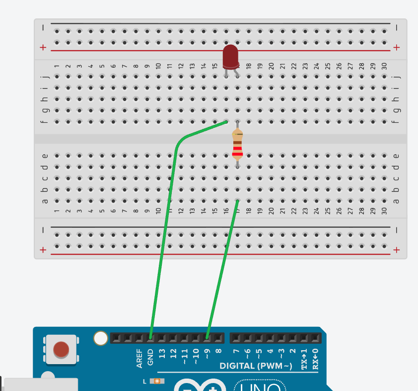
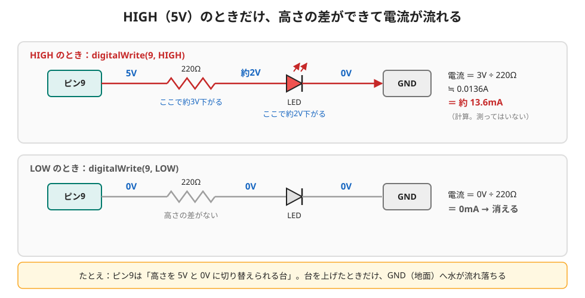
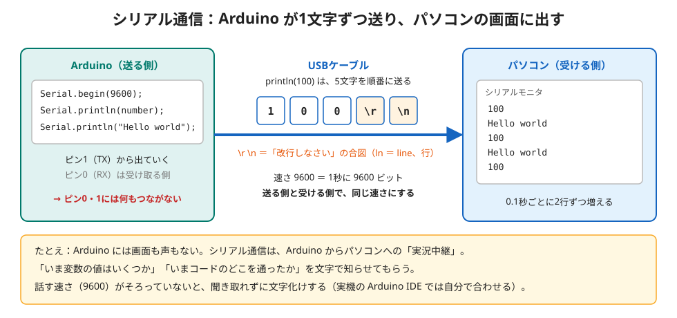
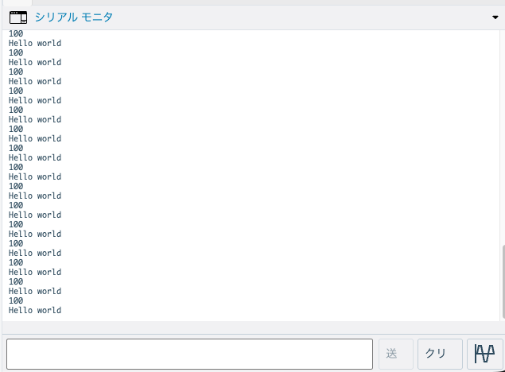
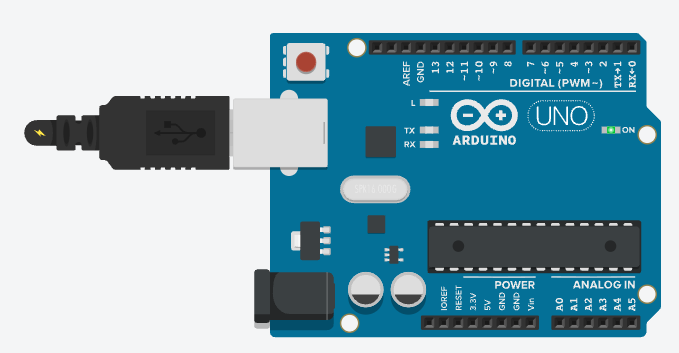

# 第5週 Arduinoの基本

- フェーズ：[フェーズ2 マイコン・モーター・センサー](../README.md)
- 日：29〜35日目（詳細は [CHECKLIST.md](../CHECKLIST.md#第5週-arduinoの基本) ）
- ゴール：delay() を使わずに複数の処理を同時に進めるプログラムを書ける
- 状態：進行中（29日目まで）
- 回路の共有リンク：[tinkercad.md](tinkercad.md)　コード：[code/](code/)

日ごとに「やること → 成果物 → 予想 → 結果 → 差の理由」を残します。測定や実験は、やる前に予想を書きます。

## 29日目 LEDとシリアルモニタ

> **ひとことで**：Tinkercad の Arduino UNO で、**ピン9 → 220Ω → LED → GND** の回路を組み、コードで LED を **0.5秒ごとに点滅**させた。最初は点かなかった。配線は正しく、原因は**コードを何もいじっていなかった**こと（線をつないだだけで、コードの画面を開いていなかった。基板の「L」だけが光っていた）。次に `Serial.println()` で、シリアルモニタに `100` と `Hello world` を **0.1秒ごと**に出した。`setup()` は**最初に1回だけ**、`loop()` は**電源を切るまでずっと繰り返す**。

**この日にやったことと、分かったこと**

| # | やったこと | 分かったこと（一言） |
| --- | --- | --- |
| 1 | SunFounder「1.1 ハロー、LED！」を読む | 記事は実機のキット向け。回路図とコードだけを使い、買う・IDE で書き込む手順は飛ばす |
| 2 | Tinkercad で ピン9 → 220Ω → LED → GND を組む | 配線は1回で合っていた。でも LED は点かなかった |
| 3 | コードを「文字」に切り替えて、ピン9のコードを打つ | 0.5秒ごとに点滅した。**回路が正しくても、コードのピン番号が合っていないと動かない** |
| 4 | SunFounder「3.0 シリアルモニタ」を読んで、コードを打つ | 配線なしで、`100` と `Hello world` が交互に流れた |
| 5 | 通信速度（9600）の設定を探す | Tinkercad のシリアルモニタには設定欄がない。コードの `Serial.begin(9600)` に自動で合う |
| 6 | `setup()` と `loop()` の役割を自分の言葉で書く | `setup()` は1回だけの準備、`loop()` は続けたい動き |

やることの詳細は[チェックリスト](../CHECKLIST.md#第5週-arduinoの基本)。

**何に役立つか**

| 使う場面 | どう使うか |
| --- | --- |
| モーター・ブザー・リレーを ON/OFF する | LED と同じ `digitalWrite(ピン, HIGH / LOW)` で動かす。モーターは電流が大きいので、ピンから直接ではなくトランジスタをはさむ（[17日目](../../phase1-electronics/week3/README.md#17日目-トランジスタスイッチを設計する筆者の課題)、36日目〜） |
| センサーの値を見る | 距離センサーや光センサーの値を `Serial.println()` で画面に出す。数字が見えないと、調整ができない（43日目〜） |
| 動かない原因を切り分ける | 「ここまで来た」を `Serial.println("ON")` のように出すと、**コードの問題か、配線の問題か**が分かる。今日のピン13のまちがいも、これがあればすぐ分かった |
| ロボットの制御ループ | 「測る → 判断する → 動かす」の繰り返しは、`loop()` の中に書く。ライントレースロボットも、1秒に何百回も `loop()` を回している |
| 実機を買ったとき | 今日のコードは、本物の Arduino UNO にそのまま書き込める（[code/day29_blink](code/day29_blink/day29_blink.ino)） |

**この日に出てくることば（プログラムと LED）**

| ことば | 意味 | たとえ |
| --- | --- | --- |
| マイコン | 小さなコンピュータが1個の部品に入ったもの。Arduino UNO の黒い長い部品 | ロボットの頭 |
| スケッチ | Arduino のプログラムのこと。ファイル名の最後は `.ino` | 作業の手順書 |
| 関数 | 名前のついた命令のまとまり。`名前( 渡す値 );` の形で使う | 「〇〇して」と頼むひとこと |
| `setup()` | 電源を入れたとき（リセットしたとき）に**1回だけ**動く部分 | 朝の身じたく |
| `loop()` | `setup()` のあと、**ずっと繰り返す**部分 | その日の仕事のくり返し |
| ピン | Arduino のふちに並んだ、線をさす穴。番号がついている（0〜13、A0〜A5） | 建物の、番号のついた出入口 |
| 出力（`OUTPUT`） | ピンから電圧を**出す**使い方。反対は入力（`INPUT`、30日目） | 蛇口（水を出す側） |
| `pinMode(ピン, OUTPUT)` | そのピンを出力として使う、と決める命令 | 「この出入口は出口専用」と札をかける |
| `digitalWrite(ピン, HIGH)` | そのピンを 5V にする命令。`LOW` なら 0V | 台を上げる／下げるスイッチ |
| `HIGH`・`LOW` | 5V と 0V のこと。デジタルは、この2つしかない | 電気のスイッチの ON・OFF |
| `delay(500)` | 500ミリ秒（＝0.5秒）、**何もせずに待つ**命令 | 「0.5秒そのまま」と止まる |
| ミリ秒（ms） | 1秒の1000分の1。1000ミリ秒 ＝ 1秒（m ＝ ÷1000） | — |
| 変数 | 値を入れておく、名前のついた箱。`int number = 100;` は「number という箱に 100 を入れる」 | ラベルつきの引き出し |
| `int` | 箱に入れるものが整数（小数のない数）である、という印 | 「この引き出しは整数専用」 |
| `const` | 「あとで中身を変えない」という印。まちがって書きかえるのを防ぐ | 引き出しにカギをかける |
| コメント（`//`） | `//` から行の終わりまでは、人が読むためのメモ。Arduino は無視する | 手順書の余白の書きこみ |
| `;`（セミコロン） | 命令1つの終わりの印。忘れるとエラーになる | 文の終わりの「。」 |
| 電流制限抵抗 | LED に流れすぎないように、直列に入れる抵抗（[15日目](../../phase1-electronics/week3/README.md#15日目-ledの抵抗を計算する)） | 蛇口を少ししぼる |
| 内蔵 LED「L」 | Arduino の基板に最初から付いている小さな LED。**ピン13**につながっている。コードでは `LED_BUILTIN` とも書く | 最初から付いているお試しランプ |

**この日に出てくることば（シリアル通信）**

| ことば | 意味 | たとえ |
| --- | --- | --- |
| シリアル通信 | 文字を1つずつ順番に、1本の線で送る通信 | 1列に並んで1人ずつ通る改札 |
| シリアルモニタ | Arduino から送られてきた文字を、パソコンで見る画面 | 実況中継を聞くラジオ |
| `Serial.begin(9600)` | 通信を始める命令。速さを 9600 に決める。`setup()` に書く | 「この速さで話します」と最初に決める |
| ボーレート（通信速度） | 1秒に何ビット送るか。9600 なら1秒に 9600 ビット | 話す速さ |
| ビット | 0 か 1 の1個ぶん。文字1つは、ビットをいくつか並べて送る | モールス信号の点と線1個ぶん |
| `Serial.println(値)` | 値を文字にして送り、最後に**改行**する。`ln` は line（行）の意味 | 1行書いて、次の行へ進む |
| `Serial.print(値)` | 値を送るが、改行**しない** | 同じ行に続けて書く |
| TX・RX | TX は送る側（ピン1）、RX は受ける側（ピン0）。パソコンとの通信に使われている | 送話口と受話口 |
| デバッグ | 動かない原因を探して直すこと | 故障診断（[22日目](../../phase1-electronics/week4/README.md#22日目-故障診断の練習)）のプログラム版 |

### 0. 先に：この日に使う前提知識

**① 今日から変わること：回路に「コード」が加わる**

フェーズ1は、線をつなげば回路は動いた。今日からは、**「線をつなぐ（回路）」と「命令を書く（コード）」の2つ**がそろって、はじめて動く。

| | フェーズ1（〜27日目） | フェーズ2（今日から） |
| --- | --- | --- |
| 電源 | 電池、Arduino の 5V ピン（いつも 5V） | Arduino の**番号つきのピン**（コードで 5V と 0V を切り替える） |
| ON/OFF するもの | ボタン、光センサー、トランジスタ | **コード**（`digitalWrite`） |
| 動かないときに疑う場所 | 配線、部品の向き、抵抗の値 | 配線 ＋ **コード（ピン番号、書きまちがい）** |

**② LED には向きがあり、抵抗が必要（[15日目](../../phase1-electronics/week3/README.md#15日目-ledの抵抗を計算する)）**

| 決まり | 意味 |
| --- | --- |
| LED は一方向にしか流さない | アノード（＋、Tinkercad では**曲がった足**）から、カソード（−、まっすぐな足）へ流れる |
| LED は約 2V を使う | 赤い LED は、光っているとき約 2V（22日目の測定では 1.98V）。A. 部品の性質 |
| 残りの電圧は抵抗が受け持つ | 電流 ＝ (電源 − LED の電圧) ÷ 抵抗 |
| LED の上限は約 20mA | これを超えると壊れる。A. 部品の性質 |

**③ ブレッドボードの決まり（[15日目](../../phase1-electronics/week3/README.md#15日目-ledの抵抗を計算する)・[24日目](../../phase1-electronics/week4/README.md#24日目-統合課題の製作と測定)）**

今日の画面では、ブレッドボードが横長に置かれている。**同じ番号の a〜e（たて5つ）は中でつながり、f〜j（たて5つ）も中でつながる**。真ん中のみぞで上下は分かれている。

```
        16   17
   j     o    o      <-- 16 の f-j は中でつながっている。17 の f-j も同じ
   i     |    |
   h     |    |
   g     |    |
   f     o    o
      ===========    <-- 真ん中のみぞ。上と下はつながっていない
   e     o    o
   d     |    |
   c     |    |
   b     |    |
   a     o    o      <-- 16 の a-e は中でつながっている。17 の a-e も同じ
```

**④ Arduino のピンが出せる電流は約 20mA まで（[17日目](../../phase1-electronics/week3/README.md#17日目-トランジスタスイッチを設計する筆者の課題)）**

LED 1個（十数 mA）ならピンから直接つなげる。モーターのように大きな電流が要るものは、トランジスタをはさむ。

### 1. 読む・組む：[1.1 ハロー、LED！](https://docs.sunfounder.com/projects/3in1-kit-v2/ja/latest/basic_project/ar_blinking_led.html)（40分）

**① 記事のどこを使い、どこを飛ばすか**

記事は、実機のキット（SunFounder 3in1 Kit）を買った人向けに書かれている。実機がないので、**回路とコードだけを Tinkercad に写す**。

| 記事の節 | 書いてあること | どう使ったか |
| --- | --- | --- |
| 必要な部品 | 制御ボード（Arduino UNO 互換）、ブレッドボード、ジャンパーワイヤー、抵抗、LED の5つ | Tinkercad の部品一覧から同じものを置く。買う案内は飛ばす |
| 回路図 | ピン9が 5V を出すと、220Ω の抵抗を通って LED が点く。0V を出すと消える | **そのまま写す** |
| 配線図 | ブレッドボードの絵（文章の説明はない） | 絵を見て写す |
| コード | Arduino IDE でファイルを開いて、ボードに書き込む手順 | 手順は飛ばす。Tinkercad では「コード」に打って「シミュレーションを開始」 |
| どのように動作するのか？ | `ledPin` という変数、`pinMode`、`digitalWrite`、`delay` の説明 | 読んで、下の ④ にまとめた |

> 記事に書いていないこと（記事外）：LED の足の向き（どちらが＋か）、220Ω を選んだ理由、`setup()` と `loop()` がいつ動くか。この3つは、この記録で補った。

**② 回路：ピン9 → 220Ω → LED → GND**

| 点滅しているところ | 配線を拡大したところ |
| --- | --- |
|  |  |

```
        16   17
   j     K    A      <-- LED。A = アノード(+、曲がった足)、K = カソード(-)
   i     |    |
   h     |    |
   g     |    |
   f    GND   R      <-- 16f から GND へ緑の線。17f に抵抗の上の足
      ===========    <-- 抵抗が真ん中のみぞをまたぐ
   e          |
   d          R      <-- 17d に抵抗の下の足
   c          |
   b          |
   a          9      <-- 17a からピン9へ緑の線
```

電気の通り道を、1か所ずつたどる。

| 順番 | 場所 | つながる理由 |
| --- | --- | --- |
| 1 | Arduino のピン `~9` → 緑の線 → 17a | 線 |
| 2 | 17a → 17d（抵抗の下の足） | 17 の a〜e は中でつながっている |
| 3 | 抵抗 220Ω（17d → 17f） | 抵抗がみぞをまたいで、下と上をつなぐ |
| 4 | 17f → 17j（LED の曲がった足＝アノード） | 17 の f〜j は中でつながっている |
| 5 | LED（17j → 16j） | アノードからカソードへ流れる |
| 6 | 16j → 16f → 緑の線 → Arduino の `GND` | 16 の f〜j は中でつながっている |

> ピン番号の前の `~`（`~9` など）は、PWM（明るさを変える機能、31日目）が使えるピンの印。今日は使わない。

**③ 数字はどこから来たか**



| 数字 | 種類 | どこから来たか |
| --- | --- | --- |
| HIGH ＝ 5V、LOW ＝ 0V | A. 部品の性質 | Arduino UNO の決まり。記事にも書いてある |
| ピン9 | B. 決めた値 | 記事がピン9を使っているので合わせた。コードと線の両方で同じ番号にする |
| 220Ω | B. 決めた値 | 記事の値。なぜ 220Ω でよいかは下の計算で確かめる |
| LED の電圧 約 2V | A. 部品の性質 | 赤い LED。22日目の測定では 1.98V |
| LED の上限 約 20mA、ピンの上限 約 20mA | A. 部品の性質 | 15日目・17日目 |
| 500ミリ秒 | B. 決めた値 | コードの `delay(500)` |
| LED の電流 約 13.6mA | D. 計算 | 下の表。**今日は電流計で測っていない** |

| 手順 | 考え方 | 計算 | 答え |
| --- | --- | --- | --- |
| 1 | HIGH のとき、ピン9は 5V。GND は 0V | — | 高さの差は 5V |
| 2 | LED が約 2V を使う。残りが抵抗にかかる | 5V − 2V | 3V |
| 3 | オームの法則（[2日目](../../phase1-electronics/week1/README.md#2日目-オームの法則)）。電流 ＝ 電圧 ÷ 抵抗 | 3V ÷ 220Ω | 約 0.0136A |
| 4 | A を mA になおす（×1000） | 0.0136 × 1000 | **約 13.6mA** |
| 5 | 上限とくらべる | 13.6mA ＜ 20mA | LED もピンも大丈夫 |

220Ω は、LED とピンの上限（約 20mA）より小さい電流にするための値。**抵抗をはずして直結すると、電流を止めるものがなくなり、上限を超える**（LED もピンも壊れる）。

**④ コード：1行ずつ読む**

保存したコード：[code/day29_blink/day29_blink.ino](code/day29_blink/day29_blink.ino)　／　回路：[Tinkercad で開く](https://www.tinkercad.com/things/5flwTfr1yzf-day29-led1hello-led/editel?sharecode=eR5hTdCiV8DzIhYwy75Y2APvANFsT_QDWI57_efGms4)

```cpp
const int ledPin = 9;

void setup()
{
  pinMode(ledPin, OUTPUT);
}

void loop()
{
  digitalWrite(ledPin, HIGH);
  delay(500);
  digitalWrite(ledPin, LOW);
  delay(500);
}
```

| 行 | 意味 | いつ動くか |
| --- | --- | --- |
| `const int ledPin = 9;` | `ledPin` という名前の箱に 9 を入れる。この先 `ledPin` と書けば 9 の意味になる | 最初に1回 |
| `void setup() { … }` | `{` から `}` までが `setup()` の中身 | 電源を入れたとき1回だけ |
| `pinMode(ledPin, OUTPUT);` | ピン9を「出力」にする | 1回だけ |
| `void loop() { … }` | `{` から `}` までが `loop()` の中身 | `setup()` のあと、ずっと繰り返す |
| `digitalWrite(ledPin, HIGH);` | ピン9を 5V にする → LED が点く | 繰り返し |
| `delay(500);` | 0.5秒、そのまま待つ（点いたまま） | 繰り返し |
| `digitalWrite(ledPin, LOW);` | ピン9を 0V にする → LED が消える | 繰り返し |
| `delay(500);` | 0.5秒、そのまま待つ（消えたまま） | 繰り返し |

- `9` を直接3か所に書いても動く。`ledPin` という名前にしておくと、**ピンを変えたいときに1行目だけ直せばよい**。
- `void` は「この関数は、結果の値を返さない」という印。今は「`setup` と `loop` の前に付ける決まり文句」と思っておけばよい。
- 記事の説明文は `delay(1000)`（1秒）で書かれている。打ったコードは `delay(500)`（0.5秒）。数字がちがうだけで、仕組みは同じ。

**⑤ ピン9の電圧の変わり方**


`delay()` がなかったら、点いた直後に消え、消えた直後に点く。速すぎて、人の目には変化が見えない。記事も「変化が人に見えるように、間をあける」と説明している。

**⑥ Tinkercad での手順（実機とのちがい）**

| 手順 | Tinkercad | 実機（Arduino IDE） |
| --- | --- | --- |
| 部品を用意する | 右の部品一覧からドラッグ。抵抗はクリックして 220Ω にする | キットの部品を使う |
| コードを書く場所 | 上の「コード」→ 左上を「ブロック」から「**文字**」に切り替える | Arduino IDE |
| コードを Arduino に入れる | 何もしなくてよい | USB でつなぎ、ボードとポートを選んで「書き込み」 |
| 動かす | 「シミュレーションを開始」 | 書き込みが終わると自動で動く |
| LED の足の見分け方 | **曲がった足**がアノード（＋）。マウスを乗せると名前が出る | **長い足**がアノード（＋） |

<details>
<summary>まちがい：回路は合っているのに LED が点かない（クリックで開く）</summary>

| 点かなかったとき（基板の「L」がオレンジに光っている） | 直したあと（LED が赤く光り、「L」は消えている） |
| --- | --- |
|  |  |


| # | 症状 | 原因 | 直し方 |
| --- | --- | --- | --- |
| 1 | 配線は正しいのに LED が点かない。基板の小さな「L」だけが光る | **コードを何もいじっていなかった**。線をつないだだけで、コードの画面を開いていなかった。Tinkercad は、Arduino を置くと「内蔵 LED（ピン13）を点滅させる」コードが最初から入っているので、**ピン13の「L」だけが点滅し、ピン9には何も出なかった** | 「コード」→「文字」に切り替え、最初のコードを消して、`ledPin = 9` のコードを打った |

最初から入っていたコードの中身は、見ていない。「ピン13を点滅させるコード」というのは、点かなかったときの画面で「L」が光っていたことからの判断。

**フェーズ1とのちがい**：フェーズ1の回路は、線をつなげば動いた。Arduino のピン9は、**コードで「5V を出せ」と命令しないかぎり何も出さない**。線をつないだら、次に必ずコードを書く。

**見分け方**：シミュレーション中に **「L」が光る ＝ ピン13 が HIGH になっている**。ピン13を使っていないのに「L」が点滅していたら、コードがちがう。

**確かめた順番**（22日目の故障診断と同じ考え方。1か所ずつ疑う）

| 順番 | 確かめたこと | 結果 |
| --- | --- | --- |
| 1 | Arduino 側の線が `GND` と `~9` にささっているか | ✓ |
| 2 | 抵抗が真ん中のみぞをまたいでいるか（同じ a〜e の中に両足を入れていないか） | ✓ |
| 3 | LED の向き（曲がった足が抵抗の側か） | ✓ |
| 4 | LED の足が、赤い＋の線（電源レール）ではなく j の穴にささっているか | ✓ |
| 5 | コードが「文字」で、ピン番号が 9 か | **✗ → ここだった** |

</details>

### 2. 読む・組む：[3.0 シリアルモニタ](https://docs.sunfounder.com/projects/3in1-kit-v2/ja/latest/basic_project/ar_serial_monitor.html)。値を画面に出す方法は、この先ずっとデバッグの主な道具になります（40分）

**① 何をするものか**



Arduino には画面がない。プログラムの中で「いま変数がいくつか」「いまどこを実行しているか」を知るには、**パソコンへ文字を送ってもらう**しかない。これがシリアル通信で、受け取った文字を見る画面がシリアルモニタ。

**② 記事のどこを使い、どこを飛ばすか**

| 記事に書いてあること | どう使ったか |
| --- | --- |
| 回路 | **なし**。Arduino だけでよい（配線しない） |
| ピン0と1はパソコンとの通信に使うので、何かをつなぐと書き込みに失敗することがある | 覚えておく。ボードの `RX←0`・`TX→1` と書いてあるピン |
| Arduino IDE を開く、ボードとポートを選ぶ、虫めがねのボタンでシリアルモニタを開く | 飛ばす。Tinkercad ではコード画面のいちばん下の「**シリアルモニタ**」を押す |
| シリアルモニタの画面の説明（自動スクロール、時刻の表示、行末の文字、通信速度、消去、送信欄） | 通信速度だけ覚える。**コードの `Serial.begin()` と同じ値にする**。ほかは実機を買ってから |
| コードと、`Serial.begin()`・`Serial.println()` の説明 | そのまま打って、下の ③ にまとめた |

**③ コード：1行ずつ読む**

保存したコード：[code/day29_serial/day29_serial.ino](code/day29_serial/day29_serial.ino)

```cpp
void setup()
{
  Serial.begin(9600);
}

void loop()
{
  int number = 100;
  Serial.println(number);
  Serial.println("Hello world");
  delay(100);
}
```

| 行 | 意味 | 画面に出るもの |
| --- | --- | --- |
| `Serial.begin(9600);` | 通信を始める。速さは 9600 ビット毎秒。1回だけでよいので `setup()` に書く | — |
| `int number = 100;` | `number` という箱に 100 を入れる | — |
| `Serial.println(number);` | 箱の**中身**を送って改行する | `100` |
| `Serial.println("Hello world");` | `" "` で囲んだ文字を**そのまま**送って改行する | `Hello world` |
| `delay(100);` | 0.1秒待つ。なければ、目で追えない速さで流れる | — |

| 書き方 | 送られるもの | 例 |
| --- | --- | --- |
| `Serial.println(number)`（`" "` なし） | 箱の中身 | `100` |
| `Serial.println("number")`（`" "` あり） | 書いた文字そのもの | `number` |

`" "` を付けるかどうかで意味が変わる。**変数の値を見たいときは `" "` を付けない。**

**④ 結果**

| シリアルモニタ | このときの Arduino（配線なし） |
| --- | --- |
|  |  |

| 数字 | 種類 | どこから来たか |
| --- | --- | --- |
| 9600 | B. 決めた値 | コードの `Serial.begin(9600)`。記事の値。よく使われる速さ |
| 100（表示される数） | B. 決めた値 | コードの `int number = 100;` |
| 100ミリ秒 | B. 決めた値 | コードの `delay(100)` |
| 1秒に約10回、約20行 | D. 計算 | 1000ミリ秒 ÷ 100ミリ秒 ＝ 10回。1回で2行出るので、10 × 2 ＝ 20行 |

`100` と `Hello world` が交互に流れた。記事の結果と同じ。

**⑤ Tinkercad と実機のちがい**

| | Tinkercad | 実機（Arduino IDE） |
| --- | --- | --- |
| シリアルモニタを開く | コード画面のいちばん下の「シリアルモニタ」 | 右上の虫めがねのボタン |
| 通信速度の設定 | **設定欄がない**。コードに自動で合う | 画面の右下で、コードと同じ 9600 を自分で選ぶ |
| 速さが合っていないと | 起こらない | 文字化けする（読めない記号が出る） |
| グラフ | 右下の波形のボタン。数字だけを出すと折れ線になる | 「シリアルプロッタ」という別の画面 |

<details>
<summary>補足：9600 で足りるのか（記事外。クリックで開く）</summary>

| 手順 | 考え方 | 計算 | 答え |
| --- | --- | --- | --- |
| 1 | 1文字を送るのに、ふつう 10 ビット使う（文字の 8 ビット ＋ 始まりと終わりの印） | — | 10ビット |
| 2 | 1秒に送れる文字の数 | 9600 ÷ 10 | 960文字 |
| 3 | `loop()` 1回で送る文字。`100` ＋改行2文字 ＝ 5文字、`Hello world` ＋改行2文字 ＝ 13文字 | 5 ＋ 13 | 18文字 |
| 4 | 1秒に10回なので | 18 × 10 | 180文字 |
| 5 | くらべる | 180 ＜ 960 | 足りる |

改行は、`\r`（行の先頭へ戻る）と `\n`（次の行へ進む）の2文字。`println` が自動で付ける（記事にも書いてある）。

</details>

<details>
<summary>気になったこと：TX のランプは光らなかった／9600 を設定していない（クリックで開く）</summary>

| # | 気になったこと | 分かったこと |
| --- | --- | --- |
| 1 | 記事には「通信速度を選ぶ」とあるが、9600 をどこにも設定していない | Tinkercad のシリアルモニタには設定欄がない。コードの `Serial.begin(9600)` だけでよい。実機では自分で合わせる |
| 2 | 基板の「TX」のランプが光っていない | 文字が画面に出ているので、通信はできている。Tinkercad が TX のランプの点滅まで再現しているかは、**確かめられていない**（スクリーンショットは一瞬なので、点滅していても写らないこともある） |

2 は、Claude が先に「TX のランプが光るはず」と説明したが、確かめていないことを断定した説明だった。

</details>

### 3. 記録：`setup()` と `loop()` の役割を自分の言葉で2行


**① 自分の言葉で書いた2行**

> - pinMode と Serial.begin は setup で設定し、それぞれ1回実行
> - loop() では繰り返し処理を実施

**② 「何のために」を足した形**

| | 自分の言葉 | 足したこと |
| --- | --- | --- |
| `setup()` | pinMode と Serial.begin は setup で設定し、それぞれ1回実行 | 電源を入れたとき（リセットしたとき）に**1回だけ**動く。ピンの向きや通信の速さなど、**最初に1回決めればよい準備**を書く |
| `loop()` | 繰り返し処理を実施 | `setup()` のあと、**電源を切るまでずっと**繰り返す。LED の点滅や画面への表示など、**続けたい動き**を書く |

**③ どちらに書くかの見分け方**

| 命令 | 書く場所 | 理由 |
| --- | --- | --- |
| `pinMode(9, OUTPUT)` | `setup()` | ピンの向きは、1回決めれば変わらない |
| `Serial.begin(9600)` | `setup()` | 通信の速さは、1回決めれば変わらない |
| `digitalWrite(9, HIGH)`、`delay(500)` | `loop()` | 点ける・待つ・消す・待つを、何度も続けたい |
| `Serial.println(number)` | `loop()` | 値を何度も知らせてほしい |

`pinMode` を `loop()` に書いても動く。ただ、毎回同じ設定をやりなおすだけなので、むだになる。

**④ 今日の2つのコードをくらべる**

| | LED の点滅 | シリアルモニタ |
| --- | --- | --- |
| `setup()`（準備） | `pinMode(ledPin, OUTPUT);` | `Serial.begin(9600);` |
| `loop()`（続ける動き） | 点ける → 0.5秒 → 消す → 0.5秒 | 100 を出す → Hello world を出す → 0.1秒 |
| `loop()` 1回の時間 | 約 1秒 | 約 0.1秒 |
| 結果を見る場所 | LED | シリアルモニタ |

形は同じ。**準備を `setup()` に、続けたい動きを `loop()` に書く。**

### この日のまとめ：予想 → 結果 → 差の理由

今日は、測る前・動かす前に予想を書かなかった。下の「予想」は、そのとき思っていたこと。次の日からは、動かす前に予想を書く。

| 何を測った／試したか | 予想 | 結果 | 差の理由 |
| --- | --- | --- | --- |
| 回路を組んで、シミュレーションを開始 | 配線が合っていれば LED が点く | 点かない。基板の「L」だけが光った | コードを何もいじっていなかった。最初から入っているコードはピン9を動かさない。回路はピン9につないでいた |
| コードを `ledPin = 9` に打ちなおす | 点滅する | 0.5秒ごとに点滅した | 差なし |
| シリアルモニタのコードを動かす | `100` と `Hello world` が出る | 交互に流れた | 差なし |
| 通信速度 9600 の設定 | シリアルモニタの側でも 9600 を選ぶ必要がある | 設定欄がなく、何もしなくても表示された | Tinkercad はコードの値に自動で合わせる。実機では自分で選ぶ |
| TX のランプ | 通信中は光る（Claude の説明） | 光っているのは確認できなかった | Tinkercad が再現しているか分からない。未確認 |
| LED に流れる電流 | 約 13.6mA（計算） | **測っていない** | — |

**まだ試していないこと**（時間のある日に）

| 試すこと | 先に書く予想 |
| --- | --- |
| `delay(500)` を `100` や `2000` に変える | 点滅の速さはどうなるか |
| LED の回路に電流計をはさむ | 13.6mA に近い値が出るか |
| 点滅のコードに `Serial.println("ON")` と `Serial.println("OFF")` を足す | LED が点いた瞬間に「ON」と出るか |

**実機を買ったらやり直すこと**

- Arduino IDE でボードとポートを選び、今日の2つのコードを書き込む
- シリアルモニタの通信速度を 9600 に合わせる。わざと別の値にして、文字化けを見る
- LED の長い足がアノード（＋）であることを、実物で確かめる
- 通信中に TX のランプが光るかを見る

## 30日目 ボタンを読む

**やること**（詳細は [チェックリスト](../CHECKLIST.md#第5週-arduinoの基本)）

- 読む：MONOist 俺流！組み込み用語解説(5) GPIO
- 読む・組む：3.1 ボタンの値を読む
- 読む・組む：5.3 ステート変更の検出

**成果物**

- 

**予想 → 結果 → 差の理由**

| 何を測った／試したか | 予想 | 結果 | 差の理由 |
| --- | --- | --- | --- |
| | | | |

## 31日目 PWMとアナログ入力

**やること**（詳細は [チェックリスト](../CHECKLIST.md#第5週-arduinoの基本)）

- 読む・組む：2.1 フェージング
- 読む・組む：4.1 ノブを回すと5.6 マッピング
- 記録：「可変抵抗は第2週の分圧回路そのもの」であることを回路図で確認

**成果物**

- 

**予想 → 結果 → 差の理由**

| 何を測った／試したか | 予想 | 結果 | 差の理由 |
| --- | --- | --- | --- |
| | | | |

## 32日目 millis() で待たない処理

**やること**（詳細は [チェックリスト](../CHECKLIST.md#第5週-arduinoの基本)）

- 読む・組む：5.4 インターバル
- 改造：29日目のLED点滅を `delay()` なしで書き直し、点滅しながらボタンも反応するようにする
- 記録：`delay()` を使うとボタンが反応しなくなる理由を1行

**成果物**

- 

**予想 → 結果 → 差の理由**

| 何を測った／試したか | 予想 | 結果 | 差の理由 |
| --- | --- | --- | --- |
| | | | |

## 33日目 割り込み

**やること**（詳細は [チェックリスト](../CHECKLIST.md#第5週-arduinoの基本)）

- 読む・組む：5.13 割り込み
- 実験：ボタンの読み取りを、通常の読み取り（30日目）と割り込みで比べ、`delay(1000)` が入っているときの反応の違いを確かめる

**成果物**

- 

**予想 → 結果 → 差の理由**

| 何を測った／試したか | 予想 | 結果 | 差の理由 |
| --- | --- | --- | --- |
| | | | |

## 34日目 反応時間ゲーム（筆者の課題）

**やること**（詳細は [チェックリスト](../CHECKLIST.md#第5週-arduinoの基本)）

- 読む・組む：6.5 反応時間ゲームをTinkercadで再現する
- 読む：MONOist 俺流！組み込み用語解説(8) チャタリング対策をソフトウェアだけで行う方法
- 改造：割り込みにデバウンスを入れ、1回押しで1回だけ反応するようにする
- 改造：見本はランダムな待ち時間に `delay()` を使っています
- `week5/reaction_game/` にコードと動画を置く

**成果物**

- 

**予想 → 結果 → 差の理由**

| 何を測った／試したか | 予想 | 結果 | 差の理由 |
| --- | --- | --- | --- |
| | | | |

## 何が壊れてどう直したか

うまくいかなかったことを、症状・原因・直し方の順に書きます。この週で一番大事な節です。

| 日 | 症状 | 原因 | 直し方 |
| --- | --- | --- | --- |
| 29日目 | 配線は正しいのに LED が点かない。基板の小さな「L」だけが光る | コードを何もいじっていなかった（コードの画面を開いていなかった）。最初から入っているコードは、ピン13の内蔵 LED を動かすもので、ピン9には何も出ない | 「コード」を「文字」に切り替え、`ledPin = 9` のコードを打ちなおした。「L」が光る ＝ ピン13が動いている、と覚える |
| 29日目 | 記事の「通信速度を選ぶ」の設定が見つからない | Tinkercad のシリアルモニタには設定欄がない（コードの `Serial.begin(9600)` に自動で合う） | 何もしなくてよい。実機の Arduino IDE では自分で 9600 を選ぶ |

**教訓**：フェーズ2からは、動かないときに疑う場所が「配線」と「コード」の2つになる。**コードのピン番号と、線をつないだピン番号が同じか**を最初に見る。

## 分からなかったこと・あとで調べること

| 日 | 分からなかったこと | 調べ方 |
| --- | --- | --- |
| 29日目 | Tinkercad は、通信中に基板の「TX」のランプを光らせるのか | シミュレーション中に「TX」をしばらく見る。実機を買ったら実物でも見る |
| 29日目 | LED に流れる電流は、計算どおり約 13.6mA か | LED の回路に電流計をはさんで測る（測る前に予想を書く） |
