# 第6週 モーター

- フェーズ：[フェーズ2 マイコン・モーター・センサー](../README.md)
- 日：36〜42日目（詳細は [CHECKLIST.md](../CHECKLIST.md#第6週-モーター) ）
- ゴール：DCモーターの速度と向きをPWMとHブリッジで制御し、エンコーダの数を数えて「ちょうど1回転」で止められる
- 状態：進行中（38日目まで）

日ごとに「やること → 成果物 → 予想 → 結果 → 差の理由」を残します。測定や実験は、やる前に予想を書きます。

## 36日目 トランジスタでモーターを回す

> **ひとことで**：Arduino のピンは、**20mA**ほどしか出せず、500〜800mA 要るモーターは、**直接は回せない**。**NPN トランジスタ**をはさみ、ピン2から**ベース抵抗**（625Ω）を通して、ベースに**約 6.9mA**だけ流すと、**電池（3V）から**モーターに大きな電流が流れて、**1秒回って、1秒止まる**ようになった。足のつなぎ先を2回まちがえ、**抵抗を 1kΩ にすると回らず**（記事の実機と同じ）、**電池の − を GND につながないと回らなかった**。

**この日にやったことと、分かったこと**

| # | やったこと | 分かったこと（一言） |
| --- | --- | --- |
| 1 | MONOist「モーター制御(2)」（全5ページ）を読む | ピンは 20mA、モーターは 500mA（始動は約 800mA）。トランジスタで増やす |
| 2 | 回路を組む（ピン2 → 625Ω → NPN → モーター、電源は Arduino の 5V） | モーターが回らない。**トランジスタの3本の足が、すべてちがう所につながっていた** |
| 3 | 電源を、**電池（3V）の別電源**にする | モーターの定格（1.5〜3.0V）に合わせ、GND を共通にする |
| 4 | 足をつなぎなおす（2回） | **足の名前は、置く向きで入れかわる**。回路図表示で読んで直した |
| 5 | 動かす | **1秒回って、1秒止まる**。回転数の表示は `-5138 rpm`（向きが逆） |
| 6 | 抵抗を 1kΩ にする／電池の − を外す | どちらも**回らない**（ベース電流が足りない／電流の戻り道がない） |

やることの詳細は[チェックリスト](../CHECKLIST.md#第6週-モーター)。

**何に役立つか**

| 使う場面 | どう使うか |
| --- | --- |
| ロボットの車輪や、ファンを回す | マイコンのピンは、小さな信号だけ。**モーターの電流は、トランジスタを通して、電池から**流す |
| モーターの速さを変える（[37日目](#37日目-逆起電力とpwmの速度制御)） | 同じ回路で、ピンを PWM（31日目）にすると、モーターの平均の電圧が変わる |
| モーターの向きを変える（38日目の H ブリッジ） | トランジスタを4つ使う形の、もとになる |
| マイコンのリセットや誤動作を防ぐ | モーターの電流は、**別電源**から流す。マイコンの電源が、モーターの始動で下がるのを防ぐ（[19日目](../../phase1-electronics/week3/README.md#19日目-電池の内部抵抗とブラウンアウト)） |
| リレー、ブザー、ソレノイドなど、大きな電流が要る部品を動かす | モーターと同じ形（ピン → ベース抵抗 → トランジスタ） |
| 動かない原因を、1つずつ切り分ける | 回路図表示で、**足の名前とつなぎ先**を確かめた。電池の − を外す実験で、GND の共通の大切さが分かった |

**この日に出てくることば**

| ことば | 意味 | たとえ |
| --- | --- | --- |
| DC モーター（直流ブラシ付きモーター） | 電池をつなぐだけで回るモーター。**電圧を逆にすると、逆回転**する。ON/OFF で、回る・止まる。向きは、電極の入れかえ | 電池をつなぐと、プロペラが回るおもちゃ |
| 定格電圧（使用電圧範囲） | そのモーターを、安全に使える電圧。記事の FA-130RA は 1.5〜3.0V | 「この電圧まで」と書かれた、使用上の注意 |
| 消費電流 | 運転中に流れる電流。FA-130RA は、適正な電圧・負荷で 500mA | 蛇口から出る水の量 |
| 突入電流 | 回り始める瞬間に流れる、大きな電流。運転中より大きい（今回は、約 800mA 要る）。負荷によっても変わる | 重い荷車を動かし始めるときの、一番強い力 |
| 別電源 | モーターの電流を、**マイコンとは別の電池や電源**から流すこと。マイコンの電源を、モーターの電流で乱さない | 別のポンプから、水を引く |
| GND の共通 | 別電源の − と、マイコンの GND を、**つなぐこと**。信号（ベース電流）の戻り道になる | 2つの水槽の、水面の高さの基準をそろえる |
| ベース電流 | トランジスタの B に流す、小さな電流。これで、C から E へ大きな電流が流せるようになる | 蛇口をひねる力 |
| ベース抵抗 | ピンとベースのあいだに入れる抵抗。ベース電流の大きさを決める（17日目） | 蛇口に付けた、流量をしぼる部品 |
| rpm | 1分間の回転数。Tinkercad のモーターに、`0 rpm`、`-5138 rpm` と出る。`-` は、回る向き | 1分に何回まわるか |
| コイン電池（CR2032、3V） | 小さな丸い電池。3V。Tinkercad の部品名は、「COIN BATTERY CR 2032 3.0V」 | 時計に入っている電池 |

### 0. 先に：この日に使う前提知識

**① トランジスタ（[16日目](../../phase1-electronics/week3/README.md#16日目-トランジスタの仕組み)・[17日目](../../phase1-electronics/week3/README.md#17日目-トランジスタスイッチを設計する筆者の課題)）**

| 使うもの | 意味 |
| --- | --- |
| NPN トランジスタ | B（ベース）に少し流すと、C（コレクタ）から E（エミッタ）へ、大きな電流が流れるスイッチ |
| ベース抵抗 | `（ピンの電圧 − 0.7V）÷ ベース電流`（17日目と同じ考え方）。0.7V は、B–E のあいだの電圧 |
| 飽和 | 完全にオンになり、スイッチとして使える状態 |

**② 足の並びは、部品と向きで変わる**

| 出どころ | 平らな面を手前に、左から |
| --- | --- |
| 22日目（Tinkercad の NPN） | C・B・E |
| MONOist の 2SC2120-Y | **E・C・B**（記事） |
| 今日の Tinkercad の回路（置いた向き） | **C・B・E**（最終の向き。回路図表示で確かめた） |

足の並びは、**部品ごとにちがい、置く向きでも入れかわる**。毎回、**回路図表示や、足にマウスを乗せて**、名前を確かめる。

**③ 電流の道は、2つ**

| 道 | 流れる電流 | 通る所 |
| --- | --- | --- |
| 細い道（ベース） | 約 6.9mA | ピン2 → 抵抗 → ベース → エミッタ → GND |
| 太い道（コレクタ） | 数百 mA | 電池の＋ → モーター → コレクタ → エミッタ → GND → 電池の − |

### 1. 読む：[MONOist モーター制御(2) マブチモーターをArduinoで制御する](https://monoist.itmedia.co.jp/mn/articles/1601/28/news005.html)（全5ページ、40分）。ピンから直接は回せないこと、ベース電流の決め方、始動時の突入電流で回らない話

**① 記事の構成**

| ページ | 書いてあること（要約） |
| --- | --- |
| 1/5 | 直流ブラシ付きモーターの原理（ローター、コイル、整流子、ブラシ。電圧を逆にすると逆回転）。ON/OFF で、回る・止まる。**ArduinoのGPIOに、モーターをただつなぐだけでは動かない**。モーター FA-130RA の仕様 |
| 2/5 | GPIO は LED を光らせる程度で、モーターを駆動する力がない。**トランジスタで電流を増やす**。2SC2120-Y（約10円、コレクタ電流は最大 800mA）。回路：モーターの一端は電源の＋（3V）、もう一端はコレクタ、エミッタは GND、ベースは**抵抗を介して** GPIO へ |
| 3/5 | ベース抵抗の求め方：データシートのグラフで、コレクタ電流 500mA（3V）のときのベース電流 **4〜5mA**（4.5mA とする）→ 5V ÷ 4.5mA ＝ **1111Ω** → 1kΩ で代用。Arduino は、各ピン 20mA、ピン合計 400mA まで |
| 4/5 | プログラム：Blink を改造（D2 を 1秒 HIGH、1秒 LOW）。「1秒回って、1秒止まる」予定 |
| 5/5 | **実験すると、回らなかった**。始動時の**突入電流**が、運転中より大きいから。コレクタ電流 800mA にするには、ベース電流 **8mA** → 5V ÷ 8mA ＝ **625Ω**（市販品は 680Ω）。突入電流は、負荷で変わるので、その都度、抵抗を調整する |

| モーター FA-130RA の仕様（記事） | 値 |
| --- | --- |
| 使用電圧範囲 | 1.5〜3.0V |
| 適正電圧 | 1.5V |
| 適正電圧・負荷時の消費電流 | **500mA** |
| 無負荷回転数 | 8600 r/min |
| 適正電圧・負荷時の回転数 | 6500 r/min |

**② 3つの質問への、あなたの答え**

| # | 質問 | あなたの答え | 判定と補足 |
| --- | --- | --- | --- |
| 1 | ピンから直接、モーターを回せないのは、なぜか（数字つき） | GPIO では、LED を点灯させる程度が精一杯で、モーターを駆動するパワーがない。モーター駆動には 500mA 必要なので、それ以上の電流を流せるトランジスタが必要 | ✓ 数字を足すと、ピン1本は **20mA**、モーターは **500mA（始動は約 800mA）**。**25倍〜40倍**のちがい（下の図） |
| 2 | ベース抵抗（625Ω）は、どうやって決めたか | コレクタ電流を 800mA にするには、ベース電流を 8mA にする必要がある。ベース抵抗は 5 ÷ 0.008 ＝ 625Ω | ✓ 8mA は、データシートのグラフから読んだ値 |
| 3 | 突入電流とは何か。なぜ、500mA 用の抵抗では回らないか | モーターの始動時・回転時の消費電流を上回る電流が必要になるから。これを突入電流と言う | ✓ 補足：500mA 用の抵抗（1111Ω）では、ベース電流が約 3.9mA で、流せるコレクタ電流が、始動に足りない |


**③ 記事の数字は、どこから来たか**

| 数字 | 種類 | どこから来たか |
| --- | --- | --- |
| 500mA | A. 部品の性質 | FA-130RA の仕様（適正電圧・負荷時の消費電流） |
| 800mA | A. 部品の性質 | 2SC2120-Y のコレクタ電流の最大値（記事） |
| 20mA | A. 部品の性質 | Arduino のピン1本の上限（記事、17日目） |
| 8mA | A. 部品の性質（グラフ） | 800mA のときのベース電流（データシートのグラフ） |
| 625Ω | D. 計算 | 5V ÷ 8mA |

| 手順 | 考え方 | 計算 | 答え |
| --- | --- | --- | --- |
| 1 | 運転中の電流を、ピンの上限と比べる | 500mA ÷ 20mA | **25倍** |
| 2 | 始動の電流を、ピンの上限と比べる | 800mA ÷ 20mA | **40倍** |
| 3 | 記事のベース抵抗（0.7V を引かない） | 5V ÷ 8mA ＝ 5 ÷ 0.008 | **625Ω** |
| 4 | 0.7V を引く式（17日目と同じ） | (5 − 0.7) ÷ 0.008 | **約 537Ω**（市販品では 560Ω あたり） |
| 5 | 625Ω のときのベース電流（0.7V を引く） | (5 − 0.7) ÷ 625 | **約 6.9mA**（ピンの上限 20mA より小さい） |

（計算）

> 記事の 625Ω は、「0.7V を引かない」計算。引くと 約 537Ω。どちらも同じくらいの大きさで、**ベース電流を、すこし多めにとる**ための値。

### 2. 組む：TinkercadでArduino → ベース抵抗 → NPNトランジスタ → DCモーター（別電源）の回路を作り、ピンのON/OFFで回す。ベース抵抗は第3週の計算で決める（50分）

**① 部品**

| 部品 | Tinkercad での名前・値 |
| --- | --- |
| ベース抵抗 | 抵抗 **625Ω**（記事の計算値。部品をクリックして、値を入れる） |
| トランジスタ | NPN（部品の絵に「N」とある） |
| モーター | DC モーター（出力の中） |
| 別電源 | コイン電池「COIN BATTERY CR 2032 3.0V」（3V） |

**② 回路**

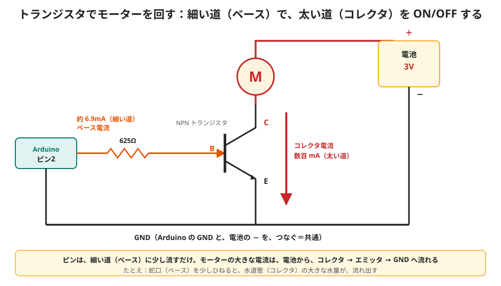

| 部品 | つなぎ先 |
| --- | --- |
| ピン2 | → 625Ω → トランジスタの**ベース**（真ん中の足） |
| 電池の ＋ | → モーターの片方の端子 |
| モーターのもう一方 | → トランジスタの**コレクタ**（左の足） |
| トランジスタの**エミッタ**（右の足） | → GND（下の − の列） |
| 電池の − | → GND（下の − の列）。**Arduino の GND と同じ線**（共通） |

| 配線図（最終） | 回路図表示（最終） |
| --- | --- |
|  | 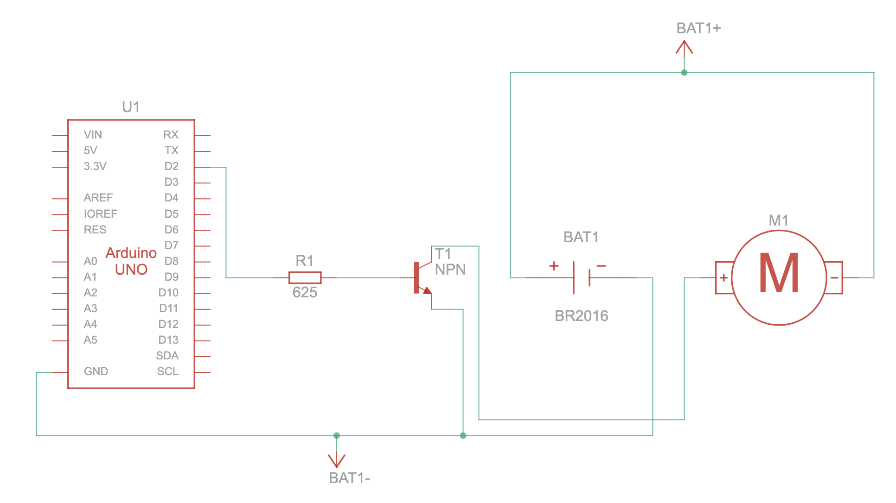 |

回路図表示では、D2 → R1（625）→ T1 のベース、T1 のコレクタ → モーターの＋、モーターの − → BAT1+、T1 のエミッタ → BAT1−（GND）、Arduino の GND と BAT1− が同じ線、になっている。5V の線はない。

> 電池の ＋ が、モーターの「−」の端子につながり、コレクタが「＋」の端子なので、モーターは**ふつうと逆向き**に回る（`-5138 rpm`）。回ることには、影響しない。

保存した回路：[Tinkercad で開く](https://www.tinkercad.com/things/bElgNR5a03V/editel?sharecode=3llx37DVYVxHKrDh22HQ04LUa980ReYHMZt6rfURszk)

**③ ベース抵抗を、第3週の計算で決める**

| 手順 | 考え方 | 計算 | 答え |
| --- | --- | --- | --- |
| 1 | モーターに流したい電流（始動）を決める（記事のトランジスタの上限） | — | 800mA |
| 2 | そのためのベース電流（データシートのグラフから） | — | 8mA |
| 3 | ベース抵抗 ＝ ピンの電圧 ÷ ベース電流（記事の式） | 5V ÷ 0.008A | **625Ω** |
| 4 | 実際のベース電流（0.7V を引く） | (5 − 0.7) ÷ 625 | 約 6.9mA |
| 5 | ピンの上限（20mA）と比べる | 6.9mA ＜ 20mA | ピンは大丈夫 |

17日目では、**電流増幅率**（hFE）から、ベース電流を決めた。今日は、記事の方法（データシートのグラフから、必要なコレクタ電流のベース電流を読む）。どちらも、「ベース電流を、すこし多めにする」考え方は同じ。

**④ コード：1行ずつ読む**

保存したコード：[code/day36_motor_transistor/day36_motor_transistor.ino](code/day36_motor_transistor/day36_motor_transistor.ino)

```cpp
void setup() {
  pinMode(2, OUTPUT);
}

void loop() {
  digitalWrite(2, HIGH);
  delay(1000);
  digitalWrite(2, LOW);
  delay(1000);
}
```

| 行 | 意味 | いつ動くか |
| --- | --- | --- |
| `pinMode(2, OUTPUT);` | ピン2を**出力**にする（トランジスタのベースにつなぐ） | `setup()` で1回 |
| `digitalWrite(2, HIGH);` | ピン2を 5V にする → ベース電流が流れる → モーターが**回る** | `loop()` で毎回 |
| `delay(1000);` | 1秒待つ | 毎回 |
| `digitalWrite(2, LOW);` | ピン2を 0V にする → ベース電流が止まる → モーターが**止まる** | 毎回 |
| `delay(1000);` | 1秒待つ | 毎回 |

コードは、29日目の LED の点滅（`digitalWrite`、`delay`）と**同じ形**。ちがうのは、ピン2につなぐものが、LED でなく、**トランジスタのベース**だけ。

**⑤ 結果**

| 止まっているとき（`0 rpm`） | 回っているとき（`-5138 rpm`） |
| --- | --- |
| 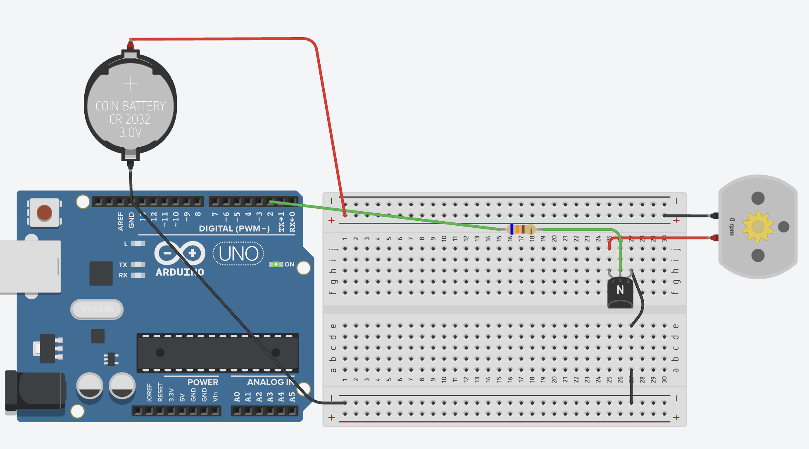 | 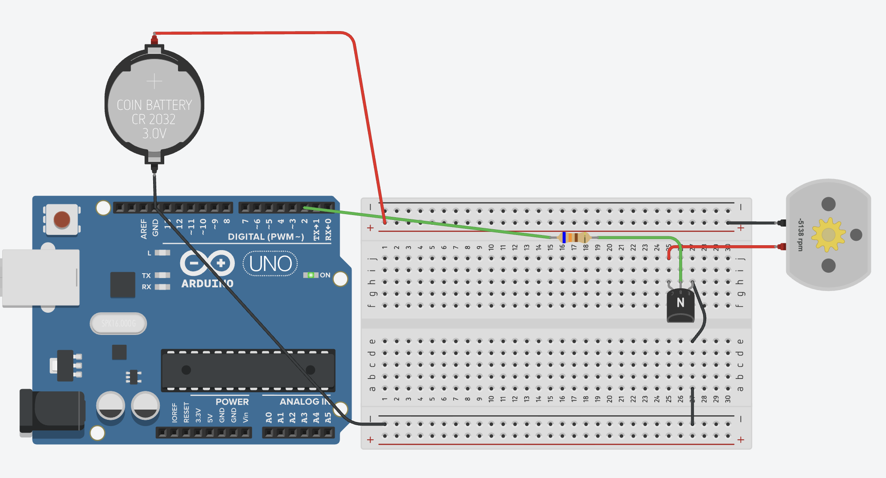 |

| # | 試したこと | 結果 | 理由 |
| --- | --- | --- | --- |
| 1 | 625Ω で動かす | **回る**（1秒回って、1秒止まる） | ベース電流が、約 6.9mA で、始動できる |
| 2 | 抵抗を **1kΩ** にする | **回らない**（記事の実機でも、1kΩ 前後で回らなかった） | ベース電流が、約 4.3mA と小さく、始動の大きな電流が流せない |
| 3 | 電池の − を、GND から外す | **回らない** | ベース電流が、エミッタから GND へ**戻る道がない** |


| 抵抗 | ベース電流（計算） | 結果 |
| --- | --- | --- |
| 1111Ω（記事） | (5 − 0.7) ÷ 1111 ≒ 3.9mA | 記事の実機：回らない |
| 1kΩ（Tinkercad） | (5 − 0.7) ÷ 1000 ＝ 4.3mA | **回らない** |
| 680Ω（記事） | (5 − 0.7) ÷ 680 ≒ 6.3mA | 記事の実機：回る |
| 625Ω（Tinkercad） | (5 − 0.7) ÷ 625 ≒ 6.9mA | **回る** |

（計算）

> Tinkercad では、**4.3mA で回らず、6.9mA で回った**ので、境目は、その間にあることだけ分かった。記事の 2SC2120-Y と FA-130RA とは、別の部品なので、境目の値は、同じではない。

<details>
<summary>まちがい：トランジスタの足のつなぎ先（クリックで開く）</summary>


| # | 症状 | 原因 | 直し方 |
| --- | --- | --- | --- |
| 1 | 最初の回路で、モーターが回らない（電源は Arduino の 5V） | 回路図表示で、**抵抗がエミッタ、モーターがベース、GND がコレクタ**につながっていた。3本とも、ちがう足 | 足にマウスを乗せて名前を確かめ、回路図表示から読んで、つなぎ先を決めた |
| 2 | 電池にしたあとも、動かない | **エミッタ → GND だけ合い**、抵抗がコレクタ、モーターがベースのまま。トランジスタの向きを変えたので、足の名前が入れかわった | **抵抗とモーターの2本を入れかえた**（抵抗 → ベース、モーター → コレクタ） |
| 3 | 最終 | すべて合った（抵抗 → ベース、モーター → コレクタ、エミッタ → GND） | モーターが回った |

| 最初の配線図 | 最初の回路図表示（すべてちがう足） |
| --- | --- |
| 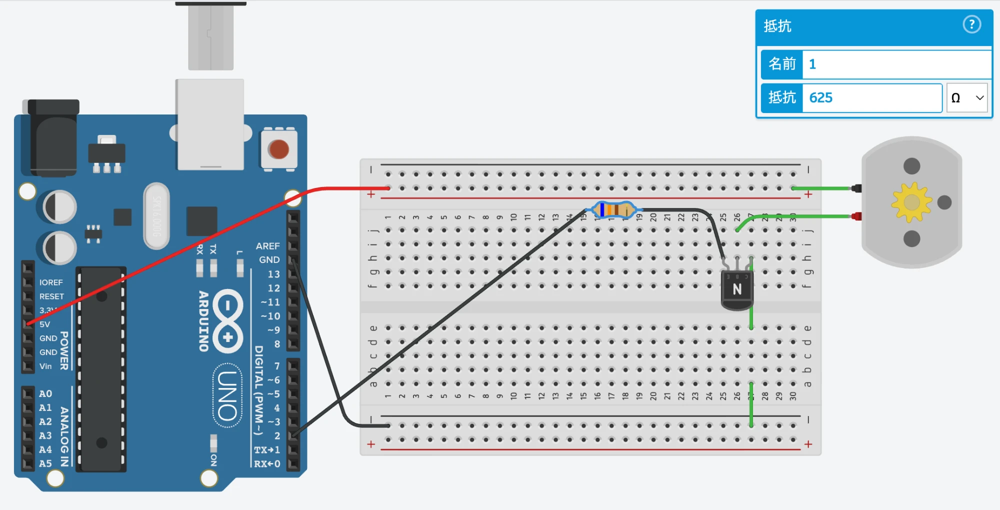 | 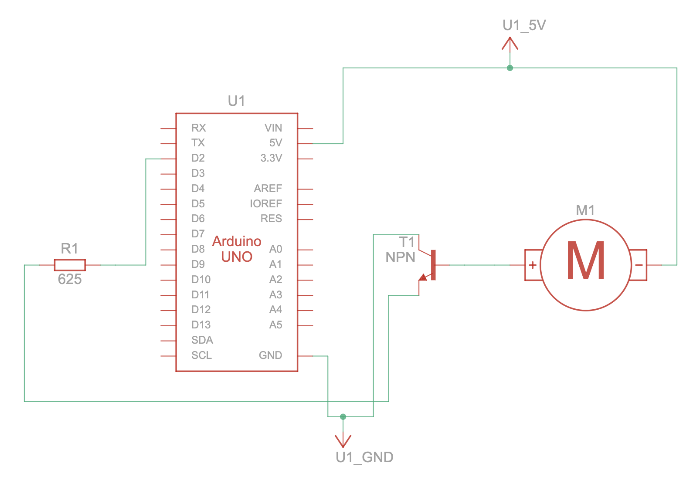 |

| 電池にしたあとの配線図 | そのときの回路図表示（エミッタだけ合っている） |
| --- | --- |
| 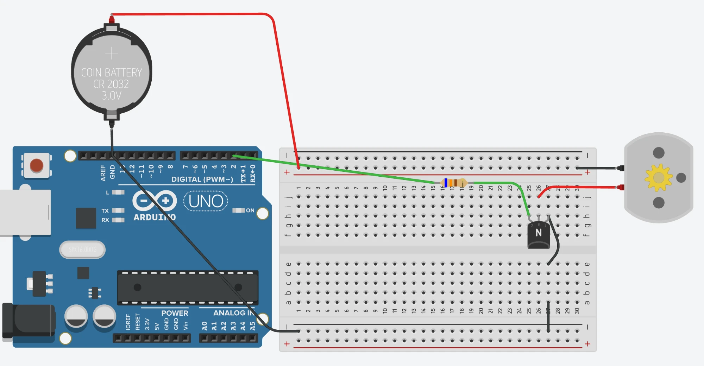 | 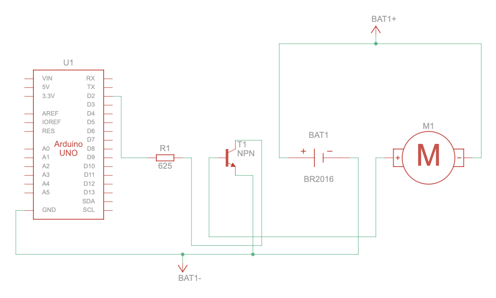 |

**ほかに直したこと**

| # | 内容 |
| --- | --- |
| 1 | モーターの電源を、**Arduino の 5V から、電池（3V）の別電源**にした（チェックリストの「別電源」。記事の電源も 3V） |
| 2 | 電池の − を、Arduino の GND につないだ（共通） |

**Claude の説明のまちがい**

| # | まちがい | 本当は |
| --- | --- | --- |
| 1 | 1kΩ と 625Ω の「流せるコレクタ電流」を、**約 430mA と約 690mA**と見積もり、「625Ω で、始動できる」と書いた | 始動には約 800mA 要る、という記事の数字と、**食いちがっていた**。Tinkercad のトランジスタとモーターは、記事のものと別なので、**見積もりはできない**。実験で分かったのは、「4.3mA で回らず、6.9mA で回る」ことだけ |
| 2 | 先に「左から エミッタ・ベース・コレクタ」と案内し、2回めには「左がコレクタ…」と案内した | 足の名前は、**置く向きで入れかわる**。そのつど、回路図表示で読んで、案内した。最初から、「向きで変わるので、毎回、足の名前を確かめる」と言うべきだった |

</details>

### この日のまとめ：予想 → 結果 → 差の理由

今日は、動かす前の予想を、**書かなかった**（結果を見て、答えた）。**次の日からは、動かす前に予想を書く。**

| 何を測った／試したか | 予想 | 結果 | 差の理由 |
| --- | --- | --- | --- |
| 最初の回路（5V、足がちがう） | 書かなかった（回る） | 回らない | トランジスタの3本の足が、すべてちがう所につながっていた |
| 電池（3V）にして、足を2本直す | 書かなかった | 回る（1秒回って、1秒止まる）。`-5138 rpm` | モーターの端子が逆向きにつながっているので、向きが逆と考えられる（確かめていない） |
| 抵抗を 625Ω から 1kΩ に変える | 書かなかった（記事の実機では回らなかった） | **回らない** | ベース電流が約 4.3mA と小さく、始動できない |
| 電池の − を、GND から外す | 書かなかった（回らないはず） | **回らない** | ベース電流の戻り道がない |

**まだ試していないこと**（時間のある日に）

| 試すこと | 先に書く予想 |
| --- | --- |
| 抵抗を 680Ω、750Ω、820Ω にして、回る・回らないの境目を探す | 何Ωで、回らなくなるか |
| 電池を 3V から 5V（電源の部品）に変える | 回転数（rpm）は、どう変わるか |
| モーターの2本を入れかえる | `-5138 rpm` の `-` が、`+` になるか |
| 電流計をはさんで、ベース電流とコレクタ電流を測る | ベース電流は、約 6.9mA か。コレクタ電流は、数百 mA か |
| モーターの電源を、Arduino の 5V にもどして、625Ω で動かす | 回るか。Tinkercad では、リセットは起こるか |

**実機を買ったらやり直すこと**

- 記事のとおり、FA-130RA（3V）と 2SC2120-Y、**680Ω** で、実機を回す
- 1kΩ で、本当に回らないかを見る（記事の実験）
- モーターを、Arduino の 5V から回して、**Arduino がリセットされないか**（19日目のブラウンアウト）を見る（確かめる前に、電源の電流に注意する）
- ベース電流とコレクタ電流を、テスターで測る
- モーターの始動時の電流（突入電流）を、テスターで測る（記事外：測るには、電流計に大きな電流が流れるので、注意する）

## 37日目 逆起電力とPWMの速度制御

> **ひとことで**：モーターは**コイル**なので、トランジスタを OFF にした瞬間に、電流の行き場がなくなり、**高い電圧**（逆起電力）が出る。これを逃がすため、**ダイオード**をモーターの両端に**並列**につなぐ（縞＝カソードを電池の＋側へ）。`analogWrite()` の値を 50 → 255 にすると、回転数は **-1080 → -5136 rpm**（− は向き。大きさで見る）と、**ほぼ比例**して増え（1 あたり約 20 rpm）、**1 でも回った（-22 rpm）**。ダイオードは、**LED を置いてしまい、向きも2回逆**だった。Tinkercad では、**ダイオードがあってもなくても、rpm は変わらなかった**。

**この日にやったことと、分かったこと**

| # | やったこと | 分かったこと（一言） |
| --- | --- | --- |
| 1 | MONOist「モーター制御(4)」のダイオードの節を読む | 電流を切ると**逆向きの電圧**が出て、供給電圧の**数十倍**になることがある。トランジスタを守るのがダイオード |
| 2 | MONOist「モーター制御(5)」（全5ページ）を読む | PWM は ON/OFF の割合（デューティー比）で、モーターにかかる**平均の電圧**を変える。記事は Fade のコードで、約 490Hz |
| 3 | 36日目の回路にダイオードを足す | 最初に **LED** を置いてしまった。部品名「ダイオード」が正しい。向きも**2回逆**だった（回路図表示で見つけた） |
| 4 | analogWrite を 5段階（50〜255）にして、rpm を読む | 値に**ほぼ比例**して、回転数が増える。1 でも回る（Tinkercad） |
| 5 | rpm が一瞬で読めない問題を解く | rpm は Arduino から読めない。**値を打って、止めたまま**読めるコードにした |
| 6 | ダイオードを外して、同じ値で比べる | **変わらなかった**（255 で、どちらも -5136 rpm）。Tinkercad は逆起電力を計算していないと考えられる |

やることの詳細は[チェックリスト](../CHECKLIST.md#第6週-モーター)。

**何に役立つか**

| 使う場面 | どう使うか |
| --- | --- |
| モーター、リレー、ソレノイドなど、**コイルを切る**回路を作る | ダイオードを**並列**に付けて、切った瞬間の高い電圧から、トランジスタやマイコンを守る。実機では、ほぼ必須（Tinkercad では効果が見えない） |
| ロボットの車輪の速さを変える | `analogWrite()` の値で、**平均の電圧**を変えて、速さを決める。表にしておくと、「この値なら、このくらいの速さ」と分かる |
| ラジコンや電動工具の速度制御（ESC） | 記事によると、ラジコンの電子式スピードコントローラーは PWM。可変抵抗で電圧を下げる昔の方法は、熱が出る |
| 電池を無駄にしない | 電圧を抵抗で下げる方法は熱になる。PWM は、ON と OFF だけを使うので、効率が高い（記事） |
| 38日目の H ブリッジで、速さを決める | イネーブルのピンに PWM を入れて、速さを決める |
| 40日目のエンコーダで、止める手前で減速する | 値と速さの表があると、「どの値まで落とすか」を決められる |
| 動かない・おかしいときに、切り分ける | 部品の名前（LED とダイオード）、向き（回路図表示）を、毎回確かめる |

**この日に出てくることば（1）：ダイオードと逆起電力**

| ことば | 意味 | たとえ |
| --- | --- | --- |
| コイル | 銅線をぐるぐる巻いたもの。モーターの中にも入っている。電流を流すと磁石になる（記事外の説明） | 重い回転ドア。急には止まれない |
| 逆起電力 | コイルに流れていた電流を切ると、**電流を流し続けようとして**出る電圧。向きが逆で、供給の数十倍になることがある（記事） | 走っている人が、急には止まれず、前につんのめる |
| 保護ダイオード | トランジスタを逆起電力から守るために入れるダイオード（記事の呼び名）。「フライバックダイオード」「還流ダイオード」とも言う（記事外） | つんのめった人が、走り続けられる、横の逃げ道 |
| ダイオード | 電流を**一方向にだけ**流す部品。アノード → カソードの向きだけ流れる（記事） | 一方通行の道 |
| アノード・カソード | ダイオードの2本の足の名前。**縞があるほうが、カソード**。回路図の記号では、三角の頂点側がカソード（縦棒）、底がアノード | 一方通行の、入口と出口 |
| LED とダイオード | LED は「光るダイオード」。流せる電流は約 20mA。保護には、大きな電流を流せる**ダイオード**を使う | 光る一方通行（LED）と、大きな荷物も通れる一方通行（ダイオード） |
| 並列 | 2つの部品の**両端を、それぞれ同じ点**につなぐこと。ダイオードを、モーターの両端につなぐ | 川が2本に分かれて、また合流する |
| 最大定格 | これを超えると壊れるおそれがある値（記事）。2SC2120-Y は、コレクタ・エミッタ間 **30V** | 「この重さまで」と書かれた、エレベーターの札 |

**この日に出てくることば（2）：PWM**

| ことば | 意味 | たとえ |
| --- | --- | --- |
| PWM（パルス幅変調） | ON と OFF を高速でくり返して、**平均の電力**を変える方法（記事） | 蛇口を、すばやく開け閉めして、水の量を変える |
| パルス幅 | 山（ON）の部分の幅。時間で表す（記事） | 蛇口を開けている時間 |
| 周期・周波数 | 山から山までの時間。周波数は 1 秒にくり返す回数（Hz）。周期の逆数（記事） | 1 秒に何回、蛇口を開け閉めするか |
| デューティー比 | パルス幅 ÷ 周期。% で表す（記事）。`analogWrite(ピン, 値)` なら、値 ÷ 255 | 1 回の周期のうち、蛇口が開いている割合 |
| 実効電圧（平均電圧） | 山の電圧 × デューティー比（記事）。モーターは、この平均で回る。このページでは「平均電圧」と書く | 開けたり閉めたりした水の、平均の量 |
| `analogWrite(ピン, 値)` | PWM を出す命令。値は 0〜255。255 でデューティー比 100%（記事） | 蛇口の開け具合を、0〜255 で決める |
| ESC | ラジコンの電子式スピードコントローラー。PWM を使う（記事） | ラジコンの、アクセル |
| DAC | デジタルをアナログの電圧に変える部品。Arduino の ATmega328P にはない（記事） | 数字を、本物の電圧に変える変換器 |
| 不感帯 | 小さい値では、モーターが回り出さない範囲（記事外の一般的な話） | 自転車のペダルが、軽く踏んでも動かない範囲 |

### 0. 先に：この日に使う前提知識

**① PWM と `analogWrite()`（[31日目](../week5/README.md#31日目-pwmとアナログ入力)）**

| 使うもの | 意味 |
| --- | --- |
| `analogWrite(ピン, 0〜255)` | PWM が使えるピン（`~` が付いたピン）から、ON/OFF のくり返しを出す。31日目は、LED の明るさに使った |
| 255 で 100%、128 で 約 50% | 値 ÷ 255 が、デューティー比 |

**② 36日目の回路（[36日目](#36日目-トランジスタでモーターを回す)）**

| 使うもの | 意味 |
| --- | --- |
| ピン → ベース抵抗 → NPN のベース | ピンの小さな電流で、トランジスタを ON/OFF する |
| 電池（3V）→ モーター → コレクタ → エミッタ → GND | モーターの大きな電流が流れる道。**別電源** |
| 電池の − と Arduino の GND を共通にする | ベース電流の戻り道 |

**③ ダイオード（[15日目](../../phase1-electronics/week3/README.md#15日目-ledの抵抗を計算する)）**

| 使うもの | 意味 |
| --- | --- |
| 順方向 | アノード → カソードの向きは、約 0.6V を超えると流れる |
| 逆方向 | 逆向きは、ほとんど流れない |

**④ コイルは、電流が急に変わるのをいやがる（記事外の説明）**

| 場面 | コイルの中で起きること |
| --- | --- |
| 電流が流れている | コイルが、磁石として、エネルギーをためている |
| 電流を切る | ためたエネルギーが、電流を**流し続けようとする**。行き場がないと、電圧が**一気に高く**なる（逆起電力） |

### 1. 読む：[MONOist モーター制御(4) 困ったら読みたいTips](https://monoist.itmedia.co.jp/mn/spv/1603/04/news042_2.html)のダイオードによる逆起電力対策（20分）

**① 記事の構成**

| ページ | 書いてあること（要約） |
| --- | --- |
| 1/2 | 直流ブラシ付きモーターは、回っているあいだ、**回転数の3倍の頻度**でコイルの ON/OFF がくり返される。電流を切ると逆向きに電流が流れる（**逆起電力**）。供給電圧の**数十倍**になることもある。守るために**保護ダイオード**を入れる。ダイオードの説明：カソード側に線がある。三角形の頂点側がカソード、底がアノード。アノード → カソードの向きだけ流れる。図2：トランジスタの**コレクタとエミッタのあいだ**にダイオードを入れる |
| 2/2 | 2SC2120-Y の最大定格：コレクタ・エミッタ間は **30V**。図2の向き：**エミッタ側がアノード、コレクタ側がカソード**。図4：**モーターの両端**にダイオードを入れる方法もある（記事の説明では、モーターを逆回転させられなくなる） |

**② 記事の図2・図4と、今日の回路**

| | 図2（記事の主な方法） | 図4（記事の別の方法） | 今日の回路 |
| --- | --- | --- | --- |
| ダイオードの位置 | トランジスタの C と E のあいだ | **モーターの両端**（並列） | **モーターの両端**（並列） |
| 向き | E 側がアノード、C 側がカソード（記事の文章） | カソードが電源（VCC）側（記事の図で確認） | カソード（縞）が電池の ＋ 側 |
| 記事の説明 | コレクタにかかる**逆電圧**を抑える | コレクタにかかる**順電圧**への対策。逆回転ができない | — |

> 今日は、**図4の置き方**にした。チェックリストは「ダイオードを足す」とだけで、位置は書いていない。**図2の置き方は、試していない**（まだ試していないこと）。

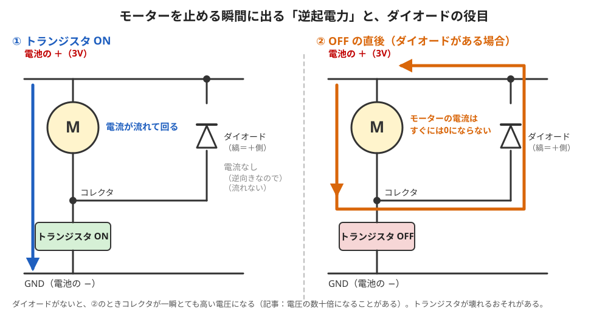

**③ ダイオードの向き（今日、2回まちがえたところ）**

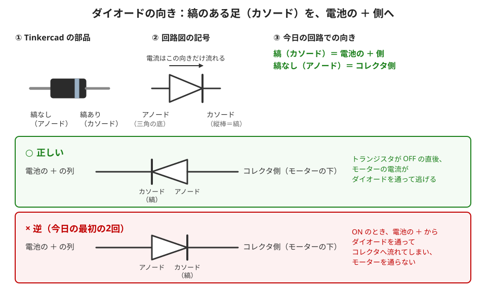

**④ 記事の数字は、どこから来たか**

| 数字 | 種類 | どこから来たか |
| --- | --- | --- |
| 3倍 | A. 部品の性質 | モーターの原理：回転数の3倍の頻度でコイルが ON/OFF する（記事） |
| 数十倍 | A. 部品の性質 | 逆起電力は、供給電圧の数十倍になることがある（記事。場合による） |
| 30V | A. 部品の性質 | 2SC2120-Y のコレクタ・エミッタ間の最大定格電圧（記事） |
| 約 0.6V | A. 部品の性質 | ダイオードが流れ始める電圧（15日目） |

> 記事の内容を確かめる質問は、今日は出さなかった（読み終わったと答えてもらった）。

### 2. 読む：[MONOist モーター制御(5) PWMでマブチモーターを制御する](https://monoist.itmedia.co.jp/mn/articles/1604/11/news014.html)（全5ページ、40分）

**① 記事の構成**

| ページ | 書いてあること（要約） |
| --- | --- |
| 1/5 | 電池を1個から2個にすると、モーターは速く回る。電圧を変えれば、速さを変えられる。可変抵抗で電圧を調整する昔のラジコンの機械式スピードコントローラーは、熱が出て、耐久性にも問題があった。電子式の **ESC** は PWM を使う |
| 2/5 | **PWM（パルス幅変調）**：ON/OFF をくり返して電力を制御する。要素は、パルス幅・周期・周波数（Hz）・デューティー比（パルス幅 ÷ 周期）。**山の電圧 × デューティー比 ＝ 実効電圧** |
| 3/5 | PWM の利点は3つ：**① 飽和状態で動かすので、トランジスタの負担が少ない**、**② 効率が高い**（OFF のときは電力を使わない）、**③ マイコンに向く**（DAC がなくても、デジタル出力1本で電圧を変えられる） |
| 4/5 | 回路図6：**D9 → 680Ω → トランジスタのベース**（PWM が使えるピンは決まっている）。680Ω は、モーターが無負荷なら問題なし。ギアや車輪を付けるなら、調整が要る |
| 5/5 | Fade のスケッチ（LED の光り方を変えるもの）を、そのまま使う。Arduino Nano の PWM ピンは **3, 5, 6, 9, 10, 11**。周波数は**約 490Hz**（5番・6番は 977Hz）。255 でデューティー比 100%。30ms ごとに 5 ずつ変わる。振動音が、**消防車のサイレン**のように聞こえる |

**② PWM は、ピンの 5V でなく、電池の 3V を切り替える**

| 見るところ | 内容 |
| --- | --- |
| ピンの ON/OFF | トランジスタのベース電流を、ON/OFF する |
| モーターにかかる電圧 | トランジスタが ON のとき、**電池の 3V** がかかる。OFF のときは 0V |
| 山の電圧 | **3V**（ピンの 5V ではない） |

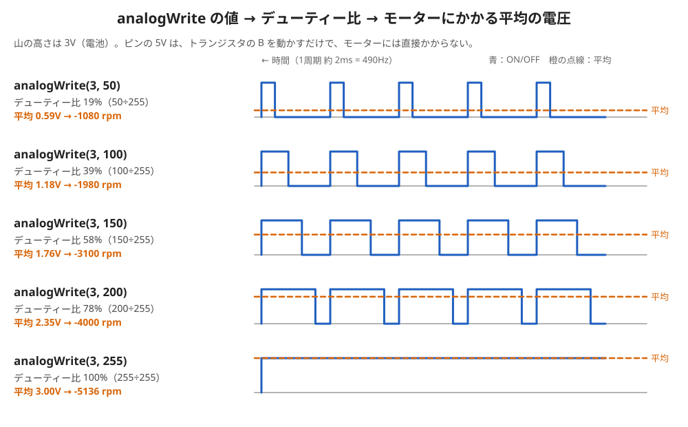

**③ 5段階の値と、計算した数字**

| 数字 | 種類 | どこから来たか |
| --- | --- | --- |
| 3V | A. 部品の性質 | コイン電池 CR2032（Tinkercad の部品に書いてある） |
| 約 490Hz | A. 部品の性質 | ピン3, 9, 10, 11 の PWM の周波数（記事） |
| 680Ω | B. 決めた値 | 記事の回路図6の値。36日目は 625Ω だった |
| 50, 100, 150, 200, 255 | B. 決めた値 | 5段階。Claude が出した案を使った（記事の値ではない） |
| デューティー比 | D. 計算 | 値 ÷ 255 |
| 平均電圧 | D. 計算 | 3V × デューティー比（記事の式）。**測っていない計算** |

| 手順 | 考え方 | 計算 | 答え |
| --- | --- | --- | --- |
| 1 | `analogWrite(3, 150)` のデューティー比 | 150 ÷ 255 | 約 0.588（**58.8%**。ログは整数で 58%） |
| 2 | 山の電圧（電池） | — | 3V |
| 3 | 平均電圧（記事の式） | 3V × 0.588 | 約 **1.76V** |
| 4 | 255 のとき | 3V × 255 ÷ 255 | **3.00V**（ずっと ON） |
| 5 | 50 のとき | 3V × 50 ÷ 255 | 約 **0.59V** |

（計算）

**④ 記事の Fade のコード（動かしたかは、確認していない）**

```cpp
int led = 9;
int brightness = 0;
int fadeAmount = 5;

void setup() {
  pinMode(led, OUTPUT);
}

void loop() {
  analogWrite(led, brightness);
  brightness = brightness + fadeAmount;
  if (brightness == 0 || brightness == 255) {
    fadeAmount = -fadeAmount;
  }
  delay(30);
}
```

| 行 | 意味 | いつ動くか |
| --- | --- | --- |
| `int led = 9;` | 出力するピンの番号。9番 | 最初に1回 |
| `int brightness = 0;` | 今の PWM の値（明るさ）。0 から始める | 最初に1回 |
| `int fadeAmount = 5;` | 1回で変える量。5 | 最初に1回 |
| `pinMode(led, OUTPUT);` | ピン9を出力にする | `setup()` で1回 |
| `analogWrite(led, brightness);` | 今の値で、PWM を出す | `loop()` で毎回 |
| `brightness = brightness + fadeAmount;` | 値を 5 ずつ変える | 毎回 |
| `if (brightness == 0 \|\| brightness == 255)` | 0 か 255 になったら | 毎回 |
| `fadeAmount = -fadeAmount;` | 増やす・減らすを、入れかえる（折り返す） | 0 か 255 のとき |
| `delay(30);` | 30ms 待つ | 毎回 |

0 → 255 → 0 と、5 ずつ行き来するので、**約 51 段階**。0 から 255 まで、約 1.5 秒（51 × 30ms）。

> このコードは、31日目の「フェード」と同じ形（`analogWrite`）。ちがうのは、つなぐものが LED でなく、**トランジスタのベース**。

**⑤ 記事の5ページ分の、どこを使ったか**

| 記事の節 | 書いてあること | どう使ったか |
| --- | --- | --- |
| モーター制御(4) 1/2〜2/2 | 逆起電力、保護ダイオード、図2・図4 | 図4の置き方で、モーターの両端にダイオードを足した |
| モーター制御(4) の続き（コンプリメンタリー） | 回転方向の制御 | 今日は飛ばした（チェックリストの範囲外） |
| モーター制御(5) 1/5〜3/5 | PWM の原理と利点 | 上の表に整理した |
| モーター制御(5) 4/5 | 回路図6（D9 → 680Ω） | ピンを 3 にして、同じ形で組んだ |
| モーター制御(5) 5/5 | Fade のコード | 記事のコードは、動かしたか確認していない。**5段階のコード（3本）を、別に書いた** |

### 3. 組む：36日目の回路にダイオードを足し、`analogWrite()` で5段階の速度にする。PWMの値と回転の速さの関係を表にする（筆者の課題の前半）（40分）

**① 部品（36日目との差）**

| 部品 | Tinkercad での名前・値 | 36日目との差 |
| --- | --- | --- |
| ダイオード | 検索で「ダイオード」と入れ、**一番上**の「ダイオード」を選ぶ（黒い筒に灰色の線が1本入った絵。下の「ツェナーダイオード」「フォトダイオード」ではない） | 追加 |
| ベース抵抗 | 抵抗 **680Ω**（記事の回路図6と同じ） | 625Ω から変更 |
| ピン | **~3**（PWM が使えるピン） | ピン2から変更 |
| モーター、トランジスタ、電池 | DC モーター、NPN、コイン電池（3V） | 同じ |

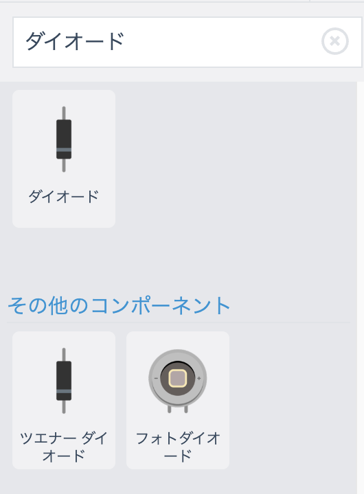

**② 回路**

```
 Battery(+) ---+-------------+
               |             |
            [Motor]       [Diode]     <-- 縞（カソード）が上＝電池の＋側
               |             |
               +------+------+
                      |
                      C
 Pin3 --[680ohm]------B   NPN
                      E
                      |
 Arduino GND ---------+------ Battery(-)    <-- 電池の−と GND は共通
```

| 順番 | 場所 | つながる理由 |
| --- | --- | --- |
| 1 | ピン3 → 680Ω → トランジスタのベース | PWM の ON/OFF で、ベース電流を流す |
| 2 | 電池の ＋ → モーター → トランジスタのコレクタ | モーターの大きな電流の道（別電源） |
| 3 | トランジスタのエミッタ → GND（電池の − と共通） | 電流の戻り道 |
| 4 | **ダイオード：縞のある足 → 電池の ＋ 側、縞のない足 → コレクタ側** | モーターの**両端に並列**。OFF の直後の電流の逃げ道 |

| 配線図（最初。ピン9、ダイオードなし） | 回路図表示（最初。ピン9、680Ω） |
| --- | --- |
| 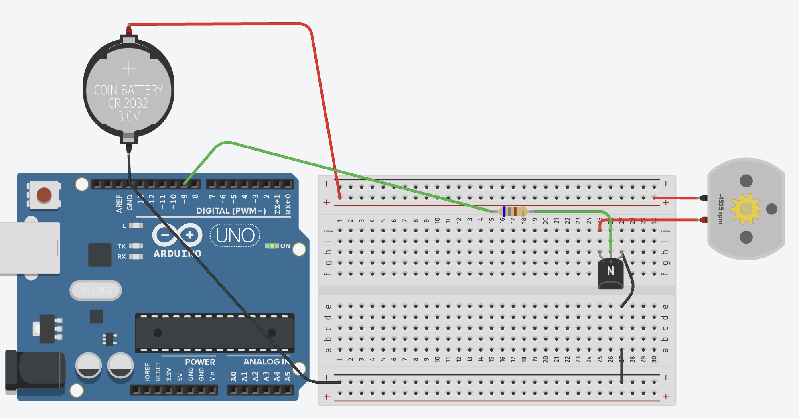 | 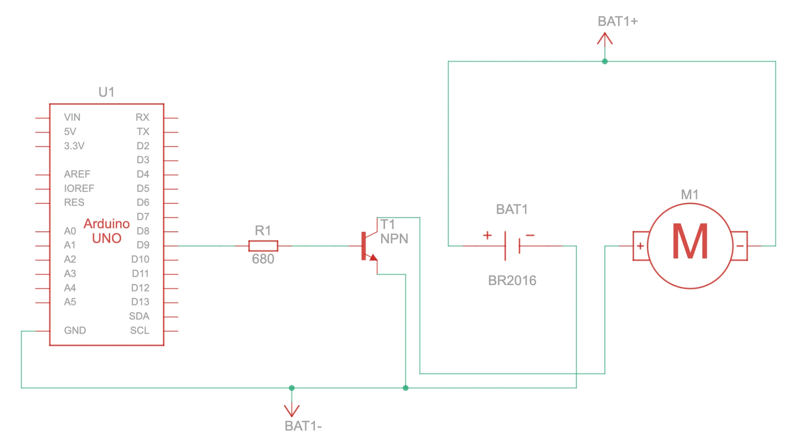 |

| 配線図（最終。ダイオードを板の穴に落とした） | 回路図表示（向きが合ったとき） |
| --- | --- |
| 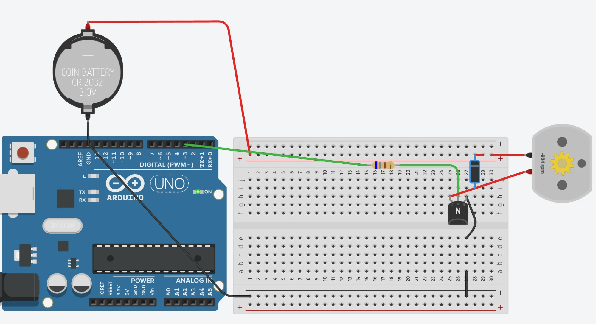 | 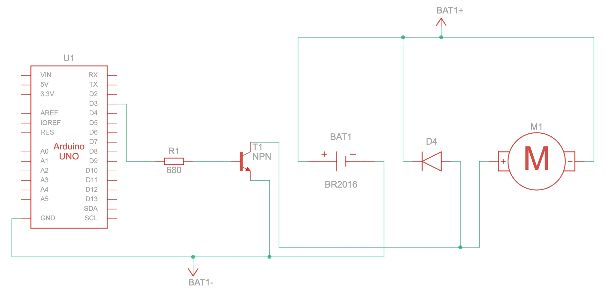 |

回路図表示では、D3 → R1（680）→ T1 のベース、T1 のコレクタ → モーターの＋、モーターの − → BAT1+、T1 のエミッタ → BAT1−（GND）、**D4 の縦棒（カソード）が BAT1+ 側、三角の底（アノード）がコレクタ側**、になっている。

> 向きが合ったときの回路図表示は、ダイオードが板の上に浮いていたときのもの（足につながった線で、つながっていた）。穴に落としたあとの回路図表示は、**撮っていない**。モーターの向きは 36日目と同じく、ふつうと逆（`-` の rpm）。

保存した回路（ダイオードあり、ピン3）：[Tinkercad で開く](https://www.tinkercad.com/things/5ySBgtFCXLX/editel?sharecode=16pri83mmRJ1OLx_keiX46KELVHmahRGNM1C4_DwSHk)

**③ コード：3本を1行ずつ読む**

最初の版（3秒ごとに5段階が変わる）：[code/day37_motor_pwm_steps/day37_motor_pwm_steps.ino](code/day37_motor_pwm_steps/day37_motor_pwm_steps.ino)

```cpp
int motorPin = 3;
int levels[5] = {50, 100, 150, 200, 255};

void setup() {
  pinMode(motorPin, OUTPUT);
  Serial.begin(9600);
}

void loop() {
  for (int i = 0; i < 5; i++) {
    analogWrite(motorPin, levels[i]);
    Serial.println(levels[i]);
    delay(3000);
  }
  analogWrite(motorPin, 0);
  Serial.println(0);
  delay(3000);
}
```

| 行 | 意味 | いつ動くか（または画面に出るもの） |
| --- | --- | --- |
| `int motorPin = 3;` | ピン3（PWM が使える）に名前を付ける | 最初に1回 |
| `int levels[5] = {50, 100, 150, 200, 255};` | 5段階の値を、配列に入れる | 最初に1回 |
| `pinMode(motorPin, OUTPUT);` | ピン3を出力にする | `setup()` で1回 |
| `Serial.begin(9600);` | シリアルモニタを使えるようにする | `setup()` で1回 |
| `for (int i = 0; i < 5; i++)` | `i` を 0 から 4 まで、1 ずつ増やして、中身を5回くり返す | `loop()` で毎回 |
| `analogWrite(motorPin, levels[i]);` | `i` 番目の値で PWM を出す | 毎回、5回 |
| `Serial.println(levels[i]);` | 今の値を、シリアルモニタに1行出す | 画面：`50`、`100` … |
| `delay(3000);` | 3秒、そのまま回す。この間に、rpm を読む | 毎回 |
| `analogWrite(motorPin, 0);` | 値 0（止める） | 5回のあと |
| `Serial.println(0);` | `0` を出す | 画面：`0` |

ログつきの版（段階、値、デューティー比、平均電圧、時刻を出す）：[code/day37_motor_pwm_log/day37_motor_pwm_log.ino](code/day37_motor_pwm_log/day37_motor_pwm_log.ino)

```cpp
int motorPin = 3;
int levels[5] = {50, 100, 150, 200, 255};
int lap = 0;

void setup() {
  pinMode(motorPin, OUTPUT);
  Serial.begin(9600);
  Serial.println("start");
}

void loop() {
  lap++;
  for (int i = 0; i < 6; i++) {
    int v = (i < 5) ? levels[i] : 0;
    analogWrite(motorPin, v);

    Serial.print("lap=");
    Serial.print(lap);
    Serial.print(" step=");
    Serial.print(i + 1);
    Serial.print(" pwm=");
    Serial.print(v);
    Serial.print(" duty=");
    Serial.print(v * 100 / 255);
    Serial.print("% avgV=");
    Serial.print(v * 3.0 / 255.0, 2);
    Serial.print("V t=");
    Serial.print(millis());
    Serial.println("ms");

    delay(3000);
  }
}
```

| 行 | 意味 | いつ動くか（または画面に出るもの） |
| --- | --- | --- |
| `int lap = 0;` | 何周目かを数える変数 | 最初に1回 |
| `Serial.println("start");` | 開始の合図を出す | 画面：`start` |
| `lap++;` | 周回を 1 増やす | `loop()` で毎回 |
| `for (int i = 0; i < 6; i++)` | 0〜5 の6回くり返す（0〜4 は5段階、5 は停止） | 毎回 |
| `int v = (i < 5) ? levels[i] : 0;` | `i` が 5 未満なら `levels[i]`、そうでなければ 0 | 毎回 |
| `analogWrite(motorPin, v);` | その値で PWM を出す | 毎回 |
| `Serial.print(...)` が続く行 | 文字を、改行なしで出す | 画面：`lap=1 step=1 pwm=50 …` |
| `Serial.print(v * 100 / 255);` | デューティー比 %。整数どうしの割り算なので、小数は切り捨て | 画面：`duty=19%` |
| `Serial.print(v * 3.0 / 255.0, 2);` | 電池3V の場合の平均電圧。小数2桁。**計算で、測っていない** | 画面：`avgV=0.59V` |
| `Serial.print(millis());` | Arduino が動き始めてからの時間（ms） | 画面：`t=2ms`、`t=3005ms` … |
| `Serial.println("ms");` | 最後に、改行する | 毎回 |
| `delay(3000);` | 3秒待つ | 毎回 |

値を打つと、その値のまま回る版（rpm を落ち着いて読む）：[code/day37_motor_pwm_serial/day37_motor_pwm_serial.ino](code/day37_motor_pwm_serial/day37_motor_pwm_serial.ino)

```cpp
int motorPin = 3;
int pwm = 0;

void setup() {
  pinMode(motorPin, OUTPUT);
  Serial.begin(9600);
  Serial.println("type 0-255 and send");
}

void loop() {
  if (Serial.available() > 0) {
    String s = Serial.readStringUntil('\n');
    s.trim();
    if (s.length() == 0) return;
    int v = s.toInt();
    if (v >= 0 && v <= 255) {
      pwm = v;
      analogWrite(motorPin, pwm);
      Serial.print("pwm=");
      Serial.print(pwm);
      Serial.print(" duty=");
      Serial.print(pwm * 100 / 255);
      Serial.print("% avgV=");
      Serial.print(pwm * 3.0 / 255.0, 2);
      Serial.println("V");
    } else {
      Serial.println("out of range (0-255)");
    }
  }
}
```

| 行 | 意味 | いつ動くか（または画面に出るもの） |
| --- | --- | --- |
| `int pwm = 0;` | 今の値。最初は 0（止まっている） | 最初に1回 |
| `Serial.println("type 0-255 and send");` | 使い方を出す | `setup()` で1回 |
| `if (Serial.available() > 0)` | シリアルモニタから、文字が届いたら | `loop()` で毎回調べる |
| `String s = Serial.readStringUntil('\n');` | 1行ぶんの文字を読む（改行を送らない設定でも、1秒待てば読める） | 文字が届いたとき |
| `s.trim();` | 前後の空白や改行を消す | 届いたとき |
| `if (s.length() == 0) return;` | 空なら何もせず、`loop()` の先頭へ戻る | 届いたとき |
| `int v = s.toInt();` | 文字を数字に変える | 届いたとき |
| `if (v >= 0 && v <= 255)` | 0〜255 のときだけ、使う | 届いたとき |
| `pwm = v; analogWrite(motorPin, pwm);` | その値で回し続ける（次の入力まで、変わらない） | 届いたとき |
| `Serial.print(...)` が続く行 | 値・デューティー比・平均電圧を出す | 画面：`pwm=50 duty=19% avgV=0.59V` |
| `Serial.println("out of range (0-255)");` | 範囲の外なら、知らせる | 画面：`out of range (0-255)` |

> rpm は、**Arduino から読めない**（モーターには、電気を送る線が2本あるだけで、回転数を返す線がない）。rpm の数字は、Tinkercad がモーターの横に出す表示で、**目で読む**。3秒ごとに変わる版では、一瞬で読めないので、値を止める版を作った。**どの数字を、どの版で読んだかは、記録していない**（1 のときの `-22` は、値を打つ版でないと出せない）。

**④ 結果**

ログ（最初の2周ぶん。3秒ごとの時刻が、`delay(3000)` どおり。1段階ごとに約 3ms 遅れるのは、`Serial.print` の時間が足されたためと考えられる。確かめていない）：

```
start
lap=1 step=1 pwm=50 duty=19% avgV=0.59V t=2ms
lap=1 step=2 pwm=100 duty=39% avgV=1.18V t=3005ms
lap=1 step=3 pwm=150 duty=58% avgV=1.76V t=6008ms
lap=1 step=4 pwm=200 duty=78% avgV=2.35V t=9012ms
lap=1 step=5 pwm=255 duty=100% avgV=3.00V t=12015ms
lap=1 step=6 pwm=0 duty=0% avgV=0.00V t=15019ms
lap=2 step=1 pwm=50 duty=19% avgV=0.59V t=18022ms
```

（ログは、あなたが貼ってくれたものの前半。）

| PWM の値 | デューティー比（計算） | 平均電圧（計算） | rpm（Tinkercad の表示） | rpm ÷ PWM の値 |
| --- | --- | --- | --- | --- |
| 0 | 0% | 0.00V | 0（止まる） | — |
| **1** | 0.4% | 0.01V | **-22** | 22.0 |
| 50 | 19% | 0.59V | -1080 | 21.6 |
| 100 | 39% | 1.18V | -1980 | 19.8 |
| 150 | 58% | 1.76V | -3100 | 20.7 |
| 200 | 78% | 2.35V | -4000 | 20.0 |
| 255 | 100% | 3.00V | -5136 | 20.1 |

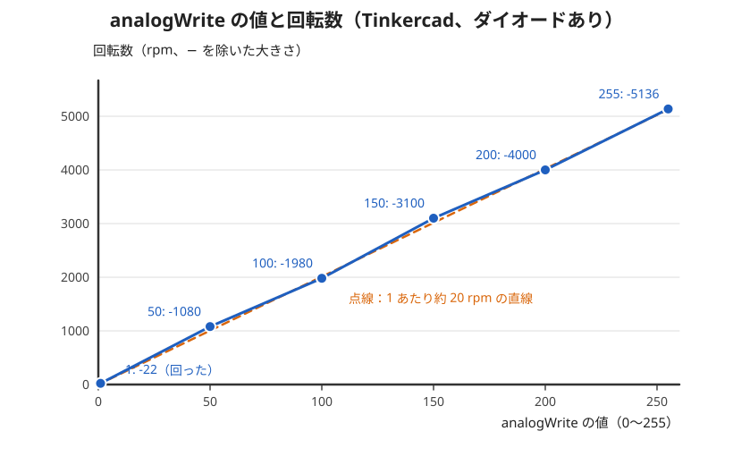

| 見るところ | 分かること |
| --- | --- |
| 増え方 | PWM の値が 1 増えるごとに、約 **20〜22 rpm** 増える。**ほぼ比例**（÷ PWM の値が、ほぼ一定）。ずれは ±10% くらい |
| 1 のとき | **-22 rpm で回った**。「ある値から急に回り出す」ことは、Tinkercad では**起きなかった** |
| `-` の符号 | モーターの端子が、ふつうと逆向きにつながっているため（36日目と同じ）。大きさで見る |
| 255 のとき | `-5136`。36日目の `digitalWrite(2, HIGH)` のときの `-5138 rpm` と、**ほぼ同じ**。255 は、ずっと ON と同じなので、合っている |
| 最初の画面の `-4535` | 最初の配線図（ピン9）に、`-4535 rpm` と出ていた。255 の `-5136` と**ちがう**。ピン9は、記事の Fade のコード（0 と 255 のあいだを行き来する）で動く形で、**行き来の途中の値と考えられる**。確かめていない |

**⑤ ダイオードの有無で、変わるか**

| ダイオードを外した配線図 | そのときの 255（`-5136 rpm`） |
| --- | --- |
| 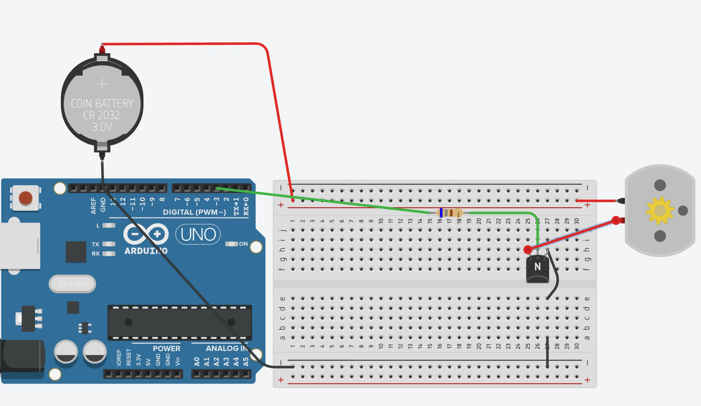 | 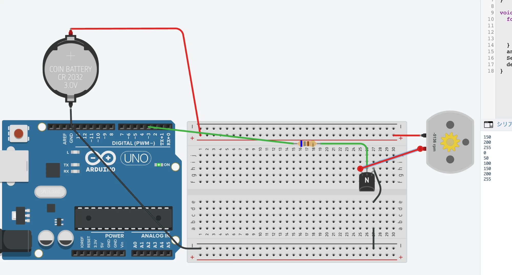 |

| 条件 | 255 のときの rpm | 出どころ |
| --- | --- | --- |
| ダイオードあり | -5136 | 前に読んだ数字 |
| ダイオードなし | **-5136** | 上のスクリーンショット |

255 だけは、数字を比べた。**ほかの値も、変わらなかった**（あなたの回答。数字は残していない）。

| 考えられること | 根拠 |
| --- | --- |
| Tinkercad は、**逆起電力を計算していない** | ダイオードがなくても、トランジスタが壊れたり、rpm が変わったりしなかった。ただし、確かめてはいない |
| 実機では、逆起電力が**実際に出る** | 記事の話。実機で測ってはいない |

**⑥ Tinkercad と、実機（Arduino IDE）のちがい**

| 項目 | Tinkercad | 実機 |
| --- | --- | --- |
| 逆起電力 | 計算していないと考えられる。ダイオードの効果が**見えない** | **実際に出る**（記事）。ダイオードがないと、トランジスタが壊れるおそれ |
| rpm | モーターの横に**数字が出る**（`-5136` など） | 数字は出ない。音や振動、エンコーダ（40日目）で知る。記事は、サイレンのような音と書いている |
| 小さい PWM の値 | 1 でも回る | 小さい値では回らない範囲（不感帯）があるのが普通（記事外の一般的な話） |
| モーター | DC モーター（部品） | FA-130RA（記事）。使用電圧は 1.5〜3.0V（36日目の表） |
| トランジスタ | NPN（部品） | 2SC2120-Y（記事）。最大定格 30V |
| ダイオード | 部品名「ダイオード」 | 型番がある。よく使われるのは 1N4007 や 1N4148（記事外） |
| PWM の周波数 | ピン3は 490Hz のはず。確かめていない | 3, 9, 10, 11 は約 490Hz、5, 6 は 977Hz（記事） |

<details>
<summary>まちがい：ダイオードの部品、向き、置き方（クリックで開く）</summary>

| # | 症状 | 原因 | 直し方 |
| --- | --- | --- | --- |
| 1 | ダイオードを足したつもりが、赤い **LED** が置いてある | LED も「ダイオード」の一種なので、まちがえたと考えられる（確かめていない）。LED は約 20mA までしか流せない | 部品の検索で「ダイオード」と入れ、**一番上**の「ダイオード」を選び直した |
| 2 | 緑の線が、ピン `2` に刺さって見えた（`~` が付いていないピン） | ピン2は PWM が使えない（`analogWrite` で、段階が変わらない） | 1つ左の **`~3`** に刺し直した（コードも 3） |
| 3 | 回路図表示で、D4 の三角が、**電池の ＋ 側 → コレクタ側**を向いていた（逆） | ダイオードの**縞（カソード）が、コレクタ側**だった。この向きだと、ON のとき、電池の＋からダイオードを通ってコレクタへ流れ、モーターを通らない | ダイオードを**上下ひっくり返す**ことにした |
| 4 | ひっくり返したつもりでも、2回目の回路図表示で、**まだ逆**（同じ向き） | ひっくり返しても、元の向きに戻っていた、または向きが変わっていなかったと考えられる（確かめていない）。配線図の縞は、小さくて読み取れなかった | 回路図表示を正解として、もう一度ひっくり返した |
| 5 | ダイオードが、**板の穴から外れて、板の上に浮いた**。赤い線は、足についていった | 回転の操作で、足が穴から外れた | 浮いたままでも、足についた線で、**つながっていた**（回路図表示は合っていた）。のちに、穴に落とした |
| 6 | 回路図表示に、**つながっていないダイオード**（D3）が1個あった | 余分なダイオードが、画面のどこかに残っていたと考えられる（確かめていない） | 消した（次の回路図表示では、なくなっていた） |

| 向きが逆（1回目）の配線図 | そのときの回路図表示（D3 が浮いている） |
| --- | --- |
| 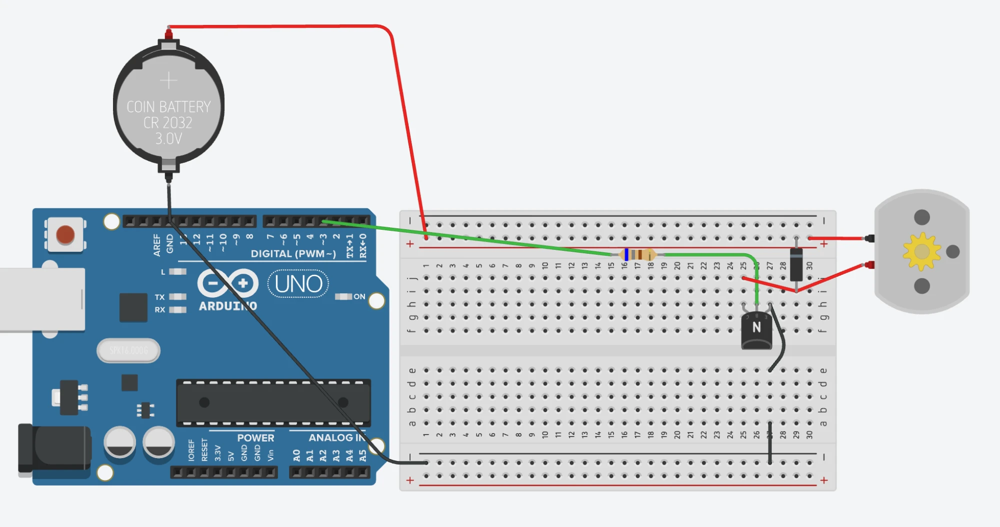 | 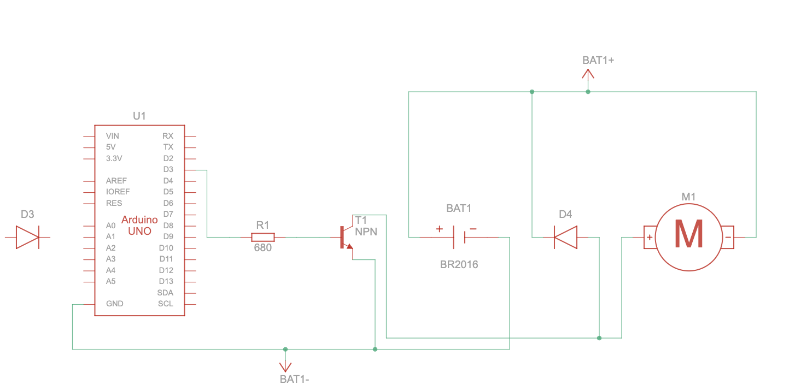 |

| 向きが逆（2回目）の配線図 | そのときの回路図表示（まだ逆） |
| --- | --- |
| 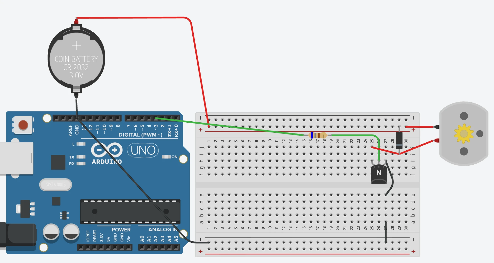 | 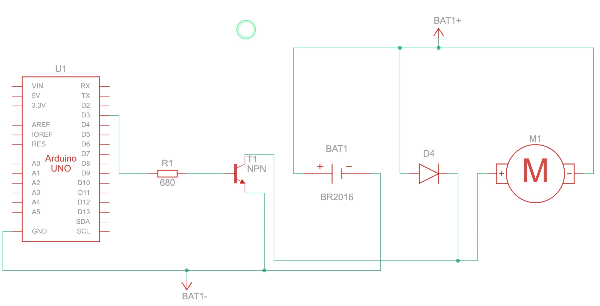 |

| 先に置いた LED（まちがい） | ひっくり返して、板の上に浮いたダイオード |
| --- | --- |
| 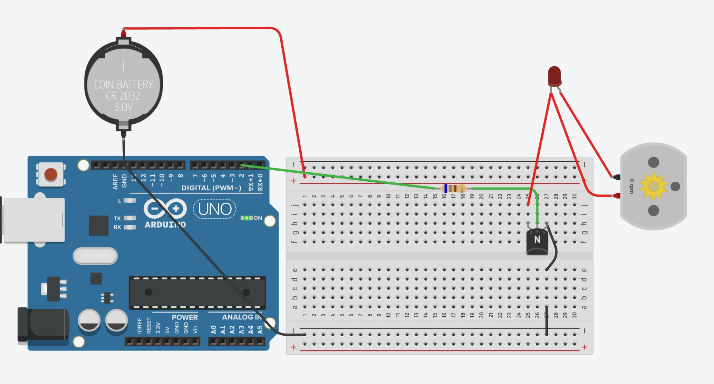 | 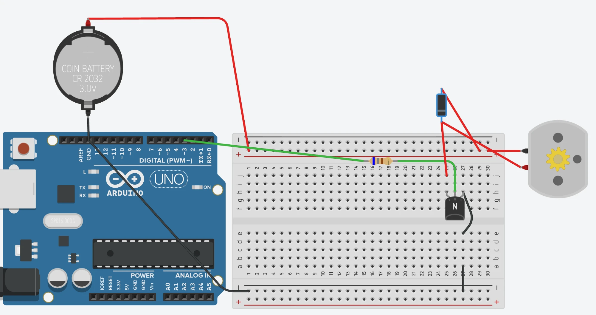 |

| 向きが合った配線図（浮いたまま） | 向きが合った回路図表示 |
| --- | --- |
| 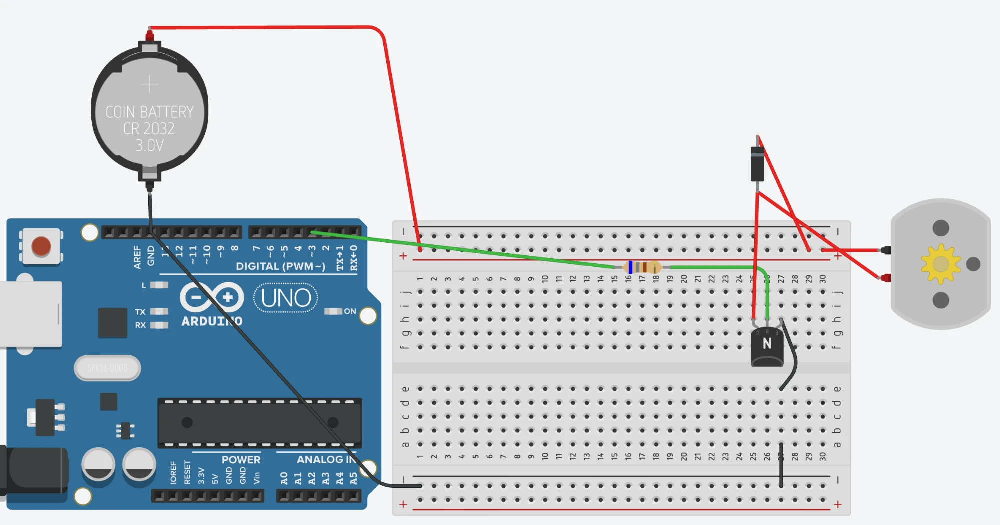 |  |

| 確かめた順番 | したこと | 結果 |
| --- | --- | --- |
| 1 | 部品を置く（LED） | LED だった。まちがい |
| 2 | 「ダイオード」を置く | 向きが逆（回路図表示） |
| 3 | ひっくり返す | まだ逆（回路図表示） |
| 4 | もう一度ひっくり返す | 板の上に浮いた。回路図表示は、**合っていた** |
| 5 | 板の穴に落とす | つながった（配線図。回路図表示は撮っていない） |

**Claude の説明のまちがい**

| # | まちがい | 本当は |
| --- | --- | --- |
| 1 | 記事を読まずに、先に「モーターの両端にダイオードを並列」と案内した | 記事の本文の主な方法は、**図2**（C と E のあいだ）で、モーターの両端は図4の別の方法。位置が2つあることを、最初に言うべきだった |
| 2 | 「出てくる部品に**整流ダイオード**と書かれたものを選ぶ」と案内した | 画面の部品名は「ダイオード」だけ（下に「ツェナーダイオード」「フォトダイオード」）。画面を見ずに、名前を言った |
| 3 | 配線図の画像から、縞が上か下かを読んで、「逆」「正しい」と言った | 画像が小さく、読み取りは**あてにならなかった**。回路図表示（三角と縦棒）を、先に正解にするべきだった |
| 4 | 「`R` キーを2回押して、ひっくり返す」と案内した | 回すと、足が穴から外れて、板の上に浮いた。「逆だと言ったから変えたのに」と、あなたを怒らせた。足の穴を保つ方法を、先に説明するべきだった |
| 5 | 最初の画面の `-4535` を、「回り始めの途中で読んだ数字」と説明した | のちに、ピン9で動いていた、記事の Fade のコードの途中の値と考えられると、直した。どちらも**確かめていない** |

</details>

### この日のまとめ：予想 → 結果 → 差の理由

今日は、動かす前の予想を、**書かなかった**。結果を見たあとに、あなたが次のように答えた（**結果を見たあとの回答**）。

| 何を測った／試したか | 予想（結果を見たあとの回答） | 結果 | 差の理由 |
| --- | --- | --- | --- |
| ダイオードを足すと、動きの見た目は変わるか | 変わる | **変わらなかった**（255 で、あり・なしとも -5136 rpm。ほかの値も、変わらなかったと回答） | Tinkercad は、逆起電力を計算していないと考えられる（確かめていない） |
| `analogWrite` の値を 50 → 255 に上げると、回転数は | 増える（A. 比例か、B. 急に回り出すか、は言わなかった） | **増えた**。ほぼ比例（約 20 rpm / 1） | 記事の式（山の電圧 × デューティー比）どおり、平均電圧に比例して増える（測ったのは rpm だけ。平均電圧は計算） |
| 255 のときの rpm は、最初の画面（-4535）と同じか | ちがう | **ちがった**（-5136） | 最初の画面は、Fade のコード（0 と 255 を行き来）の途中の値と考えられる（確かめていない） |
| PWM が 1 のとき、回るか | 書かなかった | **回った**（-22 rpm） | Tinkercad のモーターは、電圧が低くても回るように作られていると考えられる（確かめていない） |
| ダイオードの向き | 書かなかった | 最初の2回は**逆** | 縞（カソード）を、コレクタ側にしていた（回路図表示で確かめた） |

**まだ試していないこと**（時間のある日に）

| 試すこと | 先に書く予想 |
| --- | --- |
| ダイオードを、記事の図2の位置（C と E のあいだ）に付ける | 見た目は変わるか。変わらないか |
| ダイオードの向きを、**わざと逆**にして動かす | モーターは回るか。回らないか |
| 50 以外の値（たとえば 10, 20）でも、ダイオードあり・なしで rpm を比べる | 数字は、同じか |
| 電池を 3V から 5V にする | 値が同じでも、rpm は大きくなるか |
| 記事の Fade のコード（ピン9）を動かして、rpm が 0 から 5000 くらいまで、行き来するか見る | 最初の `-4535` のような途中の値が見えるか |
| `analogWrite` の値が 2〜49 のあいだで、rpm の変わり方を見る | 1 から 50 まで、直線の上にあるか |

**実機を買ったらやり直すこと**

- 記事のとおり、FA-130RA と 2SC2120-Y、680Ω、**ダイオードあり**で、モーターを回す
- ダイオードを付ける位置を、**図2**（C と E）と**図4**（モーターの両端）で比べる
- ダイオードがないときの、コレクタの電圧を、オシロスコープで見る（記事外。壊れる可能性があるので、小さい電源で。トランジスタが壊れることを、前提にする）
- `analogWrite` の小さい値で、**回り出さない範囲**（不感帯）があるかを見る
- 値を変えながら、モーターの音（記事は、サイレンのようだと書いている）を聞く
- ピン5, 6（977Hz）と、ピン3, 9, 10, 11（490Hz）で、音や回り方がちがうかを見る（記事外）

## 38日目 Hブリッジで向きを変える

> **ひとことで**：**L293D**（チップの中に**Hブリッジ**が入った、モーター用のドライバ）では、**1A と 2A の組み合わせ**で、モーターの向きが決まる。（HIGH, LOW）で **9393 rpm**、（LOW, HIGH）で **-9393 rpm**、（LOW, LOW）で **0 rpm**。速さは、**入力（1A・2A）に PWM** を入れても、**イネーブル（EN）に PWM** を入れても、**ほぼ同じ**に変わった（100 で 3664 と 3700 rpm、255 で 9393 rpm、1 でも回った）。最初の回路は、**黒い線が GND でなく、ピン12**に刺さっていた。

**この日にやったことと、分かったこと**

| # | やったこと | 分かったこと（一言） |
| --- | --- | --- |
| 1 | SunFounder「4.1 モーター」を読む | L293D に、**入力2本**（1A・2A）と**出力2本**（1Y・2Y）、**イネーブル**（EN）がある。記事は ESP32 用で、UNO ではピンの番号を変える |
| 2 | Arduino UNO と L293D で組む（1回目） | 記事の**黒い線が GND**。ピン12に刺していた。回路図表示で、**Arduino の GND に線がない**と分かった |
| 3 | 黒を GND へ、青を ~11 へ直して、向きを確かめる | （HIGH, LOW）9393 rpm、（LOW, HIGH）-9393 rpm、（LOW, LOW）0 rpm |
| 4 | 1A・2A に PWM を入れる（記事の「さらに学ぶ」） | 値が 1 増えるごとに、約 **36.5 rpm** 増える。**1 でも回る**（35 rpm） |
| 5 | EN に PWM を入れる（チェックリストの指示） | 入力に PWM を入れたときと、**ほぼ同じ**（差は約 1%） |
| 6 | チェックリストの「注意」を読む | L293D は古く、実機では TB6612FNG や DRV8833 を勧める。Tinkercad では仕組みの理解に使う |

やることの詳細は[チェックリスト](../CHECKLIST.md#第6週-モーター)。

**何に役立つか**

| 使う場面 | どう使うか |
| --- | --- |
| ロボットの車輪を、前にも後ろにも回す | モーターの向きを、2本の入力の組み合わせで決める。36日目のトランジスタ1個では、回る・止まるだけだった |
| 左右2つの車輪で、進む・曲がる・回る | L293D は、2つのモーターを動かせる（記事）。左右の車輪の向きと速さを、別々に決められる（記事外の考え方） |
| 速さを変える | `analogWrite()` の値（PWM）で、平均の電圧を変える（37日目）。入力でも EN でもよい |
| 40日目のエンコーダで、ちょうど1回転で止める | 向きと速さを、プログラムから決められるので、止める手前で減速できる |
| 実機の部品選び | L293D は、仕組みの理解用。実機では、損失の少ない TB6612FNG や DRV8833（チェックリストの注意） |

**この日に出てくることば**

| ことば | 意味 | たとえ |
| --- | --- | --- |
| L293D | モーターを動かすためのチップ（IC）。入力2本で、モーターの向きを決められる。2つのモーターを動かせる（記事） | モーターの向きを決める、小さな交通整理の人 |
| Hブリッジ | スイッチ4つで、モーターに流す電流の**向き**を切り替える回路。形が「H」に見える（記事外の説明）。L293D の中に入っている | 道を2本つないで、右から左にも、左から右にも、人を通せる橋 |
| 入力（1A・2A） | マイコンから信号を入れる足。HIGH と LOW の組み合わせで、向きが決まる | 交通整理の人への、合図 |
| 出力（1Y・2Y） | モーターをつなぐ足。1A に対応するのが 1Y、2A に対応するのが 2Y（記事の回路図） | 合図に従って、道を開ける出口 |
| イネーブル（EN、1,2EN） | 出力を有効にするか決める足。5V につなぐと、いつも有効（記事）。PWM を入れて、速さを決めることもできる（チェックリスト） | 交通整理の人の、勤務スイッチ |
| VCC1・VCC2 | VCC1 はチップ自身の電源、VCC2 はモーターに送る電源（記事外の説明）。今日は、どちらも 5V | 1つはチップの食事、もう1つはモーターの食事 |
| 正転・逆転 | モーターが、ある向きに回ること、逆向きに回ること。Tinkercad では rpm の符号（`-`）で分かる | 時計回りと、反時計回り |
| ブレーキ・空転 | 止め方のちがい。出力を同じ電位にして止めると、ブレーキがかかる。EN を切ると、自由に回る（記事外の一般的な話。今回は試していない） | 自転車を、ブレーキで止めるか、こぐのをやめて止めるか |
| 発熱・電圧ロス | L293D は、内部で電圧が下がり、熱が出る（チェックリストの注意）。数値は確かめていない | 長い水道管で、水の勢いが弱まる |

### 0. 先に：この日に使う前提知識

**① モーターは、電圧の向きを逆にすると、逆に回る（[36日目](#36日目-トランジスタでモーターを回す)）**

| 場面 | モーターの回る向き |
| --- | --- |
| 電池の ＋ を端子A、− を端子B | ある向きに回る |
| ＋と−を入れかえる | **逆に回る** |

**② トランジスタ1個では、向きは変えられない（36日目）**

| 回路 | できること |
| --- | --- |
| ピン → ベース抵抗 → NPN → モーター | 電流は、いつも ＋ → モーター → GND の1方向。**回る・止まる**だけ |

**③ PWM と `analogWrite()`（[31日目](../week5/README.md#31日目-pwmとアナログ入力)、[37日目](#37日目-逆起電力とpwmの速度制御)）**

| 使うもの | 意味 |
| --- | --- |
| `analogWrite(ピン, 0〜255)` | `~` が付いたピンから、ON/OFF のくり返しを出す。255 が 100% |
| 平均電圧 ＝ 山の電圧 × 値 ÷ 255 | モーターは、この平均で回る（37日目） |

### 1. 読む：[SunFounder ESP32「4.1 モーター」](https://docs.sunfounder.com/projects/esp32-starter-kit/ja/latest/arduino/basic_projects/ar_motor.html)。L293Dで正転・逆転・停止、さらにPWMで加減速する流れ（30分）

**① 記事の構成**

| 節 | 書いてあること（要約） |
| --- | --- |
| はじめに | L293D は、前進・後進の両方向に、2つのモーターを駆動できる（記事）。デジタル信号と PWM 信号で、モーターを制御する |
| 必要な部品、利用可能なピン | ESP32 ボード、ブレッドボード、ジャンパーワイヤ、DC モーター、L293D。使えるピンの一覧（ESP32 の番号） |
| 回路図、配線図 | **IO13 → 1A、IO14 → 2A**、1,2EN・VCC1・VCC2 は 5V、GND は GND、モーターは 1Y と 2Y のあいだ。**モーターは大きな電流が要るので、先に Power Pack を差し込む**（注釈） |
| コード | ピン13（1A）とピン14（2A）を出力にして、HIGH/LOW の組み合わせで、回る → 逆に回る → 止まる |
| さらに学ぶ | 制御ピンに PWM を入れて、速さを変える。チャンネルAを 0 → 255 → 0 に変え、Bは 0。**逆向きにするには、A と B の値を交換**する |

**② 記事の回路（L293D の足と、つなぎ先）**

| L293D の足 | 記事のつなぎ先 | 記事の配線図の色 |
| --- | --- | --- |
| 1（1,2EN） | 5V | 赤（短い線） |
| 2（1A） | IO13 | **青** |
| 3（1Y） | モーターの片方 | 黄 |
| 4（GND）ほか | GND | **黒** |
| 6（2Y） | モーターのもう片方 | 緑 |
| 7（2A） | IO14 | **オレンジ** |
| 8（VCC2）、16（VCC1） | 5V | 赤 |

IO13・IO14 は ESP32 の番号で、**Arduino UNO では、別のピンにする**。今日は、青 → **~11**、オレンジ → **~10**、黒 → **GND** にした。

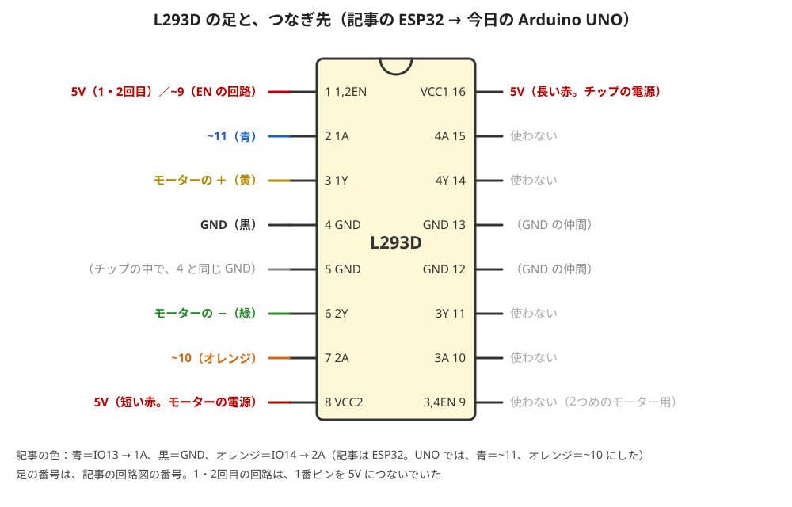

**③ 記事のコードと、今日のコード**

| 見るところ | 記事（ESP32） | 今日（Arduino UNO） |
| --- | --- | --- |
| ピン | `motor1A` ＝ 13、`motor2A` ＝ 14 | `motor1A` ＝ **11**、`motor2A` ＝ **10** |
| 向きのコード | `digitalWrite` の HIGH/LOW。2000ms、2000ms、3000ms | **同じ** |
| PWM | `ledcAttach`、`ledcWrite`（500Hz、8ビット）。0 → 255 を `delay(50)` で増やす | `analogWrite`（0〜255、約 490Hz のはず）。シリアルモニタから値を打つ |
| シリアル | 115200 | 9600 |

> 記事の**文章**は「1秒時計回り、1秒反時計回り、2秒停止」と書いているが、**コードは 2000ms、2000ms、3000ms**（2秒、2秒、3秒）。文章とコードが食いちがっている。コードは、記事のページに見えず、記事が指す GitHub のリポジトリ（`c/codes/4.1_motor/4.1_motor.ino`）で読んだ。今日は、コードの 2000ms を使った。

**④ 記事のどこを使ったか**

| 記事の節 | どう使ったか |
| --- | --- |
| 部品、Power Pack、ESP32 の拡張ボード | 飛ばした（Tinkercad では、電池を使わず、Arduino の 5V を使った） |
| 利用可能なピン | 飛ばした（ESP32 の番号。UNO は `~` が付いたピンを選んだ） |
| 回路図、配線図 | **使った**（足のつなぎ先と色を、UNO のピンに置きかえた） |
| コード（向きを変える） | **使った**（ピン番号だけ変えた） |
| さらに学ぶ（PWM） | **使った**（`ledcWrite` → `analogWrite`。値を打つ版にした） |
| LEDC の説明 | 飛ばした（UNO にはない。`analogWrite` を使う） |

**⑤ 数字は、どこから来たか**

| 数字 | 種類 | どこから来たか |
| --- | --- | --- |
| 5V | A. 部品の性質 | Arduino UNO の 5V ピン |
| 2000ms、2000ms、3000ms | A. 記事の値 | 記事のコード |
| 500Hz | A. 記事の値 | 記事の PWM の周波数（ESP32）。UNO の `~11`、`~10` は、約 490Hz のはず（37日目の記事の話。確かめていない） |
| 0〜255 | A. 部品の性質 | `analogWrite` の範囲 |
| -255〜255 | B. 決めた値 | 向きと速さを、1つの数で打つため（今日のコード） |
| 100、-100、1 | B. 決めた値 | 予想して、確かめる値 |
| 9393 rpm など | 測定 | Tinkercad の rpm の表示（目で読んだ） |

### 2. 組む：TinkercadのArduino UNOとL293Dで同じ動きを作る。2本の入力の組み合わせで向きが決まり、イネーブルのPWMで速さが決まる（60分）

**① 部品**

| 部品 | Tinkercad での名前・値 |
| --- | --- |
| L293D | ブレッドボードの上で、チップに「L293D」と出る部品（見つけた場所は、記録していない） |
| モーター | DC モーター（36日目と同じ） |
| 電源 | Arduino の 5V（今日は、電池を使わない。記事も 5V） |

**② 回路（最終）**

```
 UNO ~11 ---- (blue) ---- L293D pin2  (1A)
 UNO ~10 ---- (orange) -- L293D pin7  (2A)
 UNO GND ---- (black) --- L293D pin4  (GND)
 UNO 5V  ---- (red) ----- L293D pin16 (VCC1), pin8 (VCC2), pin1 (1,2EN)
                          L293D pin3 (1Y) -- (yellow) -- Motor +
                          L293D pin6 (2Y) -- (green) --- Motor -
```

| 順番 | 場所 | つながる理由 |
| --- | --- | --- |
| 1 | UNO の 5V → ＋の列 → 長い赤 → L293D の16番（VCC1） | チップ自身の電源 |
| 2 | 5V の列 → 短い赤 → 8番（VCC2）と 1番（1,2EN） | モーターの電源と、出力の有効化 |
| 3 | ~11 → 青 → 2番（1A）、~10 → オレンジ → 7番（2A） | 向きを決める2本の入力 |
| 4 | GND → 黒 → 4番（GND） | **信号の戻り道**（Arduino の GND と、チップの GND を共通にする） |
| 5 | 3番（1Y）→ 黄 → モーターの ＋、6番（2Y）→ 緑 → モーターの − | 出力 |

| 配線図（最終） | 回路図表示（最終） |
| --- | --- |
| 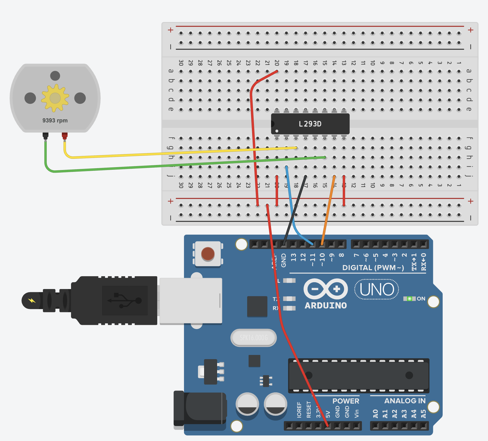 | 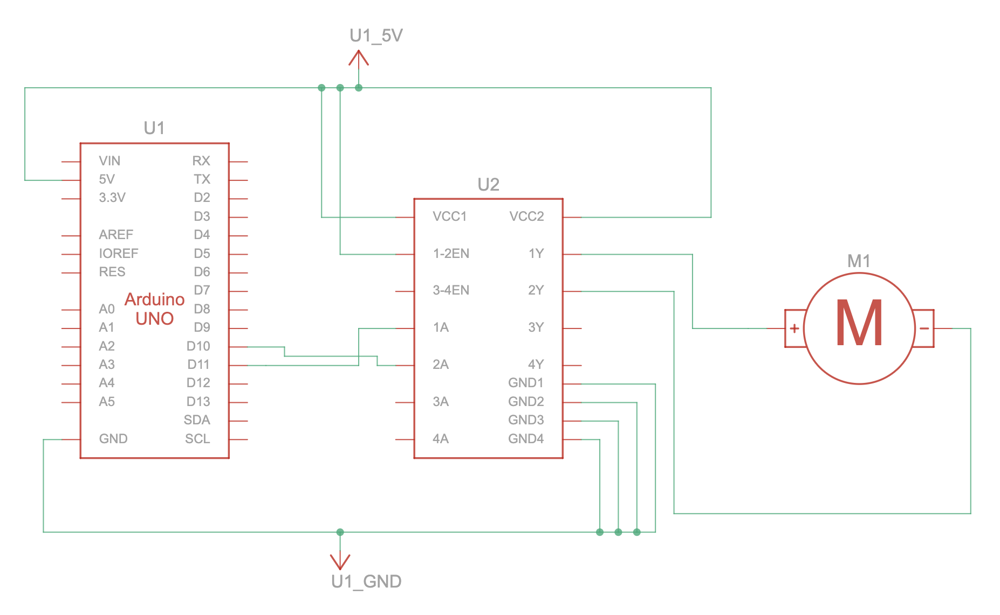 |

回路図表示では、D11 → 1A、D10 → 2A、1Y → モーターの＋、2Y → モーターの −、VCC1・VCC2・1-2EN が 5V、GND1〜4 が U1_GND（Arduino の GND）、になっている。

保存した回路（向きを変える）：[Tinkercad で開く](https://www.tinkercad.com/things/giIU5YQznXo-day38411motor/editel?sharecode=3wl8-FE4BBW-96ZnSdUZtGnkMdecu-sjijVfrHKMr3Q)

**③ Hブリッジの考え方**

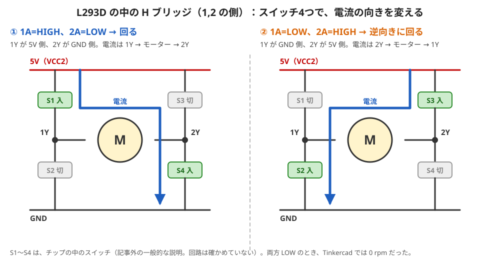

| 1A | 2A | 1Y（記事外） | 2Y（記事外） | モーター | 今日の結果（Tinkercad） |
| --- | --- | --- | --- | --- | --- |
| HIGH | LOW | 5V 側 | GND 側 | 回る | **9393 rpm** |
| LOW | HIGH | GND 側 | 5V 側 | 逆に回る | **-9393 rpm** |
| LOW | LOW | GND 側 | GND 側 | 止まる（ブレーキ。記事外） | **0 rpm** |
| HIGH | HIGH | 5V 側 | 5V 側 | 止まる（記事外） | **試していない** |

> 1Y と 2Y の列と、スイッチ4つの図は、L293D の一般的な説明（記事外）。回路そのものは、確かめていない。確かめたのは、右端の rpm。

**④ 向きを変えるコード：1行ずつ読む**

保存したコード：[code/day38_motor_l293d/day38_motor_l293d.ino](code/day38_motor_l293d/day38_motor_l293d.ino)

```cpp
#define motor1A 11
#define motor2A 10

void setup() {
  pinMode(motor1A, OUTPUT);
  pinMode(motor2A, OUTPUT);
}

void loop() {
  digitalWrite(motor1A, HIGH);
  digitalWrite(motor2A, LOW);
  delay(2000);

  digitalWrite(motor1A, LOW);
  digitalWrite(motor2A, HIGH);
  delay(2000);

  digitalWrite(motor1A, LOW);
  digitalWrite(motor2A, LOW);
  delay(3000);
}
```

| 行 | 意味 | いつ動くか |
| --- | --- | --- |
| `#define motor1A 11` | 「`motor1A`」を、11 という数字の名前にする（ピン11 ＝ 1A） | コンパイルのとき |
| `#define motor2A 10` | 「`motor2A`」を、10 という数字の名前にする（ピン10 ＝ 2A） | コンパイルのとき |
| `pinMode(motor1A, OUTPUT);` | ピン11を出力にする | `setup()` で1回 |
| `pinMode(motor2A, OUTPUT);` | ピン10を出力にする | `setup()` で1回 |
| `digitalWrite(motor1A, HIGH);` `digitalWrite(motor2A, LOW);` | 1A を HIGH、2A を LOW にする → **回る** | `loop()` で毎回 |
| `delay(2000);` | 2秒待つ | 毎回 |
| `digitalWrite(motor1A, LOW);` `digitalWrite(motor2A, HIGH);` | **逆に回る** | 毎回 |
| `delay(2000);` | 2秒待つ | 毎回 |
| `digitalWrite(motor1A, LOW);` `digitalWrite(motor2A, LOW);` | 両方 LOW → **止まる** | 毎回 |
| `delay(3000);` | 3秒待つ | 毎回 |

| （HIGH, LOW）：回る | （LOW, HIGH）：逆向き |
| --- | --- |
|  | 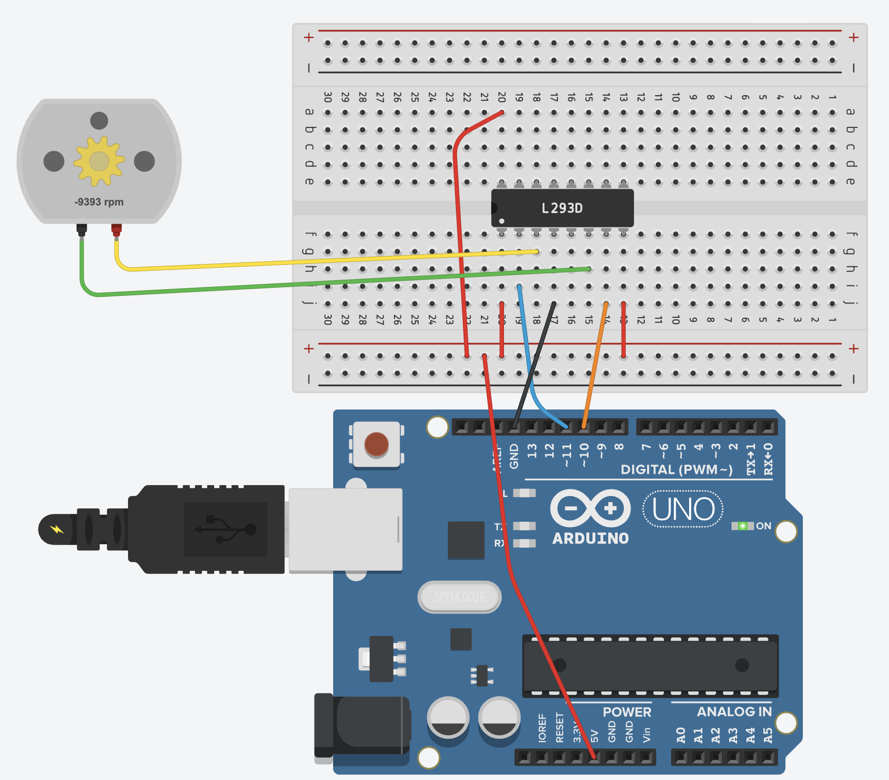 |

| （LOW, LOW）：止まる | |
| --- | --- |
| 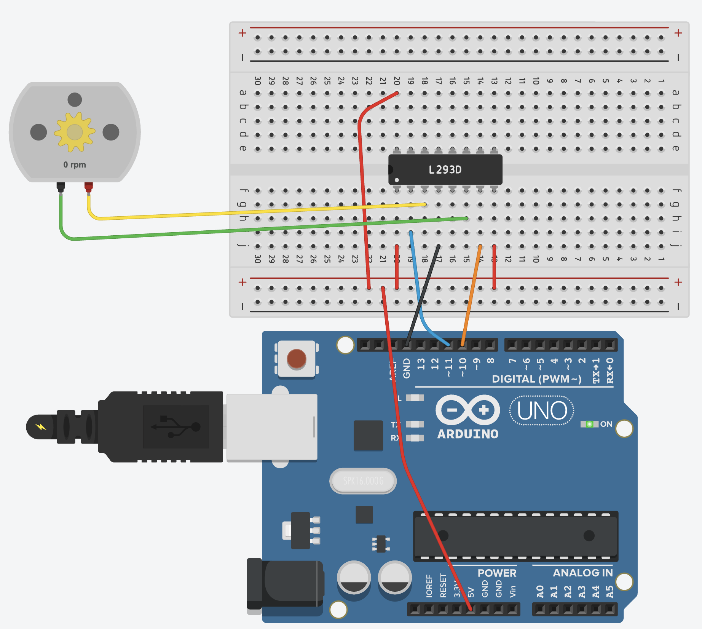 | |

**⑤ 1A・2A に PWM を入れる（記事の「さらに学ぶ」）**

保存したコード：[code/day38_motor_pwm_input/day38_motor_pwm_input.ino](code/day38_motor_pwm_input/day38_motor_pwm_input.ino)。シリアルモニタに `-255` 〜 `255` を打つ。正なら 1A に PWM、負なら 2A に PWM。

```cpp
#define motor1A 11
#define motor2A 10

void setup() {
  pinMode(motor1A, OUTPUT);
  pinMode(motor2A, OUTPUT);
  Serial.begin(9600);
  Serial.println("type -255 to 255 and send");
}

void loop() {
  if (Serial.available() > 0) {
    String s = Serial.readStringUntil('\n');
    s.trim();
    if (s.length() == 0) return;
    int v = s.toInt();
    if (v >= -255 && v <= 255) {
      if (v >= 0) {
        analogWrite(motor1A, v);
        analogWrite(motor2A, 0);
      } else {
        analogWrite(motor1A, 0);
        analogWrite(motor2A, -v);
      }
      Serial.print("value=");
      Serial.println(v);
    } else {
      Serial.println("out of range (-255 to 255)");
    }
  }
}
```

| 行 | 意味 | いつ動くか（または画面に出るもの） |
| --- | --- | --- |
| `Serial.begin(9600);` | シリアルモニタを使えるようにする | `setup()` で1回 |
| `if (Serial.available() > 0)` | 文字が届いたら | `loop()` で毎回調べる |
| `String s = Serial.readStringUntil('\n');` | 1行ぶんの文字を読む | 届いたとき |
| `s.trim();` | 前後の空白や改行を消す | 届いたとき |
| `if (s.length() == 0) return;` | 空なら何もしない | 届いたとき |
| `int v = s.toInt();` | 文字を数字にする。`-100` は、−100 になる | 届いたとき |
| `if (v >= -255 && v <= 255)` | 範囲の中だけ、使う | 届いたとき |
| `analogWrite(motor1A, v);` `analogWrite(motor2A, 0);` | `v` が 0 以上のとき、1A に PWM、2A は 0 | 届いたとき |
| `analogWrite(motor1A, 0);` `analogWrite(motor2A, -v);` | `v` が負のとき、1A は 0、2A に PWM（`-v` で、正の数にする） | 届いたとき |
| `Serial.print("value=");` `Serial.println(v);` | 打った値を出す | 画面：`value=100` |
| `Serial.println("out of range (-255 to 255)");` | 範囲の外なら、知らせる | 画面：`out of range (-255 to 255)` |

予想（動かす前）：100 のとき **3680 rpm**、-100 のとき **-3680 rpm**、1 のとき**回らない**。

| 値 | rpm（Tinkercad の表示） | rpm ÷ 値の大きさ | 予想 | 判定 |
| --- | --- | --- | --- | --- |
| 0 | 0 | — | （止まる） | ○ |
| 1 | **35** | 35 | 回らない | **はずれ（回った）** |
| 50 | 1814 | 36.3 | — | — |
| 100 | 3664 | 36.6 | 3680（差 16） | ほぼ合っている |
| -100 | -3667 | 36.7 | -3680（差 13） | ほぼ合っている |
| 150 | 5437 | 36.2 | — | — |
| 200 | 7324 | 36.6 | — | — |
| 255 | 9393 | 36.8 | — | — |

| 100：3664 rpm | 50：1814 rpm |
| --- | --- |
| 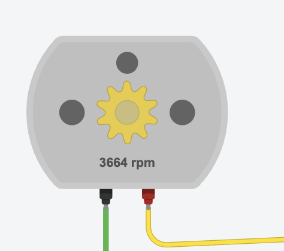 | 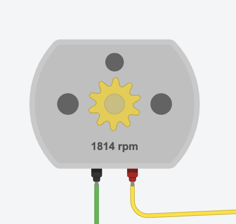 |

| -100：-3667 rpm | 1：35 rpm |
| --- | --- |
| 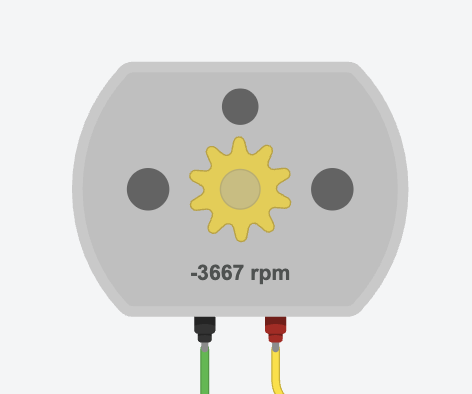 | 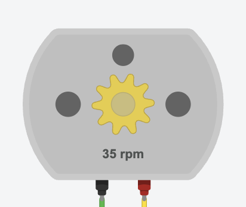 |

| 0：0 rpm | 150：5437 rpm |
| --- | --- |
| 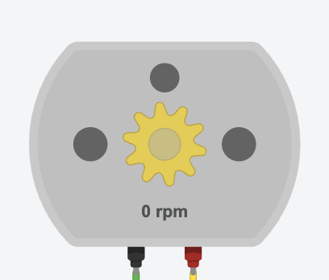 | 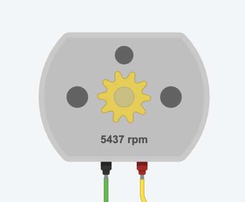 |

| 200：7324 rpm | 255：9393 rpm |
| --- | --- |
| 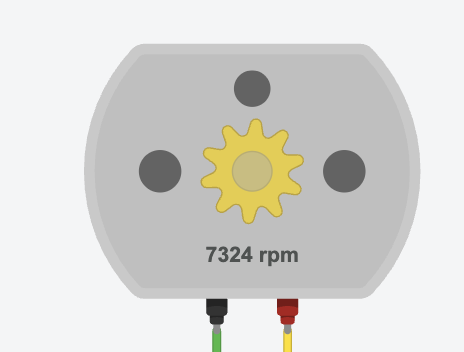 | 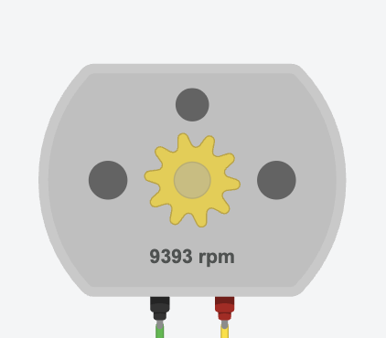 |

保存した回路（入力に PWM）：[Tinkercad で開く](https://www.tinkercad.com/things/fdgHLAXDnZL-day38412motorpwm/editel?sharecode=zl8V3Ej56nLAi5oInVBgTdiFFHoKyzfMmu74SgZJ50k)

**⑥ EN（イネーブル）に PWM を入れる（チェックリストの指示）**

記事は、**入力（1A・2A）に PWM** を入れる方法で、EN は 5V のまま。チェックリストは、「**イネーブルの PWM で速さが決まる**」と書いている。EN に PWM を入れる方法は、**記事にない**ので、同じ回路を1本だけ変えて試した。

| 線 | 1回目・2回目 | EN の回路 |
| --- | --- | --- |
| 1番ピン（1,2EN）の短い赤い線 | 5V の列 | **Arduino の `~9`** |

保存したコード：[code/day38_motor_pwm_enable/day38_motor_pwm_enable.ino](code/day38_motor_pwm_enable/day38_motor_pwm_enable.ino)。向きは、1A・2A の HIGH/LOW で決め、速さは、EN の PWM で決める。

```cpp
#define motor1A 11
#define motor2A 10
#define enablePin 9

void setup() {
  pinMode(motor1A, OUTPUT);
  pinMode(motor2A, OUTPUT);
  pinMode(enablePin, OUTPUT);
  Serial.begin(9600);
  Serial.println("type -255 to 255 and send");
}

void loop() {
  if (Serial.available() > 0) {
    String s = Serial.readStringUntil('\n');
    s.trim();
    if (s.length() == 0) return;
    int v = s.toInt();
    if (v >= -255 && v <= 255) {
      if (v >= 0) {
        digitalWrite(motor1A, HIGH);
        digitalWrite(motor2A, LOW);
        analogWrite(enablePin, v);
      } else {
        digitalWrite(motor1A, LOW);
        digitalWrite(motor2A, HIGH);
        analogWrite(enablePin, -v);
      }
      Serial.print("value=");
      Serial.println(v);
    } else {
      Serial.println("out of range (-255 to 255)");
    }
  }
}
```

| 行 | 意味 | いつ動くか |
| --- | --- | --- |
| `#define enablePin 9` | ピン9（~9）を、EN の名前にする | コンパイルのとき |
| `pinMode(enablePin, OUTPUT);` | ピン9を出力にする | `setup()` で1回 |
| `digitalWrite(motor1A, HIGH);` `digitalWrite(motor2A, LOW);` | `v` が 0 以上のとき、向きを「正」にする | 打ったとき |
| `analogWrite(enablePin, v);` | EN に PWM を入れる → **速さが決まる** | 打ったとき |
| `digitalWrite(motor1A, LOW);` `digitalWrite(motor2A, HIGH);` | `v` が負のとき、向きを「逆」にする | 打ったとき |
| `analogWrite(enablePin, -v);` | EN に、`-v`（正の数）の PWM を入れる | 打ったとき |

その他の行（`Serial` まわり）は、⑤と同じ。

予想（動かす前。本人の回答）：**全て、入力に PWM を入れたときと、変わらない**（具体的な数字は聞いていない）。

| 配線図（EN の回路。`3621 rpm` は、どの値のときか不明） | 回路図表示（D9 → 1-2EN） |
| --- | --- |
| 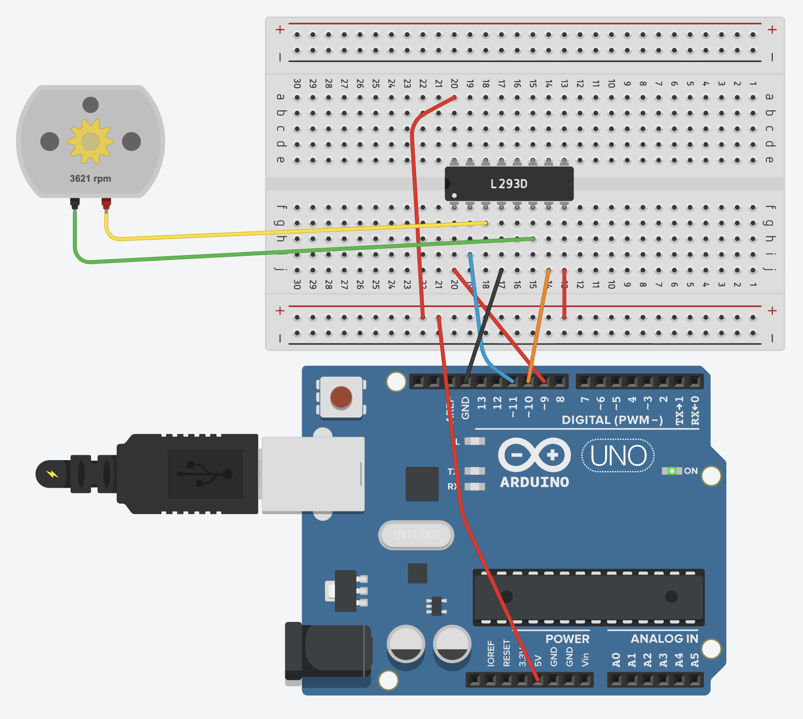 | 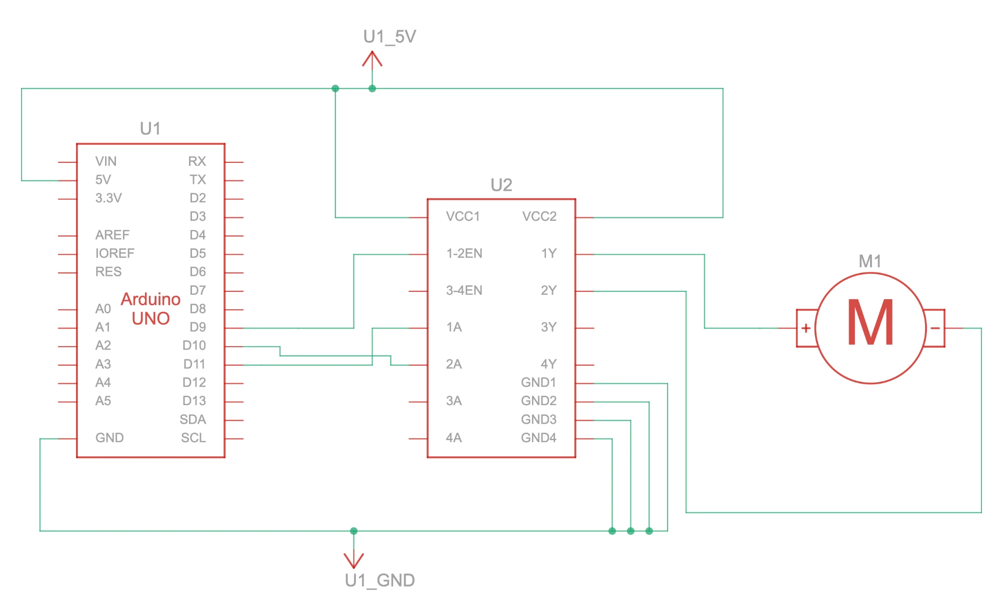 |

| 値 | 入力に PWM | EN に PWM | 差 |
| --- | --- | --- | --- |
| 100 | 3664 | **3700** | +36（約 1%） |
| -100 | -3667 | **-3700** | -33（約 1%） |
| 1 | 35 | **38** | +3 |
| 0 | 0 | **0** | 0 |
| 255 | 9393 | **9393** | 0 |

| 100：3700 rpm | -100：-3700 rpm |
| --- | --- |
| 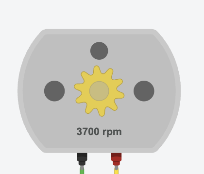 | 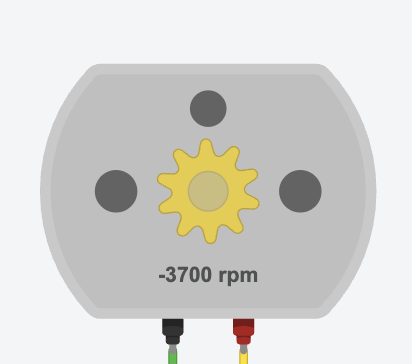 |

| 1：38 rpm | 0：0 rpm |
| --- | --- |
| 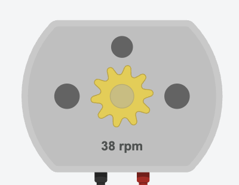 | 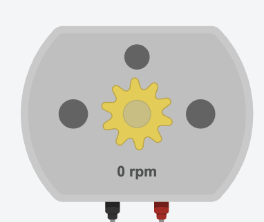 |

| 255：9393 rpm | |
| --- | --- |
| 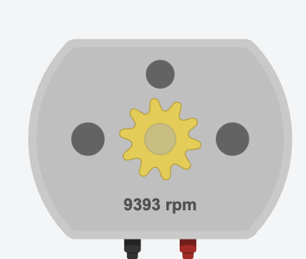 | |

保存した回路（EN に PWM）：[Tinkercad で開く](https://www.tinkercad.com/things/cIRlI2C1XMx/editel?sharecode=ejj3n5K7nKnoBhWxUjI_HxIfNve2074bytqx5pSkopM)

**⑦ 比べる**

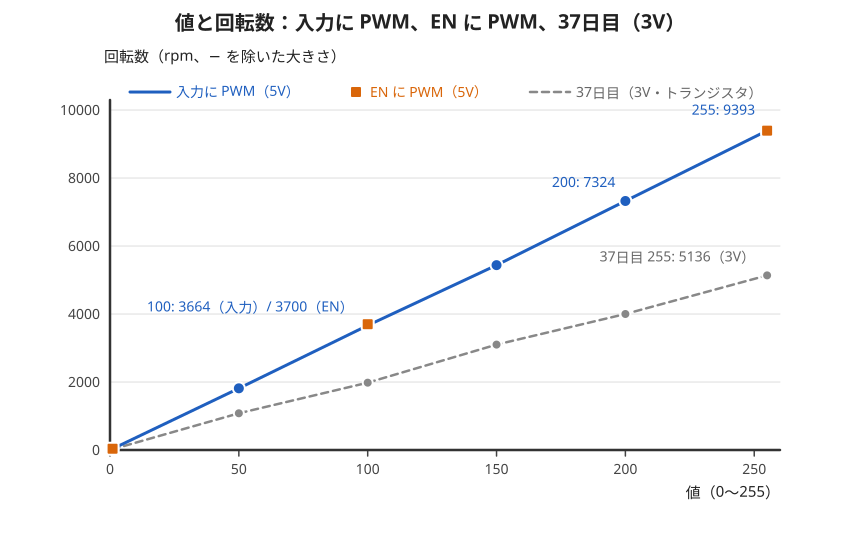

| 見るところ | 分かること |
| --- | --- |
| 入力に PWM と、EN に PWM | 100、-100、1、0、255 の5つとも、ほぼ同じ（差は約 1% 以下）。差の理由は、確かめていない（シミュレーターの計算のちがいと考えられる） |
| 傾き | 5V：約 **36.5 rpm / 1**。37日目（3V、トランジスタ）：約 20 rpm / 1。電圧は 5/3 ＝ 約 1.67倍、傾きは約 1.8倍で、**ぴったり電圧に比例ではない**。理由は、確かめていない |
| 255 のとき | 5V で 9393 rpm、3V で 5136 rpm（37日目）。5V のほうが、約 1.8倍速い |
| 1 のとき | 35 rpm（入力）、38 rpm（EN）。**回る**。37日目（3V）も、1 で回った（-22 rpm） |

### 3. 注意：筆者はL298NやL293Dのような古いドライバは発熱と電圧ロスが大きく、実機ではTB6612FNGやDRV8833を勧めています。シミュレーションでは仕組みの理解に使います

| 見るところ | 内容 |
| --- | --- |
| チェックリストの注意 | L298N と L293D は古く、**発熱**と**電圧ロス**が大きい。実機では **TB6612FNG** や **DRV8833** を勧める |
| Tinkercad で見えたか | **見えなかった。** 5V の電源で 9393 rpm（37日目の 3V より速い）。ロスや熱は、シミュレーターが計算していないと考えられる（確かめていない） |
| 今日の使い方 | 仕組みの理解用。**向きは入力の組み合わせ、速さは PWM** |
| ダイオード | 37日目で学んだダイオード（逆起電力）は、今日の回路には付けなかった。L293D の「D」は、内部にダイオードが入っているという意味と言われる（記事外。確かめていない） |

**Tinkercad と、実機（Arduino IDE）のちがい**

| 項目 | Tinkercad | 実機 |
| --- | --- | --- |
| 電源 | Arduino の 5V から、VCC1 と VCC2 | 記事は Power Pack（電池）を使い、先に差し込んで、スイッチを ON にする。モーターは大きな電流が要る |
| rpm | モーターの横に**数字が出る** | 出ない。音や振動、エンコーダ（40日目）で知る |
| 小さい PWM の値 | 1 でも回る | 回らない範囲があるのが普通（記事外） |
| L293D の損失・熱 | 見えない | 出る（チェックリストの注意） |
| PWM の周波数 | `~11`、`~10`、`~9` は、約 490Hz のはず（確かめていない） | 記事は 500Hz（ESP32 の `ledcAttach` の設定） |
| 逆起電力 | ダイオードなしでも、問題なし（37日目と同じく、計算していないと考えられる） | 出る（37日目の記事） |

<details>
<summary>まちがい：黒い線がピン12、青がピン13（クリックで開く）</summary>

| # | 症状 | 原因 | 直し方 |
| --- | --- | --- | --- |
| 1 | 最初の回路図表示で、**U1 の GND に線がなく**、**D12 が L293D の GND の列**につながっていた | 記事の黒い線は GND につなぐが、**ピン12**に刺していた。ピン13・12の並びと、GND の位置を、取りちがえたと考えられる（確かめていない） | 黒を、12 から**左へ2つ**（13 を飛ばして）、**GND の穴**へ移した |
| 2 | 青が**ピン13**（PWM が使えない） | 記事の IO13 に、番号をそろえた | PWM を使うので、**右へ2つ**、`~11` に移した |

| 最初の配線図（黒がピン12） | 最初の回路図表示（Arduino の GND に線がない） |
| --- | --- |
| 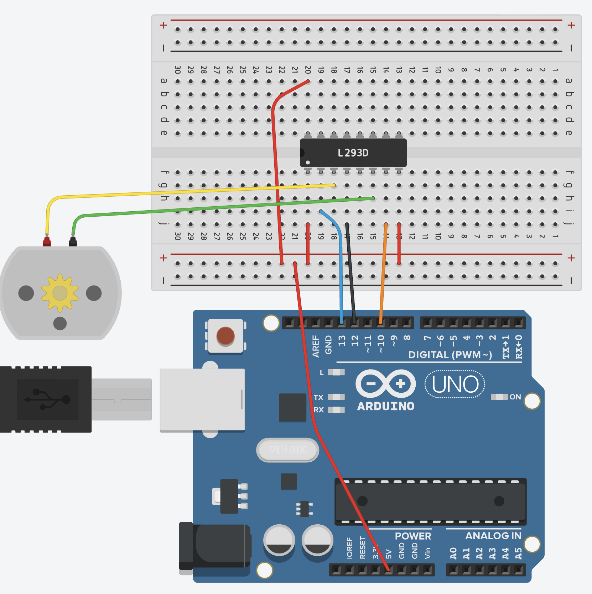 | 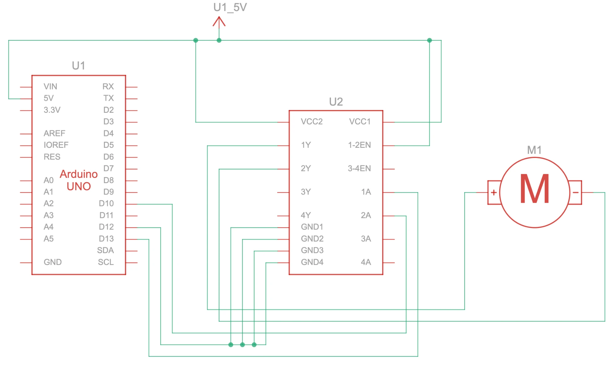 |

| 確かめた順番 | したこと | 結果 |
| --- | --- | --- |
| 1 | 回路図表示で、U1 の GND を見る | 線がない（D12 が GND の列につながっている） |
| 2 | 黒を GND へ、青を ~11 へ移す | 回路図表示で、U1_GND が GND1〜4 につながった |
| 3 | （HIGH, LOW）で動かす | 9393 rpm で回った |

**Claude の説明のまちがい**

| # | まちがい | 本当は |
| --- | --- | --- |
| 1 | 「GND がつながらないと、モーターは回りません」と言った | 最初の回路は、**動かして確かめていない**（直してから動かした）。回路図表示で、GND に線がないと分かっただけ。36日目の電池の − と同じ理由と考えられるが、断定できない |

</details>

### この日のまとめ：予想 → 結果 → 差の理由

予想は、動かす前に、あなたが出した。EN の予想は、「全て変わらない」とだけで、具体的な数字は聞いていない。

| 何を測った／試したか | 予想 | 結果 | 差の理由 |
| --- | --- | --- | --- |
| 1A=HIGH、2A=LOW | 回る | **回る**（9393 rpm） | — |
| 1A=LOW、2A=HIGH | 逆向き | **逆向き**（-9393 rpm） | — |
| 両方 LOW | 回らない | **回らない**（0 rpm） | — |
| 入力に PWM、100 | 3680 rpm | **3664 rpm**（差 16） | 比例の傾きが、予想とほぼ同じ（約 36.5 rpm / 1）。差の理由は、確かめていない |
| 入力に PWM、-100 | -3680 rpm | **-3667 rpm**（差 13） | 同上。向きは、予想どおり |
| 入力に PWM、1 | 回らない | **回った**（35 rpm） | Tinkercad のモーターは、電圧が低くても回るように作られていると考えられる（確かめていない）。37日目も、1 で回った |
| EN に PWM、100、-100、1、0、255 | 全て、入力のときと変わらない | **ほぼ同じ**（差は約 1% 以下） | PWM は、平均の電圧を変えるので、どこに入れても同じになったと考えられる。約 1% の差は、理由が分からない |
| 黒い線の刺し先 | 書かなかった | ピン12（GND でない） | 記事の黒は GND。ピンの並びを取りちがえたと考えられる（確かめていない） |

**まだ試していないこと**（時間のある日に）

| 試すこと | 先に書く予想 |
| --- | --- |
| 1A=HIGH、2A=HIGH（両方 HIGH）にする | 止まるか。回るか |
| EN を 0（OFF）にして、モーターが自由に回るか（空転）を見る | 回ったまま、ゆっくり止まるか。すぐ止まるか |
| 両方 LOW で止めるときと、EN を 0 にして止めるときの、止まり方のちがい | ちがうか。同じか |
| 電池（3V）で、VCC2 を動かす | 回転数は、5V のときより、小さくなるか |
| 2〜49 の値で、rpm を見る | 直線の上にあるか |
| 3,4 側（3A・4A）で、2つめのモーターを回す | 同じように回るか |

**実機を買ったらやり直すこと**

- 記事のとおり、Power Pack（電池）を先に差し込んで、L293D と DC モーターを動かす
- 小さい PWM の値で、**回り出さない範囲**があるかを見る
- L293D の**発熱と電圧ロス**を、テスターと手（温度）で確かめる。TB6612FNG や DRV8833 と比べる（チェックリストの注意）
- 両方 HIGH、EN を OFF にしたときの、止まり方（ブレーキと空転）を見る
- モーターの回転数を、音と、エンコーダ（40日目）で確かめる

## 39日目 サーボモーター

**やること**（詳細は [チェックリスト](../CHECKLIST.md#第6週-モーター)）

- 読む・組む：SunFounder 3in1「5.5 内蔵ライブラリの使用」
- 改造：可変抵抗の値（第5週の `map()`）でサーボの角度を決める
- 記録：サーボは内部で角度を自分で合わせる（閉ループ）が、外からは角度が分からない、という違いを1行

**成果物**

- 

**予想 → 結果 → 差の理由**

| 何を測った／試したか | 予想 | 結果 | 差の理由 |
| --- | --- | --- | --- |
| | | | |

## 40日目 エンコーダで「ちょうど1回転」（筆者の課題の後半）

**やること**（詳細は [チェックリスト](../CHECKLIST.md#第6週-モーター)）

- 準備：Tinkercadの部品検索で「エンコーダ付きDCモーター」を探す
- 読む：MONOist 俺流！組み込み用語解説(10) マイコンで機械式ロータリーエンコーダーを扱う（2ページ）
- 組む：エンコーダのA相を割り込みピン（2番）につなぎ、パルス数を数える
- 実験：電源電圧（=速度）を変えても同じ位置で止まるかを確かめる

**成果物**

- 

**予想 → 結果 → 差の理由**

| 何を測った／試したか | 予想 | 結果 | 差の理由 |
| --- | --- | --- | --- |
| | | | |

## 41日目 ステッピングモーター

**やること**（詳細は [チェックリスト](../CHECKLIST.md#第6週-モーター)）

- 読む：MONOist モーター制御(10) A4988を学ぶ
- 組む：WokwiのA4988の部品説明にある例題を開き、STEPのパルス数と回転角の関係を確かめる
- `week6/` に、速度の表とエンコーダ制御のコードを置く

**成果物**

- 

**予想 → 結果 → 差の理由**

| 何を測った／試したか | 予想 | 結果 | 差の理由 |
| --- | --- | --- | --- |
| | | | |

## 何が壊れてどう直したか

うまくいかなかったことを、症状・原因・直し方の順に書きます。この週で一番大事な節です。

| 日 | 症状 | 原因 | 直し方 |
| --- | --- | --- | --- |
| 36日目 | 最初の回路で、モーターが回らない | トランジスタの3本の足が、すべてちがう所につながっていた（抵抗がエミッタ、モーターがベース、GND がコレクタ）。モーターの電源も、Arduino の 5V だった | 電池（3V）を別電源にし、回路図表示で足の名前を読んで、抵抗 → ベース、モーター → コレクタ、エミッタ → GND にした |
| 36日目 | 電池にしても回らない | エミッタ → GND だけ合っていて、抵抗とモーターが逆のまま。足の名前は、トランジスタの置く向きで入れかわる | 抵抗とモーターの2本を入れかえた |
| 36日目 | 抵抗を 1kΩ にすると回らない | ベース電流が約 4.3mA と小さく、始動の大きな電流が流せない（記事の実機でも、1kΩ 前後で回らなかった） | 625Ω（約 6.9mA）にした |
| 36日目 | 電池の − を GND から外すと回らない | ベース電流が、エミッタから GND へ戻る道がない | 電池の − と Arduino の GND を、つなぐ（共通） |
| 37日目 | ダイオードを足したつもりが、赤い LED が置いてあった | LED も「ダイオード」の一種で、まちがえたと考えられる。LED は約 20mA までしか流せない | 検索で「ダイオード」と入れ、一番上の部品を選び直した |
| 37日目 | 緑の線が、PWM が使えないピン2に刺さっていた | ピン2に `~` が付いていない | `~3` に刺し直した（コードも 3） |
| 37日目 | ダイオードの向きが、2回続けて逆だった（回路図表示で、電池の＋ → コレクタ側を向いていた） | 縞（カソード）がコレクタ側だった。配線図の画像では、縞の位置が小さくて読み取れなかった | 回路図表示（三角と縦棒）を正解にして、縞を電池の＋側にした |
| 37日目 | ひっくり返したら、ダイオードが板の穴から外れて浮いた | 回転の操作で、足が穴から外れた | 足についた線で、つながってはいた。のちに穴に落とした |

**教訓（36日目）**：トランジスタの**足の名前は、部品と置く向きで変わる**。毎回、回路図表示や、足にマウスを乗せて、確かめる。モーターは**別電源**で、**GND を共通**にする。
| 38日目 | 最初の回路図表示で、Arduino の GND に線がなく、D12 が L293D の GND の列につながっていた | 記事の黒い線は GND につなぐが、ピン12に刺していた（ピンの並びを取りちがえたと考えられる） | 黒を GND の穴（左へ2つ）に移した |
| 38日目 | 青をピン13に刺していた（PWM が使えない） | 記事の IO13 に、番号をそろえた | PWM を使うので、`~11` に移した |

**教訓（37日目）**：ダイオードは、**縞（カソード）を電池の＋側**にする。向きは、配線図の画像でなく、**回路図表示**（三角と縦棒）で確かめる。部品の名前（LED とダイオード）も、検索の結果を見て確かめる。Tinkercad では、逆起電力が計算されないので、ダイオードの効果は見えない。

**教訓（38日目）**：記事の線の色（青・黒・オレンジ）を、Arduino の穴に移すときは、**ピンの並び（GND、13、12、~11）を取りちがえやすい**。刺したあと、回路図表示で、**U1 の GND に線があるか**を確かめる。速さの決め方は、入力に PWM でも、EN に PWM でも、Tinkercad ではほぼ同じ。

## 分からなかったこと・あとで調べること

| 日 | 分からなかったこと | 調べ方 |
| --- | --- | --- |
| 36日目 | Tinkercad で、回る・回らないの境目の抵抗値（4.3〜6.9mA のあいだ） | 680Ω、750Ω、820Ω で試して、境目を探す |
| 36日目 | Tinkercad のトランジスタの hFE と、最大のコレクタ電流 | 部品の説明を見る。電流計で、ベース電流とコレクタ電流を測る |
| 36日目 | `-5138 rpm` の `-` は、回る向きか | モーターの2本を入れかえて、符号が変わるかを見る |
| 36日目 | 5V でモーターを回すと、Arduino がリセットされるか（実機） | 実機で試す（電流に注意）。19日目のブラウンアウトと見くらべる |
| 36日目 | 電池の電圧（3V と 5V）で、回転数がどう変わるか | Tinkercad の rpm の表示で、比べる |
| 37日目 | ダイオードのあり・なしで、rpm が変わらなかった理由（Tinkercad は逆起電力を計算していないのか） | 実機で、ダイオードなしのコレクタの電圧を、オシロスコープで見る |
| 37日目 | 記事の図2（C と E のあいだ）と図4（モーターの両端）で、どちらが守れるのか | 実機で、両方を比べる。記事外の資料も調べる |
| 37日目 | 最初の画面の `-4535 rpm` の理由（Fade の途中の値か） | 記事の Fade のコード（ピン9）を動かして、rpm の変わり方を見る |
| 37日目 | PWM の値が 2〜49 のあいだの rpm、ほかの値でのダイオードあり・なしの数字 | 値を打つ版で、数字を読んで比べる |
| 37日目 | 実機で、小さい PWM の値（不感帯）が、どこから回り出すか | 実機で、値を 1 ずつ上げて、回り出す値を探す |
| 38日目 | EN の回路の配線図にあった `3621 rpm`（どの値か不明）の理由 | 値を打つたびに、スクリーンショットと値を、対にして残す |
| 38日目 | 入力に PWM と EN に PWM で、約 1% の差が出た理由（3664 と 3700 など） | 同じ値で、何度か読み取って、ゆれを見る |
| 38日目 | 5V の傾き（約 36.5 rpm / 1）が、3V（約 20 rpm / 1）の約 1.8倍で、電圧の比（約 1.67倍）とずれる理由 | 電池の電圧を何通りか変えて、rpm を比べる |
| 38日目 | 両方 HIGH のときの動き、EN を OFF にしたときの空転と、両方 LOW のブレーキのちがい | Tinkercad で試す。実機で、止まり方を見る |
| 38日目 | L293D の発熱と電圧ロス（Tinkercad では見えなかった） | 実機で、テスターと手（温度）で確かめる。TB6612FNG と比べる |
