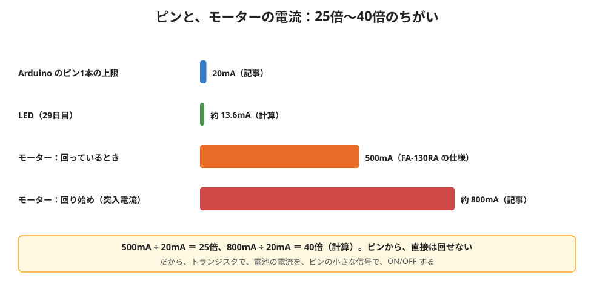
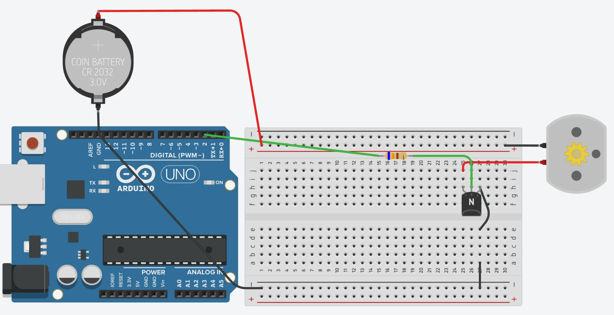
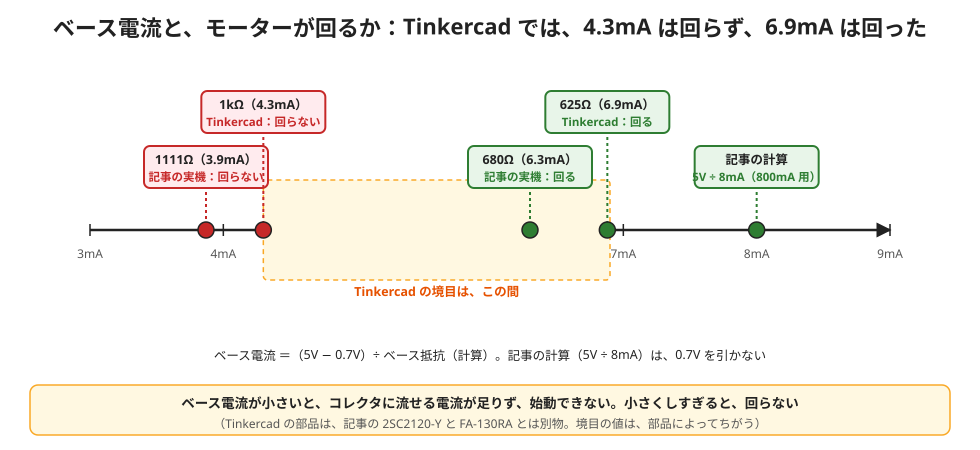
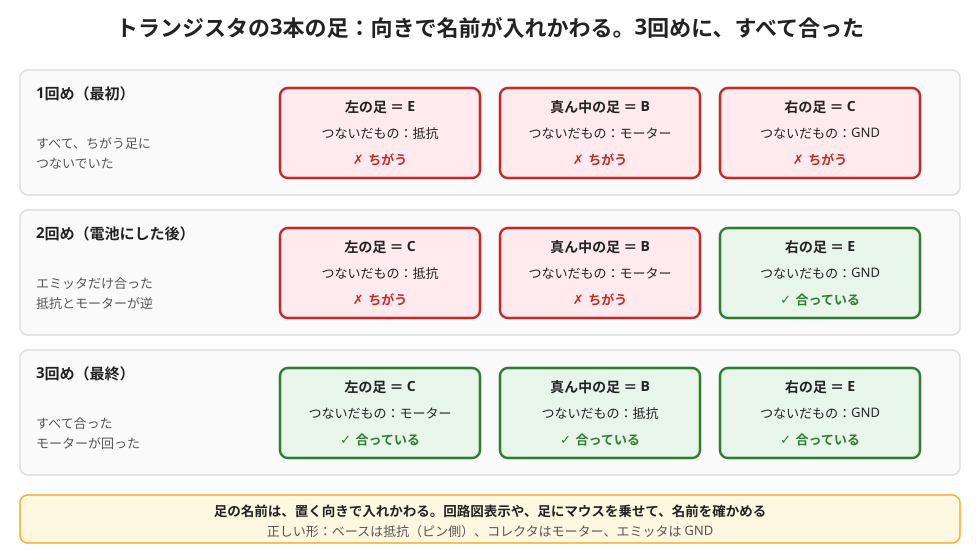

# 第6週 モーター

- フェーズ：[フェーズ2 マイコン・モーター・センサー](../README.md)
- 日：36〜42日目（詳細は [CHECKLIST.md](../CHECKLIST.md#第6週-モーター) ）
- ゴール：DCモーターの速度と向きをPWMとHブリッジで制御し、エンコーダの数を数えて「ちょうど1回転」で止められる
- 状態：進行中（36日目まで）

日ごとに「やること → 成果物 → 予想 → 結果 → 差の理由」を残します。測定や実験は、やる前に予想を書きます。

## 36日目 トランジスタでモーターを回す

> **ひとことで**：Arduino のピンは、**20mA**ほどしか出せず、500〜800mA 要るモーターは、**直接は回せない**。**NPN トランジスタ**をはさみ、ピン2から**ベース抵抗**（625Ω）を通して、ベースに**約 6.9mA**だけ流すと、**電池（3V）から**モーターに大きな電流が流れて、**1秒回って、1秒止まる**ようになった。足のつなぎ先を2回まちがえ、**抵抗を 1kΩ にすると回らず**（記事の実機と同じ）、**電池の − を GND につながないと回らなかった**。

**この日にやったことと、分かったこと**

| # | やったこと | 分かったこと（一言） |
| --- | --- | --- |
| 1 | MONOist「モーター制御(2)」（全5ページ）を読む | ピンは 20mA、モーターは 500mA（始動は約 800mA）。トランジスタで増やす |
| 2 | 回路を組む（ピン2 → 625Ω → NPN → モーター、電源は Arduino の 5V） | モーターが回らない。**トランジスタの3本の足が、すべてちがう所につながっていた** |
| 3 | 電源を、**電池（3V）の別電源**にする | モーターの定格（1.5〜3.0V）に合わせ、GND を共通にする |
| 4 | 足をつなぎなおす（2回） | **足の名前は、置く向きで入れかわる**。回路図表示で読んで直した |
| 5 | 動かす | **1秒回って、1秒止まる**。回転数の表示は `-5138 rpm`（向きが逆） |
| 6 | 抵抗を 1kΩ にする／電池の − を外す | どちらも**回らない**（ベース電流が足りない／電流の戻り道がない） |

やることの詳細は[チェックリスト](../CHECKLIST.md#第6週-モーター)。

**何に役立つか**

| 使う場面 | どう使うか |
| --- | --- |
| ロボットの車輪や、ファンを回す | マイコンのピンは、小さな信号だけ。**モーターの電流は、トランジスタを通して、電池から**流す |
| モーターの速さを変える（[37日目](#37日目-逆起電力とpwmの速度制御)） | 同じ回路で、ピンを PWM（31日目）にすると、モーターの平均の電圧が変わる |
| モーターの向きを変える（38日目の H ブリッジ） | トランジスタを4つ使う形の、もとになる |
| マイコンのリセットや誤動作を防ぐ | モーターの電流は、**別電源**から流す。マイコンの電源が、モーターの始動で下がるのを防ぐ（[19日目](../../phase1-electronics/week3/README.md#19日目-電池の内部抵抗とブラウンアウト)） |
| リレー、ブザー、ソレノイドなど、大きな電流が要る部品を動かす | モーターと同じ形（ピン → ベース抵抗 → トランジスタ） |
| 動かない原因を、1つずつ切り分ける | 回路図表示で、**足の名前とつなぎ先**を確かめた。電池の − を外す実験で、GND の共通の大切さが分かった |

**この日に出てくることば**

| ことば | 意味 | たとえ |
| --- | --- | --- |
| DC モーター（直流ブラシ付きモーター） | 電池をつなぐだけで回るモーター。**電圧を逆にすると、逆回転**する。ON/OFF で、回る・止まる。向きは、電極の入れかえ | 電池をつなぐと、プロペラが回るおもちゃ |
| 定格電圧（使用電圧範囲） | そのモーターを、安全に使える電圧。記事の FA-130RA は 1.5〜3.0V | 「この電圧まで」と書かれた、使用上の注意 |
| 消費電流 | 運転中に流れる電流。FA-130RA は、適正な電圧・負荷で 500mA | 蛇口から出る水の量 |
| 突入電流 | 回り始める瞬間に流れる、大きな電流。運転中より大きい（今回は、約 800mA 要る）。負荷によっても変わる | 重い荷車を動かし始めるときの、一番強い力 |
| 別電源 | モーターの電流を、**マイコンとは別の電池や電源**から流すこと。マイコンの電源を、モーターの電流で乱さない | 別のポンプから、水を引く |
| GND の共通 | 別電源の − と、マイコンの GND を、**つなぐこと**。信号（ベース電流）の戻り道になる | 2つの水槽の、水面の高さの基準をそろえる |
| ベース電流 | トランジスタの B に流す、小さな電流。これで、C から E へ大きな電流が流せるようになる | 蛇口をひねる力 |
| ベース抵抗 | ピンとベースのあいだに入れる抵抗。ベース電流の大きさを決める（17日目） | 蛇口に付けた、流量をしぼる部品 |
| rpm | 1分間の回転数。Tinkercad のモーターに、`0 rpm`、`-5138 rpm` と出る。`-` は、回る向き | 1分に何回まわるか |
| コイン電池（CR2032、3V） | 小さな丸い電池。3V。Tinkercad の部品名は、「COIN BATTERY CR 2032 3.0V」 | 時計に入っている電池 |

### 0. 先に：この日に使う前提知識

**① トランジスタ（[16日目](../../phase1-electronics/week3/README.md#16日目-トランジスタの仕組み)・[17日目](../../phase1-electronics/week3/README.md#17日目-トランジスタスイッチを設計する筆者の課題)）**

| 使うもの | 意味 |
| --- | --- |
| NPN トランジスタ | B（ベース）に少し流すと、C（コレクタ）から E（エミッタ）へ、大きな電流が流れるスイッチ |
| ベース抵抗 | `（ピンの電圧 − 0.7V）÷ ベース電流`（17日目と同じ考え方）。0.7V は、B–E のあいだの電圧 |
| 飽和 | 完全にオンになり、スイッチとして使える状態 |

**② 足の並びは、部品と向きで変わる**

| 出どころ | 平らな面を手前に、左から |
| --- | --- |
| 22日目（Tinkercad の NPN） | C・B・E |
| MONOist の 2SC2120-Y | **E・C・B**（記事） |
| 今日の Tinkercad の回路（置いた向き） | **C・B・E**（最終の向き。回路図表示で確かめた） |

足の並びは、**部品ごとにちがい、置く向きでも入れかわる**。毎回、**回路図表示や、足にマウスを乗せて**、名前を確かめる。

**③ 電流の道は、2つ**

| 道 | 流れる電流 | 通る所 |
| --- | --- | --- |
| 細い道（ベース） | 約 6.9mA | ピン2 → 抵抗 → ベース → エミッタ → GND |
| 太い道（コレクタ） | 数百 mA | 電池の＋ → モーター → コレクタ → エミッタ → GND → 電池の − |

### 1. 読む：[MONOist モーター制御(2) マブチモーターをArduinoで制御する](https://monoist.itmedia.co.jp/mn/articles/1601/28/news005.html)（全5ページ、40分）。ピンから直接は回せないこと、ベース電流の決め方、始動時の突入電流で回らない話

**① 記事の構成**

| ページ | 書いてあること（要約） |
| --- | --- |
| 1/5 | 直流ブラシ付きモーターの原理（ローター、コイル、整流子、ブラシ。電圧を逆にすると逆回転）。ON/OFF で、回る・止まる。**ArduinoのGPIOに、モーターをただつなぐだけでは動かない**。モーター FA-130RA の仕様 |
| 2/5 | GPIO は LED を光らせる程度で、モーターを駆動する力がない。**トランジスタで電流を増やす**。2SC2120-Y（約10円、コレクタ電流は最大 800mA）。回路：モーターの一端は電源の＋（3V）、もう一端はコレクタ、エミッタは GND、ベースは**抵抗を介して** GPIO へ |
| 3/5 | ベース抵抗の求め方：データシートのグラフで、コレクタ電流 500mA（3V）のときのベース電流 **4〜5mA**（4.5mA とする）→ 5V ÷ 4.5mA ＝ **1111Ω** → 1kΩ で代用。Arduino は、各ピン 20mA、ピン合計 400mA まで |
| 4/5 | プログラム：Blink を改造（D2 を 1秒 HIGH、1秒 LOW）。「1秒回って、1秒止まる」予定 |
| 5/5 | **実験すると、回らなかった**。始動時の**突入電流**が、運転中より大きいから。コレクタ電流 800mA にするには、ベース電流 **8mA** → 5V ÷ 8mA ＝ **625Ω**（市販品は 680Ω）。突入電流は、負荷で変わるので、その都度、抵抗を調整する |

| モーター FA-130RA の仕様（記事） | 値 |
| --- | --- |
| 使用電圧範囲 | 1.5〜3.0V |
| 適正電圧 | 1.5V |
| 適正電圧・負荷時の消費電流 | **500mA** |
| 無負荷回転数 | 8600 r/min |
| 適正電圧・負荷時の回転数 | 6500 r/min |

**② 3つの質問への、あなたの答え**

| # | 質問 | あなたの答え | 判定と補足 |
| --- | --- | --- | --- |
| 1 | ピンから直接、モーターを回せないのは、なぜか（数字つき） | GPIO では、LED を点灯させる程度が精一杯で、モーターを駆動するパワーがない。モーター駆動には 500mA 必要なので、それ以上の電流を流せるトランジスタが必要 | ✓ 数字を足すと、ピン1本は **20mA**、モーターは **500mA（始動は約 800mA）**。**25倍〜40倍**のちがい（下の図） |
| 2 | ベース抵抗（625Ω）は、どうやって決めたか | コレクタ電流を 800mA にするには、ベース電流を 8mA にする必要がある。ベース抵抗は 5 ÷ 0.008 ＝ 625Ω | ✓ 8mA は、データシートのグラフから読んだ値 |
| 3 | 突入電流とは何か。なぜ、500mA 用の抵抗では回らないか | モーターの始動時・回転時の消費電流を上回る電流が必要になるから。これを突入電流と言う | ✓ 補足：500mA 用の抵抗（1111Ω）では、ベース電流が約 3.9mA で、流せるコレクタ電流が、始動に足りない |



**③ 記事の数字は、どこから来たか**

| 数字 | 種類 | どこから来たか |
| --- | --- | --- |
| 500mA | A. 部品の性質 | FA-130RA の仕様（適正電圧・負荷時の消費電流） |
| 800mA | A. 部品の性質 | 2SC2120-Y のコレクタ電流の最大値（記事） |
| 20mA | A. 部品の性質 | Arduino のピン1本の上限（記事、17日目） |
| 8mA | A. 部品の性質（グラフ） | 800mA のときのベース電流（データシートのグラフ） |
| 625Ω | D. 計算 | 5V ÷ 8mA |

| 手順 | 考え方 | 計算 | 答え |
| --- | --- | --- | --- |
| 1 | 運転中の電流を、ピンの上限と比べる | 500mA ÷ 20mA | **25倍** |
| 2 | 始動の電流を、ピンの上限と比べる | 800mA ÷ 20mA | **40倍** |
| 3 | 記事のベース抵抗（0.7V を引かない） | 5V ÷ 8mA ＝ 5 ÷ 0.008 | **625Ω** |
| 4 | 0.7V を引く式（17日目と同じ） | (5 − 0.7) ÷ 0.008 | **約 537Ω**（市販品では 560Ω あたり） |
| 5 | 625Ω のときのベース電流（0.7V を引く） | (5 − 0.7) ÷ 625 | **約 6.9mA**（ピンの上限 20mA より小さい） |

（計算）

> 記事の 625Ω は、「0.7V を引かない」計算。引くと 約 537Ω。どちらも同じくらいの大きさで、**ベース電流を、すこし多めにとる**ための値。

### 2. 組む：TinkercadでArduino → ベース抵抗 → NPNトランジスタ → DCモーター（別電源）の回路を作り、ピンのON/OFFで回す。ベース抵抗は第3週の計算で決める（50分）

**① 部品**

| 部品 | Tinkercad での名前・値 |
| --- | --- |
| ベース抵抗 | 抵抗 **625Ω**（記事の計算値。部品をクリックして、値を入れる） |
| トランジスタ | NPN（部品の絵に「N」とある） |
| モーター | DC モーター（出力の中） |
| 別電源 | コイン電池「COIN BATTERY CR 2032 3.0V」（3V） |

**② 回路**


| 部品 | つなぎ先 |
| --- | --- |
| ピン2 | → 625Ω → トランジスタの**ベース**（真ん中の足） |
| 電池の ＋ | → モーターの片方の端子 |
| モーターのもう一方 | → トランジスタの**コレクタ**（左の足） |
| トランジスタの**エミッタ**（右の足） | → GND（下の − の列） |
| 電池の − | → GND（下の − の列）。**Arduino の GND と同じ線**（共通） |

| 配線図（最終） | 回路図表示（最終） |
| --- | --- |
|  |  |

回路図表示では、D2 → R1（625）→ T1 のベース、T1 のコレクタ → モーターの＋、モーターの − → BAT1+、T1 のエミッタ → BAT1−（GND）、Arduino の GND と BAT1− が同じ線、になっている。5V の線はない。

> 電池の ＋ が、モーターの「−」の端子につながり、コレクタが「＋」の端子なので、モーターは**ふつうと逆向き**に回る（`-5138 rpm`）。回ることには、影響しない。

保存した回路：[Tinkercad で開く](https://www.tinkercad.com/things/bElgNR5a03V/editel?sharecode=3llx37DVYVxHKrDh22HQ04LUa980ReYHMZt6rfURszk)

**③ ベース抵抗を、第3週の計算で決める**

| 手順 | 考え方 | 計算 | 答え |
| --- | --- | --- | --- |
| 1 | モーターに流したい電流（始動）を決める（記事のトランジスタの上限） | — | 800mA |
| 2 | そのためのベース電流（データシートのグラフから） | — | 8mA |
| 3 | ベース抵抗 ＝ ピンの電圧 ÷ ベース電流（記事の式） | 5V ÷ 0.008A | **625Ω** |
| 4 | 実際のベース電流（0.7V を引く） | (5 − 0.7) ÷ 625 | 約 6.9mA |
| 5 | ピンの上限（20mA）と比べる | 6.9mA ＜ 20mA | ピンは大丈夫 |

17日目では、**電流増幅率**（hFE）から、ベース電流を決めた。今日は、記事の方法（データシートのグラフから、必要なコレクタ電流のベース電流を読む）。どちらも、「ベース電流を、すこし多めにする」考え方は同じ。

**④ コード：1行ずつ読む**

保存したコード：[code/day36_motor_transistor/day36_motor_transistor.ino](code/day36_motor_transistor/day36_motor_transistor.ino)

```cpp
void setup() {
  pinMode(2, OUTPUT);
}

void loop() {
  digitalWrite(2, HIGH);
  delay(1000);
  digitalWrite(2, LOW);
  delay(1000);
}
```

| 行 | 意味 | いつ動くか |
| --- | --- | --- |
| `pinMode(2, OUTPUT);` | ピン2を**出力**にする（トランジスタのベースにつなぐ） | `setup()` で1回 |
| `digitalWrite(2, HIGH);` | ピン2を 5V にする → ベース電流が流れる → モーターが**回る** | `loop()` で毎回 |
| `delay(1000);` | 1秒待つ | 毎回 |
| `digitalWrite(2, LOW);` | ピン2を 0V にする → ベース電流が止まる → モーターが**止まる** | 毎回 |
| `delay(1000);` | 1秒待つ | 毎回 |

コードは、29日目の LED の点滅（`digitalWrite`、`delay`）と**同じ形**。ちがうのは、ピン2につなぐものが、LED でなく、**トランジスタのベース**だけ。

**⑤ 結果**

| 止まっているとき（`0 rpm`） | 回っているとき（`-5138 rpm`） |
| --- | --- |
|  |  |

| # | 試したこと | 結果 | 理由 |
| --- | --- | --- | --- |
| 1 | 625Ω で動かす | **回る**（1秒回って、1秒止まる） | ベース電流が、約 6.9mA で、始動できる |
| 2 | 抵抗を **1kΩ** にする | **回らない**（記事の実機でも、1kΩ 前後で回らなかった） | ベース電流が、約 4.3mA と小さく、始動の大きな電流が流せない |
| 3 | 電池の − を、GND から外す | **回らない** | ベース電流が、エミッタから GND へ**戻る道がない** |



| 抵抗 | ベース電流（計算） | 結果 |
| --- | --- | --- |
| 1111Ω（記事） | (5 − 0.7) ÷ 1111 ≒ 3.9mA | 記事の実機：回らない |
| 1kΩ（Tinkercad） | (5 − 0.7) ÷ 1000 ＝ 4.3mA | **回らない** |
| 680Ω（記事） | (5 − 0.7) ÷ 680 ≒ 6.3mA | 記事の実機：回る |
| 625Ω（Tinkercad） | (5 − 0.7) ÷ 625 ≒ 6.9mA | **回る** |

（計算）

> Tinkercad では、**4.3mA で回らず、6.9mA で回った**ので、境目は、その間にあることだけ分かった。記事の 2SC2120-Y と FA-130RA とは、別の部品なので、境目の値は、同じではない。

<details>
<summary>まちがい：トランジスタの足のつなぎ先（クリックで開く）</summary>



| # | 症状 | 原因 | 直し方 |
| --- | --- | --- | --- |
| 1 | 最初の回路で、モーターが回らない（電源は Arduino の 5V） | 回路図表示で、**抵抗がエミッタ、モーターがベース、GND がコレクタ**につながっていた。3本とも、ちがう足 | 足にマウスを乗せて名前を確かめ、回路図表示から読んで、つなぎ先を決めた |
| 2 | 電池にしたあとも、動かない | **エミッタ → GND だけ合い**、抵抗がコレクタ、モーターがベースのまま。トランジスタの向きを変えたので、足の名前が入れかわった | **抵抗とモーターの2本を入れかえた**（抵抗 → ベース、モーター → コレクタ） |
| 3 | 最終 | すべて合った（抵抗 → ベース、モーター → コレクタ、エミッタ → GND） | モーターが回った |

| 最初の配線図 | 最初の回路図表示（すべてちがう足） |
| --- | --- |
|  |  |

| 電池にしたあとの配線図 | そのときの回路図表示（エミッタだけ合っている） |
| --- | --- |
|  |  |

**ほかに直したこと**

| # | 内容 |
| --- | --- |
| 1 | モーターの電源を、**Arduino の 5V から、電池（3V）の別電源**にした（チェックリストの「別電源」。記事の電源も 3V） |
| 2 | 電池の − を、Arduino の GND につないだ（共通） |

**Claude の説明のまちがい**

| # | まちがい | 本当は |
| --- | --- | --- |
| 1 | 1kΩ と 625Ω の「流せるコレクタ電流」を、**約 430mA と約 690mA**と見積もり、「625Ω で、始動できる」と書いた | 始動には約 800mA 要る、という記事の数字と、**食いちがっていた**。Tinkercad のトランジスタとモーターは、記事のものと別なので、**見積もりはできない**。実験で分かったのは、「4.3mA で回らず、6.9mA で回る」ことだけ |
| 2 | 先に「左から エミッタ・ベース・コレクタ」と案内し、2回めには「左がコレクタ…」と案内した | 足の名前は、**置く向きで入れかわる**。そのつど、回路図表示で読んで、案内した。最初から、「向きで変わるので、毎回、足の名前を確かめる」と言うべきだった |

</details>

### この日のまとめ：予想 → 結果 → 差の理由

今日は、動かす前の予想を、**書かなかった**（結果を見て、答えた）。**次の日からは、動かす前に予想を書く。**

| 何を測った／試したか | 予想 | 結果 | 差の理由 |
| --- | --- | --- | --- |
| 最初の回路（5V、足がちがう） | 書かなかった（回る） | 回らない | トランジスタの3本の足が、すべてちがう所につながっていた |
| 電池（3V）にして、足を2本直す | 書かなかった | 回る（1秒回って、1秒止まる）。`-5138 rpm` | モーターの端子が逆向きにつながっているので、向きが逆と考えられる（確かめていない） |
| 抵抗を 625Ω から 1kΩ に変える | 書かなかった（記事の実機では回らなかった） | **回らない** | ベース電流が約 4.3mA と小さく、始動できない |
| 電池の − を、GND から外す | 書かなかった（回らないはず） | **回らない** | ベース電流の戻り道がない |

**まだ試していないこと**（時間のある日に）

| 試すこと | 先に書く予想 |
| --- | --- |
| 抵抗を 680Ω、750Ω、820Ω にして、回る・回らないの境目を探す | 何Ωで、回らなくなるか |
| 電池を 3V から 5V（電源の部品）に変える | 回転数（rpm）は、どう変わるか |
| モーターの2本を入れかえる | `-5138 rpm` の `-` が、`+` になるか |
| 電流計をはさんで、ベース電流とコレクタ電流を測る | ベース電流は、約 6.9mA か。コレクタ電流は、数百 mA か |
| モーターの電源を、Arduino の 5V にもどして、625Ω で動かす | 回るか。Tinkercad では、リセットは起こるか |

**実機を買ったらやり直すこと**

- 記事のとおり、FA-130RA（3V）と 2SC2120-Y、**680Ω** で、実機を回す
- 1kΩ で、本当に回らないかを見る（記事の実験）
- モーターを、Arduino の 5V から回して、**Arduino がリセットされないか**（19日目のブラウンアウト）を見る（確かめる前に、電源の電流に注意する）
- ベース電流とコレクタ電流を、テスターで測る
- モーターの始動時の電流（突入電流）を、テスターで測る（記事外：測るには、電流計に大きな電流が流れるので、注意する）

## 37日目 逆起電力とPWMの速度制御

**やること**（詳細は [チェックリスト](../CHECKLIST.md#第6週-モーター)）

- 読む：MONOist モーター制御(4) 困ったら読みたいTipsのダイオードによる逆起電力対策
- 読む：MONOist モーター制御(5) PWMでマブチモーターを制御する（全5ページ、40分）
- 組む：36日目の回路にダイオードを足し、`analogWrite()` で5段階の速度にする

**成果物**

- 

**予想 → 結果 → 差の理由**

| 何を測った／試したか | 予想 | 結果 | 差の理由 |
| --- | --- | --- | --- |
| | | | |

## 38日目 Hブリッジで向きを変える

**やること**（詳細は [チェックリスト](../CHECKLIST.md#第6週-モーター)）

- 読む：SunFounder ESP32「4.1 モーター」
- 組む：TinkercadのArduino UNOとL293Dで同じ動きを作る
- 注意：筆者はL298NやL293Dのような古いドライバは発熱と電圧ロスが大きく、実機ではTB6612FNGやDRV8833を勧めています

**成果物**

- 

**予想 → 結果 → 差の理由**

| 何を測った／試したか | 予想 | 結果 | 差の理由 |
| --- | --- | --- | --- |
| | | | |

## 39日目 サーボモーター

**やること**（詳細は [チェックリスト](../CHECKLIST.md#第6週-モーター)）

- 読む・組む：SunFounder 3in1「5.5 内蔵ライブラリの使用」
- 改造：可変抵抗の値（第5週の `map()`）でサーボの角度を決める
- 記録：サーボは内部で角度を自分で合わせる（閉ループ）が、外からは角度が分からない、という違いを1行

**成果物**

- 

**予想 → 結果 → 差の理由**

| 何を測った／試したか | 予想 | 結果 | 差の理由 |
| --- | --- | --- | --- |
| | | | |

## 40日目 エンコーダで「ちょうど1回転」（筆者の課題の後半）

**やること**（詳細は [チェックリスト](../CHECKLIST.md#第6週-モーター)）

- 準備：Tinkercadの部品検索で「エンコーダ付きDCモーター」を探す
- 読む：MONOist 俺流！組み込み用語解説(10) マイコンで機械式ロータリーエンコーダーを扱う（2ページ）
- 組む：エンコーダのA相を割り込みピン（2番）につなぎ、パルス数を数える
- 実験：電源電圧（=速度）を変えても同じ位置で止まるかを確かめる

**成果物**

- 

**予想 → 結果 → 差の理由**

| 何を測った／試したか | 予想 | 結果 | 差の理由 |
| --- | --- | --- | --- |
| | | | |

## 41日目 ステッピングモーター

**やること**（詳細は [チェックリスト](../CHECKLIST.md#第6週-モーター)）

- 読む：MONOist モーター制御(10) A4988を学ぶ
- 組む：WokwiのA4988の部品説明にある例題を開き、STEPのパルス数と回転角の関係を確かめる
- `week6/` に、速度の表とエンコーダ制御のコードを置く

**成果物**

- 

**予想 → 結果 → 差の理由**

| 何を測った／試したか | 予想 | 結果 | 差の理由 |
| --- | --- | --- | --- |
| | | | |

## 何が壊れてどう直したか

うまくいかなかったことを、症状・原因・直し方の順に書きます。この週で一番大事な節です。

| 日 | 症状 | 原因 | 直し方 |
| --- | --- | --- | --- |
| 36日目 | 最初の回路で、モーターが回らない | トランジスタの3本の足が、すべてちがう所につながっていた（抵抗がエミッタ、モーターがベース、GND がコレクタ）。モーターの電源も、Arduino の 5V だった | 電池（3V）を別電源にし、回路図表示で足の名前を読んで、抵抗 → ベース、モーター → コレクタ、エミッタ → GND にした |
| 36日目 | 電池にしても回らない | エミッタ → GND だけ合っていて、抵抗とモーターが逆のまま。足の名前は、トランジスタの置く向きで入れかわる | 抵抗とモーターの2本を入れかえた |
| 36日目 | 抵抗を 1kΩ にすると回らない | ベース電流が約 4.3mA と小さく、始動の大きな電流が流せない（記事の実機でも、1kΩ 前後で回らなかった） | 625Ω（約 6.9mA）にした |
| 36日目 | 電池の − を GND から外すと回らない | ベース電流が、エミッタから GND へ戻る道がない | 電池の − と Arduino の GND を、つなぐ（共通） |

**教訓（36日目）**：トランジスタの**足の名前は、部品と置く向きで変わる**。毎回、回路図表示や、足にマウスを乗せて、確かめる。モーターは**別電源**で、**GND を共通**にする。

## 分からなかったこと・あとで調べること

| 日 | 分からなかったこと | 調べ方 |
| --- | --- | --- |
| 36日目 | Tinkercad で、回る・回らないの境目の抵抗値（4.3〜6.9mA のあいだ） | 680Ω、750Ω、820Ω で試して、境目を探す |
| 36日目 | Tinkercad のトランジスタの hFE と、最大のコレクタ電流 | 部品の説明を見る。電流計で、ベース電流とコレクタ電流を測る |
| 36日目 | `-5138 rpm` の `-` は、回る向きか | モーターの2本を入れかえて、符号が変わるかを見る |
| 36日目 | 5V でモーターを回すと、Arduino がリセットされるか（実機） | 実機で試す（電流に注意）。19日目のブラウンアウトと見くらべる |
| 36日目 | 電池の電圧（3V と 5V）で、回転数がどう変わるか | Tinkercad の rpm の表示で、比べる |
